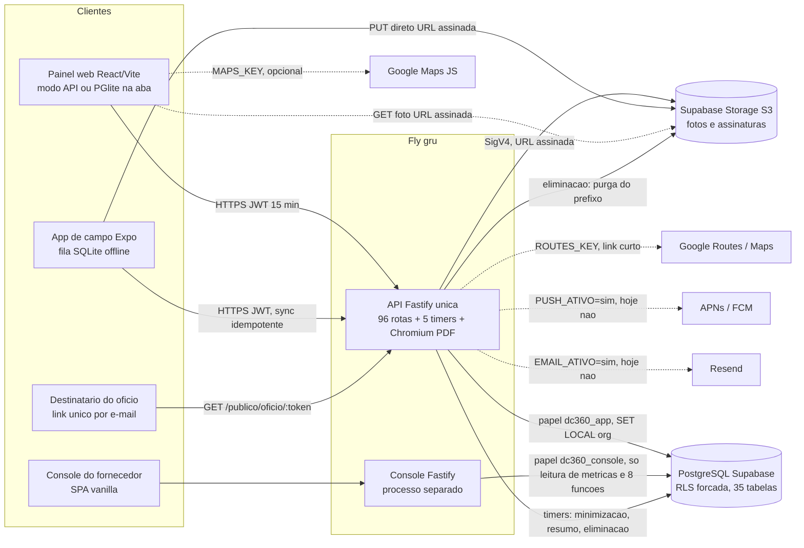

# Auditoria Baseline Zero da V2: Defesa Civil Operacional 360

**Data:** 30/09/2026
**Escopo:** `C:\Projetos\city-hall\dc360` (produto real). O protótipo `mockup/` está fora de escopo.
**Estado do repositório na largada:** branch `master`, HEAD `e82719e` (17/09/2026), nenhum commit de código posterior à auditoria de 30/09.
**Natureza:** auditoria somente leitura. Nenhum código, migration, teste ou documentação existente foi alterado. Não contém roadmap nem implementação.
**Uso:** documento interno do Rafael. Descreve vulnerabilidades em detalhe: não publicar fora do círculo de confiança.
**Onze frentes independentes**, com os relatórios completos em `docs/auditoria-v2/`. Este documento é completo: as partes A a O consolidam as 996 linhas de matriz de estado, os 240 gaps classificados, as decisões, os riscos e as dívidas; a Parte II (seção P) traz as narrativas por frente (arquitetura, inventários, as 17 respostas sobre secretarias, identidade e autorização, cidadão, LGPD e arquivos, documentos, operação, design e acessibilidade), com todas as evidências.

## Legenda de estados

- **A** existe e está comprovado
- **B** existe, mas possui gap ou regressão
- **C** existe parcialmente
- **D** não existe
- **E** novo requisito da V2
- **F** decisão humana necessária
- **G** não confirmado

Regra de prova: documentação nunca é prova de comportamento. Onde documentação, teste e código divergem, a seção N descreve os três lados sem escolher em silêncio. "Pronto" ponta a ponta só vale quando regra de negócio, UX, frontend, API, banco, autenticação, autorização, arquivos, auditoria, LGPD, estados de erro, observabilidade, testes e documentação são coerentes.

## Sumário

- A. Resumo executivo
- B. Baseline atual de testes e qualidade
- C. Mapa das 5 superfícies
- D. Matriz de estado
- E. Matriz de fluxos ponta a ponta
- F. Mapa de gaps por prioridade
- G. Decisões humanas
- H. Riscos arquiteturais
- I. Dívidas técnicas
- J. Requisitos do documento do Alyson já atendidos
- K. Requisitos do documento do Alyson parcialmente atendidos
- L. Requisitos do documento do Alyson não atendidos
- M. Requisitos novos da V2 que não estavam no documento original
- N. Divergências entre documentação, teste e código
- O. Correções à auditoria de 30/09/2026
- Anexo 1. Divergências deliberadas de arquitetura em relação ao documento do Alyson
- Anexo 2. Índice dos relatórios por frente
- P. Parte II: narrativas por frente (arquitetura, inventários, análises e respostas às seções 3 a 25 do pedido)

---

## A. Resumo executivo

### A.1 Veredicto

O repositório tem uma fundação boa e três problemas que a V2 não pode herdar. A fundação: isolamento entre municípios provado por catálogo (35 tabelas com RLS ativada e forçada, 27 funções `SECURITY DEFINER` com `search_path` fixo, 137 de 137 casos do teste de isolamento passando em 55 s, 19 sondas cruzadas pela API respondendo 404), trilha append-only garantida pelo banco e um motor offline de campo com 159 testes de unidade mais 15 de integração passando. Os problemas: (1) uma regressão de segurança hoje em produção de código, a verificação de vigência de conta desligada; (2) um baseline que não está verde e cuja documentação diz que está; (3) um modelo de identidade, de ocorrência e de arquivo desenhado só para servidor municipal, que não comporta secretaria nem cidadão sem mudança estrutural.

As superfícies 4 (portal das secretarias) e 5 (app do cidadão) NÃO existem: nenhuma tabela, rota, schema, tela ou aplicação. A auditoria provou a ausência, não a presumiu. O que existe perto delas (catálogo de órgãos, ofício com link de leitura, formulário público de interesse institucional) não serve como base de identidade.

### A.2 O que já está comprovado (classe A)

- Isolamento por município no banco e pela API (ver relatórios 02 e 06; o teste de isolamento foi executado por duas frentes).
- Trilha append-only por ausência de policy de UPDATE/DELETE, com testes.
- Motor offline de campo: fila persistente, idempotência por chave, portão de autoria no cliente e no servidor, devolução de tarefa, declaração de prova perdida no laudo (provado em nível de teste de integração com PGlite; NÃO provado em aparelho neste repositório).
- Console do fornecedor como produto real: login em duas etapas, operadores em tabela própria, cadastro de prefeitura, suspensão, reativação, eliminação com prazo de 7 dias, recuperação por códigos, métricas agregadas alimentadas por rotina agendada da API. O console NÃO lê dado operacional de município (provado por grants, visão `security_invoker` e testes).
- Minimização de dado pessoal por prazo (migrações 021, 029, 043) com teste, depois que o município fixa prazo e a ocorrência é encerrada.
- Contraste calculado nos dois temas no painel web (21 pares) e no app de campo (34 pares), com portão automatizado.

### A.3 O que muda a decisão (por impacto)

1. **P0 SEGURANÇA e INTEGRIDADE: vigência de conta desligada.** `auth/vigencia.ts` existe e NÃO é chamado (`apps/api/src/servidor.ts:454-462`, teste `describe.skip` em `apps/api/test/vigencia-na-escrita.test.ts:102`). Conta desativada ou rebaixada continua lendo e escrevendo com o token antigo por até `ACESSO_MINUTOS` (padrão 15, máximo 60), e o evento fica assinado por ela na trilha append-only. O desligamento foi deliberado e está justificado no comentário do próprio `servidor.ts`, mas três comentários de código (entre eles `auth/sessoes.ts:23`) e a auditoria de 30/09 descrevem a regra como ativa. Reproduzido por três frentes independentes (baseline, arquitetura e identidade) e conferido por mim no código. Sintoma colateral: o teste de senha provisória (`senha-provisoria.test.ts:183`) falha.
2. **P0 SEGURANÇA: autorização aberta a qualquer autenticado.** 32 das 96 rotas exigem só autenticação e o recorte por equipe existe apenas para `agente_campo`, então qualquer papel novo (secretaria, cidadão) nasceria com leitura aberta. Provado por execução: `GET /oficios` e `GET /oficios/:id` mostram ao agente de campo ofícios de ocorrências de outras equipes (conferido por mim em `apps/api/src/rotas/oficios.ts:177-212`); `GET /avisos` vaza e ainda ESCREVE em uma leitura. É a precondição mais cara da V2.
3. **P0 SEGURANÇA (defesa em profundidade): funções `SECURITY DEFINER` de autenticação não conferem o município do contexto.** `trocar_senha` e `revogar_sessoes_do_usuario`, chamadas com o contexto do município A, atuaram sobre usuário do município B (provado em PGlite). Hoje nenhuma rota da API chega nelas com uuid de outro município, então não é exploração direta; é uma barreira que falta justamente onde a V2 multiplicará os tipos de conta.
4. **P0 LGPD.** Não existe aceite de termos, versão, consentimento, revogação, política de privacidade publicada nem mecanismo de direitos do titular. O relato do solicitante (`tipo_descricao`) é copiado na trilha append-only e nenhuma migração o minimiza (conferido por mim: `ocorrencias.ts:684` e `:792`, e a migração 043 diz que ele "FICA"). O ofício entrega nome, relato e descrição de vulnerabilidade a órgão externo. IP e user-agent ficam sem expurgo.
5. **P0 INTEGRIDADE: arquivos.** Só o tipo declarado é validado (sem magic bytes, antivírus, quarentena, EXIF, miniatura, retenção de foto); o teto de armazenamento é COMPARTILHADO entre agentes e (na V2) cidadãos; toda foto avulsa de `evidencias` aparece automaticamente no laudo oficial.
6. **P1 PRODUTO: o documento não é congelado.** Laudo, termos e ofício são gerados sob demanda a partir do estado atual; não há hash do conteúdo, versão do modelo, aprovação, responsável técnico nem assinatura. O laudo de amanhã pode diferir do de hoje. Produção roda com marca d'água "DOCUMENTO DE VALIDAÇÃO" (`fly.toml:69`).
7. **P1 CONTINUIDADE.** Único restore provado em 09/09/2026, com 15 migrações (hoje são 46, e o roteiro provavelmente falha em `dc360_console` e `pg_trgm`); fotos e assinaturas sem nenhuma cópia; RPO e RTO nunca medidos; operação de cópia só roda num Mac (fator de ônibus 1).
8. **P1 OPERAÇÃO: o baseline não está verde e a documentação diz que está.** Vermelhos hoje: 1 no shared, 14 no web (5 arquivos), 2 na API mais a suíte `banco-tls`, 20 no app de campo (5 suítes), 3 em `test:scripts`, 13 afirmações do README reprovadas por `conferir:numeros`, `auditar` e os 3 e2e de navegador. `npm audit` não fecha em zero (raiz: 3 moderadas, 1 em runtime; campo: 4, 1 alta só de desenvolvimento) e o CI roda com `--audit-level=low`, então tende a estar vermelho sem mudança de código (status real do CI: NÃO CONFIRMADO, repositório privado). 119 commits direto em `master`, sem merge nem revisão; o commit `5ecdf4c` tem 275 arquivos e 24.453 inserções e traz testes escritos antes de correções que nunca chegaram.
9. **Erro meu nesta sessão, achado por esta auditoria.** O botão "Baixar pacote de saída" da tela Organização (commit `b793e82`, 17/09/2026) chama `POST /pacote.zip`, mas a rota está registrada em `/saida/pacote.zip` (conferido por mim: `apps/api/src/servidor.ts:759-760` contra `apps/web/src/dados/http.ts:951`). A sonda do auditor deu 404 no caminho do painel e 200 no real. Eu li `saida.ts` sem olhar o prefixo de registro e não havia teste de contrato que pegasse. Hoje a saída de município (CA-10) não tem botão funcional. Não corrigi, porque esta fase é somente leitura.

### A.4 Achados que contradizem documentos existentes

Ver seção N (divergências) e O (correções à auditoria de 30/09). Os mais importantes: o console NÃO é "só restrição" como dizem README, `db/PENDENCIAS.md` e a auditoria de 30/09 (tem rotas de escrita, provisionamento, 2FA e chamador de `resumir_municipio()`); o app de campo NÃO declara saída a campo apesar de `SEGURANCA-DO-AGENTE.md` e da apresentação de 15/09; `apps/campo/LEIA-ME.md:3` ainda diz "NUNCA RODOU EM APARELHO".

### A.5 Dimensão da V2

Duas superfícies novas (portal das secretarias e app do cidadão) mais, como pré-requisito, uma decisão de modelo de identidade, a correção do item A.3.1 a A.3.3, uma cadeia de arquivos que aceite conteúdo de terceiros, política de privacidade e consentimento, um modelo de relato separado da ocorrência, e ambientes de homologação que hoje não existem (sem staging, CD, monitoramento, erro centralizado ou página de status). As decisões humanas que mais travam, em ordem: (1) modelo de identidade (contas separadas por superfície, pessoa com vínculos, ou híbrido); (2) cidadão anônimo ou com conta e o nível de anti-abuso; (3) competência e escalonamento das secretarias; (4) provedores de e-mail/SMS e de armazenamento reais; (5) política de privacidade, encarregado e retenção de relato e documento; (6) congelar ou regenerar documento e quem aprova e assina; (7) RPO/RTO alvo e cópia do armazenamento; (8) se os testes vermelhos escritos primeiro são a especificação ou se o código é a verdade. Detalhe completo, com alternativas e riscos, na seção G.

### A.6 Como esta auditoria foi feita e o que ela NÃO prova

Onze frentes independentes leram e executaram o repositório em 30/09/2026 (HEAD `e82719e`, sem commit novo desde 17/09). Cada frente escreveu um relatório completo em `docs/auditoria-v2/`. Eu reli todos os resumos e conferi pessoalmente no código os achados mais pesados (vigência desligada, rotas só com autenticação, chamador de `resumir_municipio()`, `tipo_descricao` na trilha, URL de `/pacote.zip`, `npm audit`). As demais afirmações vêm dos relatórios por frente com a evidência citada neles.

NÃO CONFIRMADO em toda a auditoria, porque só a nuvem, o GitHub ou as lojas provam: estado real da produção (segredos, papéis de banco, `SEGUNDO_FATOR_ATIVO`, `EMAIL_ATIVO`, `PUSH_ATIVO`, bucket, backups e PITR do provedor), status do CI, branch protection, builds e contas Apple/Google, prova em aparelho físico (não há artefato no repositório), memória real da saída de município sob carga, e se os vermelhos que só aparecem no Windows (CRLF, `OPENSSL_CONF`, `npm` via `execFileSync`) também aparecem no Linux do CI.

---

## B. Baseline atual de testes e qualidade

Baseline NOVA medida em 30/09/2026 pela frente 01, com saídas brutas guardadas em `docs/auditoria-v2/raw/` (somente as pequenas; as saídas grandes ficaram fora do repositório).

### B.1 Baseline atual

##### 3.1 Estado do git (comandos rodados nesta sessão)

| Item | Valor |
| --- | --- |
| Branch | master |
| Último commit | e82719e, 2026-09-17 16:57 -0300, "Tema serio e neutro na apresentacao, em vez do visual colorido de produto" |
| `git status --short` | `?? docs/AUDITORIA-2026-09-30.md` (único item; árvore limpa) |
| Commits depois de 30/09/2026 | Nenhum (`git log --since=2026-09-18` vazio; último commit é de 17/09). Diff desde a auditoria: zero arquivos rastreados |
| Total de commits | 119 |
| `core.autocrlf` | true (sem `.gitattributes` no repositório). Índice em LF, árvore de trabalho em CRLF (`git ls-files --eol`: `i/lf w/crlf`) |
| Remoto | github.com/rafaelgomesbr/city-hall (privado: API pública responde 404; `gh` sem login) |
| Node / npm | v22.17.0 / 10.9.2 |

Commits do dia 17/09 depois da "implementação" gigante (5ecdf4c, 15/09 23:28): b4439ac 15:05 "ultimo commit"; b387ee3 15:32 ícone DC no Edge (SVG); 2cd1266 15:36 apresentação não técnica; b793e82 15:36 tela de Organização (retenção e saída de município); 124be71 16:00 três cartões de leitura; f013d2f 16:32; 2beb998 16:38; 7a115b2 16:46; e82719e 16:57. O b4439ac é o que desliga a vigência (item 4) e o b387ee3 é quem escreveu o `borderRadius: "8px"` que reprova o portão de design (item 10).

##### 3.2 Estrutura

- Raiz do repositório (`C:\Projetos\city-hall`): `dc360/` (produto), `mockup/` (protótipo, fora de escopo), `docs/`, `scripts/` (4 arquivos do pacote de demonstração: `empacotar-demo.ps1`, `conferir-pacote.mjs`, `conferir-roteiro.mjs`, `conferir-demo.ps1`), `relatorio/`, `dist/`.
- `dc360/package.json` (`workspaces`): `packages/*` (shared, campo), `apps/api`, `apps/console`, `apps/web`, `db`. `apps/campo` (Expo) fica FORA dos workspaces, com `package-lock.json` próprio.
- Aplicações: 4 (`apps/api` Fastify; `apps/web` React/Vite; `apps/console` fornecedor; `apps/campo` React Native/Expo SDK 57, pacote `@dc360/campo-app`). Packages: 2 (`@dc360/shared`, `@dc360/campo` = motor offline). Mais `db/` (migrations, aplicador, provedores, seeds).
- Migrations: 46 arquivos (`db/migrations/001_base.sql` a `046_senha_provisoria_e_o_dono_do_token_diz_por_que.sql`). Última: 046.
- Arquivos de teste (contados no disco): api 86, web 36 (mais 2 e2e `.mjs`), campo jest 121 (37 em `src/ui`, 34 em `src/__tests__`, 30 em `src/dados`, 12 em `src/push`, 8 em `src/ui/mapa`), console 16, shared 14 (12 em `test/` e 2 em `src/`), db 11, packages/campo 8, scripts 18 (`*.test.mjs`).
- Não existe: lint (nenhum `eslint` nos dois lockfiles, nenhum script `lint`, nenhum `.eslintrc`/`eslint.config`, embora haja comentários `eslint-disable` em `apps/campo/src/app/(agente)/*.tsx`), formatador, `.editorconfig`, `.gitattributes`.
- Não existe superfície 4 (portal das secretarias) nem 5 (app do cidadão) como código (fora do meu escopo provar; outros auditores).

##### 3.3 Pipelines e scripts de validação

`dc360/package.json` (raiz): `typecheck` (= `build:shared` + typecheck em todos os workspaces), `test` (= `build:shared` + `npm run test --workspaces --if-present`), `test:isolamento` (= `test` do workspace db, a mesma suíte do db), `test:api`, `test:console`, `test:e2e` (web, modo local), `test:e2e:api` (`scripts/e2e-api.mjs`), `test:campo` (`scripts/testar-campo.mjs`: compila shared e campo, typecheck do app, jest, cruza contagem), `test:scripts` (`node --test scripts/*.test.mjs`), `conferir:numeros`, `auditar`, e `verificar` = `typecheck && test && test:scripts && test:campo && auditar && conferir:numeros`.

Workspaces: api (`test`=vitest run, `typecheck`, `build`), web (`test`, `test:e2e`, `test:e2e:api`, `build`=`tsc -b && vite build`), console, shared, packages/campo, db (`migrar`), campo-app (`test`=jest, `typecheck`, scripts de EAS).

CI: um único arquivo, `.github/workflows/verificar.yml`, com 5 jobs: `produto` (npm ci, typecheck, `test:isolamento`, `npm test`, `npm audit --audit-level=low`, `conferir:numeros`), `navegador` (build, preview, e2e local em Chromium e Firefox, `test:e2e:api`), `demonstracao` (pacote zip, conferir, roteiro), `aplicativo` (typecheck, `npm test` do app, `npm ls`, `expo-doctor` com `EXPO_DOCTOR_SKIP_DEPENDENCY_VERSION_CHECK=1`, `npm audit --audit-level=low`), `implantavel` (Postgres 16 real: migrar, migrar de novo com `--conferir`, API sobe com papel restrito e `/saude`). NÃO entram no CI: `test:scripts`, `test:campo` (o job usa `npm test` direto), `auditar`. Status real do CI: NÃO CONFIRMADO (repo privado, sem `gh auth`).

##### 3.4 Execução (comando | workspace | duração | resultado | raw)

Todas as rodadas na máquina do Rafael (Windows 11, Git Bash, 16 CPUs), sequenciais salvo indicação. Durações são de relógio.

| Comando | Workspace | Duração | Resultado | Raw |
| --- | --- | --- | --- | --- |
| `npm run typecheck` | dc360 (shared, db, campo pkg, api, console, web) | 46 s | PASSOU (exit 0) | `typecheck-raiz.txt` |
| `npx vitest run` | db | 72 s | PASSOU: 11 arquivos, 318 testes (315 passaram, 3 pulados por `it.runIf` em `busca.test.ts:364,377,386`, por desenho). Inclui `isolamento.test.ts` 137 casos (63,8 s) e `migrar.test.ts` 17 | `teste-db.txt` |
| `npx vitest run` | packages/shared | 12 s | FALHOU: 14 arquivos, 149 testes, 1 falha (`regras-de-conteudo`, travessão) | `teste-shared.txt` |
| `npx vitest run` | packages/campo | 7 s | PASSOU: 8 arquivos, 159 testes | `teste-packages-campo.txt` |
| `npx vitest run` | apps/console | 155 s | PASSOU: 16 arquivos, 259 testes | `teste-console.txt` |
| `npx vitest run` | apps/web | 16 s | FALHOU: 36 arquivos, 550 testes, 14 falhas em 5 arquivos | `teste-web.txt` |
| `npx vitest run` | apps/api | 206 s | FALHOU: 86 arquivos, 1109 testes: 1089 passaram, 2 falharam, 18 pulados (13 de `banco-tls`, suíte caída no `beforeAll`, e 5 de `describe.skip` em `vigencia-na-escrita.test.ts:102`), mais 1 suíte com falha (`banco-tls`) | `teste-api.txt` |
| `npm run typecheck` | apps/campo | 26 s | FALHOU: 2 erros TS2345 (`perfil.tsx(1212,44)` e `Sino.tsx(154,73)`, rota `/(agente)/avisos`) | `typecheck-campo.txt` |
| `tsc` com `tsconfig` de escopo (scratch) sem `.expo/types` | apps/campo | 21 s | PASSOU (0 erros): prova que os 2 erros vêm só do cache local `.expo/types/router.d.ts` | `typecheck-campo-sem-cache-expo.txt` |
| `npm run test:campo` | dc360 | 22 s | FALHOU no passo de typecheck do app (mesmos 2 erros), antes do jest | `test-campo-script.txt` |
| `npx jest --silent` (direto, contornando o script) | apps/campo | 74 s | FALHOU: 121 suítes (116 ok, 5 falharam), 1801 testes (1781 ok, 20 falharam) | `teste-campo-jest.txt` |
| `npm audit` / `--omit=dev` | dc360 raiz | 4 s / 5 s | FALHOU: 3 moderadas / 1 moderada (runtime) | `audit-raiz.txt`, `audit-raiz.json`, `audit-raiz-omit-dev.txt`, `audit-raiz-omit-dev.json`, `audit-raiz-json.txt` (saída do 1o `--json`, ver nota abaixo) |
| `npm audit` / `--omit=dev` | apps/campo | 5 s / 5 s | FALHOU: 4 (1 alta, 3 moderadas), as mesmas 4 com `--omit=dev` | `audit-campo.txt`, `audit-campo.json`, `audit-campo-omit-dev.txt`, `audit-campo-omit-dev.json` |
| `npx expo-doctor` | apps/campo | 30 s | FALHOU 20/21: 9 pacotes Expo com drift de patch | `expo-doctor.txt` |
| `EXPO_DOCTOR_SKIP_DEPENDENCY_VERSION_CHECK=1 npx expo-doctor` (como no CI) | apps/campo | 10 s | PASSOU 20/20 | `expo-doctor-como-no-ci.txt` |
| `npm ls` (gate de árvore coerente do CI) | apps/campo | 2 s | PASSOU (exit 0) | `npm-ls-campo.txt` |
| `npm run test:scripts` | dc360 | 4 s | FALHOU: 165 testes, 158 ok, 3 falharam, 4 pulados | `test-scripts.txt` |
| `npm run conferir:numeros` | dc360 | 38 s | FALHOU: 13 afirmações de README/docs não batem (9 bateram) | `conferir-numeros.txt` |
| `npm run auditar` | dc360 | 1 s | QUEBROU: `spawnSync npm ENOENT` (Windows) | `auditar.txt` |
| `npm run auditar` com shim de `npm` via `NODE_OPTIONS` (scratch, fora do repo) | dc360 | 5 s | REPROVADO: "1 moderate em dependência de runtime" (a parte do app de campo não chegou a rodar) | `auditar-com-shim-windows.txt`, `_shim-npm.cjs` |
| `npm run build --workspace @dc360/web` | apps/web | 23 s | PASSOU | `build-web-local.txt` |
| `npm run test:e2e` (Chromium, modo local) | apps/web | 45 s | FALHOU na seção 2 (`.indicador` não aparece em 30 s) | `e2e-local-chromium.txt` |
| `MOTOR=firefox npm run test:e2e` | apps/web | 54 s | FALHOU no mesmo ponto | `e2e-local-firefox.txt` |
| `npm run test:e2e:api` (Chromium; sobe API e painel sozinho, sem serviço externo) | apps/web | 71 s | FALHOU na seção 13 (PUT de evidência, "Failed to fetch"); seções 1 a 12 OK | `e2e-api-chromium.txt` |
| `npx vitest run test/banco-tls.test.ts` com `OPENSSL_CONF` não definido | apps/api | 4 s | PASSOU 13/13 (teste de hipótese) | `teste-banco-tls-sem-openssl-conf.txt` |
| lint | todos | n/a | NÃO EXISTE | (ver 3.2) |

Notas: (a) `test:isolamento` = `npm run test --workspace @dc360/db`, a mesma suíte da linha do db; não rodei duas vezes. (b) `audit-raiz-json.txt` (primeira tentativa de `--json`, com cabeçalho do meu executor misturado) não foi usado; a análise do audit da raiz vem de `audit-raiz.json` e `audit-raiz-omit-dev.json`. (c) O raw `teste-api.txt` contém um JWT de teste impresso numa mensagem de asserção (token efêmero de banco em memória, segredo de teste); foi redigido no arquivo. (d) `test:campo` e `auditar` dependem do ambiente Windows (itens 13 e 8).

##### 3.5 Comparação com a auditoria de 30/09 (só comparação)

| Medida | Auditoria 30/09 | Hoje | Igual? |
| --- | --- | --- | --- |
| db | 318 (315 + 3 pulados) | 318 (315 + 3) | sim |
| shared | 149, 1 falha | 149, 1 falha | sim (causa tem um segundo acerto novo, ver 12) |
| packages/campo | 159 | 159 | sim |
| api | 1109: 1089 + 18 pulados + 2 falhas + 1 suíte | idem | sim |
| console | 259 | 259 | sim |
| web | 550, 14 falhas, 5 arquivos | idem | sim |
| campo jest | 1801, 20 falhas, 5 suítes | idem | sim |
| npm audit raiz | 3 moderadas (1 runtime) | idem | sim |
| npm audit campo | 4 (1 alta, 3 moderadas) | idem | sim |
| expo-doctor | 20/21, 9 pacotes | 20/21, 9 pacotes | sim |
| typecheck campo | 2 erros | 2 erros | sim |

Não constavam na auditoria anterior: `test:scripts` (3 falhas), `conferir:numeros` (13 afirmações), `auditar` (quebra e reprova), os 3 e2e de navegador, a causa real de `banco-tls`, a prova do cache `.expo`, a causa de cada um dos 5 arquivos do campo, o desligamento da vigência, e o fato de o laudo do pacote de saída nunca ter tido o aviso de equipe (não é regressão).

##### 3.6 Hipóteses de ambiente testadas

1. `core.autocrlf=true` quebra teste que procura `"\n}\n"`: CONFIRMADA para `apps/web/test/ocorrencia-encerramento.test.ts` (linha 170). Prova barata sem alterar arquivo: no texto real do disco (CRLF) `indexOf("\n}\n")` dá -1 e `onEnviar(` conta 4; no mesmo texto normalizado para LF dá posição 68592 e conta 1 (o que o teste espera). O teste depende de LF. `git ls-files --eol`: `i/lf w/crlf`. Não há `.gitattributes` para fixar. O CI (Linux) não tem o problema: inferência, NÃO CONFIRMADO (sem acesso ao CI).
2. `openssl` fora do PATH quebra `banco-tls`: REFUTADA. O `openssl` é achado (Git, `/mingw64/bin/openssl`) e o erro é "Command failed" (processo rodou e saiu com 1). A causa: a variável de ambiente `OPENSSL_CONF=C:\Program Files\PostgreSQL\psqlODBC\etc\openssl.cnf` (instalador do driver ODBC do PostgreSQL) aponta para arquivo que não existe; o `openssl req` falha com "Can't open ... openssl.cnf". Com `env -u OPENSSL_CONF`, `banco-tls.test.ts` passa 13/13 (`teste-banco-tls-sem-openssl-conf.txt`). É defeito de ambiente desta máquina, não do produto.
3. Quebras de portabilidade Windows adicionais, achadas ao rodar os gates: `execFileSync("npm", ...)` sem shell dá ENOENT no Windows (provado com `node -e`: `npm` ENOENT, `npm.cmd` EINVAL). Isso derruba `scripts/auditar.mjs:61` e o caso 19 de `comando-de-migracao.test.mjs`. O caso 22 de `copiar-producao.test.mjs` usa caminhos POSIX (`/Users/alguem/...`) com `path.resolve`/`sep`, que no Windows viram `C:\Users\...`: inferido de `scripts/copiar-producao.mjs:112-122`, NÃO CONFIRMADO em Linux (sem WSL aqui).

---

### B.2 Revalidação dos achados 1 a 13 da auditoria de 30/09

##### Item 1. Falta tela para redefinir a senha de outro usuário

- Estado atual: API pronta, tela ausente. Confirmado.
- Evidência: rota `POST /usuarios/:id/redefinir-senha` em `apps/api/src/rotas/administracao.ts:433` (permissão `gerenciar_usuarios`, recusa a própria conta com 422 `autoredefinicao`, outro município responde 404). Camada de dados do painel pronta: `apps/web/src/dados/http.ts:752` (`redefinirSenhaDeUsuario`), stub no modo local `local.ts:458`, reexportada em `repositorio.ts:65`, listada em `paridade-dos-modos.test.ts:258`. Nenhuma página chama: `grep` de `redefinirSenhaDeUsuario`, `encerrarSessoesDeUsuario`, `encerrarMinhasSessoes` em `apps/web/src` só acha essas definições; `SenhaTemporaria` (que o teste importa) não existe em `Usuarios.tsx`; o único "Redefinir senha" da interface é `RecuperarSenha.tsx` (fluxo por email).
- Risco: com recuperação por email desligada, quem administra não tem botão para devolver o acesso a um agente que esqueceu a senha. Estado de produção da recuperação por email: NÃO CONFIRMADO por mim (há `docs/LIGAR-O-EMAIL.md` e `recuperacao-desligada.test.ts`, que indicam que o desligamento é suportado).
- Corrigido depois de 30/09? Não (nenhum commit novo).
- Teste cobrindo: SIM, vermelho: `apps/web/test/seguranca-da-conta.test.ts`, 8 casos, criado no commit 5ecdf4c (15/09) sem a tela. O lado API tem teste dentro da suíte verde da API (não isolei o arquivo: NÃO CONFIRMADO qual).

##### Item 2. Falta tela para encerrar as sessões de outro usuário

- Estado: idem item 1. Rota `POST /usuarios/:id/encerrar-sessoes` (`administracao.ts:550`), função `http.ts:762`, stub `local.ts:471`. Nenhuma tela.
- Agravante novo: o comentário de `apps/api/src/auth/sessoes.ts:23-28` diz que "toda escrita relê a sessão do token no banco (`auth/vigencia.ts`)" e que sessão encerrada responde 401 no pedido seguinte. Isso NÃO é verdade no código atual (item 4): o token de acesso já emitido continua escrevendo até expirar (`ACESSO_MINUTOS` padrão 15, `config.ts:356`). Então mesmo quando a tela existir, "encerrar sessões" não corta a escrita na hora.
- Cobertura: mesmo arquivo de teste vermelho (casos "os dois botões existem", "cada um pergunta antes", "depois de encerrar as sessões, a tela confirma com um Toast", "só quem o posto deixa administrar").

##### Item 3. Falta tela para encerrar as minhas outras sessões

- Estado: API pronta (`POST /auth/encerrar-sessoes`, `autenticacao.ts:229`, aberta também com senha provisória via `servidor.ts:816`), função `http.ts:854` (`encerrarMinhasSessoes`), stub `local.ts:478`. `MinhaConta.tsx` não chama e não tem `MinhasOutrasSessoes`. Foto de perfil no painel: fora deste item.
- Cobertura: `seguranca-da-conta.test.ts` (2 casos "Minha conta", vermelhos).
- Risco: quem perde o celular não tem como derrubar o acesso pelo painel (só pela API). Nota: a rota existe de propósito sem pedir senha (comentário em `autenticacao.ts`), o que torna a ausência do botão mais cara.

##### Item 4. Senha provisória que expira durante a sessão ativa

- Estado: falha reproduzida hoje: `apps/api/test/senha-provisoria.test.ts:183` ("uma sessão viva cuja senha provisória venceu no meio não escreve nem renova") recebe 200 onde espera 401 `sessao`.
- Causa no código, em três camadas:
  1. `auth/vigencia.ts` implementa `lerVigencia`/`exigirVigencia`, que recusam (401 `sessao`) conta inativa, papel diferente do token, sessão encerrada e `senha_provisoria_ate < agora`.
  2. `apps/api/src/servidor.ts:447-469` (`exigirAutenticacao`) NÃO chama mais essa função: só `exigirAcessoAtivo` (suspensão do município). O bloco diz "DESLIGADO NESTA IMPLANTAÇÃO, DE PROPÓSITO" porque a revisão "não terminou de rodar a própria suíte". O commit que removeu as chamadas é b4439ac (17/09/2026 15:05, "ultimo commit"); o teste `vigencia-na-escrita.test.ts:94-102` foi marcado `describe.skip` (5 testes pulados) no mesmo commit.
  3. `auth/servico.ts:667` (`trocarSenha`) só confere se a senha atual bate; não confere `senha_provisoria_ate`. `/auth/trocar-senha` é rota aberta para token com marca `sp` (`servidor.ts:809`), e a marca do token (`conteudo.sp`) não expira sozinha. Só a renovação confere o vencimento (`servico.ts:524`, `senhaProvisoriaVencida`), por isso a parte "não renova" do teste passa.
- Alcance real, maior que o teste: os 5 casos pulados provam, por escrita, "conta desativada não escreve mais", "papel rebaixado escreve como o papel novo", "sessão encerrada por quem administra", etc. Com a vigência desligada nada disso vale durante a janela do token (15 min por padrão). Leitura nunca foi coberta (decisão antiga em `auth/suspensao.ts`). A janela só mata a renovação.
- Risco: um coordenador rebaixado, ou uma conta desativada por suspeita de abuso, continua podendo registrar, despachar, encerrar ocorrência e subir vistoria por até 15 min (trilha é append-only, correção não apaga). O vetor específico da senha provisória é estreito (exige sessão aberta antes do vencimento e conhecer a senha provisória).
- Documentação: não há menção no README nem em `apps/api/PENDENCIAS.md` de que a vigência está desligada (grep por "vigencia/vigência" nos .md: zero acertos relevantes). O README linha 130 diz que o token é "verificado por assinatura, sem ida ao banco", coerente com o estado atual. A fonte que cita o "plano de execução (PAUSADO em 15/09/2026)" não existe no repositório: NÃO CONFIRMADO onde está.
- Corrigido depois de 30/09: não. Teste cobrindo: o vermelho acima e o `describe.skip` (5).

##### Item 5. Divergência no laudo dentro do pacote de saída do município

- Estado: falha reproduzida (`saida-de-municipio.test.ts:367`, "o laudo do pacote imprime o aviso de equipe divergente, como o laudo emitido": o HTML do laudo do pacote não contém "estava designada à Equipe Alfa").
- Causa: o laudo emitido pela rota lê as duas equipes da vistoria (`apps/api/src/rotas/documentos.ts:108-118`: `ed.nome AS equipe_designada_nome, ea.nome AS equipe_do_agente_nome`, com `LEFT JOIN equipes ed/ea` em `v.equipe_designada_id`/`v.equipe_do_agente_id`). `avisoDeEquipe` em `documentos/laudo.ts:~503-519` imprime o aviso a partir desses campos. A consulta de vistorias de `apps/api/src/saida/pacote.ts:479-494` (`DISTINCT ON (v.ocorrencia_id)`) junta só `usuarios u` (nome e matrícula do agente) e calcula `sem_despacho`; nunca seleciona as equipes. Só o caso `sem_despacho` está coberto no pacote.
- NÃO é regressão: `git log -S'equipe_designada_nome' -- apps/api/src/saida/pacote.ts` não retorna commit algum; o teste nasceu no 5ecdf4c (15/09) descrevendo um conserto que não entrou no `pacote.ts`. O b4439ac só trocou `gerarPacote()` por `baixarPacote(tokenAdministradora)` no teste.
- Risco: dois documentos que deveriam ser idênticos (laudo emitido e laudo do pacote) divergem justamente no aviso que aponta coleta por agente de outra equipe. O município que levar o pacote embora leva o "papel limpo". Quebra o princípio do produto de um único gerador de laudo. Classe de gravidade: alta para auditoria e laudo de interdição, baixa de frequência.
- Corrigido: não. Cobertura: o próprio teste vermelho.

##### Item 6. Testes de "sessão encerrada" do app de campo (causa raiz por arquivo)

Reprodução: `teste-campo-jest.txt` (20 falhas, 5 suítes). A auditoria anterior agrupou os 5 como "mesmo tema". Não são. Quatro causas distintas; histórico com `git log -S`/blame. O commit 5ecdf4c (15/09 23:28) toca código e testes de todos.

| Arquivo | Falhas | O que o teste espera | O que o código faz | Quem está certo | Causa raiz |
| --- | --- | --- | --- | --- | --- |
| `src/__tests__/a-sessao-que-terminou-nao-e-falta-de-sinal.test.tsx` | 1 ("o ⓘ ensina o caminho de volta...") | explicação com "Sair da conta" e "continua guardado no aparelho" | `src/dados/falha-de-atualizacao.ts` `comoContarAFalha("sessao-encerrada")` manda "Toque em Entrar de novo" e diz expressamente que NÃO manda "Sair da conta", porque `sair()` apaga o dado local (vistoria começada); o botão da faixa é "Entrar de novo" (`index.tsx:1233`, chama `encerrarSessaoVencida`, que não apaga) | O CÓDIGO. A decisão está escrita e datada em `index.tsx:1222` ("Até 15/09/2026 este botão chamava `sair()`...") e o teste de unidade irmão (`falha-de-atualizacao.test.ts`) passa | Texto do teste ficou da versão anterior; a mudança entrou no 5ecdf4c sem atualizar o teste |
| `src/__tests__/perfil-a-sessao-que-terminou-e-o-aviso-que-fecha.test.tsx` | 1 ("...sem prometer o que não vale") | `toque em "Sair da conta" e entre de novo` | mesmo texto novo | O CÓDIGO | Mesma causa |
| `src/push/logout-cala-o-aparelho.test.tsx` | 4 | login/saída funcionando com `banco-local` mockado só com `apagarDadosLocais` (linha 18-20) | `sessao.tsx:180` agora chama `acolherNoAparelho` (e `marcarDonoDosDadosLocais`), ausentes do mock: `TypeError: acolherNoAparelho is not a function` | O CÓDIGO (a regra "mesma pessoa reencontra a vistoria, outra pessoa limpa" é deliberada, `banco-local.ts:195-258`) | Mock do teste (último toque 09/09) não acompanhou o `sessao.tsx` alterado no 5ecdf4c |
| `src/ui/dialogo-na-conta-com-vistoria-comecada.test.tsx` | 6 (4 do diálogo, 2 "fila lida ao vivo") | O Perfil assina a fila pelo gancho `useResumoDaFila` e o diálogo de saída conta rascunhos ("2 vistorias começadas neste aparelho", "sair apaga") | `perfil.tsx:449-453` lê `fila.resumo()` UMA vez na montagem (`git log -S` mostra essa linha desde f72c244, 14/09; `assinar` nunca esteve no `perfil.tsx`); o diálogo de saída (`perfil.tsx:539`, 1464-1467) só diz "Você vai precisar de sinal e da sua senha para entrar de novo" e nunca lista rascunhos; `listarRascunhos` nem é importado no Perfil. O mock do teste só tem `assinar`, então `fila.resumo is not a function` | O TESTE. Descreve dois achados do revisor de 15/09 que nunca foram implementados | Correção escrita como teste (vermelho) e nunca feita. O comentário de `banco-local.ts:273-277` ("É por isso que o diálogo de saída conta os rascunhos e avisa") descreve um comportamento que o código não tem (documentação contradiz código) |
| `src/__tests__/vistoria-o-teclado-a-camera-e-o-que-ela-promete.test.tsx` | 8 | seis achados do revisor cético de 15/09 (cabeçalho do teste, linhas 11-33) | `vistoria/[id].tsx` NÃO tem: nenhuma referência a teclado (`Keyboard`/`keyboardShouldPersistTaps`: 0 acertos); nenhum `barra-da-camera`; nenhum "Abrir os ajustes do aparelho"; nenhuma frase "saiu vazio" (só existe em `dados/evidencia-no-disco.ts:59`, e `fotografar` a engole); `Math.round(posicao.coords.accuracy)` em `[id].tsx:1447` dá 0 abaixo de 0,5 m e `schemas.ts:411` exige `z.number().positive()`; a tela de vistoria guardada ainda diz "sobe assim que houver rede, mesmo com o aplicativo fechado" (`[id].tsx:2232-2233`) e não há sincronização em segundo plano (`package.json`/`app.config.ts` sem task-manager nem modos de fundo) | O TESTE (correções não feitas) | Seis defeitos de produto documentados e não corrigidos, um deles (frase "mesmo com o aplicativo fechado") é promessa falsa ao agente |

Síntese: 6 dos 20 (2 arquivos) são texto de teste desatualizado; 4 são mock desatualizado; 14 descrevem defeitos reais do app que ainda existem (6 do Perfil e 8 da vistoria). O pior deles para o usuário: sair da conta pelo Perfil apaga a vistoria começada sem aviso; GPS excelente (menos de 0,5 m) impede concluir; promessa falsa de envio em segundo plano.

##### Item 7. Memória da exportação e da saída de município

- Estado: risco CONFIRMADO no código, já escrito no próprio repositório.
- Evidência: `apps/api/src/saida/pacote.ts:433-449` faz `SELECT <colunas> FROM <tabela> ORDER BY ...` sem `LIMIT` para cada tabela de `TABELAS_DA_SAIDA` (lista a partir da linha 49: organizacoes, equipes, usuarios, ocorrencias, vistorias, ..., evidencias, providencias, oficios...) e acumula `tabelas.push({ nome, colunas, linhas: r.rows })` dentro de uma transação, antes do primeiro `yield`. Depois vêm consultas inteiras de ocorrências (linha ~458), vistorias (479), órgãos indicados (505), ofícios (520), evidências (535), usuários (550). Só as fotografias saem em fluxo, uma por vez. `somas` (SHA-256) guarda só hash e caminho. O ZIP sai em fluxo (`rotas/saida.ts` `Readable.from(fluxoZip(...))`), sem `content-length`.
- Contradiz o comentário da rota? Em parte. O parágrafo de `rotas/saida.ts` sobre o fluxo promete não segurar o pacote em memória, MAS o parágrafo seguinte se corrige: "ATENÇÃO, ESTE PARÁGRAFO AINDA NÃO É VERDADE INTEIRA ... lê TODAS as tabelas sem LIMIT ... Está escrito em `apps/api/PENDENCIAS.md`". Esse aviso entrou em 09/09 (commit 2c4e488), bem antes da auditoria; a auditoria de 30/09 leu só a promessa. O que persiste é a pendência em `apps/api/PENDENCIAS.md` (única seção do arquivo): o conserto proposto é paginar por cursor e emitir CSV/JSON linha a linha.
- Capacidade: `fly.toml:122-127`: `shared-cpu-1x`, 1 GB. O mesmo processo gera PDF com Chromium. `trilha_eventos` e `trilha_administrativa` só crescem (append-only).
- Teste de carga: NÃO existe para a saída. `db/test/carga.test.ts` (15 casos) mede correção sob volume (200 ocorrências, 5 aparelhos) e diz no cabeçalho que NÃO mede desempenho; não toca `montarPacoteDeSaida` (o próprio cabeçalho admite que repete o SQL da rota). `saida-de-municipio.test.ts` (19 casos) usa a semente pequena de Serra Alta. Medição de memória real: NÃO CONFIRMADO (não medi).
- Corrigido: não. Risco: P0 de continuidade no dia da saída; dimensão do município que estoura 1 GB: NÃO CONFIRMADO (sem medição).

##### Item 8. Vulnerabilidades do `npm audit` (hoje, base de advisories de 30/09/2026)

Raiz `dc360` (3 moderadas; 1 em runtime):

| Pacote | Caminho | Severidade | Runtime ou dev | Advisory | Correção sem `--force`? |
| --- | --- | --- | --- | --- | --- |
| `fast-uri` (3.1.5 e 4.1.2 instalados) | `@dc360/api` > `fastify@5.12.1` > `@fastify/ajv-compiler@4.0.6` > `ajv@8.20.0` > `fast-uri@3.1.5`; também `@fastify/ajv-compiler` > `fast-uri@4.1.2` e `fast-json-stringify@7.0.1` > `fast-uri@4.1.2` | moderada | RUNTIME (aparece com `--omit=dev`) | GHSA-hrr3-gc8f-f4qj (host com percent-encoding), GHSA-jvvf-x445-j334 (mailto header injection); faixas afetadas `3.0.0 - 3.1.7` e `4.0.0 - 4.1.4` | SIM (`fixAvailable: true`; corrigidas em 3.1.8 e 4.1.5). NÃO apliquei (proibido) |
| `@vitest/mocker` (3.2.7) | `vitest@3.2.7` (dependência direta de api, campo pkg, db, shared, web) | moderada | dev | GHSA-82fw-gwwq-j7x9 (path traversal em mock) | NÃO: só com `vitest@5.0.3` (salto maior, `--force`) |
| `vitest` | direta | moderada | dev | via `@vitest/mocker` | idem |

Exploração real de `fast-uri` no Fastify: NÃO CONFIRMADO (não tentei); a rota não parseia URL de usuário via ajv-formats `uri`, mas não li o esquema de cada rota.

`apps/campo` (4: 1 alta, 3 moderadas; o `--omit=dev` lista as mesmas 4):

| Pacote | Caminho | Severidade | Runtime ou dev | Correção |
| --- | --- | --- | --- | --- |
| `brace-expansion` (1.1.18 sob `glob@7`/`minimatch@3.1.5`; 5.0.9 sob `@expo/fingerprint`/`minimatch@10.2.6`) | `jest@29.7.0` > `@jest/core` > (`@jest/reporters`, `jest-config`, `jest-runtime`) > `glob@7.2.3`; `react-native` > `@react-native/jest-preset` > `babel-jest` > `babel-plugin-istanbul` > `test-exclude`; `expo` > `@expo/fingerprint` > `minimatch` | ALTA (DoS por expansão quadrática GHSA-q2hr-2g5m-vwhr e por recursão GHSA-qhr7-859c-m2p7 e GHSA-6j4f-fj2g-mc7p) | Declarado "prod" pelo npm porque `expo-router` traz `@testing-library/react-native` (peer opcional) e `expo` traz o CLI `@expo/fingerprint`; na prática é ferramenta Node/Jest (inferência: não provei que não vai para o bundle RN) | SIM sem `--force` (`fixAvailable: true`; 1.1.21 e 5.0.12) |
| `decode-uri-component` 0.2.2 | `expo-router@57.0.21` > `query-string@7.1.3` > `decode-uri-component@0.2.2` | moderada (DoS GHSA-vcc3-ghjq-m6fr, `<=0.4.2`) | RUNTIME do app (`expo-router/build/fork/getPathFromState*` usa `query-string`) | NÃO pelo caminho do `npm audit` (só sugere `expo-router@5.1.11`, que é downgrade absurdo). A versão `0.5.0` existe no npm, mas `query-string@7.1.3` pede `^0.2.2`; só por `overrides`, compatibilidade NÃO CONFIRMADA |
| `query-string` 7.1.3, `expo-router` | cadeia acima | moderada | runtime | arrastados |

O `scripts/auditar.mjs` aceita `decode-uri-component` numa lista nomeada (`ACEITAS_NO_APLICATIVO`) com motivo escrito (DoS só por URL de link profundo). Pela lógica do script aplicada ao JSON (`audit-campo-omit-dev.json`), `brace-expansion` seria "NOVA" e reprovaria o app (inferência, o script parou antes por causa da raiz). O CI usa `npm audit --audit-level=low` puro, que falha nas duas árvores hoje. O README (`README.md:16`) afirma "`npm audit` em zero" e o CLAUDE.md torna isso regra não negociável: contradição ativa.

##### Item 9. Drift do Expo Doctor

`expo-doctor.txt`: 20/21. Falha só a checagem de versões (consulta a rede, então muda com o tempo): expo 57.0.23 (esperado ~57.0.26), expo-camera 57.0.5 (~57.0.6), expo-constants 57.0.18 (~57.0.20), expo-image-manipulator 57.0.18 (~57.0.20), expo-image-picker 57.0.18 (~57.0.20), expo-linking 57.0.10 (~57.0.11), expo-location 57.0.18 (~57.0.20), expo-notifications 57.0.19 (~57.0.21), expo-router 57.0.21 (~57.0.24). Os intervalos do `package.json` (`~57.0.16` etc.) já admitem as versões novas: é atraso do lockfile, não do manifesto; atualizar é `npm update` dentro da faixa (não executei). O CI desliga exatamente essa checagem (`EXPO_DOCTOR_SKIP_DEPENDENCY_VERSION_CHECK=1`, comentário escrito no workflow), então o job fica verde: com ela desligada o doctor roda 20 checagens e passa 20/20. O README afirma "21 de 21" (`README.md:16`): só é verdade com a checagem de rede ligada e sem drift. Risco: baixo (patch), mas o binário nativo novo precisa ser recompilado.

##### Item 10. Problemas conhecidos do painel web: cada teste vermelho (14 casos, 5 arquivos; `teste-web.txt`)

| Arquivo | Casos | Causa | Categoria 30/09 | Evidência |
| --- | --- | --- | --- | --- |
| `seguranca-da-conta.test.ts` | 8 | Telas dos itens 1 a 3 inexistentes; `SenhaTemporaria` não exportado de `Usuarios.tsx` (um caso quebra com "Element type is invalid"); `MinhasOutrasSessoes` ausente | A (gap funcional real) | `teste-web.txt` linhas 399-2157; teste criado no 5ecdf4c |
| `semente-e-confirmacoes.test.ts` | 3 | `Usuarios.tsx`, `Equipes.tsx`, `Orgaos.tsx` não usam `<Toast`. Só `Ocorrencia.tsx` usa o componente (`Toast.tsx` existe). Sem `role=status`, quem usa leitor de tela não ouve a confirmação de gravar | A (menor; acessibilidade) | linhas 2176, 2627, 2903 |
| `design-system.test.ts` | 1 | `componentes/Estrutura.tsx:132`: `style={{ borderRadius: "8px" }}` escrito à mão; blame: b387ee3 (17/09, commit do ícone do Edge), ou seja, a violação nasceu DEPOIS da suíte verde conhecida | B (defeito pequeno) | linha 349 |
| `acessibilidade.test.ts` | 1 | `componentes/Modal.tsx:260`: o `onClick` do fundo do modal tem exceção escrita ("acessibilidade: excecao", linha 254, seis linhas acima); o portão olha só quatro linhas (`acessibilidade.test.ts:318`, `slice(Math.max(0, el.linha - 5), el.linha - 1)`). A justificativa é verdadeira: Escape fecha (`Modal.tsx:133`) e os botões do rodapé fecham por teclado. Modal.tsx não muda desde 09/09; o portão é de 21/08 | C (portão frágil) | linha 327 |
| `ocorrencia-encerramento.test.ts` | 1 | CRLF do `core.autocrlf=true` (provado, seção 3.6) | C (ambiente) | linha 380 |

Nenhum dos 14 é fluxo de negócio quebrado em produção; os 11 das categorias A são capacidades ausentes.

Achado extra do painel, NÃO coberto por teste de unidade: o e2e local falha (`e2e-local-chromium.txt`, `e2e-local-firefox.txt`) porque, ao entrar partindo da raiz `/`, o painel cai em "Esta página não existe" (confirmado num script de diagnóstico: URL continua `/`, corpo mostra a tela `NaoEncontrada` com o usuário já logado). Causa: `App.tsx` `Protegida` manda `voltarPara: "/"` para `/entrar` (`App.tsx:43-50`), `entrar-regras.ts` `rotaInterna("/")` devolve "/" como rota válida (só barra `//` e `/entrar`), e não existe rota `/` nem `index` (`App.tsx:105-145`: o curinga `*` vira `NaoEncontrada`). A lógica nasceu no 5ecdf4c. Risco de produto: primeira impressão de quem digita só o domínio e entra. O ponto exato de falha no e2e de Firefox é o mesmo.

##### Item 11. Problemas conhecidos da API

1. Vigência de conta, papel e sessão desligada na escrita (itens 2 e 4). Gap de segurança.
2. Pacote de saída: memória sem limite (item 7) e laudo sem aviso de equipe (item 5).
3. `banco-tls.test.ts` (13 casos, suíte cai no `beforeAll`): defeito de ambiente (`OPENSSL_CONF`), prova em 3.6. Em máquina sem esse ambiente, corre; em CI não confirmado.
4. `senha-provisoria.test.ts:183` (item 4).
5. CORS: `servidor.ts:369-378` libera `allowedHeaders: ["content-type", "authorization", "accept"]`, mas os cabeçalhos da URL de envio de evidência incluem `if-none-match: *` (`armazenamento/memoria.ts:105-109`; o comentário diz que repete o adaptador S3). Preflight medido contra uma API local que subi e derrubei: resposta `access-control-allow-headers: content-type, authorization, accept`, sem `if-none-match`, para o pedido com esse cabeçalho (a resposta é idêntica com e sem ele). Resultado: o PUT feito pelo navegador no e2e da API (`fluxo-api.e2e.mjs`, seção 13, linha 22 da função avaliada) falha com "Failed to fetch". O aplicativo nativo não passa por CORS, então o efeito de produção é limitado (upload de evidência por navegador); o e2e, porém, está vermelho. Desde quando: NÃO CONFIRMADO.
6. `apps/api/PENDENCIAS.md` tem uma única pendência (a do item 7). Logo a vigência desligada, o CORS e o laudo do pacote NÃO estão listados como pendência em lugar nenhum fora de comentário de código e testes.
7. 5 testes da API pulados por decisão (vigência).

##### Item 12. Problemas conhecidos do packages/shared

1 falha: `test/regras-de-conteudo.test.ts` "nenhum travessão em texto nenhum" (`teste-shared.txt`). A varredura lê `.ts/.md/...` de `dc360/`, `mockup/` e `docs/` (raiz), ignora só `docs/referencia`, `relatorio` e `dc360/packages/shared/test`. Dois acertos hoje:
- `dc360/apps/web/test/trilha-detalhe.test.ts:181` (`expect(rotulo).not.toContain(...)` com o caractere literal dentro de um teste que verifica ausência dele; blame 5ecdf4c, 15/09): falso positivo autorreferente que já existia no HEAD limpo (inferência pela data do blame e pela lógica do scanner; não rodei a varredura em árvore sem o arquivo abaixo).
- `docs/AUDITORIA-2026-09-30.md:313` (arquivo NÃO rastreado, é a auditoria anterior, que cita o caractere ao descrever o falso positivo acima). Acerto NOVO: escrever relatório de auditoria em `docs/` com esse caractere derruba o portão. Esta auditoria (V2) grava fora do repositório, por isso não contribui.
Categoria: C. Conserto sem decisão de produto: usar `"\u2014"` no literal, ou estender `CAMINHOS_IGNORADOS`.

##### Item 13. Problemas conhecidos do app de campo

- Typecheck local falha por cache: `apps/campo/.expo/types/router.d.ts` (gitignored, datado de 27/08) não tem as rotas `mapa`, `perfil`, `avisos`; sem esse cache o mesmo typecheck passa (0 erros, `typecheck-campo-sem-cache-expo.txt`). Em runner limpo não existe `.expo/`: inferência de que o CI passa, NÃO CONFIRMADO. `tsconfig.json` inclui `.expo/types/**/*.ts` e `app.config.ts:620` liga `typedRoutes`.
- Jest: 20 falhas, causas no item 6.
- `npm audit` (item 8) e drift do Expo (item 9).
- `apps/campo/PENDENCIAS.md` tem 13 itens abertos (títulos lidos: autoria do servidor sem reação da tela, vistoria que morre por arquivo sumido, cache de foto antiga, coleta de agente que não volta, `assumir`, devolução de tarefa vencida combinada e não conferida, "nada disto foi executado em aparelho", `expo-haptics` exige regenerar `ios/`, identidade 2.0, agente sem equipe, sino sem saber do push, menu de vidro só no iOS). Li apenas os títulos nesta sessão; conteúdo de cada um: NÃO CONFIRMADO por mim.
- Nenhum teste em aparelho ou simulador (ver 25). Quatro portões em `scripts/portao-*.test.mjs` cobrem design, acessibilidade, densidade e mapa do app por análise estática.
- Risco de dupla árvore de dependências: `apps/campo` fora dos workspaces, lockfile próprio, `npm audit` separado; `auditar.mjs` foi escrito justamente porque o portão raiz "estava cego".

---

### B.3 Mapa de testes por nível

Base: contagens de hoje (seção 3.4) e de `conferir-numeros.txt` (2536 testes vitest somados; 4337 com o app; 68 + 103 verificações de navegador). `conferir:numeros` lê 1104 para a API (vs. 1109 executados: os 5 de `describe.skip` não entram na lista estática).

| Nível | O que existe (arquivos, contagem real) | Como rodar | Roda no CI? | O que NÃO existe / buracos |
| --- | --- | --- | --- | --- |
| Unidade | `packages/shared` 14 arquivos, 149; `packages/campo` 8, 159 (fila 58, depósito SQLite 9 com dublê); `apps/web` 36 arquivos vitest, 550 (grande parte "testes de fonte": leem `.tsx` com regex, ex. `seguranca-da-conta`, `semente-e-confirmacoes`, `ocorrencia-encerramento`, o que os torna sensíveis a formatação e a CRLF); `apps/campo` 121 suítes jest, 1801 | `npm test` na raiz (vitest, exclui o app); `npm test` em `apps/campo` (jest); `npm run test:campo` | Sim: job `produto` (`npm test`) e job `aplicativo` (`npm test` do app) | Sem cobertura medida (nenhum relatório de cobertura, nenhum limiar). Testes de regex sobre código-fonte dão falso conforto e já produziram vermelho espúrio |
| Integração | `apps/api` 86 arquivos, 1109 (`app.inject` contra PGlite com `SET LOCAL ROLE dc360_app`, `apps/api/src/banco/memoria.ts:57`); `apps/console` 16, 259; `packages/campo` ↔ API (`campo-integracao.test.ts`, 10) | `npm run test:api`, `npm run test:console` | Sim (`npm test`) | Nenhum teste de API roda contra Postgres real. O job `implantavel` só migra, migra de novo e chama `/saude`. PGlite é WASM, um processo, uma conexão: concorrência real, `pg_dump`, TLS real do driver, pooler e extensões como `pg_trgm` (3 testes pulados por `runIf`) ficam fora |
| Banco | `db` 11 arquivos, 318 (isolamento 137, migrar 17, eliminação de município 39, busca 40, recuperação do console 30, carga 15, minimização 15...) | `npm run test:isolamento` (= suíte do db) | Sim: `test:isolamento` isolado e de novo em `npm test` | Mesma restrição: só PGlite. Não há teste de restauração de backup automatizado (RNF-06/CA-08 dependem de procedimento manual, documentado, não confirmado por mim) |
| Autorização | `packages/shared/test/permissoes.test.ts` (permissões por papel e posto); `apps/api/test/superficie.test.ts` (11 casos; lê a árvore de rotas do servidor montado e exige autenticação de toda rota, com lista de isenções justificada); `posto-abaixo-do-seu.test.ts`; `acesso-suspenso.test.ts`; `agente-so-ve-a-equipe.test.ts`; `encerrada-nao-recebe-ato.test.ts`; `apps/console/test/superficie.test.ts` | dentro de `npm test` | Sim | Matriz EXAUSTIVA papel x rota x método: NÃO existe (o `superficie` prova autenticação, não autorização por papel). Vigência (conta desativada, papel rebaixado, sessão encerrada) sem teste ativo (item 4) |
| Isolamento | CA-06: `db/test/isolamento.test.ts` (137, catálogo do Postgres, FK composta, papéis sem privilégio); `db/test/carga.test.ts` (isolamento sob disputa com 260 ocorrências); `eliminacao-de-municipio`; `apps/console/test/plateia-nao-atravessa.test.ts`; testes de 404 por rota na API | `npm run test:isolamento` | Sim, como portão separado | Isolamento nos arquivos do armazenamento (prefixo `tenant/{organizacao_id}/`) só por CHECK e testes de unidade; não conferido em S3/R2 real (NÃO CONFIRMADO). Sem teste de isolamento com dois pools e Postgres real |
| E2E (navegador) | `apps/web/test/fluxo.e2e.mjs` (68 verificações, modo local) e `fluxo-api.e2e.mjs` (103, contra API real); `apps/console/test/no-navegador.test.ts` e `ponta-a-ponta.test.ts` (dentro do vitest); Playwright `^1.49.0`, navegadores instalados (chromium, firefox, webkit) | `npm run test:e2e` (precisa de build e `vite preview` na 4173), `MOTOR=firefox ...`, `npm run test:e2e:api` (sobe tudo sozinho nas portas 3691 e 4691) | Sim: job `navegador` (Chromium e Firefox no local; Chromium na API) | HOJE OS TRÊS REPROVAM (rota `/` e CORS, itens 10 e 11). WebKit instalado e não usado no CI (README diz que Safari é desaconselhado no modo local). Sem e2e do console contra produção. Sem e2e com aparelho |
| Mobile | Jest com React Native Testing Library (121 suítes, 1801); 4 portões estáticos `scripts/portao-*-do-aplicativo.test.mjs`; `paridade-de-tokens`, `entitlements-do-ios` | `npm test` em `apps/campo`; `npm run test:scripts` | App: sim. `test:scripts`: NÃO roda no CI | Nenhum teste em aparelho ou simulador (sem Detox, Maestro ou Appium; busca negativa em código, `package.json` e workflows). Módulos nativos (câmera, GPS, `expo-sqlite`, `expo-file-system`, `expo-haptics`, `expo-blur`, push) só com dublê. `entitlements-do-ios` pula sem pasta `ios/`. Só 1 iPhone real citado pelo README (NÃO CONFIRMADO por mim). Android: sem aparelho citado |
| Offline | `packages/campo` (fila, idempotência, backoff, `deposito-sqlite` com dublê, correção, devolução, prova perdida); API `vistoria-em-corrida`, `coleta-nao-reescreve-prova`, `autoria-da-coleta`, `bytes-confirmados-nao-se-trocam`; jest do app (faixa de sincronização, sessão vencida não apaga vistoria) | `npm test` (shared/campo/api) e jest do app | Sim | O simulador de "perda de sinal" real em rede móvel não existe; o disco real (`expo-sqlite`, sistema de arquivos) é provado só com dublê (documentado em `apps/campo/PENDENCIAS.md`, título 7, NÃO CONFIRMADO o conteúdo). Fila com 14 testes vermelhos de tela (itens 6 e 13) |
| Contrato / API | Esquemas Zod compartilhados servem de contrato entre pontas; `paridade-dos-modos.test.ts` (modo local x HTTP); `notificador-http.test.ts` (contrato do provedor de email); `eventos-tem-rotulo` | dentro de `npm test` | Sim | Sem OpenAPI, sem teste de contrato consumidor/produtor e sem snapshot de respostas (`vercel.json` cita "openapi" uma vez, não investigado; nenhum teste a usa). Mudança de resposta da API só é pega se uma tela ou um teste quebrar |
| Carga / desempenho | `db/test/carga.test.ts` (15: correção sob volume, NÃO mede tempo, cabeçalho diz isso); `apps/api/test/pico-lista-e-mapa.test.ts`, `apps/web/test/pico-lista-e-mapa.test.ts`; `limite-por-usuario.test.ts` (rate limit) | dentro de `npm test` | Sim, mas sem medir latência | Nenhuma ferramenta de carga (k6, autocannon, Artillery: busca negativa). Nenhuma medição de p95 (RNF-02), de memória da saída de município (item 7), do PDF sob concorrência com Chromium em máquina de 1 GB, nem do console (155 s de teste local). Nenhum teste de soak |
| Segurança | `enumeracao-pelo-bloqueio`, `segundo-fator`, `rotacao-de-segredo`, `config`, `banco-tls` (vermelho por ambiente), `limite-por-usuario`, `senha-e-sessoes`, `senha-provisoria`, `superficie`, `assinatura*`, `push-segredo`; `regras-de-conteudo` (travessão e normas); `npm audit --audit-level=low` | dentro de `npm test`; `npm audit` | `npm audit` e testes: sim | Sem SAST (nenhum CodeQL, Semgrep, Sonar), sem DAST (nenhum ZAP/Nuclei), sem varredura de segredos (gitleaks/trufflehog), sem Dependabot/Renovate (só existe `verificar.yml` em `.github/`), sem SBOM. Sem fuzz nem teste de propriedade (`fast-check` ausente) em upload de evidência, CSV de importação, link curto do Maps ou parser de coordenada. Vigência desligada (item 4) |
| Acessibilidade | `apps/web/test/acessibilidade.test.ts` (15; contraste calculado sobre tokens, teclado e rótulos por varredura estática), `design-system.test.ts`, `foco.test.ts`, `modal.test.ts`, `toast.test.ts`; `scripts/portao-acessibilidade-do-aplicativo.test.mjs` | dentro de `npm test`; `npm run test:scripts` (app) | Web: sim. `test:scripts`: não | Nenhuma varredura dinâmica (axe, pa11y, Lighthouse: busca negativa), nenhum teste com leitor de tela, nenhum teste de zoom/reflow. Dois casos web vermelhos (Toast ausente em 3 telas; portão do Modal) |
| Ferramentas de repositório | `scripts/*.test.mjs` 18 arquivos, 165 testes (migração, cópia de produção, portões do app, `e2e-porta-ocupada`, `fontes-do-painel`, `paridade`, `entitlements`) | `npm run test:scripts` | NÃO | 3 vermelhos hoje (2 por Windows, 1 por regex desatualizado vs refator de `app.config.ts`, ver BAS-37 e BAS-39) |
| Conferência de documentação | `scripts/conferir-numeros.mjs` | `npm run conferir:numeros` | Sim (último passo do job `produto`) | 13 afirmações erradas hoje; o CI ficaria vermelho por isso mesmo depois de tudo mais consertado |

Buracos de maior peso, com linha na matriz: carga e memória da saída (BAS-45), teste em aparelho (BAS-46), fuzz de upload e propriedade (BAS-47), SAST/DAST/segredos (BAS-48), matriz de autorização papel x rota (BAS-44), contrato de API (BAS-49), acessibilidade dinâmica (BAS-50), restauração de backup automatizada (BAS-51).

---

---

## C. Mapa das 5 superfícies

Cada superfície é classificada pelo que o código e os testes provam. Os números entre parênteses apontam para o relatório por frente (pasta `docs/auditoria-v2/`).

### C.1 Web da Defesa Civil / prefeitura (`apps/web`): EXISTE, com gaps

- Painel React/Vite em dois modos escolhidos em tempo de build: API real ou PGlite na aba (demonstração). O pacote de produção leva PGlite, as 46 migrações e a semente de desenvolvimento (02).
- Autorização por papel espelha `permissoes.ts`; nenhuma rota de escrita foi achada sem `autorizar` ou `exigirAutenticacao` de conta própria (02). O que o servidor NÃO fecha: transições da máquina de estados (só API e shared, sem trigger no banco), desativar equipe com atendimento em curso e a verificação de providências obrigatórias no encerramento (só registra).
- BACKEND SEM TELA: redefinir senha e encerrar sessões de terceiros, encerrar minhas outras sessões (`seguranca-da-conta.test.ts`: 8 de 8 falham), foto de perfil (existe no app de campo, não no painel; a frase do app "a coordenação passa a ver esta foto" é falsa), validação de identificador de documento. Com `RECUPERACAO_ATIVA=nao` em produção, quem esquece a senha não tem caminho pela interface.
- TELA SEM BACKEND QUE FECHE: botão "Baixar pacote de saída" com URL errada (404), ver A.3.9.
- 96 rotas na API, 12 sem consumidor efetivo em nenhum cliente.

### C.2 App do agente de campo (`apps/campo`, `packages/campo`): EXISTE, com regressão contra os próprios testes

- Motor offline com prova forte até integração (159 + 15 + 100 testes passando). Prova em emulador ou aparelho: nenhum artefato verificável no repositório (há relatos datados: emulador Android 16 em 27/08, iPhone 16 em 08/09, vistoria 000009/2026 em 15/09; `LEIA-ME.md:3` ainda diz "NUNCA RODOU EM APARELHO"). Classificado G (03).
- 5 suítes e 20 testes do Jest falham no HEAD. Decomposição do baseline: 6 testes com texto velho, 4 com mock velho e 14 que descrevem correções que o fonte não tem (precisão de GPS abaixo de 0,5 m impede concluir; promessa de envio "com o aplicativo fechado" que é falsa; diálogo de saída que não avisa que apaga a vistoria começada). Ver divergência N.3.
- Saída a campo: API e painel existem; o aplicativo NÃO chama nenhuma das rotas.
- Sincronização só com o app aberto (laço JS), sem tarefa em segundo plano do SO. Dados locais (SQLite e fotos) em claro, sem bloqueio local, sem wipe remoto. Push: código provado, entrega real em aparelho NÃO CONFIRMADA, desligado em produção.

### C.3 Console DC360 (`apps/console`): EXISTE como produto (contra o que a documentação diz)

- Login em duas etapas, operadores em tabela própria, cadastro, suspensão, reativação, eliminação em 7 dias, recuperação por códigos, métricas. `resumir_municipio()` é chamado pela API (`apps/api/src/index.ts:370`, na partida e a cada 15 min). Não lê dado operacional de município (provado).
- Gaps de produto e integridade: agendar eliminação suspende o município na hora, sem avisá-lo, sem trava que ligue a eliminação à conferência da saída, e apagando também a trilha; o município suspenso não consegue nem pedir o pacote de saída. Console escreve em tabelas de negócio por 5 funções nomeadas, então "teto de dano = números agregados" da ADR 0008 está desatualizado. Sem auditoria própria no banco, sem métrica de uso real (o sinal "calado" mede o relógio da API), sem contrato/plano, sem alerta ativo (04).

### C.4 Portal das secretarias e órgãos: NÃO EXISTE (E)

- "Órgão" é catálogo de destino (`orgaos`, migração 017) com e-mail. `usuarios.papel` é enum de 4 valores em 4 CHECKs, não há coluna de órgão nem no token. A resposta do órgão é digitada pela Defesa Civil (`respondida_por` em texto livre). Não existem aceite nominal, devolução, transferência, escalonamento, evidência do órgão, pedido de complemento nem reinspeção; `providencia_pendente` só vai para `encerrada`. O link público do ofício é só leitura e de uso único, não é canal de resposta (05).
- Os 10 cenários negativos pedidos (Obras x Saúde, ID trocado, URL de arquivo, usuário desativado etc.) estão analisados em 05 contra o que o sistema atual faz, e todos dependem do ponto A.3.1 a A.3.2.

### C.5 App do cidadão: NÃO EXISTE (E)

- Nenhum código, tabela, rota ou schema de cidadão; única superfície pública é o formulário B2G de interesse e o link do ofício (07).
- O modelo de ocorrência não comporta relato (`canal_entrada` fechado, `solicitante_nome NOT NULL`, trilha e registro de consulta só com 4 papéis de servidor, protocolo oficial). Gravar o relato direto como ocorrência é errado: nasce com protocolo, prazo, trilha imutável e entra nos números oficiais.
- A ADR 0004 diz "o usuário não é o cidadão". Caminho coerente com o repositório: realm de identidade próprio (precedente: console) e app novo (`apps/cidadao`). Reuso do app de campo: toolchain Expo, desenho de renovação de token e princípios; NÃO reusar UI, tokens, cliente HTTP, `packages/campo` nem push. 40 decisões de produto mapeadas em 07, nenhuma escolhida.

---

## D. Matriz de estado

Colunas: ID, SUPERFÍCIE, DOMÍNIO, REQUISITO / CAPACIDADE, ESTADO (A a G), EVIDÊNCIA, RISCO, DEPENDÊNCIAS, DECISÃO HUMANA?, OBSERVAÇÃO. Uma matriz por frente, com prefixo de ID próprio.

### D.01 Baseline e mapa de testes (53 linhas)

| ID | SUPERFÍCIE | DOMÍNIO | REQUISITO / CAPACIDADE | ESTADO | EVIDÊNCIA | RISCO | DEPENDÊNCIAS | DECISÃO HUMANA? | OBSERVAÇÃO |
| --- | --- | --- | --- | --- | --- | --- | --- | --- | --- |
| BAS-01 | Todas | Build | Typecheck TypeScript estrito dos 6 workspaces do monorepo | A | `typecheck-raiz.txt`, exit 0, 46 s | Baixo | `build:shared` | Não | Passou; não cobre `apps/campo` |
| BAS-02 | Banco | Isolamento | Portão CA-06 (`isolamento.test.ts`, 137 casos) | A | `teste-db.txt`: 137 passaram em 63,8 s | Baixo | PGlite, papel `dc360_app` | Não | Só PGlite; Postgres real só no job `implantavel` (não rodado) |
| BAS-03 | Banco | Suíte | Suíte completa do db | A | 315 passaram, 3 pulados por `it.runIf` (`busca.test.ts:364,377,386`) | Baixo | - | Não | Pulos por desenho |
| BAS-04 | Shared | Conteúdo | Portão de travessão/normas (`regras-de-conteudo`) | B | `teste-shared.txt`: 2 acertos (`trilha-detalhe.test.ts:181` e `docs/AUDITORIA-2026-09-30.md:313`) | Baixo | Varre `docs/` | Não | Falso positivo autorreferente mais documento de auditoria na pasta varrida |
| BAS-05 | Campo (motor) | Offline | `packages/campo` | A | 159 passaram, 7 s | Baixo | - | Não | Dublê de SQLite |
| BAS-06 | API | Suíte | Suíte da API | B | 1089 ok, 2 falhas, 18 pulados, 1 suíte caída (`teste-api.txt`) | Médio | itens 4, 5, BAS-30 | Não | Duração 206 s |
| BAS-07 | Console | Suíte | Suíte do console | A | 259 passaram, 155 s | Baixo | - | Não | A mais lenta por teste |
| BAS-08 | Web | Suíte | Suíte do painel | B | 14 falhas em 5 arquivos (`teste-web.txt`) | Médio | itens 1 a 3, 10 | Não | Mesmo número da auditoria anterior |
| BAS-09 | Campo | Build | Typecheck do app | B | `typecheck-campo.txt` 2 erros; sem cache `.expo`: 0 erros | Baixo | `.expo/types` gitignored | Não | Falso vermelho local; CI provavelmente verde (NÃO CONFIRMADO) |
| BAS-10 | Campo | Suíte | Jest do app | B | 20 falhas em 5 suítes (`teste-campo-jest.txt`) | Alto | item 6 | Não | 14 são defeitos reais, 6 testes velhos |
| BAS-11 | API | Dependências | `npm audit` raiz, runtime | B | `audit-raiz-omit-dev.json`: fast-uri moderada, fix sem --force | Médio | fastify | Não | Regra do CLAUDE.md exige zero |
| BAS-12 | Campo | Dependências | `npm audit` do app | B | `audit-campo.json`: 1 alta, 3 moderadas; `decode-uri-component` em runtime do app sem correção | Médio | expo-router, jest | Sim (aceitar ou override) | Lista `ACEITAS_NO_APLICATIVO` |
| BAS-13 | Campo | Dependências | Expo Doctor | B | `expo-doctor.txt` 20/21; 20/20 como no CI | Baixo | lockfile | Não | README diz 21/21 |
| BAS-14 | Raiz | Portões | `test:scripts` | B | `test-scripts.txt`: 3 falhas | Baixo | Windows, regex | Não | Não roda no CI |
| BAS-15 | Raiz | Docs | `conferir:numeros` | B | 13 afirmações erradas (`conferir-numeros.txt`) | Baixo | README, `docs/COLOCAR-DE-PE.md` | Não | Quebra o job `produto` |
| BAS-16 | Raiz | Portões | `auditar` (`npm run auditar`) | B | `auditar.txt` ENOENT; com shim: reprova runtime | Médio | Windows | Não | Portão não roda na máquina do dono |
| BAS-17 | Web | E2E | E2E local (Chromium e Firefox) | B | `e2e-local-chromium.txt`, `e2e-local-firefox.txt` | Alto | BAS-31 | Não | Reprova na seção 2 |
| BAS-18 | Web/API | E2E | E2E contra a API | B | `e2e-api-chromium.txt` seção 13 | Médio | BAS-30 | Não | Seções 1 a 12 OK |
| BAS-19 | Todas | CI | Status real do CI no GitHub | G | Repo privado, `gh` sem login, API pública 404 | Desconhecido | acesso ao repo | Sim | Só li o workflow |
| BAS-20 | Todas | Qualidade | Lint e análise estática | D | Nenhum eslint nos lockfiles; comentários `eslint-disable` sem ferramenta | Baixo | - | Sim | Só `tsc` estrito |
| BAS-21 | API | Autenticação | Vigência (conta ativa, papel, sessão viva, senha provisória) na escrita | B | `servidor.ts:447-469` sem chamada; `vigencia-na-escrita.test.ts:102` `describe.skip`; b4439ac | Alto | item 4 | Sim | Janela de 15 min, `sessoes.ts:23` afirma o contrário |
| BAS-22 | API | Autenticação | Expiração de senha provisória durante sessão ativa | B | `senha-provisoria.test.ts:183` recebe 200 esperando 401; `servico.ts:667` | Médio | BAS-21 | Não | Vetor estreito |
| BAS-23 | Web | Administração | Redefinir senha de outro usuário (tela) | B | rota `administracao.ts:433` e `http.ts:752`; nenhuma página chama | Alto | seguranca-da-conta.test | Não | API pronta |
| BAS-24 | Web | Administração | Encerrar sessões de outro usuário (tela) | B | `administracao.ts:550`, `http.ts:762`; sem tela | Alto | BAS-21 | Não | Não corta escrita na hora |
| BAS-25 | Web | Conta | Encerrar minhas outras sessões (tela) | B | `autenticacao.ts:229`, `http.ts:854`; sem tela | Médio | - | Não | Rota sem senha por desenho |
| BAS-26 | API | Saída de município | Laudo do pacote com aviso de equipe divergente | B | `saida-de-municipio.test.ts:367`; `pacote.ts:479-494` sem equipes | Médio | laudo.ts, documentos.ts | Não | Nunca implementado (não é regressão) |
| BAS-27 | API | Saída de município | Pacote sem acumular a base em memória | B | `pacote.ts:433-449` sem LIMIT; `PENDENCIAS.md` | Alto | `fly.toml` 1 GB | Sim | Comentário da rota se autocorrige |
| BAS-28 | Campo | Sessão | Aviso e ato de "sessão encerrada" (texto atual) | A | `falha-de-atualizacao.ts`, `index.tsx:1233`; testes de unidade passam | Baixo | - | Não | 2 testes de tela com texto velho |
| BAS-29 | Campo | Sessão | Login preserva vistoria da mesma pessoa e limpa a de outra (`acolherNoAparelho`) | A | `banco-local.ts:252`, `sessao.tsx:180`, `a-sessao-vencida-nao-apaga-a-vistoria.test.tsx` passa | Baixo | - | Não | 4 testes de logout com mock velho |
| BAS-30 | API | CORS/armazenamento | Upload de evidência pelo navegador (preflight com `if-none-match`) | B | `servidor.ts:369-378` vs `memoria.ts:105-109`; preflight medido | Baixo | e2e | Não | App nativo não sofre CORS |
| BAS-31 | Web | Navegação | Entrar partindo de `/` cai em "Esta página não existe" | B | `App.tsx:43-50,105-145`, `entrar-regras.ts`, diagnóstico e `e2e-local-*` | Médio | - | Não | Sem rota `/` |
| BAS-32 | Campo | Perfil | Diálogo de saída avisa que sair apaga vistoria começada e lê a fila ao vivo | B | `perfil.tsx:449-453,539,1464`; teste vermelho (6); `banco-local.ts:273-277` afirma o contrário | Alto | item 6 | Não | Risco de perda de dado de campo |
| BAS-33 | Campo | Vistoria | Seis correções da revisão de 15/09 (teclado, câmera, permissão, GPS, foto vazia, frase falsa) | B | `vistoria/[id].tsx:1447,2232`; teste vermelho (8) | Alto | item 6 | Não | GPS < 0,5 m impede concluir |
| BAS-34 | Web | Acessibilidade | Confirmação por `Toast` em Usuários, Equipes e Órgãos | B | `semente-e-confirmacoes.test.ts` (3); só `Ocorrencia.tsx` usa `<Toast` | Médio | `Toast.tsx` | Não | Leitor de tela |
| BAS-35 | Web | Design | Sem valor de design escrito à mão | B | `Estrutura.tsx:132` (b387ee3) | Baixo | - | Não | Violação pós-baseline |
| BAS-36 | Web | Acessibilidade | Portão de `onClick` em elemento não interativo | B | `Modal.tsx:254-260` vs janela de 4 linhas `acessibilidade.test.ts:318` | Baixo | - | Não | Portão frágil, código correto |
| BAS-37 | Ambiente | Portabilidade | Testes e scripts que dependem de LF, POSIX ou `npm` sem shell | B | `ocorrencia-encerramento`, `auditar.mjs:61`, 2 casos de `test:scripts` | Baixo | `autocrlf`, Windows | Sim | Sem `.gitattributes` |
| BAS-38 | Ambiente | Portabilidade | `banco-tls` no Windows do dono | B | `OPENSSL_CONF` inválido; 13/13 sem ela | Baixo | máquina | Não | Hipótese antiga refutada |
| BAS-39 | Raiz | Portões | `entitlements-do-ios.test.mjs` caso 37 (regex literal) | B | `app.config.ts:158,597` usa `PERFIL_DE_PRODUCAO` | Baixo | - | Não | Teste velho vs refator |
| BAS-40 | Processo | Git | Mudança de 275 arquivos num commit, com testes vermelhos escritos antes da correção | B | `git show --shortstat 5ecdf4c` | Médio | - | Sim | Mensagem não descreve |
| BAS-41 | Processo | Documentação | README e docs com números e promessas desatualizados | B | `conferir-numeros.txt`; README:16 "npm audit em zero", "21 de 21" | Baixo | - | Não | 13 linhas |
| BAS-42 | Testes | Unidade/integração | Cobertura medida e limiar | D | Nenhum relatório de cobertura | Médio | - | Sim | - |
| BAS-43 | Testes | Banco | Testes da API e do banco contra Postgres real | C | Só o job `implantavel` (migrar e `/saude`); resto PGlite | Médio | Docker/serviço | Sim | - |
| BAS-44 | Testes | Autorização | Matriz exaustiva papel x rota x método | C | `superficie.test.ts` (autenticação), `permissoes.test.ts`, `posto-abaixo-do-seu` | Alto | - | Não | Sem matriz completa |
| BAS-45 | Testes | Carga | Carga e memória (saída de município, PDF, pico de sincronização com medição) | D | `carga.test.ts` declara que não mede desempenho | Alto | BAS-27 | Sim | Sem k6/autocannon |
| BAS-46 | Testes | Mobile | Testes em aparelho ou simulador (Android e iOS) | D | Busca negativa por Detox/Maestro/Appium | Alto | aparelhos | Sim | README cita 1 iPhone manual |
| BAS-47 | Testes | Segurança | Fuzz e propriedade em upload, CSV, links e coordenadas | D | `fast-check` ausente | Médio | - | Não | - |
| BAS-48 | Testes | Segurança | SAST, DAST, varredura de segredos, Dependabot, SBOM | D | Só `verificar.yml` em `.github/` | Médio | conta GitHub | Sim | - |
| BAS-49 | Testes | Contrato | Contrato de API (OpenAPI ou snapshot) | D | Nenhum teste de contrato | Médio | - | Sim | `vercel.json` cita "openapi", não investigado |
| BAS-50 | Testes | Acessibilidade | Varredura dinâmica (axe, pa11y) e leitor de tela | D | Busca negativa | Médio | - | Não | Portão estático apenas |
| BAS-51 | Testes | Continuidade | Restauração de backup automatizada | G | Procedimento manual documentado, não lido por mim nesta frente | Médio | fornecedor do banco | Sim | CA-08 |
| BAS-52 | Processo | CI | `test:scripts` e `auditar` dentro do CI | D | `verificar.yml` não os chama | Baixo | - | Não | Vermelhos passam despercebidos |
| BAS-53 | Superfícies 4 e 5 | Produto | Portal das secretarias e app do cidadão | E | Fora do meu escopo provar; nenhum teste ou pasta encontrados nas listagens desta frente | n/a | outros auditores | Sim | Ver relatórios dos outros auditores |

### D.02 Arquitetura real e painel web (107 linhas)

Legenda: A = existe e comprovado; B = existe com gap ou regressão; C = existe parcialmente; D = não existe; E = novo requisito V2; F = decisão humana necessária; G = não confirmado. Superfícies: PLAT (plataforma), WEB (painel da Defesa Civil), CON (console), CAMPO, ORG (portal de órgãos, V2), CID (app do cidadão, V2).

##### Matriz ARQ (arquitetura e serviços externos)

| ID | SUPERFÍCIE | DOMÍNIO | REQUISITO / CAPACIDADE | ESTADO | EVIDÊNCIA | RISCO | DEPENDÊNCIAS | DECISÃO HUMANA? | OBSERVAÇÃO |
| --- | --- | --- | --- | --- | --- | --- | --- | --- | --- |
| ARQ-01 | PLAT | Estrutura | Monorepo com workspaces; campo fora do workspace | A | `package.json:5-11`, README:1341 | Baixo | npm | Não | O campo tem lockfile próprio |
| ARQ-02 | PLAT | Backend | API Fastify única com 96 rotas | A | `servidor.ts:226-789`, `printRoutes` executado | Médio: processo único carrega rotas, jobs e Chromium | Fly | Não | Sem separação de worker |
| ARQ-03 | PLAT | Banco | PostgreSQL, 46 migrações, 35 tabelas, RLS ativada e forçada | A | `db/migrations`; 39 `FORCE ROW LEVEL SECURITY` | Baixo | Supabase | Não | |
| ARQ-04 | PLAT | Isolamento | Isolamento entre municípios (CA-06) | A | `postgres.ts:236-238`; `isolamento.test.ts` 137 de 137 em 55 s (rodei) | Baixo | | Não | Regra número um comprovada nesta auditoria |
| ARQ-05 | PLAT | Banco | PostGIS | D | nenhuma migração cria extensão; README:1361-1363 "ainda não"; CLAUDE.md e `COLOCAR-DE-PE.md:41` dizem PostGIS | Médio: GEO-02 (raio/área) impossível | | Sim | Coordenada em colunas numéricas |
| ARQ-06 | PLAT | Regra no banco | Máquina de estados imposta no banco | C | regra em `dominio.ts:153-181` e `ocorrencias.ts:108-193`; 10 triggers, nenhum de transição | Médio: SQL direto ou rota nova pula a regra | | Não | CHECKs de valor e motivo existem |
| ARQ-07 | PLAT | Autenticação | Senha scrypt, JWT HS256 15 min, renovação rotativa com detecção de reuso, limites por IP e conta | A | `tokens.ts:52`, `servico.ts:538-599`, `config.ts:356-361` | Baixo | | Não | |
| ARQ-08 | PLAT | Autorização | Vigência do token na escrita (conta ativa, papel, sessão) | B | `servidor.ts:454-468` desligada; `vigencia-na-escrita.test.ts:102` `describe.skip`; sonda: usuário desativado escreve 201 | ALTO: desativado ou rebaixado escreve até `ACESSO_MINUTOS` | | Sim: religar custa consulta por escrita | Comentários de `sessoes.ts:20-28` e `suspensao.ts:42` afirmam o contrário |
| ARQ-09 | PLAT | Autenticação | Segundo fator TOTP, obrigatório para administrador | B | `segundo-fator.ts:114`, `config.ts:291` (padrão `nao`) | Médio: desligado por padrão, global, não por organização | `SEGUNDO_FATOR_*` | Sim (AUT-04) | Estado em produção NÃO CONFIRMADO |
| ARQ-10 | PLAT | Autorização | 4 papéis, 15 ações, posto, `autorizar` em toda escrita | A | `permissoes.ts:56-112`; grep de rotas; `superficie.test.ts` | Baixo | | Não | Papéis fixos em 3 CHECKs |
| ARQ-11 | PLAT | Transporte | Helmet, CORS por lista, rate limit 300/min, `no-store`, TLS verify-full do banco | A | `servidor.ts:344-398`, `config.ts:665` | Médio: rate limit em memória por processo | | Não | |
| ARQ-12 | PLAT | Logs | `redact` de segredos, caminho sem segredo, sem corpo de requisição | A | `servidor.ts:159-311`; `log.test.ts` | Baixo | | Não | |
| ARQ-13 | PLAT | Auditoria | Eventos de autenticação (login ok e falho) em trilha imutável | D | `trilha_administrativa` só atos; `sessoes` mutável; sem evento de login no grep | Médio (ASVS V7) | | Sim | Quais eventos e por quanto tempo é decisão LGPD |
| ARQ-14 | PLAT | Auditoria | Trilha append-only de ocorrência e administrativa | A | `trilha.ts`; `isolamento.test.ts` "Apagar prova é negado por AUSÊNCIA de policy" | Baixo | | Não | Cerca de 26 rótulos de evento em `dominio.ts:361` |
| ARQ-15 | PLAT | LGPD | Registro de consulta a dado pessoal e de exportação | A | migrações 007, 021; rotas `/relatorios/consultas`, `/exportacoes` | Baixo | | Não | Ver 08-lgpd-arquivos.md |
| ARQ-16 | PLAT | Arquivos | Armazenamento S3 com SigV4 própria, URL assinada, teto por município | G | `s3.ts`, migração 035; README:1354 (nunca falou com S3), `COLOCAR-DE-PE.md:587` (7 objetos), `fly.toml:70` | Médio | Supabase Storage | Não | Mecanismo testado com vetor AWS; uso em nuvem não provado por mim. Ver 08 |
| ARQ-17 | PLAT | Arquivos | Armazenamento em memória só para dev | A | `index.ts:90-95`, `config.ts:747-752` | Baixo | | Não | Produção recusa |
| ARQ-18 | PLAT | E-mail | Cliente Resend e ofício por e-mail | C | `notificador.ts:316-474`; `EMAIL_ATIVO` padrão `nao`; `fly.toml:62` | Alto para fluxo de órgãos | Resend, DNS | Sim | Ver 05-secretarias.md |
| ARQ-19 | PLAT | Push | APNs e FCM com varredura de avisos | C | `index.ts:183`, `fly.toml:88-96` `PUSH_ATIVO` comentado | Médio | Apple, Google | Sim | Prova real em aparelho NÃO CONFIRMADA |
| ARQ-20 | WEB | Mapas | Google Maps JS ou plano esquemático | B | `mapa-de-base.ts:101`; `configuracao.ts`; `MAPS_KEY` | Baixo | Google | Sim: custo e envio de coordenada | Padrão sem chave |
| ARQ-21 | PLAT | Mapas | Routes API e resolvedor de link curto no servidor | B | `rota.ts`, `mapa.ts`; testes com dublês | Médio: SSRF mitigado, sem prova real | Google | Não | Nunca falou com o Google de verdade |
| ARQ-22 | PLAT | Jobs | 5 timers no processo com trava consultiva | B | `index.ts:144-494`; `SAIDA-DE-MUNICIPIO.md:210` retomada da purga depende de memória | Médio | Postgres | Não | Sem fila nem worker |
| ARQ-23 | PLAT | Operação | `/saude` com banco, esquema, eliminações, push | A | `servidor.ts:597-663` | Baixo | | Não | Push mostra só esta máquina |
| ARQ-24 | PLAT | Entrega | API recusa subir com esquema atrasado; migração manual | A | `index.ts:44-56`, `scripts/migrar-producao.mjs` | Médio: deploy com migração pendente falha | | Não | |
| ARQ-25 | PLAT | Sincronização | `POST /sincronizacao/vistoria` idempotente, evidência em duas fases | A | `sincronizacao.ts:426-700`, testes API 23 arquivos | Baixo | | Não | Lado aparelho: auditoria do campo |
| ARQ-26 | PLAT | Documentos | HTML no servidor, PDF por Chromium no processo da API | B | `pdf.ts:70` `--no-sandbox`; sem CSP nem `javaScriptEnabled` no HTML; `MARCA_DAGUA` ligada | Médio: parser de HTML com dado de cidadão dentro da API | Chromium | Sim (validade oficial) | Sem assinatura digital, brasão é texto "DC" |
| ARQ-27 | PLAT | Exportação | CSV em dois níveis com neutralização de fórmula | A | `prestacao-de-contas.ts:311-325`, `exportacao-em-dois-niveis.test.ts` | Baixo | | Não | Nível completo sem UI |
| ARQ-28 | PLAT | Portabilidade | Pacote ZIP de saída (API) | B | `saida.ts:39`; `apps/api/PENDENCIAS.md` carrega base inteira em memória; 1 GB na máquina | Alto no dia da saída | | Não | |
| ARQ-29 | PLAT | Eliminação | Suspender, agendar (7 dias), relógio, livro | B | `migração 038:665`, `index.ts:482`; docs SAIDA:208-227 | Médio | | Sim: declaração sem modelo | Doc afirma que `eliminacoes_pendentes` não existe; existe em 038:1131 |
| ARQ-30 | CON | Console | Processo separado, papel de banco sem tabela de negócio | A | `apps/console/src/index.ts`; README:463 | Baixo | | Não | Auditoria do console é de outro agente |
| ARQ-31 | PLAT | Infra | Fly (1 máquina 1 GB), Vercel, Supabase configurados | G | `fly.toml:109,127`, `vercel.json` | Alto se 1 máquina | Nuvem | Sim | Estado real da nuvem NÃO CONFIRMADO |
| ARQ-32 | PLAT | CI | GitHub Actions com 5 jobs | A | `.github/workflows/verificar.yml` | Médio | GitHub | Não | Resultado do último CI NÃO CONFIRMADO |
| ARQ-33 | PLAT | Entrega | Entrega contínua (deploy automático) | D | só `verificar.yml`; docs mandam `fly deploy` à mão | Médio | | Sim | |
| ARQ-34 | PLAT | Ambientes | Homologação | D | `eas.json` com domínio de exemplo; nenhum `fly.*` de homologação | Alto para V2 (ORG e CID precisam de ambiente de teste com terceiros) | | Sim | |
| ARQ-35 | PLAT | Continuidade | Backup e restore | C | restore uma vez (09/09/2026, doc); `copiar-producao.mjs` manual; PITR NÃO CONFIRMADO; fotos fora do dump | Alto | Supabase | Sim | |
| ARQ-36 | PLAT | Observabilidade | APM, alertas, página de status, retenção de log | D | grep sem resultado; `INDISPONIBILIDADE.md` seção 4 | Alto | | Sim | |
| ARQ-37 | PLAT | Segredos | Rotação de segredo JWT sem derrubar sessão | A | `config.ts:457-523`, `scripts/rotacionar-segredo.mjs` | Baixo | | Não | |
| ARQ-38 | WEB | Entrega web | Pacote de produção leva PGlite, 46 migrações e semente dev | B | `vite build` temporário com `VITE_API_URL`: 114 `CREATE POLICY`, conta de exemplo no JS | Baixo a médio (exposição do esquema) | | Sim | Não altera RLS |
| ARQ-39 | WEB | Segurança cliente | Cabeçalhos de segurança do painel (CSP, frame-ancestors) e guarda de token | G | `vercel.json` só `Cache-Control`; `index.html` sem CSP; tokens em `sessionStorage` (`http.ts:40-50`); nenhum `dangerouslySetInnerHTML` | Médio | Vercel | Sim | Cabeçalhos que a Vercel injeta: NÃO CONFIRMADO |
| ARQ-40 | PLAT | Capacidade | Pool e timeouts do banco | C | pool 10 + 4 pools de 2 + travas (`postgres.ts:152`, `index.ts`); sem `statement_timeout` em `postgres.ts` | Médio | Supabase | Não | Limite de conexões do plano NÃO CONFIRMADO |
| ARQ-41 | PLAT | Documentação | README e PENDENCIAS alinhados ao código | B | `db/PENDENCIAS.md` itens 1 e 4 contrariam `index.ts:370` e `console/test/segundo-fator-obrigatorio.test.ts`; `web/PENDENCIAS.md` #1 e #3 contrariam `POST /:id/coordenada` e o Google Maps; `MeuTrabalho.tsx:30` | Baixo | | Não | Doc não é prova |
| ARQ-42 | PLAT | Segurança | Suspensão de município barra escrita | A | `servidor.ts:463-467`, `acesso-suspenso.test.ts` | Baixo | | Não | |
| ARQ-43 | ORG | V2 identidade | Usuário de órgão (conta própria, escopo por órgão) | D | `usuarios.papel` CHECK de 4 valores (`001_base.sql:89`), `trilha_*.autor_papel` CHECK (`:307`), `PAPEIS` em `dominio.ts:257`, e-mail globalmente único (`002:31`), `orgaos` é catálogo sem login | Alto: muda schema, JWT, RLS, UI | | Sim | NOVO V2. Ver 05-secretarias.md |
| ARQ-44 | ORG | V2 acesso | Dimensão "unidade/órgão" no controle de acesso (AUT-03 "perfil e unidade") | D | RLS só por `organizacao_id` (`001_base.sql:35`) | Alto | | Sim | Hoje não há escopo abaixo do município |
| ARQ-45 | ORG | V2 retorno | Órgão responde, anexa, pede complemento, devolve | D | resposta é digitada pela Defesa Civil (`ocorrencias.ts:1038-1079`); ofício público é `GET` de uso único (`oficios.ts:602-669`) | Alto | | Sim | |
| ARQ-46 | CID | V2 backend | Relato do cidadão como entidade separada de ocorrência | D | único endpoint público de escrita é `/publico/interesse` (município); `CANAIS_ENTRADA` sem canal de app (`dominio.ts:271-277`) | Alto | | Sim | NOVO V2 |
| ARQ-47 | CID | V2 identidade | Conta de cidadão, inclusive multi-município | D | JWT com um `org`; login sem seleção de município | Alto | | Sim | |
| ARQ-48 | PLAT | Extensibilidade | Notificação ao solicitante, ao órgão e ao cidadão (e-mail, push, SMS) | D | só aviso interno (sino) e push a agente | Médio | | Sim | |
| ARQ-49 | PLAT | Retenção | Minimização por prazo sempre ligada, prazo nulo por padrão | A | `index.ts:308`, migrações 021/029/043 | Baixo | | Sim: o município define prazo | Ver 08 |
| ARQ-50 | PLAT | Rate limit | Limite distribuído entre máquinas | C | `servidor.ts:381-398` sem store externa | Baixo a médio | | Não | Login por conta no banco |

##### Matriz PRF (painel da prefeitura)

| ID | SUPERFÍCIE | DOMÍNIO | REQUISITO / CAPACIDADE | ESTADO | EVIDÊNCIA | RISCO | DEPENDÊNCIAS | DECISÃO HUMANA? | OBSERVAÇÃO |
| --- | --- | --- | --- | --- | --- | --- | --- | --- | --- |
| PRF-01 | WEB | Acesso | Entrada por e-mail e senha | A | `Entrar.tsx`; API 60 arquivos; e2e-api §1 | Baixo | | Não | |
| PRF-02 | WEB | Acesso | Segundo fator na entrada e ativação forçada | B | `Entrar.tsx:203-390`; `segundo-fator.test.ts` | Médio | `SEGUNDO_FATOR_ATIVO` | Sim | Desligado por padrão |
| PRF-03 | WEB | Acesso | Senha provisória e troca obrigatória | A | `Entrar.tsx:489-525`, `senha-provisoria.test` | Baixo | | Não | |
| PRF-04 | WEB | Acesso | Recuperação de senha por e-mail | C | `RecuperarSenha.tsx`; `fly.toml:62-63`; API 503 | Alto | Resend | Sim | |
| PRF-05 | WEB | Acesso | Administrador redefine senha de terceiro (tela) | C | API `administracao.ts:433`; nenhuma tela; 8 de 8 do teste falham | Alto | | Não | Único caminho real hoje |
| PRF-06 | WEB | Acesso | Encerrar sessões (própria e de terceiro) | C | `http.ts:762,855` sem tela | Médio | | Não | |
| PRF-07 | WEB | Acesso | Trocar a própria senha | A | `MinhaConta.tsx:109`, e2e-api §22 | Baixo | | Não | |
| PRF-08 | WEB | Conta | Foto de perfil | C | API e campo prontos; web nada (Item 14) | Baixo | | Não | |
| PRF-09 | WEB | Navegação | Menu por papel e rotas com `Exige` | B | `Estrutura.tsx:47-100`, `App.tsx:105-146`; 7 rotas sem `Exige` | Baixo: servidor fecha | | Não | |
| PRF-10 | WEB | Avisos | Sino com 4 tipos de aviso | B | `sino-regras.ts:244-260`; migração 018 | Médio: sem aviso de providência vencida | | Não | FLU-03 |
| PRF-11 | WEB | Busca | Busca global tolerante a erro | A | `BuscaGlobal.tsx`; migração 041; `busca.test.ts` | Baixo | | Não | |
| PRF-12 | WEB | Painel | Indicadores, fila, pendências, interditados, devolvidas | A | `Painel.tsx`; API | Baixo | | Não | |
| PRF-13 | WEB | Ocorrência | Lista com filtros e paginação | A | `Ocorrencias.tsx`; `http.ts:406-441` | Baixo | | Não | |
| PRF-14 | WEB | Ocorrência | Registrar com duplicidade, link curto, referência | A | `NovaOcorrencia.tsx`; e2e-api §5 | Baixo | | Não | |
| PRF-15 | WEB | Ocorrência | Anexos no registro e anexar arquivo pelo painel | D | `evidencias/autorizar-envio` exige `registrar_vistoria` (só agente) | Médio (OCO-02, V2 órgão anexa) | | Sim | |
| PRF-16 | WEB | Ocorrência | Triagem (tipo COBRADE, severidade, vulnerabilidade, prazo) | A | `BlocoTriagem`; `ocorrencias.ts:722-799` | Baixo | | Não | Prazos fixos no código (CFG-01 D) |
| PRF-17 | WEB | Ocorrência | Despacho e redespacho com aviso ao aparelho | A | `ocorrencias.ts:801-953`; `despacho-avisa.test` | Baixo | Push desligado | Não | |
| PRF-18 | WEB | Providência | Encaminhar providência a órgão do catálogo | B | `ocorrencias.ts:976-1028`; UI só em `vistoria_concluida` (`Ocorrencia.tsx:676`) | Médio: uma por ocorrência pela UI | | Sim | Ver matriz de ofício |
| PRF-19 | WEB | Providência | Ofício numerado, envio por e-mail e link único | C | `oficios.ts`; e-mail desligado em produção | Alto | Resend | Sim | Ver 05-secretarias.md |
| PRF-20 | WEB | Providência | Registrar resposta do órgão (pela Defesa Civil) | B | `ocorrencias.ts:1038-1079`; `ja_respondida` impede correção | Médio | | Sim | Não é aceite, nem devolução, nem complemento |
| PRF-21 | WEB | Providência | Alerta de prazo de providência vencido | D | migração 018 só 4 tipos; `providencias.prazo_em` só selo de tela | Médio (FLU-03) | | Não | |
| PRF-22 | WEB | Encerramento | Encerrar com motivo e confirmação em dois toques | B | `ocorrencias.ts:1081-1143`, `BlocoEncerramento` | Médio: motivo mínimo 1; providências pendentes só avisam | | Sim | RN-05 parcial |
| PRF-23 | WEB | Encerramento | Reabrir ocorrência e reinspeção | D | `estadoTerminal` (`dominio.ts:180`); `Ocorrencia.tsx:658` | Alto (FLU-04, V2) | | Sim | |
| PRF-24 | WEB | Ocorrência | Editar dados do chamado após o registro | D | nenhuma rota `PATCH /ocorrencias/:id` | Médio | | Não | Só coordenada tem correção |
| PRF-25 | WEB | Ocorrência | Corrigir coordenada com motivo e trilha | A | `ocorrencias.ts:1299-1384`; `coordenada-de-ocorrencia-aberta.test` | Baixo | | Não | |
| PRF-26 | WEB | Interdição | Termo de interdição, levantamento, lista de interditados | A | `documentos.ts`, `ocorrencias.ts:1171-1242`, `desinterdicao.test` | Baixo | | Não | |
| PRF-27 | WEB | Documentos | Laudo e termos em HTML e PDF | B | `documentos.ts:729-849`; marca d'água; sem PDF de desinterdição | Médio | Chromium | Sim | |
| PRF-28 | WEB | Documentos | Validar identificador do rodapé | D | rota `documentos.ts:877` exige login, varre todas as emissões; sem tela | Médio | | Sim | Terceiro não valida |
| PRF-29 | WEB | Evidência | Galeria de fotos da vistoria | A | `CartaoEvidencias`; `evidencias.ts:560` | Baixo | S3 | Não | |
| PRF-30 | WEB | Mapa | Mapa da cidade com plano esquemático ou Google | B | `Mapa.tsx`, `MapaDoGoogle.tsx` | Baixo | Google | Sim | |
| PRF-31 | WEB | Campo | Meu trabalho (agente na web, leitura) | C | `MeuTrabalho.tsx`; comentário desatualizado | Baixo | | Não | Sem foto nem emCampo dos colegas |
| PRF-32 | WEB | Segurança física | Quem está em campo e encerramento da saída | C | `QuemEstaEmCampo.tsx`; o campo não declara saída | Alto (feature prometida em README:802-835) | Campo | Sim | Campo: NÃO chama `POST /saida-a-campo` |
| PRF-33 | WEB | Cadastro | Equipes (criar, editar, desativar) | B | `Equipes.tsx`; `PATCH` sem teste | Baixo | | Não | |
| PRF-34 | WEB | Cadastro | Catálogo de órgãos | B | `Orgaos.tsx`; `reativacao` sem teste | Baixo | | Não | Base de ORG (V2) |
| PRF-35 | WEB | Cadastro | Usuários com posto e regra do último administrador | B | `Usuarios.tsx`, `administracao.ts:143-400`; sem toast, sem reset | Médio | | Não | |
| PRF-36 | WEB | Auditoria | Trilha filtrável | A | `Auditoria.tsx`; `prestacao-de-contas.ts:174-240` | Baixo | | Não | |
| PRF-37 | WEB | Relatórios | Resumo por período | A | `Auditoria.tsx:64`; `/relatorios/resumo` | Baixo | | Não | PDF de relatório (REL-01) D |
| PRF-38 | WEB | LGPD | Exportar CSV básico | A | `Auditoria.tsx:480` | Baixo | | Não | |
| PRF-39 | WEB | LGPD | CSV completo com dado pessoal (administrador) | C | API pronta; UI não envia `nivel` | Médio | | Não | |
| PRF-40 | WEB | LGPD | Quem exportou e quem consultou | A | `Auditoria.tsx:257,315` | Baixo | | Não | |
| PRF-41 | WEB | LGPD | Retenção de dado pessoal por município | A | `Organizacao.tsx`, `administracao.ts:611-700` | Baixo | | Sim: prazo | Ver 08 |
| PRF-42 | WEB | Contrato | Uso de armazenamento e teto | A | `Organizacao.tsx:168-197` | Baixo | | Não | |
| PRF-43 | WEB | Portabilidade | Botão de saída de município | B | `http.ts:951` chama `/pacote.zip`; sonda 404; rota real 200 | Alto | | Não | Sem teste de painel, contrato nem e2e |
| PRF-44 | WEB | Configuração | Alterar dados do município (nome, UF, brasão) | D | `permissoes.ts:40` sem rota nem tela | Médio | | Não | |
| PRF-45 | WEB | Configuração | Configurar tipos, prazos e modelos (CFG-01) | D | `PRAZO_PADRAO_HORAS` fixo (`dominio.ts:113`) | Médio | | Sim | |
| PRF-46 | WEB | Acesso | Aceite de termos e ciência de uso (AUT-05) | D | grep sem resultado | Médio (LGPD) | | Sim | |
| PRF-47 | WEB | Ocorrência | Importar lote por CSV (OCO-08) | D | grep sem resultado | Baixo | | Não | Prioridade C na spec |
| PRF-48 | WEB | Ocorrência | Histórico territorial por raio e área (GEO-02) | C | "ver também" por tipo e endereço; sem PostGIS | Médio | PostGIS | Sim | |
| PRF-49 | WEB | Comercial | Formulário público "Quero conhecer" | C | `QueroConhecer.tsx`; fila sem leitor | Baixo | | Sim | |
| PRF-50 | WEB | Demonstração | Modo local com PGlite | A | `local.ts`, `banco.ts`; `quem-esta-em-campo.test` | Baixo | | Sim: manter no mesmo build? | Sem documentos, sem fotos, sem auditoria |
| PRF-51 | WEB | Qualidade | Paridade dos modos | B | `paridade-dos-modos.test.ts` compara nomes e aridade | Médio | | Não | Não cobre caminho HTTP nem comportamento |
| PRF-52 | WEB | Qualidade | Testes do painel | B | vitest em node (sem jsdom); e2e-api 22 seções; sem e2e para Organização, Órgãos, Ofícios, Quem está em campo, 2FA; `seguranca-da-conta` 8 de 8 falham (rodei); 14 casos em 5 arquivos segundo a auditoria anterior (não rodei suíte) | Médio | | Não | Números oficiais: agente de baseline |
| PRF-53 | WEB | Design | `borderRadius: "8px"` fora do token | B | `Estrutura.tsx:132` | Baixo | | Não | Viola regra do CLAUDE.md |
| PRF-54 | WEB | Feedback | Confirmação de sucesso em Usuários, Equipes, Órgãos | D | 0 ocorrências de `Toast` nessas páginas | Baixo | | Não | |
| PRF-55 | WEB | V2 ORG | Fila de retorno de órgãos no painel (aceitar, complemento, reinspeção) | E | depende de ARQ-43 a ARQ-45 | Alto | | Sim | NOVO V2 |
| PRF-56 | WEB | V2 CID | Triagem de relatos do cidadão e conversão em ocorrência | E | depende de ARQ-46 | Alto | | Sim | NOVO V2: relato não é ocorrência oficial |
| PRF-57 | WEB | V2 ORG | Encaminhar tarefa a várias secretarias (mais de uma providência) | E | API aceita repetição (provado por sonda: 1 para 2 providências, HTTP 200); UI não | Alto | | Sim | |

### D.03 App de campo e offline (100 linhas)

Convenção: SUPERFÍCIE "2 CAMPO" = app do agente; "API/CAMPO" = lado servidor das rotas de campo. ESTADO: A existe e comprovado; B existe com gap ou regressão; C existe parcialmente; D não existe; E novo requisito V2; F decisão humana necessária; G não confirmado. Prova em aparelho NÃO CONFIRMADA em toda linha, salvo dito.

| ID | SUPERFÍCIE | DOMÍNIO | REQUISITO / CAPACIDADE | ESTADO | EVIDÊNCIA | RISCO | DEPENDÊNCIAS | DECISÃO HUMANA? | OBSERVAÇÃO |
| --- | --- | --- | --- | --- | --- | --- | --- | --- | --- |
| CMP-01 | 2 CAMPO | Autenticação | Login e-mail+senha, acesso 15 min, renovação rotativa 14 dias | A | `api.ts:entrar/renovar`; `config.ts:356-357`; `token.test.ts` (passou) | Baixo | auth (outra frente) | NÃO | Nível (a,c). Relato b37b00d: autenticou no emulador |
| CMP-02 | 2 CAMPO | Autenticação | Renovação única sem reapresentar token queimado | A | `token.ts:criarObtentorDeToken`; `sessao.test.tsx` 5 casos (passou) | Médio | CMP-01 | NÃO | Falha aqui derruba todas as sessões do agente |
| CMP-03 | 2 CAMPO | Autenticação | Credenciais no cofre do SO (Keychain/Keystore) | A | `sessao.tsx:75-88` | Baixo | n/a | NÃO | (a) apenas |
| CMP-04 | 2 CAMPO | Autenticação | Segundo fator no login do app | D | `rotas/segundo-fator.ts:156` sem filtro de papel; `api.ts:entrar` lê `r.acesso` sem tratar desafio | Médio | auth | SIM | Só o administrador é obrigado; agente que ativar pode ficar sem entrar no app (lido, não reproduzido) |
| CMP-05 | 2 CAMPO | Segurança local | Bloqueio local do app (PIN/biometria/ocioso) | D | `package.json` sem `expo-local-authentication`; grep sem resultado | Médio | CMP-47 | SIM | Aparelho de plantão compartilhado abre direto na sessão |
| CMP-06 | API/CAMPO | Escopo | Recorte do agente nas leituras (ocorrência, dossiê, mapa, evidências) | A | `recorte-do-agente.ts:26`; `agente-so-ve-a-equipe.test.ts` (passou) | Baixo | RLS (outra frente) | NÃO | 404 e nunca 403 |
| CMP-07 | API/CAMPO | Escopo | `exigirPermissao` nas rotas de campo | A | `sincronizacao.ts:427,1017`; `saida-a-campo.ts:169,431,577,838`; `evidencias.ts:211,484` | Baixo | n/a | NÃO | Via `autorizar` (`servidor.ts:858`) |
| CMP-08 | API/CAMPO | Escopo | Sino com recorte de equipe para agente | B | `avisos.ts:201, 395-411` (sem `eRecorteDoAgente`) | Médio | CMP-75 | SIM | Protocolo, tipo e detalhe de outras equipes; comentário declara "sem exigirPermissao" por desenho |
| CMP-09 | API/CAMPO | Escopo | Autorização de upload de evidência restrita à equipe | B | `evidencias.ts:288-303` | Médio | CMP-37 | SIM | Agente de outra equipe pode anexar arquivo (autor fica em `anexada_por` e na trilha) |
| CMP-10 | API/CAMPO | Escopo | Escrita do próprio agente sem `exigirPermissao` (aparelhos, avisos/lidos, foto de perfil) | B | `aparelhos.ts:88-101`; `avisos.ts:203,524`; `usuarios-eu.ts:18` | Baixo | regra do `CLAUDE.md` | SIM | Exceção documentada em comentário contra a regra literal; estreiteza substitui a permissão |
| CMP-11 | API/CAMPO | Equipes | Equipe, colegas, quem está em campo | B | `campo.ts:40-120`; `perfil-equipe-e-concluidas.test.tsx` (existe) | Baixo | CMP-12 | NÃO | Uma equipe por usuário |
| CMP-12 | API/CAMPO | Equipes | Histórico do agente (concluídas, total real, teto 50) | B | `campo.ts:62-70`: agente sem equipe recebe `concluidas: []`, sem totais (PENDENCIAS §11) | Médio | CMP-11 | NÃO | Agente retirado da equipe lê zero vistorias assinadas |
| CMP-13 | API/CAMPO | Tarefas | Lista de tarefas da equipe (`em_campo`), teto 200 com `truncada` | A | `sincronizacao.ts:1521-1583`; `teto-de-pendencias.test.ts` (existe) | Baixo | n/a | NÃO | Pull completo a cada atualização, sem delta |
| CMP-14 | 2 CAMPO | Tarefas | Cópia local da lista e do catálogo numa transação | A | `pendencias.ts:atualizarPendencias`; `lista-cortada.test.ts`, `catalogo-de-orgaos.test.ts` (existem; não executados) | Baixo | CMP-13 | NÃO | Lista traz contato do solicitante e vulnerabilidade de saúde em claro (CMP-47) |
| CMP-15 | 2 CAMPO | Tarefas | Atualização por idade (foco, AppState, sinal, 60 s) | A | `atualizacao.ts`; `(agente)/index.tsx:690-735`; `atualizacao.test.ts` (existe) | Baixo | CMP-65 | NÃO | Só com app aberto |
| CMP-16 | API/CAMPO | Tarefas | Reconciliação: por que a tarefa sumiu (encerrada, outra equipe, devolvida, concluída) | A | `sincronizacao.ts:1389-1505`; `reconciliar-pendencias.test.ts` (passou) | Baixo | CMP-27 | NÃO | Teto de 200 ids por pergunta |
| CMP-17 | API/CAMPO | Despacho | Instruções do despacho chegam ao agente | D | `ocorrencias.ts:870-874` (só trilha); `/pendencias` SELECT sem `instrucoes`; `Pendencia` sem o campo | Médio | CMP-18 | SIM | Campo de 2000 caracteres digitado pela coordenação que o agente nunca lê |
| CMP-18 | API/CAMPO | Despacho | Prazo do despacho (`prazoHoras`) chega ao agente | D | `ocorrencias.ts:848-873`: `prazo_em` da ocorrência não é tocado; `prazoHoras` só na trilha | Médio | CMP-17 | SIM | O agente vê apenas o prazo por severidade |
| CMP-19 | 2 CAMPO | Despacho | Aceite ou recusa da tarefa pelo agente | D | Apresentação OCO-06: "aceite explícito do agente não existe"; nenhuma rota | Médio | CMP-21 | SIM | Decisão de desenho registrada ("quem baixou a lista está ciente") |
| CMP-20 | API/CAMPO | Despacho | Devolução de tarefa vencida pela fila (motivos fechados, relógio do servidor) | A | `sincronizacao.ts:1016-1364`; `devolucao.test.ts` (24 passaram); `devolucao-de-tarefa.test.ts` (existe) | Baixo | CMP-59 | NÃO | Observação livre fora da trilha (minimização) |
| CMP-21 | API/CAMPO | Despacho | Devolução antes do prazo ou por risco imediato | D | `sincronizacao.ts:1204-1212` (`tarefa_no_prazo`); `devolucao.ts:no_prazo` | Médio | CMP-19 | SIM | Motivo `risco_para_a_equipe` só depois de vencida |
| CMP-22 | API/CAMPO | Saída a campo | Declarar, prorrogar, confirmar retorno, encerrar (API) | A | `saida-a-campo.ts:168-837`; `saida-a-campo.test.ts` 27 (passou); migração 031 | Baixo | n/a | NÃO | Relógio do servidor; sem botão de pânico, por desenho |
| CMP-23 | 2 CAMPO | Saída a campo | Declarar/prorrogar/confirmar a saída no aplicativo | D | Grep em `apps/campo/src`: zero chamadas; `CARTAO-DO-AGENTE.md` passo 2; `SEGURANCA-DO-AGENTE.md` §5; apresentação "Pronto" | Alto | CMP-24 | SIM | O cartão de bolso manda o agente usar um recurso que o app não tem. Auditoria de 30/09 listou "saída a campo" como implementada no app (discordo) |
| CMP-24 | WEB/CAMPO | Saída a campo | Tela "Quem está em campo" (painel) | C | `apps/web/src/paginas/QuemEstaEmCampo.tsx`; `http.ts:1186` | Médio | CMP-23 | NÃO | Sem declaração vinda do app, a tela fica vazia na prática |
| CMP-25 | 2 CAMPO | Vistoria | Rascunho gravado a cada toque, UPSERT | A | `rascunho.ts:salvarRascunho`; `tela-de-vistoria.test.tsx` (passou) | Médio | CMP-46 | NÃO | Morte do processo: relato no emulador |
| CMP-26 | 2 CAMPO | Vistoria | Conclusão em ordem (fila, lápide, rascunho) e conferência com esquema do servidor | A | `coleta.ts:concluirColetaEmOrdem`; `conferencia.ts`; `coleta.test.ts` (14 passaram); `vistoria/[id].tsx:1788` | Baixo | CMP-59 | NÃO | Nasceu da vistoria 000009/2026 |
| CMP-27 | 2 CAMPO | Vistoria | Lápide que impede segunda vistoria acidental | B | `coleta.ts`; `coletas.ts`; `banco-local.ts:333` apaga lápides no logout e mantém a fila; `vistoria/[id].tsx:1166-1169` decide só por rascunho e lápide | Médio | CMP-52 | NÃO | Duplicação possível depois de logout com fila cheia (lido, sem teste) |
| CMP-28 | 2 CAMPO | Vistoria | Corrigir a coleta recusada (volta a rascunho com a mesma chave) | A | `fila.ts:1153`; `correcao-da-coleta.test.ts` (21 passaram) | Baixo | CMP-61 | NÃO | Pedido do dono com o aparelho na mão (15/09) |
| CMP-29 | 2 CAMPO | Checklist | Checklist único fixo (6 itens, 4 obrigatórios) para todos os tipos | C | `shared/dominio.ts:306-312`; `schemas.ts:264` | Médio | spec VIS-05 | SIM | Spec pede por tipo e condicional; apresentação: "Feito diferente" |
| CMP-30 | 2 CAMPO | Vistoria | Órgãos a acionar (catálogo offline mais campo livre) | A | `pendencias.ts:orgaosGuardados`; `OrgaosParaAcionar.tsx`; `conclusao.ts`; `orgaos-indicados-na-vistoria.test.ts` (existe) | Baixo | CMP-14 | NÃO | Indicação, não providência formal |
| CMP-31 | 2 CAMPO | Vistoria | Contagem de pessoas atingidas (ausente = não contado) | A | `schemas.ts:298`; `rascunho.ts` (contagens como texto) | Baixo | n/a | NÃO | |
| CMP-32 | 2 CAMPO | GPS | Captura de GPS em primeiro plano, opcional | C | `vistoria/[id].tsx:1424-1452` | Médio | CMP-33 | NÃO | Sem anti-simulação; ponto único por vistoria |
| CMP-33 | 2 CAMPO | GPS | Precisão do GPS registrada e aceita pelo servidor | B | `:1447` arredonda 0,3 para 0; `schemas.ts:411` `positive()`; teste "abaixo de meio metro vira 1" FALHA | Médio | CMP-89 | NÃO | Agente com o melhor GPS fica sem poder concluir |
| CMP-34 | 2 CAMPO | GPS | Coordenada própria por foto | C | `vistoria/[id].tsx:1490-1512` (foto herda o último ponto da vistoria) | Baixo | CMP-32 | NÃO | |
| CMP-35 | 2 CAMPO | GPS | Permissão negada leva aos ajustes do aparelho | B | teste "a permissão negada" (2 falhas); botão só em `perfil.tsx` para notificações | Baixo | CMP-89 | NÃO | |
| CMP-36 | 2 CAMPO | Fotos | Captura e cópia para o diretório do app (não cache, não galeria) | A | `evidencia-no-disco.ts:guardarFotoNoAparelho`; `evidencia-no-disco.test.ts` (passou) | Médio | CMP-42 | NÃO | Defeito do `size` zerado achado no iPhone (relato) |
| CMP-37 | API/CAMPO | Fotos | Upload direto por URL pré-assinada, escrita única, confirmação com SHA-256 medido | A | `evidencias.ts:115-200, 210-514`; `campo-integracao.test.ts` (passou) | Baixo | storage (outra frente) | NÃO | O servidor lê o objeto inteiro (até 15 MB) para medir |
| CMP-38 | 2 CAMPO | Fotos | Retomada arquivo a arquivo e progresso gravado a cada foto | A | `fila.ts:661-812`; `fila.test.ts:1341,1382,1409` | Baixo | n/a | NÃO | |
| CMP-39 | 2 CAMPO | Fotos | Upload retomável no byte (spec VIS-04, RNF-08) | C | `transporte.ts:enviarBytes` (PUT único, 120 s); apresentação VIS-04 "Parcial" | Médio | n/a | SIM | Foto de 15 MB em 3G reinicia do zero |
| CMP-40 | 2 CAMPO | Fotos | Hash calculado no aparelho (integridade de ponta a ponta) | D | `evidencias.ts:61,138`: `sha256` declarado é opcional; o app não calcula | Médio | CMP-37 | SIM | Cadeia de custódia começa na chegada, não na captura |
| CMP-41 | 2 CAMPO | Fotos | Perda de arquivo declarada no laudo e na trilha, com consentimento do agente | A | `fila.ts:754-839,1061`; `sincronizacao.ts:215,705,902-922`; `prova-perdida.test.ts` (10) e API (passaram) | Baixo | CMP-46 | NÃO | FS real NÃO CONFIRMADO (PENDENCIAS §7). `PENDENCIAS.md` §2 está obsoleto |
| CMP-42 | 2 CAMPO | Fotos | Varredura de foto antiga no cache na abertura | D | PENDENCIAS §3; grep sem resultado | Médio | CMP-41 | NÃO | Aparelho atualizado com coleta antiga no cache |
| CMP-43 | 2 CAMPO | Assinatura | Assinatura no dedo, PNG no diretório do app, sobe com papel próprio | A | `ui/Assinatura.tsx`; `fila.test.ts:1480-1615` (passou) | Baixo | CMP-36 | NÃO | Traços só em estado React até confirmar |
| CMP-44 | API/CAMPO | Assinatura | Foto e assinatura obrigatórias também no servidor | C | `schemas.ts` (`fotos` sem mínimo, `assinaturaChave` nula); `conclusao.ts`; incidente de 09/09 | Médio | CMP-43 | SIM | Decisão documentada de não destruir coleta; regra só no formulário |
| CMP-45 | 2 CAMPO | Armazenamento | SQLite único, WAL, `busy_timeout` 5 s | A | `banco-local.ts:104`; defeito real achado no emulador (b37b00d) | Baixo | n/a | NÃO | Durabilidade sob kill: NÃO CONFIRMADO |
| CMP-46 | 2 CAMPO | Armazenamento | Guarda de espaço livre antes de capturar | D | Grep sem resultado | Médio | CMP-51 | NÃO | Aparelho de entrada vive cheio |
| CMP-47 | 2 CAMPO | Segurança local | Criptografia própria do banco e dos arquivos | D | `DECLARACAO-NAS-LOJAS.md:395-400`; `api.ts:Pendencia` traz contato e vulnerabilidade | Alto | CMP-05, CMP-49 | SIM | Depende só da criptografia do SO |
| CMP-48 | 2 CAMPO | Segurança local | Exclusão do diretório de dados do backup do iOS | G | `app.config.ts:398` cobre só `allowBackup` do Android | Médio | CMP-47 | SIM | Não confirmado |
| CMP-49 | 2 CAMPO | Segurança local | Wipe remoto ou revogação de dado local | D | Sem rota nem mecanismo; desativar usuário só derruba sessões (`administracao.ts:202-292`) | Alto | CMP-71 | SIM | Aparelho perdido mantém a lista e a fila |
| CMP-50 | 2 CAMPO | Limpeza | Limpeza no logout explícito (banco e arquivos não referenciados) | A | `banco-local.ts:286-372`; `logout-nao-apaga-prova.test.ts` (4 passaram) | Baixo | CMP-51 | NÃO | Preserva a fila por desenho |
| CMP-51 | 2 CAMPO | Limpeza | Limpeza de foto e assinatura depois da sincronização | D | Grep: nenhum `delete` após confirmação; só logout e remoção manual | Médio | CMP-50 | SIM | O agente não faz logout (comentário do código) |
| CMP-52 | 2 CAMPO | Logout | Diálogo de saída avisa que apaga rascunho e fotos | B | `perfil.tsx:534-539`; teste `dialogo-na-conta-com-vistoria-comecada` FALHA; comentário em `banco-local.ts` afirma o contrário | Alto | CMP-89 | NÃO | Perda silenciosa de vistoria em andamento |
| CMP-53 | 2 CAMPO | Troca de usuário | Entrada de outra pessoa apaga o dado da anterior | B | `banco-local.ts:252`; `sessao.tsx:180`; nenhum teste executa a função; referência a teste inexistente em `a-sessao-vencida...test.tsx:14` | Alto | CMP-56 | SIM | Também destrói, sem confirmação, o rascunho do colega |
| CMP-54 | 2 CAMPO | Troca de usuário | Autoria carimbada no item e portão no cliente e no servidor (409) | A | `fila.ts:85,462-482`; `sincronizacao.ts:460`; `autoria-da-coleta.test.ts` (passou); `fila.test.ts:503-757` | Baixo | n/a | NÃO | |
| CMP-55 | 2 CAMPO | Troca de usuário | Coleta sem autor (legado) assumida com o dedo | A | `fila.ts:1103`; `fila.test.ts:616-685` | Baixo | CMP-57 | NÃO | Removível quando não houver coleta legada (PENDENCIAS §5) |
| CMP-56 | 2 CAMPO | Troca de usuário | Fila do agente anterior no aparelho compartilhado (envelope em claro; qualquer um descarta) | C | `fila.ts:1184-1205`; `banco-local.ts:295-316` | Médio | CMP-53 | SIM | Descarte exige confirmação com o nome de quem coletou |
| CMP-57 | 2 CAMPO | Conflito | `autor_divergente` volta a andar quando a conta certa entra | B | PENDENCIAS §1 (aberto); `CODIGOS_SEM_DESTINO` só `ja_encerrada`; sem código que reative | Médio | CMP-54 | NÃO | Item fica `bloqueado` até toque manual |
| CMP-58 | 2 CAMPO | Conflito | Destino da coleta de agente que não volta (verbo da coordenação) | D | PENDENCIAS §4 | Médio | CMP-56 | SIM | Hoje só descartar |
| CMP-59 | 2 CAMPO | Fila | Fila persistente com estados, espera exponencial com ruído, dreno único | A | `packages/campo/src/fila.ts`; 58 + 15 testes (passaram) | Baixo | n/a | NÃO | Só nível (a,b,c) |
| CMP-60 | 2 CAMPO | Fila | Registro corrompido não é apagado em silêncio | B | `deposito.ts:110-119` remove a chave ilegível; `fila.test.ts:1056,1065` cimenta o comportamento | Médio | CMP-59 | NÃO | Deveria ir para quarentena |
| CMP-61 | API/CAMPO | Idempotência | Vistoria idempotente (chave do aparelho, UNIQUE, `ON CONFLICT DO NOTHING`, releitura) | A | `sincronizacao.ts:470-700`; `campo-integracao.test.ts`, `vistoria-em-corrida.test.ts` (passaram) | Baixo | n/a | NÃO | |
| CMP-62 | API/CAMPO | Idempotência | Evidência e devolução idempotentes | A | `evidencias.ts:238-285`; `sincronizacao.ts:1066-1252` | Baixo | n/a | NÃO | |
| CMP-63 | API/CAMPO | Conflito | Política append-only, "aceita e marca" (fora da equipe, sem despacho), encerrada arquiva | C | `sincronizacao.ts:546-577,925-955`; `fila.ts:42,937`; RN-06 | Médio | CMP-64 | SIM | Sem tela para a coordenação resolver além dos eventos na trilha |
| CMP-64 | 2 CAMPO | Conflito | Aditamento ou complemento de vistoria já enviada (VIS-08) | D | Sem rota nem tela; máquina de estados `dominio.ts:155-188` | Médio | CMP-93 | SIM | Correção só enquanto bloqueada na fila |
| CMP-65 | 2 CAMPO | Sincronização | Sincronização em segundo plano do SO | D | `_layout.tsx:186-198` (laço JS); `package.json` e `app.config.ts` sem task manager, sem `UIBackgroundModes` | Alto | CMP-66 | SIM | Celular bloqueado no bolso não sincroniza quando o sinal volta |
| CMP-66 | 2 CAMPO | Sincronização | Telas não prometem o que não existe | B | `vistoria/[id].tsx:2233`; `fila.tsx:1658,1787`; teste "não promete envio com o aplicativo fechado" FALHA | Médio | CMP-65 | NÃO | O teste descreve a própria ausência de segundo plano |
| CMP-67 | 2 CAMPO | Sessão | Sessão vencida não apaga dado; mesma pessoa reencontra tudo | A | `sessao.tsx:236`; `a-sessao-vencida-nao-apaga-a-vistoria.test.tsx` (passou) | Baixo | CMP-53 | NÃO | |
| CMP-68 | 2 CAMPO | Sessão | 401 na fila: retomada automática depois de novo login e frase própria | B | `transporte.ts` (401 permanente); `campo-integracao.test.ts:329`; `fila.tsx` sem tratamento de `nao_autenticado` | Médio | CMP-57 | NÃO | Coleta boa fica "precisa de atenção" até toque |
| CMP-69 | API/CAMPO | Sessão | Município suspenso: fila recebe 503 e espera | A | `servidor.ts:79,428`; `acesso-suspenso.test.ts` e `api-acesso-suspenso.test.ts` (existem) | Baixo | console (outra frente) | NÃO | |
| CMP-70 | API/CAMPO | Aparelho | Revogação da ficha de push (logout, varredor, rota) | A | `aparelhos.ts:185`; `push-aparelhos.test.ts` (21 passaram) | Baixo | CMP-72 | NÃO | Sem tela para desligar avisos |
| CMP-71 | API/CAMPO | Aparelho | Cadastro de aparelho, revogação de sessão por aparelho, MDM | D | Sessões por usuário (`administracao.ts:550`); acesso vale até 15 min | Médio | CMP-49 | SIM | Sem atestação de aparelho |
| CMP-72 | API/CAMPO | Push | Envio com vitrine sem PII, trava, idempotência no banco | A | `mensagem.ts`; `varredor.ts`; `push-aparelhos`, `despacho-avisa` (passaram) | Baixo | CMP-73 | NÃO | Dois tipos: `tarefa_nova`, `prazo_vencendo` |
| CMP-73 | API/CAMPO | Push | Entrega real em aparelho e push ligado em produção | G | Commit 063b0e8 (credenciais aceitas com ficha falsa); apresentação 15/09 "Pronto, desligado" | Alto | CMP-72 | NÃO | Estado de hoje desconhecido |
| CMP-74 | 2 CAMPO | Push | Aviso local de tarefa nova com o app aberto | A | `pendencias.ts:aoChegarTarefaNova`; `push/ProvedorDePush.tsx`; `tarefa-nova-avisa.test.ts` (existe) | Baixo | CMP-15 | NÃO | Tarefa que sai e volta para a mesma equipe não avisa de novo (limitação declarada) |
| CMP-75 | API/CAMPO | Push | Sino com cursor (criado_em, id) e 4 tipos | A | `avisos.ts`; `sino-de-avisos.test.ts` (existe) | Baixo | CMP-08 | NÃO | Só abre ao entrar no Perfil |
| CMP-76 | API/CAMPO | Push | Aviso de prazo vencido por push | D | `mensagem.ts:26` (só dois tipos); `prazo_vencido` só no sino | Médio | CMP-72 | NÃO | A auditoria de 30/09 marcou FLU-03 "Completo" (parcialmente discordo) |
| CMP-77 | 2 CAMPO | Erros | Frases em português com ação, classificação temporária ou permanente | A | `api.ts:40-110`; `transporte.ts`; `api-*.test.ts` (existem) | Baixo | n/a | NÃO | |
| CMP-78 | 2 CAMPO | Observabilidade | Relatório de falhas, telemetria, `ErrorBoundary`, versão mínima | D | Grep sem resultado em `src`, `package.json`, `app.config.ts` | Alto | n/a | SIM | Defeitos de 15/09 foram achados pelo dono, com o aparelho na mão |
| CMP-79 | 2 CAMPO | Histórico | Histórico da casa (vistoria anterior, providências, devolução, fotos) | C | `historico-da-casa.ts` (só com sinal, nunca estoura) | Baixo | CMP-96 | NÃO | Sem versão offline |
| CMP-80 | 2 CAMPO | Mapa | Mapa Google nativo ou plano esquemático; mapa offline | C | `ui/mapa/*`; apresentação: modo Google nunca rodou no aparelho | Médio | n/a | SIM | Sem tiles offline |
| CMP-81 | 2 CAMPO | Vistoria | Minuta do laudo lida antes de assinar | A | `ui/MinutaDoLaudo.tsx`; `shared/minuta.ts`; `minuta-nao-diverge.test.ts` (existe) | Baixo | n/a | NÃO | |
| CMP-82 | 2 CAMPO | Prova em aparelho | Android físico | G | Apresentação RNF-10: "nunca em aparelho"; PENDENCIAS §8 | Alto | n/a | SIM | O produto declara Android e iOS |
| CMP-83 | 2 CAMPO | Prova em aparelho | Emulador Android 16 (27/08) | G | Commit b37b00d; APK local 95.081.390 bytes (gitignored) | Médio | n/a | NÃO | Relato específico, sem log nem captura |
| CMP-84 | 2 CAMPO | Prova em aparelho | iPhone (instalação 08/09; vistoria 000009/2026 em 15/09) | G | `README.md:16`; apresentação; `evidencia-no-disco.ts:50-90`; `LEIA-ME.md:3` diz o contrário | Médio | n/a | SIM | Três versões divergentes (seção 7.1) |
| CMP-85 | 2 CAMPO | Prova em aparelho | CA-02: modo avião, GPS, 5 fotos, sincroniza sem duplicar | C | Apresentação: "Parcial"; lógica provada em (a,c) | Alto | CMP-84 | SIM | Auditoria de 30/09: "Completo" (discordo) |
| CMP-86 | 2 CAMPO | Prova em aparelho | Matar o app no meio do envio; reinício do aparelho com fila cheia | G | LEIA-ME passos 4 e 6 (pendentes); nenhuma evidência | Alto | CMP-85 | NÃO | |
| CMP-87 | 2 CAMPO | Qualidade | Suíte do app coerente com o fonte | B | 5 suítes, 20 testes falham (reproduzido); ver seção 7.4 | Médio | CMP-89 | NÃO | |
| CMP-88 | 2 CAMPO | Qualidade | Teste de `acolherNoAparelho`, `conectividade.ts` e `sair()` com banco real | D | Grep sem testes; `sessao.test.tsx` só cobre token | Médio | CMP-53 | NÃO | |
| CMP-89 | 2 CAMPO | Qualidade | Seis correções "provadas no aparelho em 15/09" presentes no fonte | B | `vistoria-o-teclado-a-camera-e-o-que-ela-promete.test.tsx` cabeçalho; `vistoria/[id].tsx` | Alto | CMP-33, CMP-35, CMP-52, CMP-66 | NÃO | Os testes foram commitados sem o conserto correspondente |
| CMP-90 | DOC | Documentação | Documentação do app consistente com o código | B | `LEIA-ME.md:3` (23/08); `PENDENCIAS.md` §2 obsoleto; `DECLARACAO-NAS-LOJAS.md:388-393` cita `revogarAparelho`, removida de `api.ts`; nenhum ADR da decisão nativo em vez de PWA | Médio | n/a | NÃO | |
| CMP-91 | 2 CAMPO | Distribuição | Política de versão: mínima, atualização forçada, OTA | D | `eas.json` sem `updates`; nenhum gate de versão na API | Médio | n/a | SIM | O app fala com a API em produção com formatos legados opcionais para sempre |
| CMP-92 | 2 CAMPO | Distribuição | Publicação nas lojas | G | `LOJAS.md`; apresentação: pendências de conta, Time Sensitive | Médio | n/a | SIM | Fora do que o código prova |
| CMP-93 | 2 CAMPO | V2 | Reinspeção ou nova vistoria pedida pela Defesa Civil depois do retorno do órgão | E | `dominio.ts:155-188`: `vistoria_concluida` só vai a `providencia_pendente` ou `encerrada`; `/pendencias` só lista `em_campo` | Alto | portal das secretarias | SIM | Hoje: "ocorrência nova vinculada" |
| CMP-94 | 2 CAMPO | V2 | Pedido de complemento ao agente | E | Inexistente | Médio | CMP-93, CMP-64 | SIM | |
| CMP-95 | 2 CAMPO | V2 | Avisos de retorno de órgão, complemento, reinspeção, relato convertido | E | Push tem 2 tipos; sino tem 4 | Médio | CMP-72, CMP-75 | SIM | |
| CMP-96 | 2 CAMPO | V2 | Agente acompanha providência e resposta de órgão em campo | E | Só `providencia_respondida` no sino e histórico online (CMP-79) | Médio | portal das secretarias | SIM | |
| CMP-97 | 2 CAMPO | V2 | Relato do cidadão triado aparece ao agente (com mídia do cidadão) | E | Hoje "Relato recebido" = texto do solicitante da ocorrência (`vistoria/[id].tsx:2740`) | Alto | app do cidadão | SIM | Minimização e conversão em ocorrência |
| CMP-98 | 2 CAMPO | V2 | Sincronização de tarefas de múltiplas origens com delta e cursor | E | Pull completo limitado a 200 (`sincronizacao.ts:39`) | Médio | CMP-13 | SIM | |
| CMP-99 | 2 CAMPO | V2 | Um app ou vários (agente, cidadão, órgãos); reuso do motor offline | E | Motor é TypeScript puro (`packages/campo`); app fora do `workspaces` | Médio | decisão de produto | SIM | |
| CMP-100 | 2 CAMPO | Privacidade | Dado pessoal na lista do aparelho (nome, contato, vulnerabilidade) em claro | C | `api.ts:Pendencia`; `PRIVACIDADE.md:62-80` declara o motivo | Alto | CMP-47, CMP-51 | SIM | Sem retenção local por idade |

---

### D.04 Console DC360 (65 linhas)

Legenda de ESTADO: A existe e comprovado; B existe com gap; C parcial; D não existe; E novo requisito V2; F decisão humana; G não confirmado. Onde o código está A mas a produção não é verificável, a observação diz "produção G".

| ID | SUPERFÍCIE | DOMÍNIO | REQUISITO / CAPACIDADE | ESTADO | EVIDÊNCIA | RISCO | DEPENDÊNCIAS | DECISÃO HUMANA? | OBSERVAÇÃO |
| --- | --- | --- | --- | --- | --- | --- | --- | --- | --- |
| CON-01 | 3 Console | Identidade | Login em duas etapas: senha gera desafio (5 min), código TOTP gera sessão | A | servidor.ts:504-587; tokens.ts:41-49,106-115; segundo-fator-obrigatorio.test.ts (13/13 rodado) | Baixo | API auth/totp.ts, senha.ts importados | Não | Resposta igual para e-mail inexistente, senha errada e conta desativada, com tempo equivalente (operadores.ts:521-532) |
| CON-02 | 3 Console | Identidade | 2FA obrigatório para todo operador, imposto no código da rota; no banco só presença do envelope | A | servidor.ts:517-523,573-586; 038:221-222; operadores.ts:46-52; superficie.test.ts:124-144 | Médio | CONSOLE_SEGUNDO_FATOR_CHAVE | Não | O banco não verifica código; quem verifica é o processo. Conta criada pelo dono recebe o segredo já no ato (sem provar posse do app) |
| CON-03 | 3 Console | Identidade | Token do console e token do produto não atravessam (plateia, mesmo com segredo igual) | A | tokens.ts:27-41; plateia-nao-atravessa.test.ts:58-184 | Baixo | jose | Não | Não rodei este arquivo; confio no teste escrito |
| CON-04 | 3 Console | Identidade | Sessão: JWT HS256, 30 min, sem renovação e sem tabela de sessões; "Sair" só descarta o token no navegador | B | tokens.ts:66,95-104; servidor.ts (nenhuma rota de saída); pagina.ts:2640-2668 | Médio | n/a | Não | Token roubado vale até 30 min; sem kill-switch individual além de desativar ou trocar senha; sem registro de sessões, IP ou UA |
| CON-05 | 3 Console | Identidade | Revogação: desativar vale no pedido seguinte; trocar senha ou recuperar derruba as demais sessões | A | servidor.ts:610-622; tokens.ts:91-93; operadores-no-banco.test.ts:354-359; area-de-usuarios.test.ts:376-391 | Baixo | n/a | Não | Papel vem da linha a cada pedido, não do token |
| CON-06 | 3 Console | Identidade | Força bruta: TOTP 5 falhas geram 15 min de castigo na linha; senha só limitada por endereço (20/5 min) | B | operadores.ts:387-406,416-417; servidor.ts:343-347; segundo-fator-obrigatorio.test.ts:209-253 | Médio | CON-07 | Não | Sem contador de falha de senha por conta (escolha declarada, evita trancar o dono de fora) |
| CON-07 | 3 Console | Identidade | Limite por endereço atrás do Fly enxerga o endereço do balanceador (sem `trustProxy`, sem `enderecoDoCliente`) | G | servidor.ts:257-268 (Fastify sem trustProxy); grep trustProxy só em apps/api; IMPLANTACAO.md:393-398 admite | Médio | fly.console.toml | Não | Efeito provável: 20 logins/5 min e 10 ações/h compartilhados por todos; um atacante anônimo trava a entrada (DoS); não medido em produção |
| CON-08 | 3 Console | Usuários internos | Criar, listar e desativar operador; papel dono único; só o dono gerencia | A | 038:198-252,263-264,361-399; servidor.ts:969-1091; area-de-usuarios.test.ts; eliminacao-de-municipio.test.ts:368-594 | Baixo | n/a | Não | Regras no banco: policy, índice único parcial, gatilho de papel imutável |
| CON-09 | 3 Console | Usuários internos | Ciclo de vida do operador: sem reativar, sem transferir o dono, e-mail de conta desativada não se reutiliza, sem quem/quando da desativação nem último login | B | 038:198-252 (colunas), 038:233,240,254,277-297; servidor.ts (sem rota); servidor.ts:1016-1021 | Médio | n/a | Sim | Desligar a pessoa que é o dono exige alterar constraint por migração. Doc manda "desative e crie outra", inviável com o mesmo e-mail |
| CON-10 | 3 Console | Usuários internos | Credencial inicial do operador sorteada e mostrada ao dono (senha, TOTP, QR, 8 códigos); sem troca obrigatória na primeira entrada | B | servidor.ts:988-1054; grep de "provisória" em apps/console/src: zero | Médio | n/a | Sim | O dono conhece os dois fatores de todo operador que cria: atribuição ambígua de ações |
| CON-11 | 3 Console | Identidade | Semente do dono (uma vez) e comando `provisionar` que só imprime | A | operadores.ts:161-232,454-504; provisionar-operador.ts:51-110; operadores-no-banco.test.ts:57-195 | Baixo | CONSOLE_OPERADORES | Não | A armadilha das aspas no shell tem portão próprio (operadores.ts:98-146) |
| CON-12 | 3 Console | Recuperação | Recuperação por 8 códigos scrypt de uso único; redefine senha E segundo fator; sem e-mail | B | servidor.ts:1264-1327; recuperacao.ts; 039:143-414; recuperacao-de-senha.test.ts:236-489 | Médio | 039 | Sim | Um código sozinho toma a conta (não exige senha nem TOTP); sem alerta a ninguém; dono sem códigos depende de SQL de dono do banco (aviso na partida em servidor.ts:1397-1404) |
| CON-13 | 3 Console | Identidade | Troca da própria senha com senha atual e código novo | A | servidor.ts:1112-1155; area-de-usuarios.test.ts:284-398 | Baixo | n/a | Não | Piso de 12 caracteres |
| CON-14 | 3 Console | Identidade | Chaves: `CONSOLE_JWT_SEGREDO` única; `CONSOLE_SEGUNDO_FATOR_CHAVE` única; sem procedimento de rotação | B | config.ts:58,72; api/src/auth/cofre.ts (só "v1", chave única); operadores.ts:496-503; scripts/rotacionar-segredo.mjs (só JWT_SEGREDO da API) | Médio | n/a | Sim | Chave do TOTP perdida ou trocada: a partida recusa (envelope do dono não abre) e o console fica fora até SQL de dono do banco |
| CON-15 | 3 Console | Banco | Papel `dc360_console` NOLOGIN e login próprio `dc360_console_login`, diferente do `dc360_api` | G | 023:66-73; config.ts:100,157-164; banco.ts:115-135; fly.console.toml:26-38; IMPLANTACAO.md:198-215; esquema.ts:172-289 | Médio | Supabase | Não | Código e doc coerentes; login é criado à mão, fora de migração; a partida não confere que o login não é superusuário ou dono. Produção não verificada |
| CON-16 | 3 Console | Acesso a dado | Console NÃO lê dado operacional municipal | A | GRANTs 023:344-347, 036:324, 038:1215-1224, 039:438-441; isolamento.test.ts:3562-3876 (rodado, passou), 4413-4477, 4549-4566, 4580-4633, 4731-4769; ponta-a-ponta.test.ts:272-342 | Baixo | n/a | Não | Asserção universal (catálogo), não lista fixa. Visão `security_invoker` provada com contraexemplo |
| CON-17 | 3 Console | Acesso a dado | Console lê `organizacoes` inteira; o teste de tipo de coluna a isenta | B | 023:346 (GRANT SELECT sem lista de colunas); isolamento.test.ts:4428 (`continue` para organizacoes) | Médio | V2 | Sim | Coluna nova com dado pessoal em `organizacoes` (contato, CNPJ, secretarias) fica visível ao console sem nenhum teste quebrar |
| CON-18 | 3 Console | Acesso a dado | Escrita do console em tabela de negócio só por 5 funções nomeadas (provisionar, suspender, reativar, agendar, cancelar) mais 3 auxiliares e 3 de recuperação | A | isolamento.test.ts:3833-3858; 036; 038:528-810; superficie.test.ts:156-211 | Médio | n/a | Não | Cada exceção está narrada e tem caso-irmão; o teto de funções SECURITY DEFINER subiu |
| CON-19 | 3 Console | Acesso a dado | "Só o dono" imposto no banco, mas o banco confia no id declarado em `app.console_operador` | B | banco.ts:146-147; 038:306-334,361-363; acoes-perigosas.test.ts:148-180 | Alto | DSN do console | Sim | Quem tem a DSN pode declarar o id do dono (lido por SELECT com `USING (true)`) e chamar as funções, sem passar pelo 2FA, que é do processo |
| CON-20 | 3 Console | Restrições | Configuração recusa subir inseguro (sem DSN, loopback, TLS sem verificação, hash estragado, esquema atrasado) | A | config.ts:145-202; esquema.ts; subir-em-producao.test.ts | Baixo | n/a | Não | Esquema conferido pelo `pg_catalog`, não por `schema_migracoes`, por causa do portão CA-06 |
| CON-21 | 3 Console | Restrições | Toda rota fechada exige sessão; sem PUT, PATCH, DELETE; CSP `'self'`; sem CORS; corpo máx. 16 KB | A | superficie.test.ts:113-211; servidor.ts:257-268,283-307 | Baixo | n/a | Não | Lista nominal de POST: qualquer rota nova reprova o teste até ser nomeada |
| CON-22 | 3 Console | Produção | Console implantado, imagem `Dockerfile.console` construída e executada, login de banco e segredos conferidos | G | Dockerfile.console:12-16 ("NÃO FOI CONSTRUÍDA NEM EXECUTADA AQUI"); fly.console.toml; IMPLANTACAO.md:154-426 | Médio | Fly, Supabase | Não | Sem acesso a produção. Documentação fala de "quem já tem console no ar" (IMPLANTACAO.md:339) |
| CON-23 | 3 Console | Métricas | Município escreve o próprio resumo (`resumir_municipio`, SECURITY INVOKER, sob RLS) | A | 023:207-260; isolamento.test.ts:4241-4317 | Baixo | 023 | Não | Só contagem, mediana, data, booleano; varredura de catálogo impede coluna pessoal |
| CON-24 | 3 Console | Métricas | Chamador: relógio da API na partida e a cada 15 min, trava Postgres, uma transação por município | A | apps/api/src/index.ts:338-380; metricas/resumo.ts:100-238; resumo-do-municipio.test.ts:198-219; ponta-a-ponta.test.ts:91-105 | Baixo | 026, 038:1246 | Não | Único chamador no repositório inteiro. Produção G. Refuta PENDENCIAS.md:17-47 e a auditoria de 30/09 |
| CON-25 | 3 Console | Métricas | `metricas_municipio` recebe dado real | G | Mecanismo em CON-24; nenhum banco vivo consultado | Médio | CON-24, CON-22 | Não | Se o relógio parar, o painel mostra "calado" só após 36 h (023:312-313) |
| CON-26 | 3 Console | Métricas | Conteúdo das métricas mede cadastro e retrato, não uso: `usuarios_ativos` é contagem de contas ativas, sem último acesso, sem erro, sem fila parada | B | 023:106-108,230-238; ADR 0008:21-26 | Médio | n/a | Sim | "Alguém está com problema?" (ADR) só é respondido por aparelhos sem aparecer há 2 dias e atrasadas |
| CON-27 | 3 Console | Métricas | Sinal "calado" (sem escrita em 36 h) mede o relógio da API, não o município | B | 023:312-313; resumo.ts:112-150; 038:1258-1260 (só eliminado é pulado) | Médio | CON-24 | Não | Município suspenso continua "em dia" no sinal. Nenhum alarme ativo |
| CON-28 | 3 Console | Métricas | Painel: KPIs, tabela por município, estados de acesso, estado vazio | A | pagina.ts:395-504,3176-3274; consultas.ts:73-93; a-tela-responde.test.ts; ponta-a-ponta.test.ts:145-270 | Baixo | n/a | Não | Não rodei os testes de tela |
| CON-29 | 3 Console | Métricas | Série histórica por município na tela | C | consultas.ts:115-132; servidor.ts:662-682; ponta-a-ponta.test.ts:220; grep em pagina.ts: sem consumidor | Baixo | n/a | Não | Rota e teste existem; falta a tela |
| CON-30 | 3 Console | Consumo | Consumo por município (armazenamento, API, custo) no console | D | Colunas de 023:89-130 sem bytes; só CLI `apps/api/src/armazenamento/cli.ts` (--uso) com DATABASE_URL de dono e rota `/armazenamento` do município | Médio | CON-44 | Sim | Faturamento e teto dependem disso |
| CON-31 | 3 Console | Saúde | Alertas ativos (e-mail, push, webhook) quando município cala, atrasa ou some | D | index.ts:15-18 ("ele não envia nada"); ausência de provedor no console | Médio | Canal de saída | Sim | Alarme só existe se alguém abrir a tela |
| CON-32 | 3 Console | Saúde | Saúde do próprio console: `/saude` só diz que o processo está de pé | B | servidor.ts:1338; fly.console.toml:125-142; IMPLANTACAO.md:389-392 | Médio | n/a | Não | Banco que cai depois da partida mantém a sonda verde |
| CON-33 | 3 Console | Saúde | Observabilidade do relógio de métricas fora do console (ex.: em `/saude` da API) | D | apps/api/src/servidor.ts:597-690 (campos: migração, eliminações, push; nenhum de resumo) | Baixo | n/a | Não | A API expõe `eliminacoes.agendadas` publicamente; um monitor externo poderia usá-la como canário de eliminação |
| CON-34 | 3 Console | Métricas | Retenção/expurgo de `metricas_municipio` e menção na política de privacidade | D | PENDENCIAS.md:48-64; grep de `metricas_municipio` em dc360/docs: 0 | Baixo | n/a | Sim | Só números; sem policy de DELETE para ninguém |
| CON-35 | 3 Console | Provisionamento | Cadastro de prefeitura e primeiro administrador pelo console, numa transação, com linha de nascimento na trilha | A | servidor.ts:701-773; cadastro.ts:44-173; 036:95-306; 046:226-...; cadastro-de-prefeitura.test.ts:134-456 | Baixo | 036, 046 | Não | Recusa duplicata, e-mail em uso (sem dizer onde), campos faltando antes de tocar no banco |
| CON-36 | 3 Console | Provisionamento | Autoria do ato: nome digitado vai para a trilha imutável do município, não a identidade da sessão | B | cadastro.ts:73,155; servidor.ts:721-727; 036:264-269; provisionar.ts (CLI idem) | Médio | n/a | Sim | As funções da 038 usam o e-mail da sessão; a de provisionar não. Corrigível sem decisão de produto |
| CON-37 | 3 Console | Provisionamento | Entrega do acesso à prefeitura: senha mostrada uma vez ao operador e entregue por canal manual | C | pagina.ts:621-650; cadastro.ts:126-134 | Médio | n/a | Sim | Sem convite por e-mail, URL, material de treinamento, nem registro de que foi entregue |
| CON-38 | 3 Console | Provisionamento | Senha inicial provisória: 72 h, troca obrigatória na primeira sessão | A | 046:226-... (now()+72h); servico.ts:222-231,433-454; apps/api/test/senha-provisoria.test.ts | Baixo | 046 | Não | Só vale para contas criadas após a 046 |
| CON-39 | 3 Console | Provisionamento | Reemissão de acesso ao administrador do município (senha vencida ou esquecida, único administrador) | D | servico.ts:222-231; fly.toml:67; servidor.ts (sem rota); ADR 0006 (posto: só administrador administra administrador) | Alto | CON-35 | Sim | Hoje só SQL com credencial de dono do banco |
| CON-40 | 3 Console | Provisionamento | Edição pelo fornecedor de dados da prefeitura (nome do órgão, município, UF, e-mail do administrador) | D | servidor.ts (sem rota); 038 toca só colunas de suspensão | Médio | n/a | Não | Erro de digitação no cadastro só se corrige por SQL ou pelo próprio administrador do município |
| CON-41 | 3 Console | Provisionamento | Caminho por linha de comando com credencial de dono (`provisionar.ts`, `cadastrar-prefeitura.mjs`) | B | apps/api/src/provisionar.ts:1-140; scripts/cadastrar-prefeitura.mjs:13-22,90-112; armazenamento/cli.ts | Médio | DATABASE_URL de dono | Sim | É o padrão que a ADR 0008 chama de problema; envólucro depende do chaveiro do macOS |
| CON-42 | 3 Console | Provisionamento | Identidade do município: duplicidade por `lower(municipio)+uf`; sem código IBGE, CNPJ nem contato | C | 036:200-211; 001:44-50 | Médio | V2 | Sim | Um município pode ser "reservado" por um cadastro errado; V2 precisará de chave estável |
| CON-43 | 3 Console | Contrato | Contrato, plano, vigência, vencimento por município | D | organizacoes sem colunas de contrato; ADR 0008:25-26 | Médio | n/a | Sim | Pergunta 3 da ADR sem resposta |
| CON-44 | 3 Console | Contrato | Teto de armazenamento por município (decisão do fornecedor) | C | 035:70-110; armazenamento/cli.ts:123; gatilho impede `dc360_app` de alterar | Baixo | CON-30 | Sim | Só por SQL ou CLI com credencial de dono; nenhuma tela |
| CON-45 | 3 Console | Ciclo de vida | Suspensão (só dono, motivo obrigatório; revoga sessões; bloqueia login, renovação e escrita; leitura até 15 min) | A | 038:528-597,1157-1187; suspensao.ts:25-58; servidor.ts:463-466; acesso-suspenso.test.ts:174-416; eliminacao-de-municipio.test.ts:665-866; acoes-perigosas.test.ts:102-190 | Baixo | n/a | Não | Não re-executei |
| CON-46 | 3 Console | Ciclo de vida | Reativação (recusa se há eliminação agendada) | A | 038:602-660; acoes-perigosas.test.ts:129-137,281-287 | Baixo | n/a | Não | Religar não restaura sessões: todos entram de novo |
| CON-47 | 3 Console | Ciclo de vida | Eliminação com prazo de arrependimento de 7 dias (senha, código novo, nome exato, motivo); suspende na hora; relógio da API executa em 3 fases; cancelável | A | servidor.ts:884-946; 038:405-510,665-740,864-1116; eliminacao/relogio.ts; eliminacao-de-municipio.test.ts:867-1500; acoes-perigosas.test.ts:192-321 | Médio | 038 | Não | Prazo é constraint do banco (038:438-440). Mecanismo provado por testes que não re-executei |
| CON-48 | 3 Console | Ciclo de vida | Trava de software ligando a eliminação à saída ou à conferência do município | D | servidor.ts:884-946 (nenhuma checagem); SAIDA-DE-MUNICIPIO.md:44-50,133,224 | Alto | CON-49 | Sim | Só o "motivo" escrito no livro; o doc admite "o console não sabe se o passo 5 aconteceu" (linha 133) e que o prazo corre do pedido, não da confirmação (linha 224) |
| CON-49 | 3 Console | Ciclo de vida | Município suspenso ou em eliminação consegue exportar os próprios dados | B | servidor.ts:463-466; rotas/saida.ts:39 (`app.post`); 038:711-712; nenhum teste | Alto | CON-47 | Sim | Por leitura do código, o pacote de saída (POST) responde 403 depois da suspensão. NÃO TESTADO. Contradiz SAIDA-DE-MUNICIPIO.md:49-50 |
| CON-50 | 3 Console | Ciclo de vida | Aviso proativo à prefeitura sobre suspensão, agendamento e lembrete antes do apagamento | D | index.ts:15-18; organizacoes sem contato; nenhuma chamada de e-mail ou push em servidor.ts do console | Alto | Canal e contato | Sim | O município só descobre ao tentar entrar |
| CON-51 | 3 Console | Ciclo de vida | Mensagem ao tentar entrar em município suspenso (web e campo) | A | suspensao.ts:109-111; servico.ts:204-216; Entrar.tsx:162-172; apps/campo/src/dados/api-acesso-suspenso.test.ts | Baixo | n/a | Não | Web: por leitura de código, sem teste de tela. Não informa o motivo nem a data |
| CON-52 | 3 Console | Auditoria | Trilha administrativa do município registra os atos do fornecedor, mas nenhuma rota ou tela a lê (só o pacote de saída) | B | 036:264-269; 038:587-592,653-658,729-736,801-805; prestacao-de-contas.ts:174-225 (lê trilha_eventos); grep FROM trilha_administrativa: 0 | Médio | CON-49 | Sim | "O município lê na trilha dele quem o criou" (025) vale no banco, não na tela |
| CON-53 | 3 Console | Ciclo de vida | A eliminação apaga também `trilha_administrativa` e `trilha_eventos` do município e o livro só guarda contagens | F | 038:842-845 (lista de apagamento); 038:405-457 (livro); CLAUDE.md "trilha append-only", "registro não se apaga, se encerra com motivo" | Alto | CON-47 | Sim | Convive com as regras do projeto por desenho do fim de contrato; retenção de registro público é decisão jurídica |
| CON-54 | 3 Console | Ciclo de vida | Livro de eliminações sobrevive e o console o consulta | C | 038:405-457; grep `eliminacoes_de_municipio` em apps/console/src: 0; consultas.ts:90 | Médio | n/a | Não | Município eliminado some da lista do console e ninguém lê o livro, apesar do GRANT |
| CON-55 | 3 Console | Ciclo de vida | Purga real do armazenamento (S3) na eliminação | G | eliminacao/relogio.ts; PRIVACIDADE.md:378-381 (listagem "nunca falou com provedor de verdade") | Médio | S3 | Não | Testes usam armazenamento em memória |
| CON-56 | 3 Console | Auditoria | Auditoria administrativa própria do console (login, falha, criar e desativar operador, troca de senha, uso de códigos, quem e quando) | C | servidor.ts:453-483 (só log); 038:198-252 (sem colunas de quem/quando desativou nem último login); ADR 0008:95 "trilha nos dois lados" | Alto | n/a | Sim | Existe rastro em warn e nas trilhas de município; não existe tabela |
| CON-57 | 3 Console | Auditoria | Guarda, coleta e retenção dos logs do console | G | servidor.ts:255-268; nada no repositório sobre destino de logs | Médio | Fly | Sim | Log tem e-mail de operador e e-mail tentado; sem política |
| CON-58 | 3 Console | Suporte | Suporte de dentro do produto (tickets, leitura de ocorrência, busca por protocolo) | D | ADR 0006 (Consequências, "Não existe suporte de dentro do produto"); ADR 0008:76-79; PENDENCIAS.md:106-113 | Médio | n/a | Sim | Ausência por decisão, não por esquecimento |
| CON-59 | 3 Console | Suporte | Impersonation ou acesso assistido com consentimento | D | grep sem ocorrência no console e na API | Médio | n/a | Sim | Ausente por desenho (recusa a super-administrador) |
| CON-60 | 3 Console | V2 | Cadastrar secretarias e órgãos por prefeitura no console | E | Hoje `orgaos` é destino de ofício, sem usuários (017,020); console não conhece órgão | Alto | CON-17, CON-42 | Sim | Ver decisões D1 e D2 |
| CON-61 | 3 Console | V2 | Provisionar usuários de secretaria ou órgão (quem cria, como entrega credencial) | E | `provisionar_municipio` cria só um administrador de município (036:217-226,046) | Alto | CON-60, CON-37 | Sim | Papéis atuais: agente, operador de plantão, coordenador, administrador (ADR 0006) |
| CON-62 | 3 Console | V2 | Métricas dos novos canais (órgãos: recebidas, aceitas, devolvidas, vencidas; cidadão: relatos recebidos, triados, convertidos) | E | `resumir_municipio()` e `metricas_municipio` não têm esses campos (023:89-130,207-260) | Médio | CON-23, CON-26 | Sim | Precisa manter a regra "só número, data, booleano" (isolamento.test.ts:4351-4393) |
| CON-63 | 3 Console | V2 | Suporte, privacidade e exclusão de conta do app do cidadão | E | Nenhum conceito de cidadão como usuário em `usuarios`/console; `interesse_municipio` existe só como formulário público | Alto | CON-58 | Sim | Quem atende o cidadão: município ou fornecedor? |
| CON-64 | 3 Console | V2 | Eliminação e pacote de saída cobrindo as tabelas e objetos novos da V2 | E | 038:834-862 (lista fixa; tabela com `organizacao_id` fora da lista faz a função recusar, DC366); saida/pacote.ts:103 (TABELAS_DA_SAIDA) | Alto | n/a | Não | Toda migração V2 que crie tabela de tenant precisa atualizar a ordem de apagamento e a lista de saída, senão NENHUMA eliminação roda |
| CON-65 | 3 Console | V2 | Modelo de identidade do fornecedor para equipe maior (SSO, papéis além de dono e operador, offboarding, atribuição por pessoa) | F | 038:233,240,277-297; CON-09; CON-10 | Médio | n/a | Sim | Hoje: 1 dono fixo e N operadores equivalentes |

### D.05 Secretarias e órgãos (68 linhas)

| ID | SUPERFÍCIE | DOMÍNIO | REQUISITO / CAPACIDADE | ESTADO | EVIDÊNCIA | RISCO | DEPENDÊNCIAS | DECISÃO HUMANA? | OBSERVAÇÃO |
| --- | --- | --- | --- | --- | --- | --- | --- | --- | --- |
| SEC-01 | Web DC (1) | Órgão | Catálogo de órgãos por município (nome, sigla, e-mail, telefone, desativação com motivo) | A | 017:86-156; orgaos.ts:113-290; orgaos-e-oficio.test.ts:175-267 (24/24 passaram) | Baixo | RLS, FK composta | Não | Cadastro estrutural, gerido por `gerenciar_equipes` (coordenador/administrador) |
| SEC-02 | Portal (4) | Órgão | Órgão como entidade operacional autenticável | E | `usuarios` sem órgão (001:83-95); JWT sem órgão (tokens.ts:18-36); `apps/` só api/campo/console/web | Alto | D6, D7, D9 | Sim | Não existe: prova por ausência |
| SEC-03 | Portal (4) | Órgão | Tipologia e hierarquia: secretaria, órgão, unidade, concessionária | D | `orgaos` plano; espec. §11 (linha 310) prevê `Unit`; nenhuma tabela de unidade | Médio | D1, D7 | Sim | A espec. e a PAPEIS_E_RESPONSABILIDADES (pergunta 9, linha 281) já perguntavam por unidade/distrito |
| SEC-04 | Portal (4) | Identidade | Usuário de secretaria/órgão com papel próprio | E | `usuarios.papel CHECK` com 4 valores (001:89) | Alto | SEC-48, D9 | Sim | Hoje ninguém de fora da DC tem conta |
| SEC-05 | Portal (4) | Identidade | Vínculo usuário x órgão/unidade, com histórico | E | Nenhuma tabela/coluna; só `usuarios.equipe_id` (DC) | Alto | D9 | Sim | Precedente de lotação lida do banco: recorte-do-agente.ts:17-18 |
| SEC-06 | Portal (4) | Competência | Competência do órgão (quem pode receber o quê) | E | Nenhum campo de competência em `orgaos` (017:86-132); `equipes.especialidade` é texto da DC | Alto | D1 | Sim | Não inventar taxonomia: COBRADE é a única lista fechada de tipos |
| SEC-07 | Web DC (1) | Órgão | Criação automática de órgão por trigger a partir de texto livre | B | 017:248-282; orgaos-e-oficio.test.ts:286-311 | Médio (V2) | D1, D7 | Sim | Útil hoje (não trava encaminhamento urgente); na V2 criaria "órgão fantasma" sem usuário, e-mail nem competência |
| SEC-08 | Web DC (1) | Órgão | Desativação de órgão com providências abertas | B | orgaos.ts:207-247 (sem checagem de abertas); `GET /orgaos` só informa contagem (orgaos.ts:96-107) | Médio | D12 | Sim | Providências abertas ficam órfãs de destinatário ativo |
| SEC-09 | Web DC (1) | Encaminhamento | Encaminhar providência a órgão do catálogo, com isolamento entre municípios | A | ocorrencias.ts:976-1028; 017:221-226; orgaos-e-oficio.test.ts:270-284; isolamento.test.ts:2566-2593 | Baixo | | Não | 404 `orgao_nao_encontrado` para órgão de outro município |
| SEC-10 | Web DC (1) | Encaminhamento | Encaminhar a qualquer momento (antes da vistoria) | B | dominio.ts:158,185-187; ocorrencias.ts:982 | Médio | | Sim | Providência só a partir de `vistoria_concluida`; triagem/em_campo não encaminham |
| SEC-11 | Web DC (1) | Encaminhamento | Cancelar/corrigir providência enviada ao órgão errado | D | Só há INSERT e UPDATE da resposta em `providencias` (ocorrencias.ts:1009-1017, 1064-1068); sem rota de cancelamento | Médio | | Sim | Contradiz "registro se encerra com motivo" (CLAUDE.md); o workaround é registrar `recusada` |
| SEC-12 | Web DC (1) | Encaminhamento | Responsável nominal no órgão (destinatário do item) | C | `responsavel` texto livre 1-200 (schemas.ts:463); ofício imprime "Responsável indicado" (documento.ts:102) | Médio | SEC-05 | Sim | Não é usuário, não gera fila do responsável (FLU-01 da espec.) |
| SEC-13 | Web DC (1) | Prazo | Prazo da providência | C | `prazoHoras` 1-2160 (schemas.ts:464); padrão 72 na tela (Ocorrencia.tsx:1377); `prazo_em = now()+horas` (ocorrencias.ts:1012) | Médio | | Sim | Fixo por formulário; não por tipo/severidade |
| SEC-14 | Web DC (1) | Prazo | Visibilidade de providência vencida (lista e indicador) | A | ocorrencias.ts:1414-1432, 1461-1468; api.test.ts:910-945 | Baixo | | Não | Lista por prazo; não some ao encerrar a ocorrência |
| SEC-15 | Web DC (1) | Prazo | Notificação ou escalonamento ao vencer/próximo de vencer | D | Sino varre `ocorrencias.prazo_em` (avisos.ts:256-285); tipos de aviso sem prazo de providência (018:56-62; 031:404-407); `src/push` sem "providencia" | Alto | D3, D4 | Sim | Espec. FLU-03 (M): "Notificar prazos próximos e vencidos". O sino materializa o prazo vencido só quando alguém o consulta (avisos.ts:244-248; o mesmo vale para o retorno de saída, 299-303) |
| SEC-16 | Web DC (1) | Prazo | Prorrogação/alteração de prazo da providência, com motivo | D | Nenhuma rota escreve `prazo_em` de providência além do INSERT | Médio | | Sim | `saidas_a_campo` tem prorrogação idempotente (032) como precedente de padrão |
| SEC-17 | Web DC (1) | Ofício | Ofício numerado por município/ano, um por providência | A | 017:293-338, 343-405; oficios.ts:252-343; isolamento.test.ts:2664-2730; orgaos-e-oficio.test.ts:314-364 | Baixo | | Não | Numeração travada em transação; sem UPDATE/DELETE |
| SEC-18 | Web DC (1) | Ofício | Link de uso único (hash, expiração, teto de reenvio, 410, 404) | A | 017:426-653; oficios.ts:598-670; orgaos-e-oficio.test.ts:464-494, 542-552, 682+; isolamento.test.ts:2820-2880, 2953-2955 | Baixo | | Não | Canal de LEITURA do ofício, não de resposta |
| SEC-19 | Web DC (1) | Ofício | Link que sobrevive a pré-leitura automática (scanner de e-mail, prévia) | B | Consumo por GET (oficios.ts:602-627); comentário admite "o provedor de email" como quem pode abrir antes (oficios.ts:630-638) | Médio | | Sim | O link pode ser "queimado" por robô; o destinatário legítimo recebe 410 e pede reenvio (teto 3) |
| SEC-20 | Web DC (1) | Ofício | Envio do ofício por e-mail ao órgão | B | oficios.ts:365-581; `EMAIL_ATIVO` padrão `nao` (config.ts:102); fly.toml não o liga (só RECUPERACAO_ATIVA=nao, linha 67); orgaos-e-oficio.test.ts:373-680 com notificador de teste | Médio | Provedor de e-mail | Sim | Existe e passa em teste; no deploy padrão o envio recusa com 503 `envio_desligado` |
| SEC-21 | Web DC (1) | Ofício | Entrega real por provedor de e-mail em produção | G | notificador-http.test.ts (contrato, sem rede); docs/LIGAR-O-EMAIL.md:8; nenhum provedor real exercitado | Médio | | Não | NÃO CONFIRMADO: sem acesso a segredos/ambiente real |
| SEC-22 | Web DC (1) | Ofício | Lista fechada de domínios (só domínio de órgão ativo do catálogo) | A | 017:501-523; orgaos-e-oficio.test.ts:399-427; isolamento.test.ts:2743-2775 | Baixo | | Não | Protege contra uso do painel como encaminhador; o e-mail do órgão é editável por `gerenciar_equipes` com trilha (orgaos.ts:173-184) |
| SEC-23 | Portal (4) | Recebimento | Recebimento/ciência do órgão | C | `oficio_aberturas` (IP/UA); "Aberto pelo órgão em" (oficio-regras.ts:73-77) | Médio | | Não | Anônimo; prova que alguém abriu, não quem |
| SEC-24 | Portal (4) | Aceite | Aceite nominal do encaminhamento por usuário autorizado | E | Nenhum aceite em schema, rota ou tela | Alto | SEC-04, SEC-05 | Sim | Semântica do aceite (assumir responsabilidade) é decisão |
| SEC-25 | Portal (4) | Devolução | Devolução do encaminhamento pelo órgão, com motivo | E | `devolucoes_de_tarefa` (028) só para campo; para providência não existe | Alto | SEC-24 | Sim | Padrão reaproveitável: append-only, motivo fechado, idempotência |
| SEC-26 | Portal (4) | Transferência | Transferência entre órgãos/unidades, com vínculo à origem | E | Sem `parent` em `providencias` (001:274-285; 006; 017) | Médio | D1, D2 | Sim | Quem pode encaminhar a outra secretaria é decisão de competência |
| SEC-27 | Portal (4) | Escalonamento | Escalonamento por prazo/recusa/inércia | E | Nenhuma ocorrência no código (grep) | Médio | SEC-15 | Sim | |
| SEC-28 | Portal (4) | Complemento | Pedido de complemento (DC -> órgão e órgão -> DC) | E | Nenhum | Médio | SEC-24 | Sim | Hoje: nova providência, desconectada |
| SEC-29 | Web DC (1) | Resposta | Registrar a resposta do órgão (desfecho fechado, texto, quem respondeu) | C | ocorrencias.ts:1038-1079; schemas.ts:468-494; Ocorrencia.tsx:2005-2137; api.test.ts:732-761 | Médio | | Não | Feita pela DC, em nome do órgão |
| SEC-30 | Portal (4) | Resposta | Resposta pelo próprio órgão, autenticado | E | Nenhuma | Alto | SEC-04, SEC-05 | Sim | |
| SEC-31 | Web DC (1) | Resposta | Autoria da resposta | C | Trilha: digitador do token (trilha.ts:18-35); `respondida_por` texto livre (schemas.ts:492) | Médio | | Sim | Quem respondeu não é verificável |
| SEC-32 | Web DC (1) | Resposta | Imutabilidade da resposta (banco e concorrência) | B | Check-then-act sem lock: SELECT (ocorrencias.ts:1047-1050) depois `UPDATE ... WHERE id = $1` sem `AND respondida_em IS NULL` (1064-1068); GRANT UPDATE de tabela (001:330-333), policy `providencias_atualizacao` só por município (034:259-262); coluna `providencias` fora da lista de UPDATE por coluna (isolamento.test.ts:3962-3986); sem teste de corrida | Alto | | Não | TOCTOU por leitura de código, NÃO reproduzido (PGlite serializa). A trilha guarda as duas respostas (desfecho e respondidaPor), não o texto |
| SEC-33 | Web DC (1) | Resposta | Registrar resposta depois do encerramento da ocorrência | G | Código sem conferência de status (ocorrencias.ts:1038-1079); sem teste; pendente listada após encerrar (api.test.ts:940+) | Baixo | | Sim | Comportamento permitido por omissão; não confirmado como intenção |
| SEC-34 | Portal (4) | Evidência | Evidência de cumprimento anexada ao encaminhamento | D | `evidencias` sem `providencia_id` (003:54-55); `autorizar-envio` exige `registrar_vistoria` (evidencias.ts:210-211), só `agente_campo` (permissoes.ts:80); espec. FLU-02 (linha 196) | Alto | | Sim | Requisito já especificado, não entregue |
| SEC-35 | Portal (4) | Evidência | Anexo não-imagem (PDF, laudo, ART) | E | CHECK `tipo_de_imagem_aceito` (003:20-24) | Médio | SEC-34 | Sim | O banco recusaria PDF |
| SEC-36 | Web DC (1) | Histórico | Histórico completo do encaminhamento | C | Trilha: `providencia`, `resposta_providencia`, `oficio_emitido`, `oficio_enviado`, `encerramento` (ocorrencias.ts:1019, 1071, 1130; oficios.ts:312, 553); `oficio_envios`/`oficio_aberturas` append-only | Médio | | Não | Falta aceite/devolução/reatribuição/prazo; `providencias` é mutável |
| SEC-37 | Web DC (1) | Retorno | Aviso à DC quando o órgão responde | A | 018:315-338 (trigger só na transição); sino-de-avisos.test.ts:619 | Baixo | | Não | Só no sino do painel; sem push/e-mail |
| SEC-38 | Portal (4) | Notificação | Notificação ao órgão de novo encaminhamento/prazo | C | Só o e-mail do ofício (SEC-20), desligado por padrão; nada de prazo | Médio | SEC-20 | Sim | |
| SEC-39 | Web DC (1) | Retorno | Reinspeção/reabertura após a resposta | D | `providencia_pendente: ["encerrada"]`, `encerrada: []` (dominio.ts:187-188); sem rota `reabr*`/`reinsp*`; espec. FLU-04 prevê "reabrir" | Alto | | Sim | A vistoria só se aceita em ocorrência `em_campo` para o agente (sincronizacao.ts:1398,1537) |
| SEC-40 | Web DC (1) | Retorno | Nova providência após a resposta | C | Permitida (`de === para`, ocorrencias.ts:130-149); sem vínculo com a anterior | Médio | | Sim | |
| SEC-41 | Web DC (1) | Encerramento | Encerramento verificando providências obrigatórias | B | Só avisa (ocorrencias.ts:1089-1139; api.test.ts:815-853; README:420-423); espec. RN-05 (linha 244) pede verificação | Médio | | Sim | Divergência entre espec. e implementação, decidida por escrito no README |
| SEC-42 | Todas | Isolamento | Isolamento entre municípios para órgão/providência/ofício/arquivo | A | isolamento.test.ts:313-450, 2486-2880; orgaos-e-oficio.test.ts:219-233, 366-371 | Baixo | | Não | Pilar do produto; FK composta impede vazamento por FK (017:23-33) |
| SEC-43 | Portal (4) | Isolamento | Isolamento entre órgãos dentro do município (RLS/ACL por órgão) | E | RLS só conhece `app.organizacao_atual` (001:35-38); nenhuma policy por órgão | Crítico | D7 | Sim | É o requisito central do portal |
| SEC-44 | Web DC (1) | Autorização | Leituras autenticadas sem permissão nem recorte por órgão | B | ~16 handlers só com `exigirAutenticacao`; `GET /oficios` e `/oficios/:id` (oficios.ts:177-246) sem recorte, inclusive para `agente_campo` (lido no código, não executado; `agente-so-ve-a-equipe.test.ts` não cobre ofício) | Alto | | Não | `/oficios/:id` devolve `orgao_email`, `destinatario_email`, IP de quem abriu e `observacoes` |
| SEC-45 | Web DC (1) | Autorização | Recorte por equipe lido do banco, sem depender do token | A | recorte-do-agente.ts:30-38; agente-so-ve-a-equipe.test.ts:103-256 | Baixo | | Não | Precedente de escopo intra-município; é SQL de aplicação, não RLS |
| SEC-46 | Todas | Sessão | Vigência do token de acesso (conta desativada, papel rebaixado, sessão encerrada) | B | `auth/vigencia.ts` pronto; removido de servidor.ts em b4439ac (17/09/2026); servidor.ts:454-467; vigencia-na-escrita.test.ts:102 `describe.skip`; comentários divergentes em sessoes.ts:20-27 e suspensao.ts:36-42 | Alto | | Não | Janela de 15 min (máx. 60) para ler e escrever com conta/papel já revogados |
| SEC-47 | Web DC (1) | Sessão | Revogar sessões de renovação ao desativar usuário | A | administracao.ts:202-257; servico.ts:192,341,375,500-506 | Baixo | | Não | Fecha login e renovação, não o token vivo (SEC-46) |
| SEC-48 | Portal (4) | Identidade | Papel de secretaria exige mudar CHECKs e tipos | E | `usuarios.papel` (001:89), `trilha_eventos.autor_papel` (001:307), `trilha_administrativa.autor_papel` (025:55-59), `ocorrencia_consultas.usuario_papel` (021:219-221), `trilha_eventos.origem` (001:308); `PAPEIS` (dominio.ts:257) | Médio | D9 | Sim | `Record<Papel,...>` em `permissoes.ts` e `POSTO` obrigam a tratar o novo valor |
| SEC-49 | Portal (4) | Identidade | Mesma pessoa em mais de um município/órgão | F | `usuarios_email_global_idx` (002:31); token com um `org` (tokens.ts:18-36); ADR 0006:102 recusa token multi-município | Alto | D6 | Sim | Afeta concessionárias e órgãos estaduais |
| SEC-50 | Portal (4) | Identidade | MFA para usuários de secretaria | F | TOTP só obrigatório para `administrador` (segundo-fator.ts:108-115); `SEGUNDO_FATOR_ATIVO` padrão `nao` (servidor.ts:404-405) e fly.toml não o liga | Alto | D5 | Sim | |
| SEC-51 | Portal (4) | Identidade | Federação (gov.br) para portal externo | F | Nenhum OIDC/SAML no código (busca por openid/OIDC/SAML/govbr em `apps/**/*.{ts,tsx}`: só falsos positivos de e-mail de exemplo); espec. linha 334 "Avaliar para portal externo" | Médio | D5 | Sim | |
| SEC-52 | Portal (4) | Identidade | Concessionárias e órgãos externos ao município | F | Nenhuma entidade de órgão externo; `orgaos` é por município | Alto | D6 | Sim | |
| SEC-53 | Portal (4) | Banco | Encaixe nos portões do banco (papel de banco novo, funções privilegiadas) | E | isolamento.test.ts:625-626 (teto de 27 `SECURITY DEFINER`), :4005-4011 (nenhum papel além do de aplicação e do dono com privilégio em tabela de negócio), :313-418 (toda policy cita `app_organizacao_atual`) | Médio | D7 | Sim | Inferência pela leitura dos testes, não executada: manter `dc360_app` e acrescentar GUC não dispara o portão de papéis; um papel de banco novo com grants dispara |
| SEC-54 | Web DC (1) | Arquivos | Leitura de evidência por URL curta, só após conferir permissão e equipe | A | evidencias.ts:523-597; s3.ts:62-63; agente-so-ve-a-equipe.test.ts:195-222 | Baixo | | Não | 5 min, credencial ao portador na janela; não testado contra S3/R2 real |
| SEC-55 | Portal (4) | Arquivos | Escopo de arquivo por órgão/encaminhamento | E | Chave `tenant/<org>/ocorrencias/<id>/` (sincronizacao.ts:718); sem segmento de órgão | Alto | D7 | Sim | |
| SEC-56 | Portal (4) | Busca | Busca restrita ao escopo do órgão | E | busca.ts:35-50 (regra por papel, sem órgão) | Médio | SEC-43 | Não | |
| SEC-57 | Web DC (1) | Documentos | Registro de consulta na abertura do documento do ofício | B | `GET /oficios/:id/documento` sem `registrarConsulta` (oficios.ts:345-355); laudo registra (documentos.ts:698); `recurso` fechado em 4 valores (021:232-237) | Alto | | Não | Inconsistência interna: o ofício concentra os mesmos dados do laudo |
| SEC-58 | Portal (4) | Documentos | Dossiê do ofício mínimo por competência do órgão | F | Ofício leva solicitante, endereço, descrição, vulnerabilidade a qualquer órgão (documento.ts:113-129) | Alto | D8 | Sim | Decisão de LGPD: não defino base legal |
| SEC-59 | Portal (4) | Exportação | Exportação escopada por órgão (ou proibida) | E | `exportar_dados` só coordenador/administrador (permissoes.ts:93,109); pacote de saída inclui providências/órgãos/ofícios (saida/pacote.ts:92-94) | Médio | | Não | |
| SEC-60 | Portal (4) | Trilha | Visibilidade da trilha por órgão e eventos de órgão | E | `GET /ocorrencias/:id` devolve a trilha inteira (ocorrencias.ts:516-521) | Alto | D8, D13 | Sim | |
| SEC-61 | Todas | LGPD | Retenção/minimização do texto livre de providência e resposta | F | 043:519-523 ("FICAM... ninguém decidiu ainda") | Alto | | Sim | Com órgão escrevendo, o volume de texto livre com nome de pessoa cresce |
| SEC-62 | Portal (4) | Superfície | Portal autenticado (app/rotas/telas) | E | `apps/` = api, campo, console, web; nenhuma página de órgão em `apps/web/src/paginas` | Alto | D13 | Sim | |
| SEC-63 | Portal (4) | Encaminhamento | Máquina de estados própria do encaminhamento | E | Estado derivado de `respondida_em`/`desfecho` (006:13-29) | Alto | | Sim | A ocorrência tem máquina (dominio.ts:155-189); a providência não |
| SEC-64 | Web DC (1) | Encaminhamento | Prioridade e "fila do responsável" (FLU-01) | D | Sem coluna de prioridade; `responsavel` texto | Médio | SEC-12 | Sim | Espec. FLU-01 (linha 195) |
| SEC-65 | Web DC (1) | Indicadores | Indicadores por órgão (atendimento, tempo de resposta) | C | `GET /orgaos` traz total e abertas (orgaos.ts:96-107); `ROTULO_DESFECHO` lista fechada (schemas.ts:468-479) | Baixo | | Não | Base existe (catálogo + desfecho); não há relatório por órgão confirmado |
| SEC-66 | Portal (4) | Administração | Quem administra usuários do órgão (delegação, teto do órgão) | F | ADR 0006: teto do município; `podeGerirPapel` (permissoes.ts:165-168) | Alto | D9 | Sim | |
| SEC-67 | Web DC (1) | Autorização | `exigirPermissao` antes da escrita de órgão/ofício/providência | A | orgaos.ts:114,151,208,258; oficios.ts:253,346,366; ocorrencias.ts:977,1039; orgaos-e-oficio.test.ts:210-217; api.test.ts:805-813 | Baixo | | Não | Esconder botão não é o controle |
| SEC-68 | Todas | Autorização | Gate automatizado de "toda leitura declara quem pode ler" | D | superficie.test.ts prova só autenticação (linhas 32-51, 190-198) | Médio | | Não | Sem ele, uma rota nova herda o município inteiro |

### D.06 Identidade e autorização (85 linhas)

| ID | SUPERFÍCIE | DOMÍNIO | REQUISITO / CAPACIDADE | ESTADO | EVIDÊNCIA | RISCO | DEPENDÊNCIAS | DECISÃO HUMANA? | OBSERVAÇÃO |
| --- | --- | --- | --- | --- | --- | --- | --- | --- | --- |
| IDN-01 | Web/Campo | Identidade | Conta de servidor municipal (`usuarios`): tenant, e-mail, matrícula, papel, equipe, ativo | A | 001:79-99; catálogo: RLS+FORCE; grants sem DELETE | Médio | IDN-02,03 | Não | 1 conta = 1 pessoa x 1 município x 1 papel x 1 equipe |
| IDN-02 | Transversal | Identidade | Papel como enum de 4 valores (coordenador, operador, agente_campo, administrador) | B | CHECKs 001:89, 001:307, 010:43, 021:220; dominio.ts:257; tokens.ts:25; permissoes.ts | Alto p/ V2 | AUT-35 | Sim (IDN-38/39) | Novo papel exige migração em 4 tabelas + shared + JWT + UI + web local |
| IDN-03 | Transversal | Identidade | Tenant por conta, obrigatório e imutável na prática (`organizacao_id NOT NULL`, FK RESTRICT) | A | 001:81; `sessoes`/JWT com `org` | Médio | IDN-14,37 | Sim | Não representa pessoa em 2 municípios nem cidadão global |
| IDN-04 | Transversal | Identidade | E-mail único global e case-insensitive, inclusive conta desativada | B | 002:31; prova P3: 409 entre municípios, caixa alta e desativada | Médio | IDN-41 | Sim | Oráculo de existência entre tenants para coordenador/administrador |
| IDN-05 | Transversal | Identidade | Matrícula única por município, case-sensitive, editável | B | 001:93; prova P3 (mesma matrícula em 2 municípios = 201) | Baixo | IDN-30 | Não | `SA-1042` e `sa-1042` coexistem |
| IDN-06 | Transversal | Autenticação | Login e-mail+senha, scrypt N=2^17, mín. 12, sem checagem de senha vazada | B | senha.ts:34; schemas.ts:961; autenticacao.ts | Médio | | Não | Auditoria de 30/09 diz 2^16 (divergência) |
| IDN-07 | Transversal | Sessão | JWT de acesso HS256 15 min, aud `dc360`, lista de segredos p/ rotação | A | tokens.ts:25-110; config.ts:356 | Baixo | | Não | Mesma audiência para painel e campo |
| IDN-08 | Transversal | Sessão | Refresh opaco rotacionado, reúso só de token rotacionado derruba a família; janela deslizante sem teto absoluto | B | servico.ts:482-580; 002 `abrir_sessao`; config.ts:357 | Médio | IDN-09 | Sim | ASVS 3.3 pede reautenticação periódica; campo offline usa 14 dias |
| IDN-09 | Transversal | Revogação | Revogação de refresh em desativação, troca/redefinição de senha, encerrar sessões e suspensão do município | A | administracao.ts:259; 005; 038:528-600; api.test.ts:615 | Baixo | | Não | Teste "na hora" só prova o refresh |
| IDN-10 | Web/Campo | Revogação | Revogação do token de ACESSO e checagem de vigência na escrita (conta ativa, papel, sessão viva) | B (regressão) | servidor.ts:449-467; b4439ac; vigencia-na-escrita.test.ts:102 skip; senha-provisoria.test.ts:183 falha; prova P1/P2 | Alto | IDN-13,AUT-19 | Sim (D5) | Conta desativada escreveu 200/201 e o evento entrou na trilha; 3 comentários afirmam o contrário |
| IDN-11 | Transversal | Desativação | Desativar sem apagar (registro e trilha preservados) | A | grants sem DELETE; administracao.ts:190-200; FK autor SET NULL | Baixo | | Não | Cumpre a regra do projeto |
| IDN-12 | Campo | Desativação | Aparelho de push de conta desativada | C | prova P4 (revogado_em NULL); 042:208; ocorrencias.ts:920 | Baixo | | Não | Bloqueio só por filtro nas varreduras |
| IDN-13 | Transversal | Papel | Troca de papel: coluna + trilha antes/depois; sem revogação de sessão | B | administracao.ts:294-375; prova P2 (POST /equipes 201 após rebaixar) | Médio | IDN-10 | Sim | Sem vigência de papel |
| IDN-14 | Transversal | Vínculo | Transferir pessoa entre municípios | D | e-mail reservado (IDN-04); sem entidade Pessoa | Médio | IDN-38 | Sim | Hoje: contas distintas, e-mail antigo liberado só editando a conta antiga |
| IDN-15 | Web/Campo | Vínculo | Pessoa com duas funções (coordenador que vistoria) | D | matriz: coord/adm = 403 em `/sincronizacao`, `/campo/meu-trabalho`, evidências | Médio | IDN-04 | Sim | Exige 2 contas com 2 e-mails |
| IDN-16 | Web | MFA | TOTP de servidor: opcional; obrigatório só para administrador e só com `SEGUNDO_FATOR_ATIVO=sim` | C | segundo-fator.ts:114-116; config.ts:291 (padrão nao); fly.toml não define | Alto | | Sim (D3) | Produção NÃO CONFIRMADO |
| IDN-17 | Web | Recuperação | Recuperação de senha por link | C | 005; autenticacao.ts:176; fly.toml:67 `RECUPERACAO_ATIVA="nao"` | Médio | provedor de e-mail | Sim (D4) | Desligada no piloto |
| IDN-18 | Web | Recuperação | Senha temporária de 72 h por redefinição do administrador, com troca obrigatória | A | 046; administracao.ts:433-535; senha-provisoria.test.ts (3 de 4 casos de sessão passam) | Médio | IDN-10 | Sim | Quem redefiniu conhece a credencial (personificação por 72 h) |
| IDN-19 | Web | Criação | Criação de conta: senha inicial digitada por quem cria, NÃO provisória, sem convite nem verificação de e-mail | B | administracao.ts:143-175 (INSERT sem `senha_provisoria_ate`) | Médio | | Sim (D11) | ASVS 2.3.1: segredo inicial não pode virar definitivo |
| IDN-20 | Web | MFA | Resetar o TOTP de outra pessoa | D | README.md:1373-1380; matriz sem rota | Médio | | Sim (D4) | Último administrador sem telefone e códigos: sem saída pela tela |
| IDN-21 | Console | Identidade | Operador do console (dono/operador), TOTP obrigatório, aud própria, sessão 30 min, conta relida por pedido | A | 038:200-260; console tokens.ts; servidor.ts:503-620 | Baixo | | Não | Auditoria de 30/09 (§3.7) está desatualizada |
| IDN-22 | Console | Recuperação | Códigos de recuperação do console | A | 039; db/test/recuperacao-do-console.test.ts (existe; não executei) | Baixo | | Não | |
| IDN-23 | Transversal | Identidade | Órgão parceiro por link de uso único, sem conta | A (como link) / D (como identidade) | 017:559-640; oficios.ts:602 | Médio | IDN-24,35 | Sim | IP e user-agent do abridor gravados |
| IDN-24 | Web | Identidade | Entidade órgão (catálogo) sem usuários; resposta por texto livre | C | 017:95-140; 006 `respondida_por text`; ocorrencias.ts:1038-1078 | Alto p/ V2 | IDN-35 | Sim | Resposta é atribuída ao servidor da Defesa Civil na trilha |
| IDN-25 | Banco | Identidade | Papéis de banco: dc360_app, dc360_console (NOLOGIN), logins e dono BYPASSRLS | A (catálogo) / G (produção) | catalogo.json roles; COLOCAR-DE-PE.md:120-150 | Alto | | Não | Produção só documentada |
| IDN-26 | Plataforma | Identidade | Operador de plataforma por credencial de dono (CLI, migração, SQL manual) | C | provisionar.ts:188-243; armazenamento/cli.ts:75-110; 036:60-100 | Alto | | Sim | Sem identidade individual nem trilha por pessoa |
| IDN-27 | Banco | Identidade | Relógios internos sem ator | A | index.ts; 016/021/026/038/042 | Baixo | | Não | |
| IDN-28 | Transversal | Auditoria | Eventos de identidade na trilha administrativa | C | grep `acao:`; servico.ts (trocarSenha sem trilha) | Médio | | Não | Faltam login, falha, bloqueio, troca da própria senha, recuperação, reúso |
| IDN-29 | Transversal | LGPD | IP e user-agent em `sessoes`, `recuperacoes_senha`, `oficio_aberturas` sem expurgo nem menção na política | C | 002:39-52; sem DELETE; PRIVACIDADE.md sem ocorrência | Médio | | Sim (D10) | Base legal e prazo = decisão humana |
| IDN-30 | Transversal | Auditoria | Snapshot do autor na trilha (nome, papel) | B | 001:307; laudo lê matrícula ao vivo (documentos.ts:107); prova L3 | Alto | | Sim (D9) | Editar nome/matrícula reescreve a assinatura do laudo |
| IDN-31 | Transversal | Identidade | Segredos de credencial fora do pacote de saída | A | saida/pacote.ts:150-216 | Médio | | Não | Deny-list de colunas é fail-open para coluna nova |
| IDN-32 | Campo | Autenticação | Token no SecureStore; gate de autoria `coletadaPor` (opcional no envelope) | A/B | sessao.tsx:75-79; sincronizacao.ts:462 | Baixo | | Não | Envelope sem `coletadaPor` passa |
| IDN-33 | Web | Autenticação | Tokens em `sessionStorage` (legível por JS) | A | apps/web/src/dados/http.ts:40-50; estado/sessao.tsx | Médio | | Não | Risco se houver XSS (fora do escopo) |
| IDN-34 | Transversal | Autenticação | Bloqueio por conta (5/15 min), limite por IP, resposta uniforme | A | servico.ts:80-200; enumeracao-pelo-bloqueio.test.ts | Baixo | | Não | Limitador por IP em memória do processo |
| IDN-35 | Secretarias | Identidade | Usuário de secretaria | E | sem tabela, coluna ou rota; ver 13.3 | Alto | IDN-02,38,39 | Sim | |
| IDN-36 | Secretarias | Identidade | Gestor de secretaria (administração escopada) | E | `podeGerirPapel` por posto, não por escopo (permissoes.ts) | Alto | IDN-35 | Sim | |
| IDN-37 | Cidadão | Identidade | Conta de cidadão | E | `usuarios.organizacao_id NOT NULL`; `canal_entrada` sem app | Alto | IDN-41 | Sim | |
| IDN-38 | Transversal | Modelo | Entidade Pessoa + vínculos (pessoa x tenant x órgão x papel) | D | não existe | Alto | | Sim (D1) | |
| IDN-39 | Transversal | Competência | Competência como dado (órgão, tipo COBRADE, território) | D | `equipes.especialidade` texto livre; nenhuma tabela | Alto | IDN-38 | Sim (D6) | |
| IDN-40 | Transversal | Modelo | Contas separadas por superfície (precedente: console) | C | console_operadores, aud separada, auth duplicada | Médio | | Sim (D1) | |
| IDN-41 | Cidadão | Identidade | Namespace de e-mail/telefone de cidadão versus servidor | E | índice global 002:31 | Alto | | Sim (D2) | |
| IDN-42 | Transversal | Identidade | Leitor externo somente leitura (auditor, câmara) | F | docs/PAPEIS_E_RESPONSABILIDADES.md pergunta 4 | Médio | | Sim (D8) | Só documentação |
| IDN-43 | Transversal | MFA | Política de MFA por papel/superfície/tenant | F | hoje só `administrador` + flag global | Alto | IDN-16 | Sim (D3) | |
| AUT-01 | Banco | Tenant | RLS ativada e FORÇADA em todas as tabelas | A | catalogo.json: 35/35; isolamento.test.ts:260 | Baixo | | Não | |
| AUT-02 | API | Tenant | Tenant só do JWT, via `SET LOCAL` em transação, sem rota que escape | A | postgres.ts:230-251; grep `comTenant(`; 19 sondas 404 | Baixo | | Não | |
| AUT-03 | Banco | Tenant | FKs compostas com `organizacao_id` | A | catálogo: 49 compostas, 30 p/ organizacoes, 2 do console | Baixo | | Não | |
| AUT-04 | Banco | Tenant | 27 funções SECURITY DEFINER, search_path fixo, sem EXECUTE a PUBLIC | A | catálogo; isolamento.test.ts:629-654 | Médio | | Não | Teto do teste = 27 = atual |
| AUT-05 | Banco | Tenant | Funções SD de autenticação sem conferir tenant do argumento | B | definer.mjs: trocar_senha e revogar_sessoes_do_usuario agiram sobre usuário de B | Alto | AUT-04 | Não | Sem caminho de API hoje; defesa em profundidade |
| AUT-06 | Banco | Grants | `dc360_app` sem DELETE (salvo avisos), colunas restritas; `dc360_console` estreito | A | catálogo de grants; portão 3562-4210 | Baixo | | Não | |
| AUT-07 | Banco | Tenant | Dependência de dono com BYPASSRLS em funções SD | B / G | COLOCAR-DE-PE.md:134; 037, 045 | Médio | IDN-25 | Não | Produção NÃO CONFIRMADO |
| AUT-08 | API | Papel | `exigirPermissao` antes do parse nas 53 rotas com ação | A | matriz.out: 403 nos papéis sem ação | Baixo | | Não | |
| AUT-09 | API | Papel | Posto e "último administrador" só na API | B | permissoes.ts `podeGerirPapel`; administracao.ts:232-255,338-350; sem trigger em `usuarios` (catálogo) | Médio | | Não | O console impõe regra equivalente no banco; o município não |
| AUT-10 | API | Papel | 32 rotas só autenticadas (11 da conta, 4 sino/aparelho, 13 leituras de dados, 4 utilidades) | B | matriz.out | Alto p/ V2 | AUT-11 | Sim | |
| AUT-11 | API | Recorte | Recorte de equipe só para `agente_campo`, em 9 leituras; fail-open para outros papéis | B | recorte-do-agente.ts:35; ocorrencias.ts; evidencias.ts; busca.ts:150 | Alto p/ V2 | AUT-10 | Sim | |
| AUT-12 | Campo | Recorte | `GET /oficios` e `/oficios/:id` ao agente: ofícios de ocorrências de OUTRA equipe | B | prova2 (Q1): ocorrência c2 dá 404 ao agente, mas lista e ficha do ofício dão 200 com `observacoes`, `orgao_email`, ids; oficios.ts:177-239 | Alto | | Não | Confirma achado do relatório de secretarias |
| AUT-13 | Campo/Web | Recorte | `GET /avisos` devolve avisos do município inteiro a qualquer papel e ESCREVE | B | avisos.ts:201-330; prova P6 | Médio | | Não | Protocolo e tipo de fato; GET com INSERT |
| AUT-14 | Transversal | Recorte | `GET /documentos/validar/:codigo` a qualquer papel, sem recorte | B | documentos.ts:877-920 | Baixo | | Não | Devolve protocolo e ocorrenciaId |
| AUT-15 | Transversal | Papel | Exceções à regra "toda escrita por exigirPermissao" | C | 11 rotas da conta + 4 sino/aparelho + `GET /avisos` + públicas | Médio | | Não | As da conta são deliberadas e comentadas |
| AUT-16 | API | Tenant | Recurso de outro município responde 404 | A | prova4: 17 de 19 = 404 (+2 explicados) | Baixo | | Não | Exceção: e-mail existente (IDN-04) responde 409 |
| AUT-17 | API | Papel | Posto insuficiente e dado pessoal no mesmo tenant respondem 403 | A | servidor.ts:543; prestacao-de-contas.ts:129 | Baixo | | Não | Decisão consciente |
| AUT-18 | API | Contexto | Escrita confere suspensão do município; leitura com token vivo não | A | suspensao.ts; servidor.ts:463-467 | Baixo | | Não | |
| AUT-19 | API | Contexto | Vigência na escrita (conta, papel, sessão) | B (regressão) | ver IDN-10 | Alto | IDN-10 | Sim | |
| AUT-20 | Web/Campo | Mapa | Rota por ruas só autenticada; resolver-link por `abrir_ocorrencia` | C | rota.ts:261; mapa.ts:478 | Baixo | | Não | Custo de API externa |
| AUT-21 | Web/Campo | Busca | Busca global por tenant; agente recortado; usuários só com gerenciar_usuarios | A/B | busca.ts:140-240; 041:216-232 | Médio | AUT-11 | Não | Fail-open para papéis novos |
| AUT-22 | Web | Exportação | CSV 2 níveis, resumo e saída de município com trilha | A | prestacao-de-contas.ts:129-330; saida.ts:39-130 | Baixo | | Não | |
| AUT-23 | Web | Exportação | Pacote de saída exclui credenciais por lista de tabelas e deny-list de colunas | A/B | saida/pacote.ts:150-216 | Médio | | Não | Coluna nova sensível sai por padrão |
| AUT-24 | API | Storage | Chave por tenant com CHECK, URL pré-assinada curta, credencial única do balde | B | 001 CHECK; s3.ts:62-63 | Médio | | Sim | Isolamento por prefixo, não por IAM |
| AUT-25 | API | Storage | URL assinada é bearer (sem vínculo a usuário ou IP) | C | s3.ts; tipos.ts | Baixo | | Sim | |
| AUT-26 | Campo | Push | Vitrine genérica; só aparelho de usuário ativo da equipe | A | push/mensagem.ts:55-110; 042:208 | Baixo | | Não | Revogação por logout só com ficha |
| AUT-27 | Transversal | Jobs | 5 relógios via funções SD sem parâmetro de município | A | index.ts; catálogo SD | Médio | AUT-07 | Não | |
| AUT-28 | API | Cache | Cache de rotas Google sem tenant; contadores em memória por processo | C | rota.ts:230; servico.ts:110-135; servidor.ts:381 | Baixo | | Não | Conteúdo não sensível |
| AUT-29 | Console | Métricas | Métricas agregadas pelo município; console só lê | A | 023; isolamento.test.ts:4530 | Baixo | | Não | |
| AUT-30 | API | Logs | Redact, caminho sem segredo, IP e ids em log, e-mail do operador do console | B | servidor.ts:129-310; console servidor.ts:511 | Médio | IDN-29 | Sim | IP é dado pessoal; sem política de retenção de log |
| AUT-31 | Console | Papel | Conta e papel relidos do banco a cada pedido | A | console servidor.ts:596-620 | Baixo | | Não | Contraste com IDN-10 |
| AUT-32 | Teste | Cobertura | Teste de isolamento de banco completo no nível tabela/FK/função/privilégio | A | isolamento.test.ts | Baixo | | Não | |
| AUT-33 | Teste | Cobertura | Não há varredura rota x papel nem cobertura de recorte intra-tenant | B | superficie.test.ts só 401; api.test.ts:327-375 | Alto | | Não | |
| AUT-34 | Teste | Cobertura | Não cobre argumentos de funções SD, vigência, papéis de produção, balde, pool real | B | 14c | Médio | | Não | |
| AUT-35 | Secretarias | Autorização | Autorização por competência do órgão | E | sem coluna, rota, policy | Alto | IDN-35,39 | Sim | |
| AUT-36 | Secretarias | Autorização | Administração escopada ao órgão | E | IDN-36 | Alto | | Sim | |
| AUT-37 | Cidadão | Autorização | Relato próprio sem acesso ao município | E | sem rota | Alto | IDN-37 | Sim | |
| AUT-38 | Banco | Tenant | RLS intra-tenant por órgão, equipe ou papel | E | policies só por `organizacao_id`; o banco não conhece o ator (`app.usuario_atual` não existe) | Alto | | Sim | |
| AUT-39 | Banco | Identidade | Papel de banco e audiência de token por superfície nova | E/F | padrão do console | Médio | | Sim (D1) | |
| AUT-40 | Banco | Trilha | `trilha_eventos.origem` só `campo`/`escritorio`, `autor_papel` em CHECK, `ocorrencia_id NOT NULL` | B p/ V2 | 001:307-308 | Médio | | Não | Relato do cidadão não cabe |
| AUT-41 | API | Papel | Comparações de papel espalhadas no código | B | administracao.ts:240,326,338; busca.ts:150; recorte-do-agente.ts:35; evidencias.ts:192; prestacao-de-contas.ts:129; web local.ts:1362,2059; campo perfil.tsx:312,1144 | Médio | | Não | |
| AUT-42 | API | Taxa | Limite global 300/min por usuário e login por IP | A | servidor.ts:381-398 | Baixo | | Não | |

### D.07 App do cidadão (120 linhas)

Legenda de ESTADO: A existe e comprovado; B existe com gap ou regressão; C existe parcialmente; D não existe; E novo requisito da V2; F decisão humana necessária; G não confirmado. Nas linhas de decisão (CID-81 em diante) o número DH-xx remete à seção "Decisões humanas".

| ID | SUPERFÍCIE | DOMÍNIO | REQUISITO / CAPACIDADE | ESTADO | EVIDÊNCIA | RISCO | DEPENDÊNCIAS | DECISÃO HUMANA? | OBSERVAÇÃO |
| --- | --- | --- | --- | --- | --- | --- | --- | --- | --- |
| CID-01 | 5 Cidadão | Existência | Código de app ou portal do cidadão | D | Glob e `git log --all --name-only` sem arquivos; `apps/` = api, campo, console, web; `mockup/` sem visão de cidadão | Alto | Todas as linhas abaixo | Não | Superfície 5 é produto novo |
| CID-02 | 5 Cidadão | Plataforma | App nativo React Native/Expo (Android e iOS), não PWA | E | `LEVANTAMENTO...:57,59`; divergência com `ESPECIFICACAO...` 4.1 (PWA primeiro) | Médio | Toolchain Expo do campo | Não (decidido) | Decisão já tomada pela V2 |
| CID-03 | 5 Cidadão | Reuso | Formulário público de interesse como canal | C | `rotas/interesse.ts:33-85`; `QueroConhecer.tsx:1-280`; `api.test.ts:1282-1364` (4 passaram, executado) | Baixo | Nenhuma | Não | Lead B2G. Só padrões. Sem aviso de privacidade na página |
| CID-04 | 5 Cidadão | Reuso | Padrão "escreve e não lê" para rota pública | A | `011:110-114`; `isolamento.test.ts:275-311` (lido) | Baixo | RLS/GRANT | Não | Cobre só a entrada, não o acompanhamento |
| CID-05 | 5 API | LGPD | Descarte/retenção de `interesse_municipio` (IP, e-mail, telefone) | D | `011:66-68,158-159` prometem; `034:104` só INSERT; nenhuma função/purga (grep) | Médio | DH-33 (precedente) | Sim | Descarte documentado, NÃO CONFIRMADO; código indica ausência |
| CID-06 | 5 API | Superfície | Inventário e portão de rotas sem token | A | `superficie.test.ts:30-64,149-187` (executado, 9 passaram) | Baixo | Nenhuma | Não | 11 isenções, nenhuma de cidadão |
| CID-07 | 5 API | Anti-abuso | Limite de taxa em rota pública de escrita | C | `servidor.ts:381-398` (300/min por IP ou usuário, memória); `interesse.ts` sem limite próprio; `autenticacao.ts:104-107` | Alto | DH-23 | Sim | Sem `store` compartilhado; nº de máquinas G |
| CID-08 | 5 API | Anti-abuso | CAPTCHA, atestação de app/dispositivo, convite | D | grep `captcha\|turnstile\|recaptcha\|attest\|integrity\|appcheck`: zero | Alto | DH-24, DH-26 | Sim | |
| CID-09 | 5 API | Anti-abuso | CORS como controle | B | `servidor.ts:369-379`; `config.ts:354,742-744` | Médio | Nenhuma | Não | Só restringe navegador; não contém cliente nativo |
| CID-10 | 5 API | Anti-abuso | Chave de limite robusta atrás de NAT móvel | B | `rede.ts:92-132` (NAT da prefeitura já reconhecido); cidadão anônimo cai no IP | Alto | DH-23 | Sim | 429 em dia de evento |
| CID-11 | 5 API | Contrato | Versionamento de API | D | grep `/v1` sem prefixo; `ESPECIFICACAO...` 12.2 exige "versionada desde o início" | Alto | Nenhuma | Não | App em loja demora a atualizar |
| CID-12 | 5 API | Integridade | Idempotência na criação de ocorrência/relato | D | `rotas/ocorrencias.ts:629-692` sem chave; vistorias e evidências têm (`001:230`, `004`) | Alto | CID-32 | Não | Duplo envio no 3G gera registro duplicado |
| CID-13 | 5 App+API | Operação | Ambiente de homologação | D | `LOJAS.md:59-60` | Alto | Nenhuma | Não | App público sem homologação |
| CID-14 | 5 API | Operação | Capacidade para pico público de tráfego | G | `fly.toml:109,123-128`; `banco/postgres.ts:152`; `carga.test.ts:1-30` ("NÃO mede desempenho") | Alto | CID-07 | Não | Nenhum número medido; nº de máquinas em produção não confirmado |
| CID-15 | 5 API | Identidade | Conta/identidade do cidadão | E | `001:83-95` (`usuarios`, papel CHECK de 4 servidores); `ADR 0004:18` ("O usuário não é o cidadão") | Crítico | DH-01, DH-30 | Sim | Não reaproveitar `usuarios` |
| CID-16 | 5 API | Identidade | Realm de token próprio (plateia) | E | `auth/tokens.ts:18-42`; precedente `apps/console/src/tokens.ts:12-30`, `plateia-nao-atravessa.test.ts` | Crítico | CID-15 | Não | Precedente A no console |
| CID-17 | 5 API | Autorização | Acesso "só ao meu relato" como regra do banco | E | RLS só por município (`001:207-209`); `postgres.ts:236-238`; recorte por rota (`recorte-do-agente.ts`) | Crítico | CID-15 | Não | Segunda variável de contexto ou equivalente |
| CID-18 | 5 API | Autorização | Papel de banco/RLS para o realm do cidadão | E | `isolamento.test.ts:1173,4005`; ADR 0008 §3 | Alto | DH (arquitetura) | Sim | Gate hoje barra terceiro papel |
| CID-19 | 5 API | Identidade | E-mail/telefone como identificador do cidadão | E | `002:31` (e-mail único global no sistema); login só por e-mail (`autenticacao.ts:7-10`) | Alto | DH-02 | Sim | Colisão com e-mail de servidor |
| CID-20 | 5 API | Identidade | Verificação de e-mail/telefone (OTP ou link) | D | `Notificador` existe (`notificador.ts:16-54,379`); `EMAIL_ATIVO` padrão `nao` (`config.ts:102`); sem SMS/WhatsApp (grep) | Alto | DH-02 | Sim | Provedor não contratado |
| CID-21 | 5 API | Identidade | Recuperação de conta | C | `autenticacao.ts:171-187`; `fly.toml:67` `RECUPERACAO_ATIVA="nao"`; ADR 0004 "pronta e não entrega nada" | Alto | CID-20 | Sim | Existe para servidor, desligada em produção |
| CID-22 | 5 API | Identidade | Login social / gov.br | E | ADR 0004 (federação "quando um edital exigir"); `ESPECIFICACAO...` 12.1 | Médio | DH-04 | Sim | Não há nenhum OIDC no código |
| CID-23 | 5 API | Abuso | Bloqueio de conta efetivo também na escrita | B | Bloqueio por tentativa existe (`002`, `enumeracao-pelo-bloqueio.test.ts`); escrita não confere conta ativa: `servidor.ts:449-466`, `vigencia-na-escrita.test.ts:102` `describe.skip` | Alto | DH-25 | Sim | Token vivo escreve até 15 min. Fora do meu escopo corrigir; cito |
| CID-24 | 5 API | Dispositivo | Sessões e dispositivos do cidadão (listar, revogar) | C | `sessoes` com `user_agent`/`ip` (`002:40-55`); ADR 0004 "não existe registro de dispositivo... tela de sessões" | Médio | DH-26 | Sim | |
| CID-25 | 5 App+API | LGPD/Lojas | Exclusão de conta dentro do app | D | `usuarios` não se apaga, se desativa (`034`; `CLAUDE.md`); `DECLARACAO-NAS-LOJAS.md:384` "exclusão é pedida ao município"; `LEVANTAMENTO...:59` | Alto | DH-27 | Sim | Regra "registro não se apaga" colide |
| CID-26 | 5 App+API | LGPD | Aceite de termos/privacidade/consentimentos com versão e prova | E | grep `termos de uso\|aceite\|consentimento` sem tabela nem rota (o "consentimento" de `packages/campo/src/fila.ts` é outro assunto) | Alto | DH-06, DH-07, DH-08 | Sim | `LEVANTAMENTO...:106` diz que base legal não é consentimento |
| CID-27 | 5 Jurídico | LGPD | Política de privacidade publicada | C | `PRIVACIDADE.md:3-12` "redigida, ainda não publicada", `[[placeholders]]`; `DECLARACAO-NAS-LOJAS.md:563` | P0 | DH-40 | Sim | Escrita para dado ditado por operador, não para coleta direta do titular |
| CID-28 | 5 App+API | LGPD | Canal e função para direitos do titular | D | `PRIVACIDADE.md:287-307` "procure o município"; `IMPLANTACAO.md:21`; nenhuma rota; `LEVANTAMENTO...:108` ("é tela e endpoint") | P0 | DH-28 | Sim | |
| CID-29 | 5 API | LGPD | Registro de quem leu dado de relato | C | `021:209-235` (`ocorrencia_id NOT NULL`, `recurso` fechado) | Médio | CID-32 | Não | Só ocorrência e laudos |
| CID-30 | 5 Jurídico | LGPD | Encarregado (DPO) nomeado | D | `IMPLANTACAO.md:21`; `PRIVACIDADE.md:36-38,412` `[[nome]]` | P0 | DH-28 | Sim | |
| CID-31 | 5 App+API | LGPD | Tratamento de menores | D | `PRIVACIDADE.md:402` ("não é dirigido a menores"); nenhuma verificação de idade no código | Alto | DH-19 | Sim | App em loja aberta contradiz a frase |
| CID-32 | 5 API | Modelo | Entidade RELATO separada de ocorrência | E | Não existe; `ocorrencias` é ato oficial (`001:152-197`) | Crítico | DH-31 | Não | |
| CID-33 | 5 API | Modelo | Protocolo próprio do relato | E | `proximo_protocolo` por município/ano (`001:124-147`); `protocoloSchema` (`schemas.ts:29-31`) não distingue | Alto | CID-32 | Sim | Formato e sequência do relato |
| CID-34 | 5 API | Modelo | Canal de entrada "app do cidadão" na ocorrência convertida | E | CHECK de 5 valores `001:170-171`; `dominio.ts:271-286`; `NovaOcorrencia.tsx:323` | Médio | CID-45 | Não | Não pode ser selecionável por operador |
| CID-35 | 5 API | Modelo | Solicitante anônimo ou não identificado | E | `solicitante_nome NOT NULL` (`001:168`); marcador `'removido por prazo'` (`021:142-150`) | Alto | DH-01 | Sim | |
| CID-36 | 5 API | Modelo | Vínculo relato -> ocorrência (N para 1) que sobrevive à minimização | E | `vinculada_a` só ocorrência->ocorrência e só no INSERT (`ocorrencias.ts:647,667`; `008:61-63`) | Alto | CID-32, CID-45 | Não | |
| CID-37 | 5 API | Modelo | Estados do relato (recebido, em análise, complemento, rejeitado, duplicado, convertido, cancelado) | E | `dominio.ts:124-189` não os tem; motivo de encerramento é texto livre (`schemas.ts:496-498`) | Alto | DH-32 | Sim | |
| CID-38 | 5 API | Auditoria | Histórico append-only do relato com ator cidadão e servidor | E | `trilha_eventos.ocorrencia_id NOT NULL`, `autor_papel` 4 valores, `origem` campo/escritorio (`001:300-312`; `008:107-115`) | Alto | CID-32 | Não | |
| CID-39 | 5 API | Moderação | Registro de moderação (rejeitar, spam, bloquear) | E | Só `motivo_encerramento` livre; nenhuma tabela | Alto | DH-20, DH-21, DH-22, DH-25 | Sim | |
| CID-40 | 1 Web | Triagem | Caixa de entrada de triagem de relatos no painel | E | Páginas em `apps/web/src/paginas/*` sem relato; `GET /ocorrencias` só lista ocorrências | Alto | CID-32 | Não | Cruza com a frente da superfície 1 |
| CID-41 | 1 Web | Notificação interna | Avisar o plantão de relato novo ou complemento recebido | C | Sino existe, mas `avisos.tipo` tem 3 valores e `ocorrencia_id NOT NULL` (`018:52-62`) | Médio | CID-40 | Não | Nem ocorrência nova avisa hoje |
| CID-42 | 1 Web | Triagem | Classificação técnica (tipo, severidade, vulnerabilidade) | C | `ocorrencias.ts:722-799`; `ORIGENS_DA_TRIAGEM` `dominio.ts:208` | Médio | CID-45 | Não | Triagem existe só para ocorrência já oficial |
| CID-43 | 1 Web | Triagem | Tipo "a classificar" quando o cidadão não sabe | C | `dominio.ts:41-74`; `019:85-113`; texto copiado à trilha (`ocorrencias.ts:684-686`) e fora da minimização (`043:513`) | Médio | DH-10 | Não | Serve ao conceito, vaza texto livre para a trilha |
| CID-44 | 1 Web | Duplicidade | Sugestão de duplicidade aplicável a relato | C | `ocorrencias.ts:695-720`: tipo igual, 48 h, primeiro trecho do endereço em `LIKE`, máx. 10; sem coordenada (`README.md:1372`), sem contato (`041:71-77`), sem escape de `%`/`_` | Alto | CID-32 | Não | Só enxerga ocorrências |
| CID-45 | 1 Web | Conversão | Converter relato em ocorrência oficial preservando vínculo | E | `POST /ocorrencias` é formulário do operador (`ocorrencias.ts:629-692`) | Crítico | CID-32, CID-36 | Não | |
| CID-46 | 1 Web | Triagem | Rejeitar relato com motivo estruturado | E | Só encerrar ocorrência com texto livre | Alto | CID-39 | Sim | |
| CID-47 | 1 Web | Triagem | Pedir complemento ao cidadão | E | Nenhum canal de retorno existe (push só de servidor; e-mail só de ofício/recuperação) | Alto | CID-58, CID-65 | Sim | |
| CID-48 | 5 App+API | Comunicação | Canal bidirecional cidadão e Defesa Civil | E | Inexistente | Alto | DH-18 | Sim | |
| CID-49 | 5 App+API | Relato | Cancelamento do relato pelo cidadão | E | Inexistente | Médio | DH-17 | Sim | |
| CID-50 | 5 App+API | Anexos | Fluxo de envio pré-assinado e confirmação com SHA-256 | C | `evidencias.ts:114-197`; `s3.ts:118-121` | Alto | CID-51 | Não | Desenho reaproveitável, código soldado ao agente |
| CID-51 | 5 API | Anexos | Permissão e chave de anexo para cidadão | E | `registrar_vistoria` só de `agente_campo` (`permissoes.ts:80`; `evidencias.ts:211`); `ocorrencia_id NOT NULL`, chave por ocorrência (`003:55-66`) | Alto | CID-32 | Não | |
| CID-52 | 5 API | Anexos | Verificação do conteúdo real, antivírus, limite de dimensão | D | grep `exif\|magic\|clamav\|antiv\|malware\|file-type\|image-size`: zero; servidor lê bytes só para tamanho e SHA-256 (`evidencias.ts:119-138`) | P0 | CID-50 | Não | Tipo é só o declarado |
| CID-53 | 5 App+API | Anexos | EXIF e metadados de foto de cidadão | D | Só `foto-do-agente.ts:96-98` passa `exif: false`; evidência mantém metadados | Alto | DH-09, DH-10 | Sim | Coordenada da casa do cidadão no arquivo |
| CID-54 | 5 API | Anexos | Teto e quota separados (por cidadão e por município) | E | `evidencia_dentro_do_teto` conta tudo em `evidencias` (`035:351-353`; `uso.ts`) | P0 | CID-56 | Sim | Abuso de cidadão trava evidência de campo (507) |
| CID-55 | 5 API | Anexos | Vídeo, áudio, documento | E | `TIPOS_ACEITOS` = 4 imagens (`evidencia.ts:17-22`; CHECK `003:18-29`) | Médio | DH-11, DH-12 | Sim | |
| CID-56 | 5 API | Anexos | Cadeia de evidência serve a anexo de relato | C | Serve: escrita única, SHA-256 medido, prefixo de tenant. Não serve: FK ocorrência, `anexada_por`, teto, laudo automático (`documentos.ts:159-189`), "não se apaga" (032-034) | Alto | CID-51, CID-54 | Sim | Não gravar anexo de cidadão em `evidencias` |
| CID-57 | 5 API | Anexos | URL de leitura assinada e curta, nunca pública | A | `armazenamento/tipos.ts:1-16`; `documentos.ts:259-271` | Baixo | Nenhuma | Não | |
| CID-58 | 5 API | Anexos | Conteúdo ilícito ou ofensivo: detecção, denúncia, remoção | D | Nenhum código | Alto | DH-21 | Sim | Envolve jurídico |
| CID-59 | 5 App | Localização | Captura de coordenada no app (primeiro plano) | C | `vistoria/[id].tsx:1428-1436` (dentro de tela de 3748 linhas); `app.config.ts` permissões | Médio | DH-09 | Sim | Padrão reaproveitável, código não |
| CID-60 | 5 App+API | Localização | Coordenada declarada pelo cidadão é afirmação, não prova | E | Laudo trata coordenada como prova de local (`CLAUDE.md`, `docs/PRIVACIDADE.md` 2.1) | Médio | DH-09 | Sim | Precisão e falsificação |
| CID-61 | 5 API | Localização | Determinar o município a partir de ponto ou escolha sem token | D | `organizacoes` sem IBGE/slug/unicidade (`001:44-50`); sem polígono nem PostGIS (`README.md:1372`); sem lista pública | Crítico | DH-29 | Sim | Conflita com "organização vem do token" |
| CID-62 | 5 App | Localização | Mapa para o cidadão (subprocessador Google) | C | `app.config.ts` chave por binário e plataforma; `GET /configuracao` exige auth (`configuracao.ts:101`); `SUBPROCESSADORES.md` 2.2 | Médio | DH-39 | Sim | Coordenada do cidadão vai ao Google |
| CID-63 | 5 API | Acompanhamento | Leitura autenticada do próprio relato | E | Inexistente; leituras atuais são de servidor (`ocorrencias.ts:494-626`) | Alto | CID-17 | Não | |
| CID-64 | 5 API | Acompanhamento | Consulta por protocolo sem conta | E | Protocolo sequencial e enumerável (`001:145`); link de uso único do ofício não serve (`oficios.ts:598-690`) | Alto | DH-14 | Sim | |
| CID-65 | 5 API | Acompanhamento | Projeção de INCLUSÃO de campos para o cidadão | D | Padrão atual é `SELECT o.*` com lista de EXCLUSÃO (`privacidade/lista.ts:38-46`) | P0 | CID-63 | Não | Coluna nova vaza por padrão |
| CID-66 | 5 API | Acompanhamento | Separar texto interno do que o cidadão vê | E | Sem campo "nota interna"; texto interno espalhado (`vulnerabilidade_descricao`, `observacoes`, `observacao`, `providencias.descricao`, `legenda`, `detalhe`) | P0 | CID-65 | Sim | |
| CID-67 | 5 App+API | Notificações | Push ao cidadão | E | `aparelhos.usuario_id` FK `usuarios` (`016:78-107`); 2 tipos de aviso; `APNS_BUNDLE` único (`config.ts:229`, `fly.toml:98`); `FCM_CONTA_SERVICO` único (`config.ts:267`) | Alto | DH-15, DH-08 | Sim | |
| CID-68 | 5 API | Notificações | Vitrine sem dado pessoal na tela bloqueada | A | `push/mensagem.ts:30-64` (vitrine constante) | Baixo | Nenhuma | Não | Princípio reaproveitável |
| CID-69 | 5 API | Notificações | E-mail transacional ao cidadão | C | Porta `Notificador` e Resend (`notificador.ts:16-54,170,379`); `EMAIL_ATIVO` padrão `nao`; produção sem provedor (`fly.toml:60-67`) | Alto | DH-02 | Sim | |
| CID-70 | 5 API | LGPD | Retenção e minimização de relato não convertido | E | Minimização conta de `encerrado_em` da ocorrência (`021:70-74,186-190`); `interesse_municipio` sem purga | Alto | DH-33 | Sim | |
| CID-71 | 5 API | LGPD | Saída e eliminação de município cobrem as tabelas novas | A | `saida/pacote.ts:100-170`; `eliminacao-de-municipio.test.ts:1274-1288` (lidos) | Médio | CID-32 | Não | Gates por catálogo vão reprovar tabela sem classificação. Bom. Identidade global do cidadão fica fora disso |
| CID-72 | 5 API | Isolamento | Gates universais de RLS pegam tabela nova | A | `isolamento.test.ts:260-436` (lidos) | Baixo | CID-15 | Não | Tabela global de cidadão exigiria isenção nomeada |
| CID-73 | 5 CI | Qualidade | `npm audit` e `verificar` alcançam o novo app | D | `scripts/auditar.mjs:109` e `testar-campo.mjs:65` com `apps/campo` fixo; `package.json:5-11` `workspaces` | Alto | Nenhuma | Não | Novo app escaparia do gate |
| CID-74 | 5 App | Lojas | Publicação pública (bundle, ficha, rótulos de privacidade, conteúdo de usuário, conta demo) | E | `LOJAS.md:14,73,238,242`; `LEVANTAMENTO...:59`; `DECLARACAO-NAS-LOJAS.md:563` | Alto | DH-38, DH-40 | Sim | Regras de loja citadas no levantamento: NÃO CONFIRMADAS por mim |
| CID-75 | 5 API | Observabilidade | Logs sem dado pessoal do cidadão | C | `servidor.ts:284-293` registra `remoteAddress`; lista de redação é do agente (`:180-224`) | Médio | DH-28 | Sim | IP em log é dado pessoal; retenção de log G |
| CID-76 | 5 API | Operação | Município suspenso ou sem canal habilitado: resposta ao cidadão | E | Suspensão só para servidor (`auth/suspensao.ts`; `servidor.ts:428-466`) | Médio | DH-31 | Sim | |
| CID-77 | 5 Testes | Qualidade | Portões de isolamento, superfície e contrato para o novo realm | E | Padrão existe (`superficie.test.ts`, `plateia-nao-atravessa.test.ts`) | Alto | CID-16 | Não | |
| CID-78 | 5 API | Anexos | Anexo entra no laudo oficial só por escolha explícita do servidor | D | `documentos.ts:159-189` inclui avulsas automaticamente | P0 | CID-56 | Não | |
| CID-79 | 5 API | Integridade | Relato excluído de resumo, CSV, métricas e prestação de contas | E | `prestacao-de-contas.ts:532-562` sem filtro de status | P0 | CID-32 | Não | Garantido só se relato nunca estiver em `ocorrencias` |
| CID-80 | 5 API | Relógio | Relógio de triagem do relato e prazo da ocorrência convertida | F | `prazo_em = criado_em + horas` (`ocorrencias.ts:769`) | Médio | DH-35 | Sim | |
| CID-81 | 5 Decisão | Identidade | Cidadão cria conta ou relata anonimamente | F | DH-01 | Crítico | | Sim | |
| CID-82 | 5 Decisão | Identidade | Telefone e e-mail obrigatórios | F | DH-02 | Alto | | Sim | |
| CID-83 | 5 Decisão | Identidade | CPF | F | DH-03 | Alto | | Sim | O produto evita CPF hoje (`011:25-28`) |
| CID-84 | 5 Decisão | Identidade | Autenticação social e gov.br | F | DH-04 | Médio | | Sim | |
| CID-85 | 5 Decisão | Identidade | Recuperação de conta | F | DH-05 | Alto | | Sim | |
| CID-86 | 5 Decisão | LGPD | Aceite de termos | F | DH-06 | Alto | | Sim | |
| CID-87 | 5 Decisão | LGPD | Aceite de privacidade | F | DH-07 | Alto | | Sim | |
| CID-88 | 5 Decisão | LGPD | Consentimentos | F | DH-08 | Alto | | Sim | |
| CID-89 | 5 Decisão | Localização | Uso de localização | F | DH-09 | Alto | | Sim | |
| CID-90 | 5 Decisão | Anexos | Foto | F | DH-10 | Alto | | Sim | |
| CID-91 | 5 Decisão | Anexos | Vídeo | F | DH-11 | Médio | | Sim | |
| CID-92 | 5 Decisão | Anexos | Outros anexos | F | DH-12 | Médio | | Sim | |
| CID-93 | 5 Decisão | Anexos | Limite de anexos | F | DH-13 | Alto | | Sim | |
| CID-94 | 5 Decisão | Acompanhamento | Acompanhamento por protocolo | F | DH-14 | Alto | | Sim | |
| CID-95 | 5 Decisão | Notificações | Notificações push | F | DH-15 | Médio | | Sim | |
| CID-96 | 5 Decisão | Relato | Complementação posterior | F | DH-16 | Médio | | Sim | |
| CID-97 | 5 Decisão | Relato | Cancelamento | F | DH-17 | Médio | | Sim | |
| CID-98 | 5 Decisão | Comunicação | Comunicação com a Defesa Civil | F | DH-18 | Alto | | Sim | |
| CID-99 | 5 Decisão | LGPD | Menores de idade | F | DH-19 | Alto | | Sim | |
| CID-100 | 5 Decisão | Abuso | Denúncia falsa | F | DH-20 | Alto | | Sim | |
| CID-101 | 5 Decisão | Abuso | Abuso | F | DH-21 | Alto | | Sim | |
| CID-102 | 5 Decisão | Abuso | Spam | F | DH-22 | Alto | | Sim | |
| CID-103 | 5 Decisão | Abuso | Rate limit | F | DH-23 | Alto | | Sim | |
| CID-104 | 5 Decisão | Abuso | CAPTCHA e anti-bot | F | DH-24 | Alto | | Sim | |
| CID-105 | 5 Decisão | Abuso | Bloqueio de conta | F | DH-25 | Alto | | Sim | |
| CID-106 | 5 Decisão | Dispositivo | Dispositivo | F | DH-26 | Médio | | Sim | |
| CID-107 | 5 Decisão | LGPD | Exclusão de conta | F | DH-27 | Alto | | Sim | |
| CID-108 | 5 Decisão | LGPD | Direitos LGPD do titular | F | DH-28 | P0 | | Sim | |
| CID-109 | 5 Decisão | Município | Como o município é determinado | F | DH-29 | Crítico | | Sim | |
| CID-110 | 5 Decisão | Identidade | Conta global ou por município | F | DH-30 | Alto | | Sim | |
| CID-111 | 5 Decisão | Município | Habilitação do canal por município, moderação e SLA | F | DH-31 | Alto | | Sim | |
| CID-112 | 5 Decisão | Acompanhamento | O que o cidadão vê do andamento | F | DH-32 | Alto | | Sim | |
| CID-113 | 5 Decisão | LGPD | Retenção de relato não convertido, rejeitado, spam | F | DH-33 | Alto | | Sim | |
| CID-114 | 5 Decisão | Autorização | Papel de triagem do relato e formato do protocolo | F | DH-34 | Médio | | Sim | |
| CID-115 | 5 Decisão | Relógio | Prazo de triagem e início do prazo da ocorrência | F | DH-35 | Médio | | Sim | |
| CID-116 | 5 Decisão | Relato | Relato em nome de terceiros e dado sensível declarado | F | DH-36 | Alto | | Sim | |
| CID-117 | 5 Decisão | Escopo | Natureza do canal (não é emergência) e competência | F | DH-37 | Alto | | Sim | |
| CID-118 | 5 Decisão | Lojas | Titular da conta de loja, marca, categoria, classificação etária | F | DH-38 | Médio | | Sim | |
| CID-119 | 5 Decisão | Mapa | Mapa e subprocessadores para o cidadão | F | DH-39 | Médio | | Sim | |
| CID-120 | 5 Decisão | LGPD | Quem é controlador dos dados da conta do app | F | DH-40 | Alto | | Sim | |

---

### D.08 LGPD e arquivos (92 linhas)

| ID | SUPERFÍCIE | DOMÍNIO | REQUISITO / CAPACIDADE | ESTADO | EVIDÊNCIA | RISCO | DEPENDÊNCIAS | DECISÃO HUMANA? | OBSERVAÇÃO |
| --- | --- | --- | --- | --- | --- | --- | --- | --- | --- |
| LGP-01 | TRANSVERSAL | Inventário | Inventário de dados pessoais por coluna, com classificação, retenção e dono, mantido no repositório | C | PRIVACIDADE.md:43-136 (prosa); DICIONARIO-DE-DADOS.md (523 linhas, uma menção a dado pessoal, linha 79); este relatório é o primeiro por coluna | Médio | LGP-02 a LGP-15 | Não | Não encontrei portão automático que obrigue coluna nova com dado pessoal a declarar retenção (isolamento.test.ts cobre RLS, DELETE e FK). NÃO CONFIRMADO que não exista em outro arquivo |
| LGP-02 | API/BANCO | Minimização | Nome e contato do solicitante viram marcador no prazo fixado pelo município | B | 021:372-495; 029; 043:177-495; minimizacao.ts:51-134; minimizacao.test.ts; db/test/minimizacao-do-relato-e-da-trilha.test.ts | Alto | LGP-11, LGP-12 | Sim (prazo) | Provado em PGlite. Gaps: padrão NULL (021:70-72), só ocorrência encerrada, produção NÃO CONFIRMADA |
| LGP-03 | API/BANCO | Minimização | Relato (`descricao`) vira marcador no mais curto dos prazos | A | 043:319-324, 125-129; db test :213 | Baixo | | Não | |
| LGP-04 | API/BANCO | Minimização | Descrição de vulnerabilidade sai junto ou antes do nome, ordem garantida por CHECK | A | 021:107-113, 395-410; minimizacao.test.ts:250-298 | Baixo | | Não | Marca booleana permanece (021:150-163) |
| LGP-05 | API/BANCO | Minimização | Observação do agente (vistoria e devolução) vira marcador | A | 029:239-249; 043:338-369 | Baixo | | Não | Marcador só onde havia texto (043:254-269) |
| LGP-06 | API/BANCO | Minimização | Nome do assinante: fica na vistoria, não entra mais na trilha, é redigido nos eventos antigos | A | sincronizacao.ts:850-873; 043:396-402; db test :237-250 | Baixo | | Sim (já decidido: permanece) | |
| LGP-07 | API/BANCO | Minimização | Cópia do relato (`tipoDescricao`) na trilha append-only é alcançada pela minimização | B | ocorrencias.ts:671-690 e 778-793; nenhuma migração trata `detalhe.tipoDescricao`; 029:26-28 afirma o contrário | Alto | LGP-02 | Sim | Só chamados `tipo = outro`, até 300 caracteres. Contradiz a promessa declarada. Testes da 043 semeiam outro caso |
| LGP-08 | API/BANCO | Minimização | Texto livre remanescente com prazo (legenda, providência, resposta, observação de ofício, motivos, ponto de referência) | C | 043:519-523; PRIVACIDADE.md:218-222 | Médio | LGP-07 | Sim | Só orientação operacional na tela e na política |
| LGP-09 | API/BANCO | Retenção | Endereço, ponto de referência e coordenadas permanentes | F | 021:24-28 | Médio | | Sim | Decisão já tomada pelo projeto, nunca validada pelo município |
| LGP-10 | API/BANCO | Retenção | Retenção por prazo de fotografias e assinaturas | D | 021:544-549; PRIVACIDADE.md:171, 370-374 | Alto | UPL-23 | Sim | "Previsto, não implantado" |
| LGP-11 | API/BANCO | Minimização | Agendador: sobe sempre, 60 min, trava entre máquinas | B | index.ts:286, 304-317; minimizacao.ts:146-174 (sem execução na partida); nenhum teste importa `agendarMinimizacao` | Médio | | Não | Primeiro disparo 60 min após cada partida. Falha só em log |
| LGP-12 | API/BANCO | Retenção | Prazos realmente configurados por município em produção | G | administracao.ts:611-702; Organizacao.tsx; produção inacessível | Alto | LGP-02 | Sim | Sem configuração, nada expira |
| LGP-13 | API/BANCO | Retenção | Expurgo de sessões e links de redefinição (IP, user agent) | D | 002:39-50; 005:12-22; DELETE FROM só em avisos.ts:365 | Médio | | Sim | 011:71-72 afirma purga inexistente |
| LGP-14 | API/BANCO | Retenção | IP em exportações, consultas e aberturas de ofício: permanente por decisão | F | 007:26; 021:258; 017:541; 021:511-518 | Médio | | Sim | |
| LGP-15 | API/BANCO | Retenção | Leads do formulário público: aviso na coleta e expurgo | D | 011:35-81, 157-159; interesse.ts:54-70; QueroConhecer.tsx sem menção | Médio | | Sim | Titular: servidor público de município prospect |
| LGP-16 | API/BANCO | Retenção | Expurgo de avisos enviados por push (90 dias) | B | 016:296; 037; 045; push-varredor.test.ts:484; fly.toml:86-90 | Baixo | | Não | Existe e testado; depende do push ligado |
| LGP-17 | API/BANCO | Retenção | Expurgo de avisos do sino (60 dias) | A | 018:170-174; avisos.ts:358-372; sino-de-avisos.test.ts:512 | Baixo | | Não | |
| LGP-18 | API/BANCO | Auditoria | Registro de quem consultou dado de cidadão (dossiê, laudo, termos, busca por nome) | A | 021:209-289; consulta.ts:105-125; ocorrencias.ts:599-603; documentos.ts:698-702; busca.ts:229; registro-de-consulta.test.ts | Baixo | | Não | Append-only; sem conteúdo |
| LGP-19 | API/BANCO | Auditoria | Leituras de dado de cidadão sem registro: lista `?busca=`, ofício autenticado, fotos, trilha, pendências do agente | B | ocorrencias.ts:342-352; oficios.ts:345-355; evidencias.ts:523-597 | Médio | LGP-18 | Sim (critério) | A lista associa nome a endereço sem rastro |
| LGP-20 | API/BANCO | Auditoria | Registro de exportação com nível e justificativa | B | 007; 021:309-336; prestacao-de-contas.ts:412-425, 586-598; exportacao-em-dois-niveis.test.ts | Baixo | | Não | Relatório não mostra nível nem justificativa |
| LGP-21 | WEB | Exportação | CSV em dois níveis com teto e justificativa | A | prestacao-de-contas.ts:310-517; exportacao-em-dois-niveis.test.ts | Médio | | Não | Nível básico leva endereço, coordenada e marca de vulnerabilidade |
| LGP-22 | API/BANCO | Portabilidade | Pacote de saída do município (controlador) | A | saida.ts; pacote.ts:49-216; saida-de-municipio.test.ts | Médio | | Não | Risco de memória em PENDENCIAS.md; não é por titular |
| LGP-23 | CONSOLE | Eliminação | Eliminação do município: banco e armazenamento, prazo de sete dias | B | 038:405-445; eliminacao/relogio.ts; SAIDA-DE-MUNICIPIO.md:173-203 | Médio | | Não | Retomada de purga depende da memória do processo (documentado) |
| LGP-24 | TRANSVERSAL | Direitos do titular | Acesso e confirmação de tratamento | D | 15.7; não há entidade pessoa | Alto | LGP-32 | Sim | |
| LGP-25 | TRANSVERSAL | Direitos do titular | Correção de dado pessoal | D | busca de `SET solicitante_` só acha a função de minimização; trilha append-only | Alto | LGP-32 | Sim | |
| LGP-26 | TRANSVERSAL | Direitos do titular | Eliminação ou anonimização sob demanda | D | 15.7 | Alto | LGP-32 | Sim | Só por prazo e por município inteiro |
| LGP-27 | TRANSVERSAL | Direitos do titular | Portabilidade por titular | D | 15.7 | Médio | LGP-32 | Sim | |
| LGP-28 | TRANSVERSAL | Direitos do titular | Informar com quem os dados foram compartilhados | C | 017:532-545; SUBPROCESSADORES.md | Médio | | Sim | `oficio_aberturas` só cobre ofício |
| LGP-29 | TRANSVERSAL | Consentimento | Aceite de termos de uso: versão, data, IP, usuário | D | 15.3 | Alto | | Sim | |
| LGP-30 | TRANSVERSAL | Consentimento | Aceite ou ciência da política de privacidade | D | 15.3 | Alto | LGP-32 | Sim | |
| LGP-31 | TRANSVERSAL | Consentimento | Registro e revogação de consentimento | D | 15.3 | Alto | | Sim | `aparelhos.revogado_em` é revogação de token |
| LGP-32 | TRANSVERSAL | Transparência | Política publicada, encarregado nomeado, canal do titular | D | PRIVACIDADE.md:3-13, 36-39 (10 `[[ ]]`); apps/web/public sem a política; DECLARACAO-NAS-LOJAS.md:564-569 | Alto | | Sim | O piloto já trata dado de cidadão sem texto publicado |
| LGP-33 | TRANSVERSAL | Transparência | Política coerente com o código | B | 15.8 itens 1 a 4 | Médio | | Não | Seção 6 desatualizada; frase do ofício ambígua |
| LGP-34 | API/BANCO | Logs | Redação de log da API e descarte de detalhe de erro do banco | A | servidor.ts:180-224, 244-311; log.test.ts | Baixo | | Não | Casos de corpo não discriminam (log.test.ts:65-78) |
| LGP-35 | API/BANCO | Logs | IP por requisição em log: retenção, destino e acesso aos logs | G | servidor.ts:284-293; retenção do Fly NÃO CONFIRMADA | Médio | | Sim | |
| LGP-36 | CONSOLE | Logs | Log do console sem redact | B | apps/console/src/servidor.ts:257-262 | Baixo | | Não | Sem dado de cidadão; URL com query e IP de proxy |
| LGP-37 | CAMPO | Dispositivo | Dado de cidadão no aparelho: apagado no logout exceto a fila; sem cifra de aplicação | B | banco-local.ts:286-326; app.config.ts:398; DECLARACAO-NAS-LOJAS §1.2 | Médio | | Sim | A fila leva nome do assinante, observações e fotos |
| LGP-38 | API/BANCO | Transferência | Push com vitrine genérica e dado mínimo | A | push/mensagem.ts (VITRINE, montarAviso) | Baixo | | Não | |
| LGP-39 | TRANSVERSAL | Transferência | Coordenadas para Google (mapa, SDK, Routes) e push Apple e Google fora do país | F | SUBPROCESSADORES.md §2 (documentado, NÃO CONFIRMADO no tráfego) | Médio | | Sim | |
| LGP-40 | CAMPO | Servidor | Foto de perfil: opcional, troca apaga, sai no pacote | A | usuarios-eu.ts:204-322; foto-do-agente.test.ts | Baixo | UPL-28 | Não | |
| LGP-41 | TRANSVERSAL | Servidor | Nome de servidor em tabelas append-only: correção e anonimização | F | 15.2.2 | Médio | | Sim | Decisão "usuário não se apaga" é deliberada |
| LGP-42 | CAMPO | Servidor | Localização do agente declarada, não rastreada | A | 031; rota.ts; servidor.ts:214-215 | Baixo | | Não | `vistorias.latitude/longitude` guarda onde esteve (030) |
| LGP-43 | API/BANCO | Dispositivo | Token de push: proteção, revogação, expurgo | B | 016:90; aparelhos.ts; servidor.ts:223; sem expurgo de revogado | Baixo | | Não | Push desligado em `fly.toml` |
| LGP-44 | CONSOLE | Operador DC360 | Credenciais de operador com segundo fator obrigatório e segredo cifrado | A | 038:198-260 (CHECKs) | Baixo | | Não | Corpo da 039 não lido |
| LGP-45 | CONSOLE | Operador DC360 | Acesso do fornecedor a dado de cidadão por credencial de dono, com registro | G | 011:13-20; sem pgaudit visto | Alto | | Sim | Fora do produto |
| LGP-46 | TRANSVERSAL | Backup | Backup do banco e do balde; alcance da eliminação sobre backups | G | COLOCAR-DE-PE.md:587-597; SAIDA-DE-MUNICIPIO.md:§3 | Alto | UPL-25 | Sim | Retenção do provedor não conferida |
| LGP-47 | TRANSVERSAL | Governança | Relatório de impacto à proteção de dados | D | busca por RIPD e impacto em docs/: sem resultado; especificação recomenda avaliação antes de módulos de abrigos, vulnerabilidade e geolocalização sensível | Médio | | Sim | |
| LGP-48 | TRANSVERSAL | Governança | Registro separado de evento de segurança com alerta | D | PRIVACIDADE.md:369 "previsto, não implantado" (documentado) | Médio | | Não | |
| LGP-49 | PORTAL | Novo canal | Conta, credencial e registro de acesso de usuário de secretaria, com visibilidade por órgão | E | 15.2.4; CHECKs de 4 papéis em 001:307, 010, 021:219-221 | Alto | LGP-18 | Sim | |
| LGP-50 | PORTAL | Novo canal | Retenção e expurgo do que a secretaria escreve e anexa | E | 15.9 | Alto | LGP-08 | Sim | |
| LGP-51 | PORTAL | Novo canal | Compartilhamento de dado de cidadão dentro da plataforma, substituindo o ofício por link | E | oficios/documento.ts:116-129 | Alto | LGP-19 | Sim | |
| LGP-52 | CIDADÃO | Novo canal | Aceite de termos e política com versão, data e revogação, por canal | E | 15.3 | Alto | LGP-29 a LGP-31 | Sim | |
| LGP-53 | CIDADÃO | Novo canal | Dados do cidadão no app: identificação, telefone, e-mail, localização, dispositivo, push | E | 15.9 | Alto | | Sim | Base legal por finalidade: DECISÃO HUMANA |
| LGP-54 | CIDADÃO | Novo canal | Menores de idade como titulares ou como fotografados | E | PRIVACIDADE.md:396-401 (só como atingidos) | Alto | | Sim | |
| LGP-55 | CIDADÃO | Novo canal | Autoatendimento de direitos do titular | E | 15.7 | Alto | LGP-24 a LGP-27 | Sim | |
| LGP-56 | CIDADÃO | Novo canal | Relato do cidadão separado de ocorrência oficial, com expurgo próprio | E | 001:170-171 (canais); solicitante obrigatório | Alto | | Sim | |
| UPL-01 | API/BANCO | Armazenamento | Toda leitura por URL pré-assinada, nunca pública | A | tipos.ts:11-14; s3.ts:97-151 | Médio | UPL-02 | Não | |
| UPL-02 | API/BANCO | Armazenamento | Bucket privado, criptografia em repouso e versionamento no provedor | G | configuração do Supabase não versionada; COLOCAR-DE-PE.md:587-589 | Alto | | Não | Bucket público tornaria a chave (UUIDs e sufixo) a única barreira |
| UPL-03 | API/BANCO | Isolamento | Prefixo por tenant, servidor monta a chave, CHECK no banco | A | 001:258-260; 009; 040:54-58; protocolo.ts:18-26; evidencias.test.ts:405, 468 | Baixo | | Não | |
| UPL-04 | API/BANCO | Autorização | Autorização de upload: permissão, RLS, ocorrência aberta, teto, chave do servidor | B | evidencias.ts:210-404; sem recorte de equipe (:288-297) | Médio | | Sim | Agente de outra equipe pode anexar. Não executei |
| UPL-05 | API/BANCO | Autorização | Autorização de download por município e equipe, com registro de quem viu | B | evidencias.ts:523-597; nenhum `registrarConsulta` | Médio | LGP-19 | Sim | |
| UPL-06 | API/BANCO | URL | Validade curta: escrita 15 min, leitura 5 min, laudo 30 min | A | s3.ts:62-63; documentos.ts:259, 271, 319 | Baixo | | Não | URL de 30 min é portadora: quem a copia lê sem login |
| UPL-07 | API/BANCO | Integridade | Objeto escrito uma vez (`if-none-match: *` assinado) | A | s3.ts:118-122; evidencias.ts:238-270; bytes-confirmados-nao-se-trocam.test.ts | Baixo | | Não | Provedor que ignore o cabeçalho perde só esta proteção (s3.ts:110-116) |
| UPL-08 | API/BANCO | Validação | MIME real do conteúdo | D | evidencias.ts:114-197 (só tamanho e hash); evidencias.test.ts:296-310 | Alto | | Não | Fraude passa por leitura de código (16.2) |
| UPL-09 | API/BANCO | Validação | Extensão coerente com o tipo | D | evidencia.ts:93-95; protocolo.ts:24 | Médio | UPL-08 | Não | |
| UPL-10 | API/BANCO | Validação | Magic bytes | D | busca sem resultado; levantamento §5.4 recomenda | Alto | UPL-08 | Não | Chromium do servidor decodifica a imagem ao gerar PDF |
| UPL-11 | API/BANCO | Validação | Lista fechada de tipos declarados (jpeg, png, webp, heic) | A | evidencia.ts:28-33; 003:20-24 | Baixo | | Sim (tipos, DH-02) | |
| UPL-12 | API/BANCO | Validação | Tamanho máximo: 15 MB evidência, 2 MB perfil | A | evidencia.ts:42, 101-112; 003:28-31; usuarios-eu.ts:98 | Baixo | | Sim (DH-02) | Perfil: só HEAD e pulado se sem tamanho |
| UPL-13 | CAMPO | Mídia | Compressão | C | vistoria/[id].tsx:1468-1471; foto-do-agente.ts:135-146; sem compressão no servidor | Baixo | | Não | Especificação VIS-04 pede qualidade configurável |
| UPL-14 | API/BANCO | Mídia | Tratamento de EXIF e GPS embutido no servidor | D | sem leitura nem remoção; levantamento §4.5 recomenda | Médio | | Sim (DH-04) | Originais saem no pacote com o EXIF que tiverem |
| UPL-15 | CAMPO | Mídia | EXIF nas fotos de vistoria e de perfil no cliente | G | perfil `exif: false` (apps/campo/src/dados/foto-do-agente.ts:98, teste no mesmo diretório :163); câmera sem `exif: true` (vistoria/[id].tsx:1468-1471), padrão da biblioteca NÃO confirmado | Médio | UPL-14 | Sim (DH-04) | |
| UPL-16 | API/BANCO | Mídia | Recodificação e sanitização | D | sem código | Médio | UPL-10 | Não | |
| UPL-17 | API/BANCO | Mídia | Miniatura e derivados | D | busca sem resultado no servidor; RNF-08 | Baixo | | Não | Painel e laudo servem o original |
| UPL-18 | API/BANCO | Integridade | SHA-256 do arquivo: medido no servidor, gravado, conferido contra o declarado | B | evidencias.ts:138-146; 003:16; bytes-confirmados-nao-se-trocam.test.ts:196-233 | Médio | | Não | Cliente não declara; sem CHECK de formato; sem reverificação na leitura; pacote não compara com a coluna |
| UPL-19 | API/BANCO | Segurança | Varredura de malware | D | busca sem resultado; levantamento §5.4 | Alto | | Sim (DH-03) | Precondição para abrir upload a cidadão |
| UPL-20 | API/BANCO | Segurança | Quarentena antes de disponibilizar | D | `enviada_em IS NULL` não é quarentena | Alto | UPL-19 | Sim | |
| UPL-21 | API/BANCO | Ciclo de vida | Varredura de objeto órfão: lista, reconferência, descarte manual | B | orfaos.ts; 035; objeto-orfao.test.ts; config.ts:178-198; fly.toml sem a variável | Médio | | Não | Nunca rodou contra o provedor real |
| UPL-22 | API/BANCO | Ciclo de vida | Reserva de teto abandonada e teto por município | A | 035; evidencias.ts:260-264, 353-375; teto-de-armazenamento.test.ts | Baixo | | Não | |
| UPL-23 | API/BANCO | Retenção | Retenção de fotos, assinaturas e fotos de perfil por prazo | D | 021:544-549 | Alto | LGP-10 | Sim (DH-01) | |
| UPL-24 | API/BANCO | Exportação | Originais no pacote de saída com soma de verificação | A | pacote.ts; saida-de-municipio.test.ts:331-341, 408 | Médio | | Não | |
| UPL-25 | API/BANCO | Continuidade | Backup e restauração dos objetos | D | COLOCAR-DE-PE.md:587-593: "segundo procedimento, ainda não escrito e não testado" (documentado) | Alto | LGP-46 | Não | Restaurar o banco devolve linhas apontando para objetos possivelmente ausentes |
| UPL-26 | API/BANCO | Autoria | Autor da evidência e evento de trilha com SHA-256 | A | 024:79-101; evidencias.ts:158-193; prova-fotografica.test.ts | Baixo | | Não | |
| UPL-27 | API/BANCO | Integridade | Imutabilidade da linha de evidência confirmada no banco e object lock | B | 034:241-244; 001:330-333; busca por object lock sem resultado | Alto | UPL-18 | Não | Só a rota protege `sha256`, `chave_storage`, `legenda`. Levantamento §4.5 recomenda |
| UPL-28 | CAMPO | Arquivo | Foto de perfil: prefixo do usuário, teto, troca apaga, sem validar conteúdo | B | usuarios-eu.ts:204-296; foto-do-agente.test.ts | Médio | UPL-08 | Não | |
| UPL-29 | API/BANCO | Arquivo | Assinatura: chave remontada no servidor | A | sincronizacao.ts:597-603; 009; documentos.ts:295-320 | Baixo | | Não | |
| UPL-30 | WEB | Arquivo | Laudo embute URL assinada de 30 min em HTML | B | laudo.ts:529, 627; documentos.ts:259 | Médio | UPL-06 | Não | O HTML salvo perde as imagens depois (documentos.ts:254-256) |
| UPL-31 | API/BANCO | Disponibilidade | Confirmação lê o objeto inteiro em memória | B | evidencias.ts:119-136; tipos.ts:51-76 | Médio | UPL-12 | Não | Depende de o provedor impor o `content-length` assinado: NÃO CONFIRMADO |
| UPL-32 | PORTAL | Novo canal | Anexo por usuário de secretaria: autoria, permissão, visibilidade por órgão | E | 003:62-64; 024:96-99; permissoes.ts:80 | Alto | LGP-49 | Sim | |
| UPL-33 | CIDADÃO | Novo canal | Upload pelo cidadão: identidade de tenant, tabela própria, limite por usuário, abuso | E | 001:170-171; global rate limit existe (limite-por-usuario.test.ts) | Alto | UPL-08, UPL-19 | Sim | |
| UPL-34 | CIDADÃO | Novo canal | Vídeo e áudio | E | CHECKs 003:20-31 | Alto | | Sim (DH-02) | |
| UPL-35 | CIDADÃO | Novo canal | HEIC de iOS: aceito no esquema, renderização no painel e no PDF | G | evidencia.ts:28-33 | Médio | UPL-17 | Sim | |
| UPL-36 | CIDADÃO | Novo canal | Dado de terceiros em foto (rostos, placas, menores) e moderação | E | sem código | Alto | LGP-54 | Sim | |

### D.09 Documentos e requisitos do Alyson (121 linhas)

Convenção: DOC-xx são capacidades de documento (seção 17). REQ-xxx são os requisitos do documento do Alyson, com o ID original entre colchetes. Superfícies: 1 Web, 2 Campo, 3 Console, 4 Portal de órgãos (V2), 5 App do cidadão (V2), API, DB.

| ID | SUPERFÍCIE | DOMÍNIO | REQUISITO / CAPACIDADE | ESTADO | EVIDÊNCIA | RISCO | DEPENDÊNCIAS | DECISÃO HUMANA? | OBSERVAÇÃO |
| --- | --- | --- | --- | --- | --- | --- | --- | --- | --- |
| DOC-01 | API, 1 | Documento | Laudo de vistoria em HTML imprimível | A | documentos.ts:729-732, laudo.ts:666-691, documentos.test.ts:162-250 | Baixo | | Não | Sob demanda, vistoria vigente |
| DOC-02 | API, 1 | Documento | PDF de laudo e termo de interdição via Chromium | B | pdf.ts:54-118, documentos.ts:769-849 | Médio: PDF síncrono, 1 GB, Chromium --no-sandbox | DOC-11 | Não | Sem PDF para desinterdição e ofício |
| DOC-03 | API | Documento | Termo de interdição como ato; segunda via não reinterdita | A | documentos.ts:458-490, 650-706; trilha.ts:143-155; segunda-via-nao-reinterdita.test.ts | Baixo | DOC-07 | Não | Recusa sem despacho, sem indicação, em encerrada |
| DOC-04 | API, 1 | Documento | Termo de desinterdição e levantamento com motivo | A | ocorrencias.ts:1171-1242, documentos.ts:756-759, laudo.ts:780-834, migração 014, desinterdicao.test.ts | Baixo | | Não | Só HTML |
| DOC-05 | API, 1 | Documento | Ofício de encaminhamento numerado, emissão, envio por email, link de uso único | B | oficios.ts:252-387, 602-669; migração 017:293-385, 532-600 | Médio | DOC-30 | Sim (envio em produção) | Conteúdo remontado na impressão; email desligado por padrão |
| DOC-06 | 2 | Documento | Minuta no aparelho, sem valor de documento | A | minuta.ts:34-35, 117-274; vistoria/[id].tsx:2315-2359 | Baixo | | Não | Teste de paridade minuta x laudo citado no código |
| DOC-07 | API, DB | Documento | Registro de emissão na trilha (uma por documento e vistoria) | B | trilha.ts:72-95; migração 009:104-111 | Médio: só a primeira, sem conteúdo | DOC-11 | Não | Demais aberturas só em ocorrencia_consultas |
| DOC-08 | API | Documento | Identificador da emissão (sha256 12 hex) | B | laudo.ts:257-273 | Médio | DOC-09 | Não | Identifica o ato, não o conteúdo; 48 bits |
| DOC-09 | API | Documento | Conferência do identificador (GET /documentos/validar/:codigo) | B | documentos.ts:877-938; identificador-da-emissao.test.ts:176-215 | Médio | DOC-10 | Sim | Exige login, só o mesmo município, varredura de toda a trilha, sem tela |
| DOC-10 | API, 1 | Documento | Validação por terceiro e QR no documento | D | folha.ts:349-352 (selo é texto, não QR); QR só em segundo fator (web qr.ts, console qr.ts) | Médio | DOC-09 | Sim | MP, tribunal e cidadão não conferem |
| DOC-11 | API, DB | Documento | Documento emitido guardado e congelado, com hash do conteúdo | D | documentos.ts:836-842 (bytes enviados e descartados); nenhuma tabela | Alto | DOC-12 | Sim | Núcleo da seção 17 |
| DOC-12 | API | Documento | Versão do modelo e do documento | D | folha.ts:314-357 (rodapé sem versão); laudo.ts | Alto | DOC-11 | Sim | Modelo é código |
| DOC-13 | API | Documento | Reimpressão fiel ao emitido | D | documentos.ts:53-280; tabela 1.2 | Alto | DOC-11 | Sim | Só deixa rastro na correção de coordenada |
| DOC-14 | API | Documento | Rodapé da segunda via coerente com o identificador | B | documentos.ts:278; laudo.ts:687-688; folha.ts:344-352 | Médio | DOC-08 | Não | Mostra quem reimprimiu e quando, com identificador do primeiro ato |
| DOC-15 | API | Documento | Aviso de equipe divergente e de vistoria sem despacho no laudo | A | laudo.ts:503-520, documentos.ts:103-118, 124-133 | Baixo | | Não | Correto na rota; ausente no pacote (DOC-16) |
| DOC-16 | API | Documento | Laudo do pacote de saída idêntico ao laudo emitido | B | pacote.ts:479-494; saida-de-municipio.test.ts:364-369 (falha, executado por mim) | Alto | DOC-17 | Não | Dois montadores de dados para um modelo |
| DOC-17 | API | Documento | Fotos, perdidas, coordenada do ponto, vistoria do ato e identificador no pacote | B | pacote.ts:534-539, 652-671, 677-689, 731-733 | Alto | DOC-16 | Não | Divergências latentes, por leitura |
| DOC-18 | API, 1 | Documento | Revisão, aprovação, cancelamento e substituição de documento | D | zero ocorrências em migrações, api, shared | Alto | DOC-19 | Sim | REQ-DOC-04 |
| DOC-19 | API, DB, 1 | Documento | Responsável técnico, competência e cargo/registro do signatário | D | dominio.ts:257-258; migração 001:83-95; laudo.ts:672, 816 | Alto | DOC-18 | Sim | Não inventar norma de habilitação |
| DOC-20 | 2, API | Documento | Traço da pessoa presente e assinatura de próprio punho | B | laudo.ts:672-674; folha.ts:377-439; migração 009 | Médio | REQ-VIS-06 | Não | Sem data e finalidade próprias |
| DOC-21 | API | Documento | Assinatura eletrônica qualificada (ICP-Brasil ou gov.br) | D | grep: nenhum | Médio | DOC-19 | Sim | MVP 2 do Alyson |
| DOC-22 | API | Documento | Fundamento legal nos termos | A | laudo.ts:707, 803; docs/CONTEXTO.md:29 | Baixo | | Sim (conteúdo) | Só norma autorizada, sem artigo |
| DOC-23 | API | Documento | Marca d'água "DOCUMENTO DE VALIDAÇÃO" em produção | F | fly.toml:68-69 | Médio | | Sim | Documento do piloto declara-se sem validade |
| DOC-24 | API | Documento | Número próprio do documento | C | ofício: migração 017:293-338; laudo e termo: só protocolo e identificador | Médio | | Não | |
| DOC-25 | API, 4 | Documento | Recebimento: abertura registrada e acuse do órgão | C | oficios.ts:602-669; migração 017:532-600; migração 027 | Médio | DOC-05 | Sim | Acuse do órgão é V2 |
| DOC-26 | API, 4 | Documento | Prazo e resposta ligados ao documento | C | oficio/documento.ts:101; schemas.ts:489-493 | Médio | DOC-25 | Não | Resposta digitada pela Defesa Civil |
| DOC-27 | API | Documento | Cancelamento e substituição de ofício | D | Ocorrencia.tsx:1692-1696; migração 017:370 | Médio | DOC-18 | Sim | Um ofício por providência, sem cancelar |
| DOC-28 | API, DB | Documento | Arquivamento e retenção do documento emitido | D | sem armazenamento; laudo-depois-da-minimizacao.test.ts | Alto | DOC-11 | Sim | Conflito prova x minimização LGPD |
| DOC-29 | API | Documento | Registro de cada abertura de laudo e termos | A | documentos.ts:698-703; consulta.ts:70-125 | Baixo | | Não | |
| DOC-30 | API | Documento | Registro de leitura de ofício e de fotos | D | consulta.ts:70-81 (sem "oficio"); evidencias.ts sem registrarConsulta | Médio (LGPD) | | Não | Lacuna do próprio controle |
| DOC-31 | API | Documento | Permissão de emitir e isolamento (404) | A | permissoes.ts:88, 104; documentos.ts:569, 579-580; documentos.test.ts:407, 826 | Baixo | | Não | |
| DOC-32 | API | Documento | Emissão de ato refaz a decisão na gravação (estado mudou) | A | documentos.ts:650-673 | Baixo | | Não | |
| DOC-33 | API | Documento | Aviso de documento já emitido ao corrigir coordenada | A | ocorrencias.ts:1345-1372 | Baixo | | Não | Único gatilho com rastro |
| DOC-34 | API | Documento | Fuso correto nos documentos | A | folha.ts:60-117; fuso-do-documento.test.ts | Baixo | | Não | CSV fora (REQ-REL-01) |
| DOC-35 | API | Documento | Renderizador de PDF endurecido | G | pdf.ts:69-72, 94-102 | Médio | DOC-02 | Não | Sem sandbox, JS ligado; depende de escapar() |
| DOC-36 | 4, API | Documento | Órgão recebe, aceita ou devolve e anexa evidência dentro do sistema | E | sem portal; hoje link único por email | Alto | DOC-25, DOC-26 | Sim | Superfície 4 da V2 |
| DOC-37 | 5, API | Documento | Cidadão acompanha protocolo sem dado sensível | E | sem rota pública de acompanhamento | Médio | DOC-10 | Sim | Superfície 5 da V2 |
| REQ-001 | DB, API | Acesso | [AUT-01] Organizações, unidades e equipes multi-tenant | C | migração 001:44-95, 036; sem "unidade" | Médio | | Sim (unidade no piloto?) | Isolamento atendido |
| REQ-002 | API, 1 | Acesso | [AUT-02] Login e recuperação segura com registro | B | autenticacao.ts:116-241; fly.toml:67; migração 002:105-130 | Alto | REQ-003 | Sim (provedor de email) | Sem UI de reset administrativo; falhas sem evento |
| REQ-003 | API | Acesso | [AUT-03] Controle de acesso por perfil e unidade | C | permissoes.ts; superficie.test.ts | Médio | REQ-001 | Sim | Sem unidade e sigilo |
| REQ-004 | API | Acesso | [AUT-04] MFA exigido por política da organização | C | segundo-fator.ts:114-116; config.ts:291 | Médio | | Sim | Exigência por papel e flag global |
| REQ-005 | API, 1 | Acesso | [AUT-05] Aceite de termos com versão, data, usuário e IP | D | grep zero | Médio | | Sim (texto, jurídico) | |
| REQ-006 | API, DB | Ocorrência | [OCO-01] Protocolo único por organização e ano | A | migração 001:124-147, 182; ocorrencias.ts:637 | Baixo | | Não | Ano pelo relógio do processo |
| REQ-007 | API, 1 | Ocorrência | [OCO-02] Dados do chamado, regras por tipo, anexos | C | schemas.ts:85-127; web sem upload | Médio | | Não | |
| REQ-008 | API, 1 | Ocorrência | [OCO-03] Classificação, fila ordenada, histórico | A | ocorrencias.ts:722-799, 395 | Baixo | | Não | |
| REQ-009 | API, 1 | Ocorrência | [OCO-04] Duplicidade por endereço, coordenada, contato e período | C | ocorrencias.ts:694-718 | Médio | | Não | Só tipo + endereço + 48 h |
| REQ-010 | API, 1 | Ocorrência | [OCO-05] Relacionar ao mesmo imóvel, área ou evento | C | Ocorrencia.tsx:397-405; busca.ts | Médio | REQ-030 | Não | Só vínculo manual e busca textual |
| REQ-011 | API, 1 | Ocorrência | [OCO-06] Atribuir equipe, responsável, prazo, instruções; ver aceite | C | schemas.ts:154-158; ocorrencias.ts:801 | Médio | | Sim (responsável individual) | Sem aceite |
| REQ-012 | DB, API | Ocorrência | [OCO-07] Linha do tempo imutável | A | migração 001:300-335 | Baixo | | Não | Sem selo criptográfico |
| REQ-013 | API, 1 | Ocorrência | [OCO-08] Importação de lote por CSV | D | só exportação: csv.ts, prestacao-de-contas.ts:310 | Baixo | | Não | Prioridade C |
| REQ-014 | 2 | Campo | [VIS-01] PWA responsiva e instalável | C | apps/campo nativo | Médio | | Sim (registrar ADR) | Divergência M1 |
| REQ-015 | 2 | Campo | [VIS-02] Tarefas e formulários offline | A | campo.ts:43; packages/campo | Baixo | | Não | Android não exercitado |
| REQ-016 | 2 | Campo | [VIS-03] GPS, precisão, data e autoria | A | 001:220; migrações 024, 030 | Baixo | | Não | |
| REQ-017 | 2 | Campo | [VIS-04] Fotos comprimidas e upload retomável | C | vistoria/[id].tsx:1460-1470; fila.ts:795-811 | Médio | | Não | Sem miniatura, sem resume por byte |
| REQ-018 | 2 | Campo | [VIS-05] Checklist por tipo, condicional, offline | C | dominio.ts:306-335 | Médio | REQ-036 | Não | Lista única |
| REQ-019 | 2 | Campo | [VIS-06] Assinatura na tela com finalidade, data e vínculo | C | ui/Assinatura.tsx; migração 009 | Médio | DOC-20 | Não | |
| REQ-020 | 2 | Campo | [VIS-07] Rascunhos, pendências e conflitos visíveis | A | tipos.ts:13-25; FaixaDeSincronizacao.tsx | Baixo | | Não | |
| REQ-021 | 2, API | Campo | [VIS-08] Complemento sem apagar evidência, versionado com justificativa | C | evidencias.ts:225-240, 298-304 | Médio | | Não | Sem aditamento justificado |
| REQ-022 | API, 1 | Documento | [DOC-01] Relatório de vistoria em PDF com versão | B | documentos.ts:845; sem versão | Médio | DOC-12 | Não | |
| REQ-023 | API, 1 | Documento | [DOC-02] Notificação, encaminhamento, termo, relatório fotográfico | C | laudo.ts, oficio/documento.ts | Médio | | Sim | Sem notificação e relatório fotográfico |
| REQ-024 | API | Documento | [DOC-03] Versionar modelos e documentos emitidos | C | trilha.ts:72-95 | Alto | DOC-11 | Sim | Critério não atendido |
| REQ-025 | API | Documento | [DOC-04] Revisão e aprovação por responsável técnico | D | seção 1.5 | Alto | DOC-18, DOC-19 | Sim | |
| REQ-026 | API, 1 | Fluxo | [FLU-01] Providência com responsável, prazo, prioridade e órgão | C | schemas.ts:460-466; ocorrencias.ts:976-1037 | Médio | | Não | Sem prioridade |
| REQ-027 | API, 1 | Fluxo | [FLU-02] Resposta e evidência de cumprimento | C | migração 006; ocorrencias.ts:1038-1080 | Médio | DOC-36 | Sim (dispensa) | Encerra sem resposta |
| REQ-028 | API, 2, 1 | Fluxo | [FLU-03] Notificar prazos próximos e vencidos | C | migrações 016, 018:52-66 | Médio | | Não | Providência sem aviso |
| REQ-029 | API, 1 | Fluxo | [FLU-04] Encerrar e reabrir com motivo | C | ocorrencias.ts:1081-1143; dominio.ts:188 | Médio | | Sim (reabrir) | Reabrir ausente |
| REQ-030 | 1, API | Geo | [GEO-01] Mapa por coordenada, status, tipo, prioridade, com filtros | C | ocorrencias.ts:449-493; Mapa.tsx | Médio | | Não | Mapa sem filtro |
| REQ-031 | API, DB | Geo | [GEO-02] Histórico por imóvel, raio ou área | D | README.md:1372 | Médio | | Não | |
| REQ-032 | 1, API | Painel | [PAI-01] Fila, prazos, volume, tipos, tempo | A | ocorrencias.ts:1434-1481; prestacao-de-contas.ts:526-585 | Baixo | | Não | |
| REQ-033 | 1, API | Relatório | [REL-01] Exportar PDF e CSV identificando filtros, data, organização, responsável | C | prestacao-de-contas.ts:310-517 | Médio | | Não | Sem PDF; fuso do CSV |
| REQ-034 | API, DB | Auditoria | [AUD-01] Registrar criação, alteração, consulta sensível, exportação | B | consulta.ts; prestacao-de-contas.ts:412-457 | Médio (LGPD) | DOC-30 | Não | |
| REQ-035 | API, 1 | Auditoria | [AUD-02] Auditoria só para perfis autorizados | A | permissoes.ts:92, 108 | Baixo | | Não | |
| REQ-036 | API, 1 | Config | [CFG-01] Configurar tipos, prioridades, prazos, modelos, com versão | D | dominio.ts:113-118 | Médio | | Sim | Só retenção e órgãos |
| REQ-037 | DB | Fase futura | [INC-01] Incidente com nível, período, área, comando | D | sem tabela | Baixo | | Sim | Fase 3 |
| REQ-038 | DB | Fase futura | [INC-02] Quadro de situação | D | idem | Baixo | REQ-037 | Sim | Fase 3 |
| REQ-039 | DB | Fase futura | [INC-03] Equipes, turnos, check-in/out | D | idem (saída a campo, migração 031, é outro escopo) | Baixo | REQ-037 | Sim | Fase 3 |
| REQ-040 | API | Fase futura | [INC-04] Relatório de situação | D | idem | Baixo | REQ-037 | Sim | Fase 3 |
| REQ-041 | DB | Fase futura | [ABR-01] Abrigos | D | idem | Baixo | | Sim | Fase 3 |
| REQ-042 a REQ-048 | DB | Fase futura | [LOG-01 a LOG-07] Logística humanitária | D | sem tabela | Baixo | REQ-041 | Sim | Fase 3; uma linha cada no anexo abaixo |
| REQ-049 | Transversal | Regra | [RN-01] Isolamento por tenant | A | RLS forçada; migração 001 | Baixo | | Não | |
| REQ-050 | DB | Regra | [RN-02] Protocolo único, cancelamento não libera | A | migração 001:124-182 | Baixo | | Não | |
| REQ-051 | API | Regra | [RN-03] Evidência em documento aprovado não se substitui | C | evidencias.ts:225-240; migração 034 | Médio | REQ-025 | Não | Sem estado aprovado |
| REQ-052 | API, 2 | Regra | [RN-04] Coordenada, precisão, data, origem, ajuste justificado | C | migração 030; ocorrencias.ts:1299-1376 | Médio | | Não | Ocorrência sem origem/precisão |
| REQ-053 | API | Regra | [RN-05] Encerramento com motivo, responsável, verificação | B | ocorrencias.ts:1081-1143 | Médio | REQ-027 | Sim | Não bloqueia por providência |
| REQ-054 | API, 2 | Regra | [RN-06] Conflito offline previsível ou revisão humana | C | sincronizacao.ts:306-357 | Médio | | Não | Sem fila de revisão |
| REQ-055 | API | Regra | [RN-07] Sigilo de dado pessoal | A | prestacao-de-contas.ts:316-325 | Médio | REQ-034 | Não | |
| REQ-056 | DB | Regra | [RN-08] Agrupar em incidente | D | sem tabela | Baixo | REQ-037 | Sim | Fase 3 |
| REQ-057 | DB | Regra | [RN-09] Saldo por movimento | D | sem tabela | Baixo | REQ-042 | Sim | Fase 3 |
| REQ-058 | API | Regra | [RN-10] Configuração versionada | D | dominio.ts | Médio | REQ-036 | Sim | |
| REQ-059 | Transversal | RNF | [RNF-01] Disponibilidade 99,5% | G | fly.toml:112-121 | Médio | | Sim | Sem série |
| REQ-060 | Transversal | RNF | [RNF-02] p95 em 2 s | G | db/test/carga.test.ts | Médio | | Não | Não medido |
| REQ-061 | 2 | RNF | [RNF-03] Offline com fila visível e retomável | A | fila.ts | Baixo | | Não | |
| REQ-062 | API | RNF | [RNF-04] TLS, senha forte, segredo, RBAC, validação | A | config.ts; senha.ts | Baixo | | Não | |
| REQ-063 | DB, API | RNF | [RNF-05] Logs protegidos, retenção e pesquisa configuráveis | C | migração 001; prestacao-de-contas.ts:174 | Médio | | Sim | |
| REQ-064 | Transversal | RNF | [RNF-06] Backup RPO 24 h, RTO 8 h | G | COLOCAR-DE-PE.md (doc) | Alto | | Sim | Documentado, NÃO CONFIRMADO |
| REQ-065 | API | RNF | [RNF-07] Escala horizontal | G | servidor.ts:381; auth/servico.ts:106-147 | Médio | | Não | |
| REQ-066 | 2, API | RNF | [RNF-08] Compressão, miniatura, retomável, retenção | C | ver REQ-017 | Médio | | Sim (retenção de mídia) | |
| REQ-067 | 1 | RNF | [RNF-09] WCAG 2.1 AA | C | web/test/acessibilidade.test.ts | Médio | | Não | |
| REQ-068 | 1, 2 | RNF | [RNF-10] Chrome, Edge, Android, iOS | C | apps/campo nativo | Médio | | Sim | |
| REQ-069 | API | RNF | [RNF-11] Métricas, logs, alertas, rastreio | C | servidor.ts:244-259, 597 | Médio | | Não | Sem alertas |
| REQ-070 | API | RNF | [RNF-12] Exportação do tenant | B | saida/pacote.ts | Alto | DOC-16 | Não | Memória e reconstrução |
| REQ-071 | Transversal | RNF | [RNF-13] Testes, migrações, CI/CD, ambientes | C | .github/workflows/verificar.yml | Médio | | Não | Sem homologação |
| REQ-072 | Transversal | RNF | [RNF-14] Português, datas e fusos | B | folha.ts:60-100; prestacao-de-contas.ts:153-160 | Médio | | Não | |
| REQ-073 | Transversal | RNF | [RNF-15] Contingência antes da fase 3 | G | docs/INDISPONIBILIDADE.md | Médio | | Sim | Documentado, NÃO CONFIRMADO |
| REQ-074 | Transversal | Aceite | [CA-01] Ocorrência completa | B | api.test.ts (não executado por mim) | Médio | REQ-011 | Sim | Papel do operador |
| REQ-075 | 2 | Aceite | [CA-02] Vistoria offline, cinco fotos, sem duplicar | G | packages/campo/test | Alto | | Não | Sem prova em aparelho |
| REQ-076 | API | Aceite | [CA-03] PDF padronizado com versão | B | documentos.ts:845 | Médio | DOC-12 | Não | |
| REQ-077 | API, 1 | Aceite | [CA-04] Encaminhamento atribuído, notificado, respondido, comprovado | C | ocorrencias.ts:976-1080 | Médio | DOC-36 | Não | |
| REQ-078 | API, 2 | Aceite | [CA-05] Conflito sem descarte silencioso | C | sincronizacao.ts:453-463 | Médio | | Não | |
| REQ-079 | DB | Aceite | [CA-06] Isolamento entre municípios | A | db/test/isolamento.test.ts | Baixo | | Não | Execução oficial com baseline |
| REQ-080 | API | Aceite | [CA-07] Rastreabilidade inclusive aprovação | C | seção 1 | Médio | REQ-025 | Não | |
| REQ-081 | Transversal | Aceite | [CA-08] Backup restaurado e documentado | G | COLOCAR-DE-PE.md | Alto | | Sim | Mesma prova de RNF-06 |
| REQ-082 | 2, 1 | Aceite | [CA-09] Usabilidade sem assistência | G | sem dado de campo | Médio | | Não | Precisa de piloto |
| REQ-083 | API | Aceite | [CA-10] Exportação legível e documentada | B | saida-de-municipio.test.ts (18/19) | Alto | DOC-16 | Não | |
| REQ-084 | API, 1 | Perfis | [Seção 3] Operador classifica e despacha | F | permissoes.ts:79; PAPEIS_E_RESPONSABILIDADES.md:58-62 | Médio | | Sim | Divergência aberta |
| REQ-085 | API, 1 | Perfis | [Seção 3] Técnico responsável valida laudos | D | sem papel | Alto | DOC-19 | Sim | |
| REQ-086 | 4, API | Perfis | [Seção 3] Órgão parceiro acessa só demandas atribuídas | E | sem login de órgão | Alto | DOC-36 | Sim | Superfície 4 V2 |
| REQ-087 | 1, API | Perfis | [Seção 3] Gestor, controle e auditor só leitura | D | quatro papéis; consultar_trilha é do coordenador | Médio | | Sim | |
| REQ-088 | 5, API | Perfis | [Seção 3] Cidadão abre solicitação e acompanha | E | sem portal | Médio | DOC-37 | Sim | Superfície 5 V2, não é ocorrência oficial |
| REQ-089 | API | Arquitetura | [12.2] API versionada e idempotência em escritas relevantes | C | servidor.ts:665-771 | Médio | | Não | Idempotência só em sync e evidência |
| REQ-090 | API | Arquitetura | [10.1] Fila de jobs | D | README.md:1383-1386 | Médio | | Não | Divergência M3 |

Anexo da linha REQ-042 a REQ-048 (LOG-01 a LOG-07, todas D, fase futura, prioridade F, sem tabela nem rota): LOG-01 depósitos e pontos de coleta; LOG-02 item, lote, validade; LOG-03 QR/código de barras de item; LOG-04 entrada, transferência, separação, entrega, ajuste; LOG-05 necessidade x estoque x doação; LOG-06 carga, rota e comprovante; LOG-07 estoque permanente de kits.

### D.10 Operação: backup, observabilidade, SDLC (91 linhas)

Legenda de ESTADO: A existe e comprovado; B existe com gap ou regressão; C existe parcialmente; D não existe; E novo requisito da V2; F decisão humana necessária; G não confirmado.

| ID | SUPERFÍCIE | DOMÍNIO | REQUISITO / CAPACIDADE | ESTADO | EVIDÊNCIA | RISCO | DEPENDÊNCIAS | DECISÃO HUMANA? | OBSERVAÇÃO |
| --- | --- | --- | --- | --- | --- | --- | --- | --- | --- |
| OPS-01 | Plataforma | Backup | Backup automático gerenciado do banco (Supabase) | G | COLOCAR-DE-PE.md:111-118, 594-597 ("não foi conferido se o backup automático está ligado nem qual é a retenção") | Alto | Plano e painel do Supabase | SIM | Nenhum arquivo do repositório prova plano, retenção ou PITR. COLOCAR-DE-PE.md:326 cita Neon como exemplo de custo, e o banco real é Supabase (SUBPROCESSADORES.md:21) |
| OPS-02 | Plataforma | Backup | Dump lógico manual antes de migrar (`copiar-producao.mjs`) | B | `scripts/copiar-producao.mjs:62-282`; `scripts/migrar-producao.mjs:58-70,115-121`; testes `copiar-producao.test.mjs`, `migrar-producao.test.mjs` | Médio | pg_dump 17+, chaveiro macOS, pooler Supabase | NÃO | Só existe antes de migração; `--schema=public`; escape `--sem-copia`; só roda em macOS |
| OPS-03 | Plataforma | Backup | Backup agendado e automatizado pelo projeto | D | verificar.yml:13-16 (sem `schedule`); fly.toml sem rotina; grep negativo por rotina de backup na API | Alto | Decisão de destino | SIM | O RPO efetivo é a idade da última cópia manual, que ninguém registra |
| OPS-04 | Plataforma | Backup | Procedimento de restauração documentado | B | COLOCAR-DE-PE.md:340-616 | Alto | pg_dump e pg_restore 17.x | NÃO | Escrito para 15 migrações; não cria `dc360_console` nem instala `pg_trgm` (1.1.2); inferência, não testada |
| OPS-05 | Plataforma | Backup | Último restore executado, com evidência datada | B | COLOCAR-DE-PE.md:347 (09/09/2026), 402 (dump 6,2 s, 99 KiB), 455 (restore 0,4 s), 498-536 (contagens e estrutura iguais); md5 `b446363c...` recalculado por mim a partir de 001-015 e idêntico | Médio | Nenhuma | NÃO | Execução única, 21 dias antes desta auditoria, pelo autor do sistema; evidência narrativa sem log bruto nem relatório assinado. O md5 bate, o que corrobora dados reais, não prova o restore |
| OPS-06 | Plataforma | Backup | Restore cobre o esquema atual (46 migrações, 36 relações) | G | Teste com 15 migrações e 15 tabelas (COLOCAR-DE-PE.md:523-532); hoje 46 arquivos em `db/migrations` e 35 `CREATE TABLE` | Alto | Reteste | NÃO | O documento manda refazer após migração que mude papel, policy ou grant (611-614); houve 023, 034, 036, 038, 039, 046 |
| OPS-07 | Plataforma | Backup | Periodicidade do teste de restauração | F | INDISPONIBILIDADE.md:104 `[[periodicidade a definir]]`; COLOCAR-DE-PE.md:611-616 (mensal); levantamento 5.5 (trimestral, relatório assinado) | Alto | Decisão do dono | SIM | Três valores divergentes; nenhum decidido |
| OPS-08 | Plataforma | Backup | RPO medido | D | Sem medição em nenhum documento ou script; ESPECIFICACAO RNF-06 (linha 260) hipótese 24 h; levantamento 5.5 sugere 15 min | Alto | Decisão de alvo | SIM | "Hipótese, não promessa" (ESPECIFICACAO:271) |
| OPS-09 | Plataforma | Backup | RTO medido | D | COLOCAR-DE-PE.md:577-582 (10 s de comando, meia hora instalando pg_dump), 607-609 (API não apontada para a cópia) | Alto | Decisão de alvo | SIM | Só há tempo de comando |
| OPS-10 | Plataforma | Backup | PITR (recuperação a ponto no tempo) | G | COLOCAR-DE-PE.md:594-597 ("depende do plano contratado, e não foi testado") | Alto | Plano do provedor | SIM | Recurso do provedor |
| OPS-11 | Plataforma | Backup | Anexos (fotos e assinaturas no Storage) no backup | D | COLOCAR-DE-PE.md:586-593, 600-603; `copiar-producao.mjs:258-261`; nenhum script de cópia de balde; sem versionamento citado | Alto | Supabase Storage, credenciais S3 | SIM | Fotos são a prova material (ARMAZENAMENTO.md:187-190). Levantamento 4.2 pede versionamento e object lock |
| OPS-12 | Plataforma | Backup | Banco incluído no backup | C | `copiar-producao.mjs:266-268` (`--schema=public`); COLOCAR-DE-PE.md:600-606 | Médio | Nenhuma | NÃO | Não leva papéis, senhas, extensões, esquemas do provedor |
| OPS-13 | Plataforma | Backup | Segredos necessários para restaurar: inventário e guarda | D | Inventário em COLOCAR-DE-PE.md:177-191 e IMPLANTACAO.md:259-290; guarda só em `fly secrets` e chaveiro macOS (`scripts/producao.mjs:14-16,73-92`); sem cofre documentado | Alto | Fly, máquina do operador | SIM | Sem `SEGUNDO_FATOR_CHAVE` os TOTP do banco restaurado ficam ilegíveis (COLOCAR-DE-PE.md:190) |
| OPS-14 | Plataforma | Continuidade | Runbook de indisponibilidade | C | `docs/INDISPONIBILIDADE.md` v2 (15/09/2026): tabela do que cai, escala de gravidade, passos, contingência em papel | Médio | Contatos (OPS-15) | NÃO | Bom, nunca simulado; levantamento 5.7 pede simulação anual |
| OPS-15 | Plataforma | Continuidade | Contatos e plantão | D | INDISPONIBILIDADE.md:195-210 (quatro linhas `[[nome]]`, compromisso "melhor esforço") | Alto | Decisão do dono e do município | SIM | Vazias desde a v1 (09/09/2026) |
| OPS-16 | Plataforma | Continuidade | Página de status externa | D | INDISPONIBILIDADE.md:122-149 ("Ainda não existe") | Médio | Escolha de hospedagem fora de Fly, Vercel e Supabase | SIM | Se for terceiro, entra em SUBPROCESSADORES antes de ligar |
| OPS-17 | Campo | Continuidade | Operação offline do agente com API e banco fora do ar | C | INDISPONIBILIDADE.md:16-29; `packages/campo` (fila SQLite, testes); LOJAS.md:290-298 (durabilidade sob morte de processo nunca provada em aparelho) | Médio | Aparelho real | NÃO | Lógica provada por teste de unidade; comportamento no aparelho G. Três documentos divergem sobre o app já ter rodado em aparelho |
| OPS-18 | Plataforma | Continuidade | Gate "cópia recente antes de migrar" | B | `migrar-producao.mjs:58-95` (função pura `decidirSobreACopia`); teste `scripts/migrar-producao.test.mjs` | Médio | Nenhuma | NÃO | `--sem-copia` fica só no terminal; o teste não roda no CI (OPS-63) |
| OPS-19 | Plataforma | Continuidade | Dumps com dado de cidadão: destino, cifragem, prazo de eliminação | F | `copiar-producao.mjs:26-39` (~/dc360-copias, 0600, sem cifragem de arquivo); IMPLANTACAO.md:664-665 (apagar à mão); SAIDA-DE-MUNICIPIO.md:61-63 `[[prazo do ciclo]]`; PRIVACIDADE.md não cita backup nem dump (grep) | Alto | Decisão e encarregado | SIM | A política de privacidade não cobre cópia de segurança |
| OPS-20 | Plataforma | Continuidade | Independência de máquina e pessoa para migrar e copiar | B | `scripts/producao.mjs:73-92` (`security find-generic-password`, macOS); `copiar-producao.mjs:166-189` (Homebrew); COLOCAR-DE-PE.md:4-5 | Alto | Segundo operador | SIM | No Windows o roteiro sai com "Não achei a senha do banco no chaveiro do Mac". Fator de ônibus 1 |
| OPS-21 | Plataforma | Continuidade | Reconstrução da infraestrutura do zero (DR de ambiente) | C | fly.toml, fly.console.toml, Dockerfile e Dockerfile.console, vercel.json, COLOCAR-DE-PE.md Parte 3; sem IaC (levantamento 4.2 prevê Terraform) | Médio | Contas Fly, Vercel, Supabase | SIM | Segredos e DNS manuais; nunca ensaiado |
| OPS-22 | Plataforma | Continuidade | Restaurar dentro do Supabase de produção ou em projeto novo | D | COLOCAR-DE-PE.md:598-599 (não ensaiado); `db/provedores/supabase-endurecer.sql` precisa rodar depois | Alto | Reteste | NÃO | O teste foi em cluster local |
| OPS-23 | API | Continuidade | Saída de município como via parcial de recuperação por tenant | C | `apps/api/PENDENCIAS.md:7-53` (pacote carrega todas as tabelas em memória, máquina de 1 GB, não medido); SAIDA-DE-MUNICIPIO.md | Médio | Medição de volume | NÃO | Não é backup |
| OPS-30 | API | Observabilidade | Logs estruturados com redação de dado pessoal | A | `apps/api/src/servidor.ts:139-311`; `apps/api/test/log.test.ts` | Baixo | Nenhuma | NÃO | Nível fixo; sem variável de nível |
| OPS-31 | Console | Observabilidade | Logs do console | C | `apps/console/src/servidor.ts:257-261` (sem `redact`, sem `genReqId`) | Baixo | Nenhuma | NÃO | Serializador padrão não grava corpo |
| OPS-32 | Plataforma | Observabilidade | Destino e retenção de logs | D | INDISPONIBILIDADE.md:153-172 ("Não está definido"; stdout no Fly; acesso é quem tem a conta) | Alto | Fly ou coletor novo | SIM | O log leva e-mail de servidor e IP (documento); prazo não escrito em PRIVACIDADE |
| OPS-33 | API | Observabilidade | Request/correlation id | B | `servidor.ts:316` (randomUUID), `581-586` (corpo do 500 com `requisicao`); pino loga `reqId` | Médio | Cliente exibir o código | NÃO | Sem header de resposta, não aceita id de entrada, nenhum cliente o mostra, nenhum teste o afirma |
| OPS-34 | Plataforma | Observabilidade | Métricas de aplicação (latência, erros, filas) | D | grep negativo por prom-client, opentelemetry etc.; fly.toml sem `[metrics]` | Alto | Escolha de ferramenta | SIM | Levantamento:88 exige SLA com evidência automática |
| OPS-35 | Console | Observabilidade | Métricas de negócio agregadas por município | B | `db/migrations/023_metricas_do_municipio.sql:89-130,291-321`; `apps/api/src/index.ts:338-380`; `apps/console/src/consultas.ts:73-93` | Médio | Nenhuma | NÃO | Só contagens de ocorrência, vistoria, ofício, usuário, aparelho |
| OPS-36 | API | Observabilidade | Health check | B | `servidor.ts:597-663`; fly.toml:115-120; verificar.yml:314-330 | Médio | Nenhuma | NÃO | Ramo 503 sem teste; rota pública expõe `ultimaMigracao` e contadores |
| OPS-37 | API | Observabilidade | Readiness separada de liveness | C | Rota única; comentário `servidor.ts:592` cita `esquemaEmDia` que a resposta não tem; checagem de esquema só na partida (`index.ts:44-56`); README:1043-1044 e fly.toml:112-114 prometem 503 por esquema atrasado | Médio | Nenhuma | NÃO | Documentação e código divergem |
| OPS-38 | Console | Observabilidade | Health do console | C | `apps/console/src/servidor.ts:1338` (`{ ok: true }`); fly.console.toml:125-134 | Baixo | Nenhuma | NÃO | Declarado como não coberto (IMPLANTACAO.md:389-392) |
| OPS-39 | Plataforma | Observabilidade | Alertas em qualquer canal | D | grep negativo por pager, uptime, webhook, e-mail de alerta; console é tela de consulta | Alto | Ferramenta e canal | SIM | Falha só é vista por quem abre `fly logs` ou o console |
| OPS-40 | Plataforma | Observabilidade | Erro centralizado (Sentry ou equivalente) | D | grep negativo em api, console, web e campo | Alto | Ferramenta; subprocessador | SIM | Painel sem ErrorBoundary; app sem crash report |
| OPS-41 | API | Observabilidade | Monitoramento das rotinas agendadas | C | `index.ts:183-494`; `push/trava.ts:81-124`; falha de minimização, resumo e órfãos em `app.log.info` (`index.ts:314,377,428`), eliminação em `warn` (491) | Alto | Alertas (OPS-39) | NÃO | Minimização executa obrigação de retenção prometida (index.ts:288-302) e não tem sinal em `/saude` |
| OPS-42 | API | Observabilidade | Monitoramento da sincronização | C | `rotas/sincronizacao.ts:461,764,771,1032,1570`; métrica `aparelhos_sem_aparecer` (023:237-238) | Médio | Métrica de fila | NÃO | Sem profundidade, idade de fila ou taxa de erro |
| OPS-43 | API | Observabilidade | Monitoramento de push | C | `push/varredor.ts:379-381`; `servidor.ts:656-662`; `notificacoes_enviadas.detalhe`; testes `push-rodada-diz-o-que-fez`, `push-saude-e-despertar` | Médio | Estado real do Fly | NÃO | `PUSH_ATIVO` comentado em fly.toml:90; `/saude` é por máquina |
| OPS-44 | API | Observabilidade | Monitoramento de e-mail | C | migração 027 (`provedor_id`); `rotas/oficios.ts:563`; `RECUPERACAO_ATIVA="nao"` em fly.toml:67 | Baixo hoje | Provedor | NÃO | Sem webhook de entrega ou rejeição |
| OPS-45 | API | Observabilidade | Monitoramento de armazenamento | C | ARMAZENAMENTO.md:21-110, 262-270, 287-293 | Médio | Varredura real contra o provedor | NÃO | Não aparece no console; sem sonda em `/saude` |
| OPS-46 | Plataforma | Observabilidade | Tracing distribuído | D | grep negativo | Baixo | Ferramenta | SIM | Levantamento 4.2 cita OpenTelemetry |
| OPS-47 | Plataforma | Observabilidade | Auditoria operacional (negócio e administração) | B | migrações 001:300, 007, 010:33, 021:209; ADR 0002 | Médio | Outras frentes | NÃO | Sem trilha técnica (deploy, job) nem cadeia de hash (levantamento 5.6); grep por `previous_hash` sem resultado |
| OPS-48 | API | Observabilidade | Versão ou commit implantado visível | D | `servidor.ts:662` (resposta sem versão); fly.toml sem build arg | Médio | Nenhuma | NÃO | Só o painel do Fly responde "o que está rodando" |
| OPS-49 | API | Observabilidade | Limites de tempo no banco | C | `apps/api/src/banco/postgres.ts:152-155` (pool 10, ociosa 30 s, conexão 5 s); sem `statement_timeout` | Médio | Nenhuma | NÃO | Consulta lenta não é limitada |
| OPS-50 | Campo | Observabilidade | Crash e erro no aplicativo | D | grep negativo por ErrorBoundary, Sentry, crashlytics em `apps/campo/src` | Alto | Ferramenta; declaração nas lojas | SIM | Afeta também a declaração de dados das lojas |
| OPS-51 | Web | Observabilidade | Erro no painel | D | grep negativo em `apps/web/src` | Médio | Ferramenta | SIM | |
| OPS-52 | Console | Observabilidade | Saúde dos tenants visível ao fornecedor | B | `apps/console/src/consultas.ts:26-93` | Médio | Colunas novas na 023 | NÃO | Ver 1.2.1; consulta passiva, sem aviso |
| OPS-60 | Plataforma | SDLC | Integração contínua | A | `.github/workflows/verificar.yml` (5 jobs, push e PR) | Baixo | GitHub Actions | NÃO | Último commit do arquivo: 30/08/2026 (552b4d8) |
| OPS-61 | Plataforma | SDLC | CI verde no HEAD | G | `gh` não autenticado; API anônima do GitHub devolve 404 para `rafaelgomesbr/city-hall` | Médio | Acesso ao GitHub | NÃO | `npm audit` sai 1 hoje (OPS-66); hipótese de CI vermelho, não confirmada |
| OPS-62 | Plataforma | SDLC | Typecheck estrito | A | `strict` e `noUncheckedIndexedAccess` nos 6 tsconfig; verificar.yml:46-47, 201-202 | Baixo | Nenhuma | NÃO | |
| OPS-63 | Plataforma | SDLC | Testes automatizados no CI | B | verificar.yml:50-54, 110-134, 208-209; grep no workflow por `test:scripts`, `test:campo`, `auditar`: vazio | Médio | Nenhuma | NÃO | 18 arquivos `scripts/*.test.mjs` só rodam em `npm run verificar`. Testes em PGlite/Postgres 16 contra produção 17.6 |
| OPS-64 | Plataforma | SDLC | Lint e formatação | D | Sem ESLint, Prettier, EditorConfig; nenhum script `lint` | Baixo | Decisão de ferramenta | NÃO | |
| OPS-65 | Plataforma | SDLC | SAST | D | Sem CodeQL ou Semgrep; levantamento 5.1 exige | Médio | Ferramenta | SIM | Substitutos caseiros (ex.: `apps/api/test/superficie.test.ts`) não são SAST |
| OPS-66 | Plataforma | SDLC | SCA: `npm audit` no CI e bloqueante | B | verificar.yml:56-57, 241-242 (`--audit-level=low`); hoje exit 1 em `dc360` (1 moderada runtime, fast-uri) e em `apps/campo` (4, 1 alta só de desenvolvimento) | Médio | Correção de dependência | SIM | README:1310, 1336, 1345 dizem "em zero"; critério do CI difere de `scripts/auditar.mjs` |
| OPS-67 | Plataforma | SDLC | Dependabot ou Renovate | D | Sem `dependabot.yml` nem `renovate.json` | Médio | GitHub | SIM | |
| OPS-68 | Plataforma | SDLC | Secret scanning e pre-commit | D | Sem gitleaks; `.git/hooks` só amostras; `.gitignore` cobre `.env*`, `*.p8`, `*.mobileprovision`, contas Firebase, `apps/campo/segredos/` | Médio | GitHub push protection (G) | SIM | Varredura manual minha achou só fixtures falsas |
| OPS-69 | Plataforma | SDLC | SBOM | D | Sem CycloneDX ou syft | Baixo | Release (OPS-77) | SIM | |
| OPS-70 | Plataforma | SDLC | Licenças das dependências | D | Sem verificador e sem arquivo LICENSE | Baixo | Decisão jurídica | SIM | Licença das fontes está ao lado delas (SUBPROCESSADORES.md:38-41) |
| OPS-71 | Plataforma | SDLC | DAST | D | Levantamento:51, 374 exige ZAP em staging; não há staging nem workflow | Médio | Staging (OPS-83) | SIM | |
| OPS-72 | Plataforma | SDLC | Scan de contêiner | D | Sem trivy ou grype; imagem não é construída no CI | Médio | OPS-73 | SIM | |
| OPS-73 | Plataforma | SDLC | Build da imagem Docker exercitado no CI | D | verificar.yml sem `docker`; Dockerfile:3-9, Dockerfile.console:12-16, compose.yaml:3-9 e README:1051-1054 atribuem a conferência ao job `implantavel`, que só roda `npm run build` e `node apps/api/dist/index.js` (278-330) | Médio | Nenhuma | NÃO | Documentos e CI divergem |
| OPS-74 | Plataforma | SDLC | Endurecimento da imagem | C | Dockerfile:97 (`USER node`), `npm ci`, `--omit=dev`; base por tag móvel (:37), Chromium via apt sem versão (:73-75), sem `HEALTHCHECK`, shell presente | Médio | Nenhuma | NÃO | Levantamento 5.4 pede sem shell e FS somente leitura |
| OPS-75 | Plataforma | SDLC | Endurecimento dos workflows | D | Ações por `@v4`, sem `permissions:`, sem `timeout-minutes` | Médio | Nenhuma | NÃO | |
| OPS-76 | Plataforma | SDLC | Branch protection e revisão de código | G | `git log`: 119 commits, 0 merges, 0 assuntos com `(#n)` ou "Merge pull request", 1 autor, 0 assinados; proteção só no GitHub | Alto | Acesso ao GitHub | SIM | Levantamento 5.1 exige PR obrigatório mesmo solo |
| OPS-77 | Plataforma | SDLC | Versionamento e release | D | Todos `package.json` 0.1.0; `git tag` vazio; sem CHANGELOG; `app.config.ts:22,80` | Médio | Política de versão | SIM | |
| OPS-78 | Banco | SDLC | Aplicador de migrations | A | `db/src/migrar.ts:19-23,137-199`; `db/src/cli.ts`; `db/test/migrar.test.ts` | Baixo | Nenhuma | NÃO | Ordem, uma vez, transação por migração |
| OPS-79 | Banco | SDLC | Recusa de histórico reescrito | A | `migrar.ts:46-55,59-68,159-165`; `migrar.test.ts:136-172` | Baixo | Nenhuma | NÃO | Impressão SHA-256 normalizando espaço |
| OPS-80 | Banco | SDLC | Rollback de migration | D | Só `ROLLBACK` de transação (migrar.ts:187); IMPLANTACAO.md:565-580 (regra "aditiva ou compatível", revisão humana) | Médio | Cópia prévia (OPS-02) | NÃO | Migração só avança |
| OPS-81 | Banco | SDLC | Trava contra migração concorrente | D | Sem advisory lock em `migrar.ts`; README:1046-1047 confia na regra "passo separado" | Baixo | Nenhuma | NÃO | |
| OPS-82 | Banco | SDLC | Migração em produção: roteiro, cópia, endurecimento | C | `scripts/migrar-producao.mjs`; IMPLANTACAO.md:558-677; endurecimento manual (674-677) | Médio | macOS, pooler | NÃO | Tabela nova nasce concedida aos papéis do provedor até o passo 4 rodar |
| OPS-83 | Plataforma | SDLC | Ambientes dev, staging e prod separados | D | LOJAS.md:58-62; eas.json:19; só `NODE_ENV`; piloto roda como `production` com `MARCA_DAGUA` (fly.toml:69) | Alto | Custo, dados sintéticos | SIM | Levantamento 5.4: dado de produção não vai para staging |
| OPS-84 | API | SDLC | Deploy da API | C | `fly deploy` manual (fly.toml:9-10; IMPLANTACAO.md:658); sem CD, sem `release_command`, uma máquina (fly.toml:109) | Médio | Decisão de CD | SIM | |
| OPS-85 | Web | SDLC | Deploy do painel | B | VERCEL-PAINEL.md:49-52; IMPLANTACAO.md:658-662 | Médio | Proteção de deploy na Vercel (G) | SIM | Publica a cada push em master, sem gate de CI conhecido; ordem API antes do painel é convenção humana |
| OPS-86 | Plataforma | SDLC | Rollback de código | C | INDISPONIBILIDADE.md:81-88; VERCEL-PAINEL.md:51-52 | Médio | Releases no Fly | NÃO | Banco sem reversão; app sem caminho |
| OPS-87 | Campo | SDLC | Configuração EAS (perfis e submit) | C | `eas.json:14-20` (homologação com exemplo.gov.br), `27`, `33`, `37-41` (PREENCHER); `app.config.ts:669` (`projectId` vazio sem variável) | Médio | Contas e `eas init` | SIM | `homologacao` inutilizável (LOJAS.md:58-62) |
| OPS-88 | Campo | SDLC | Build nativo provado (EAS ou local) | G | LOJAS.md:299 ("Nenhum build foi gerado"); README:13 (iPhone, 08/09/2026); COLOCAR-DE-PE.md:45-47 (emulador Android) | Alto | Aparelho e contas | NÃO | Três versões divergentes |
| OPS-89 | Campo | SDLC | Atualização OTA | D | grep negativo por `expo-updates`, `runtimeVersion`, `updates` | Médio | Decisão de política | SIM | Canais de `eas.json` inertes |
| OPS-90 | Campo | SDLC | CI compila o app nativo | D | verificar.yml:176-242; comentário 211-220 | Médio | Conta EAS | NÃO | O defeito do `react-native-worklets` só apareceu no build |
| OPS-91 | Campo | SDLC | Assinatura e distribuição (Apple e Google) | G | Só na loja; DECLARACAO-NAS-LOJAS.md:585-587 ("identificadores de conta não existem": D-U-N-S e verificação Google); 588-595 (APNs e FCM responderam em 13/09) | Alto | Contas | SIM | Ver 1.3.B |
| OPS-92 | Campo | SDLC | Identidade do app (bundle id e package) | F | `app.config.ts:228,313` `com.solerte.dc360.campo` ("definitivo"); COLOCAR-DE-PE.md:53-67 manda trocar; LOJAS.md:73 | Alto | Nome e CNPJ | SIM | Trocar depois de publicar cria outro app |
| OPS-93 | Plataforma | SDLC | Segredos de CI e deploy | B | CI sem segredos (JWT de teste em verificar.yml:320); produção só em `fly secrets`; scripts lêem chaveiro macOS | Médio | Cofre | SIM | Sem cofre nem rotação documentada além de `JWT_SEGREDO` (`scripts/rotacionar-segredo.mjs`) |
| OPS-94 | Plataforma | SDLC | Rastreabilidade commit para artefato implantado | D | Sem SHA em `/saude`; deploy partindo da máquina do operador; sem tag | Médio | OPS-77 | NÃO | |
| OPS-95 | Plataforma | SDLC | Teste contra Postgres real com os três papéis | B | verificar.yml:244-330 (`postgres:16`, linha 259; `NODE_ENV: development`, linha 316) | Médio | Nenhuma | NÃO | Produção é 17.6 e roda `production`; recusas de `config.ts` (TLS verify-full etc.) não são exercitadas ali |
| OPS-96 | Plataforma | SDLC | CI agendado contra deriva de dependência | D | Sem `schedule:` em verificar.yml | Médio | Nenhuma | NÃO | Advisory nova só aparece no próximo push |
| OPS-97 | Plataforma | SDLC | Pentest externo | G | Sem evidência no repositório | Alto | Orçamento | SIM | Levantamento 5.1: antes do primeiro cliente e anual |
| OPS-100 | Portal (V2) | Operação | Staging e dados sintéticos para o portal das secretarias | E | Não existe staging (OPS-83) | Alto | OPS-83 | SIM | O portal recebe usuários externos à Defesa Civil |
| OPS-101 | Cidadão (V2) | Loja | Segundo app React Native em loja pública: EAS, bundle id, contas, revisão | E | Hoje um app interno (`LOJAS.md:12-37` recomenda distribuição interna); EAS sem build comprovado (OPS-88) | Alto | Contas Apple e Google | SIM | App público e a guideline de login/4.2 mudam de natureza |
| OPS-102 | Cidadão (V2) | Push | Push para cidadão sem conta de servidor | E | `aparelhos.usuario_id NOT NULL` com FK (`db/migrations/016_aparelho_e_aviso_de_prazo.sql:78-110`); um único `APNS_BUNDLE` (`config.ts:229`, `index.ts:193-198`, `push/apns.ts:188`); FCM não configurado (IMPLANTACAO.md:481-483); `PUSH_ATIVO` comentado (fly.toml:90) | Alto | Modelo de identidade do aparelho; LGPD | SIM | O push atual é só para servidores autenticados |
| OPS-103 | Portal (V2) | E-mail | E-mail para secretarias e órgãos | E | Resend escolhido e não ligado (SUBPROCESSADORES.md:43-47; LIGAR-O-EMAIL.md); `EMAIL_ATIVO` padrão `nao`; faixa gratuita de 100/dia e 3000/mês (LIGAR-O-EMAIL.md:32-34, 213); ofício atual é link de uso único sem login (`servidor.ts:742-752`) | Alto | Domínio remetente verificado; plano pago | SIM | Nenhuma recusa 429 de cota tem tratamento de fila |
| OPS-104 | Plataforma | Continuidade | Subprocessadores novos declarados antes de ligar | F | SUBPROCESSADORES.md:359-364 (30 dias de aviso), 399-401 | Médio | Jurídico | SIM | Push do cidadão, e-mail de órgãos, status page, coletor de log e ferramenta de erro entram aqui |
| OPS-105 | Plataforma | Capacidade | API em uma máquina de 1 GB com Chromium do PDF e cinco relógios no mesmo processo, sob portal e rotas públicas do cidadão | E | fly.toml:109, 122-127; index.ts:183-494 | Alto | Teste de carga | SIM | `apps/api/PENDENCIAS.md:28-34` já alerta para memória |
| OPS-106 | Portal e Cidadão (V2) | Observabilidade | Observabilidade e SLA por superfície nova | E | Levantamento:88 ("SLA mensurável com evidência automática"); hoje não há métrica nem alerta (OPS-34, OPS-39) | Alto | OPS-34, OPS-39, OPS-40 | SIM | |

---

### D.11 Design e acessibilidade (94 linhas)

Convenção: ESTADO A a G conforme o preâmbulo. "lido" = li o código e o teste, sem executar o teste. Caminhos relativos a `dc360/`. Nas superfícies que não existem, a linha de existência é D e a de requisito é E.

| ID | SUPERFÍCIE | DOMÍNIO | REQUISITO / CAPACIDADE | ESTADO | EVIDÊNCIA | RISCO | DEPENDÊNCIAS | DECISÃO HUMANA? | OBSERVAÇÃO |
| --- | --- | --- | --- | --- | --- | --- | --- | --- | --- |
| UXD-01 | Web | Tokens | Tokens únicos de cor, tipografia, espaço, raio, sombra, toque, z e movimento, com tema claro e escuro | A | `apps/web/src/estilos/tokens.css:1-233`; contraste dos tokens passa em `acessibilidade.test.ts` (rodei) | Baixo | | Não | Fonte de verdade de fato do produto |
| UXD-02 | Web | Design gate | Nenhum valor de cor, raio, sombra, duração, peso, tamanho ou espaço literal | B | `apps/web/test/design-system.test.ts:62-130`; `Estrutura.tsx:132` `style={{ borderRadius: "8px" }}`, regex do portão casa (reproduzi) | Baixo | UXD-01 | Não | Teste não executado por mim; auditoria anterior reporta 1 caso falhando, consistente |
| UXD-03 | Campo | Tokens | Tema claro e escuro, espaço, raio, tipografia, toque 52, movimento, elevação, papel e visor fixos | A | `apps/campo/src/ui/tokens.ts:127,151,203,244,251,255,327,387`; `paridade-de-tokens` passa 10 de 10 (rodei) | Baixo | UXD-01 | Não | `papel` e `visor` não seguem o tema, por razão documentada |
| UXD-04 | Transversal | Tokens | Paridade de tokens painel e campo garantida por teste | B | `scripts/paridade-de-tokens-do-aplicativo.test.mjs` (rodei, 10/10); mapa SEMANTICOS tem 23 pares, sem `bordaControle`, `anelDeFoco`, `accent-graphic` | Médio | UXD-01, UXD-03 | Não | Valores iguais hoje (leitura); igualdade desses três não é garantida |
| UXD-05 | Console | Tokens | Tokens do produto no console | C | `apps/console/src/pagina.ts:1064-1190`; comparação em memória: subconjunto do painel, valores idênticos; sem teste de paridade | Médio | UXD-01 | Não | Sem `--ds-sev-*`, `--ds-fw-*`, `--ds-z-*`, `--ds-qr-*` (não usa). Cópia sem portão |
| UXD-06 | Transversal | Tokens | Tokens em package compartilhado consumível por web e React Native | D | `packages/` só tem `shared` e `campo`; `packages/shared/src/index.ts` sem tokens | Alto para V2 | | Sim | Decidir fonte (CSS ou TS) e quem gera o outro |
| UXD-07 | Transversal | Semântica visual | Glifos de severidade, rótulos de domínio e mensagens do Zod em um lugar só | A | `packages/shared/src/glifos-de-severidade.ts:120-162`; imports em `comuns.tsx:6-9` e `campo/src/ui/icones.tsx:3`; `mensagens-do-zod.ts`; `campos.ts` | Baixo | | Não | Portão `paridade-de-severidade` lido, não executado |
| UXD-08 | Transversal | Fontes | Work Sans e Roboto Mono servidas localmente, sem rede | B | web: `tokens.css:1-60`, `scripts/fontes-do-painel.test.mjs` (byte a byte, lido); campo: `assets/fontes`; console: `src/fontes.ts` (base64 Brotli, 3 faces) | Médio | | Não | Três cópias; o console só confere assinatura TrueType e tamanho, não o conteúdo |
| UXD-09 | Web | Tipografia | Escala display 44 a caption 12, pesos por token | A | `tokens.css:160-172`; regras de peso e tamanho em `design-system.test.ts:99-110` | Baixo | UXD-01 | Não | Unidade px (ver A11-12) |
| UXD-10 | Campo | Tipografia | Sete degraus, rastreio, régua de hierarquia com portão, piso de interação 14 | A | `tokens.ts:300-363`; `ui/hierarquia.ts`; `portao-design-do-aplicativo.test.mjs` (H1 e H3, lido) | Baixo | UXD-03 | Não | Não visto em aparelho (`PENDENCIAS.md:258-262`) |
| UXD-11 | Transversal | Espaço, raio, sombra | Escalas de espaçamento, raio e elevação por tema | A | web `tokens.css:175-178, 145-147, 215-217`; campo `tokens.ts:251-255` e `elevacao`; teste de igualdade de espaço e raio (rodei) | Baixo | UXD-04 | Não | |
| UXD-12 | Transversal | Movimento | Durações por token, movimento reduzido respeitado | A | web `tokens.css:224-233`; campo `ui/useReducaoDeMovimento.ts`; console `pagina.ts:1221-1236` | Baixo | | Não | Exceção documentada da roda de carregamento no console |
| UXD-13 | Transversal | Dark e light | Dois temas completos, alternância, persistência | A | web `estado/sessao.tsx:131-150` e e2e `fluxo.e2e.mjs:317-338`; campo `ProvedorDeTema` (`componentes.tsx:101`), `app.config.ts:201`; console `o-acabamento-da-tela.test.ts:269-298` | Baixo | | Não | Web só alterna entre dois estados; o campo tem "sistema, claro, escuro" |
| UXD-14 | Web | Componentes | Biblioteca de componentes coerente, sem estilo solto | B | 15 arquivos em `src/componentes`; 89 `style={{` em 18 arquivos; `Modal.tsx:243-246` admite estilo inline "porque app.css pertence a outra frente" | Médio | UXD-01 | Não | Dívida de migrar inline para a folha |
| UXD-15 | Campo | Componentes | Primitivas do app (Botao, Tocavel, Txt, Cartao, Aviso, Vazio, Carregando, Dialogo, Chip, Cracha, FaixaDeSincronizacao...) | A | `ui/componentes.tsx` (1468 linhas), `ui/*.tsx`; testes `src/ui/*.test.tsx` (52 de 121 arquivos tocam rótulo ou papel) | Baixo | | Não | Jest não executado; auditoria anterior lista 5 arquivos vermelhos no app |
| UXD-16 | Console | Componentes | Componentes reutilizáveis | C | `pagina.ts` 3646 linhas: HTML, CSS e JS em três strings, sem componentes | Médio | | Não | Reuso só de tokens e de padrões |
| UXD-17 | Web | Formulário | Padrão Campo: amarração única de rótulo, erro, dica, required | A | `componentes/Campo.tsx:41-113`; `test/campo.test.ts`, `formularios.test.ts`; e2e `fluxo.e2e.mjs:361` | Baixo | | Não | Base para o portal |
| UXD-18 | Campo | Formulário | Campo RN com rótulo falado e erro antes da ajuda | A | `ui/Campo.tsx:73-96`; `ui/campo.test.tsx` (lido) | Baixo | | Não | RN sem `aria-invalid`: o erro vai no texto falado |
| UXD-19 | Console | Formulário | Erro por campo e mensagens de erro | C | `pagina.ts` tem `<label for>` e `novalidate`; erro numa região única (`:383, 509, 615`); `aria-invalid` ausente (grep 0) | Médio | | Não | Sem `aria-describedby` por campo |
| UXD-20 | Web | Validação | Validação de formulário com esquemas do shared, 422 mostrado por campo e lista | A | `Equipes.tsx:56`, `NovaOcorrencia.tsx:130`, `Ocorrencia.tsx:1133`, `comuns.tsx:281` `ErrosDoServidor`, `shared/campos.ts` | Baixo | | Não | |
| UXD-21 | Campo | Validação | Conferência local com os mesmos esquemas antes de enfileirar | A | `packages/campo/src/conferencia.ts`; `mensagens-do-zod.ts:1-35` | Baixo | | Não | Lido |
| UXD-22 | Web | Modal | Modal acessível e confirmação de ato irreversível | A | `componentes/Modal.tsx:248-331`, `ConfirmarAcao.tsx:100`; `test/modal.test.ts` (326 linhas), `portoes-de-componente.test.ts:390, 535, 641` | Baixo | | Não | Lido, não executado |
| UXD-23 | Campo | Modal | Diálogo em folha, recusa obrigatória no destrutivo, sem `Alert.alert` | A | `ui/Dialogo.tsx:1-80`; `portao-design-do-aplicativo` reprova `Alert.alert` (README) | Baixo | | Não | |
| UXD-24 | Console | Modal | Dois diálogos com amarração completa e `inert` | A | `pagina.ts:914, 947`; `o-acabamento-da-tela.test.ts:391-462` | Baixo | | Não | Lido |
| UXD-25 | Web | Toast | Aviso passageiro anunciado, com pausa e saída manual | A | `componentes/Toast.tsx:30-160`; `test/toast.test.ts` (242 linhas) | Baixo | | Não | 6 s e 15 s para ditar protocolo |
| UXD-26 | Campo e Console | Toast | Equivalente de toast | D | grep por `toast` no campo: zero; o console usa região `recado` | Baixo | | Sim | Decidir se a V2 padroniza um componente de confirmação passageira |
| UXD-27 | Web | Estado de erro | Erro de API, de campo, 404, sem conexão; erro inesperado de renderização | B | `dados/http.ts:56-63, 131-133`; `paginas/NaoEncontrada.tsx`; grep `ErrorBoundary`, `componentDidCatch`, `errorElement`: zero | Médio | | Não | Sem barreira de erro de renderização: tela em branco |
| UXD-28 | Campo | Estado de erro | Erro por motivo (sessão, suspensão, sem sinal) e erro inesperado | B | `dados/falha-de-atualizacao.ts:98-160`; sem `ErrorBoundary` (grep zero) | Médio | | Não | Tela de falha de renderização em campo: não tratada |
| UXD-29 | Console | Estado de erro | Erro visível com ícone e texto, servidor fora do ar | C | `pagina.ts:383`; `a-tela-responde.test.ts:407, 485, 705` | Baixo | | Não | Erro como `role="status"` |
| UXD-30 | Transversal | Carregamento | Estado de carregamento com saída | A | web `comuns.tsx:318-325`; campo `componentes.tsx:1319-1375` (`DEMORA_MS` 6000, `aoDesistir`); console `a-tela-responde.test.ts:549-585`, `o-acabamento:326-351` | Baixo | | Não | |
| UXD-31 | Transversal | Vazio | Estado vazio desenhado | A | web `comuns.tsx:327`; campo `componentes.tsx:1269`; console `a-tela-responde.test.ts:587` | Baixo | | Não | |
| UXD-32 | Campo | Offline | Fila e faixa de sincronização com estados e clímax | B | `ui/FaixaDeSincronizacao.tsx` (`decidirFaixa`, 6 estados); `faixa-de-sincronizacao.test.tsx`; `PENDENCIAS.md:150-155` nada em aparelho | Médio | `packages/campo` | Não | Lógica testada com dublê; não vista em aparelho |
| UXD-33 | Web | Offline | Comportamento sem conexão | C | só mensagem de falta de conexão (`http.ts:131-133`); sem service worker (grep zero) | Baixo hoje, Alto para portal | | Sim | Portal e cidadão podem precisar de política de offline |
| UXD-34 | Web | Responsividade | Layout responsivo | C | `app.css:673, 846, 872` (1080, 900, 600 px); nenhum teste de viewport (e2e sem `setViewportSize`) | Médio | | Não | Lateral vira barra inferior |
| UXD-35 | Campo | Responsividade | Orientação e tablet | C | `app.config.ts:200` `portrait`, `:230` `supportsTablet: true`; nenhum teste de layout de tablet | Médio | | Sim | Retrato travado |
| UXD-36 | Console | Responsividade | Layout móvel | C | uma quebra em `pagina.ts:2135` (640 px) | Baixo | | Não | |
| UXD-37 | Transversal | Ícones | Conjunto de ícones coerente entre superfícies | B | `web/.../Icones.tsx` (22 funções), `campo/src/ui/icones.tsx`, sprite do console; só severidade compartilhada | Baixo | | Não | Três desenhos à mão do mesmo vocabulário |
| UXD-38 | Transversal | Conteúdo | pt-BR, sem travessão, COBRADE, sem norma inventada | A | `packages/shared/test/regras-de-conteudo.test.ts` (lido) | Baixo | | Não | Não executado |
| UXD-39 | Transversal | i18n | Internacionalização | D | nenhuma lib em `package.json` de api, web, campo, console, shared; `pt-BR` fixo em 11 pontos | Baixo hoje | | Sim | Ver decisão de idiomas |
| UXD-40 | Transversal | UX writing | Botão de confirmação repete o verbo e o objeto, nunca "OK" | A | web `portoes-de-componente.test.ts:641`; campo `Dialogo.tsx:41`; console `o-acabamento-da-tela.test.ts:423` | Baixo | | Não | Três implementações da mesma regra |
| UXD-41 | Portal das secretarias | Existência | Superfície de interface do portal | D | `apps/` sem portal; único HTML para órgão é o ofício por link de uso único em `apps/api/src/rotas/oficios.ts:602-666` (leitura, sem resposta) | Alto | | Sim | |
| UXD-42 | Portal das secretarias | Design | Padrão visual, shell por órgão, formulários de resposta, devolução, anexos, prazo | E | Fluxo descrito no preâmbulo; nada no código | Alto | UXD-06, UXD-17, UXD-22, UXD-46 | Sim | Ver decisão 1 |
| UXD-43 | App do cidadão | Existência | Superfície RN do cidadão | D | `apps/campo` é `app/(agente)`; nenhum app de cidadão | Alto | | Sim | |
| UXD-44 | App do cidadão | Reuso de tokens | Aproveitar tokens do campo | C | `tokens.ts` sem imports (puro); `toque` 52, `papel`, `visor` específicos do agente | Médio | UXD-06 | Sim | Extração precisa distinguir genérico de agente |
| UXD-45 | App do cidadão | Reuso de componentes | Componentes RN sem dependência do agente | C | `componentes.tsx:19` importa `dados/preferencia-de-tema` (SQLite); `FaixaDeSincronizacao` importa `dados/conectividade` e `resumo-da-fila` | Alto | UXD-06 | Sim | Precisam de portas (armazenamento, sinal, fila) |
| UXD-46 | Portal das secretarias | Reuso de componentes | Reuso de componentes do painel | C | componentes em `apps/web/src/componentes`, sem package; `Estrutura.tsx:45-110` navegação fixa da Defesa Civil | Médio | | Sim | Mesma aplicação ou aplicação nova muda tudo |
| UXD-47 | Transversal | Gates | Portões de design e acessibilidade cobrem qualquer superfície nova | B | `acessibilidade.test.ts:27` `RAIZ` = `apps/web/src`; `scripts/fonte-do-aplicativo.mjs` fixa `apps/campo/src`; o console testa a própria string | Alto para V2 | | Não | Superfície nova nasce sem portão |
| UXD-48 | Transversal | HTML da API | HTML servido pela API (ofício, recusa, laudo, folha) alinhado ao design | B | `rotas/oficios.ts:146-157` CSS com hexadecimais; `documentos/folha.ts` com `--papel`, `--tinta` próprios | Baixo | | Não | Documentos impressos são papel, por desenho; a página de recusa não é |
| UXD-49 | Campo | UX de estado | Texto de sessão encerrada coerente com o teste | G | `falha-de-atualizacao.ts:98-125` (15/09) contra `a-sessao-que-terminou-nao-e-falta-de-sinal.test.tsx:203` (14/09); auditoria anterior: 5 arquivos, 20 casos | Médio | | Sim | Três lados, não re-executei o Jest (ver 1.6) |
| UXD-50 | Transversal | Documentação | Documentação do design system do produto real | C | README `:628-720` descreve os portões; `DESIGN_SYSTEM.md` e `_tokens.scss` estão em `mockup/` e não têm `--ds-border-controle`, `--ds-fw-*`, `--ds-qr-*` | Baixo | | Não | `tokens.css` afirma espelhar esses arquivos |
| UXD-51 | Portal das secretarias | Identidade | Identidade visual por órgão ou única | F | sem evidência; decisão de produto | Médio | UXD-42 | Sim | Ver decisão 1 |
| A11-01 | Web | Contraste | Contraste AA calculado nos dois temas sobre os tokens | A | `acessibilidade.test.ts:143-190` 21 pares; rodei: 2 casos de contraste passam | Baixo | UXD-01 | Não | Sobre token, não sobre pixel; README diz "dezessete" (`README.md:645`) |
| A11-02 | Web | Contraste | Pares fora da tabela: lateral escura, hover, disabled, placeholder | C | lateral: `app.css:127-180` lê primitivas; medi 7,71 (muted), 15,32 (ativo), 14,79 (hover); disabled e placeholder não medidos | Baixo | | Não | Sem portão |
| A11-03 | Web | Teclado | Nenhum `onClick` fora do alcance do teclado | B | rodei: falha em `Modal.tsx:260`; exceção em `:254` fora da janela de 4 linhas | Baixo | | Não | Falso positivo, portão vermelho |
| A11-04 | Web | Foco | Foco visível, e sobrevive ao Alto Contraste | A | `app.css:45, 58-70`; casos passam (rodei) | Baixo | | Não | Teste "grosseiro de propósito"; sem navegador em modo forçado |
| A11-05 | Web | Navegação | Atalho de pular, título por rota, foco no conteúdo | A | `Estrutura.tsx:128`, `TrocaDeTela.tsx`; testes passam (rodei); e2e `fluxo.e2e.mjs:368-375` | Baixo | | Não | |
| A11-06 | Web | Formulário | Rótulo, required, aria-invalid, aria-describedby, foco no erro | A | `Campo.tsx`, `foco.ts`; `campo.test.ts`, `formularios.test.ts`, `foco.test.ts` (lidos) | Baixo | | Não | |
| A11-07 | Web | Modal | Armadilha de foco, inert, retorno de foco | A | `Modal.tsx:1-60, 248-331`; `modal.test.ts` (lido) | Baixo | | Não | |
| A11-08 | Web | Busca | Combobox com `aria-activedescendant` e contagem `aria-live` | A | `fluxo.e2e.mjs:81-103` (não rodei) | Baixo | | Não | Só roda no CI |
| A11-09 | Web | Tabelas | Nome acessível e cabeçalhos de tabela | B | 16 tabelas, 8 com `<caption>`; `scope="col"` 75; Equipes, MeuTrabalho x2, NovaOcorrencia, Ocorrencia, Orgaos, QuemEstaEmCampo, Usuarios sem caption | Médio | | Não | Sem portão |
| A11-10 | Web | Estrutura | Título de página em toda tela | B | `NaoEncontrada.tsx` sem `<h1>`; 16 páginas com | Baixo | | Não | |
| A11-11 | Web | Alvo de toque | Alvo mínimo de 44 px (regra do `CLAUDE.md`) | C | `--ds-touch` em 13 regras de `app.css`; nenhum teste do painel o cita | Médio | | Não | Regra sem portão |
| A11-12 | Web | Zoom e reflow | Texto ampliável e reflow em 320 px | G | fontes em `px` (`tokens.css:160-168`); quebra mínima 600 px; nenhum teste | Médio | | Sim | WCAG 1.4.4 e 1.4.10 não verificados |
| A11-13 | Transversal | Automação | Axe-core ou equivalente em navegador no CI | D | grep em todos os `package.json`: sem axe, Lighthouse, pa11y, Cypress, Detox; workflow sem passo de acessibilidade | Alto | | Sim | Prescrito em `LEVANTAMENTO...:244, 496` |
| A11-14 | Web | Validação humana | Leitor de tela, pessoa com deficiência, revisão manual | D | grep por NVDA, JAWS, VoiceOver, TalkBack em `docs` e `dc360`: só comentários e o levantamento | Alto | | Sim | Nenhum registro |
| A11-15 | Web | Mapa | Acessibilidade do mapa e dos pinos | G | modo plano: tabela com caption (`Mapa.tsx:244`), pinos com `aria-label` (e2e `:283`); modo Google (`MapaDoGoogle.tsx`) não verificado | Médio | | Não | |
| A11-16 | Web | Estado nunca só por cor | Selo, aviso, erro com ícone e texto | A | `comuns.tsx:39-62, 183-198`; `glifos-de-severidade.test.ts:36-62` | Baixo | | Não | |
| A11-17 | Web | Movimento | Movimento reduzido | A | `tokens.css:224-233`; `app.css:254-256` | Baixo | | Não | |
| A11-18 | Campo | Contraste | Contraste AA nos dois temas, 34 pares | A | `portao-acessibilidade-do-aplicativo.test.mjs:61-140`, rodei 10 de 10 | Baixo | UXD-03 | Não | Sobre token; texto sobre foto não coberto |
| A11-19 | Campo | Alvo de toque | Todo tocável com piso de 52 | A | mesmo portão, caso `nenhum alvo de toque abaixo de 52` (rodei) | Baixo | | Não | Estático; não vê `TextInput` nem tocável criado por componente externo |
| A11-20 | Campo | Leitor de tela | Todo tocável com papel e rótulo | A | caso `todo elemento tocável se apresenta ao leitor de tela` (rodei) | Baixo | | Não | Rótulo presente, não rótulo bom |
| A11-21 | Campo | API nativa | Uso de estado, região viva, modal, dica, headers | B | contagens em código não teste: Label 61, Role 45, State 15, LiveRegion 8, ViewIsModal 4, Hint 4, `header` apenas 1 (`fila.tsx:674`) | Médio | | Não | Poucos títulos para rotor |
| A11-22 | Campo | Escala de fonte | Dynamic Type e tamanho de fonte do Android | G | zero ocorrências de `allowFontScaling`, `maxFontSizeMultiplier`, `fontScale`; `larguraDoRotulo` (`componentes.tsx:352`) usa tamanho fixo | Alto | | Sim | RN escala por padrão; layout ampliado não testado |
| A11-23 | Campo | Movimento | Reduzir movimento com escuta em tempo real | A | `ui/useReducaoDeMovimento.ts:1-54` | Baixo | | Não | |
| A11-24 | Campo | Tema | Tema automático mais escolha | A | `app.config.ts:201`; `tema-a-escolha-do-agente.test.tsx` (lido) | Baixo | | Não | |
| A11-25 | Campo | Validação humana | VoiceOver e TalkBack em aparelho | D | `apps/campo/PENDENCIAS.md:150-155, 178-180`: nada em aparelho, sem aparelho Android | Alto | | Sim | O app do cidadão é Android e iOS |
| A11-26 | Campo | Orientação | Orientação livre | F | `app.config.ts:200` `portrait` | Médio | | Sim | Decisão de produto |
| A11-27 | Campo | Assinatura | Alternativa ao traço de dedo | G | `ui/Assinatura.tsx:262` só desenho | Médio | | Sim | Quem assina é o morador |
| A11-28 | Campo | Campo de texto | Erro e obrigatório ditos no rótulo falado | A | `ui/Campo.tsx:73-96`, `campo.test.tsx` (lido) | Baixo | | Não | Sem `aria-invalid` no RN |
| A11-29 | Console | Estrutura | `lang`, `main`, `nav`, tabelas com caption e `th scope`, labels | A | `pagina.ts:45, 164, 197, 467-487, 675-682` | Baixo | | Não | |
| A11-30 | Console | Contraste | Contraste calculado | D | grep por contraste, luminância e WCAG em `apps/console`: só três comentários | Médio | UXD-05 | Não | Tokens iguais aos do painel; pares próprios não medidos |
| A11-31 | Console | Foco e Alto Contraste | Foco visível em `forced-colors` | B | `pagina.ts:1449`; regex do portão do painel aplicada ao CSS do console: `removeFoco true`, `temForcado false` | Médio | | Não | Mesmo defeito que o painel já corrigiu |
| A11-32 | Console | Erro | Erro anunciado e amarrado ao campo | C | `pagina.ts:383, 509, 615`: `role="status"`; `aria-invalid` ausente | Médio | | Não | |
| A11-33 | Console | Alvo de toque | 44 px em botão e campo | A | `o-acabamento-da-tela.test.ts:307-311` (lido) | Baixo | | Não | Só `.botao` e `input` |
| A11-34 | Console | Atalho de pular | Pular ao conteúdo | D | grep `pular`, `skip`: zero | Baixo | | Não | Tela única, custo baixo |
| A11-35 | Console | Validação humana | Leitor de tela e revisão manual | D | sem registro | Médio | | Sim | |
| A11-36 | Transversal | Documento oficial | PDF acessível do laudo e do ofício | B | `apps/api/src/documentos/pdf.ts:103-105` sem `tagged`; `playwright-core` 1.62.1 `types.d.ts:4110` default `false`; HTML com `lang`, `alt` | Médio | | Sim | Ver decisão 6 |
| A11-37 | Transversal | Exigência legal | LBI art. 63 e eMAG | G | `CONTEXTO.md:34`, `LEVANTAMENTO...:171`; nenhuma verificação eMAG no código | Alto | | Sim | Aplicabilidade é questão jurídica; não emito parecer |
| A11-38 | Portal das secretarias | Acessibilidade | Requisitos de acessibilidade do portal | E | RNF-09 `ESPECIFICACAO...:263`; J09 | Alto | UXD-42, UXD-47, A11-13 | Sim | Fluxo de estados precisa de anúncio de mudança |
| A11-39 | App do cidadão | Acessibilidade | Requisitos de acessibilidade do app do cidadão | E | Público amplo; sem alvo definido | Alto | UXD-43, A11-22, A11-25 | Sim | |
| A11-40 | App do cidadão | Conformidade | Nível alvo de conformidade | F | sem definição; RNF-09 fala em WCAG 2.1 AA no MVP | Alto | | Sim | Ver decisão 3 |
| A11-41 | App do cidadão | Idiomas | Idioma único ou vários | F | sem i18n (UXD-39) | Médio | | Sim | |
| A11-42 | Transversal | Processo | Processo de validação humana por etapa | F | `LEVANTAMENTO...:244` prescreve; nenhum registro | Alto | | Sim | Ver decisão 5 |
| A11-43 | Transversal | Portões | Reuso dos portões em novas superfícies | E | ver UXD-47 | Alto | UXD-47 | Não | |

---

## E. Matriz de fluxos ponta a ponta

Fluxos exigidos: Cidadão para Defesa Civil (07); Defesa Civil para Agente e Agente para Defesa Civil (03); Defesa Civil para Secretaria e Secretaria para Defesa Civil (05); Defesa Civil para Documento (09); Defesa Civil para Encerramento e Município para saída/portabilidade (02); DC360 para Prefeitura (04).

### E.01 Baseline e mapa de testes

Fluxo da cadeia de validação `npm run verificar` (definida no `package.json` raiz), rodada passo a passo nesta sessão.

| FLUXO | PASSO | ESTADO (EXISTE/PARCIAL/AUSENTE/NOVO V2) | EVIDÊNCIA |
| --- | --- | --- | --- |
| verificar | typecheck (6 workspaces) | EXISTE (passa) | `typecheck-raiz.txt` |
| verificar | `npm test` (vitest de 6 workspaces) | PARCIAL (reprova em shared, web, api) | `teste-shared.txt`, `teste-web.txt`, `teste-api.txt` |
| verificar | `test:scripts` | PARCIAL (3 falhas) | `test-scripts.txt` |
| verificar | `test:campo` | PARCIAL (para no typecheck do app por cache local) | `test-campo-script.txt` |
| verificar | `auditar` | PARCIAL (quebra no Windows; reprova runtime) | `auditar.txt`, `auditar-com-shim-windows.txt` |
| verificar | `conferir:numeros` | PARCIAL (13 afirmações) | `conferir-numeros.txt` |
| CI `navegador` | e2e local Chromium, Firefox; e2e API | PARCIAL (os três reprovam aqui) | `e2e-*.txt` |
| CI `implantavel` | API sobe em Postgres 16 real | NÃO CONFIRMADO (não rodado: exige Postgres e `psql`) | `.github/workflows/verificar.yml` |

### E.02 Arquitetura real e painel web

##### Município -> saída/portabilidade

| FLUXO | PASSO | ESTADO | EVIDÊNCIA |
| --- | --- | --- | --- |
| Saída de município | 1. Pedido formal de saída e confirmação da data | AUSENTE (manual, contratual) | `docs/SAIDA-DE-MUNICIPIO.md:35-42`; nenhum registro em sistema |
| Saída de município | 2. Administrador aciona a extração pela interface | PARCIAL: botão com caminho errado | `http.ts:951` `POST {BASE}/pacote.zip`; sonda: 404 `nao_encontrado`; `Organizacao.tsx:203-223` |
| Saída de município | 3. API gera o pacote (administrador, dupla permissão) | EXISTE | `saida.ts:39-164`; sonda: `POST /saida/pacote.zip` 200 `application/zip`; `saida-de-municipio.test.ts` |
| Saída de município | 4. Registro da extração (exportações e trilha administrativa, antes do primeiro byte) | EXISTE | `saida.ts:97-123` |
| Saída de município | 5. Conteúdo: CSV e JSON por tabela, fotos por protocolo, HTML dos documentos, índice, `SOMAS-SHA256.txt`, esquema | EXISTE segundo docs e testes; conteúdo do ZIP NÃO inspecionado por mim | `SAIDA-DE-MUNICIPIO.md:78-88`; `pacote.ts` |
| Saída de município | 6. Suporte a município grande | PARCIAL: base inteira em memória antes do primeiro byte, máquina de 1 GB | `apps/api/PENDENCIAS.md`; `fly.toml:127` |
| Saída de município | 7. Dicionário de dados dentro do pacote | AUSENTE (entregue à parte) | `SAIDA-DE-MUNICIPIO.md:86` |
| Saída de município | 8. Conferência pelo município e aceite registrado | AUSENTE (nenhum registro de aceite) | procedimento manual, `:41-47` |
| Saída de município | 9. Suspender acesso (console, dono, segundo fator) | EXISTE | `console/src/servidor.ts:820-860`; migração 038:528 |
| Saída de município | 10. Agendar eliminação (mínimo 7 dias, motivo) e cancelar | EXISTE | `console servidor.ts:885-960`; 038:665,745 |
| Saída de município | 11. Execução: banco, purga do prefixo no armazenamento, conclusão | PARCIAL: relógio de 15 min, mas retomada depende da memória do processo | `index.ts:482-494`; `SAIDA-DE-MUNICIPIO.md:210-218` |
| Saída de município | 12. Declaração de eliminação | AUSENTE (sem modelo) | `:87,222` |
| Saída de município | 13. Livro de eliminações | EXISTE (não sai no pacote) | migração 038:405 |
| Saída de município | 14. Cópias de segurança do fornecedor depois da saída | NÃO CONFIRMADO | retenção do provedor, `:59-66` |

##### Defesa Civil -> Encerramento

| FLUXO | PASSO | ESTADO | EVIDÊNCIA |
| --- | --- | --- | --- |
| Encerramento | 1. Registro, triagem e despacho | EXISTE | `ocorrencias.ts:629-953` |
| Encerramento | 2. Vistoria de campo sincronizada e laudo | EXISTE | `sincronizacao.ts:426-700`, `documentos.ts` |
| Encerramento | 3. Providência a órgão e ofício | PARCIAL: e-mail desligado; UI só uma providência em `vistoria_concluida` | `Ocorrencia.tsx:676`, `fly.toml:62` |
| Encerramento | 4. Resposta do órgão registrada pela Defesa Civil | PARCIAL: digitada por staff, sem aceite, complemento ou devolução | `ocorrencias.ts:1038-1079` |
| Encerramento | 5. Levantar interdição antes de encerrar | EXISTE (409 `interdicao_ativa`) | `ocorrencias.ts:1112-1124` |
| Encerramento | 6. Verificação de providências obrigatórias (RN-05) | PARCIAL: só anota `providenciasSemResposta` | `ocorrencias.ts:1096-1134` |
| Encerramento | 7. Encerrar com motivo e confirmação em dois toques | EXISTE (motivo mínimo 1 caractere, CHECK do banco `trim > 0`) | `schemas.ts:496`, `001_base.sql:186`, `ocorrencia-regras.ts:65-78` |
| Encerramento | 8. Evento `encerramento` na trilha | EXISTE | `ocorrencias.ts:1130-1134` |
| Encerramento | 9. Encerrada é terminal: sem vistoria nova nem ato novo | EXISTE | `dominio.ts:180`, `sincronizacao.ts:492`, `ocorrencias.ts:1203` |
| Encerramento | 10. Cópia de documento depois de encerrar | EXISTE | `documentos.ts:540-545` |
| Encerramento | 11. Reabrir ou pedir reinspeção | AUSENTE | `TRANSICOES_PERMITIDAS.encerrada: []`; nenhum estado volta de `vistoria_concluida` |
| Encerramento | 12. Aviso de encerramento ao solicitante, ao órgão ou ao cidadão | AUSENTE | sem canal |
| Encerramento | 13. Minimização do dado pessoal depois do encerramento | EXISTE, inerte até o município definir prazo | `index.ts:308`, migração 021; prazo nulo por padrão |

### E.03 App de campo e offline

##### Defesa Civil -> Agente

| FLUXO | PASSO | ESTADO (EXISTE/PARCIAL/AUSENTE/NOVO V2) | EVIDÊNCIA |
| --- | --- | --- | --- |
| Defesa Civil -> Agente | 1. Coordenador despacha equipe, com prazo em horas e instruções | EXISTE | `ocorrencias.ts:801-880`; `despachoSchema` (`schemas.ts:154`); despacho é por EQUIPE, não por pessoa |
| Defesa Civil -> Agente | 2. Ocorrência passa a `em_campo` com `equipe_id`; `prazo_em` por severidade não é alterado | EXISTE | `ocorrencias.ts:848-870`; `prazo-do-despacho.test.ts` (existe) |
| Defesa Civil -> Agente | 3. A tarefa aparece no app | EXISTE (pull, só com app aberto) | `GET /sincronizacao/pendencias` (`sincronizacao.ts:1521`); atualização por idade (`atualizacao.ts`); cópia local; nível (a,b,c), aparelho NÃO CONFIRMADO |
| Defesa Civil -> Agente | 4. Aviso de tarefa nova com o app fechado (push) | PARCIAL | Enfileirado na transação do despacho e enviado pelo varredor (`ocorrencias.ts:877-930`; `despacho-avisa.test.ts` passou); credenciais aceitas por Apple e Google com ficha falsa (13/09); "Pronto, desligado" em 15/09; entrega real NÃO CONFIRMADA |
| Defesa Civil -> Agente | 5. Aviso de tarefa nova com o app aberto | EXISTE | Comparação de listas e aviso local (`pendencias.ts:aoChegarTarefaNova`, `ProvedorDePush.tsx`); teste existe, não executado |
| Defesa Civil -> Agente | 6. Prazo visível na tarefa e contagem regressiva | PARCIAL | `prazo.ts:quantoFalta` mostra o prazo da ocorrência por severidade; `prazoHoras` do despacho não chega (`ocorrencias.ts:870-874`) |
| Defesa Civil -> Agente | 7. Aviso de prazo vencendo | PARCIAL | Push `prazo_vencendo` (`mensagem.ts:26`, `varredor.ts`); `prazo_vencido` só no sino (pull no Perfil) |
| Defesa Civil -> Agente | 8. Instruções escritas no despacho chegam ao agente | AUSENTE | Só na trilha (`ocorrencias.ts:873`); `Pendencia` e `/pendencias` não as trazem |
| Defesa Civil -> Agente | 9. Agente aceita ou recusa a tarefa | AUSENTE | Apresentação OCO-06; nenhuma rota |
| Defesa Civil -> Agente | 10. Agente consulta o que já houve na casa (vistoria, providências, devolução, fotos) | PARCIAL | `historico-da-casa.ts`; só com sinal; recortado à equipe (`recorte-do-agente.ts`) |
| Defesa Civil -> Agente | 11. Ocorrência encerrada, redespachada ou concluída por colega enquanto o agente está offline | EXISTE | Reconciliação (`sincronizacao.ts:1389`); coleta vira `arquivada` (`fila.ts:937`); `reconciliar-pendencias.test.ts` passou |
| Defesa Civil -> Agente | 12. Resposta do órgão a uma providência avisa o agente | PARCIAL | Tipo `providencia_respondida` no sino (pull, município inteiro, CMP-08) |
| Defesa Civil -> Agente | 13. Coordenação pede complemento ou reinspeção depois da vistoria | AUSENTE / NOVO V2 | Sem transição `vistoria_concluida -> em_campo` (`dominio.ts:155-188`) |
| Defesa Civil -> Agente | 14. Tarefa vinda do portal das secretarias ou de relato do cidadão | NOVO V2 | Superfícies 4 e 5 não existem na frente de campo |

##### Agente -> Defesa Civil

| FLUXO | PASSO | ESTADO (EXISTE/PARCIAL/AUSENTE/NOVO V2) | EVIDÊNCIA |
| --- | --- | --- | --- |
| Agente -> Defesa Civil | 1. Vistoria offline: checklist, pessoas, órgãos a acionar, GPS, fotos, assinatura, observações | EXISTE (com os defeitos de CMP-33, CMP-35, CMP-89) | `vistoria/[id].tsx`; `rascunho.ts`; `conclusao.ts`; `tela-de-vistoria.test.tsx` passou |
| Agente -> Defesa Civil | 2. Conclusão: conferência com o esquema do servidor, fila, lápide, rascunho | EXISTE | `conferencia.ts`; `coleta.ts:concluirColetaEmOrdem`; `coleta.test.ts` (14) passou |
| Agente -> Defesa Civil | 3. Sincronização quando volta o sinal | PARCIAL | Só com o app aberto (`_layout.tsx:186-198`); `fila.test.ts` (58) e integração (10) passaram |
| Agente -> Defesa Civil | 4. Evidências: URL pré-assinada, PUT direto, confirmação, SHA-256 do servidor | EXISTE | `evidencias.ts:210-514`; `campo-integracao.test.ts` passou |
| Agente -> Defesa Civil | 5. Vistoria chega: laudo com duas marcas de tempo, trilha, sem duplicar | EXISTE | `sincronizacao.ts:426-977`; "dez vezes vira um laudo só" passou |
| Agente -> Defesa Civil | 6. Arquivo perdido: sobe com a perda declarada | EXISTE | `fila.ts:1061`; `sincronizacao.ts:902-922`; `prova-perdida.test.ts` passou; FS real NÃO CONFIRMADO |
| Agente -> Defesa Civil | 7. Vistoria recusada pelo servidor: corrigir e reenviar com a mesma chave | EXISTE | `fila.ts:1153`; `correcao-da-coleta.test.ts` (21) passou |
| Agente -> Defesa Civil | 8. Devolução de tarefa vencida com motivo | EXISTE (só depois do prazo, relógio do servidor) | `sincronizacao.ts:1016-1364`; `devolucao.test.ts` (24) passou |
| Agente -> Defesa Civil | 9. Saída a campo: declarar, prorrogar, confirmar retorno | AUSENTE no app (API e painel EXISTEM) | Zero chamadas em `apps/campo/src`; `saida-a-campo.ts`; `saida-a-campo.test.ts` (27) passou |
| Agente -> Defesa Civil | 10. Indicar órgãos a acionar (proposta de providência) | PARCIAL | Indicação no laudo (`orgaosParaAcionar`); providência formal é da coordenação |
| Agente -> Defesa Civil | 11. Complemento de vistoria já enviada | AUSENTE | VIS-08 sem implementação |
| Agente -> Defesa Civil | 12. Abrir ocorrência a partir do campo | AUSENTE | `agente_campo` só tem `registrar_vistoria` (`permissoes.ts:80`); coleta em ocorrência sem despacho é aceita e marcada (`sincronizacao.ts:576`) |
| Agente -> Defesa Civil | 13. Receber o retorno da coordenação (aceite, complemento, reinspeção) | AUSENTE / NOVO V2 | Só `vistoria_recebida` no sino |
| Agente -> Defesa Civil | 14. Coordenação vê quem está em campo | PARCIAL | Painel existe; depende da declaração que o app não faz (CMP-23) |
| Agente -> Defesa Civil | 15. Agente convive com o portal das secretarias e com relatos do cidadão | NOVO V2 | Ver Decisões humanas 1 a 4 |

---

### E.04 Console DC360

| FLUXO | PASSO | ESTADO (EXISTE/PARCIAL/AUSENTE/NOVO V2) | EVIDÊNCIA |
| --- | --- | --- | --- |
| DC360 -> Prefeitura | Validar quem é o solicitante e se tem autoridade (conferir cargo, ofício, contrato) antes de cadastrar | AUSENTE | Nenhum campo nem etapa; só o nome digitado em "quem está cadastrando" (cadastro.ts:73) |
| DC360 -> Prefeitura | Provisionar pelo console (município, administrador, espelho na trilha) | EXISTE | servidor.ts:701-773; 036; 046; cadastro-de-prefeitura.test.ts:134-456 |
| DC360 -> Prefeitura | Provisionar por linha de comando com credencial de dono (alternativa) | EXISTE | provisionar.ts; cadastrar-prefeitura.mjs (só macOS) |
| DC360 -> Prefeitura | Entregar acesso (senha inicial, URL, instruções) | PARCIAL | Senha mostrada uma vez ao operador; entrega manual fora do sistema (pagina.ts:621-650); sem e-mail nem convite |
| DC360 -> Prefeitura | Primeiro acesso: troca obrigatória, validade de 72 h | EXISTE | 046; servico.ts:222-231,433-454 |
| DC360 -> Prefeitura | Reemitir acesso ao administrador único após 72 h ou esquecimento | AUSENTE | Sem rota no console; `RECUPERACAO_ATIVA=nao` (fly.toml:67); só SQL de dono do banco |
| DC360 -> Prefeitura | Corrigir dados do cadastro (nome do órgão, UF, e-mail do administrador) | AUSENTE | Nenhuma rota de edição no console |
| DC360 -> Prefeitura | Acompanhar uso (contadores diários e retrato) | PARCIAL | Painel (pagina.ts:395-504); mede cadastro e retrato, sem último acesso nem tela de série |
| DC360 -> Prefeitura | Acompanhar saúde e ser alertado quando o município cala ou atrasa | PARCIAL | Sinal "calado" só na tela e semântica de relógio (CON-27); sem alerta (CON-31) |
| DC360 -> Prefeitura | Acompanhar consumo e contrato (armazenamento, vigência) | AUSENTE | CLI com credencial de dono; sem contrato (CON-30, CON-43) |
| DC360 -> Prefeitura | Suportar o município (ver o que ele vê, resolver ocorrência) | AUSENTE | Por decisão (ADR 0006 e 0008) |
| DC360 -> Prefeitura | Suspender acesso com motivo | EXISTE | 038:528-597; acoes-perigosas.test.ts:102-190 |
| DC360 -> Prefeitura | Avisar a prefeitura da suspensão e do motivo | AUSENTE | Só 403 ao tentar entrar (suspensao.ts:109-111); trilha não é lida por tela (CON-52) |
| DC360 -> Prefeitura | Reativar acesso | EXISTE | 038:602-660 |
| DC360 -> Prefeitura | Garantir que o município exportou e conferiu seus dados antes de eliminar | AUSENTE | Sem trava de software; export bloqueado pela própria suspensão (CON-48, CON-49) |
| DC360 -> Prefeitura | Agendar eliminação (prazo de 7 dias, 2FA de novo, nome exato, motivo) | EXISTE | servidor.ts:884-946; 038:665-740 |
| DC360 -> Prefeitura | Avisar a prefeitura do agendamento e lembrar antes do apagamento | AUSENTE | CON-50 |
| DC360 -> Prefeitura | Cancelar eliminação dentro do prazo (não reativa sozinho) | EXISTE | 038:745-807; acoes-perigosas.test.ts:288-303 |
| DC360 -> Prefeitura | Executar a eliminação (banco, armazenamento, conclusão) | EXISTE | 038:864-1116; eliminacao/relogio.ts; purga real do S3: G (CON-55) |
| DC360 -> Prefeitura | Registro pós-eliminação consultável pelo fornecedor | PARCIAL | Livro grava; console não o lê e a lista esconde o município (CON-54) |
| DC360 -> Prefeitura | Cadastrar secretarias e órgãos do município e provisionar usuários de órgão | NOVO V2 | CON-60, CON-61 |
| DC360 -> Prefeitura | Habilitar o app do cidadão para o município e acompanhar o canal | NOVO V2 | CON-62, CON-63 |
| DC360 -> Prefeitura | Eliminar e exportar incluindo dados de órgãos e de cidadão | NOVO V2 | CON-64 |

### E.05 Secretarias e órgãos

| FLUXO | PASSO | ESTADO (EXISTE/PARCIAL/AUSENTE/NOVO V2) | EVIDÊNCIA |
| --- | --- | --- | --- |
| Defesa Civil -> Secretaria | 1. Ocorrência registrada e classificada | EXISTE | ocorrencias.ts:629 (POST /), :722 (triagem); máquina em dominio.ts:155-189 |
| Defesa Civil -> Secretaria | 2. Vistoria concluída (pré-condição do encaminhamento) | EXISTE | `providencia_pendente` só a partir de `vistoria_concluida` (dominio.ts:186); não há encaminhamento antes da vistoria |
| Defesa Civil -> Secretaria | 3. Providência criada (órgão, descrição, responsável, prazo) | EXISTE | ocorrencias.ts:976-1028; schemas.ts:460-466 |
| Defesa Civil -> Secretaria | 4. Seleção da Secretaria/Órgão (catálogo) | EXISTE | BlocoProvidencia (Ocorrencia.tsx:1364-1462); 404 entre municípios (orgaos-e-oficio.test.ts:270-284); sem competência (SEC-06) |
| Defesa Civil -> Secretaria | 5. Ofício numerado emitido | EXISTE | oficios.ts:252-343; orgaos-e-oficio.test.ts:314-364 |
| Defesa Civil -> Secretaria | 6. Envio ao órgão | PARCIAL | E-mail com link de uso único (oficios.ts:365-581), desligado por padrão (config.ts:102); na prática impresso/telefone (README/PAPEIS:221-224) |
| Defesa Civil -> Secretaria | 7. Recebimento pela Secretaria | PARCIAL | Abertura anônima do link, registrada (017:565-653; oficio-regras.ts:73-77); sem usuário, sem caixa da secretaria |
| Defesa Civil -> Secretaria | 8. Aceite nominal | NOVO V2 | Nenhum aceite em nenhuma camada (SEC-24) |
| Defesa Civil -> Secretaria | 9. Responsável designado | PARCIAL | `responsavel` texto livre (schemas.ts:463); não é usuário nem gera fila (SEC-12) |
| Defesa Civil -> Secretaria | 10. Prazo acompanhado | PARCIAL | Prazo fixado na criação (schemas.ts:464); lista/indicador de vencidas (ocorrencias.ts:1414-1474); sem aviso, sem prorrogação, sem escalonamento (SEC-15, 16, 27) |
| Defesa Civil -> Secretaria | 11. Execução pelo órgão | AUSENTE | Nenhum estado "em execução"; estado da providência é derivado de 2 colunas (006:13-29) |
| Defesa Civil -> Secretaria | 12. Evidências do órgão | AUSENTE | SEC-34: `evidencias` sem `providencia_id`; só imagem; permissão só do agente; espec. FLU-02 |
| Secretaria -> Defesa Civil | 13. Resposta do órgão | PARCIAL | Digitada pela DC (ocorrencias.ts:1038-1079; Ocorrencia.tsx:2005-2137); `respondida_por` livre |
| Secretaria -> Defesa Civil | 14. Aviso à Defesa Civil de que respondeu | EXISTE | Trigger 018:315-338; sino-de-avisos.test.ts:619 |
| Secretaria -> Defesa Civil | 15. Devolução pelo órgão, com motivo | NOVO V2 | Só existe `recusada` como desfecho digitado pela DC (schemas.ts:468-472) |
| Secretaria -> Defesa Civil | 16. Pedido de complemento pelo órgão | NOVO V2 | Nenhum (SEC-28) |
| Secretaria -> Defesa Civil | 17. Transferência a outra secretaria | NOVO V2 | Nenhuma; workaround é nova providência sem vínculo (SEC-26) |
| Secretaria -> Defesa Civil | 18. Aceite da Defesa Civil sobre a resposta | AUSENTE | Não há estado "resposta aceita"; a resposta apenas fecha a cobrança da providência (Ocorrencia.tsx:2118-2123) |
| Secretaria -> Defesa Civil | 19. Complemento solicitado pela Defesa Civil | AUSENTE | Nenhum mecanismo (SEC-28) |
| Secretaria -> Defesa Civil | 20. Reinspeção/nova vistoria ligada à providência | AUSENTE | `providencia_pendente: ["encerrada"]` (dominio.ts:187); sem rota (grep `reinsp`/`reabr`) |
| Secretaria -> Defesa Civil | 21. Nova providência | PARCIAL | Permitida, independente da anterior (ocorrencias.ts:130-149; sem `parent`) |
| Secretaria -> Defesa Civil | 22. Encerramento da ocorrência | PARCIAL | Com motivo; não trava por providência aberta, só avisa (ocorrencias.ts:1089-1139; api.test.ts:815-853); trava por interdição ativa (1118-1124) |

### E.06 Identidade e autorização

| FLUXO | PASSO | ESTADO (EXISTE/PARCIAL/AUSENTE/NOVO V2) | EVIDÊNCIA |
| --- | --- | --- | --- |
| Login do servidor | e-mail+senha -> `credenciais_para_login` -> scrypt -> bloqueio -> suspensão -> senha provisória -> sessão + JWT | EXISTE | servico.ts:155-240 |
| Login do administrador | senha -> desafio aud `dc360-desafio` (5 min) -> TOTP ou código de recuperação -> sessão | PARCIAL (só com flag ligada) | servico.ts:232-330; segundo-fator.ts:114 |
| Renovação | refresh rotacionado, reúso derruba família, suspensão e senha provisória conferidas | EXISTE | servico.ts:482-580 |
| Desativação de conta | `ativo=false` + revogação de refresh + trilha | EXISTE | administracao.ts:202-292 |
| Desativação de conta | bloqueio imediato do access token e da escrita | AUSENTE (regressão) | servidor.ts:454-467; prova P1 |
| Troca de papel | edição + trilha antes/depois | EXISTE | administracao.ts:294-375 |
| Troca de papel | efeito imediato no token e nas sessões | AUSENTE | prova P2 |
| Criação de conta | administrador digita senha; sem convite nem verificação | PARCIAL | administracao.ts:143-175 |
| Redefinição por administrador | senha temporária 72 h, revoga sessões, trilha | EXISTE | administracao.ts:433-535 |
| Recuperação por e-mail | pedido -> link 30 min -> senha nova -> revoga sessões | PARCIAL (desligada no piloto) | 005; fly.toml:67 |
| Reset de TOTP de terceiro | | AUSENTE | README.md:1373 |
| Provisionar município | CLI ou console cria org + administrador provisório + linha espelho | EXISTE | 036, 046; provisionar.ts |
| Suspensão de município | console -> revoga sessões -> `abrir_sessao` recusa -> escrita 403/503 | EXISTE | 038; suspensao.ts |
| Console | senha -> desafio -> TOTP -> sessão 30 min, conta relida por pedido | EXISTE | console servidor.ts:503-620 |
| Órgão abre ofício | e-mail com link -> `abrir_oficio` -> documento uma vez -> registro de IP | EXISTE | 017:559-640 |
| Órgão responde | resposta digitada por servidor da Defesa Civil (texto livre) | PARCIAL | ocorrencias.ts:1038-1078 |
| Secretaria autenticada | login, ver só sua competência, aceitar/devolver, responder com evidência | NOVO V2 | sem rota nem tabela |
| Cidadão | cadastro, relato, triagem, conversão em ocorrência | NOVO V2 | sem rota nem tabela |

### E.07 App do cidadão

Fluxo "Cidadão -> Defesa Civil". Estado: EXISTE (comprovado), PARCIAL, AUSENTE (deveria existir e não existe), NOVO V2 (não existia por ser da V2, e nada foi construído).

| FLUXO | PASSO | ESTADO | EVIDÊNCIA |
| --- | --- | --- | --- |
| Cidadão -> Defesa Civil | 1. Cidadão encontra e instala o app na loja pública (bundle e ficha próprios) | NOVO V2 | `LOJAS.md:14,73,238,242` (app de campo é interno); `LEVANTAMENTO...:59` |
| Cidadão -> Defesa Civil | 2. Define o município de destino sem ter token | NOVO V2 | `organizacoes` sem IBGE (`001:44-50`); sem polígono/PostGIS (`README.md:1372`); regra "org do token" (`CLAUDE.md`, `servidor.ts:412-489`) |
| Cidadão -> Defesa Civil | 3. Cria conta ou segue como anônimo | NOVO V2 | ADR 0004:18; `001:83-95`; `002:31` |
| Cidadão -> Defesa Civil | 4. Verifica e-mail ou telefone | AUSENTE | `Notificador` existe mas desligado (`config.ts:102`, `fly.toml:67`); sem SMS (grep) |
| Cidadão -> Defesa Civil | 5. Aceita termos, privacidade e consentimentos, com versão registrada | AUSENTE | grep sem tabela nem rota; `PRIVACIDADE.md:3-12` não publicada |
| Cidadão -> Defesa Civil | 6. Descreve o relato (texto, tipo ou "a classificar", local, vulnerabilidade declarada) | PARCIAL | Esquema do operador `aberturaOcorrenciaSchema` (`schemas.ts:85-128`), COBRADE e "a classificar" (`dominio.ts:9-74`), coordenada (`localizacao.ts`). Nenhum schema de relato |
| Cidadão -> Defesa Civil | 7. Anexa fotos | PARCIAL | Fluxo de envio existe (`evidencias.ts:114-474`) mas só para agente e atrelado a ocorrência (`permissoes.ts:80`, `003:55-66`) |
| Cidadão -> Defesa Civil | 8. Envia com tolerância a falha de rede, sem duplicar | PARCIAL | Idempotência existe em vistoria e evidência (`001:230`, `004`); `POST /ocorrencias` não tem (`ocorrencias.ts:629-692`); fila local é do agente |
| Cidadão -> Defesa Civil | 9. Entrada protegida contra abuso | PARCIAL | Limite global e de login (`servidor.ts:381-398`, `autenticacao.ts:104`); sem CAPTCHA/atestação; vigência desligada (`servidor.ts:449-462`) |
| Cidadão -> Defesa Civil | 10. Relato recebe protocolo próprio | AUSENTE | `proximo_protocolo` é da ocorrência (`001:124-147`) |
| Cidadão -> Defesa Civil | 11. Defesa Civil recebe o relato na triagem (caixa de entrada) | AUSENTE | Páginas do painel e `GET /ocorrencias` só tratam ocorrência; sino sem tipo de relato (`018:52-62`) |
| Cidadão -> Defesa Civil | 12. Operador analisa (com registro de leitura de dado de cidadão) | PARCIAL | `registrarConsulta` só para ocorrência (`021:209-235`; `ocorrencias.ts:599-604`) |
| Cidadão -> Defesa Civil | 13. Rejeita com motivo | AUSENTE | Só encerramento de ocorrência com texto livre (`schemas.ts:496-498`) |
| Cidadão -> Defesa Civil | 14. Pede complemento e recebe resposta | AUSENTE | Sem canal de retorno; push só para servidor (`016:107`) |
| Cidadão -> Defesa Civil | 15. Marca duplicidade | PARCIAL | Consulta para ocorrência (`ocorrencias.ts:695-720`); vínculo só no INSERT (`:647,667`); nada para relato nem N para 1 |
| Cidadão -> Defesa Civil | 16. Classifica (tipo, severidade, vulnerabilidade) | PARCIAL | Triagem de ocorrência existe (`ocorrencias.ts:722-799`); de relato não |
| Cidadão -> Defesa Civil | 17. Converte em ocorrência oficial | AUSENTE | Só `POST /ocorrencias` do operador (`:629-692`); `canal_entrada` sem valor de app (`001:170-171`) |
| Cidadão -> Defesa Civil | 18. Conversão preserva vínculo com o relato original | AUSENTE | `vinculada_a` é ocorrência->ocorrência (`008:61-63`) |
| Cidadão -> Defesa Civil | 19. Depois da conversão: despacho, vistoria, providência, encerramento | EXISTE | `ocorrencias.ts:801-1170`; `packages/shared/src/dominio.ts:155-189` (escopo de outras frentes) |
| Cidadão -> Defesa Civil | 20. Cidadão acompanha o andamento sem ver nota interna | AUSENTE | Sem rota pública de acompanhamento (`superficie.test.ts:30-64`); leitura atual devolve `o.*` e trilha (`ocorrencias.ts:494-626`) |
| Cidadão -> Defesa Civil | 21. Cidadão é notificado (push ou e-mail) | AUSENTE | `aparelhos` preso a `usuarios` (`016:107`); bundle único (`config.ts:229`) |
| Cidadão -> Defesa Civil | 22. Cidadão complementa ou cancela | AUSENTE | Inexistente |
| Cidadão -> Defesa Civil | 23. Moderação e bloqueio de abuso com registro | AUSENTE | Sem tabela; escrita não confere conta ativa (`vigencia-na-escrita.test.ts:102` skip) |
| Cidadão -> Defesa Civil | 24. Retenção e minimização do relato | AUSENTE | Minimização é da ocorrência encerrada (`021:70-74,186-190`) |
| Cidadão -> Defesa Civil | 25. Cidadão exerce direitos do titular e exclui a conta | AUSENTE | `PRIVACIDADE.md:306`; `DECLARACAO-NAS-LOJAS.md:384` |
| Cidadão -> Defesa Civil | 26. Relato fora das estatísticas oficiais e da exportação de município | AUSENTE | Resumo e CSV contam toda linha de `ocorrencias` (`prestacao-de-contas.ts:532-562`); catálogos de saída/eliminação forçam classificar tabela nova (`pacote.ts:100-170`) |

---

### E.08 LGPD e arquivos

| FLUXO | PASSO | ESTADO (EXISTE/PARCIAL/AUSENTE/NOVO V2) | EVIDÊNCIA |
| --- | --- | --- | --- |
| Evidência de campo | 1. Autorização (permissão, ocorrência, teto, chave do servidor) | EXISTE | evidencias.ts:210-404 |
| Evidência de campo | 2. PUT direto ao armazenamento com cabeçalhos assinados | EXISTE | s3.ts:97-139 |
| Evidência de campo | 3. Validação do conteúdo (MIME real, magic bytes, malware) | AUSENTE | 16.2 |
| Evidência de campo | 4. Confirmação: tamanho e SHA-256 medidos, trilha | EXISTE | evidencias.ts:114-197 |
| Evidência de campo | 5. Leitura por URL de 5 min, com registro de quem viu | PARCIAL (URL sim, registro não) | evidencias.ts:523-597 |
| Evidência de campo | 6. Retenção e descarte por prazo | AUSENTE | 021:544-549 |
| Evidência de campo | 7. Descarte de órfão | PARCIAL (lista e ato manual) | orfaos.ts; ARMAZENAMENTO.md |
| Minimização por prazo | 1. Município fixa o prazo | EXISTE (padrão vazio) | administracao.ts:632-702 |
| Minimização por prazo | 2. Relógio de 60 min sem execução na partida | PARCIAL (sem teste do agendador) | minimizacao.ts:146-174 |
| Minimização por prazo | 3. Função remove, redige e registra na trilha | EXISTE | 043:177-495 |
| Minimização por prazo | 4. Confirmação de que rodou em produção | NÃO CONFIRMADO | (sem acesso) |
| Pedido de titular | 1. Receber pedido por canal publicado | AUSENTE | 15.3, 15.7 |
| Pedido de titular | 2. Localizar o titular (acesso) | AUSENTE | 15.7 |
| Pedido de titular | 3. Corrigir, anonimizar ou eliminar | AUSENTE | 15.7 |
| Pedido de titular | 4. Responder com quem consultou | PARCIAL (por ocorrência) | prestacao-de-contas.ts:614-663 |
| Compartilhamento com órgão | 1. Emitir ofício numerado | EXISTE | oficios.ts |
| Compartilhamento com órgão | 2. Enviar link de uso único por e-mail | EXISTE, e-mail desligado em `fly.toml` (`RECUPERACAO_ATIVA=nao`; `EMAIL_ATIVO` documentado, NÃO CONFIRMADO) | SUBPROCESSADORES §1 |
| Compartilhamento com órgão | 3. Abertura do link entrega nome, relato e vulnerabilidade, registra IP | EXISTE | oficios.ts:598-627 |
| Compartilhamento com órgão | 4. Abertura autenticada do documento registra consulta | AUSENTE | oficios.ts:345-355 |
| Anexo pela secretaria | Receber, anexar, devolver, pedir complemento, concluir | NOVO V2 | (não existe) |
| Relato com foto pelo cidadão | Aceite, conta, upload, triagem, conversão em ocorrência | NOVO V2 | (não existe) |

### E.09 Documentos e requisitos do Alyson

##### Fluxo 1: Defesa Civil -> Documento (passo a passo)

| FLUXO | PASSO | ESTADO | EVIDÊNCIA |
| --- | --- | --- | --- |
| Defesa Civil -> Documento | 1. Agente coleta vistoria offline com checklist, GPS, fotos e traço da pessoa presente | EXISTE | packages/campo/src/fila.ts; vistoria/[id].tsx |
| Defesa Civil -> Documento | 2. Minuta no aparelho lida em voz alta antes da assinatura | EXISTE | minuta.ts:117-274; vistoria/[id].tsx:2315-2359 |
| Defesa Civil -> Documento | 3. Sincronização cria vistoria idempotente e registra autor e equipes | EXISTE | sincronizacao.ts:426; migração 024 |
| Defesa Civil -> Documento | 4. Revisão da minuta ou do laudo por alguém da coordenação | AUSENTE | seção 1.5 |
| Defesa Civil -> Documento | 5. Aprovação por responsável técnico | AUSENTE | sem papel, sem estado |
| Defesa Civil -> Documento | 6. Decisão de interditar | PARCIAL | indicada no checklist; ato é a emissão do termo (documentos.ts:658-680) |
| Defesa Civil -> Documento | 7. Emissão do laudo ou termo (HTML ou PDF), com permissão emitir_documento | EXISTE | documentos.ts:546-706 |
| Defesa Civil -> Documento | 8. Registro da emissão na trilha e do acesso na consulta | PARCIAL | só a primeira emissão na trilha; conteúdo não registrado (trilha.ts:72-95) |
| Defesa Civil -> Documento | 9. Congelar o documento (PDF guardado, hash, versão do modelo) | AUSENTE | documentos.ts:836-842 |
| Defesa Civil -> Documento | 10. Assinatura de quem assina (próprio punho ou eletrônica) | PARCIAL | próprio punho no papel; traço da pessoa presente; sem eletrônica |
| Defesa Civil -> Documento | 11. Conferir autenticidade depois (por terceiro, com QR) | AUSENTE | validar exige login e não tem tela; sem QR |
| Defesa Civil -> Documento | 12. Segunda via | PARCIAL | sai de novo do banco; rodapé e identificador incoerentes (DOC-14) |
| Defesa Civil -> Documento | 13. Substituir ou cancelar documento emitido | AUSENTE | seção 1.5 |
| Defesa Civil -> Documento | 14. Levantar interdição e emitir termo de desinterdição | EXISTE | ocorrencias.ts:1171-1242; documentos.ts:756-759 |
| Defesa Civil -> Documento | 15. Encaminhar ao órgão por ofício numerado | EXISTE | oficios.ts:252-343 |
| Defesa Civil -> Documento | 16. Envio do ofício por email com link de uso único | PARCIAL | código pronto; EMAIL_ATIVO padrão "nao" e fly.toml não liga (oficios.ts:379-387) |
| Defesa Civil -> Documento | 17. Recebimento: abertura registrada e acuse do órgão | PARCIAL | abertura registrada; acuse não existe |
| Defesa Civil -> Documento | 18. Prazo e resposta do órgão | PARCIAL | prazo impresso; resposta digitada pela Defesa Civil |
| Defesa Civil -> Documento | 19. Arquivar documento e encerrar com motivo | PARCIAL | ocorrência encerra com motivo (ocorrencias.ts:1081-1143); documento não é arquivado |

##### Fluxo 2: Documento -> Órgão/Secretaria (V2, superfície 4)

| FLUXO | PASSO | ESTADO | EVIDÊNCIA |
| --- | --- | --- | --- |
| Documento -> Órgão | 1. Órgão tem usuário próprio e vê só o que é da competência dele | NOVO V2 | sem login de órgão; orgaos é catálogo de destino (migração 017:86-154) |
| Documento -> Órgão | 2. Órgão recebe a demanda e o documento dentro do sistema | NOVO V2 | hoje link único por email (oficios.ts:602-669) |
| Documento -> Órgão | 3. Aceitar ou devolver com motivo, assumir responsabilidade | NOVO V2 | sem equivalente |
| Documento -> Órgão | 4. Acompanhar prazo | PARCIAL | prazo e indicador existem (Painel.tsx:203-207); sem aviso ao órgão |
| Documento -> Órgão | 5. Responder com anexo, pedir complemento | NOVO V2 | resposta existe sem anexo (schemas.ts:489-493) |
| Documento -> Órgão | 6. Defesa Civil aceita, pede complemento ou abre reinspeção | NOVO V2 | reinspeção = nova vistoria (existe); aceite/complemento não |

##### Fluxo 3: Documento -> pacote de saída do município (CA-10)

| FLUXO | PASSO | ESTADO | EVIDÊNCIA |
| --- | --- | --- | --- |
| Saída do município | 1. Administrador pede pacote ZIP | EXISTE | rotas/saida.ts:39 |
| Saída do município | 2. Dados e tabelas em CSV, JSON e esquema | EXISTE | pacote.ts:430-450, 594-619 |
| Saída do município | 3. Documentos como emitidos | AUSENTE | são reconstruídos (pacote.ts:677-738) e divergem (1.3 e 1.4) |
| Saída do município | 4. Integridade do arquivo | EXISTE | SOMAS-SHA256.txt (pacote.ts:906) |
| Saída do município | 5. Memória limitada | AUSENTE | pacote.ts:446-449; apps/api/PENDENCIAS.md:7-30 |

### E.10 Operação: backup, observabilidade, SDLC

| FLUXO | PASSO | ESTADO (EXISTE/PARCIAL/AUSENTE/NOVO V2) | EVIDÊNCIA |
| --- | --- | --- | --- |
| Backup do banco | Cópia automática do provedor | PARCIAL (documentada, não confirmada) | COLOCAR-DE-PE.md:111-118, 594-597 |
| Backup do banco | Dump manual antes de migrar, em pasta local 0600 | EXISTE | `copiar-producao.mjs:62-282` |
| Backup do banco | Dump agendado | AUSENTE | verificar.yml:13-16; fly.toml |
| Backup do banco | Cifrar e copiar para fora da máquina do operador | AUSENTE | `copiar-producao.mjs:26-39` (proíbe nuvem, não cifra) |
| Backup do banco | Eliminar cópia velha | PARCIAL (manual) | IMPLANTACAO.md:664-665 |
| Backup do Storage | Cópia do balde | AUSENTE | COLOCAR-DE-PE.md:586-593 |
| Backup de segredos | Cofre ou cópia de guarda | AUSENTE | grep negativo; `fly secrets` e chaveiro apenas |
| Restore | Preparar cliente 17.x e papéis | EXISTE (documentado) | COLOCAR-DE-PE.md:363-443 |
| Restore | `pg_restore --exit-on-error` em cluster descartável | EXISTE (executado uma vez, 09/09/2026) | COLOCAR-DE-PE.md:445-455 |
| Restore | Conferir linhas, estrutura e RLS | EXISTE (executado uma vez) | COLOCAR-DE-PE.md:457-566 |
| Restore | Apontar a API para a cópia e fazer login e vistoria | AUSENTE | COLOCAR-DE-PE.md:607-609 |
| Restore | Restaurar sobre a produção ou em projeto Supabase novo | AUSENTE | COLOCAR-DE-PE.md:598-599 |
| Restore | Reteste periódico com relatório | AUSENTE (periodicidade aberta) | INDISPONIBILIDADE.md:104 |
| Migração em produção | Conferir o que falta | EXISTE | `migrar-producao.mjs` (padrão conferir) |
| Migração em produção | Cópia de até 30 min como gate | EXISTE (escape `--sem-copia`) | `migrar-producao.mjs:58-70` |
| Migração em produção | Aplicar em transação por arquivo | EXISTE | `db/src/migrar.ts:178-192` |
| Migração em produção | Endurecimento dos papéis do provedor | PARCIAL (passo manual) | IMPLANTACAO.md:629-662, 674-677 |
| Migração em produção | Rollback | AUSENTE | `db/src` sem reversão |
| Deploy da API | Build e deploy | PARCIAL (manual `fly deploy`, sem CD) | fly.toml:9-10 |
| Deploy da API | Recusa de esquema atrasado na partida | EXISTE | `index.ts:44-56` |
| Deploy da API | Check de saúde do balanceador | EXISTE | fly.toml:115-120 |
| Deploy do painel | Push em master publica na Vercel | EXISTE (sem gate de CI conhecido) | VERCEL-PAINEL.md:49-52 |
| Release | Tag, versão, changelog, SBOM | AUSENTE | `git tag` vazio; package.json 0.1.0 |
| Release do app | `eas build` por perfil | PARCIAL (configurado, não comprovado) | eas.json |
| Release do app | `eas submit` (Apple e Google) | PARCIAL (campos PREENCHER; service account ausente) | eas.json:30-42 |
| Release do app | Correção sem loja (OTA) | AUSENTE | sem `expo-updates` |
| Release do app | Homologação em aparelho antes da loja | AUSENTE (endpoint de exemplo) | eas.json:14-20 |
| Incidente | Confirmar a queda (`/saude`, `fly status`, `fly logs`) | EXISTE (manual) | INDISPONIBILIDADE.md:49-66 |
| Incidente | Detecção automática e alerta | AUSENTE | OPS-39 |
| Incidente | Avisar o município | PARCIAL (sem contatos preenchidos) | INDISPONIBILIDADE.md:68-76, 195-210 |
| Incidente | Página de status | AUSENTE | INDISPONIBILIDADE.md:122-149 |
| Incidente | Contingência em papel e reentrada com data real | PARCIAL (data digitada à mão) | INDISPONIBILIDADE.md:176-189 |
| Incidente | Simulação anual | AUSENTE | sem evidência |
| Observabilidade | Falha de rotina agendada chega a alguém | AUSENTE (log `info`, sem alerta) | `index.ts:314,377,428` |
| Observabilidade | Silêncio de município aparece no console | EXISTE (consulta passiva) | 023:291-321 |
| Push do cidadão | Registrar aparelho sem usuário | NOVO V2 | 016:78-110 |
| Push do cidadão | Enviar por mais de um bundle | NOVO V2 | `config.ts:229`; `apns.ts:188` |
| E-mail das secretarias | Enviar com domínio verificado e tratar cota e rejeição | NOVO V2 | LIGAR-O-EMAIL.md; OPS-103 |
| Lojas (dois apps) | Contas, revisão, privacidade, conta de demonstração | NOVO V2 | LOJAS.md; OPS-101 |

---

### E.11 Design e acessibilidade

| FLUXO | PASSO | ESTADO (EXISTE/PARCIAL/AUSENTE/NOVO V2) | EVIDÊNCIA |
| --- | --- | --- | --- |
| Formulário com erro (painel) | Validar com esquema do shared, mostrar erro por campo, `aria-invalid` e `aria-describedby`, levar foco ao primeiro inválido, listar campos do 422 | EXISTE | `Campo.tsx`, `foco.ts`, `comuns.tsx:281`, `foco.test.ts:126-135`, e2e `fluxo.e2e.mjs:361` |
| Formulário com erro (campo) | Conferir coleta com esquemas, dizer "com erro" no rótulo falado, erro antes da ajuda | EXISTE | `ui/Campo.tsx:73-96`, `packages/campo/src/conferencia.ts` |
| Formulário com erro (console) | Erro numa região única, sem aria-invalid por campo | PARCIAL | `pagina.ts:383, 509`; grep `aria-invalid` zero |
| Confirmar ato irreversível | Título nomeia o ato, consequência em uma frase, botão repete o verbo, foco em Cancelar, Escape fecha | EXISTE nas três superfícies | `ConfirmarAcao.tsx`, `Dialogo.tsx`, `pagina.ts:914-960`, testes listados em UXD-22 a UXD-24 |
| Sessão encerrada no campo | Faixa "Sua sessão terminou", detalhe com "Entrar de novo", promessa de nada apagado | PARCIAL | código `falha-de-atualizacao.ts:98-125` contra teste `a-sessao-que-terminou...:203`; Jest não re-executado |
| Falta de conexão (painel) | Mensagem "Sem conexão com o servidor" e que o preenchido não foi enviado | PARCIAL | `dados/http.ts:131-133`; sem modo offline |
| Falta de sinal (campo) | Faixa de 6 estados, fila enchendo, sincronizado com clímax | EXISTE, não visto em aparelho | `FaixaDeSincronizacao.tsx`, `PENDENCIAS.md:150-155` |
| Erro inesperado de renderização | Tela de falha com saída | AUSENTE | grep zero em web e campo |
| Órgão recebe, aceita, devolve, responde, anexa com acessibilidade | Formulários e estados do portal | NOVO V2 | sem código; UXD-41, UXD-42 |
| Cidadão envia relato com acessibilidade e fonte ampliada | Fluxo de relato no app | NOVO V2 | sem código; UXD-43, A11-39 |
| Validação humana de acessibilidade por etapa | Teste com leitor de tela e pessoas, registro, critério de aceite | AUSENTE | A11-14, A11-25, A11-35, A11-42 |

---

## F. Mapa de gaps por prioridade

Tags vêm de cada frente; "A DEFINIR" indica que a prioridade depende de decisão humana ou não há base clara. Itens sem tag ficam separados para classificação.

### F.P0 SEGURANÇA (18)

- [01 Baseline e mapa de testes] P0 SEGURANÇA: vigência de conta, papel e sessão desligada na escrita (BAS-21, 22, 24). Conta desativada ou rebaixada segue escrevendo até 15 min; comentário de `auth/sessoes.ts:23` afirma o contrário; ausente do README e do PENDENCIAS.
- [01 Baseline e mapa de testes] P0 SEGURANÇA: `npm audit` não fecha em zero, contra a regra do CLAUDE.md (BAS-11 com correção sem `--force`; BAS-12 alta em árvore de dev e `decode-uri-component` sem correção de caminho).
- [02 Arquitetura real e painel web] **G-01 P0 SEGURANÇA**: vigência do token desligada na escrita. Conta desativada, papel rebaixado e sessão encerrada continuam ESCREVENDO até `ACESSO_MINUTOS` (padrão 15, máximo 60). Provado por sonda. `servidor.ts:454-468`, `vigencia-na-escrita.test.ts:102`. Comentários de `sessoes.ts` e `suspensao.ts` dizem que está ativa.
- [05 Secretarias e órgãos] **P0 SEGURANÇA** Vigência do token de acesso desligada: conta desativada, papel rebaixado ou sessão encerrada continuam lendo e escrevendo até `ACESSO_MINUTOS` (padrão 15, máx. 60). Código removido em b4439ac; teste `describe.skip`; dois comentários afirmam o contrário (sessoes.ts:20-27, suspensao.ts:36-42). Bloqueia qualquer papel escopado de secretaria.
- [05 Secretarias e órgãos] **P0 SEGURANÇA** Pelo menos 16 handlers de leitura de dado de negócio exigem só autenticação (ocorrencias 7, evidencias 2, oficios 2, avisos 2, orgaos 1, busca 1, documentos 1; contagem por grep). `GET /oficios` e `GET /oficios/:id` entregam número, órgão, e-mail do órgão, e-mail de destino, IP de quem abriu e `observacoes` a qualquer papel, inclusive `agente_campo` (lido no código, não executado). Severidade atual moderada (dado institucional); crítica para a V2.
- [06 Identidade e autorização] P0 SEGURANÇA: vigência de conta/papel/sessão desligada na escrita (servidor.ts:454-467); conta desativada ou rebaixada escreve por até 15 min (prova P1, P2); comentários e testes divergem (IDN-10, AUT-19).
- [06 Identidade e autorização] P0 SEGURANÇA: funções SD de autenticação (`trocar_senha`, `revogar_sessoes_do_usuario`, `registrar_tentativa_login`, e as que recebem uuid) não conferem o tenant do contexto (AUT-05).
- [06 Identidade e autorização] P0 SEGURANÇA: `GET /oficios` e `GET /oficios/:id` sem recorte; `GET /avisos` sem recorte e com escrita em GET (AUT-12, AUT-13).
- [06 Identidade e autorização] P0 SEGURANÇA: padrão fail-open de papel novo: 13 leituras de dados abertas a qualquer autenticado e recorte só para `agente_campo` (AUT-10, AUT-11). Precondição para a V2.
- [06 Identidade e autorização] P0 SEGURANÇA: senha inicial digitada por quem cria a conta, não provisória, sem convite nem verificação de e-mail (IDN-19).
- [07 App do cidadão] P0 SEGURANÇA: Não há realm de identidade e autorização do cidadão; reaproveitar `usuarios`/`Papel`/plateia `dc360` misturaria autorização (`001:89,307`, `tokens.ts:20,41`, `002:31`, ADR 0004:18).
- [07 App do cidadão] P0 SEGURANÇA: Leitura pública hoje seria `SELECT o.*` com lista de exclusão; coluna nova vaza por padrão (`privacidade/lista.ts:38-46`). Toda leitura do cidadão exige lista de inclusão e teste de contrato.
- [07 App do cidadão] P0 SEGURANÇA: Restrição "só o meu" inexistente no banco; o padrão de recorte por fragmento SQL em rota já causou vazamento (`recorte-do-agente.ts`).
- [07 App do cidadão] P0 SEGURANÇA: Anexos sem verificação de conteúdo, antivírus, limite de dimensão, nem remoção de EXIF; tipo apenas declarado (`evidencias.ts:119-138`; grep negativo).
- [07 App do cidadão] P0 SEGURANÇA: Teto de armazenamento compartilhado: upload de cidadão pode esgotar o teto e fazer o servidor devolver 507 à evidência de campo (`035:351-353`; `evidencias.ts:353-375`).
- [07 App do cidadão] P0 SEGURANÇA: Sem anti-automação (CAPTCHA, atestação) e com limite em memória por IP, vulnerável a abuso em escala e a NAT móvel (`servidor.ts:381-398`; `rede.ts:92-132`).
- [07 App do cidadão] P0 SEGURANÇA: Bloqueio de conta não vale dentro do token vivo (`servidor.ts:449-466`; `vigencia-na-escrita.test.ts:102`). Achado da frente de autenticação, citado porque o bloqueio de cidadão depende dele.
- [08 LGPD e arquivos] [P0 SEGURANÇA] Upload sem validação de conteúdo: só o tipo declarado é conferido; bytes arbitrários com `content-type` de imagem e tamanho igual passam (16.2). Hoje exige conta de agente; vira crítico quando o upload for aberto a cidadão e a secretaria.

### F.P0 INTEGRIDADE (13)

- [01 Baseline e mapa de testes] P0 INTEGRIDADE: laudo dentro do pacote de saída sem o aviso de equipe divergente (BAS-26).
- [03 App de campo e offline] **G01. P0 INTEGRIDADE.** Sair da conta apaga em silêncio a vistoria começada (rascunho, fotos, assinatura não enfileiradas): `sessao.tsx:190-235`, `banco-local.ts:286-372`; o diálogo só conta itens da fila (`perfil.tsx:534-539`) e o teste que exige o aviso falha; o comentário de `banco-local.ts` afirma que o diálogo avisa. CMP-52.
- [03 App de campo e offline] **G02. P0 INTEGRIDADE.** Correções de 15/09 ausentes do fonte e já cobertas por teste que falha: precisão de GPS abaixo de 0,5 m vira 0 e o servidor recusa com 422 (`vistoria/[id].tsx:1447`, `schemas.ts:411`); mensagem de foto vazia engolida; teclado e câmera sem área segura; permissão sem botão de ajustes. CMP-33, CMP-35, CMP-89.
- [04 Console DC360] P0 INTEGRIDADE: eliminar de município sem trava de software, com suspensão imediata que impede o município de exportar (POST bloqueado) e de sequer entrar, sem aviso ao município, e com exclusão da trilha dele (CON-47 a CON-50, CON-53). O desenho do processo (SAIDA-DE-MUNICIPIO) diz o contrário em dois pontos. Bloqueio depende das decisões D1 a D3.
- [05 Secretarias e órgãos] **P0 INTEGRIDADE** A resposta da providência não tem trava no banco: `UPDATE ... WHERE id = $1` sem `AND respondida_em IS NULL`, sem lock, tabela com UPDATE amplo e sem restrição de coluna; duas respostas simultâneas podem sobrescrever a primeira (a trilha guarda desfecho e respondidaPor de ambas, não o texto). Não reproduzido.
- [06 Identidade e autorização] P0 INTEGRIDADE: a trilha append-only recebeu evento assinado por conta já desativada (prova P1); laudo reimpresso reflete nome e matrícula editados depois (prova L3) (IDN-30).
- [07 App do cidadão] P0 INTEGRIDADE: Foto avulsa em `evidencias` entra automaticamente no laudo oficial (`rotas/documentos.ts:159-189`); anexo de cidadão nessa tabela viraria "prova" no documento com brasão.
- [07 App do cidadão] P0 INTEGRIDADE: Relato gravado como ocorrência inflaria resumo, CSV, métricas e prestação de contas (`prestacao-de-contas.ts:532-562`), queimaria sequência oficial de protocolo (`001:124-147`) e gravaria texto livre em trilha imutável (`ocorrencias.ts:684-686`; `001:323-324`).
- [07 App do cidadão] P0 INTEGRIDADE: Esquema atual não representa relato: `canal_entrada` CHECK, `solicitante_nome NOT NULL`, `trilha_eventos` e `ocorrencia_consultas` amarrados a ocorrência e a servidor, `vinculada_a` só no INSERT.
- [08 LGPD e arquivos] [P0 INTEGRIDADE] `evidencias` aceita UPDATE irrestrito do papel de aplicação, sem gatilho que proteja `sha256`, `chave_storage` e `legenda` depois da confirmação, sem object lock, e o aparelho não declara hash (UPL-18, UPL-27). Hoje só o código da rota protege a prova.
- [09 Documentos e requisitos do Alyson] P0 INTEGRIDADE: documento emitido não é guardado nem tem hash do conteúdo; a reimpressão não reproduz o emitido (DOC-11, DOC-12, DOC-13, DOC-28). Sem isso o registro de emissão prova que houve um ato, não o que ele continha.
- [09 Documentos e requisitos do Alyson] P0 INTEGRIDADE: pacote de saída reconstrói os documentos por um segundo montador, com divergências: aviso de equipe (teste vermelho desde 5ecdf4c), fotos de todas as vistorias, registros perdidos, coordenada do ponto, vistoria do ato e identificador que não valida (DOC-16, DOC-17).
- [09 Documentos e requisitos do Alyson] P0 INTEGRIDADE: sha256 das fotos não é reverificado contra o armazenamento na emissão, e não entra no registro de emissão (documentos.ts:295-320 só confere existência da assinatura).

### F.P0 LGPD (8)

- [05 Secretarias e órgãos] **P0 LGPD** Abrir o documento do ofício (que concentra nome do solicitante, endereço e vulnerabilidade) não gera registro de consulta, ao contrário do laudo. O link público registra IP e user-agent, sem identidade.
- [06 Identidade e autorização] P0 LGPD: IP e user-agent em `sessoes`/`recuperacoes_senha`/`oficio_aberturas` sem expurgo e fora da política de privacidade; base legal e prazo são decisão humana (IDN-29).
- [07 App do cidadão] P0 LGPD: Política de privacidade não publicada, com campos `[[ ]]`, escrita para dado ditado por operador e não para coleta direta do titular (`PRIVACIDADE.md:3-12`; `DECLARACAO-NAS-LOJAS.md:563`).
- [07 App do cidadão] P0 LGPD: Não há encarregado nomeado, nem canal ou função para direitos do titular ("procure o município", `PRIVACIDADE.md:306`; `IMPLANTACAO.md:21`).
- [07 App do cidadão] P0 LGPD: Sem registro de aceite e sem tratamento de menores, num app de loja aberta que a própria política diz não ser dirigido a menores (`PRIVACIDADE.md:402`).
- [08 LGPD e arquivos] [P0 LGPD] `tipoDescricao` (relato do solicitante, ate 300 caracteres) é copiado para `trilha_eventos.detalhe` (ocorrencias.ts:684, 792) e nenhuma migração o minimiza. Contradiz 029:26-28 e a promessa de que o relato sai no prazo. Só chamados `tipo = outro`.
- [08 LGPD e arquivos] [P0 LGPD] Nenhum texto de privacidade publicado, nenhum encarregado nomeado, nenhum canal e nenhum mecanismo de acesso, correção, eliminação ou portabilidade por titular. O piloto já trata dado de cidadão (LGP-24 a LGP-27, LGP-32).
- [09 Documentos e requisitos do Alyson] P0 LGPD: leitura interna de ofício e de fotos de uma família não gera registro de consulta, enquanto laudo, termos e dossiê geram (consulta.ts:70-81; DOC-30).

### F.P1 OPERAÇÃO (60)

- [01 Baseline e mapa de testes] P1 OPERAÇÃO: sem tela para redefinir senha de terceiro, encerrar sessões de terceiro ou as próprias (BAS-23 a 25), com recuperação por email dependente de provedor.
- [01 Baseline e mapa de testes] P1 OPERAÇÃO: diálogo de saída do app não avisa que sair apaga vistoria começada; GPS abaixo de 0,5 m impede concluir; promessa falsa de envio com o app fechado; teclado e câmera sem tratamento (BAS-32, 33).
- [01 Baseline e mapa de testes] P1 OPERAÇÃO: os três e2e de navegador e vários gates do `verificar` reprovados; CI sem status verificável (BAS-16 a 19, 52).
- [01 Baseline e mapa de testes] P1 OPERAÇÃO: CORS impede PUT de evidência com `if-none-match` pelo navegador (BAS-30).
- [02 Arquitetura real e painel web] **G-04 P1 OPERAÇÃO**: com `RECUPERACAO_ATIVA=nao` (produção), quem esquece a senha não tem caminho pela interface: a API de redefinição por administrador existe e nenhuma tela a chama. Texto de `Usuarios.tsx` ainda manda usar "o link de recuperação".
- [02 Arquitetura real e painel web] **G-08 P1 OPERAÇÃO**: sem homologação, sem entrega contínua, sem monitoramento nem página de status; 1 máquina Fly pedida; backup e restore documentados mas fotos fora do dump.
- [02 Arquitetura real e painel web] **G-15 P1 OPERAÇÃO**: máquina de estados só na API e no shared, nenhum trigger no banco; regra de "motivo mínimo" de encerramento fraca (1 caractere).
- [02 Arquitetura real e painel web] **G-17 P1 OPERAÇÃO**: Chromium `--no-sandbox` com JS habilitado dentro do processo da API que também serve o banco; sem CSP no HTML do documento.
- [02 Arquitetura real e painel web] **G-22 P1 OPERAÇÃO**: usuário criado por administrador recebe senha escolhida por quem administra, sem troca obrigatória (`administracao.ts:143-193`).
- [03 App de campo e offline] **G03. P1 OPERAÇÃO.** A tela promete envio "mesmo com o aplicativo fechado" e "em segundo plano" e o app só sincroniza aberto; nenhum mecanismo de segundo plano do SO. `vistoria/[id].tsx:2233`, `fila.tsx:1658,1787`, `_layout.tsx:186-198`. CMP-65, CMP-66.
- [03 App de campo e offline] **G05. P1 OPERAÇÃO.** Troca de pessoa no aparelho (`acolherNoAparelho`) sem nenhum teste, com comentário apontando para teste que nunca existiu, e com destruição silenciosa do rascunho do colega. CMP-53, CMP-88.
- [03 App de campo e offline] **G06. P1 OPERAÇÃO.** Logout apaga as lápides e mantém a fila; a abertura da vistoria só consulta rascunho e lápide, não a fila: pode nascer segunda vistoria com chave nova para a mesma ocorrência (lido, não reproduzido). `banco-local.ts:333`, `vistoria/[id].tsx:1166-1169`. CMP-27.
- [03 App de campo e offline] **G07. P1 OPERAÇÃO.** Item da fila que recebe 401 vira `bloqueado` e não volta sozinho depois de novo login; o agente lê a frase crua do servidor. `transporte.ts`, `campo-integracao.test.ts:329`, `fila.tsx`. CMP-68. Mesma família: `autor_divergente` (PENDENCIAS §1). CMP-57.
- [03 App de campo e offline] **G08. P1 OPERAÇÃO.** Sem limpeza de foto e assinatura depois de sincronizar, sem guarda de espaço livre, e o agente não faz logout: acúmulo de imagens de imóveis e de assinaturas no aparelho até lotar. CMP-46, CMP-51.
- [03 App de campo e offline] **G12. P1 OPERAÇÃO.** Prova em aparelho inexistente como artefato: CA-02 "Parcial", Android físico nunca, matar no envio e reinício do aparelho nunca, push real nunca. CMP-82 a CMP-86.
- [03 App de campo e offline] **G13. P1 OPERAÇÃO.** Push desligado em produção em 15/09 (chave no servidor e capacidade Time Sensitive); estado de hoje desconhecido. O despacho não avisa com o app fechado. CMP-73.
- [03 App de campo e offline] **G14. P1 OPERAÇÃO.** Sem observabilidade do cliente (relatório de falhas, telemetria, `ErrorBoundary`, versão mínima): o único detector de defeito de campo hoje é o dono com o aparelho na mão. CMP-78, CMP-91.
- [03 App de campo e offline] **G15. P1 OPERAÇÃO.** Registro de fila ilegível é apagado em silêncio (`deposito.ts:118`): uma vistoria pode sumir sem rastro, em vez de ir para quarentena. CMP-60.
- [03 App de campo e offline] **G17. P1 OPERAÇÃO.** Agente sem equipe perde o histórico (`campo.ts:62-70`, PENDENCIAS §11, correção de uma linha ainda não feita). CMP-12.
- [04 Console DC360] P1 OPERAÇÃO: limite por endereço do console sem `trustProxy`/`Fly-Client-IP`: os 20 logins por 5 min e as 10 ações por hora são compartilhados por todos atrás do balanceador; um atacante anônimo impede o dono de entrar em incidente (CON-07). Efeito em produção: G.
- [04 Console DC360] P1 OPERAÇÃO: sem reemissão de acesso ao único administrador de um município (senha provisória de 72 h vencida, recuperação por e-mail desligada em produção); só SQL de dono do banco (CON-39).
- [04 Console DC360] P1 OPERAÇÃO: autoria de `municipio_provisionado` e de `--operador` é texto livre digitado, em trilha imutável; a sessão autenticada só vai para o log (CON-36).
- [04 Console DC360] P1 OPERAÇÃO: auditoria do console é apenas log do processo; nenhuma tabela de quem fez o quê no console, sem quem/quando da desativação, sem último login, retenção do log desconhecida (CON-56, CON-57, CON-09).
- [04 Console DC360] P1 OPERAÇÃO: documentação desatualizada sobre segurança e escopo do console: `PENDENCIAS.md` (09/09), `README.md:552-580`, ADR 0008 sem emenda para 038/039 e com "banco separado" e "teto de dano" que não batem, `SAIDA-DE-MUNICIPIO.md` (retomada, `eliminacoes_pendentes`, "console mostra o livro"). A auditoria de 30/09 herdou o erro e concluiu que o console "não tem dado nenhum" e "sem 2FA".
- [04 Console DC360] P1 OPERAÇÃO: ciclo de vida do operador: sem reativar, e-mail de conta desativada não reutilizável (doc manda "desative e crie outra"), sem transferência do dono (CON-09).
- [04 Console DC360] P1 OPERAÇÃO: credenciais do console são cerimônia manual sem rotação: chave do TOTP única (perda derruba a partida do console), JWT sem rotação, login de banco criado à mão fora de migração e não conferido como não privilegiado (CON-14, CON-15).
- [04 Console DC360] P1 OPERAÇÃO: rotinas de fornecedor ainda exigem credencial de dono do banco (teto de armazenamento, consumo, varredura e descarte de órfãos, provisionamento por CLI): é o padrão que a ADR 0008 nomeia como problema (CON-30, CON-41, CON-44).
- [04 Console DC360] P1 OPERAÇÃO: `/saude` do console só diz processo de pé; banco que cai depois da partida deixa a sonda verde (CON-32).
- [05 Secretarias e órgãos] **P1 OPERAÇÃO** Providência vencida não gera aviso, push nem e-mail; o sino só cobre o prazo da ocorrência e só materializa quando alguém o abre (avisos.ts:244-248).
- [05 Secretarias e órgãos] **P1 OPERAÇÃO** Prazo de providência fixo em 72 h no formulário, sem padrão por tipo/severidade e sem prorrogação.
- [05 Secretarias e órgãos] **P1 OPERAÇÃO** Envio do ofício por e-mail desligado no deploy padrão; provedor real NÃO CONFIRMADO. Link de uso único consumido por GET pode ser queimado por scanner/prévia de e-mail.
- [05 Secretarias e órgãos] **P1 OPERAÇÃO** Trigger `providencia_amarra_no_catalogo` cria órgão a partir de texto livre; na V2 criaria órgão sem usuário, e-mail nem competência.
- [06 Identidade e autorização] P1 OPERAÇÃO: auditoria de autenticação incompleta (sem login, falha, bloqueio, troca da própria senha, recuperação, reúso) (IDN-28).
- [06 Identidade e autorização] P1 OPERAÇÃO: sem varredura rota x papel; a única defesa é revisão humana (AUT-33).
- [06 Identidade e autorização] P1 OPERAÇÃO: recuperação desligada, redefinição por terceiro que conhece a senha por 72 h, sem reset de TOTP de outra pessoa (IDN-17, 18, 20).
- [06 Identidade e autorização] P1 OPERAÇÃO: documentação desatualizada: 3 comentários dizem que a vigência está em vigor; auditoria de 30/09 afirma console sem MFA e N=2^16; `db/PENDENCIAS.md` parado em 09/09; comentário de avisos.ts cita "doze" funções SD (são 27).
- [07 App do cidadão] P1 OPERAÇÃO: Sem provedor de e-mail ou SMS em produção (`fly.toml:60-67`; `config.ts:102`; grep de SMS), logo sem verificação de contato nem recuperação de conta do cidadão.
- [07 App do cidadão] P1 OPERAÇÃO: Capacidade para tráfego público de pico não medida; máquina única pequena que também gera PDF em Chromium (`fly.toml:109,123-128`; `carga.test.ts:1-30`). Nº de máquinas reais G.
- [07 App do cidadão] P1 OPERAÇÃO: Sem ambiente de homologação (`LOJAS.md:59-60`).
- [07 App do cidadão] P1 OPERAÇÃO: IP do cidadão em log (`servidor.ts:292`) e em `interesse_municipio` (`011:71`) sem retenção definida nem purga implementada.
- [08 LGPD e arquivos] [P1 OPERAÇÃO] Minimização: padrão NULL em todos os municípios, agendador sem teste e sem execução na partida, configuração de produção desconhecida (LGP-11, LGP-12).
- [08 LGPD e arquivos] [P1 OPERAÇÃO] Sem expurgo de `sessoes`, `recuperacoes_senha`, `interesse_municipio` e `aparelhos` revogados; o comentário da 011 promete purga que não existe (LGP-13, LGP-15, LGP-43).
- [08 LGPD e arquivos] [P1 OPERAÇÃO] Documentação desatualizada: PRIVACIDADE.md seção 6 diz que a lista ainda devolve nome e contato (15.8, item 1).
- [08 LGPD e arquivos] [P1 OPERAÇÃO] Confirmação lê objeto inteiro em memória de máquina de 1 GB junto do Chromium, dependendo de o provedor impor o tamanho assinado (UPL-31). Também a saída de município acumula todas as tabelas em memória (PENDENCIAS.md da API).
- [08 LGPD e arquivos] [P1 OPERAÇÃO] Varredura de órfãos desligada e nunca exercitada contra o provedor real (UPL-21).
- [09 Documentos e requisitos do Alyson] P1 OPERAÇÃO: login, saída e bloqueio não entram na trilha; falhas são só contador (REQ-002, REQ-034).
- [09 Documentos e requisitos do Alyson] P1 OPERAÇÃO: recuperação de senha desligada em produção e reset administrativo sem tela (REQ-002).
- [09 Documentos e requisitos do Alyson] P1 OPERAÇÃO: sem alerta de erro, sem latência por rota, sem homologação, deploy manual (REQ-069, REQ-060, REQ-071).
- [09 Documentos e requisitos do Alyson] P1 OPERAÇÃO: Chromium com --no-sandbox e JavaScript ligado renderizando HTML com texto de cidadão (DOC-35).
- [10 Operação: backup, observabilidade, SDLC] Nenhum alerta, erro centralizado, métrica de aplicação nem tracing; painel e app sem captura de erro. `P1 OPERAÇÃO`
- [10 Operação: backup, observabilidade, SDLC] Falha das rotinas de minimização, resumo e órfãos é registrada em `info`, sem sinal em `/saude`; minimização executa obrigação de retenção prometida. `P1 OPERAÇÃO`
- [10 Operação: backup, observabilidade, SDLC] `/saude` mistura liveness e readiness, o ramo 503 não tem teste, e a documentação (README, fly.toml, comentário) promete 503 por esquema atrasado, que o código não faz. `P1 OPERAÇÃO`
- [10 Operação: backup, observabilidade, SDLC] `npm audit` falha hoje nos dois lockfiles e o CI tende a estar vermelho sem mudança de código; não há execução agendada nem Dependabot; README diz "em zero". `P1 OPERAÇÃO`
- [10 Operação: backup, observabilidade, SDLC] O CI não roda os 18 `scripts/*.test.mjs`, `test:campo` nem `auditar`, e não constrói a imagem Docker, que os documentos dizem ser conferida por ele. `P1 OPERAÇÃO`
- [10 Operação: backup, observabilidade, SDLC] Sem lint, SAST, secret scanning, SBOM, licenças, DAST, scan de contêiner; workflows sem `permissions`, sem SHA de ação, sem timeout. `P1 OPERAÇÃO`
- [10 Operação: backup, observabilidade, SDLC] Sem staging (nem para o backend, nem para o app). `P1 OPERAÇÃO`
- [10 Operação: backup, observabilidade, SDLC] Sem versionamento, tags, changelog, nem versão ou SHA visível em produção; deploy manual da máquina do operador. `P1 OPERAÇÃO`
- [11 Design e acessibilidade] `P1 OPERAÇÃO`: dois portões do painel vermelhos hoje (A11-03, UXD-02). Um é falso positivo de janela de 4 linhas (`Modal.tsx:254` contra `:260`), outro é violação real pequena (`Estrutura.tsx:132`). Portão vermelho perde credibilidade e não sei o status do CI.
- [11 Design e acessibilidade] `P1 OPERAÇÃO`: sem ErrorBoundary no painel e no campo (UXD-27, UXD-28). Erro de renderização deixa tela em branco ou derruba o app em campo.
- [11 Design e acessibilidade] `P1 OPERAÇÃO`: texto de "sessão encerrada" do campo mudou deliberadamente em 15/09 e o teste de 14/09 continua pedindo o texto antigo (UXD-49); a auditoria anterior chama de regressão. Não re-executei; divergência de três lados.

### F.P1 PRODUTO (51)

- [01 Baseline e mapa de testes] P1 PRODUTO: entrar pela raiz `/` leva a "Esta página não existe" (BAS-31); `Toast` ausente em três telas administrativas (BAS-34).
- [02 Arquitetura real e painel web] **G-05 P1 PRODUTO**: saída a campo: README e `SEGURANCA-DO-AGENTE.md` descrevem o agente declarando saída, mas nenhum código de campo chama `POST /saida-a-campo` (nem `prorrogar`, `retorno`); a tela "Quem está em campo" do painel fica sem dado de origem. Confirmar com o auditor do campo.
- [02 Arquitetura real e painel web] **G-06 P1 PRODUTO**: providência: a UI só encaminha uma providência por ocorrência (`Ocorrencia.tsx:676`); resposta do órgão é digitada pela Defesa Civil; sem alerta de prazo de providência vencida; sem anexar arquivo no painel.
- [02 Arquitetura real e painel web] **G-07 P1 PRODUTO**: sem reabertura de ocorrência nem pedido de reinspeção (FLU-04), sem edição de dados do chamado, sem configuração de prazos e tipos (CFG-01).
- [02 Arquitetura real e painel web] **G-09 P1 PRODUTO**: e-mail e push desligados por padrão em produção; ofício por e-mail e recuperação de senha indisponíveis; provedor e domínio não contratados.
- [02 Arquitetura real e painel web] **G-10 P1 PRODUTO**: foto de perfil sem tela no painel, e a tela de campo promete que a coordenação a vê.
- [03 App de campo e offline] **G04. P1 PRODUTO.** Saída a campo sem cliente no aplicativo, com cartão de bolso, guia e apresentação afirmando que existe. A orientação operacional manda usar recurso inexistente e o painel "Quem está em campo" fica vazio. CMP-23, CMP-24.
- [03 App de campo e offline] **G16. P1 PRODUTO.** Instruções do despacho e `prazoHoras` digitados pela coordenação nunca chegam ao agente; não há aceite. CMP-17, CMP-18, CMP-19.
- [03 App de campo e offline] **G18. P1 PRODUTO.** Checklist único e fixo (spec VIS-05 pede por tipo e condicional); sem aditamento (VIS-08); sem mapa offline. CMP-29, CMP-64, CMP-80.
- [04 Console DC360] P1 PRODUTO: "calado" mede o relógio da API, não o uso; `usuarios_ativos` mede contas; sem último acesso, erro, fila parada, consumo, alertas (CON-26, CON-27, CON-30, CON-31).
- [04 Console DC360] P1 PRODUTO: a prefeitura não tem tela nem rota para ler a trilha administrativa onde estão os atos do fornecedor (CON-52).
- [04 Console DC360] P1 PRODUTO: sem edição de dados da prefeitura, sem adicionar administrador, sem correção de e-mail do primeiro administrador pelo fornecedor (CON-40).
- [04 Console DC360] P1 PRODUTO: o console não lê o livro de eliminações e esconde o município eliminado (CON-54); série por município sem tela (CON-29).
- [05 Secretarias e órgãos] **P1 PRODUTO** A resposta do órgão é digitada pela Defesa Civil; o órgão não tem canal, conta nem identidade. O ofício pede resposta "no protocolo" sem dar canal.
- [05 Secretarias e órgãos] **P1 PRODUTO** Não existem aceite, devolução, transferência, escalonamento nem pedido de complemento para providência.
- [05 Secretarias e órgãos] **P1 PRODUTO** Evidência de cumprimento (FLU-02) não existe; `evidencias` é só imagem, da ocorrência, enviada só por `agente_campo`.
- [05 Secretarias e órgãos] **P1 PRODUTO** Reinspeção e reabertura não têm aresta na máquina de estados; `encerrada` é terminal; espec. FLU-04 prevê reabrir.
- [05 Secretarias e órgãos] **P1 PRODUTO** Providência só pode nascer a partir de `vistoria_concluida`.
- [05 Secretarias e órgãos] **P1 PRODUTO** Providência errada não pode ser cancelada ou corrigida; só responder `recusada` ou abrir outra.
- [05 Secretarias e órgãos] **P1 PRODUTO** `responsavel` e `respondida_por` são texto livre; não há fila do responsável (FLU-01) nem autoria verificável.
- [05 Secretarias e órgãos] **P1 PRODUTO** Não existe gate automatizado de "toda leitura declara quem pode ler" (`superficie.test.ts` só prova autenticação).
- [06 Identidade e autorização] P1 PRODUTO: 1 conta = 1 município x 1 papel, e-mail global inclusive de desativadas; dupla função e transferência exigem contas separadas (IDN-04, 14, 15).
- [06 Identidade e autorização] P1 PRODUTO: modelo não suporta secretaria nem cidadão (enum em 4 CHECKs, sem vínculo, sem competência, sem audiência própria) (IDN-35 a 41, AUT-35 a 40).
- [06 Identidade e autorização] P1 PRODUTO: `providencias.respondida_por` é texto livre; o órgão não tem identidade nem estados de aceite/devolução (IDN-24).
- [07 App do cidadão] P1 PRODUTO: Sem idempotência na criação de ocorrência/relato e sem versionamento de API (`ocorrencias.ts:629-692`; grep `/v1`).
- [07 App do cidadão] P1 PRODUTO: Push preso a `usuarios`, a dois tipos de aviso e a um bundle/projeto FCM (`016:107`; `config.ts:229,267`).
- [07 App do cidadão] P1 PRODUTO: Duplicidade insuficiente para o volume e a natureza de relatos (sem coordenada, contato, relato, janelas maiores, escape de `LIKE`) (`ocorrencias.ts:695-720`).
- [07 App do cidadão] P1 PRODUTO: Sem caixa de entrada de triagem no painel e sem aviso ao plantão para relato novo (`018:52-62`).
- [07 App do cidadão] P1 PRODUTO: Sem pacotes compartilhados de UI, tokens e cliente HTTP; quarto cliente e terceira cópia de tokens (`tokens.ts:1-14`; três clientes).
- [08 LGPD e arquivos] [P1 PRODUTO] Consultas sem registro: lista `?busca=` associa nome a endereço sem rastro, fotos, ofício autenticado, trilha, pendências do agente (LGP-19, UPL-05).
- [08 LGPD e arquivos] [P1 PRODUTO] `GET /relatorios/exportacoes` não mostra `nivel` nem `justificativa` (LGP-20).
- [08 LGPD e arquivos] [P1 PRODUTO] Autorização de upload sem recorte de equipe (UPL-04), a confirmar com cenário de teste.
- [08 LGPD e arquivos] [P1 PRODUTO] V2: tabelas de auditoria com 4 papéis por CHECK, `evidencias` presas a ocorrência e agente, tipos de arquivo por CHECK, e-mail único global (15.9, 16.4).
- [09 Documentos e requisitos do Alyson] P1 PRODUTO: rodapé de segunda via mostra quem reimprimiu e quando, com o identificador do primeiro ato (DOC-14).
- [09 Documentos e requisitos do Alyson] P1 PRODUTO: conferência do identificador só com login, só no município, sem tela e sem QR; terceiros não conferem (DOC-09, DOC-10).
- [09 Documentos e requisitos do Alyson] P1 PRODUTO: documento sem versão do modelo (DOC-12, REQ-022, REQ-076).
- [09 Documentos e requisitos do Alyson] P1 PRODUTO: PDF só para laudo e termo de interdição; termo de desinterdição e ofício só em HTML (DOC-02).
- [09 Documentos e requisitos do Alyson] P1 PRODUTO: CSV de ocorrências imprime datas no fuso do processo (provavelmente UTC) e não identifica filtros, organização nem responsável; sem relatório em PDF (REQ-033).
- [09 Documentos e requisitos do Alyson] P1 PRODUTO: checklist único para todos os tipos; sem formulário configurável (REQ-018, REQ-036, REQ-058).
- [09 Documentos e requisitos do Alyson] P1 PRODUTO: mapa sem filtros; lista sem filtro por tipo (REQ-030).
- [09 Documentos e requisitos do Alyson] P1 PRODUTO: duplicidade só por tipo + endereço + 48 h; sem coordenada e contato (REQ-009).
- [09 Documentos e requisitos do Alyson] P1 PRODUTO: providência sem prioridade, sem fila do responsável, sem anexo de comprovação, sem aviso de vencimento, e encerramento sem justificativa de dispensa (REQ-026 a REQ-028, REQ-053).
- [09 Documentos e requisitos do Alyson] P1 PRODUTO: aditamento da vistoria sem justificativa versionada (REQ-021); fila de revisão do coordenador para coleta bloqueada inexistente (REQ-054, REQ-078).
- [10 Operação: backup, observabilidade, SDLC] V2: push do cidadão exige aparelho sem usuário, mais de um bundle e FCM configurado; e-mail das secretarias exige provedor ligado, domínio e plano; dois apps em loja; capacidade da máquina única. `P1 PRODUTO` ---
- [11 Design e acessibilidade] `P1 PRODUTO`: nenhuma validação humana de acessibilidade em nenhuma superfície (A11-14, A11-25, A11-35, A11-42). Existe só prescrição (levantamento J09) e análise estática. O produto declara RNF-09 para o MVP.
- [11 Design e acessibilidade] `P1 PRODUTO`: nenhuma automação de acessibilidade em navegador real (A11-13): sem axe-core ou equivalente, contra o que o levantamento prescreve. Portões atuais leem fonte e tokens.
- [11 Design e acessibilidade] `P1 PRODUTO`: console sem salvaguarda de Alto Contraste e sem contraste medido (A11-30, A11-31). É um defeito já conhecido e corrigido no painel.
- [11 Design e acessibilidade] `P1 PRODUTO`: app de campo sem tratamento nem teste de fonte ampliada (A11-22), com estimador de largura que ignora a escala. NÃO CONFIRMADO o efeito, mas o app é usado por agentes de todas as idades.
- [11 Design e acessibilidade] `P1 PRODUTO`: nenhum aparelho Android e nenhuma validação de leitor de tela em aparelho (A11-25), enquanto o app do cidadão será Android e iOS.
- [11 Design e acessibilidade] `P1 PRODUTO` (para a V2): portões presos a `apps/web/src` e `apps/campo/src` (UXD-47): superfície nova sem portão.
- [11 Design e acessibilidade] `P1 PRODUTO` (para a V2): tokens triplicados sem package e sem paridade no console (UXD-05, UXD-06); componentes RN do agente acoplados a tema em SQLite e à fila (UXD-45).

### F.P1 CONTINUIDADE (15)

- [01 Baseline e mapa de testes] P1 CONTINUIDADE: pacote de saída carrega a base inteira em memória numa máquina de 1 GB (BAS-27, 45).
- [02 Arquitetura real e painel web] **G-02 P1 CONTINUIDADE**: botão de saída de município chama caminho inexistente (`http.ts:951`), 404 provado. Sem teste de contrato que cruze caminhos de cliente com a árvore de rotas.
- [02 Arquitetura real e painel web] **G-03 P1 CONTINUIDADE**: pacote de saída carrega a base inteira em memória numa máquina de 1 GB (`apps/api/PENDENCIAS.md`); trilhas só crescem.
- [04 Console DC360] P1 CONTINUIDADE: um único dono fixo, não desativável e de papel imutável: desligar ou substituir a pessoa exige migração (CON-09, CON-65); console em uma máquina, uma região, sem HA (fly.console.toml:116-123).
- [05 Secretarias e órgãos] **P1 CONTINUIDADE** Trilha: tentativas de envio de ofício que falharam ficam só em `oficio_envios`, não na trilha da ocorrência (por desenho, oficios.ts:542-551); quem audita só pela trilha da ocorrência não as vê.
- [06 Identidade e autorização] P1 CONTINUIDADE: último administrador sem telefone e sem códigos depende de SQL com credencial de dono (IDN-20, IDN-26).
- [07 App do cidadão] P1 CONTINUIDADE: Scripts de gate (`auditar.mjs:109`, `testar-campo.mjs:65`) e `workspaces` ignoram um novo app; `npm audit` zero não o alcança até ajuste.
- [07 App do cidadão] P1 CONTINUIDADE: Documentação de loja, declaração de privacidade e rótulos existentes descrevem só o app do agente (`LOJAS.md:14`; `DECLARACAO-NAS-LOJAS.md`).
- [08 LGPD e arquivos] [P1 CONTINUIDADE] Balde de fotografias fora do backup e sem procedimento escrito; retenção do backup do provedor não conferida (UPL-25, LGP-46).
- [09 Documentos e requisitos do Alyson] P1 CONTINUIDADE: pacote de saída carrega o município inteiro em memória (REQ-070); restore só documentado e periodicidade aberta (REQ-064, REQ-081).
- [10 Operação: backup, observabilidade, SDLC] Nenhum restore foi refeito desde que o esquema passou de 15 para 46 migrações; o roteiro de restore provavelmente falha em `dc360_console` e `pg_trgm` (inferência). `P1 CONTINUIDADE`
- [10 Operação: backup, observabilidade, SDLC] Fotos e assinaturas (Storage) não têm nenhuma cópia, nem versionamento ou object lock documentado; o dump exclui `storage.objects`. `P1 CONTINUIDADE`
- [10 Operação: backup, observabilidade, SDLC] Operação de produção (cópia, migração) só roda em macOS por chaveiro de uma pessoa; fator de ônibus 1. `P1 CONTINUIDADE`
- [10 Operação: backup, observabilidade, SDLC] Inventário de segredos existe, mas não há cofre nem cópia de guarda; `SEGUNDO_FATOR_CHAVE` perdida torna ilegíveis os TOTP. `P1 CONTINUIDADE`
- [10 Operação: backup, observabilidade, SDLC] Contatos de plantão vazios, sem página de status, sem simulação de incidente. `P1 CONTINUIDADE`

### F.P2 EVOLUÇÃO (24)

- [01 Baseline e mapa de testes] P2 EVOLUÇÃO: lint ausente; cobertura não medida; testes contra Postgres real; OpenAPI; SAST/DAST/segredos; fuzz; aparelho real; acessibilidade dinâmica (BAS-20, 42 a 50).
- [02 Arquitetura real e painel web] **G-18 P2 EVOLUÇÃO**: papéis fixos em CHECKs do banco e no shared; e-mail globalmente único; base para ORG e CID exige evolução de identidade.
- [02 Arquitetura real e painel web] **G-19 P2 EVOLUÇÃO**: documentação desatualizada (`db/PENDENCIAS.md`, `web/PENDENCIAS.md`, `SAIDA-DE-MUNICIPIO.md` seção 5, comentários de `MeuTrabalho.tsx`).
- [02 Arquitetura real e painel web] **G-20 P2 EVOLUÇÃO**: confirmações de sucesso ausentes em Usuários, Equipes e Órgãos; `borderRadius` fora do token em `Estrutura.tsx:132`; `PATCH /equipes/:id` e `POST /orgaos/:id/reativacao` sem teste.
- [02 Arquitetura real e painel web] **G-21 P2 EVOLUÇÃO**: fila `interesse_municipio` sem leitor (leitura só por `psql`).
- [03 App de campo e offline] **G20. P2 EVOLUÇÃO.** Upload não retomável no byte; sem hash calculado no aparelho (cadeia de custódia); servidor lê o objeto inteiro para medir o SHA-256; pull completo da lista sem delta. CMP-39, CMP-40, CMP-98.
- [03 App de campo e offline] **G21. P2 EVOLUÇÃO.** Documentação do app diverge do código (LEIA-ME, PENDENCIAS §2, DECLARACAO-NAS-LOJAS, referência a teste inexistente) e não há ADR da decisão nativo em vez de PWA. CMP-90.
- [04 Console DC360] P2 EVOLUÇÃO: `dia` da métrica no fuso do servidor (UTC), a virada cai às 21 h em Brasília (023:84-87, aceito no cabeçalho); `pagina.ts` com 3646 linhas em template string.
- [05 Secretarias e órgãos] **P2 EVOLUÇÃO** Indicadores por órgão (taxa de atendimento, tempo de resposta) além da contagem em `GET /orgaos`.
- [06 Identidade e autorização] P2 EVOLUÇÃO: credencial única do balde; URL assinada bearer (AUT-24, AUT-25).
- [06 Identidade e autorização] P2 EVOLUÇÃO: cache Google sem tenant; limitador de taxa em memória por máquina (AUT-28).
- [06 Identidade e autorização] P2 EVOLUÇÃO: matrícula case-sensitive; deny-list de colunas do pacote de saída é fail-open (IDN-05, AUT-23).
- [07 App do cidadão] P2 EVOLUÇÃO: Extrair subcaminhos de `@dc360/shared` para não embarcar permissões e vocabulário do agente no app público.
- [08 LGPD e arquivos] [P2 EVOLUÇÃO] Miniaturas, derivados, compressão no servidor, hash declarado pelo cliente (UPL-13, UPL-17, UPL-18).
- [09 Documentos e requisitos do Alyson] P2 EVOLUÇÃO: ano do protocolo pelo relógio do processo (REQ-006); importação CSV (REQ-013); aceite de termos (REQ-005); miniaturas, upload retomável por byte, antivírus, retenção de mídia (REQ-017, REQ-066); API sem versão (REQ-089); documentação velha (web/PENDENCIAS.md itens 1 e 5, README.md:1361-1364, GUIA-DO-COORDENADOR.md:124).
- [10 Operação: backup, observabilidade, SDLC] Migração sem rollback e sem trava de concorrência; o endurecimento pós-migração é manual. `P2 EVOLUÇÃO`
- [10 Operação: backup, observabilidade, SDLC] Request id não é exposto como header, não é aceito de entrada, não é mostrado pelos clientes nem testado. `P2 EVOLUÇÃO`
- [10 Operação: backup, observabilidade, SDLC] Documentação contraditória sobre operação: `db/PENDENCIAS.md` (console "não construído"), README (`audit` zero; S3 "nunca falou com provedor" enquanto COLOCAR-DE-PE relata 7 objetos no balde), três versões sobre o app ter rodado em aparelho, `LOJAS.md`. `P2 EVOLUÇÃO`
- [11 Design e acessibilidade] `P2 EVOLUÇÃO`: paridade painel e campo não cobre `bordaControle`, `anelDeFoco` e `accent-graphic` (UXD-04).
- [11 Design e acessibilidade] `P2 EVOLUÇÃO`: 8 de 16 tabelas sem nome acessível, 404 sem título, alvo de 44 px sem portão (A11-09, A11-10, A11-11).
- [11 Design e acessibilidade] `P2 EVOLUÇÃO`: estilo inline em 89 pontos do painel, constantes locais fora do `--ds-` e `letter-spacing` literal (UXD-14, seção 1.4).
- [11 Design e acessibilidade] `P2 EVOLUÇÃO`: HTML servido pela API (página de recusa, ofício) com cores literais e fora de todo portão (UXD-48).
- [11 Design e acessibilidade] `P2 EVOLUÇÃO`: documentação do design system defasada: `tokens.css` diz espelhar arquivos do protótipo que não têm 7 tokens; README fala em 17 pares e o portão tem 21 (UXD-50, A11-01).
- [11 Design e acessibilidade] `P2 EVOLUÇÃO`: apenas 1 `accessibilityRole="header"` no app de campo (A11-21); erros do console em `role="status"` sem `aria-invalid` (A11-32).

### F.A DEFINIR (51)

- [01 Baseline e mapa de testes] A DEFINIR: política de fim de linha e de ambiente de desenvolvimento Windows x CI Linux (BAS-37, 38); testes escritos antes da correção (BAS-40); override de `decode-uri-component` (BAS-12).
- [02 Arquitetura real e painel web] **G-11 A DEFINIR**: eventos de autenticação sem trilha imutável (login, falha de login, bloqueio).
- [02 Arquitetura real e painel web] **G-12 A DEFINIR**: painel sem CSP e sem `frame-ancestors` no repositório; tokens em `sessionStorage`; estado real dos cabeçalhos na Vercel NÃO CONFIRMADO.
- [02 Arquitetura real e painel web] **G-13 A DEFINIR**: pacote de produção do painel leva PGlite, migrações e semente de desenvolvimento.
- [02 Arquitetura real e painel web] **G-14 A DEFINIR**: PostGIS ausente apesar de constar na stack do CLAUDE.md; GEO-02 (raio e área) depende disso.
- [02 Arquitetura real e painel web] **G-16 A DEFINIR**: documentos oficiais com marca d'água "DOCUMENTO DE VALIDAÇÃO", brasão textual, sem assinatura digital; validação do identificador exige login e varre todas as emissões.
- [03 App de campo e offline] **G09. A DEFINIR.** Sem criptografia local própria, sem wipe remoto, sem bloqueio local, exclusão de backup do iOS não confirmada; a lista traz contato e descrição de vulnerabilidade de saúde em claro. Depende de decisão de ameaça (aparelho institucional ou pessoal; MDM). CMP-05, CMP-47, CMP-48, CMP-49, CMP-100.
- [03 App de campo e offline] **G10. A DEFINIR.** Sino sem recorte de equipe (`avisos.ts:395-411`) e autorização de upload de evidência sem recorte de equipe (`evidencias.ts:288-303`): contradizem a promessa de que o agente só vê a equipe dele; o sino é "sem `exigirPermissao`" por desenho. CMP-08, CMP-09, CMP-10.
- [03 App de campo e offline] **G11. A DEFINIR.** Foto e assinatura obrigatórias só no cliente; o servidor aceita `fotos: []` e `assinaturaChave` nula, e três vistorias reais do piloto chegaram sem assinatura. A decisão de não destruir coleta está escrita; a regra de negócio fica só no formulário, contra o `CLAUDE.md`. CMP-44.
- [03 App de campo e offline] **G19. A DEFINIR.** Segundo fator: servidor permite ativar para qualquer papel e o app não tem tela de código. CMP-04. Lido, não reproduzido.
- [03 App de campo e offline] **G22. A DEFINIR.** Aparelho de plantão compartilhado: a fila do agente anterior (envelope em claro) permanece e qualquer pessoa pode descartar coleta alheia; coleta de agente que não volta só tem saída destrutiva. CMP-56, CMP-58. ---
- [04 Console DC360] A DEFINIR: a recuperação por um código sozinho toma a conta sem senha nem TOTP, sem alerta (CON-12).
- [04 Console DC360] A DEFINIR: credencial inicial de operador conhecida pelo dono, sem troca obrigatória (CON-10).
- [04 Console DC360] A DEFINIR: a DSN do console (ou uma sessão de dono) pode suspender e agendar a eliminação de qualquer município e criar municípios; o banco confia no id de operador declarado pelo processo (CON-19).
- [04 Console DC360] A DEFINIR: `organizacoes` legível por inteiro pelo console e isenta do teste de colunas; coluna pessoal nova fica visível sem teste quebrar (CON-17).
- [04 Console DC360] A DEFINIR: política de retenção de `metricas_municipio`, de `console_operadores` (dado pessoal de equipe do fornecedor) e dos logs do console (CON-34, CON-57).
- [04 Console DC360] A DEFINIR: contrato, plano, vigência e faturamento no console (CON-43, CON-44).
- [05 Secretarias e órgãos] **A DEFINIR** Dossiê do ofício idêntico para qualquer órgão: sem minimização por competência (Trânsito recebe vulnerabilidade da família). Decisão de LGPD.
- [05 Secretarias e órgãos] **A DEFINIR** Retenção de texto livre de providência e resposta não decidida (043:519-523); no portal o volume cresce.
- [05 Secretarias e órgãos] **A DEFINIR** Desativar órgão com providências abertas é permitido sem destino para os itens.
- [05 Secretarias e órgãos] **A DEFINIR** Encerramento não verifica providências obrigatórias (RN-05 da espec.); o README documenta a escolha oposta.
- [05 Secretarias e órgãos] **A DEFINIR** Modelo de identidade: e-mail único global (`usuarios_email_global_idx`), token com um só `org`, 4 CHECKs de papel, `origem` com 2 valores, `recurso` de consulta com 4 valores, teto de 27 funções privilegiadas: todos dependem de D1, D5, D6, D7 e D9.
- [05 Secretarias e órgãos] **A DEFINIR** MFA e federação de identidade para usuários de secretaria.
- [06 Identidade e autorização] A DEFINIR: MFA desligado por padrão, obrigatório só a administrador; estado de produção desconhecido (IDN-16, IDN-43).
- [06 Identidade e autorização] A DEFINIR: sessão deslizante sem teto absoluto (IDN-08).
- [06 Identidade e autorização] A DEFINIR: e-mail de outro município revelado por 409 a coordenador/administrador (IDN-04).
- [06 Identidade e autorização] A DEFINIR: dependência de BYPASSRLS do dono e dos logins `dc360_api`/`dc360_console_login` não verificável no repositório (IDN-25, AUT-07).
- [07 App do cidadão] A DEFINIR: Município do relato sem token conflita com a regra de organização vinda do token; sem IBGE, polígono ou lista pública (`001:44-50`; `README.md:1372`). Depende de DH-29.
- [07 App do cidadão] A DEFINIR: Identidade global ou por município, e onde ela mora em relação ao RLS (`isolamento.test.ts:160-215`, exceções nomeadas). Depende de DH-30.
- [07 App do cidadão] A DEFINIR: Gate de papel de banco (`isolamento.test.ts:1173,4005`) só admite `dc360_app` e dono em tabela de negócio; realm separado com papel próprio exige evoluir o gate por decisão.
- [07 App do cidadão] A DEFINIR: Política de moderação, denúncia falsa, spam e abuso (DH-20 a DH-22), incluindo remoção de conteúdo ilícito.
- [07 App do cidadão] A DEFINIR: Retenção de relato não convertido e de anexos do cidadão (DH-33), e conflito entre "prova não se apaga" e direito do titular. ---
- [08 LGPD e arquivos] [A DEFINIR] Varredura de malware e quarentena inexistentes (UPL-19, UPL-20).
- [08 LGPD e arquivos] [A DEFINIR] Consentimento, aceite, versão e revogação: nenhum registro existe; se cada canal precisa e sob qual base é decisão humana (LGP-29 a LGP-31, LGP-52).
- [08 LGPD e arquivos] [A DEFINIR] O ofício por link entrega nome, relato e descrição de vulnerabilidade a órgão externo, e a abertura autenticada não gera registro de consulta. A política diz que "o dado em si" não sai (15.8, item 2).
- [08 LGPD e arquivos] [A DEFINIR] Sem retenção de fotografia, assinatura e foto de perfil (UPL-23, LGP-10).
- [08 LGPD e arquivos] [A DEFINIR] EXIF e GPS embutido: nenhum tratamento no servidor, padrão do cliente não confirmado, originais saem no pacote (UPL-14, UPL-15).
- [08 LGPD e arquivos] [A DEFINIR] Texto livre remanescente sem prazo (legenda, providência, observações de ofício, motivos, ponto de referência) (LGP-08).
- [08 LGPD e arquivos] [A DEFINIR] Endereço, ponto de referência, coordenadas, nome do assinante e IPs permanentes por decisão do projeto, não confirmada com município (LGP-09, LGP-14).
- [08 LGPD e arquivos] [A DEFINIR] Acesso do fornecedor ao banco por credencial de dono sem registro no produto (LGP-45).
- [08 LGPD e arquivos] [A DEFINIR] Relatório de impacto, registro de eventos de segurança com alerta, transferência internacional de coordenadas e push (LGP-47, LGP-48, LGP-39).
- [09 Documentos e requisitos do Alyson] A DEFINIR: aprovação, responsável técnico, cargo e registro profissional (DOC-18, DOC-19, REQ-025, REQ-085); assinatura eletrônica (DOC-21); marca d'água de produção (DOC-23); unidade e sigilo (REQ-001, REQ-003); MFA por política (REQ-004); reabrir ocorrência (REQ-029); operador classifica e despacha (REQ-084); perfil de gestor/auditor só leitura (REQ-087).
- [10 Operação: backup, observabilidade, SDLC] Backup automático e PITR do provedor não estão confirmados; ninguém sabe o RPO efetivo. `A DEFINIR`
- [10 Operação: backup, observabilidade, SDLC] RPO e RTO alvo não decididos e nunca medidos; periodicidade do reteste aberta (três valores divergentes). `A DEFINIR`
- [10 Operação: backup, observabilidade, SDLC] Dumps com dado de cidadão ficam em pasta local sem cifragem de arquivo e com prazo de eliminação manual; a política de privacidade não cita backup; ciclo de cópias do SAIDA-DE-MUNICIPIO é `[[prazo do ciclo]]`. `A DEFINIR`
- [10 Operação: backup, observabilidade, SDLC] Sem destino nem prazo de retenção de log; o log leva e-mail de servidor e IP. `A DEFINIR`
- [10 Operação: backup, observabilidade, SDLC] Sem evidência de revisão de código ou branch protection (119 commits diretos); Vercel publica a cada push sem gate conhecido. `A DEFINIR`
- [10 Operação: backup, observabilidade, SDLC] App de campo: `eas.json` incompleto, `projectId` vazio, sem OTA, nenhum build EAS comprovado, bundle id em conflito com o próprio guia; contas de loja inexistentes ou não confirmadas. `A DEFINIR`
- [11 Design e acessibilidade] `A DEFINIR`: PDF oficial não etiquetado (A11-36): a prioridade depende de quem recebe o documento (cidadão, órgão, tribunal) e de exigência legal.
- [11 Design e acessibilidade] `A DEFINIR`: zoom e reflow do painel, unidade de fonte em px (A11-12), orientação do app (A11-26), alternativa à assinatura (A11-27), nível de conformidade alvo (A11-40), idiomas (A11-41), i18n (UXD-39).
- [11 Design e acessibilidade] `A DEFINIR`: exigência legal LBI art. 63 e eMAG sem verificação (A11-37).

---

## G. Decisões humanas

Cada decisão traz pergunta, por que importa, o que bloqueia, alternativas e risco de cada alternativa. Nenhuma foi escolhida pela auditoria.

### G.01 Baseline e mapa de testes

1. Religar `auth/vigencia.ts` na escrita? Pergunta: religar agora, religar só para conta inativa e sessão encerrada, ou aceitar a janela de 15 min. Importa porque hoje a desativação de conta e o encerramento de sessões não cortam a escrita na hora. Bloqueia: confiança no botão "encerrar sessões" (itens 2 e 3) e o teste de senha provisória. Alternativas: (a) religar e consertar os 5 testes pulados (risco: travar escrita legítima, foi o motivo do desligamento); (b) religar parcial (menos cobertura, menos risco de travar); (c) reduzir `ACESSO_MINUTOS` e documentar (risco: janela continua, renovação mais frequente no campo offline); (d) aceitar e documentar no README (risco: incidente de conta comprometida sem corte imediato).
2. O que fazer com testes escritos antes das correções que nunca chegaram (web 11, API 1, campo 14)? Importa porque misturam defeito real com teste velho. Bloqueia: baseline verde. Alternativas: implementar; apagar ou reescrever o que for decisão superada (item 6, textos do aviso de sessão); marcar pulados com data e dono. Risco de cada: implementar atrasa a V2; apagar perde prova de defeito real; pular esconde vermelho (exatamente o que aconteceu com a vigência).
3. Padronizar fim de linha e ambiente (`.gitattributes`, script de setup, `OPENSSL_CONF`, `npm` em Windows). Importa porque o dono trabalha em Windows e o CI em Linux. Bloqueia: `npm run verificar` local. Alternativas: `.gitattributes` com `eol=lf`; corrigir os scripts com `shell: true`/`npm.cmd`; desenvolver em WSL ou contêiner. Risco: normalização de EOL reescreve todos os arquivos no primeiro checkout; WSL muda o fluxo do dono.
4. Política de `npm audit`: lista de aceites no app (`decode-uri-component`), override, troca de `expo-router`, e se dependência de desenvolvimento reprova. Importa porque a regra do CLAUDE.md diz zero. Bloqueia: CI verde. Alternativas: override de `0.5.0` (risco: quebrar deep link sem teste em aparelho); aceitar com prazo; esperar o Expo. Vitest 5 é salto maior: decidir quando.
5. Saída de município: limite de porte, paginação por cursor ou exportação assíncrona por arquivo. Importa para CA-10. Bloqueia: promessa comercial de portabilidade. Risco de cada: paginar mantém o processo de 1 GB; fila assíncrona exige armazenamento temporário e mais LGPD (arquivo com dado pessoal guardado).
6. Processo de commit: aceitar mudanças de 275 arquivos? Importa pela rastreabilidade de auditoria de um produto de dado pessoal. Bloqueia: nada técnico. Alternativas: commits pequenos com suíte verde; PR obrigatório e CI como portão; manter como está. Risco: mais atrito para o dono sozinho.
7. Exibir o status do CI: dar acesso de leitura (gh auth ou exportar logs) a esta auditoria. Bloqueia: confirmar se vermelhos são só do Windows.

### G.02 Arquitetura real e painel web

1. **Religar a vigência do token na escrita.** Pergunta: quanto custo (uma consulta a mais por escrita) e quanto risco de travar escrita legítima o projeto aceita para fechar a janela de 15 minutos? Importa: desligamento, rebaixamento e suspensão de conta não valem de imediato. Bloqueia: a afirmação de que desativar um servidor corta o acesso. Alternativas: (a) religar `auth/vigencia.ts` e terminar sua suíte; (b) encurtar `ACESSO_MINUTOS`; (c) aceitar a janela e escrever isso na documentação. Riscos: (a) risco de regressão e de 401 em fila de campo; (b) mais renovações e mais carga; (c) servidor desligado continua escrevendo.
2. **E-mail em produção.** Pergunta: contratar provedor, domínio e remetente agora? Importa: recuperação de senha, ofício por e-mail, e todo o portal de órgãos. Bloqueia: ORG e fluxos de notificação. Alternativas: Resend (escolhido), outro provedor, ficar sem e-mail. Riscos: custo e dado saindo do país, atraso do piloto, dependência de impressão e telefone.
3. **Política de encerramento.** Pergunta: motivo mínimo, lista padronizada de motivos e se providência obrigatória sem resposta bloqueia ou exige justificativa de dispensa (RN-05, FLU-02). Importa: prova de que a prefeitura agiu. Bloqueia: nada tecnicamente. Alternativas: manter aviso, exigir justificativa, bloquear. Riscos: fila travada, ou encerramentos vazios.
4. **Reabertura e reinspeção.** Pergunta: como se reabre, quem pode, o que acontece com documentos já emitidos. Importa: retorno de órgão e devolução (V2). Bloqueia: fluxo de órgãos. Alternativas: reabrir a mesma ocorrência, abrir ocorrência filha, novo estado "em reinspeção". Riscos: histórico confuso, protocolos duplicados, documento emitido divergente.
5. **PostGIS.** Pergunta: a stack oficial inclui PostGIS ou sai do CLAUDE.md? Importa: histórico por raio e área. Bloqueia: GEO-02. Alternativas: adotar, deferir, remover da stack. Riscos: migração tardia, ou promessa sem código.
6. **Homologação e entrega contínua.** Pergunta: criar ambiente de homologação e CD antes da V2? Importa: testar com órgãos e cidadão sem tocar produção. Bloqueia: releases seguros das superfícies 4 e 5. Alternativas: segundo app Fly e segundo banco, branch de preview, nada. Riscos: custo, deriva entre ambientes, teste em produção.
7. **Observabilidade e log.** Pergunta: destino, retenção e acesso do log e dos alertas; se sai do país. Importa: incidente às 3 da manhã e LGPD. Bloqueia: SLO. Alternativas: log do Fly com exportação, coletor nacional, coletor estrangeiro. Riscos: transferência internacional, custo, cegueira.
8. **Auditoria de autenticação.** Pergunta: quais eventos (login, falha, bloqueio, troca de senha) entram em trilha imutável e por quanto tempo. Importa: investigação de tomada de conta. Alternativas: trilha própria, reaproveitar `trilha_administrativa`, só log. Riscos: dado pessoal de IP guardado sem prazo, ou investigação impossível.
9. **Cabeçalhos e guarda de token do painel.** Pergunta: CSP e `frame-ancestors` no `vercel.json`, e se o token sai de `sessionStorage`. Importa: XSS vira sequestro de sessão. Alternativas: CSP estrita, cookie httpOnly com CSRF, manter. Riscos: quebrar o mapa do Google, complexidade de CSRF.
10. **Modo local no build de produção.** Pergunta: manter demonstração e produção no mesmo pacote? Importa: peso, exposição do esquema, semente de desenvolvimento no bundle. Alternativas: dois builds, import dinâmico do modo local, manter. Riscos: duas esteiras, ou exposição contínua.
11. **Validade oficial dos documentos.** Pergunta: quando remover a marca d'água e se haverá assinatura digital e brasão do município. Importa: laudo anexado a processo. Não invento base legal. Alternativas: manter carimbo, assinatura avançada, ICP-Brasil. Riscos: peça inválida em processo, ou custo e dependência de certificado.
12. **Modelo de identidade da V2.** Pergunta: como entram usuários de órgão (conta por órgão dentro do município? concessionária multi-município?) e cidadão (conta por município ou global?). Importa: e-mail globalmente único, JWT com um município, RLS por município. Bloqueia: ORG e CID. Alternativas: papel novo `orgao` com escopo por órgão; identidade separada para cidadão; identidade global com vínculo. Riscos: vazamento entre órgãos, reescrita de RLS, LGPD de cidadão.
13. **Saída de município.** Pergunta: prazo e forma de entrega, modelo da declaração de eliminação, aceite registrado. Importa: CA-10 e confiança contratual. Bloqueia: nada técnico. Alternativas: aceite no sistema, aceite por papel. Riscos: eliminar contra calendário, ou não conseguir provar entrega.
14. **Capacidade e alta disponibilidade.** Pergunta: quantas máquinas Fly, tamanho e limites de conexão do plano do banco, teto de memória para PDF e pacote. Importa: dia de temporal. Alternativas: manter 1 máquina, 2 máquinas com rate limit compartilhado, separar PDF em serviço. Riscos: indisponibilidade, custo, consistência de limite.
15. **Fila de interesse.** Pergunta: quem lê e onde (console, e-mail, planilha). Importa: funil comercial. Alternativas: tela no console, e-mail ao dono, manter `psql`. Riscos: lista de contatos de servidores servida a quem descobrir a rota, ou funil morto.

### G.03 App de campo e offline

Regra: não escolho. Cada decisão traz pergunta, por que importa, o que bloqueia, alternativas e risco de cada uma.

##### 1. Como o agente de campo convive com o portal das secretarias e de órgãos (V2)

- Pergunta: o agente da Defesa Civil passa a ver e agir sobre providências que estão com as secretarias (status, aceite, devolução, resposta)? Ou o app do agente só recebe o resultado final (retorno consolidado) e todo o acompanhamento fica na web da Defesa Civil?
- Por que importa: hoje o app mostra o histórico da casa só com sinal e só como leitura (`historico-da-casa.ts`), e o sino traz `providencia_respondida` para o município inteiro. Se o agente é quem decide reinspecionar, ele precisa da resposta do órgão no aparelho e offline.
- O que bloqueia: desenho de tarefas de retorno, tipos de aviso novos, recorte de dados por órgão, escopo do que desce ao aparelho.
- Alternativas: (A) agente só lê histórico online, como hoje; (B) resposta de órgão vira item baixável e offline no aparelho; (C) o agente nunca lida com órgãos, a coordenação é intermediária e cria nova tarefa.
- Riscos: A deixa o agente na porta sem saber a resposta do órgão; B aumenta dado pessoal e volume no aparelho e exige delta e reconciliação; C concentra carga na coordenação e depende de despacho manual por reinspeção.

##### 2. O relato do cidadão no aparelho do agente (V2)

- Pergunta: o que do relato do cidadão (texto, fotos, coordenada, contato, histórico) desce ao aparelho do agente, e em que momento (depois da conversão em ocorrência oficial apenas, ou também durante a triagem)?
- Por que importa: hoje "Relato recebido" é o texto do solicitante da ocorrência e desce com nome, contato e vulnerabilidade (`api.ts:Pendencia`, `PRIVACIDADE.md:62-80`). Mídia do cidadão aumentaria dado pessoal e peso offline.
- O que bloqueia: modelo de conversão relato -> ocorrência, minimização no aparelho, política de retenção local.
- Alternativas: (A) só ocorrência convertida, com os mesmos campos de hoje; (B) mídia do cidadão como anexo baixável; (C) agente pode pedir complemento ao cidadão pelo aparelho.
- Riscos: A perde contexto visual que ajudaria a priorizar; B eleva exposição de dado em aparelho sem criptografia própria; C abre canal de comunicação direta que exige regra de contato e auditoria.

##### 3. Reinspeção e pedido de complemento: como chegam ao agente (V2)

- Pergunta: a Defesa Civil abre nova vistoria na mesma ocorrência (nova aresta na máquina de estados) ou sempre como ocorrência nova vinculada? O agente responde a um pedido de complemento dentro da vistoria existente (aditamento versionado) ou com nova vistoria?
- Por que importa: `vistoria_concluida` só vai a `providencia_pendente` ou `encerrada` (`dominio.ts:155-188`), o app só lista `em_campo`, e VIS-08 (aditamento) não existe. É o fluxo central da V2 do lado da Defesa Civil.
- O que bloqueia: máquina de estados, laudo versionado, listagem de tarefas do app, regras de autoria.
- Alternativas: (A) ocorrência vinculada nova; (B) aresta de volta a `em_campo` com motivo; (C) aditamento versionado da vistoria com justificativa.
- Riscos: A fragmenta o histórico e multiplica protocolos; B quebra a propriedade "toda para frente" que o projeto protege e exige rever prazo e indicadores; C exige versionamento do documento oficial e cuidado com a trilha append-only.

##### 4. Um app ou vários (agente, cidadão, órgãos) e o que se reaproveita do motor offline (V2)

- Pergunta: o agente e o servidor de órgão usam o mesmo app com papéis diferentes, ou apps separados? O app do cidadão reaproveita `packages/campo` (fila, idempotência) ou nasce independente?
- Por que importa: o motor é TypeScript puro e testado, o app do agente está fora do `workspaces` com lockfile próprio, e a decisão de ser React Native nativo já foi tomada.
- O que bloqueia: estrutura do monorepo, distribuição (lojas, MDM), modelo de autenticação de cada público.
- Alternativas: (A) app único com papéis; (B) apps separados com motor compartilhado; (C) apps separados sem compartilhamento.
- Riscos: A mistura superfícies de risco e aprovações de loja diferentes; B exige versionar o pacote comum com cuidado; C duplica a parte mais cara de errar (fila e idempotência).

##### 5. Quanto offline a V2 exige, e sincronização em segundo plano

- Pergunta: por quanto tempo, e com quais volumes, o agente precisa ficar offline, e a sincronização deve ocorrer com o app fechado ou bloqueado?
- Por que importa: a pergunta original da especificação ("quais áreas não têm sinal e por quanto tempo") continua aberta; hoje só se sincroniza com o app aberto, e a tela promete o contrário.
- O que bloqueia: decisão de implementar `expo-task-manager` ou equivalente, capacidades de plataforma, consumo de bateria, e a frase da tela.
- Alternativas: (A) manter foreground e corrigir o texto; (B) segundo plano oportunista (janela do SO, sem garantia); (C) serviço em primeiro plano no Android e modo equivalente no iOS.
- Riscos: A deixa coleta parada com o celular no bolso; B não dá garantia e pode ser morto pelo SO; C aumenta complexidade, permissões e revisão de loja.

##### 6. Proteção do dado no aparelho

- Pergunta: o aparelho é institucional (com MDM) ou pessoal? A proteção é a do SO, ou exige criptografia própria (por exemplo SQLCipher), bloqueio local do app, exclusão de backup, wipe remoto e retenção local depois da sincronização?
- Por que importa: lista e fila carregam nome, contato, vulnerabilidade de saúde, fotos de imóveis e assinaturas em claro; `DECLARACAO-NAS-LOJAS.md` admite a ausência; o agente não faz logout, então nada sai sozinho.
- O que bloqueia: escolha de biblioteca, política de retenção, requisitos de contrato com o município, declaração de dados nas lojas.
- Alternativas: (A) confiar no SO e documentar; (B) criptografia própria mais limpeza pós-sincronização; (C) B mais MDM e wipe remoto.
- Riscos: A deixa exposição em aparelho perdido ou compartilhado; B custa desempenho e migração de dados gravados; C depende de infraestrutura que o município pode não ter.

##### 7. Saída a campo: implementar no app ou retirar das instruções

- Pergunta: o município quer a declaração de saída no aplicativo (a API já existe), ou o procedimento ficará fora do sistema até decisão posterior?
- Por que importa: o cartão de bolso, o guia e a apresentação dizem que o agente declara no app; hoje isso é falso e o agente pode agir contando com cobertura que não existe.
- O que bloqueia: tela e fluxo no app, procedimento escrito do município, texto das lojas e da apresentação.
- Alternativas: (A) implementar e manter os textos; (B) corrigir os textos e deixar a API sem cliente; (C) implementar com lembrete e prorrogação automática por sinal.
- Riscos: A e C criam expectativa de socorro que o produto declara não cumprir, se mal comunicadas; B remove o único mecanismo de aviso de retorno e mantém o painel vazio.

##### 8. Aceite, recusa e devolução antes do prazo

- Pergunta: o agente deve aceitar ou recusar a tarefa explicitamente e poder devolvê-la antes do prazo quando houver risco?
- Por que importa: hoje "quem baixou a lista está ciente" e a devolução só é aceita depois do prazo vencer (`sincronizacao.ts:1204-1212`), inclusive por `risco_para_a_equipe`.
- O que bloqueia: máquina de estados, indicador de atrasadas, responsabilidade por tarefa.
- Alternativas: (A) manter; (B) aceite explícito; (C) devolução imediata por motivos de segurança.
- Riscos: A mantém o agente preso a tarefa que oferece risco até vencer; B cria novo estado e tarefa "não aceita" que envelhece; C abre caminho para esvaziar a lista sem trabalho feito (que o portão do prazo hoje impede).

##### 9. Cadeia de custódia da evidência e obrigatoriedade no servidor

- Pergunta: a evidência precisa de hash calculado no aparelho na captura, e foto e assinatura passam a ser obrigatórias também no servidor?
- Por que importa: o SHA-256 só é medido depois que os bytes chegam (`evidencias.ts:138`), e o servidor aceita vistoria sem foto e sem assinatura para não destruir coleta antiga.
- O que bloqueia: contrato do envelope, compatibilidade com aparelhos em campo, valor probatório do laudo.
- Alternativas: (A) manter; (B) hash no aparelho declarado e comparado; (C) B mais obrigatoriedade no servidor com versão mínima do app.
- Riscos: A mantém a prova sem âncora na captura; B exige recalcular sobre arquivos já gravados; C quebra aparelhos que não atualizaram.

##### 10. Coleta de agente que saiu e aparelho compartilhado

- Pergunta: como a coordenação recebe uma coleta cujo autor não entra mais no aparelho, e o agente seguinte pode descartar coleta alheia?
- Por que importa: hoje a única saída é descartar (destrutiva), PENDENCIAS §4 admite que falta o verbo, e o aparelho guarda envelope com observações em claro.
- O que bloqueia: verbo de coordenação, regra de autoria, política de descarte.
- Alternativas: (A) manter; (B) coordenação assume autoria com motivo e trilha; (C) proibir descarte de coleta alheia.
- Riscos: A perde vistoria feita; B altera o nome no laudo, que a trilha append-only não corrige; C trava o aparelho com item que ninguém consegue zerar.

##### 11. Recorte de equipe no sino e no upload de evidência

- Pergunta: o agente deve ver no sino só avisos da equipe dele, e só poder anexar evidência a ocorrência da equipe dele?
- Por que importa: a promessa em `PAPEIS_E_RESPONSABILIDADES.md` é que o agente não vê a fila do município; hoje o sino vaza protocolo e tipo de outras equipes e o upload não confere equipe.
- O que bloqueia: migração dos avisos com equipe, regra de "aceita e marca" para evidência.
- Alternativas: (A) manter e ajustar o texto; (B) recorte por equipe nas duas rotas; (C) recorte no sino e "aceita e marca" no upload.
- Riscos: A mantém exposição interna; B pode esconder aviso legítimo de redespacho; C aumenta a superfície de eventos na trilha.

##### 12. Versão mínima, atualização e distribuição

- Pergunta: como se garante que o parque de aparelhos fala o formato atual da API, e como se distribui o app (lojas, distribuição interna, MDM)?
- Por que importa: campos opcionais existem para sempre por compatibilidade (`coletadaPor`, `orgaosParaAcionar`, `evidenciasPerdidas`); não há versão mínima nem OTA; a publicação nas lojas depende de contas e capacidades ainda pendentes.
- O que bloqueia: endurecimento de contratos, decisão de loja, ciclo de release.
- Alternativas: (A) manter opcionais indefinidamente; (B) versão mínima com bloqueio educado; (C) OTA para JS e binário para nativo.
- Riscos: A acumula ambiguidade; B pode travar agente em campo sem sinal para atualizar; C exige disciplina de compatibilidade entre JS e módulos nativos (o projeto já foi mordido por isso, `LEIA-ME.md`).

##### 13. Critério de aceite de prova em aparelho

- Pergunta: o relato datado em commit e apresentação basta como prova de aparelho, ou o critério exige artefato (captura, log, vídeo por etapa) e aparelho Android físico antes da V2?
- Por que importa: a própria apresentação deixa CA-02 "Parcial"; LEIA-ME e README divergem; 20 testes do app falham no HEAD.
- O que bloqueia: declarar o offline pronto, submissão às lojas, confiança do município.
- Alternativas: (A) aceitar relato; (B) roteiro de prova com captura em iPhone e Android; (C) B mais ambiente de teste contínuo em nuvem de aparelhos.
- Riscos: A seguirá com defeitos que só o aparelho acha (já aconteceram dois); B consome tempo de quem segura o aparelho; C tem custo recorrente.

##### 14. Tarefa por equipe ou por pessoa

- Pergunta: a V2 mantém o despacho por equipe, ou passa a atribuir tarefa a uma pessoa (responsável), em especial quando órgãos e cidadãos entram no fluxo?
- Por que importa: hoje todo membro da equipe vê a tarefa, qualquer um coleta, a devolução de um colega é tratada como "duplicada", e a autoria do laudo é de quem coletou.
- O que bloqueia: modelo de dados de atribuição, avisos por pessoa, indicadores.
- Alternativas: (A) equipe; (B) pessoa; (C) equipe com responsável designado.
- Riscos: A deixa responsabilidade difusa; B cria tarefa órfã quando a pessoa some; C exige UI de designação e regra de substituição.

---

### G.04 Console DC360

**D1. Quem garante que o município saiu com os dados antes da eliminação, e em que momento o acesso é cortado?**
- Por que importa: hoje agendar suspende na hora (038:711-712), e suspenso o município não entra nem exporta (servidor.ts:463-466); a eliminação apaga a trilha. O doc diz "nada é apagado antes de o município conferir" e "o sistema continua no ar".
- O que bloqueia: desenho do fluxo de fim de contrato na V2 (mais superfícies e mais dado por município); CON-47 a CON-49.
- Alternativas: (a) manter tudo como está e exigir a conferência só por processo humano; (b) exigir no console uma confirmação registrada (data do pacote baixado, responsável) antes de aceitar `eliminar`; (c) separar "suspender para cobrança" de "janela de saída" (município mantém leitura e exportação, sem escrita); (d) permitir o pacote em município suspenso.
- Riscos: (a) apagamento irreversível por engano ou por conta de dono comprometida; (b) atrito operacional e dependência de registro manual; (c) mais estados e testes, e semântica nova para o app de campo; (d) abre leitura em município suspenso por inadimplência.

**D2. Como a prefeitura é avisada de suspensão e de eliminação agendada, e o que ela pode ver sobre isso?**
- Por que importa: hoje só há um 403 ao tentar entrar e nenhuma tela lê a trilha administrativa (CON-50, CON-52); o console não envia nada.
- O que bloqueia: decidir contato institucional por município (campo novo em `organizacoes`, que o console lê por inteiro, CON-17), canal (e-mail do provedor da API, push), e quem envia (o console não tem provedor e a ADR 0008 o proíbe).
- Alternativas: (a) o dono avisa por telefone, como hoje; (b) a API envia e-mail a partir do estado do banco (o relógio da API já guarda o estado); (c) tela no painel do município que mostra a trilha administrativa e o estado do contrato, acessível mesmo suspenso em modo leitura; (d) combinação.
- Riscos: (a) depende de memória humana; (b) nova dependência de entrega e de endereço correto; (c) exige relaxar a suspensão para leitura; (d) custo maior.

**D3. O que é preservado do município depois de eliminado (trilha, laudos, interdições) e por quanto tempo?**
- Por que importa: a eliminação apaga `trilha_administrativa` e `trilha_eventos` (038:842-845) e o livro guarda só contagens. O projeto declara trilha append-only e registro que não se apaga. Não há base legal escrita aqui e não invento: é decisão jurídica e contratual.
- O que bloqueia: CON-53 e o texto da declaração de eliminação (SAIDA-DE-MUNICIPIO.md:222, "continua sem modelo").
- Alternativas: (a) manter como está (apagar tudo, livro com contagens); (b) reter um extrato mínimo (ex.: trilha administrativa) sob custódia do fornecedor com prazo; (c) exigir que o município receba e arquive tudo antes (liga com D1).
- Riscos: (a) perda de prova de atos de interdição e desinterdição; (b) o fornecedor passa a guardar dado de município extinto; (c) depende de D1.

**D4. Quem é a identidade do fornecedor na V2: continuar com um dono fixo e operadores equivalentes, ou adotar papéis e SSO?**
- Por que importa: dono único não desativável e de papel imutável (038:233,240,277-297), credencial inicial conhecida pelo dono (CON-10), nome de autor digitado (CON-36), sem quem/quando (CON-56).
- O que bloqueia: equipe de suporte da V2 (órgãos e cidadão), offboarding, atribuição de ações por pessoa.
- Alternativas: (a) manter e corrigir só o que é barato (autor da sessão, troca obrigatória, reativação); (b) papéis adicionais (somente leitura, cadastro, suspensão) com reescrita das policies; (c) SSO/OIDC do provedor de identidade da empresa com 2FA dele.
- Riscos: (a) gargalo e risco de chave única de pessoa; (b) mais policies, mais exceções narradas no portão universal; (c) dependência externa e o console passa a confiar em token de terceiro.

**D5. Haverá acesso de suporte assistido aos dados do município, ou o modelo "telefone com o administrador" continua na V2?**
- Por que importa: ADR 0006 e 0008 assumem a consequência ruim; a V2 tem órgãos e cidadão, ou seja, mais chamados. Qualquer acesso assistido contradiz "nenhuma credencial lê dado de dois municípios" se não for por município e com consentimento.
- O que bloqueia: desenho do suporte, tempo de resposta prometido, custo.
- Alternativas: (a) manter a regra; (b) "acesso assistido" por município: o administrador do município concede, com prazo, um usuário temporário da própria plataforma (não credencial do console), registrado na trilha; (c) ferramenta de diagnóstico sem dado pessoal (contadores por órgão, filas, erros).
- Riscos: (a) frustração e tempo de atendimento; (b) superfície nova de abuso e de LGPD (operador do fornecedor vê dado de cidadão); (c) não resolve "o que houve na ocorrência 000123".

**D6. O que é "contrato" no console (vigência, plano, cotas, faturamento) e quem o define?**
- Por que importa: a pergunta 3 da ADR 0008 não tem tela; o único dado contratual é o teto de armazenamento via CLI com credencial de dono (CON-43, CON-44).
- O que bloqueia: suspensão por inadimplência, limites por município, consumo (CON-30).
- Alternativas: (a) colunas de contrato em `organizacoes` (lidas pelo console, cuidado com CON-17); (b) tabela própria de contratos no lado do fornecedor, sem chave para `organizacoes` (como o livro); (c) sistema externo de cobrança, console só lê o status.
- Riscos: (a) mistura dado comercial com cadastro do tenant; (b) sincronização manual; (c) integração e dado financeiro fora do produto.

**D7. Secretarias e órgãos: são unidades dentro do mesmo município (tenant) ou organizações próprias? Quem as cadastra e quem provisiona os usuários deles?**
- Por que importa: `orgaos` hoje são destino de ofício, sem usuários; `organizacoes` é 1 por município (duplicidade por município mais UF, CON-42); suspensão, eliminação, métricas e pacote de saída são por `organizacao_id`.
- O que bloqueia: CON-60, CON-61, e a regra número um (isolamento): um órgão que atende mais de um município (concessionária) exigiria identidade entre tenants.
- Alternativas: (a) órgão como unidade interna do tenant, usuários criados pelo administrador do município no painel, console só vê contagens; (b) console provisiona o órgão e o primeiro usuário, como faz com o administrador; (c) órgão externo como organização própria com vínculo a municípios (quebra o modelo de tenant).
- Riscos: (a) o fornecedor não controla a qualidade do cadastro; (b) mais superfície e mais entrega manual de credencial; (c) reabre a ADR 0001.

**D8. Métricas dos novos canais: o que o console precisa enxergar de órgãos e cidadão, e por qual via?**
- Por que importa: a métrica é escrita pelo município e só pode ter número, data e booleano (isolamento.test.ts:4351-4393); "calado" mede o relógio (CON-27).
- O que bloqueia: extensão de `resumir_municipio()` e de `metricas_municipio` (migração nova), tela e alertas.
- Alternativas: (a) novas colunas numéricas na mesma tabela (relatos recebidos, convertidos, tarefas de órgão vencidas); (b) tabela de métrica por órgão (nova chave, novo teste de catálogo); (c) não medir canal no console.
- Riscos: (a) tabela larga e retenção; (b) uuid de órgão nas métricas (hoje só o uuid da organização é permitido); (c) cego para adoção do app do cidadão.

**D9. Suporte, privacidade e exclusão de conta do cidadão: quem atende e como isso aparece no console?**
- Por que importa: o cidadão não é usuário de município hoje; relato não é ocorrência; o app em loja tem exigências de política de privacidade e exclusão que a documentação de lojas trata em outra frente. Não invento base legal.
- O que bloqueia: papel do fornecedor (operador ou controlador), canal de atendimento, o que a eliminação de município faz com contas de cidadão.
- Alternativas: (a) cidadão sempre atendido pelo município; console não participa; (b) fornecedor recebe pedidos e encaminha ao município; (c) conta global de cidadão com vínculo a municípios.
- Riscos: (a) município sem capacidade de atender; (b) fornecedor passa a tocar dado de cidadão; (c) rompe o isolamento por município.

**D10. Quais sinais exigem alerta ativo, por qual canal, e quem é acionado?**
- Por que importa: o console não envia nada (CON-31); o "canário" de eliminação agendada está na `/saude` pública da API e ninguém o monitora; `/saude` do console não olha o banco.
- O que bloqueia: confiabilidade operacional da V2 com mais superfícies.
- Alternativas: (a) monitor externo lendo `/saude` das duas apps; (b) o relógio da API envia resumo diário de calados e atrasados por e-mail ao fornecedor; (c) provedor de alerta dedicado.
- Riscos: (a) só detecta processo, não semântica; (b) acopla relógio a provedor de e-mail; (c) custo e segredo novo.

**D11. As rotinas de fornecedor que ainda usam credencial de dono do banco (teto, consumo, órfãos, provisionamento por CLI, recuperação do dono) migram para o console ou ficam?**
- Por que importa: é o padrão que a ADR 0008 nomeia como problema, e a V2 aumenta a frequência.
- O que bloqueia: novas funções privilegiadas nomeadas (teto de funções SECURITY DEFINER) e novos casos-irmãos no portão universal.
- Alternativas: (a) manter a CLI e registrar uso; (b) funções nomeadas para teto e consumo, como as de suspensão; (c) papel de banco intermediário para operação.
- Riscos: (a) segredo de dono em mãos e sem trilha; (b) cresce a superfície que o teste de catálogo precisa narrar; (c) mais um papel a proteger.

**D12. Reemissão de acesso e validação do solicitante no onboarding: como a prefeitura prova quem é o administrador legítimo e como ele recupera acesso?**
- Por que importa: a senha de 72 h entregue por telefone vale para quem recebe (CON-37, CON-39); não há conferência de autoridade.
- O que bloqueia: onboarding sem chamado manual; segurança do primeiro administrador (todo o município depende dele).
- Alternativas: (a) manter telefone e adicionar rota de reemissão do console (só dono, com trilha); (b) convite por e-mail com link de uso único (exige provedor e domínio); (c) exigir documento e segundo administrador já no cadastro.
- Riscos: (a) engenharia social por telefone; (b) dependência de e-mail do município e entregabilidade; (c) fricção e mais campos no cadastro.

### G.05 Secretarias e órgãos

**D1. Competência das secretarias: quem pode receber o quê.**
- Pergunta: cada secretaria/órgão recebe encaminhamento por quais critérios: tipo de ocorrência COBRADE, tipo de providência, território, severidade, ou nenhum (qualquer um recebe qualquer coisa, como hoje)?
- Por que importa: define o "só acessa o que for da sua competência" do portal e o que aparece no seletor de destino.
- O que bloqueia: modelo de competência (SEC-06), filtro do seletor de órgão, regra de 404 por competência, dossiê mínimo (D8), prazos por tipo.
- Alternativas: (a) sem competência, apenas vínculo direto (o encaminhamento nomeia órgão e só ele vê); (b) competência por tipo COBRADE por órgão; (c) por tipo de providência (exige definir lista fechada, não inventar); (d) por território/distrito; (e) combinação.
- Riscos: (a) órgão errado recebe dado sensível sem barreira sistêmica; (b) COBRADE cobre o tipo de ocorrência, não o que se pede ao órgão; (c) taxonomia inventada sem o domínio gera retrabalho e catálogo divergente entre municípios; (d) exige georreferenciamento por órgão e manutenção; (e) complexidade e configuração por município.

**D2. Quem pode encaminhar a outra secretaria, e a transferência entre secretarias.**
- Pergunta: só a Defesa Civil encaminha? A secretaria que recebe pode transferir a outra? Com aceite da origem? Com dossiê completo ou mínimo?
- Por que importa: hoje só a DC encaminha (`encaminhar_providencia`: coordenador/administrador, permissoes.ts:81-111). Transferência cria nova fronteira de acesso a dado de família.
- O que bloqueia: SEC-26, estados do encaminhamento, regra de visibilidade de dossiê entre órgãos.
- Alternativas: (a) só DC encaminha, órgão devolve com motivo; (b) órgão sugere transferência, DC aprova; (c) transferência direta entre órgãos com registro.
- Riscos: (a) gargalo na DC em dia de chuva; (b) atraso e dupla tarefa; (c) dado sensível se espalha sem decisão da DC, isolamento entre órgãos enfraquece.

**D3. Escalonamento.**
- Pergunta: o que acontece quando o órgão não aceita, não responde ou estoura o prazo: para quem sobe, em quanto tempo, por qual canal?
- Por que importa: a ausência de resposta é o risco que o README cita ("a secretaria às vezes nunca responde").
- O que bloqueia: SEC-15, SEC-27, regra de encerramento (D11).
- Alternativas: (a) só alerta à DC; (b) escalonamento para gestor do órgão; (c) escalonamento para o prefeito/controle; (d) sem escalonamento, só indicador.
- Riscos: (a) depende de alguém abrir o painel (o sino hoje é sob demanda); (b) exige gestor de órgão cadastrado; (c) política municipal, pode gerar conflito institucional; (d) mantém o "silêncio" que o produto quer evitar.

**D4. Prazos por tipo.**
- Pergunta: há prazo padrão por tipo de ocorrência/providência/severidade, quem o define, o município pode alterá-lo, e há prorrogação com motivo?
- Por que importa: hoje 72 h fixas no formulário e `PRAZO_PADRAO_HORAS` só para a ocorrência.
- O que bloqueia: SEC-13, SEC-16, SLA e indicadores por órgão.
- Alternativas: (a) manter prazo livre na criação; (b) padrão por tipo/severidade configurável por município; (c) prazo negociado por órgão; (d) prorrogação só por quem encaminhou, com motivo.
- Riscos: (a) inconsistência entre coordenadores; (b) valor "padrão" tratado como política sem decisão da prefeitura; (c) complexidade; (d) disputa sobre quem tem a palavra final.

**D5. Identidade e MFA de usuários de secretaria.**
- Pergunta: como o usuário de secretaria prova quem é: senha própria, MFA (TOTP, e-mail), federação (gov.br, conta institucional)? Obrigatório para todos ou só para quem aceita/responde?
- Por que importa: o portal expõe dado de família a pessoas fora da DC; hoje só o administrador tem TOTP obrigatório (segundo-fator.ts:108-115) e `SEGUNDO_FATOR_ATIVO` é `nao` por padrão.
- O que bloqueia: SEC-50, SEC-51, cadastro de usuários de órgão, recuperação de conta (hoje `RECUPERACAO_ATIVA=nao`, fly.toml:67).
- Alternativas: (a) senha + TOTP obrigatório; (b) senha + TOTP opcional; (c) federação gov.br; (d) link de uso único sem conta (como hoje) para órgão pequeno.
- Riscos: (a) atrito em secretarias pequenas, suporte a perda de dispositivo; (b) contas sem segundo fator com dado sensível; (c) dependência externa e cadastro de quem pode usar; (d) sem autoria nominal.

**D6. Concessionárias e órgãos externos ao município (e quem atende vários municípios).**
- Pergunta: concessionária (água, energia), órgão estadual ou bombeiros com atuação em vários municípios entram como usuários do portal? Um usuário pode pertencer a mais de um município?
- Por que importa: o e-mail é único global e o token tem um só município (002:31; tokens.ts:18-36); ADR 0006:102 recusa token multi-município.
- O que bloqueia: SEC-49, SEC-52, modelo de tenant do órgão externo.
- Alternativas: (a) conta por município (e-mails distintos) para a mesma pessoa; (b) contexto selecionável com token por contexto e lista de vínculos; (c) órgão externo como organização própria com troca controlada de dados entre tenants; (d) fora do portal: só link de uso único.
- Riscos: (a) pessoa com N logins, rotação de equipe difícil; (b) contraria a ADR 0006 e exige nova ADR, risco de token atravessar município; (c) contradiz o desenho de isolamento da ADR 0001/0008; (d) sem aceite nominal nem evidência.

**D7. Modelo de tenant: órgão aninhado versus entidade do município.**
- Pergunta: o órgão é um sub-tenant (com `orgao_id` em tudo e RLS própria) ou uma entidade do município com escopo aplicado só nas tabelas de encaminhamento?
- Por que importa: define o custo de isolamento e o que o CA-06 passa a provar.
- O que bloqueia: SEC-43, SEC-53, SEC-55, SEC-56.
- Alternativas: (a) sub-tenant completo; (b) híbrido: RLS por órgão só em encaminhamento/anexos/eventos; (c) ACL por encaminhamento (tabela de concessões) sem RLS por órgão; (d) visões `security_invoker` por órgão.
- Riscos: (a) migração de todas as tabelas e FKs, portões refeitos; (b) GUC ausente vira leitura ampla se a policy for `OR ... IS NULL` (fail-open); (c) o filtro fica na aplicação, como o `recorteDoAgente`, e cada rota nova pode esquecer; (d) visão mal configurada vaza (o projeto já viu isso na ADR 0008).
- Decisão técnica associada: o vínculo do usuário ao órgão vem do JWT (mais rápido, stale por até `ACESSO_MINUTOS`) ou do banco a cada requisição (precedente da equipe do agente, custo de uma consulta por leitura). Com a vigência desligada (SEC-46), o JWT já é stale para papel e conta.

**D8. Quanto do dossiê e da trilha cada órgão vê (LGPD).**
- Pergunta: nome do solicitante, endereço exato, descrição de vulnerabilidade, fotos e eventos da trilha (inclusive respostas de outros órgãos e observações internas da coordenação) aparecem para todo órgão ou variam por competência? Há finalidade declarada por acesso?
- Por que importa: hoje o ofício leva tudo a qualquer órgão (documento.ts:113-129) e a base legal e a minimização não são decisão minha.
- O que bloqueia: SEC-58, SEC-57, SEC-61, desenho do documento do portal.
- Alternativas: (a) dossiê completo, com registro de consulta; (b) mínimo por competência; (c) mínimo por padrão e ampliação com justificativa (como a exportação completa exige justificativa, 021).
- Riscos: (a) exposição desnecessária; (b) órgão sem dado suficiente para agir; (c) atrito e justificativas vazias.

**D9. Papel, vínculo e administração de usuários do órgão.**
- Pergunta: secretaria vira um `papel` a mais (com postos) ou um eixo separado (papel na DC x papel no órgão)? O usuário pertence a um órgão ou a vários, e a uma unidade? O gestor do órgão administra a própria equipe?
- Por que importa: `papel` está em 4 CHECKs, `POSTO`, `podeGerirPapel`, regra do "último administrador" (ADR 0006), `Identidade`.
- O que bloqueia: SEC-04, SEC-48, SEC-66.
- Alternativas: (a) novo papel `orgao_*` com posto próprio; (b) eixo ortogonal; (c) o administrador do município cria e gerencia todos.
- Riscos: (a) crescimento da tabela de ações por papel; (b) duas fontes de verdade na autorização; (c) sobrecarga do administrador e sem teto do órgão. Vínculo a vários órgãos amplia o escopo de cada conta (um token comprometido alcança mais) e complica o "usuário removido da secretaria".

**D10. Encaminhar antes da vistoria; reinspeção e reabertura.**
- Pergunta: a DC pode encaminhar em triagem/em_campo? A resposta pode reabrir a ocorrência ou exigir reinspeção? Quem decide?
- Por que importa: hoje só `vistoria_concluida -> providencia_pendente` e `providencia_pendente -> encerrada` (dominio.ts:185-187), sem reabertura (FLU-04 da espec.).
- O que bloqueia: SEC-10, SEC-39, máquina de estados do encaminhamento (SEC-63).
- Alternativas: (a) manter; (b) permitir encaminhar em triagem para urgências; (c) aresta `providencia_pendente -> em_campo/triagem` com nova vistoria; (d) reabertura de encerrada com motivo.
- Riscos: (a) o sistema não acompanha o que a rua faz; (b) a ocorrência sai do fluxo linear e quebra indicadores; (c) toca a máquina central e o app de campo; (d) contradiz "encerrada é terminal" e a trilha.

**D11. Encerramento com providência em aberto e cancelamento de providência.**
- Pergunta: encerrar ocorrência com providência obrigatória sem resposta é proibido, avisado ou exige justificativa? Como se cancela uma providência errada?
- Por que importa: espec. RN-05 versus README (avisa, não trava); "registro se encerra com motivo".
- O que bloqueia: SEC-11, SEC-41.
- Alternativas: (a) manter o aviso; (b) bloquear para providências marcadas obrigatórias; (c) exigir justificativa por providência aberta; cancelamento com motivo e evento append-only.
- Riscos: (a) fila silenciosa de "a prefeitura não fez nada"; (b) fila do coordenador cresce (risco que o README cita); (c) justificativa vazia.

**D12. Desativação de órgão e de usuário com itens em andamento.**
- Pergunta: desativar um órgão ou desvincular um usuário transfere, bloqueia ou apenas sinaliza os encaminhamentos abertos?
- Por que importa: hoje desativar órgão não olha abertas (SEC-08) e não há vínculo.
- O que bloqueia: SEC-08, cenários 8 e 9.
- Alternativas: (a) bloquear a desativação até resolver; (b) transferir em lote para outro órgão; (c) manter aberto e alertar a DC.
- Riscos: (a) órgão extinto não sai do catálogo; (b) dado de família vai para destino que não pediu; (c) itens órfãos.

**D13. Forma do portal e convivência com o link de uso único.**
- Pergunta: o portal é um app separado (origem, CORS, CSP e `aud` de JWT próprios, como o console, ADR 0008) ou telas do `apps/web` com papel restrito? O link de uso único continua existindo para órgão sem conta, ou é substituído?
- Por que importa: define superfície de ataque, deploy e quanto do código do painel (inclusive o modo local em PGlite, `paridade-dos-modos.test.ts`) o portal herda. O link atual é o único canal que funciona sem conta.
- O que bloqueia: SEC-62, SEC-60, desenho de sessão e de CSP do portal.
- Alternativas: (a) app separado; (b) rotas no painel com papel restrito; (c) portal para órgãos com conta e link de uso único mantido para o resto; (d) só portal, link desativado.
- Riscos: (a) mais uma superfície a manter, portões e auditoria duplicados; (b) um bug de autorização no painel expõe o município inteiro ao usuário de fora; (c) dois canais com garantias diferentes (o link não tem autoria nominal); (d) órgão sem capacidade de operar conta fica sem canal.

### G.06 Identidade e autorização

**D1. Modelo de identidade: contas separadas por superfície, pessoa única com vínculos, ou híbrido?**
Por que importa: define tabelas, tokens, papéis de banco e quanto da auth é reescrito. Bloqueia: secretaria, cidadão, dupla função, transferência entre municípios, e o escopo de `gerenciar_usuarios`.
Alternativas e riscos: (a) contas separadas por superfície (precedente: console): isolamento forte de audiência e namespace, mas auth duplicada (senha, TOTP, recuperação), pessoa com dois papéis vira duas contas; (b) pessoa única + vínculos (pessoa x tenant x órgão x papel): uma credencial para dupla função e transferência, mas exige nova entidade global fora do RLS por tenant, novas funções pré-tenant e migração dos `usuarios` existentes; (c) híbrido (cidadão separado, servidores e secretarias com vínculos): menor superfície de colisão, dois mecanismos a manter.

**D2. Identidade do cidadão: namespace e forma de login.**
Por que importa: índice global de e-mail, squatting de e-mail institucional, verificação, recuperação por e-mail ou telefone, relato em mais de um município. Bloqueia o app do cidadão. Alternativas: e-mail, telefone com código único, login federado (decisão de negócio, não assumo base legal). Riscos: e-mail no mesmo namespace dos servidores (colisão, enumeração); telefone (troca de chip, custo de SMS); federado (dependência externa e adequação).

**D3. MFA por papel, superfície e município.**
Por que importa: hoje só `administrador` e só com flag global; coordenador redefine senha e exporta dados. Bloqueia: política de gestor de secretaria e de acesso do cidadão. Alternativas: obrigatório a todos os servidores; obrigatório por papel; configurável por município; opcional. Riscos: atrito no campo e no plantão; conta travada de administrador (ver D4); uniformidade x flexibilidade por município.

**D4. Recuperação de conta e quem pode resetar o MFA de outra pessoa.**
Por que importa: piloto roda sem e-mail; redefinição por terceiro cria janela de personificação de 72 h; último administrador sem telefone depende de SQL. Alternativas: ligar e-mail; reset de TOTP por administrador com dupla aprovação; reset por console com dono; códigos impressos. Riscos: porta para retirar proteção alheia; dependência do fornecedor; custo de provedor.

**D5. Política de revogação do token de acesso.**
Por que importa: hoje 15 min de leitura e escrita após desativar. Alternativas: religar `vigencia.ts` na escrita (1 consulta por escrita); também na leitura (1 por pedido); encurtar `ACESSO_MINUTOS`; lista de revogação em cache. Riscos: latência em noite de chuva, 401 na fila do campo (tratado como falha permanente em packages/campo/src/transporte.ts, segundo o próprio comentário de vigencia.ts), consistência em várias máquinas.

**D6. Competência: dado ou papel?**
Por que importa: define se "Obras só vê Obras" é um papel por secretaria, um papel genérico com vínculo a `orgao_id`, ou permissões por tipo COBRADE/território. Bloqueia o portal das secretarias. Alternativas: (a) um papel por secretaria (simples, explosão de papéis e CHECKs); (b) papel genérico + vínculo ao órgão + RLS intra-tenant por órgão; (c) competência como dado configurável por município. Riscos: (a) migração a cada secretaria; (b) o banco passa a precisar conhecer o ator (`app.usuario_atual`); (c) complexidade e erro de configuração do município.

**D7. Teto absoluto de sessão e vida do refresh.**
Por que importa: janela deslizante infinita x campo offline por 14 dias. Alternativas: manter; teto de 30/90 dias; teto por superfície. Riscos: re-login no morro sem sinal; refresh roubado vivo indefinidamente.

**D8. Leitor externo somente leitura (auditor, câmara) existe?** Pergunta 4 de PAPEIS_E_RESPONSABILIDADES.md. Bloqueia o papel e sua política. Riscos: expor dado de cidadão; ou omitir a demanda de transparência.

**D9. Quem assina o laudo: identidade congelada ou viva?**
Por que importa: editar nome ou matrícula reescreve documento já emitido. Alternativas: snapshot na vistoria; snapshot na emissão; manter vivo com histórico. Riscos: snapshot exige migração e regra de correção; vivo compromete a prova.

**D10. Retenção de IP e user-agent (sessões, recuperação, abertura de ofício) e de logs.** Bloqueia a política de privacidade. Riscos: guardar sem finalidade; apagar e perder investigação de incidente.

**D11. Quem cria usuários de secretaria e como recebem a primeira credencial.** Alternativas: administrador da Defesa Civil; gestor da secretaria; autocadastro com aprovação; convite por e-mail. Riscos: credencial conhecida por quem cria; convite depende de e-mail (hoje desligado).

**D12. Permitir e-mail compartilhado ou institucional em mais de um vínculo?** Bloqueia a unicidade de e-mail. Riscos: responsabilização individual x conveniência.

### G.07 App do cidadão

Regra deste bloco: apenas mapear. Nenhuma alternativa é recomendada. "Risco" de cada alternativa é risco técnico, de produto, de privacidade ou de operação que o repositório ou os documentos apontam. Onde há tema legal, o texto apenas indica que a escolha depende de parecer do jurídico; não cito artigo de lei que o repositório não cite.

##### DH-01. O cidadão cria conta ou relata anonimamente? (DECISÃO HUMANA)
- Por que importa: define quem é o titular, o canal de retorno, o custo de abuso e o que `solicitante_nome NOT NULL` (`001:168`) vira.
- Bloqueia: identidade, protocolo, acompanhamento, notificação, exclusão, anti-abuso, conversão.
- Alternativas e riscos: (a) só com conta: atrito em situação de risco e mais dado pessoal guardado; (b) só anônimo: sem retorno, sem complemento, sem bloqueio por pessoa, e acompanhamento por segredo; (c) ambos: dois caminhos de segurança e de moderação, e a ocorrência convertida precisa de representação de "não identificado". Em qualquer caso, `solicitante_nome` precisa de regra nova.

##### DH-02. Telefone e e-mail são obrigatórios? (DECISÃO HUMANA)
- Por que importa: é o canal de retorno e de verificação; `usuarios` já exige e-mail único global (`002:31`).
- Bloqueia: verificação, recuperação, notificação, duplicidade por contato.
- Alternativas e riscos: (a) e-mail obrigatório: exige provedor (hoje desligado em produção) e deixa de fora quem não usa; (b) telefone obrigatório: exige provedor de SMS ou WhatsApp que não existe e tem custo por mensagem; (c) nenhum obrigatório: sem retorno garantido; (d) qualquer um dos dois: dois fluxos de verificação.

##### DH-03. Pede CPF? (DECISÃO HUMANA)
- Por que importa: o produto evita CPF de propósito ("nada de CPF, nada de dado de cidadão", `011:25-28`; `schemas.ts:1005-1009`). CPF aumenta obrigação e valor de ataque.
- Bloqueia: desduplicação de pessoa, vínculo com gov.br, anti-abuso por pessoa.
- Alternativas e riscos: (a) não pedir: menos proteção contra múltiplas contas; (b) pedir e validar formato: dado pessoal a mais, necessidade precisa ser justificada; (c) pedir via gov.br sem guardar: dependência de federação.

##### DH-04. Autenticação social e gov.br? (DECISÃO HUMANA)
- Por que importa: ADR 0004 adiou federação "até um edital exigir"; `ESPECIFICACAO...` 12.1 diz "avaliar para portal externo". Dado pessoal passa por terceiro e pode sair do país.
- Bloqueia: escolha de provedor, contrato, subprocessadores, regras de loja para login de terceiro.
- Alternativas e riscos: (a) só e-mail e senha próprios: superfície de autenticação própria (ADR 0004) e recuperação dependente de provedor de e-mail; (b) gov.br: dependência externa e regras de credenciamento; (c) Google/Apple: dado com terceiro privado e possíveis exigências das lojas (citadas no levantamento, NÃO CONFIRMADAS por mim); (d) combinação: mais fluxos para proteger.

##### DH-05. Recuperação de conta? (DECISÃO HUMANA)
- Por que importa: hoje a recuperação de servidor existe e está desligada em produção (`fly.toml:67`, ADR 0004).
- Bloqueia: experiência de quem perde o aparelho, e vetor de tomada de conta.
- Alternativas e riscos: (a) link por e-mail: exige provedor; (b) código por SMS: custo e troca de chip; (c) sem recuperação, conta nova: perde histórico e vínculo com relato; (d) suporte humano da Defesa Civil: carga operacional e engenharia social.

##### DH-06. Aceite de termos de uso? (DECISÃO HUMANA, com jurídico)
- Por que importa: não existe texto de termos nem registro de aceite (grep).
- Bloqueia: submissão às lojas, regras de conteúdo e de moderação.
- Alternativas e riscos: (a) aceite explícito versionado: precisa de tabela, versão e prova; (b) aviso sem aceite: menos prova; (c) sem termos: conflita com conteúdo gerado por usuário e com regras de loja.

##### DH-07. Aceite de política de privacidade? (DECISÃO HUMANA, com jurídico)
- Por que importa: a política não está publicada e o levantamento diz que a base legal de Defesa Civil "não é consentimento" e que não se deve construir "telas de consentimento como se fosse app de varejo" (`LEVANTAMENTO...:106`).
- Bloqueia: publicação nas lojas, texto de tela.
- Alternativas e riscos: (a) ciência registrada sem ser consentimento: exige redação jurídica precisa para não parecer consentimento; (b) aceite como consentimento: pode contrariar a base legal que o próprio levantamento aponta; (c) só link: menos prova de informação ao titular.

##### DH-08. Quais consentimentos separados existem (push, localização, compartilhamento com órgãos, foto)? (DECISÃO HUMANA, com jurídico)
- Por que importa: permissão do sistema operacional não é, por si, base legal; o que exige consentimento próprio é questão jurídica que não resolvo.
- Bloqueia: modelo de aceites, tela de ajustes, revogação.
- Alternativas e riscos: (a) só permissões do sistema: menos prova; (b) consentimentos granulares com histórico: mais tabelas, revogação que precisa propagar; (c) nenhum além da política: depende de a base legal cobrir tudo.

##### DH-09. Uso de localização? (DECISÃO HUMANA)
- Por que importa: o laudo trata coordenada como prova de local; coordenada do cidadão é afirmação. `SUBPROCESSADORES.md` 2.2: coordenada de imóvel é dado sobre pessoa identificável.
- Bloqueia: permissão do app (`app.config.ts`), precisão, mapa, determinação de município, EXIF.
- Alternativas e riscos: (a) GPS do aparelho em primeiro plano: pode ser falso ou impreciso, e o cidadão pode estar longe do fato; (b) endereço digitado: sem coordenada, pior para triagem (`dominio.ts` comenta a rua sem numeração); (c) ponto escolhido no mapa: depende de subprocessador de mapa; (d) combinação, com marca de origem do dado.

##### DH-10. Foto? (DECISÃO HUMANA)
- Por que importa: foto mostra a casa e a rua de família em risco (`armazenamento/tipos.ts:1-16`) e pode trazer rostos e EXIF.
- Bloqueia: fluxo de upload, EXIF, moderação, política de retenção.
- Alternativas e riscos: (a) sem foto: triagem mais cega; (b) foto opcional com EXIF removido: perde evidência de local e data; (c) foto com EXIF preservado: localização da casa do cidadão vai no arquivo e na trilha.

##### DH-11. Vídeo? (DECISÃO HUMANA)
- Por que importa: hoje só há imagem (`evidencia.ts:17-22`; CHECK `003:18-29`). Vídeo multiplica tamanho, custo e superfície de conteúdo.
- Bloqueia: limites, armazenamento, renderização, moderação.
- Alternativas e riscos: (a) sem vídeo; (b) vídeo curto com teto: custo e transcodificação; (c) vídeo livre: abuso de armazenamento e conteúdo impróprio.

##### DH-12. Outros anexos (documento, áudio, PDF)? (DECISÃO HUMANA)
- Por que importa: cada tipo tem perfil próprio de risco (macros, scripts, PII em documento).
- Bloqueia: lista de tipos e validadores.
- Alternativas e riscos: (a) só imagem; (b) acrescentar PDF/áudio: exige verificação de conteúdo que não existe (CID-52); (c) qualquer arquivo: risco alto.

##### DH-13. Limite de anexos (quantidade, tamanho, por relato, por dia, por cidadão)? (DECISÃO HUMANA)
- Por que importa: o teto hoje é por município e contado junto com a evidência dos agentes (`035:351-353`).
- Bloqueia: quota, custo de armazenamento, teto separado.
- Alternativas e riscos: (a) limites baixos: corta evidência útil; (b) limites altos: custo e abuso; (c) limite por município configurável: quem decide o número (o teto é do fornecedor, `035:30-32`)?

##### DH-14. Acompanhamento por protocolo: como o cidadão prova que é dono do protocolo? (DECISÃO HUMANA)
- Por que importa: o protocolo é sequencial (`000123/2026`) e enumerável; a especificação fala em "portal limitado por protocolo".
- Bloqueia: rota de consulta, projeção de campos, registro de leitura.
- Alternativas e riscos: (a) só com conta: exclui anônimo; (b) protocolo mais contato informado: depende de contato verificado; (c) protocolo mais segredo emitido no envio (padrão do link do ofício, mas reutilizável): segredo perdido, perde acesso; (d) só protocolo: enumeração e vazamento de status.

##### DH-15. Notificações push ao cidadão? (DECISÃO HUMANA)
- Por que importa: a notificação atravessa Apple e Google e fica na tela bloqueada (`push/mensagem.ts:1-30`). Hoje o envio não sabe de dois aplicativos (`config.ts:229,267`).
- Bloqueia: tabela de aparelhos, tipos de aviso, consentimento, conteúdo.
- Alternativas e riscos: (a) sem push, só consulta: menos custo, menos alcance; (b) push com vitrine constante sem dado: reaproveita o princípio, mas o cidadão não vê o conteúdo sem abrir; (c) push com texto do andamento: dado do relato em tela bloqueada e em subprocessador.

##### DH-16. Complementação posterior (o cidadão acrescenta informação depois de enviar)? (DECISÃO HUMANA)
- Por que importa: a trilha é imutável; complemento é evento novo, com autor cidadão, que não cabe hoje.
- Bloqueia: modelo de histórico, regra de quando pode (antes da triagem, depois), moderação.
- Alternativas e riscos: (a) não permitir: relato incompleto fica como está; (b) só quando o servidor pedir: exige canal de retorno; (c) livre: abre porta a abuso e a alteração de relato já em análise.

##### DH-17. Cancelamento pelo cidadão? (DECISÃO HUMANA)
- Por que importa: "registro não se apaga, se encerra com motivo" (`CLAUDE.md`); cancelar não pode virar apagar, e relato já convertido é ato oficial.
- Bloqueia: estados do relato, regra de corte (até quando).
- Alternativas e riscos: (a) permitido até a triagem: simples, mas o cidadão pode cancelar aviso de risco real; (b) permitido sempre como "retirada" registrada, sem efeito sobre ocorrência já aberta: precisa explicar ao cidadão; (c) não permitido: pressão por exclusão de conta.

##### DH-18. Comunicação com a Defesa Civil (mensagens, chat, ligação, nenhuma)? (DECISÃO HUMANA)
- Por que importa: o produto não tem canal de retorno; a especificação exclui integração com 190/193 e WhatsApp não oficial (`ESPECIFICACAO...` 4.1).
- Bloqueia: complemento, rejeição com explicação, notificação.
- Alternativas e riscos: (a) mensagens estruturadas (perguntas do servidor e respostas): menos abuso, mais desenho; (b) chat livre: moderação pesada e expectativa de resposta imediata; (c) só telefone: sem rastro; (d) WhatsApp oficial: só em fase posterior pela especificação, com custo.

##### DH-19. Menores de idade? (DECISÃO HUMANA, com jurídico)
- Por que importa: a política diz que o sistema "não é dirigido a menores" (`PRIVACIDADE.md:402`), mas uma loja aberta alcança menores. O levantamento classifica dado de criança como sensível.
- Bloqueia: texto de loja, classificação etária, verificação de idade, regra de relato sobre menor.
- Alternativas e riscos: (a) declaração de idade mínima: fácil de burlar; (b) verificação mais forte: dado e atrito a mais; (c) permitir menores com regras próprias: exige parecer jurídico e fluxo de responsável.

##### DH-20. Denúncia falsa (trote)? (DECISÃO HUMANA)
- Por que importa: relato falso pode mobilizar equipe em área de risco e contaminar estatística.
- Bloqueia: política de moderação, consequência para o autor, texto de termos.
- Alternativas e riscos: (a) só descartar: sem dissuasão; (b) registrar e bloquear reincidente: precisa identidade e devido processo interno; (c) medidas legais: fora do produto, mas os termos precisam dizer.

##### DH-21. Abuso (conteúdo ofensivo, ilícito, dado de terceiros)? (DECISÃO HUMANA, com jurídico)
- Por que importa: conteúdo gerado por usuário muda o perfil do app perante as lojas (`LOJAS.md:242` diz que hoje não há).
- Bloqueia: denúncia, remoção, quarentena, retenção do que foi removido.
- Alternativas e riscos: (a) moderação humana pelo plantão: custo e exposição do servidor a conteúdo ruim; (b) filtros automáticos: falso positivo e a política afirma que não há decisão automatizada sobre pessoas (`PRIVACIDADE.md` 5); (c) moderação pelo fornecedor: o fornecedor passaria a ver conteúdo de cidadão do município (contrário a `ADR 0008`).

##### DH-22. Spam? (DECISÃO HUMANA)
- Por que importa: o relato entra numa fila humana de emergência; spam consome atenção e sequência de protocolo se mal modelado.
- Bloqueia: quarentena antes da fila, limites por conta e por município.
- Alternativas e riscos: (a) fila separada "a verificar" até passar em critérios: atraso em relato real; (b) entra direto na fila com sinalização: fila poluída; (c) limites duros por pessoa/dia: barra o evento com muitos relatos legítimos.

##### DH-23. Limite de taxa (rate limit)? (DECISÃO HUMANA)
- Por que importa: o limite atual é por IP ou usuário em memória (`servidor.ts:381-398`); NAT móvel e dia de evento.
- Bloqueia: número por rota, chave do balde, armazenamento compartilhado.
- Alternativas e riscos: (a) por IP: bloqueia legítimos atrás de NAT; (b) por conta: exige conta (DH-01); (c) por dispositivo atestado: exige DH-26; (d) limite alto na criação e baixo no login: exposição a inundação de relatos.

##### DH-24. CAPTCHA ou outro anti-bot? (DECISÃO HUMANA)
- Por que importa: não existe nada (grep). CAPTCHA em situação de emergência é atrito; a rota pública recebe texto e anexo.
- Bloqueia: escolha de serviço (terceiro, subprocessador), acessibilidade, UX.
- Alternativas e riscos: (a) CAPTCHA de terceiro: dado do visitante com terceiro e barreira a pessoa com deficiência; (b) atestação nativa (App Attest, Play Integrity): reduz script, não impede uso humano malicioso, depende da loja; (c) prova de trabalho ou convite: complexidade; (d) nada: abuso aberto.

##### DH-25. Bloqueio de conta? (DECISÃO HUMANA)
- Por que importa: hoje a escrita não confere conta ativa (`servidor.ts:449-466`).
- Bloqueia: regra de quem bloqueia, duração, recurso, efeito sobre relatos abertos.
- Alternativas e riscos: (a) temporário automático por tentativas (já existe para login): serve a senha, não a abuso de conteúdo; (b) manual pelo plantão com motivo estruturado: exige tela e permissão; (c) bloqueio de dispositivo: DH-26. Risco comum: bloquear quem relata risco real.

##### DH-26. Dispositivo (vincular, atestar, banir)? (DECISÃO HUMANA)
- Por que importa: `sessoes` guarda só `user_agent` e `ip`; ADR 0004 diz que não há registro de dispositivo.
- Bloqueia: anti-abuso por dispositivo, revogação de push, várias contas por aparelho.
- Alternativas e riscos: (a) sem vínculo: sem controle; (b) identificador de instalação: troca com reinstalação, e é dado pessoal; (c) atestação da plataforma: dependência de serviço e de regras de loja.

##### DH-27. Exclusão de conta? (DECISÃO HUMANA, com jurídico)
- Por que importa: o repositório não apaga usuário (desativa) e a declaração de loja diz que "a exclusão é pedida ao município" (`DECLARACAO-NAS-LOJAS.md:384`); o levantamento cita exigência de exclusão de conta dentro do app (`LEVANTAMENTO...:59`, NÃO CONFIRMADO por mim).
- Bloqueia: submissão às lojas, modelo de anonimização, vínculo com relato convertido.
- Alternativas e riscos: (a) anonimizar a conta e manter relato: preserva o ato, exige separar identidade de relato; (b) apagar tudo: conflita com ocorrência já oficial e com a trilha; (c) apenas desativar: pode não satisfazer a loja nem o titular.

##### DH-28. Direitos do titular (acesso, correção, eliminação, portabilidade, informação de compartilhamento)? (DECISÃO HUMANA)
- Por que importa: hoje o cidadão é mandado ao município (`PRIVACIDADE.md:306`) e não há encarregado (`IMPLANTACAO.md:21`). O levantamento diz "não é jurídico, é tela e endpoint" (`:108`).
- Bloqueia: funções de exportação e correção, prazos, quem responde (município ou fornecedor).
- Alternativas e riscos: (a) pedido pelo app, atendido pelo município: fila humana e prazo; (b) autoatendimento de acesso e exportação: precisa de escopo que exclua dado de terceiros; (c) só canal de e-mail: sem rastro e sem prazo medido.

##### DH-29. Como o município do relato é determinado sem token? (DECISÃO HUMANA, com arquitetura)
- Por que importa: a regra da casa diz que a organização vem do token e de mais lugar nenhum. Sem token, ela viria de escolha do cidadão, de coordenada ou de código. Não há IBGE, polígono, PostGIS, unicidade de município nem lista pública (CID-61). Divulgar lista de municípios expõe quais são clientes (`servidor.ts:612-616` evita isso).
- Bloqueia: toda escrita do relato.
- Alternativas e riscos: (a) o cidadão escolhe em lista: expõe carteira de clientes e permite relato no município errado; (b) por coordenada no servidor: exige base de limites municipais e mapeamento município/organização; (c) código de município ou convite: mais atrito; (d) um app por município: multiplica lojas; contraria a decisão de um bundle público.

##### DH-30. Identidade do cidadão é global ou por município? (DECISÃO HUMANA, com arquitetura)
- Por que importa: todas as tabelas de negócio têm `organizacao_id` e RLS (`isolamento.test.ts:313-436`); uma identidade global seria a segunda exceção nomeada (como `interesse_municipio`), e a eliminação de município não a levaria.
- Bloqueia: modelo de conta, exclusão, isolamento.
- Alternativas e riscos: (a) global: uma conta para vários municípios, mas tabela fora do RLS e responsabilidade de controlador ambígua; (b) por município: isolamento limpo, mas conta repetida ao mudar de cidade e o município precisa estar definido antes do cadastro.

##### DH-31. O município habilita o canal? Quem modera e com que SLA? (DECISÃO HUMANA)
- Por que importa: o município é controlador (`PRIVACIDADE.md` 1) e assume a fila humana; município suspenso ou sem equipe não pode receber relato que ninguém lê.
- Bloqueia: configuração por município, mensagem ao cidadão, contrato.
- Alternativas e riscos: (a) canal ligado por padrão: relato sem dono; (b) opt-in por município: adoção mais lenta; (c) horário de atendimento declarado: expectativa do cidadão versus realidade de plantão.

##### DH-32. O que o cidadão vê do andamento? (DECISÃO HUMANA)
- Por que importa: severidade, prazo, equipe, vulnerabilidade e endereço são internos ou sensíveis.
- Bloqueia: projeção de leitura (CID-65), notificações, textos.
- Alternativas e riscos: (a) só etapas genéricas (recebido, em análise, encerrado): seguro, pouco informativo; (b) acrescenta resultado (convertido, rejeitado com motivo padrão): expectativa e contestação; (c) mostra equipe e prazo: expõe servidor e promete SLA.

##### DH-33. Retenção de relato não convertido, rejeitado ou spam, e de anexos? (DECISÃO HUMANA)
- Por que importa: o prazo é decisão do município enquanto controlador (`021` cabeçalho); minimização hoje só conta do encerramento da ocorrência. `interesse_municipio` não tem purga (CID-05).
- Bloqueia: jobs de descarte, conflito com "prova não se apaga".
- Alternativas e riscos: (a) por prazo do município (como hoje): município sem número não descarta nada (padrão nulo); (b) prazo fixo do fornecedor: contradiz que o controlador decide; (c) guardar rejeitado por mais tempo para auditoria de moderação: mais dado parado.

##### DH-34. Quem tria relato (papel), quem converte, e formato do protocolo do relato? (DECISÃO HUMANA)
- Por que importa: `abrir_ocorrencia` é de operador, coordenador e administrador; `classificar_triagem` só de coordenador e administrador (`permissoes.ts:79-111`).
- Bloqueia: ações novas em `ACOES`, teste de permissões, visibilidade do protocolo ao cidadão.
- Alternativas e riscos: (a) operador tria e converte: mais rápido, menos competência técnica; (b) só coordenação: gargalo no plantão; (c) protocolo do relato com prefixo próprio: evita confundir com ocorrência; ou mesmo formato: risco de o cidadão citar o protocolo em ofício como se fosse oficial.

##### DH-35. Qual relógio vale? Prazo de triagem do relato e início do prazo da ocorrência convertida. (DECISÃO HUMANA)
- Por que importa: `prazo_em = criado_em + horas` (`ocorrencias.ts:769`); se a ocorrência nasce na conversão, o tempo em fila do relato some do SLA; se `criado_em` for retroagido, falsifica-se o instante de criação.
- Bloqueia: modelo de datas, indicadores de atraso.
- Alternativas e riscos: (a) relógio do relato separado, prazo da ocorrência na conversão: o atraso na fila de triagem não aparece; (b) retroagir: distorce `criado_em` e auditoria; (c) guardar as duas datas e escolher qual alimenta o indicador: precisa regra escrita.

##### DH-36. Relato em nome de terceiros e dado sensível declarado pelo cidadão (saúde, deficiência, criança)? (DECISÃO HUMANA, com jurídico)
- Por que importa: a descrição de vulnerabilidade é o dado mais sensível do produto (`021` cabeçalho, `PRIVACIDADE.md` 2.1) e hoje só é preenchida pela triagem.
- Bloqueia: campos do relato, retenção, acesso.
- Alternativas e riscos: (a) o cidadão não informa, só a triagem: perde prioridade cedo; (b) campo livre: texto sensível sem controle; (c) campo estruturado mínimo: menos texto livre, mais desenho.

##### DH-37. Natureza do canal: não substitui emergência, e competência do município. (DECISÃO HUMANA)
- Por que importa: a especificação diz que o produto não substitui 190, 192, 193 (`ESPECIFICACAO...` 4.1). Cidadão em risco imediato pode esperar resposta do app.
- Bloqueia: texto da tela, horário, encaminhamento para canais de emergência, responsabilidade.
- Alternativas e riscos: (a) aviso fixo e visível: atrito mínimo, responsabilidade clara, não evita uso errado; (b) triagem por pergunta ("há risco imediato?") com instrução: mais desenho e responsabilidade sobre a resposta; (c) sem aviso: risco reputacional e de dano.

##### DH-38. Publicação nas lojas: quem é o titular da conta, marca do app, categoria, classificação etária? (DECISÃO HUMANA)
- Por que importa: o levantamento cita exigência de entidade legal para app com dados sensíveis (`LEVANTAMENTO...:59`, NÃO CONFIRMADO por mim). O bundle é definitivo (`LOJAS.md:73`).
- Bloqueia: submissão, conta demo para revisão, política publicada.
- Alternativas e riscos: (a) marca do fornecedor: um app para todos, cidadão vê marca que não é a da prefeitura; (b) marca por município (um app por município): multiplica submissões; (c) app único com marca do município configurada: decisão técnica de tematização.

##### DH-39. Mapa e subprocessadores para o cidadão? (DECISÃO HUMANA)
- Por que importa: hoje o envio de coordenada ao Google é decisão do município e o app cai em plano esquemático sem chave (`SUBPROCESSADORES.md` 2.2; `app.config.ts`). Para o cidadão, o município teria de aceitar que a coordenada DO CIDADÃO vá ao Google.
- Bloqueia: seletor de local, custo de chave, política.
- Alternativas e riscos: (a) sem mapa, só endereço e GPS: menor fluidez; (b) mapa do Google: dado do cidadão sai do país; (c) mapa de outro provedor: novo subprocessador e novo contrato.

##### DH-40. Quem é o controlador dos dados da conta do app do cidadão? (DECISÃO HUMANA, com jurídico)
- Por que importa: a política diz que o município é controlador e o fornecedor operador (`PRIVACIDADE.md:24-25`). Em app de loja pública do fornecedor, os dados de conta e de dispositivo podem ter finalidade própria do fornecedor.
- Bloqueia: texto de privacidade, contrato, rótulos de loja, encarregado.
- Alternativas e riscos: (a) município controlador de tudo: fornecedor fica sem poder de moderar conta para segurança do próprio app; (b) fornecedor controlador da conta, município do relato: dois controladores, dois avisos e duas respostas a titular; (c) contrato específico: depende de redação jurídica.

---

### G.08 LGPD e arquivos

**DH-01 Retenção.**
- Pergunta: por quanto tempo ficam (a) nome e contato, relato e vulnerabilidade (hoje: prazo por município, padrão vazio), (b) fotografias, assinatura e foto de perfil (hoje: para sempre), (c) endereço e coordenadas (hoje: para sempre), (d) IP, sessões, links de redefinição e leads (hoje: para sempre), (e) logs e backups (hoje: desconhecido), (f) o que o portal e o app do cidadão gravarem?
- Por que importa: o produto promete minimização na política; sem prazo configurado nada expira, e a promessa sobre foto é futura.
- Bloqueia: publicação da política, retenção de foto (UPL-23), desenho de expurgo dos canais novos, configuração padrão dos municípios.
- Alternativas: manter padrão vazio e exigir decisão do município no provisionamento; fixar padrão do fornecedor com possibilidade de encurtar; prazos distintos por categoria e por canal; expurgo apenas do que não sustenta ato administrativo.
- Riscos: padrão vazio mantém o estado de hoje (acúmulo indefinido); padrão do fornecedor é o operador decidindo pelo controlador (o projeto recusou isso, 021:59-64); prazos por categoria multiplicam configuração e testes; expurgo de foto exige apagar objeto e linha com consistência (hoje apenas o descarte manual de órfão existe).

**DH-02 Anexos: tipos, tamanho e vídeo.**
- Pergunta: quais tipos (imagem apenas? PDF? documento? áudio? vídeo?), qual tamanho e quantidade por relato ou anexo, e HEIC entra?
- Por que importa: os CHECKs de `evidencias` fixam 4 imagens e 15 MB; o custo de armazenamento hoje estima cerca de 24 GB por município por ano só com fotos (ARMAZENAMENTO.md:8-11).
- Bloqueia: modelo de anexo do portal e do app, dimensionamento do teto, migração do CHECK.
- Alternativas: só imagem; imagem mais PDF; incluir vídeo com limite de duração e tamanho; transcodificar no servidor.
- Riscos: só imagem limita o portal (órgão costuma responder com documento); PDF e vídeo ampliam superfície de ataque e custo (scanner, transcodificação); HEIC sem conversão pode quebrar painel e PDF.

**DH-03 Varredura de malware e quarentena.**
- Pergunta: haverá varredura de todo upload (ClamAV em job, serviço do provedor, nenhuma), e o arquivo fica indisponível até passar?
- Por que importa: o levantamento recomenda; a especificação lista "antivírus" como pergunta aberta; hoje nenhuma validação de conteúdo existe.
- Bloqueia: abertura de upload a cidadão e a secretaria.
- Alternativas: scanner assíncrono com quarentena; validação só por magic bytes e recodificação de imagem; aceitar só imagens recodificadas pelo servidor; nenhuma.
- Riscos: scanner assíncrono adiciona fila, latência e estado "em análise" na vistoria em campo sem sinal; recodificação perde o original e o valor probatório do hash; nenhuma mantém o risco atual.

**DH-04 EXIF e GPS embutido.**
- Pergunta: preservar EXIF no original arquivado e remover nas cópias entregues (recomendação do levantamento §4.5), remover sempre, ou manter sempre? E a coordenada própria da foto continua vindo do rascunho da vistoria?
- Por que importa: o EXIF de foto de aparelho pessoal (cidadão) revela o endereço residencial e o modelo do aparelho; o original tem valor probatório.
- Bloqueia: foto do cidadão, pacote de saída, laudo publicado.
- Alternativas: preservar e derivar cópia sem EXIF para toda saída; remover no upload; manter como está.
- Riscos: preservar exige derivado (hoje inexistente) e decidir qual cópia cada tela serve; remover no upload perde prova de captura; manter expõe o cidadão.

**DH-05 Consentimento, aceite e base legal por canal.**
- Pergunta: para cada canal (painel do servidor, app do agente, portal de secretarias, app do cidadão, formulário de interesse) e cada finalidade, qual base legal se aplica e, quando for consentimento, como registrar versão, data, IP, usuário e revogação? Quem é controlador dos dados da conta do cidadão num app único para vários municípios?
- Por que importa: hoje não há nada registrado; a escolha muda schema, telas e contrato.
- Bloqueia: app do cidadão, publicação nas lojas, cadastro de usuário de secretaria.
- Alternativas: registro de aceite de versão de política em tabela própria por conta; consentimento granular por finalidade (localização, push, foto); nenhum consentimento onde outra base for adotada.
- Riscos: consentimento granular aumenta fricção e superfície de revogação; sem registro não há prova; escolher base errada invalida o desenho (decisão do jurídico, não do produto).

**DH-06 Direitos do titular.**
- Pergunta: quem atende (município como controlador, fornecedor apoiando), por qual canal, com qual procedimento e prazo, e o produto oferece ferramenta (busca por pessoa, correção auditada, anonimização sob demanda, exportação por titular)?
- Por que importa: hoje seria operação manual com credencial de dono e deixaria o nome antigo na trilha e nos registros append-only.
- Bloqueia: política publicada, autoatendimento no app, contrato.
- Alternativas: atendimento manual documentado; ferramenta administrativa no painel com evento de trilha; autoatendimento no app; identificador de titular nas ocorrências.
- Riscos: manual é lento e sem rastro no produto; ferramenta exige modelar "pessoa" (hoje texto livre) e resolver homônimos; autoatendimento amplia superfície de fraude de identidade; anonimização sob demanda em tabela append-only pede mecanismo de redação como o da 043.

**DH-07 Divulgação de vulnerabilidade, nome e relato em ofício a órgão externo.**
- Pergunta: o órgão destinatário precisa da descrição de vulnerabilidade e do nome do solicitante, ou basta a marca e o endereço? Como fica no portal?
- Por que importa: a página aberta pelo link imprime esses campos a pessoa sem conta; a política diz que o dado em si não sai.
- Bloqueia: texto da política, desenho do portal.
- Alternativas: manter; enviar só marca e endereço e liberar detalhe no portal autenticado; mascarar por padrão com liberação justificada e registrada.
- Riscos: manter mantém a divergência com a política; retirar dificulta a triagem pelo órgão; liberar com justificativa exige registro de consulta novo.

**DH-08 Texto livre remanescente, cópia do relato na trilha e retenção de IP e sessões.**
- Pergunta: legenda, providência, resposta, observação de ofício, motivos, ponto de referência, `tipoDescricao` e a cópia na trilha entram na minimização? IP de sessão, exportação, consulta e abertura de ofício têm prazo?
- Por que importa: são os buracos da promessa de minimização e de retenção de segurança.
- Bloqueia: fechamento do gap de `tipoDescricao`, política final.
- Alternativas: estender a função de minimização a essas colunas; redigir a cópia na trilha como se fez com `assinante`; manter como orientação operacional; prazo de log de segurança e expurgo de sessões.
- Riscos: estender reescreve a trilha em mais pontos (a 043 abriu uma única exceção e a protegeu com conferência); manter deixa dado sem prazo; prazo de IP curto enfraquece investigação de vazamento.

**DH-09 Identificação do cidadão e menores (app).**
- Pergunta: que identificador o app do cidadão exige (telefone, e-mail, documento)? Como tratar menor de idade como usuário ou como fotografado?
- Por que importa: define o mais sensível do inventário novo.
- Bloqueia: modelo de conta e de relato.
- Alternativas: relato anônimo com contato opcional; conta com telefone verificado; conta com documento.
- Riscos: anonimato facilita abuso e spam; telefone exige SMS ou outro canal; documento amplia risco e obrigação.

**DH-10 Transferência internacional e mapas.**
- Pergunta: aceitar coordenada para o Google (mapa, SDK, rotas) e push pela Apple e Google, ou adotar alternativas?
- Por que importa: a própria documentação diz que exige conversa com o município antes de ligar (SUBPROCESSADORES §2).
- Bloqueia: declaração nas lojas, política.
- Alternativas: manter com aviso e aceite do município; reduzir a precisão; trocar o provedor de mapa.
- Riscos: manter requer aceite e texto; reduzir precisão prejudica o trabalho em morro; trocar de provedor custa implementação.

**DH-11 Escopo de visibilidade e registro de acesso do portal.**
- Pergunta: que o usuário de secretaria vê (só a tarefa, a ocorrência, fotos?), e que registro de acesso é exigido?
- Por que importa: hoje o município inteiro vê tudo por papel, e as tabelas de auditoria têm 4 papéis.
- Bloqueia: modelo de permissão e de auditoria do portal.
- Alternativas: visão mínima por tarefa; visão da ocorrência sem pessoa; visão completa com registro.
- Riscos: visão mínima dificulta o trabalho do órgão; visão completa amplia exposição de dado de cidadão.

### G.09 Documentos e requisitos do Alyson

1. Congelar ou regenerar o documento emitido.
   - Pergunta: o laudo e o termo emitidos passam a ser guardados (PDF ou HTML) com hash e versão do modelo, ou continuam regenerados do banco?
   - Por que importa: termo de interdição tira famílias de casa e vai para processo; hoje a reimpressão pode divergir do papel e nada prova o emitido.
   - O que bloqueia: DOC-11, 12, 13, 28; validação por terceiros; CA-03 e DOC-03 do Alyson; fidelidade do pacote de saída.
   - Alternativas: (a) congelar na primeira emissão e servir sempre a cópia; (b) guardar só hash e snapshot dos dados de entrada e regenerar; (c) manter como está e declarar que a cópia fiel é o papel.
   - Riscos: (a) custo de armazenamento, conflito com minimização LGPD e com correção de erro; (b) regenerar pode não reproduzir byte a byte se o modelo mudar; (c) manter a prova frágil em contestação.
2. Quem revisa, aprova e assina.
   - Pergunta: existe papel de responsável técnico? O emissor pode ser o aprovador? Que registro profissional (se algum) é exigido por tipo de documento?
   - Por que importa: competência técnica do laudo e do termo; a própria especificação cita aprovação por técnico.
   - O que bloqueia: DOC-04 do Alyson, CA-07, DOC-18, DOC-19.
   - Alternativas: (a) manter emissão pela coordenação; (b) papel novo com aprovação obrigatória para termos; (c) dois olhos apenas para interdição.
   - Riscos: (a) contestação por falta de competência técnica registrada; (b) atrito no plantão e fila travada em temporal; (c) regra por tipo aumenta configuração. A definição jurídica de quem tem competência é do município e do jurídico: não inventei norma.
3. Assinatura e validade jurídica.
   - Pergunta: basta assinatura de próprio punho mais traço da pessoa presente, ou é preciso assinatura eletrônica (gov.br, ICP-Brasil)?
   - Por que importa: validade do ato e recusa de documentos por outros órgãos.
   - O que bloqueia: DOC-21, REQ-019; remoção da marca d'água.
   - Alternativas: (a) manter papel; (b) assinatura eletrônica avançada própria; (c) integração com provedor qualificado.
   - Riscos: (a) retrabalho manual e extravio; (b) força probatória menor que a qualificada; (c) custo e dependência de fornecedor.
4. Validação por terceiros.
   - Pergunta: o documento terá QR e página pública de conferência? O que ela mostra?
   - Por que importa: Ministério Público, tribunal e cidadão não têm login.
   - O que bloqueia: DOC-09, DOC-10, DOC-37.
   - Alternativas: (a) conferência pública só com protocolo, tipo, data e situação; (b) só por login; (c) nenhuma.
   - Riscos: (a) enumeração e exposição de dado pessoal se mal desenhada; (b) não atende ao uso; (c) documento não verificável.
5. Marca d'água de produção.
   - Pergunta: quando os documentos passam a valer e a marca sai (fly.toml:68-69)?
   - Por que importa: hoje o piloto emite documento que se declara sem validade.
   - O que bloqueia: uso oficial pelo município.
   - Alternativas: manter até homologação; retirar por município; retirar só depois das decisões 1 a 3.
   - Riscos: retirar antes de congelar o documento expõe o município a documento não reproduzível.
6. Retenção de documento versus minimização LGPD.
   - Pergunta: depois do prazo de retenção, o laudo emitido perde nome e relato (como hoje) ou é preservado como prova?
   - Por que importa: laudo reimpresso passa a dizer "removido por prazo"; uma cópia congelada manteria o dado.
   - O que bloqueia: decisão 1; DOC-28.
   - Alternativas: minimizar também a cópia guardada; guardar cópia íntegra por prazo legal; guardar cópia com campos pessoais cifrados.
   - Riscos: perder prova; manter dado além da finalidade; complexidade de chave. Base legal e prazos são do jurídico e do município.
7. Política de substituição, cancelamento, segunda via e reabertura.
   - Pergunta: como se corrige documento emitido com erro, e uma ocorrência encerrada pode ser reaberta ou só gerar ocorrência vinculada?
   - Por que importa: hoje o único caminho é nova vistoria ou nova ocorrência; ofício não cancela.
   - O que bloqueia: DOC-18, DOC-27, REQ-029; reinspeção da V2.
   - Alternativas: substituir com vínculo; cancelar com motivo; reabrir com motivo e trilha.
   - Riscos: histórico confuso sem vínculo forte; reabrir contraria "registro não se apaga, se encerra".
8. Operador classifica e despacha?
   - Pergunta: em município onde o operador é o coordenador, o papel some; decidir por escrito.
   - Por que importa: PAPEIS_E_RESPONSABILIDADES.md:58-62 admite a divergência sem decisão.
   - O que bloqueia: CA-01 como o Alyson escreveu.
   - Alternativas: manter; conceder classificar e despachar ao operador; permissão por município.
   - Riscos: classificação sem competência técnica; fila travada no plantão; complexidade de configuração.
9. Unidade, nível de sigilo e MFA por política.
   - Pergunta: o piloto e consórcios precisam de unidades e de sigilo? A exigência de MFA passa a ser configuração do município?
   - Por que importa: AUT-01, AUT-03, AUT-04 do Alyson.
   - O que bloqueia: isolamento intra-município e consórcio.
   - Alternativas: adiar para MVP 2; implementar unidade como coluna e política; só MFA por organização.
   - Riscos: retrabalho em todas as consultas se a coluna entrar tarde.
10. Em que lugar o documento vive na V2 (portal de órgãos).
    - Pergunta: o ofício vira tarefa dentro do portal, substituindo o link único por email?
    - Por que importa: recebimento, aceite, devolução e anexos da superfície 4 dependem de o documento ser entidade guardada.
    - O que bloqueia: DOC-36, REQ-086.
    - Alternativas: manter email com link; portal com tarefa e documento; híbrido.
    - Riscos: duplicar canais; LGPD do usuário externo.
11. Aceite de termos e modelo de documento por município.
    - Pergunta: texto, versão e dono do aceite; quem mantém timbre, fundamento e modelos por município.
    - Por que importa: AUT-05 do Alyson; CFG-01 e RN-10.
    - O que bloqueia: REQ-005, REQ-036.
    - Alternativas: termos fixos do fornecedor; termos por município com versão; modelo por município configurável.
    - Riscos: texto jurídico inventado; explosão de variações de modelo.
12. Registrar formalmente PWA versus nativo.
    - Pergunta: escrever um ADR que registre a troca (hoje só CLAUDE.md).
    - Por que importa: RNF-10, VIS-01 divergem do documento do Alyson.
    - O que bloqueia: nada técnico; risco de leitura errada por terceiros.
    - Alternativas: ADR novo; nota na especificação.
    - Riscos: mínimo.

### G.10 Operação: backup, observabilidade, SDLC

**D1. Periodicidade, dono e formato do teste de restauração**
- Pergunta: de quanto em quanto tempo o restore é refeito, por quem, e com que relatório?
- Por que importa: o único restore é de 09/09/2026 e o esquema mudou muito; três documentos dão três respostas (`[[a definir]]`, mensal, trimestral assinado).
- O que bloqueia: saber se a cópia de hoje é restaurável; cláusula de backup em contrato; critério CA-08 declarado como cumprido.
- Alternativas: (a) mensal pelo próprio autor; (b) trimestral com relatório assinado por pessoa que não escreveu o sistema; (c) automatizar um restore em cluster descartável por workflow agendado; (d) por evento (toda migração que mexa em papel, policy ou grant) mais uma periodicidade de piso.
- Riscos: (a) repete o viés de quem escreveu; (b) intervalo longo entre provas; (c) custo e manuseio de dado pessoal em runner, exige dump sintético ou anonimizado; (d) depende de disciplina humana para reconhecer a migração.

**D2. RPO e RTO alvo**
- Pergunta: quanto dado o município aceita perder (RPO) e quanto tempo aceita esperar (RTO)?
- Por que importa: ESPECIFICACAO RNF-06 dá 24 h e 8 h como hipótese; o levantamento recomenda 15 min e 4 h; o que existe hoje não mede nenhum.
- O que bloqueia: escolha de plano do provedor, PITR, frequência de dump, SLA contratual.
- Alternativas: manter 24 h e 8 h no piloto; adotar 15 min e 4 h (PITR); valores intermediários por município.
- Riscos: alvo frouxo demais expõe o dia de temporal; alvo agressivo exige plano pago e prova periódica que hoje não existe.

**D3. Destino, cifragem e retenção das cópias (banco e Storage)**
- Pergunta: onde as cópias moram, cifradas como, por quanto tempo, com que prazo de eliminação, e qual é o "ciclo" citado em SAIDA-DE-MUNICIPIO (`[[prazo do ciclo]]`)?
- Por que importa: dump tem dado de cidadão; a política de privacidade não cita backup; eliminação de município precisa dizer quando a cópia vence; o Storage não tem cópia alguma.
- O que bloqueia: texto de PRIVACIDADE e do contrato; eliminação com declaração; DR do Storage.
- Alternativas: só o provedor (sem cópia própria); cópia própria cifrada em bucket de outra conta e região do Brasil; cópia em máquina de operador (estado atual); versionamento e object lock no balde.
- Riscos: só provedor = dependência total e sem prova de restore; bucket externo = novo subprocessador e custo; máquina de operador = dado pessoal fora de controle, fator de ônibus 1; object lock conflita com eliminação exigida por prazo.

**D4. Quem opera, plantão e segunda pessoa com acesso**
- Pergunta: quem atende incidente, com que contatos e compromisso (melhor esforço ou plantão), e quem é a segunda pessoa com acesso às contas e aos segredos?
- Por que importa: INDISPONIBILIDADE.md:195-210 está vazio; os roteiros só rodam num Mac de uma pessoa.
- O que bloqueia: contrato com SLA, procedimento executável de madrugada, continuidade se o operador único faltar.
- Alternativas: manter operador único com melhor esforço escrito em contrato; segundo operador com acesso mínimo; serviço de plantão terceirizado.
- Riscos: operador único = indisponibilidade de pessoa; segundo operador amplia a superfície de acesso ao banco e segredos; terceirizar cria subprocessador e custo.

**D5. Ferramenta de observabilidade, alerta e status page**
- Pergunta: qual ferramenta para erro centralizado, métricas, alertas e página de status, hospedada onde?
- Por que importa: hoje nada avisa; levantamento 4.2 indica OpenTelemetry mais Grafana/Loki ou equivalente; SLA exige evidência automática; o destino do log também precisa de prazo (INDISPONIBILIDADE.md:153-172).
- O que bloqueia: detectar falha antes do município, medir SLA, atender incidente, declaração nas lojas se houver crash report no app.
- Alternativas: serviço gerenciado de erro mais uptime (terceiro); pilha aberta própria; recursos nativos do Fly com exportação; status page estática fora de Fly, Vercel e Supabase.
- Riscos: terceiro fora do país = transferência internacional e novo subprocessador (SUBPROCESSADORES.md exige aviso de 30 dias); pilha própria = operação extra para um operador único; nativo do Fly = pouco alcance em app e painel.

**D6. Ambientes**
- Pergunta: criar staging (API, banco, painel e perfil de homologação do app)? Com que dados?
- Por que importa: não existe staging; o piloto roda como produção; o levantamento exige ZAP em staging e proíbe dado de produção nele; o portal e o app do cidadão aumentam o risco de testar em produção.
- O que bloqueia: DAST, teste de release do app, ensaio de migração e de restore, o perfil `homologacao` do EAS.
- Alternativas: staging permanente; ambiente efêmero por PR; manter produção única com gates mais fortes.
- Riscos: permanente custa e exige dados sintéticos; efêmero exige automação que não existe; produção única mantém o risco atual.

**D7. Política de branch, revisão e release**
- Pergunta: PR obrigatório e checks obrigatórios em `master`, mesmo solo? Como versionar (SemVer, tags), quem aprova um deploy, e o deploy da Vercel deve esperar o CI?
- Por que importa: 119 commits diretos, sem tag, sem changelog, sem SHA em produção; a Vercel publica a cada push.
- O que bloqueia: rastreabilidade de release, SBOM por release, auditoria de mudança.
- Alternativas: proteção rígida com PR próprio e auto-aprovação registrada; proteção leve (só checks); manter direto em master.
- Riscos: rígida adiciona atrito para operador único; leve não cria revisão real; direto mantém a ausência de registro de mudança.

**D8. Conjunto mínimo de segurança de desenvolvimento e política de `npm audit`**
- Pergunta: quais ferramentas entram (SAST, secret scanning, SBOM, licenças, Dependabot ou Renovate, scan de contêiner) e com que SLA por severidade? O CI bloqueia por qualquer advisory (hoje) ou só runtime (como `auditar.mjs`)?
- Por que importa: hoje o critério do CI e o local divergem e o CI tende a ficar vermelho por advisory nova.
- O que bloqueia: confiança no gate; cumprir a régua ASVS 2 e CIS IG1 que o próprio projeto adotou.
- Alternativas: adotar as seis ferramentas; adotar só SCA, secret scanning e SAST gratuitos do GitHub; manter o estado atual e declarar exceção.
- Riscos: todas = tempo de triagem para um operador; subconjunto = lacuna declarada; manter = régua escrita que não se cumpre.

**D9. App de campo: contas, identidade e OTA**
- Pergunta: conta Apple e Google pessoal ou de organização (D-U-N-S, verificação), qual bundle id e package (hoje `com.solerte.dc360.campo`), distribuição interna ou pública, e haverá OTA (`expo-updates`)?
- Por que importa: bundle é definitivo depois de publicado; o guia manda trocar e o código não mudou; sem OTA toda correção exige nova revisão de loja.
- O que bloqueia: primeiro build EAS, `eas submit`, push em produção no iOS e Android, segundo app.
- Alternativas: conta pessoal para piloto; organização (prazo de D-U-N-S); distribuição privada (Apple Business Manager, teste interno Google); OTA ligada ou desligada.
- Riscos: pessoal = personificação e migração futura; organização = prazo longo; privada = sem vitrine; OTA = canal de código fora da revisão de loja e nova superfície de supply chain.

**D10. Dependências externas novas dos dois canais da V2 (sem escolher)**
- Pergunta: para o push do cidadão, para o e-mail das secretarias e para as lojas, quais provedores e contas entram?
- Por que importa:
  - Push do cidadão: o modelo atual exige usuário autenticado (`aparelhos.usuario_id NOT NULL`), usa um único `APNS_BUNDLE` e FCM não está configurado; precisa de segundo bundle e app, chave e tópico APNs, projeto Firebase, e decisão LGPD sobre identificar aparelho de cidadão.
  - E-mail das secretarias: Resend escolhido mas não ligado; exige conta, domínio remetente verificado no DNS, chave e plano; a faixa gratuita cita 100/dia e 3000/mês.
  - Lojas: segunda ficha pública, política de privacidade e formulários de dados, conta de demonstração.
  - Todos entram em SUBPROCESSADORES.md no mesmo commit, com 30 dias de aviso.
- O que bloqueia: superfícies 4 e 5 da V2 em produção.
- Alternativas: push via APNs e FCM diretos (como hoje) ou intermediário; e-mail com Resend, outro provedor ou relay do município; domínio remetente do fornecedor ou do município; uma conta de loja para os dois apps ou contas separadas.
- Riscos: diretos = mais código multi-bundle e manutenção de credenciais; intermediário = novo subprocessador fora do país; Resend gratuito estoura em dia de temporal (LIGAR-O-EMAIL.md:213); domínio do município exige DNS do município; conta única concentra risco de suspensão.

**D11. Capacidade e topologia da API**
- Pergunta: manter uma máquina de 1 GB com PDF, cinco relógios e rotas públicas no mesmo processo, ou separar?
- Por que importa: o portal e o cidadão trazem tráfego e rotas públicas; `apps/api/PENDENCIAS.md` já aponta risco de memória.
- O que bloqueia: dimensionar SLA e escolher onde instrumentar.
- Alternativas: escalar a máquina; segunda máquina (as travas já existem); separar PDF e relógios em processo próprio.
- Riscos: escalar só adia; segunda máquina muda a semântica de `/saude` por máquina; separar aumenta a operação.

---

### G.11 Design e acessibilidade

1. Padrão visual do portal das secretarias.
   - Pergunta: o portal usa o mesmo design do painel da Defesa Civil, ou identidade própria por órgão (Obras, Saúde, Assistência Social, Trânsito, Meio Ambiente, Engenharia, Fiscalização, concessionárias)?
   - Por que importa: define tokens, marca, shell e quanto do painel se reaproveita; também define se o órgão se sente "usuário do sistema da Defesa Civil" ou de um portal próprio.
   - O que bloqueia: extração de tokens em package, desenho do shell, portões de paridade, UXD-42 e UXD-51.
   - Alternativas: (a) mesmo design e marca DC360; (b) mesmo sistema com tema neutro e nome do órgão no cabeçalho; (c) identidade própria por órgão com tema por órgão; (d) identidade da prefeitura.
   - Riscos: (a) menor custo, risco de confundir papéis e de o órgão externo ver marca interna; (b) custo médio, exige tokens de tema por órgão e prova de contraste por tema; (c) custo e risco de contraste por órgão sem validação, muitas variações para testar; (d) depende de material de cada prefeitura, risco de marca inconsistente entre municípios.
2. Portal na mesma aplicação web ou em aplicação separada.
   - Pergunta: rotas do portal dentro de `apps/web`, filtradas por papel, ou `apps/portal`?
   - Por que importa: decide se os portões atuais, `Modal`, `Campo` e o shell se reaproveitam sem cópia, e o que o usuário do órgão recebe no pacote do navegador (telas internas da Defesa Civil).
   - O que bloqueia: UXD-46, UXD-47, política de segurança de conteúdo, desenho de build.
   - Alternativas: mesma aplicação; aplicação separada com package de componentes; aplicação separada copiando.
   - Riscos: mesma aplicação concentra código de dois públicos e aumenta a superfície exposta; separada com package exige criar package de UI e religar portões; cópia repete a deriva que já ocorre com o console.
3. Padrão de acessibilidade alvo do app do cidadão (público amplo, idosos, pessoas com deficiência).
   - Pergunta: qual nível e quais tecnologias assistivas são o alvo e o critério de aceite?
   - Por que importa: hoje o alvo declarado é WCAG 2.1 AA no MVP (RNF-09), sem mapeamento para app nativo; o cidadão amplia o público em relação ao agente.
   - O que bloqueia: A11-39, A11-40, o que se testa e com quem, o tamanho máximo de fonte suportado, contraste acima de AA, alvo de toque.
   - Alternativas: manter WCAG 2.1 AA; WCAG 2.2 AA; AA mais pontos de AAA (contraste reforçado, alvo maior) para o cidadão; eMAG como lista de verificação adicional.
   - Riscos: nível baixo demais expõe a questão legal e exclui quem mais precisa; nível alto aumenta custo de desenho e teste e pode atrasar a V2; adotar norma sem parecer jurídico pode gerar falsa segurança.
4. Idiomas.
   - Pergunta: pt-BR único, ou outros idiomas e linguagem simples?
   - Por que importa: hoje não há i18n (UXD-39) e todo texto está no código; o app do cidadão amplia a base.
   - O que bloqueia: decisão de infraestrutura de texto, rótulos de acessibilidade, tradução de documentos.
   - Alternativas: pt-BR único com revisão de linguagem simples; pt-BR mais Libras em vídeo para orientações (alternativa a verificar); segundo idioma para regiões de fronteira ou turismo.
   - Riscos: manter único exclui quem não lê bem português; multi-idioma exige biblioteca, revisão e conteúdo oficial traduzido com validade jurídica duvidosa.
5. Processo de validação humana de acessibilidade.
   - Pergunta: quem valida, com que tecnologia assistiva, em que etapa, com que critério de aceite e com que registro?
   - Por que importa: hoje não existe nenhum registro (A11-14, A11-25, A11-35) e o levantamento prescreve auditoria manual por etapa.
   - O que bloqueia: declarar RNF-09 cumprido, qualquer cláusula de edital, lançamento do app do cidadão nas lojas com declaração de acessibilidade.
   - Alternativas: auditoria interna; consultoria especializada; recrutar pessoas com deficiência para teste; combinação com axe-core no CI como piso.
   - Riscos: interna tende a subestimar problemas; consultoria tem custo e prazo; recrutamento exige consentimento e dados pessoais tratados (LGPD); sem decidir, o risco é declarar conformidade sem prova.
6. PDF oficial acessível.
   - Pergunta: laudo e ofício precisam sair como PDF etiquetado e navegável?
   - Por que importa: hoje `pdf.ts` não passa `tagged`; o documento vai a cidadão, órgão e possivelmente a processo.
   - O que bloqueia: A11-36.
   - Alternativas: ligar `tagged` e revisar a estrutura semântica do HTML; oferecer também HTML acessível; manter como está por ser documento de assinatura e impressão.
   - Riscos: ligar sem revisar a estrutura dá PDF etiquetado ruim; manter expõe o município a demanda de acesso; HTML alternativo duplica manutenção.
7. Fonte da verdade dos tokens e onde mora.
   - Pergunta: CSS (painel) gera TS (campo e cidadão), ou TS gera CSS, em qual package, e o console passa a consumir?
   - Por que importa: três cópias hoje; cinco superfícies na V2.
   - O que bloqueia: UXD-06, UXD-44, portões de paridade.
   - Alternativas: package de tokens com gerador; manter cópia com mais portões; consumo direto do `tokens.css` pelo console na construção.
   - Riscos: gerador exige pipeline no build, que o console não tem (constrói só com `tsc`); mais portões sobre cópia aumentam manutenção; consumir CSS direto contradiz a razão declarada do console (política de segurança de conteúdo sem `@import`).
8. Orientação e layout de tablet dos apps.
   - Pergunta: o app do agente e o do cidadão ficam travados em retrato?
   - Por que importa: acessibilidade motora (aparelho fixo) e tablets (o campo declara `supportsTablet: true`).
   - O que bloqueia: A11-26, UXD-35.
   - Alternativas: manter retrato; liberar rotação nos dois; liberar só no cidadão.
   - Riscos: liberar exige revisar todos os layouts; travar pode excluir usuários de suporte horizontal.
9. Política de toque, contraste e fonte para o cidadão.
   - Pergunta: alvo de toque de 44, 48 ou 52; fonte mínima e teto de ampliação; contraste acima de 4,5 sob sol?
   - Por que importa: o 52 do agente é razão de campo (luva, chuva), o do cidadão é outro cenário.
   - O que bloqueia: tokens próprios do cidadão e o portão correspondente.
   - Alternativas: herdar 52 e 14; adotar 48; fixar por norma.
   - Riscos: herdar pode deixar telas pesadas para o cidadão; reduzir sem critério repete o botão de 32 pontos que o portão do campo já pegou.
10. Texto de "sessão encerrada" do app do agente.
    - Pergunta: a frase deve mandar "Sair da conta" ou "Entrar de novo", e o teste acompanha?
    - Por que importa: o código comenta que "Sair da conta" apaga a vistoria começada; o teste ainda espera o texto antigo (seção 1.6).
    - O que bloqueia: UXD-49, a suíte do campo.
    - Alternativas: manter o texto novo e atualizar o teste; voltar ao antigo; unificar com decisão sobre o que "Sair" apaga.
    - Riscos: manter o novo sem teste ou com teste errado deixa o portão sem valor; voltar ao antigo reintroduz o risco de perda que o comentário descreve.
11. Quais exigências legais se aplicam a cada superfície.
    - Pergunta: LBI art. 63 e eMAG alcançam painel, portal, app do agente, app do cidadão e console?
    - Por que importa: define prioridade e nível de prova.
    - O que bloqueia: A11-37 e o nível alvo.
    - Alternativas: parecer jurídico por superfície; adotar o mais exigente em todas.
    - Riscos: sem parecer, cumprir de menos expõe, cumprir de mais custa prazo; eu não emito parecer jurídico.
12. Padrão de confirmação passageira (toast) e de erro inesperado para V2.
    - Pergunta: a V2 padroniza um componente de confirmação passageira e uma tela de falha de renderização nas cinco superfícies?
    - Por que importa: UXD-26 e UXD-27, UXD-28; hoje cada superfície resolve de um jeito ou não resolve.
    - O que bloqueia: catálogo de componentes compartilhados.
    - Alternativas: padronizar; deixar por superfície.
    - Riscos: padronizar custa uma rodada de desenho; deixar perpetua três respostas diferentes.

---

## H. Riscos arquiteturais

### H.01 Baseline e mapa de testes

- Dois mundos de dependência (`apps/campo` fora dos workspaces, lockfile próprio, `npm audit` próprio, gate próprio): o portão raiz nunca viu o app, e hoje o `test:campo` não roda no CI.
- Toda a confiança de banco e de API vem de PGlite (WASM, processo único, superusuário com `SET ROLE`). O que só existe em Postgres real (concorrência, pooler, TLS, extensões) é visto só pelo job `implantavel`.
- Autorização na escrita depende do token de 15 min sem consulta ao banco (vigência desligada): revogação é "eventual".
- Comportamento prometido em comentário e documentação diverge do código em pelo menos 3 pontos (`sessoes.ts:23`, `banco-local.ts:273-277`, parágrafo de fluxo de `rotas/saida.ts`), e o README desatualiza nos números.
- Processo: histórico com um commit gigante e testes-primeiro vermelhos; o último commit real (17/09, "ultimo commit") desligou um controle de segurança.
- Teste de fonte por regex sobre `.tsx` (web) acopla o teste ao formato do arquivo (CRLF, distância de comentário) em vez do comportamento.
- Máquina de 1 GB com Chromium do PDF e extração de município no mesmo processo.

### H.02 Arquitetura real e painel web

1. Processo único acumula API, rotinas agendadas, Chromium e pacote de saída em memória numa máquina de 1 GB: um PDF ou uma saída grande derruba o plantão.
2. Regra de negócio importante (transições) vive só na API e no shared: SQL direto, migração ou rota nova a contornam.
3. Autorização por token sem vigência na escrita: desligar pessoa não vale de imediato.
4. Modelo de identidade com quatro papéis fixos em CHECKs e e-mail único global: a V2 (órgãos, cidadão) exige mudança de banco, token, RLS e telas.
5. Sem homologação, cada mudança para as superfícies 4 e 5 seria testada em produção.
6. Duas implementações da camada de dados do painel (`http.ts` e `local.ts`) com teste de paridade só de nomes: divergências como `/pacote.zip` passam.
7. Retomada de purga e rate limit dependem de memória de processo; com duas máquinas, cada uma tem a sua.
8. Dependências de nuvem sem prova no repositório (Supabase, Fly, Vercel): risco de conta única, sem segundo provedor nem plano de saída do fornecedor.
9. HTML de documento com dado de cidadão é renderizado por Chromium com JS habilitado e sem sandbox, na mesma máquina do processo que fala com o banco.
10. Bundle de produção expõe esquema completo e semente de desenvolvimento a qualquer visitante.

### H.03 App de campo e offline

1. O motor offline vive no laço JavaScript do app em primeiro plano; sem tarefa do SO, a garantia "não perde nem duplica" é sobre o que já está na fila, não sobre quando chega ao servidor.
2. A fila guarda o envelope como JSON opaco num KV sobre SQLite. A compatibilidade com coleta gravada por versões anteriores vive em `normalizar()` e em campos opcionais que nunca poderão virar obrigatórios enquanto houver aparelho antigo; cada mudança de contrato acrescenta dívida.
3. A lista de tarefas é substituída por inteiro a cada atualização (teto 200) e a reconciliação pergunta no máximo 200 ids; a V2 com mais origens de tarefa não escala nesse desenho sem delta e cursor.
4. O aparelho não tem identidade própria para o servidor (sem atestação, sem cadastro, sessão por usuário): roubo do refresh token fora do aparelho só é detectado pela rotação com detecção de reuso.
5. A integridade da evidência começa na chegada ao servidor, não na captura; um arquivo trocado no aparelho antes do upload não é detectável.
6. Regra de negócio espalhada entre `packages/campo` (conclusão, devolução) e o pacote compartilhado: obrigatoriedade de foto e assinatura só existe no cliente.
7. O app está fora do `workspaces` (lockfile e auditoria próprios); mudanças no motor e no compartilhado chegam por `file:` e dependem de `dist` compilado que não é versionado.
8. Três telas concentram a maior parte do comportamento e dos comentários de decisão (`vistoria/[id].tsx` 3748 linhas, `fila.tsx` 1931, `index.tsx` 1761): o conhecimento do produto mora em comentários e a suíte diverge do fonte.
9. Duas fontes de "tarefa" (lista em disco e rede) e três de "coleta" (rascunho, lápide, fila) precisam concordar; o logout quebra essa concordância (CMP-27).
10. O mapa do Google e o push dependem de contas e chaves de fornecedor ainda pendentes, e o modo Google nunca rodou no aparelho.

---

### H.04 Console DC360

1. O banco não autentica o operador: `app.console_operador` é uma variável de sessão que o processo declara depois de verificar o token (`banco.ts:146-147`). As funções da 038 confiam nela (`038:306-334`) e o id do dono é legível por qualquer operador do console (policy de SELECT com `USING (true)`, `038:361-363`). Quem tiver a `CONSOLE_DATABASE_URL` pode declarar o id do dono e chamar `console_agendar_eliminacao` para qualquer município, sem passar pelo 2FA (que é do processo). Logo o teto de dano da ADR 0008 (números agregados) não descreve mais o sistema; o que limita é o prazo de 7 dias, o cancelamento e o fato de a leitura de dado pessoal seguir impossível.
2. Console e produto compartilham o mesmo Postgres e a mesma lista de tabelas: toda tabela V2 com `organizacao_id` precisa entrar na ordem de apagamento (`038:834-862`) e no pacote de saída, senão `executar_eliminacoes_vencidas` recusa (DC366) e TODAS as eliminações pendentes param até uma migração nova. Objetos de armazenamento de cidadão fora de `tenant/<id>/` virariam órfãos de dado pessoal.
3. A utilidade do console depende de um relógio de outro processo (API): se ele falhar, o console mostra o que parece "município calado". O sinal mistura saúde da plataforma e uso do município (CON-27).
4. A V2 multiplica a pressão sobre `organizacoes`: hoje o console a lê inteira, sem teste de colunas (CON-17). Contato, CNPJ, secretarias e configuração de canais naturalmente cairiam ali.
5. Duas portas de poder máximo coexistem: o console (2FA, sessão, trilha parcial) e a credencial de dono do banco (sem 2FA, atribuição digitada). Toda rotina que o console não cobre empurra para a segunda (CON-30, CON-39, CON-41, CON-44).
6. Deploy acoplado: o console recusa subir se uma das relações ou funções que ele usa faltar (`esquema.ts`). Toda migração que toque o que ele usa exige migrar primeiro e implantar o console depois, com duas máquinas (API e console) e um passo manual de GRANT do login.
7. Dependência de código da API dentro do console (`cofre`, `senha`, `totp`, `postgres.ts`, `tls.ts`): reduz divergência, mas o `Dockerfile.console` precisa copiar `apps/api` inteiro e uma mudança lá pode quebrar o console (Dockerfile.console:21-28).
8. Um processo, uma máquina, uma região; sem HA (fly.console.toml:116-123), aceitável para poucos operadores, mas a V2 acrescenta alertas e suporte que dependem dele.

### H.05 Secretarias e órgãos

1. **Isolamento por órgão depende de mecanismo novo.** O CA-06 hoje prova só município; uma policy com `app_orgao_atual() IS NULL OR ...` é fail-open. Alternativa por papel de banco reprova os portões atuais (isolamento.test.ts:4005).
2. **Filtro de aplicação é o padrão intra-município hoje** (`recorteDoAgente`, SQL colado em cada leitura). Estendê-lo a órgão herda o risco de "cada rota nova pode esquecer" e de contagens que entregam existência.
3. **Autorização lida do token.** `papel` no JWT sem revalidação (SEC-46); para órgão, o vínculo precisa ser lido do banco por requisição (precedente: equipe).
4. **Identidade global por e-mail e token de município único** contradizem concessionárias multi-município (SEC-49).
5. **`providencias` mutável no banco**: UPDATE de tabela inteira; hoje as regras de imutabilidade moram na rota (check-then-act). Um portal com mais escritores multiplica o risco de corrida.
6. **Modelo de estado frágil**: estado do encaminhamento derivado de colunas, status único da ocorrência; adicionar aceite/devolução/complemento sem uma máquina própria vira regra espalhada.
7. **Trilha com enumerações fechadas** (`autor_papel` 4 valores, `origem` 2, `recurso` de consulta 4): cada nova ator/ação exige migração em tabelas append-only, que não se corrigem depois.
8. **Portões do banco**: teto de 27 funções privilegiadas e regras de papel de banco limitam atalhos pré-tenant para login/convite de usuário de órgão.
9. **Dois modos no painel** (local em PGlite e API; `paridade-dos-modos.test.ts`): o portal, se viver no `apps/web`, herda a manutenção em paridade. Não investigado em profundidade.
10. **Link de uso único por GET**: adequado para um leitor humano, frágil a robôs; se o portal mantiver o canal para órgão sem conta, o risco de "queimar" o link continua.

### H.06 Identidade e autorização

1. Falta a entidade Pessoa: tudo gira em torno de `usuarios` (tenant, papel, e-mail, senha e equipe na mesma linha).
2. O banco não conhece o ator: só `app.organizacao_atual`. Toda regra de papel, posto, equipe e competência mora em `if` de rota, inclusive "último administrador". Escalar para órgão e cidadão multiplica esses `if`.
3. Falha aberta por omissão: o recorte é exceção para um papel, o padrão é município inteiro.
4. Token sem revogação efetiva e sem superfície: mesma audiência e mesma chave para painel e campo; vigência desligada.
5. Portas pré-tenant como `SECURITY DEFINER` crescem por superfície, o teto está colado em 27, e as de autenticação não conferem tenant do argumento.
6. Dependência operacional do dono com BYPASSRLS, invisível em PGlite.
7. Duplicação de auth entre `apps/api/src/auth` e `apps/console/src`, e regras duplicadas em `apps/web/src/dados/local.ts`.
8. Enumerações espalhadas (4 CHECKs, shared, JWT, trilha, UI, web local, campo) sem fonte única.
9. Credencial única do armazenamento para todos os municípios.
10. Operação de plataforma por credencial de dono compartilhada, sem trilha por pessoa.

### H.07 App do cidadão

- R-01. Misturar autorização: qualquer atalho que ponha o cidadão em `usuarios`, em `PAPEIS` ou em plateia `dc360` faz o token de cidadão chegar a rotas e tabelas desenhadas para servidor. O console já prova o desenho correto e já tem teste de plateia que não atravessa.
- R-02. Conflito com a regra número um: a organização só vem do token. O relato anônimo e a escolha de município sem token exigem uma exceção ao princípio ou uma forma de derivar a organização no servidor. Qualquer exceção precisa ser nomeada e coberta por gate, como `interesse_municipio` (`isolamento.test.ts:160-215`).
- R-03. O gate universal de papéis de banco (`isolamento.test.ts:4005`) foi feito para barrar um terceiro papel. Realm separado com papel próprio exige alterar o gate; alterá-lo para "fazer passar" é o que ele existe para impedir.
- R-04. Cadeia de evidência reaproveitada por engano: anexo de cidadão em `evidencias` entra no laudo oficial, no teto dos agentes e na regra "prova não se apaga".
- R-05. Disponibilidade: uma máquina pequena serve painel, fila dos agentes, PDF (Chromium) e, se nada mudar, o tráfego público de pico de desastre. Sem número medido (`carga.test.ts` declara não medir desempenho) e sem homologação.
- R-06. Dois tipos de "relato" no vocabulário: hoje "relato" é o texto ditado por telefone (`ocorrencias.descricao`; migração 043). Um "relato do cidadão" como entidade nova vai colidir com isso em código, tela, documentação e política de privacidade.
- R-07. Texto livre do cidadão em estruturas imutáveis (trilha, legendas, `tipo_descricao`): a 029 e a 043 já corrigiram isso uma vez; o canal do cidadão multiplica a entrada desse tipo de texto.
- R-08. API sem versionamento e sem idempotência na criação, consumida por binário de loja que não se atualiza de imediato.
- R-09. Escala de confiança invertida: todo o desenho de segurança atual assume usuário conhecido, contratado e identificado (ADR 0004). O cidadão é população aberta, potencialmente hostil, sem contrato, com ferramentas de automação.
- R-10. Política de privacidade e documentação de lojas escritas para um único perfil (servidor). Publicar o app do cidadão sem reescrevê-las cria declaração inconsistente com o que o binário novo faz.
- R-11. Dependência de provedores inexistentes em produção (e-mail, SMS, possivelmente atestação e CAPTCHA) como pré-requisito de conta e recuperação.
- R-12. Extração de pacotes (UI, tokens, cliente) é pré-requisito de eficiência, e não existe. Sem ela, o custo de um segundo app nativo para equipe de uma pessoa sobe (`LEVANTAMENTO...:61`).

### H.08 LGPD e arquivos

1. Modelo de identidade único: `usuarios` por município, e-mail globalmente único (002:31), 4 papéis fixados por CHECK em `trilha_eventos`, `trilha_administrativa`, `ocorrencia_consultas`. Usuários de secretaria e concessionárias, e o cidadão, exigem novo modelo de identidade e migração dessas tabelas.
2. A minimização é por coluna e por função escrita à mão (marcador por coluna, conferência de contagem). Cada coluna de texto livre que o portal ou o app criar nasce fora do alcance, e não há portão automático que force a decisão (ao contrário de `TABELAS_DA_SAIDA`, que um teste confere).
3. Trilha append-only e dado pessoal em texto livre convivem mal: a única exceção é uma função privilegiada que depende de BYPASSRLS no dono e de `row_security = off`. Mais campos na trilha pedem mais exceções, ou a regra de que texto livre nunca entra nela (já quebrada em `tipoDescricao`).
4. Toda a cadeia de confiança do arquivo termina no servidor da API, que baixa o objeto na memória (1 GB com Chromium) e renderiza imagens não validadas no Chromium para o PDF. Abrir upload a público amplia exatamente esse ponto.
5. Prova material sem imutabilidade no banco nem no balde: a integridade é de código de rota. V2 multiplica quem escreve em `evidencias`.
6. Dependência do papel dono com BYPASSRLS para minimização, varredura de prazo e eliminação (043, 045, 038): instalação com dono sem o atributo falha alto (correto), mas o requisito é operacional e documentado em `COLOCAR-DE-PE.md`.
7. Três caminhos de entrega de dado de cidadão a terceiros sem conta: ofício por link, URLs assinadas de 30 min no laudo HTML, pacote de saída. Todos dependem de o destinatário guardar o segredo.
8. Backups e logs do provedor fora do alcance de minimização e de eliminação; as promessas de eliminação do município (SAIDA-DE-MUNICIPIO §3) dependem de ciclo de backup não conferido.

### H.09 Documentos e requisitos do Alyson

- O documento é função de estado mutável. Nome do agente, equipe, coordenada, fotos, retenção e modelo mudam o que a reimpressão diz. Qualquer contestação depende do papel impresso.
- Dois montadores para um modelo (documentos.ts e pacote.ts). Cada correção de conteúdo precisa ser dobrada; já existe um teste vermelho por isso e quatro divergências latentes.
- Trilha append-only por privilégio, sem selo criptográfico: dono do banco ou quem restaura de backup reescreve sem rastro verificável. Não há cadeia de hash nem âncora externa.
- Identificador de 48 bits derivado de dados não secretos, recalculado por varredura: prova que a emissão existe na base, não autenticidade do conteúdo, e não serve para terceiros.
- Geração de PDF no processo da API, com 1 GB de memória, relógios no mesmo processo e pacote de saída em memória: um único ponto de falha no dia em que mais precisam (emissão sob enchente, saída de município).
- Modelo de ofício (uma linha mais remontagem) não sustenta o fluxo do portal de órgãos da V2, que exige documento como entidade com estados, anexos e vínculos.
- Conflito entre minimização LGPD e documento como prova: a solução técnica depende da decisão jurídica 6.
- Escalabilidade: a conferência varre todas as emissões do município e a trilha cresce sem teto.

### H.10 Operação: backup, observabilidade, SDLC

1. **Relógios dentro do processo da API** (push, minimização, resumo, órfãos, eliminação) compartilham memória e ciclo de vida com o atendimento e com o Chromium do PDF, numa única máquina de 1 GB. Travas `pg_try_advisory_lock` são de sessão: dependem de o pooler estar em modo sessão (porta 5432); em modo transação (6543) a trava não se sustenta (o próprio `producao.mjs:42-50` distingue os dois modos).
2. **Observabilidade passiva**: a saúde do produto depende de alguém abrir o console, o Fly ou o log. Sem alerta, o tempo de detecção é o tempo até o município ligar.
3. **Deploy desacoplado e sem gate**: a Vercel publica a cada push, a API é implantada à mão, e a migração é um terceiro passo manual; a ordem correta é convenção humana (IMPLANTACAO.md:658-662).
4. **Migração irreversível** com mitigação apenas humana (regra aditiva) e uma cópia manual de 30 min; sem reversão, o ponto de volta é o restore, que não foi refeito para o esquema atual.
5. **Desvio de versão de Postgres entre ambientes** (testes em PGlite e CI em 16; produção 17.6; máquina local já citada em 18). Comportamento de extensão (`pg_trgm`), papéis e planos pode divergir.
6. **Segredos sem cofre**: `fly secrets` e chaveiro de uma máquina; sem a chave do segundo fator, o banco restaurado perde a autenticação de quem tem 2FA obrigatório.
7. **Dependência de provedores únicos** (Supabase para banco e Storage, Fly para API, Vercel para painel, Apple e Google para push) sem plano de troca nem cópia de Storage.
8. **Binário com endpoint fixo por build** (`DC360_API_URL` em `eas.json`): a V2 do cidadão precisa decidir como um app público descobre o município e o endpoint, e a operação de builds por município multiplicaria lojas e contas.
9. **Fator de ônibus 1** em código, contas e ferramentas de produção.

### H.11 Design e acessibilidade

- Design system sem fonte única em package: tokens em CSS no painel, em TS no campo e numa string no console; a paridade só está garantida entre painel e campo. A V2 multiplica por cinco sem decisão.
- Os portões são varreduras de texto com heurísticas de janela (4 linhas de exceção, 12 linhas de junção de tag, regex de expressão). Provaram valor (muitos defeitos reais achados), e já produziram um falso positivo vermelho. Uma superfície nova fora das pastas varridas não é protegida.
- Acessibilidade é avaliada sobre tokens e código, nunca sobre o que o usuário percebe. Não há navegador com leitor, nem aparelho. Com o app do cidadão, essa distância vira risco legal e reputacional.
- Três implementações independentes de modal, confirmação e padrão de formulário; o mesmo acordo de UX é reescrito e retestado em cada uma.
- O console é uma SPA de strings sem build; não compartilha componentes nem consome package de tokens sem mudar a arquitetura dele.
- O app de campo está fora do workspace raiz, com lockfile próprio e links `file:`; qualquer package novo consumido por RN precisa do mesmo ajuste de Metro e de instalação.
- Componentes RN do agente amarram tema a SQLite e a fila; reuso pelo cidadão sem portas repete acoplamento de dados dentro de UI.
- Páginas gigantes (`Ocorrencia.tsx` 2468 linhas, `vistoria/[id].tsx` 3748 linhas) concentram formulários que o portal e o cidadão precisariam reaproveitar por padrão e não por cópia.
- Documentos oficiais são gerados por navegador headless sem PDF etiquetado; acessibilidade do produto final entregue ao cidadão depende de decisão e de ajuste.

---

## I. Dívidas técnicas

### I.01 Baseline e mapa de testes

- 14 testes web, 1 shared, 2 API, 20 campo vermelhos; 5 pulados na API; 3 vermelhos em `test:scripts`.
- Cache `.expo/types` obsoleto local; lockfile do Expo atrasado em 9 pacotes.
- README e docs com números velhos (13 linhas); `README.md:16` afirma zero vulnerabilidades e 21/21.
- Sem lint; comentários `eslint-disable` sem ferramenta.
- `scripts/auditar.mjs` e 2 casos de `test:scripts` não rodam em Windows; `test:scripts` e `auditar` fora do CI.
- `Estrutura.tsx:132` com raio escrito à mão; portão de `Modal` com janela curta.
- `Usuarios.tsx`, `MinhaConta.tsx`, `Equipes.tsx`, `Orgaos.tsx`: telas e Toast pendentes.
- `perfil.tsx` lê a fila uma vez; `vistoria/[id].tsx` sem as seis correções.
- `pacote.ts` sem paginação e sem as equipes no laudo.
- Plano de execução citado em `servidor.ts` e no teste ("PAUSADO em 15/09/2026") não está no repositório.

### I.02 Arquitetura real e painel web

- Teste de contrato que confronte cada caminho de `http.ts`, `campo/dados/api.ts` e `packages/campo/transporte.ts` com `printRoutes` (teria pego `/pacote.zip`).
- Terminar a suíte de `auth/vigencia.ts` e religá-la, ou remover o código e corrigir os comentários.
- Telas faltantes com teste já escrito (`seguranca-da-conta.test.ts`): redefinir senha, encerrar sessões, encerrar minhas sessões.
- Paginar o pacote de saída por cursor (caminho descrito em `apps/api/PENDENCIAS.md`).
- Alinhar documentação: `db/PENDENCIAS.md`, `apps/web/PENDENCIAS.md`, `docs/SAIDA-DE-MUNICIPIO.md` seção 5, comentários de `MeuTrabalho.tsx` e `auth/sessoes.ts`.
- Testes sem cobertura: `PATCH /equipes/:id`, `POST /orgaos/:id/reativacao`, telas Organização, Órgãos, Ofícios, Quem está em campo e 2FA no painel; nenhum unit de Auditoria.
- `local.ts` (2157 linhas) duplica regras da API em SQL de cliente.
- Adicionar `statement_timeout` e revisar o tamanho dos pools (10 + 4 pools de 2 + travas por máquina).
- Extrair o modo local do pacote de produção.
- `ColegaDeEquipe` do painel descarta `fotoUrl` e `emCampo` que a API já entrega.

### I.03 App de campo e offline

1. 5 suítes e 20 testes do app falham no HEAD (reproduzido): seis correções ausentes do fonte e testes desatualizados em relação à mudança deliberada do texto de sessão vencida; `logout-cala-o-aparelho.test.tsx` mocka `banco-local` sem `acolherNoAparelho`.
2. Teste inexistente citado como prova: `dados/sessao-vencida-nao-apaga.test.tsx`, referido em `a-sessao-vencida-nao-apaga-a-vistoria.test.tsx:14` e nunca presente no histórico do git.
3. Sem testes para `acolherNoAparelho`, `marcarDonoDosDadosLocais`, `conectividade.ts` e para `sair()` com banco real (`sessao.test.tsx` só prova token; o `sair()` ali estoura no banco e engole o erro).
4. `deposito.ts:110-119` apaga registro ilegível em vez de isolar, e `fila.test.ts:1056,1065` cimenta isso.
5. `LEIA-ME.md:3` (23/08) contradiz o README e o histórico; `PENDENCIAS.md` §2 descreve como não feito o que está feito e §1, §3, §11 continuam abertos (confirmei §1, §3 e §11 no código); `DECLARACAO-NAS-LOJAS.md` cita `revogarAparelho`, removida de `api.ts`; nenhum ADR para a decisão nativo em vez de PWA.
6. Comentários do código descrevem comportamento que o fonte não tem (diálogo de saída que "conta os rascunhos").
7. `dist` de `packages/campo` não é versionado e o app resolve o pacote por `file:`: um `dist` velho muda o comportamento do app sem mudança de fonte.
8. `Pendencia` e `meu-trabalho` carregam dado pessoal em claro sem retenção local por idade.
9. Mistura de nomes e cópias: `transporte.ts` tem duas implementações de envio (`enviar` separada de `chamar`), apesar do comentário dizer que a cópia foi removida.
10. Correção de uma linha conhecida e não feita: `campo.ts:62-70` (agente sem equipe).

### I.04 Console DC360

- Documentação contraditória com o código: `db/PENDENCIAS.md` (itens 1, 4, 5 e 6 resolvidos pelo código), `README.md:552-580`, ADR 0008 (sem emenda para 038/039; decisão 1 fala em "banco de dados separado"; decisão 4 fala em "trilha nos dois lados"), `SAIDA-DE-MUNICIPIO.md` (cap. 2 versus cap. 5; retomada e `eliminacoes_pendentes` descritas como pendentes). `pagina.ts` ainda diz que os números aparecem "no dia seguinte ao primeiro uso", o que o relógio de 15 min desmente.
- Testes do console e do banco rodam em PGlite como superusuário: o caminho real do login com `WITH SET TRUE`, a imagem Docker e a implantação não estão sob teste (Dockerfile.console:12-16).
- `apps/console/src/pagina.ts` (3646 linhas) e `fontes.ts` (1829 linhas) com HTML, CSS e JS em template string; a tela é testada por DOM simulado e por navegador (`a-tela-responde.test.ts`, `no-navegador.test.ts`), o que torna manutenção cara.
- `GET /municipios/:id/serie` sem consumidor na tela.
- `metricas_municipio` sem expurgo e fora de `DICIONARIO-DE-DADOS.md` e de `PRIVACIDADE.md` (zero ocorrências em `dc360/docs`).
- Desativar operador é um `UPDATE ... SET ativo = false` (`operadores.ts:305-306`) sem colunas de auditoria (`desativado_em`, `desativado_por`): o histórico da conta não guarda quem a desligou nem quando.
- Re-suspender município atualiza o motivo sem linha de trilha (`038:566-593`).
- `cadastrar-prefeitura.mjs` exige o chaveiro do macOS; em Windows e Linux só resta rodar `provisionar.ts` à mão com a DSN.
- Função `provisionar_municipio` foi recriada inteira na 046 (corpo duplicado da 036): qualquer ajuste futuro exige recriar de novo e reconferir a forma cobrada no portão universal.
- `dia` da métrica no fuso do servidor.

### I.05 Secretarias e órgãos

1. `auth/vigencia.ts` pronto e fora do caminho; teste `describe.skip`; comentários desatualizados em `sessoes.ts` e `suspensao.ts`.
2. Nenhum gate de autorização de leitura; `superficie.test.ts` cobre só autenticação.
3. `GET /oficios` e `GET /oficios/:id` sem permissão/recorte; `oficios` sem teste para agente.
4. Sem teste de corrida nem trava de banco para a resposta da providência; sem teste de 404 entre municípios dedicado à rota de resposta.
5. `providencias` sem UPDATE por coluna (padrão já adotado em `oficio_envios`, `devolucoes_de_tarefa`, `saidas_a_campo`).
6. Sem `registrarConsulta` no documento do ofício; lista fechada de `recurso` sem ofício/providência.
7. `responsavel` e `respondida_por` em texto livre; sem FK para pessoa.
8. `orgaos` com UPDATE amplo; e-mail do órgão é a lista de domínios do envio (editável por `gerenciar_equipes`, com trilha administrativa).
9. Trigger de criação automática de órgão a partir de texto.
10. Envio de ofício por e-mail nunca exercitado com provedor real; `EMAIL_ATIVO` e `SEGUNDO_FATOR_ATIVO` não definidos no `fly.toml`.
11. Documentação de PAPEIS_E_RESPONSABILIDADES.md e espec. preveem "Órgão parceiro" e "Unit"; o código não os tem, e não há ADR de portal de secretarias.

### I.06 Identidade e autorização

1. Religar ou remover `auth/vigencia.ts`, o `describe.skip`, o teste reprovado (`senha-provisoria.test.ts:172`) e os 3 comentários que afirmam vigência ativa.
2. Varredura rota x papel x tenant como teste (a matriz de `tmp\matriz.mts` mostra como).
3. Conferir `app_organizacao_atual()` nas funções SD que recebem uuid de usuário, ou movê-las para dentro de `comTenant`.
4. Registrar na trilha: login, falha, bloqueio, troca da própria senha, recuperação, reúso de refresh.
5. Expurgo e política para `sessoes.ip/user_agent`, `recuperacoes_senha.ip`, `oficio_aberturas.ip`.
6. `POST /usuarios` com senha provisória ou convite.
7. `GET /avisos` escreve: separar leitura de materialização.
8. Matrícula com unicidade case-insensitive; índice de e-mail parcial (ou política explícita) para contas desativadas.
9. Atualizar `db/PENDENCIAS.md`, comentários sobre "doze funções SD", README sobre armazenamento, auditoria de 30/09 (§3.7, N do scrypt).
10. Conferir nos comentários de `administracao.ts:200` e `suspensao.ts` a janela real de 15 min (leitura e escrita).
11. Deny-list de colunas do pacote de saída vs lista positiva.
12. Comparações de papel espalhadas (AUT-41) atrás de uma função única.

### I.07 App do cidadão

- DT-01. Três clientes HTTP (`apps/web/src/dados/http.ts` 1245 linhas, `apps/campo/src/dados/api.ts` 856, `packages/campo/src/transporte.ts` 234) com lógica de renovação e erro duplicada.
- DT-02. Tokens de design copiados à mão e guardados por script com caminhos fixos (`scripts/paridade-de-tokens-do-aplicativo.test.mjs`), sem pacote.
- DT-03. Biblioteca de UI do app de campo não empacotada; testes presos ao jest do campo.
- DT-04. `@dc360/shared` com entrada única e efeito colateral global (`z.setErrorMap`) em `mensagens-do-zod.ts`; mistura domínio do agente, schemas de operador e utilidades neutras.
- DT-05. Tela de vistoria com 3748 linhas contendo câmera, GPS e regras (`app/(agente)/vistoria/[id].tsx`); capturas não reaproveitáveis.
- DT-06. `apps/campo` fora de `workspaces` com scripts de gate de caminho fixo (`auditar.mjs:109`, `testar-campo.mjs:65`); `npm audit` do app aceita um advisory nomeado (`auditar.mjs:48`, `decode-uri-component`). Este ponto pertence a outra frente, citado pelo efeito sobre um segundo app.
- DT-07. Padrão de leitura por lista de exclusão (`privacidade/lista.ts`) e por fragmento SQL em rota (`recorte-do-agente.ts`), ambos com histórico de vazamento registrado nos próprios comentários.
- DT-08. `auth/vigencia.ts` escrito e desligado; testes correspondentes em `describe.skip` (`vigencia-na-escrita.test.ts:102`). Achado da frente de autenticação.
- DT-09. Push com um único `APNS_BUNDLE`, uma conta FCM e `aparelhos` ligado a `usuarios` (`config.ts:229,267`; `016:107`).
- DT-10. `interesse_municipio` com IP e contato sem purga implementada, contra o que o comentário da coluna promete (`011:66-68,158-159`).
- DT-11. Consulta de duplicidade sem escape de curingas `LIKE` e sem coordenada/contato (`ocorrencias.ts:702-714`).
- DT-12. Painel "em dois modos" (ADR 0003): qualquer nova entidade exposta ao painel precisa existir nos dois repositórios de dados (`apps/web/src/dados/http.ts` e `local.ts`, este com 2157 linhas). Custo para a caixa de triagem de relatos (frente da superfície 1).

---

### I.08 LGPD e arquivos

1. Agendador da minimização sem teste e sem execução na partida (minimizacao.ts:146-174).
2. `evidencias.sha256` é `text` livre sem CHECK de formato; sem gatilho de imutabilidade pós-confirmação (003:16; 034:241-244).
3. `GET /relatorios/exportacoes` não expõe nível e justificativa (prestacao-de-contas.ts:589-595).
4. PRIVACIDADE.md seção 6 desatualizada quanto à lista de ocorrências (PRIVACIDADE.md:382-386).
5. Pacote de saída acumula todas as tabelas em memória (apps/api/PENDENCIAS.md).
6. Retomada de purga de eliminação depende de memória do processo; função `eliminacoes_pendentes()` ausente na 038 (SAIDA-DE-MUNICIPIO.md:173-203).
7. `busca` de `ocorrencias` e de `usuarios` é coluna gerada com endereço, nome e e-mail, sem classificação de dado pessoal (041:220-226).
8. Varredura de objeto órfão nunca exercitada contra o provedor (ARMAZENAMENTO.md:256-270).
9. Testes de log de corpo não discriminam (log.test.ts:65-78), e o console não tem `redact` nem `trustProxy`.
10. Documentos com campos `[[ ]]` a preencher: PRIVACIDADE.md (10 ocorrências), SUBPROCESSADORES.md e SAIDA-DE-MUNICIPIO.md (prazos), INDISPONIBILIDADE.md (encarregado).
11. `DICIONARIO-DE-DADOS.md` não classifica dado pessoal, e o pacote de saída entrega o dicionário à parte.

### I.09 Documentos e requisitos do Alyson

- Unificar a montagem de `DadosDocumento` em uma função usada pela rota e pelo pacote, e consertar o teste vermelho.
- Registrar leitura de ofício e de fotos em ocorrencia_consultas (novo RecursoConsultado).
- Corrigir `dataParaPlanilha` para o fuso do município (usar fusoDoEstado) e o ano do protocolo para o relógio do banco.
- Coluna com o código na trilha e índice, em vez de varredura completa (o próprio comentário de documentos.ts:868-871 prevê).
- Rótulos de cargo hardcoded em laudo.ts:672 e 816.
- Documentação desatualizada: web/PENDENCIAS.md itens 1 e 5, README.md:1361-1364, README sobre MapLibre (web/PENDENCIAS.md item 3), GUIA-DO-COORDENADOR.md:124.
- PDFs de desinterdição e ofício; `javaScriptEnabled: false` e bloqueio de rede interna no contexto do Chromium.
- Rota de administração de conta sem tela (reset de senha e encerramento de sessões de terceiros), já apontada pela auditoria de 30/09 e confirmada aqui (nenhuma página usa).
- `ON CONFLICT DO NOTHING` na emissão engole a repetição sem registrar formato e autor das demais.

### I.10 Operação: backup, observabilidade, SDLC

1. Documentos de operação com números e afirmações envelhecidas: `db/PENDENCIAS.md` (console e resumo "não construídos"), README (audit zero; S3 nunca testado), `LOJAS.md` e `LEIA-ME.md` do app (nunca rodou) contra README e COLOCAR-DE-PE, `Dockerfile` e `compose.yaml` (conferência "pelo job implantavel" que não constrói imagem).
2. `scripts/*.test.mjs` (18) e `auditar.mjs` fora do CI.
3. Workflow sem `permissions`, sem SHA de ação, sem `timeout-minutes`, sem `schedule`; job `demonstracao` (protótipo) mistura escopos.
4. Rotinas agendadas registram falha em `info` e `registrar` sem nível.
5. `/saude`: comentário com `esquemaEmDia` inexistente, rota única para liveness e readiness, ramo 503 sem teste, exposição pública de `ultimaMigracao`.
6. Request id sem header, sem propagação e sem consumo nos clientes.
7. Sem `statement_timeout` e sem `LOG_LEVEL`.
8. `apps/api/src/servidor.ts:454-462`: a verificação de vigência de conta e sessão (`auth/vigencia.ts`) está escrita e desligada "nesta implantação"; registrado aqui por tocar operação, a análise é da frente de autenticação.
9. `apps/campo`: `eas.json` com placeholders, `projectId` vazio, `BUILD` fixo no código com `autoIncrement` no EAS, sem `expo-updates`, bundle id em conflito entre guia e código.
10. Roteiros de produção só para macOS (chaveiro, Homebrew, Desktop); sem equivalente para Windows ou Linux.
11. Migrador sem trava de concorrência e sem registro persistente de `--sem-copia`.
12. `apps/web` lista `@electric-sql/pglite` como dependência de runtime (modo local de demonstração) no build que vai à Vercel; registrado por afetar superfície de dependência, sem aprofundar.

---

### I.11 Design e acessibilidade

- `Estrutura.tsx:132` `borderRadius: "8px"` literal (portão de design vermelho) e `Modal.tsx:254` com exceção fora da janela do portão (portão de acessibilidade vermelho).
- 89 `style={{` no painel; `Modal.tsx` e `Toast.tsx` com estilo inline por declaração de que `app.css` era de outra frente; `--emblema-*` e `--tracking-*` fora do prefixo `--ds-`; `letter-spacing` literal em quatro regras.
- `app.css:849` usa `--ds-ink-800` (primitiva) na barra inferior móvel; a lateral inteira lê primitivas, por exceção declarada; pares não medidos pelo portão.
- Sem ErrorBoundary no painel e no campo.
- 8 tabelas sem `<caption>`; `NaoEncontrada` sem título.
- Console: tokens copiados sem teste de paridade; foco sem salvaguarda de Alto Contraste; erro em `role="status"`; sem contraste medido.
- Paridade painel e campo sem `bordaControle`, `anelDeFoco`, `accent-graphic`.
- `tokens.css` declara espelhar `design-system/DESIGN_SYSTEM.md` e `_tokens.scss`, que não têm sete tokens; README diz 17 pares, o portão tem 21.
- Campo: um só `accessibilityRole="header"`; escala de fonte sem tratamento; estimador de largura de rótulo fixo; orientação travada.
- Jest do campo: 5 arquivos e 20 casos vermelhos segundo a auditoria anterior (não re-executado por mim), com ao menos um caso (sessão encerrada) defasado por mudança de texto deliberada.
- Três conjuntos de ícones desenhados à mão; três cópias de fontes (duas com portão).
- HTML servido pela API (`rotas/oficios.ts:146-157`) com cores literais fora do design system e dos portões.
- Sem i18n; textos em pt-BR dentro do código.
- PDF sem `tagged: true` (`documentos/pdf.ts:103-105`).

---

## J. Requisitos do documento do Alyson já atendidos

| ID | Evidência | Ressalva |
| --- | --- | --- |
| OCO-01 | proximo_protocolo com linha de sequência travada (migração 001:124-147), UNIQUE (organizacao_id, protocolo) (001:182), uso em ocorrencias.ts:637-639 | Ano pelo relógio do processo (ver 1.6); suspeita não reproduzida |
| OCO-03 | schemas.ts:131-151, ocorrencias.ts:722-799 (tipo, severidade, vulnerabilidade, prazo por severidade, trilha com tipo anterior), fila ordenada (ocorrencias.ts:395) | "Risco de agravamento" do fluxo 5.1 não é campo separado; severidade cobre prioridade e risco |
| OCO-07 | trilha_eventos com apenas SELECT e INSERT (migração 001:300-335), autor, origem, ocorrido_em e registrado_em | Imutável por privilégio, sem selo criptográfico (ver riscos) |
| VIS-02 | GET /campo/meu-trabalho (rotas/campo.ts:43), fila e depósito SQLite em packages/campo (fila.ts, deposito-sqlite.ts), checklist embutido no aparelho | Comprovado em testes do motor; aparelho só iPhone, Android nunca (campo/PENDENCIAS.md item 7, documentado) |
| VIS-03 | gps_precisao_metros (001:220), ponto da vistoria (migração 030), autoria com coletadaPor (migração 024), laudo imprime precisão e coordenada capturada (laudo.ts:364-372) | O laudo não apresenta GPS como exato |
| VIS-07 | Estados da fila pendente, enviando, confirmado, bloqueado, destino perdido (packages/campo/src/tipos.ts:13-25), ui/FaixaDeSincronizacao.tsx, perdida marcada por foto (fila.ts:780-790) | Sem aviso de descarte: o descarte de coleta exige confirmação nomeando o autor (campo/PENDENCIAS.md:91-96) |
| PAI-01 | Indicadores (ocorrencias.ts:1434-1481: fila, em campo, atrasadas, críticas, providências abertas e vencidas), resumo por tipo e mediana (prestacao-de-contas.ts:526-585, Auditoria.tsx:413-432), recorte do agente | Filtro só por período e situação; painel inicial sem filtro |
| AUD-02 | consultar_trilha só coordenador e administrador (permissoes.ts:92, 108; prestacao-de-contas.ts:175, 587, 615); sem policy de UPDATE/DELETE | |
| RNF-03 | fila visível e retomada foto a foto (fila.ts:795-811), FaixaDeSincronizacao | "Retomável" aqui é por arquivo, não por byte (ver RNF-08) |
| RNF-04 | scrypt (auth/senha.ts:1), verify-full exigido em produção (config.ts:~655), helmet e rate limit (servidor.ts:344-381), force_https (fly.toml), Zod nas rotas | Segurança em profundidade é de outra frente |
| RN-01 | RLS forçada em toda tabela de negócio, chave de storage com prefixo do tenant por CHECK (001: evidencias), 404 para outro município (documentos.ts:579-580) | Teste db/test/isolamento.test.ts não foi executado por mim (número oficial com o agente de baseline) |
| RN-02 | Sequência por organização e ano, número não retorna; não existe cancelamento de ocorrência, só encerramento terminal (dominio.ts:188) | Mesmo ressalva do ano de OCO-01 |
| RN-07 | Exportação completa exige posto e justificativa, registrada em `exportacoes` e na trilha administrativa (prestacao-de-contas.ts:316-325, 412-457); colunas de pessoa fora da lista (consulta.ts:47-57); não há painel público | Lacunas de registro de leitura estão em AUD-01 |
| CA-06 | db/test/isolamento.test.ts (descobre tabelas pelo catálogo) | Execução oficial com o agente de baseline |

Nota: desses 14, nenhum foi reexecutado por mim em suíte completa; "atendido" significa código coerente com o critério e teste correspondente existente.

## K. Requisitos do documento do Alyson parcialmente atendidos

| ID | Evidência do que existe | O que falta |
| --- | --- | --- |
| AUT-01 | Organizações e equipes em modelo multi-tenant (001:44-95, 62-72), console cria município (migração 036) | "Unidades": nenhuma tabela, coluna ou conceito (grep "unidade" em migrações e shared: zero). Critério de aceite (isolamento) atendido |
| AUT-02 | Login, renovação, sair, recuperar, redefinir, trocar senha, bloqueio por conta e por IP (rotas/autenticacao.ts:116-241), sessões registradas (migração 002:39-50) | Em produção RECUPERACAO_ATIVA="nao" (fly.toml:67); reset administrativo existe na API e NENHUMA página o chama (web dados/http.ts:752-763 definidos, sem uso em paginas/); falhas de login são só contador sobrescrito (migração 002:105-130), sem evento; login e saída não entram na trilha |
| AUT-03 | RBAC compartilhado (permissoes.ts), superficie.test.ts, toda escrita passa por `autorizar` (varredura: só rotas públicas de auth, interesse, armazenamento local e segundo fator ficam de fora) | "Unidade" e "nível de sigilo" do texto da seção 3 não existem |
| AUT-04 | TOTP com códigos de recuperação (migração 022, auth/segundo-fator.ts) | Exigência é por PAPEL administrador e flag GLOBAL (segundo-fator.ts:114-116, config.ts:291), não política por organização; padrão "nao", não ligado em fly.toml (estado vivo NÃO CONFIRMADO) |
| OCO-02 | Todos os campos do critério existem (schemas.ts:85-127, migração 001:152-182) | Regras por tipo: só "outro" exige descrição (schemas.ts:121-127). Anexos: a web não tem upload (nenhum input file; web só lista evidências, dados/http.ts:792-797); só o aplicativo de campo e a API avulsa; aceita apenas imagem (migração 003:19-24) |
| OCO-04 | GET /ocorrencias/duplicidades/consulta, operador confirma vínculo ou segue independente (NovaOcorrencia.tsx:147-166, 239-284) | Só mesmo tipo, trecho do endereço (antes da vírgula), ocorrência ativa, janela de 48 h (ocorrencias.ts:694-718). Sem coordenada, sem contato, sem janela configurável |
| OCO-05 | Vínculo `vinculada_a` mostrado nos dois sentidos (Ocorrencia.tsx:397-405); busca textual por endereço com tolerância a erro (rotas/busca.ts, migração 041) | Sem entidade imóvel, área ou evento; histórico territorial só por texto; GEO-02 ausente |
| OCO-06 | Despacho a EQUIPE com prazo e instruções (schemas.ts:154-158, ocorrencias.ts:801-975) | Sem responsável individual e sem ACEITE do agente; instruções só no evento da trilha; unidade de despacho é a equipe por decisão documentada (docs/PAPEIS_E_RESPONSABILIDADES.md:170-172) |
| VIS-01 | App nativo React Native/Expo para Android e iOS em vez de PWA (apps/campo); painel tem manifest.webmanifest mas nenhum service worker | Divergência deliberada (seção M); sem ADR; Android sem aparelho; "estado de instalação" do PWA não se aplica |
| VIS-04 | Captura JPEG com qualidade 0,6 fixa (vistoria/[id].tsx:1460-1470), envio direto por URL pré-assinada, retomada arquivo a arquivo e idempotente (fila.ts:795-811), teto 15 MB por arquivo (migração 003:29) | Compressão não configurável (valor fixo); sem miniaturas (grep "miniatura" só UI do aparelho); sem upload retomável por byte (PUT único do arquivo inteiro lido em memória); sem antivírus |
| VIS-05 | Quatro itens obrigatórios e dois opcionais, lista de órgãos condicional ao item "acionar outro órgão" (dominio.ts:306-313, 324-335) | UM checklist fixo para todos os tipos COBRADE; sem perguntas condicionais por tipo; sem formulário configurável (depende de CFG-01) |
| VIS-06 | Captura no dedo (ui/Assinatura.tsx), chave ligada à vistoria com CHECK de tenant (migração 009:75-79), impressa no laudo e no termo | Assinatura não tem finalidade, data ou hash próprios: a data é a da vistoria; a pessoa assina a MINUTA, e o laudo é remontado depois; sem ligação criptográfica ao documento |
| VIS-08 | Evidência confirmada não troca de bytes (evidencias.ts:225-240, teste bytes-confirmados-nao-se-trocam.test.ts), ocorrência encerrada recusa evidência nova (evidencias.ts:298-304), re-vistoria é linha nova | "Aditamento" versionado com justificativa não existe como conceito; nova vistoria não exige justificativa |
| DOC-01 | Laudo em HTML e PDF com protocolo, dados, checklist, fotos, autoria e data (laudo.ts:666-691, documentos.ts:845-849) | Critério pede "versão": não há. Em produção sai com marca d'água de validação (fly.toml:69). PDF síncrono no processo da API |
| DOC-02 | Laudo, termo de interdição, termo de desinterdição e ofício de encaminhamento (laudo.ts, oficio/documento.ts) | Faltam notificação e relatório fotográfico avulso; modelos não são habilitáveis por organização ou tipo |
| DOC-03 | Registro de emissão por (documento, vistoria) e identificador (trilha.ts:72-95, laudo.ts:257-273) | Critério "preserva conteúdo e modelo da época" NÃO atendido: nada é guardado (ver 1.1 e 1.2) |
| FLU-01 | Providência com órgão (catálogo, migração 017:248-280), responsável (texto), prazo, descrição (schemas.ts:460-466, ocorrencias.ts:976-1037), evento na linha do tempo | Sem prioridade; "fila do responsável" não existe (responsável é texto livre e o órgão não entra no sistema); só lista do município (ocorrencias.ts:1414-1432) |
| FLU-02 | Resposta com desfecho fechado e quem respondeu (migração 006, schemas.ts:489-493, ocorrencias.ts:1038-1080) | Sem evidência de cumprimento anexada à resposta; encerramento NÃO exige resposta nem "justificativa de dispensa" (ocorrencias.ts:1090-1099 só avisa) |
| FLU-03 | Sino e push para prazo de VISTORIA vencendo/vencido (migrações 016 e 018:52-66) | Providência vencida só aparece como indicador e lista (ocorrencias.ts:1467-1469, 1414-1432); não há aviso de providência vencendo ou vencida (tipos de aviso: vistoria_recebida, prazo_vencido da ocorrência, providencia_respondida) |
| FLU-04 | Encerrar com motivo obrigatório por CHECK e verificação de providências abertas e interdição ativa (migração 001:173-180, ocorrencias.ts:1081-1143) | Reabrir não existe: `encerrada: []` terminal (dominio.ts:188); caminho é ocorrência nova vinculada (ocorrencias.ts:1328-1330) |
| GEO-01 | GET /ocorrencias/mapa e Mapa.tsx/MapaDoGoogle.tsx mostram ativas com coordenada, tipo, status e severidade (por forma, não só cor) | O mapa NÃO tem filtro (consultaMapaSchema só paginação: ocorrencias.ts:82-85; Mapa.tsx sem controles); a lista filtra situação, severidade e atrasadas, não tipo (ocorrencias.ts:43-50, Ocorrencias.tsx:211-235); teto de 200 pontos com total informado |
| REL-01 | CSV com filtros de período e situação, dois níveis, defesa contra injeção de fórmula, registro em `exportacoes` (prestacao-de-contas.ts:310-517) | Sem exportação em PDF de relatório; o arquivo não identifica filtros, organização, data de emissão nem responsável (só o registro no servidor e a data no nome); datas no fuso do processo (1.6); filtros sem tipo e severidade |
| AUD-01 | trilha_eventos, trilha_administrativa, exportacoes, ocorrencia_consultas (detalhe da ocorrência, laudo e termos, busca por nome) | Sem registro: leitura de ofício, leitura de fotos, consulta à própria trilha, login/saída/bloqueio; "contexto técnico" (IP, agente) só em consultas e exportações, não em trilha_eventos (migração 001:300-312) |
| RNF-05 | Proteção contra alteração (append-only) e pesquisa da trilha (filtroTrilhaSchema, prestacao-de-contas.ts:174) | Retenção configurável existe só para dado pessoal (migrações 021, 029, 043); o log em si não tem política de retenção por organização |
| RNF-08 | Ver VIS-04 | Política de retenção de mídia por organização não existe (minimizacao.ts não trata evidências); foto não é minimizada |
| RNF-09 | Portões estáticos de contraste e teclado nos dois temas (apps/web/test/acessibilidade.test.ts; sem axe-core) | Sem teste com leitor de tela real ou pessoa; a auditoria anterior registrou 1 caso vermelho (resultado oficial: agente de baseline) |
| RNF-10 | Painel roda em Chromium e Firefox por E2E (.github/workflows/verificar.yml) | Campo é nativo, não navegador/PWA (divergência); iOS Safari para painel local desaconselhado (README, documentado) |
| RNF-11 | Logs estruturados pino com redact (servidor.ts:244-259), /saude (servidor.ts:597), métricas de negócio por município para o console | Nenhum alerta de erro ou APM (grep de sentry, opentelemetry, prom-client: zero); sem métrica de latência por rota; rastreio de sincronização só por eventos de negócio |
| RNF-12 | POST /saida/pacote.zip com CSV, JSON, esquema, evidências, documentos e somas (saida/pacote.ts, rotas/saida.ts:39) | Carrega todas as tabelas em memória (pacote.ts:446-449; apps/api/PENDENCIAS.md:7-30); documentos do pacote são reconstruções divergentes (1.3 e 1.4); 1 teste vermelho |
| RNF-13 | CI com typecheck, isolamento, suíte completa, npm audit, E2E (.github/workflows/verificar.yml), migrações versionadas | Deploy manual (`fly deploy`, fly.toml:13-14); não encontrei ambiente de homologação (grep "staging" só em IMPLANTACAO sobre binário iOS) |
| RNF-14 | Documentos com fuso por UF (folha.ts:60-100), pt-BR | CSV no fuso do processo (prestacao-de-contas.ts:153-160); ano do protocolo pelo relógio do processo |
| RN-03 | Bytes confirmados não se trocam, ocorrência encerrada recusa evidência nova, evidência sem DELETE (migração 034), sha256 por foto | Não existe "documento aprovado"; sha256 não é reverificado na emissão; UPDATE continua permitido à aplicação nessa tabela (034:~) |
| RN-04 | Coordenada + precisão + data + autoria na vistoria (001:220, migração 030, 024); ajuste manual justificado com antes/depois na trilha (ocorrencias.ts:1361-1372; teste 13/13) | A coordenada da OCORRÊNCIA não guarda origem (digitada, link, GPS) nem precisão; origem só implícita |
| RN-05 | Motivo obrigatório por CHECK, responsável na trilha, providências abertas listadas na resposta e na trilha (ocorrencias.ts:1096-1134) | Verificação não bloqueia e não há conceito de providência "obrigatória": decisão deliberada de não travar a fila (ocorrencias.ts:1090-1095). Bloqueia só interdição ativa |
| RN-06 | Idempotência por chave do cliente (001:204-205), autor divergente recusado com 409 e evento (sincronizacao.ts:306-357, 453-463), vigente = última recebida (documentos.ts:77-99) | Sem fila de revisão humana no painel: coleta recusada só aparece como evento na trilha; campo/PENDENCIAS.md:91-103 diz que o caminho via coordenação "não existe" |
| CA-01 | Cadeia completa por rotas e testes (api.test.ts, scripts/e2e-api.mjs não executado por mim) | O operador do critério "classifica e despacha"; no produto só coordenação/administração classificam e despacham (permissoes.ts:79-110; docs/PAPEIS_E_RESPONSABILIDADES.md:58-62 admite "nunca foi decidido por escrito") |
| CA-03 | PDF do laudo com protocolo, respostas, evidências, autoria e data | Sem "versão"; marca d'água de validação em produção |
| CA-04 | Providência atribuída, respondida e atraso no painel (Painel.tsx:203-207) | "Notificada": ofício por email desligado em produção; "comprovada": sem anexo de evidência; resposta digitada pela Defesa Civil |
| CA-05 | Regra previsível (idempotência, vigente = última recebida, 409 de autor divergente) | "Fila de revisão" do lado da coordenação não existe (ver RN-06) |
| CA-07 | Criação, status, exportação e consulta de dossiê rastreáveis | "Aprovação" não existe; lacunas de AUD-01 |
| CA-10 | Pacote ZIP com LEIA-ME, índice, esquema, somas (teste saida-de-municipio.test.ts: 18 de 19 passam, executado por mim) | Risco de memória; documentos reconstruídos divergentes; PDF nunca é o emitido |

## L. Requisitos do documento do Alyson não atendidos

| ID | Estado | Evidência | O que faltaria |
| --- | --- | --- | --- |
| AUT-05 | D | Grep "aceite, termos de uso, consentimento, ciência" em migrações, api, web, campo e shared: nenhuma tabela, rota ou tela | Tabela de versões de termos, aceite por usuário com versão, data e IP, tela de aceite; texto é decisão humana |
| OCO-08 | D | Única ocorrência de CSV é exportação (shared/src/csv.ts, prestacao-de-contas.ts:310); nenhuma rota ou tela de importação | Rota de importação com validação total e relatório de erros, sem efeito parcial |
| DOC-04 | D | Nenhum estado, papel ou rota de revisão/aprovação de documento (seção 1.5) | Máquina de estados do documento, papel de responsável técnico, permissões por estado |
| GEO-02 | D | Sem PostGIS (README.md:1372-1373; compose.yaml usa imagem postgis mas nenhuma migração cria a extensão), sem busca por raio ou área (grep: zero) | Índice espacial, consulta por raio/polígono, camadas de risco (GeoJSON/KML) |
| CFG-01 | D | Tipos, severidades e prazos são constantes (dominio.ts:113-118, 306-313); só retenção de dado pessoal (PATCH /organizacao/retencao, administracao.ts:632) e catálogo de órgãos são configuráveis por município | Configuração por organização de tipos, prioridades, prazos, checklists e modelos, com versão |
| RN-10 | D | Não há configuração versionável; modelo é código | Depende de CFG-01 |
| RNF-01 | G | Só existe sonda /saude a cada 15 s pelo Fly (fly.toml:112-121); nenhum histórico ou SLO no repositório | Monitor externo de disponibilidade, definição de janela pactuada, ao menos 30 dias de série |
| RNF-02 | G | db/test/carga.test.ts diz de si que NÃO mede desempenho (PGlite); não há tempo de resposta instrumentado por rota | p95 por rota a partir de log/APM e teste de carga contra Postgres real em ambiente de homologação |
| RNF-06 | G | Procedimento de restore "executado em 09/09/2026" só em docs/COLOCAR-DE-PE.md e INDISPONIBILIDADE.md:99-105; periodicidade "[[a definir]]"; não há backup agendado no repositório | Evidência do restore (log), RPO/RTO medidos, rotina de cópia agendada |
| RNF-07 | G | Sinais de instância única: limitador de taxa em memória (servidor.ts:381, sem store), mapa de falhas de login em memória (auth/servico.ts:106-147), Chromium no processo, 1 máquina (fly.toml). Há trava advisory no varredor de push (push/trava.ts:114) | Teste com 2+ instâncias; contadores compartilhados |
| RNF-15 | G | docs/INDISPONIBILIDADE.md (documentado, NÃO CONFIRMADO); modo degradado depende de papel e do aplicativo offline | Exercício de simulado de indisponibilidade |
| CA-02 | G | Motor coberto por testes (packages/campo), cenário literal (avião, cinco fotos, aparelho) só por relato (README: 3 vistorias reais em iPhone) | Execução em aparelho Android e iOS com cinco fotos |
| CA-08 | G | Ver RNF-06 | Restore repetido e registrado |
| CA-09 | G | Exige usuários reais do piloto | Sessões de usabilidade com agentes |

### L.fase-futura Fase futura, não iniciada

Conferido por grep em migrações, api, web, campo (nenhuma tabela incidente, abrigo, depósito, estoque, lote, movimento, necessidade, doação, entrega):

- INC-01, INC-02, INC-03, INC-04, ABR-01, LOG-01, LOG-02, LOG-03, LOG-04, LOG-05, LOG-06, LOG-07 (todos prioridade F). "Desabrigados" no laudo (migração 015) é contagem de vistoria, não ABR-01.
- RN-08 (incidente), RN-09 (estoque): dependem das fases acima.
- MVP 2: portal do cidadão (só existe o formulário de interesse de MUNICÍPIO em rotas/interesse.ts), formulários configuráveis, integrações municipais, BI, assinatura (ICP-Brasil), regras de SLA.
- Fase 3: modo incidente, equipes por turno, abrigos, logística.
- Fase 4: apoio mútuo consorcial, APIs e integrações oficiais.
- Integrações da seção 12.1 (S2ID pacote de dados, GeoJSON/KML, processo eletrônico PDF+metadados, assinatura ICP, mensageria SMS/WhatsApp): nada de S2ID/KML/WFS no código; push e email existem.
- Para a V2, as superfícies 4 (portal das secretarias) e 5 (app do cidadão) absorvem parte disso; ver linhas E da matriz.

---

## M. Requisitos novos da V2 que não estavam no documento original

Requisitos da V2 que NÃO estavam no documento original do Alyson (classe E = novo requisito da V2). Cada linha indica o estado atual do repositório, sem decidir a solução. Itens marcados DECISÃO HUMANA dependem de Rafael, Alyson, jurídico ou das secretarias.

### M.1 Portal autenticado das secretarias e órgãos (superfície 4)

| ID | Requisito novo | Estado atual (evidência nos relatórios) | Decisão humana? |
| --- | --- | --- | --- |
| V2-SEC-01 | Usuários próprios por secretaria/órgão, com vínculo usuário x órgão (um ou vários) | D: `usuarios` sem coluna de órgão, papel em enum de 4 valores (05, 06) | SIM: modelo de identidade |
| V2-SEC-02 | Competência do órgão (o que pode receber, ver e responder) como dado | D: não existe entidade de competência (05) | SIM: competência por tipo, por providência ou por território |
| V2-SEC-03 | Recebimento do encaminhamento e aceite nominal por usuário autorizado | D: resposta é digitada pela Defesa Civil; não há aceite (05) | SIM |
| V2-SEC-04 | Devolução com motivo, transferência entre secretarias e escalonamento | D (05) | SIM: quem pode transferir e quando escalar |
| V2-SEC-05 | Prazo acompanhado por responsável nominal | C: existe prazo na providência, sem responsável do lado do órgão (05) | SIM: prazos por tipo |
| V2-SEC-06 | Evidências anexadas pelo próprio órgão | D: `evidencias` exige ocorrência e agente; papéis de auditoria fixos em 4 (05, 08) | SIM: tipos e limites |
| V2-SEC-07 | Pedido de complemento, aceite da resposta pela Defesa Civil e reinspeção/nova vistoria | D: `providencia_pendente` só vai para `encerrada`; máquina de estados sem volta (03, 05) | NÃO (é fluxo pedido), detalhe SIM |
| V2-SEC-08 | Autorização na API, banco, arquivos, busca, documentos, notificações, exportações e eventos (não só menus) | C: isolamento por município sólido; não há dimensão órgão em RLS, tokens, storage keys, busca nem pacote de saída; 32 de 96 rotas só exigem autenticação e o recorte só existe para `agente_campo` (06) | SIM: órgão como tenant aninhado ou como entidade dentro do município |
| V2-SEC-09 | Cenários negativos garantidos (Obras x Saúde, Secretaria A x B, ID trocado, URL de arquivo, usuário desativado, encaminhamento encerrado, usuário removido ou movido, responder item não atribuído) | G: sistema atual tem resposta para alguns por acidente; vigência de conta desligada invalida "usuário desativado" (05, 06) | NÃO |
| V2-SEC-10 | Histórico completo e auditável do fluxo do órgão | C: trilha existe para a ocorrência; ofício guarda abertura; abrir documento do ofício não registra consulta LGPD (05) | NÃO |
| V2-SEC-11 | Provisionamento de secretarias e seus usuários (quem cadastra) e MFA/recuperação para esses usuários | D: console e painel não conhecem órgãos como usuários (04, 05) | SIM |
| V2-SEC-12 | Órgãos externos ao município (concessionárias) como participantes | D | SIM: entram no modelo? |

### M.2 App do cidadão (superfície 5, React Native Android e iOS)

| ID | Requisito novo | Estado atual | Decisão humana? |
| --- | --- | --- | --- |
| V2-CID-01 | Aplicativo novo (`apps/cidadao` ou equivalente) com bundle, ficha de loja e permissões próprios | D: nenhum código (07) | Recomendação técnica em 07; decisão SIM |
| V2-CID-02 | Realm de identidade e autorização do cidadão separado do servidor | D: `usuarios`/`Papel`/audiência `dc360` foram desenhados para servidor; ADR 0004 "o usuário não é o cidadão" (06, 07) | SIM |
| V2-CID-03 | Relato como entidade própria, com protocolo próprio, separado da ocorrência | D: modelo de ocorrência não comporta (`canal_entrada` fechado, `solicitante_nome NOT NULL`, trilha só com papéis de servidor) (07) | NÃO (é a decisão de produto), estados SIM |
| V2-CID-04 | Triagem da Defesa Civil: rejeitar, pedir complemento, marcar duplicidade, classificar, converter | D: fila de triagem existe para ocorrência, não para relato (07) | SIM |
| V2-CID-05 | Conversão preserva vínculo com o relato original | D: `vinculada_a` só ocorrência a ocorrência e só no INSERT (07) | NÃO |
| V2-CID-06 | Acompanhamento pelo cidadão sem expor notas internas nem dado sensível | D: leitura atual é `SELECT o.*` com lista de exclusão; coluna nova vaza por padrão (`privacidade/lista.ts:38-46`) (07) | SIM: o que o cidadão vê |
| V2-CID-07 | Anexos do cidadão com validação de conteúdo, antivírus, remoção de EXIF e limite | D: só tipo declarado; teto de armazenamento compartilhado com agentes; toda foto avulsa entra no laudo (07, 08) | SIM: fotos, vídeo, limites |
| V2-CID-08 | Anti-abuso: rate limit, CAPTCHA/atestação de app, bloqueio, denúncia falsa, spam, moderação | D: limitador em memória por usuário ou IP; sem CAPTCHA, atestação nem moderação (07) | SIM |
| V2-CID-09 | Município do relato sem token (geografia decide o município) | D: conflita com "organização vem do token verificado" (07) | SIM |
| V2-CID-10 | Push ao cidadão, com modelo de aparelho sem usuário e mais de um bundle APNs | D: push preso a `usuarios`, a um bundle e a um projeto FCM (07, 10) | SIM |
| V2-CID-11 | Contas nas lojas, ficha, rótulos de privacidade, homologação e builds assinados | G: EAS sem build comprovado; `eas.json` com placeholders (10) | SIM |

### M.3 Requisitos transversais da V2

| ID | Requisito novo | Estado atual | Decisão humana? |
| --- | --- | --- | --- |
| V2-TRV-01 | Política de privacidade publicada, termos com versão, aceite, consentimento e revogação | D (08) | SIM (jurídico, encarregado, base legal) |
| V2-TRV-02 | Direitos do titular (acesso, correção, eliminação, portabilidade do cidadão) | D (08) | SIM |
| V2-TRV-03 | Retenção de relato, de documento e de dado de usuário de secretaria | C: minimização por prazo só para ocorrência encerrada (08) | SIM |
| V2-TRV-04 | Identidade multi-superfície: MFA por papel, recuperação, política de revogação, desativação sem apagar histórico | C: MFA só administrador e console, sujeito à flag `SEGUNDO_FATOR_ATIVO`; recuperação por e-mail desligada em produção (06) | SIM |
| V2-TRV-05 | Religar e provar a vigência de conta, papel e sessão na escrita e na leitura | B: desligada (A.3.1) | SIM: aceitar custo de consulta por requisição e `ACESSO_MINUTOS` |
| V2-TRV-06 | Ambientes de homologação, CD, monitoramento, erro centralizado e página de status | D (10) | SIM: ferramentas |
| V2-TRV-07 | Documento como fluxo quando secretarias emitirem ou aprovarem: versão, hash, responsável técnico, assinatura | D (09) | SIM |
| V2-TRV-08 | Console passa a provisionar secretarias e acompanhar uso dos novos canais | D (04) | SIM |
| V2-TRV-09 | Acessibilidade para público amplo no app do cidadão (idosos, pessoas com deficiência), com validação humana | D: só portões automatizados existem; nenhuma validação humana registrada (11) | SIM: padrão alvo |
| V2-TRV-10 | Teste de contrato entre cliente e rotas (evita 404 de caminho, como o do pacote de saída) | D: nenhum teste liga caminho do cliente a rota do servidor (02) | NÃO |

---

## N. Divergências entre documentação, teste e código

Regra desta seção: quando documentação, teste e código divergem, os três lados são descritos com evidência e nenhuma versão é escolhida em silêncio. Onde uma frente trouxe evidência mais granular, isso é dito, sem declarar vencedor.

| # | Assunto | Documentação diz | Teste diz | Código e execução mostram | Situação |
| --- | --- | --- | --- | --- | --- |
| N.1 | Vigência de conta, papel e sessão na escrita | `auth/sessoes.ts:23` e outros 2 comentários afirmam que vale; auditoria de 30/09 trata o item como sintoma de senha provisória | `vigencia-na-escrita.test.ts:102` em `describe.skip`; `senha-provisoria.test.ts:183` falha | `servidor.ts:454-462` diz "DESLIGADO NESTA IMPLANTAÇÃO, DE PROPÓSITO"; conta desativada escreveu 201 com token antigo (02, 06) | O código assume o desligamento. Os comentários e a auditoria anterior estão errados. Religar é decisão do Rafael (custo de consulta por requisição). |
| N.2 | Console do fornecedor | README (552-580), `db/PENDENCIAS.md` (09/09) e auditoria de 30/09: sem rota de escrita, sem provisionamento, sem segundo fator, sem chamador de `resumir_municipio()` | Testes do console (259) passam e cobrem login em duas etapas, cadastro, suspensão, eliminação | `apps/console` tem 20 rotas (12 POST); `agendarResumo` em `apps/api/src/index.ts:370` (conferido por mim) | Documentação velha; código e testes concordam entre si. ADR 0008 ("teto de dano = agregados") também está desatualizada (04). |
| N.3 | Testes de "sessão encerrada" do app de campo (20 vermelhos, 5 suítes) | Auditoria de 30/09: "componente não exibe o que o teste espera", tratado como regressão de um tema | Testes esperam "Sair da conta" e diálogo que lista rascunhos | Baseline (01) por arquivo: 6 testes com texto velho (o código NOVO é deliberado e datado em `index.tsx:1222`, pois "Sair da conta" apaga a vistoria começada), 4 com mock velho, e 14 que descrevem defeitos reais que o código NÃO corrigiu (Perfil e vistoria). Design (11) concorda que o texto é mudança deliberada de 15/09 | As duas frentes concordam no ponto do texto; o baseline acrescenta os 14 defeitos reais. A auditoria anterior está errada ao tratar tudo como regressão de "sessão encerrada". **DECISÃO HUMANA:** os testes escritos primeiro (commit `5ecdf4c`) são a especificação que o código deve cumprir, ou o código é a verdade e os testes devem ser reescritos? Isso decide se os 14 são bug ou teste obsoleto. |
| N.4 | Laudo dentro do pacote de saída | Auditoria de 30/09: "quebrado de novo ou nunca fechado" | Teste (`saida-de-municipio.test.ts`) espera o aviso de equipe divergente | Dois montadores do mesmo modelo: `saida/pacote.ts:479-494` faz a própria consulta e nunca juntou as duas equipes, em nenhum dos 10 commits (01, 09) | Nunca existiu; o teste foi escrito em `5ecdf4c` sem o conserto. Não é regressão. |
| N.5 | Causa do vermelho de `banco-tls` | Auditoria de 30/09: `openssl` fora do PATH no Windows | 13 casos pulam e a suíte falha no teardown | `OPENSSL_CONF` aponta para arquivo inexistente (instalador do driver ODBC do PostgreSQL); 13 de 13 passam sem a variável (01) | Hipótese anterior refutada; causa é do ambiente da máquina, não do produto. |
| N.6 | Saída a campo ("segurança do agente sozinho") | `SEGURANCA-DO-AGENTE.md`, cartão de bolso e apresentação de 15/09: o agente declara a saída no app ("Pronto") | 27 testes de API e painel passam | Nenhuma chamada a `POST /saida-a-campo`, prorrogar, retorno ou `/minha` em `apps/campo` (02, 03) | O app não tem a funcionalidade que a documentação afirma. Risco de promessa de segurança física sem entrega. |
| N.7 | Prova em aparelho do app de campo | `apps/campo/LEIA-ME.md:3`: "NUNCA RODOU EM APARELHO" (linha de 23/08) | Nenhum teste em emulador ou aparelho | Commits e README relatam emulador Android 16 (27/08, `b37b00d`), iPhone 16 (08/09) e vistoria 000009/2026 (15/09); nenhum artefato (log, captura, vídeo) no repositório | Três versões. Classificado G (NÃO CONFIRMADO) até existir artefato. |
| N.8 | Foto de perfil | Auditoria de 30/09: "sem interface correspondente" | Jest do campo cobre a tela do app | App de campo tem upload completo; painel web não tem nada; a tela do app diz "a coordenação passa a ver esta foto" (`perfil.tsx:483`) (02) | A auditoria anterior não distinguiu app de painel; a promessa da tela de campo é falsa hoje. |
| N.9 | Números e "zero" do README | "npm audit em zero", "expo-doctor 21 de 21", contagens de teste | `conferir:numeros` reprova 13 afirmações | `npm audit` raiz 1 moderada em runtime, campo 4 (1 alta); expo-doctor 20 de 21 (01) | README desatualizado; `conferir:numeros` audita contagem, não resultado. |
| N.10 | Validade dos documentos emitidos | Apresentação e README tratam laudo e termos como oficiais | n/d | `fly.toml:69` roda em produção com marca d'água "DOCUMENTO DE VALIDAÇÃO" (09) | Por configuração, os documentos ainda não "valem". |
| N.11 | Saída de município e eliminação | `SAIDA-DE-MUNICIPIO.md` cap. 2: "o sistema continua no ar" | n/d | Mesmo documento cap. 5: agendar eliminação suspende na hora; município suspenso recebe 403 no pacote de saída (`servidor.ts:463-466`, `rotas/saida.ts:39`) (04) | Documento se contradiz; o código segue o cap. 5. |
| N.12 | Mapa | README cita MapLibre | n/d | Google Maps desde 13/09/2026 (`rotas/configuracao.ts`) | `apps/web/PENDENCIAS.md` item 3 já admite o atraso do README. |

---

## O. Correções à auditoria de 30/09/2026

Esta seção lista onde a auditoria de 30/09/2026 (`docs/AUDITORIA-2026-09-30.md`) foi corrigida por esta rodada. O documento anterior não foi alterado.

### O.1 A auditoria anterior era otimista demais

- **Vigência de conta.** Tratou a falha de senha provisória como risco "estreito". É sintoma de um desligamento geral da vigência de conta, papel e sessão na escrita (N.1).
- **`npm audit` do campo e testes vermelhos.** Corretos, mas incompletos: faltavam `test:scripts` (3 falhas), `conferir:numeros` (13 afirmações), `auditar` (quebra e reprova), os 3 e2e de navegador, o bug de navegação "entrar a partir de `/` leva a 'Esta página não existe'" e o preflight CORS que reprova o PUT de evidência do navegador no e2e da API (01).
- **Requisitos marcados "Completo" que tinham lacuna nomeada** (a frente 09 conta 16 linhas da tabela; a lista por ID tem 20): OCO-02, OCO-05, OCO-06, VIS-05, VIS-08, DOC-01, DOC-02, FLU-01, FLU-02, FLU-03, GEO-01, AUT-01, AUT-03, AUD-01, RNF-14, RN-03, RN-06, CA-01, CA-03, CA-05 (09 seção 1.7, detalhe linha a linha na lista K).
- **Arquitetura de produção.** Não mencionou que o pacote do painel leva PGlite, as 46 migrações e a semente de desenvolvimento (02), nem as leituras abertas a qualquer autenticado (06), nem `GET /oficios` e `GET /avisos` (05, 06).

### O.2 A auditoria anterior foi pessimista em alguns pontos (o código é melhor)

- A rota `POST /ocorrencias/:id/coordenada` EXISTE, o painel a chama, há teste (13 de 13 passaram) e o commit é `ed61cbb` de 12/09. RN-04 e OCO-02 sobem de estado; `apps/web/PENDENCIAS.md` item 1 é documentação velha (09).
- O teto de seis casas existe no esquema compartilhado e no banco (CHECK, migração 030). `apps/web/PENDENCIAS.md` item 5 é documentação velha (09).
- O README (1361-1364) ainda diz que falta quem produza a assinatura; `apps/campo/src/ui/Assinatura.tsx` existe e está ligada (09).
- Console: tem rotas de escrita, provisionamento, 2FA e chamador de `resumir_municipio()` (04).

### O.3 Hipóteses da auditoria anterior refutadas ou confirmadas

- `banco-tls` por `openssl` fora do PATH: REFUTADA (causa: `OPENSSL_CONF`). CRLF quebrando `ocorrencia-encerramento.test.ts`: CONFIRMADA (01).
- Laudo do pacote de saída "quebrado de novo": REFUTADA; nunca foi fechado (N.4).
- "Sessão encerrada" como tema único dos 20 testes do campo: REFUTADA; são 4 causas (N.3).
- Risco de memória na saída de município: CONFIRMADO por leitura de código; carga real NÃO CONFIRMADA (01 item 7).
- Foto de perfil "sem interface": PARCIAL; o app de campo tem interface, o painel não (N.8).

### O.4 Erro desta sessão

O botão "Baixar pacote de saída" (commit `b793e82`, 17/09/2026) chama `/pacote.zip` e a rota é `/saida/pacote.zip`. Escrevi o cliente a partir de `rotas/saida.ts` sem conferir o prefixo de registro em `servidor.ts:759-760`. Declarei a tela pronta sem testar contra a API. Correção é de uma linha, mas esta rodada é somente leitura e não foi aplicada. Falta também um teste de contrato que ligue caminhos do cliente a rotas do servidor (V2-TRV-10).

---

## Anexo 1. Divergências deliberadas de arquitetura em relação ao documento do Alyson

| # | Documento do Alyson | Produto | Evidência | Registro formal? |
| --- | --- | --- | --- | --- |
| M1 | PWA instalável, offline, IndexedDB (VIS-01, RNF-10, 10.2) | App nativo React Native/Expo com SQLite (expo-sqlite) | CLAUDE.md "O produto real"; apps/campo; packages/campo/src/deposito-sqlite.ts | Só CLAUDE.md. Nenhum ADR (docs/adr/0001 a 0008 não tratam) |
| M2 | PostgreSQL com PostGIS (10.1, 10.3) | PostgreSQL sem PostGIS; lat/lng em double precision com CHECK de 6 casas | migração 030:228-231; README.md:1372-1373 | README |
| M3 | Fila de jobs para PDF, miniatura, notificação, importação, exportação (10.1) | Tudo síncrono no processo: PDF em Chromium, relógios em processo (varredura de push, minimização, resumo, órfão, eliminação), pacote de saída em memória | README.md:1383-1386; fly.toml:26-36 | README |
| M4 | Operador "classifica e despacha" (seção 3) | Só coordenador e administrador classificam e despacham | permissoes.ts:79-110; PAPEIS_E_RESPONSABILIDADES.md:58-62 | Documentado como "nunca decidido por escrito" |
| M5 | Permissões por organização, unidade, perfil e sigilo (seção 3, AUT-01/03) | Organização e perfil; sem unidade nem sigilo | grep "unidade/sigilo": zero | Não |
| M6 | Oito perfis (incl. técnico responsável, órgão parceiro, gestor/auditor, cidadão) | Quatro papéis | dominio.ts:257-258 | Não; órgão parceiro e cidadão viram superfícies V2 |
| M7 | Descarte controlado (seção 13) e registro que não se apaga | Minimização por prazo em vez de apagar; eliminação só de município inteiro com prazo de arrependimento | migrações 021, 029, 043, 038; CLAUDE.md | CLAUDE.md e PRIVACIDADE.md |
| M8 | Mapa: "biblioteca de mapa e custo de tiles" em aberto | Google Maps (chave em tempo de execução); README ainda cita MapLibre | rotas/configuracao.ts; web/PENDENCIAS.md item 3 | Parcial (README velho) |
| M9 | API versionada desde o início (12.2); chave de idempotência em escritas relevantes | Rotas sem prefixo de versão; idempotência só na sincronização e na evidência (POST /ocorrencias não tem) | servidor.ts:665-771 | Não |
| M10 | Autenticação: "próprio ou gerenciado" em aberto | Autenticação própria scrypt + JWT HS256 | ADR 0004 | Sim |
| M11 | Sem item equivalente | Acréscimos: console do fornecedor, pacote de saída, ofício por link de uso único, saída a campo, push | ADR 0008; rotas/saida.ts; oficios.ts; migração 031 | Parcial |
| M12 | Painel em um modo | Painel em dois modos (local PGlite para demonstração e API) | ADR 0003 | Sim |
| M13 | Assinatura: "aprovação interna e identificação de autoria" no MVP (12.1) | Nem aprovação interna nem assinatura eletrônica; autoria é quem emitiu/imprimiu | seção 1.5 | Não |

---

## Anexo 2. Índice dos relatórios por frente

Os relatórios por frente estão integralmente copiados abaixo (Parte II, seção P) e também como arquivos separados:

- `docs/auditoria-v2/01-baseline.md`: Baseline e mapa de testes
- `docs/auditoria-v2/02-painel-arquitetura.md`: Arquitetura real e painel web
- `docs/auditoria-v2/03-campo-offline.md`: App de campo e offline
- `docs/auditoria-v2/04-console.md`: Console DC360
- `docs/auditoria-v2/05-secretarias.md`: Secretarias e órgãos
- `docs/auditoria-v2/06-identidade-authz.md`: Identidade e autorização
- `docs/auditoria-v2/07-cidadao.md`: App do cidadão
- `docs/auditoria-v2/08-lgpd-arquivos.md`: LGPD e arquivos
- `docs/auditoria-v2/09-documentos-requisitos.md`: Documentos e requisitos do Alyson
- `docs/auditoria-v2/10-operacao.md`: Operação: backup, observabilidade, SDLC
- `docs/auditoria-v2/11-design-acessibilidade.md`: Design e acessibilidade

---

## P. Parte II: narrativas por frente

Seções 3 a 25 do pedido, por frente, na ordem dos relatórios. Cada frente começa pelo Resumo e termina pelo que ficou NÃO CONFIRMADO. As tabelas de estado, os fluxos, os gaps, as decisões, os riscos e as dívidas de cada frente estão nas seções D a I, para não duplicar.

### P.01 Baseline e mapa de testes

#### Resumo

- Nenhum commit novo desde 17/09/2026 (HEAD e82719e, branch master). Tudo o que a auditoria de 30/09 mediu continua igual: os números de hoje coincidem, caso a caso, com os dela (comparação, não fonte).
- O baseline NÃO está verde. Falham hoje: 1 teste do shared, 14 do web (5 arquivos), 2 da API mais 1 suíte (banco-tls), 20 do app de campo (5 suítes), 3 de `test:scripts`, `conferir:numeros` (13 afirmações do README/docs desatualizadas), `auditar` (reprova runtime e ainda quebra no Windows), e os 3 e2e de navegador. `npm run verificar` não fecha em nenhum passo depois do typecheck.
- Achado mais grave que a auditoria anterior subdimensionou: `apps/api/src/auth/vigencia.ts` está DESLIGADO em `servidor.ts` desde o commit b4439ac ("ultimo commit", 17/09). Conta desativada, papel rebaixado e sessão encerrada por quem administra continuam escrevendo por até 15 minutos; a falha da senha provisória (item 4) é só um sintoma. O comentário de `auth/sessoes.ts:23` afirma o contrário do código.
- Os vermelhos de item 6 NÃO giram todos em torno de "sessão encerrada": são 4 causas distintas (2 testes com texto velho, 4 com mock velho, 6 e 8 testes escritos primeiro cuja correção nunca entrou no código, incluindo um aviso de saída que não avisa que sair apaga a vistoria começada).
- A causa de `banco-tls` NÃO é openssl fora do PATH: é a variável de ambiente `OPENSSL_CONF` apontando para arquivo inexistente (provado: 13/13 passam sem ela). A hipótese do CRLF está provada para `ocorrencia-encerramento.test.ts`.
- `npm audit` não fecha em zero: raiz 3 moderadas (1 de runtime, fast-uri, correção sem --force); campo 4 (1 alta, 3 moderadas). CI não consultável (repo privado): NÃO CONFIRMADO.
- Bug real achado pelo e2e local: entrar a partir de `/` leva a "Esta página não existe". E2E da API: PUT de evidência do navegador reprovado no preflight por `if-none-match` fora de `allowedHeaders`.
- Padrão de processo: o commit 5ecdf4c (15/09 23:28) tem 275 arquivos, 24.453 inserções, e traz testes escritos antes das correções que nunca chegaram (web 11, API 1, campo 14 testes).

---

#### NÃO CONFIRMADO

- Status real do CI (repo privado). Se os vermelhos de Windows (CRLF, `npm` sem shell, caminhos POSIX, cache `.expo`) aparecem em Linux: inferido, não provado.
- Job `implantavel` (Postgres 16 real): não rodado.
- Se `brace-expansion` do app chega ao bundle React Native; se `fast-uri` é explorável pelas rotas; se o override de `decode-uri-component` 0.5.0 é compatível.
- Consumo real de memória da saída de município; quantidade de dados que estoura 1 GB.
- Em que commit o CORS passou a recusar `if-none-match` e se o e2e da API já estava vermelho no CI.
- Conteúdo dos 13 itens de `apps/campo/PENDENCIAS.md`, dos 5 de `apps/web/PENDENCIAS.md` e dos 6 de `db/PENDENCIAS.md` (li só os títulos).
- Qual arquivo de teste da API cobre as rotas dos itens 1 a 3 (passam dentro da suíte verde, não isolei).
- Comportamento em aparelho, procedimento de restore de backup, e estado de produção da recuperação por email.

### P.02 Arquitetura real e painel web

#### Resumo

1. A arquitetura real é: um monorepo com UMA API Fastify (96 rotas, conferidas no servidor montado por `printRoutes`), um banco PostgreSQL com 46 migrações, 35 tabelas e RLS forçada, um painel React/Vite que roda em DOIS modos (API ou PGlite na aba, escolhido em tempo de build por `VITE_API_URL`), um console do fornecedor em processo separado, e cinco rotinas agendadas DENTRO do processo da API. Não há fila, cache, worker, homologação, CD, monitoramento nem página de status.
2. O isolamento por município está provado: `db/test/isolamento.test.ts` rodei sozinho nesta auditoria, 137 de 137 passaram em 55 s (ARQ-04).
3. ACHADO P0 SEGURANÇA, provado por execução: `auth/vigencia.ts` existe mas NÃO é chamado (`servidor.ts:454-468`, teste `describe.skip` em `vigencia-na-escrita.test.ts:102`). Com um servidor montado, desativei a operadora Jonas e o token dela continuou criando ocorrência (HTTP 201) e lendo a lista. Comentários em `auth/sessoes.ts` dizem o contrário. A janela é `ACESSO_MINUTOS` (padrão 15, máximo 60). A auditoria anterior não menciona isso.
4. ACHADO provado por execução: o botão "Baixar pacote de saída" do painel chama `POST {BASE}/pacote.zip` (`apps/web/src/dados/http.ts:951`), mas a rota é `POST /saida/pacote.zip`. A sonda deu 404 no caminho do painel e 200 `application/zip` no caminho real. Nenhum teste de painel, contrato ou e2e cobre isso. Em produção, a saída de município (CA-10) não tem botão funcional.
5. Item 14 (foto de perfil): a API tem as 4 rotas, o APLICATIVO DE CAMPO tem a interface completa (`apps/campo/src/app/(agente)/perfil.tsx`, `dados/foto-do-agente.ts`, testes Jest), e o PAINEL WEB não tem nada (nem upload, nem exibição). A frase da tela de campo "a coordenação passa a ver esta foto" (`perfil.tsx:483`) não é verdadeira no painel. A auditoria anterior disse "sem interface correspondente" sem distinguir campo de web.
6. Item 15: 96 rotas. 12 não têm consumidor efetivo em nenhum cliente (inclui as 4 de saída a campo que o aplicativo de campo nunca chama, `redefinir-senha` e `encerrar-sessoes` de terceiros, `/auth/encerrar-sessoes`, `validar/:codigo`, `evidencias/:id/url`, `auth/eu`, `aparelhos/revogar` e o pacote de saída). Só UM caminho de cliente não casa com rota do servidor: `/pacote.zip`.
7. BACKEND SEM FRONTEND: redefinir senha e encerrar sessões de terceiro, encerrar minhas sessões, foto de perfil, validação de identificador de documento, CSV de nível completo. Teste de painel `seguranca-da-conta.test.ts` descreve a tela que falta: rodei o arquivo, 8 de 8 falham. Com `RECUPERACAO_ATIVA=nao` em produção (`fly.toml`), quem esquece a senha não tem caminho pela interface.
8. FRONTEND SEM REGRA NO SERVIDOR: não achei botão de escrita sem autorização no servidor (toda escrita passa por `autorizar` ou `exigirAutenticacao` de conta própria). O que o servidor NÃO fecha: as transições da máquina de estados (só API e pacote shared, nenhum trigger no banco), desativar equipe com atendimento em curso (só aviso de tela) e a verificação de providências obrigatórias no encerramento (RN-05, só registra).
9. O pacote de produção do painel inclui PGlite, as 46 migrações e a semente de desenvolvimento (114 `CREATE POLICY` e uma conta de exemplo no JS de 1,6 MB, conferido com `vite build` em pasta temporária).
10. Superfícies V2: não há nenhum backend para órgãos como usuários nem para cidadão. `usuarios.papel` é CHECK de 4 valores, `orgaos` é catálogo com e-mail, o ofício público é leitura de uso único.

#### §5. Arquitetura REAL (o que existe hoje, não o que o README promete)

##### 5.1 Componentes

| Peça | O que é de verdade | Onde | Observação |
| --- | --- | --- | --- |
| Monorepo | npm workspaces: `packages/*`, `apps/api`, `apps/console`, `apps/web`, `db`. `apps/campo` FORA dos workspaces, com lockfile próprio | `dc360/package.json:5-11` | Comando da raiz não enxerga o campo; há `npm run test:campo` |
| API | Fastify 5, TypeScript, processo único, `construirServidor` | `apps/api/src/servidor.ts:226`, bootstrap `index.ts` | 96 rotas (seção Item 15). Sem prefixo: `/equipes`, `/usuarios`, `/organizacao`, `/trilha`, `/relatorios` |
| Painel web | React 18.3, Vite 7, react-router 7; 17 rotas de tela mais a de endereço desconhecido; estado por contexto (sem biblioteca de dados); dois modos (API ou PGlite) | `apps/web` | Modo decidido em BUILD: `repositorio.ts:19` `Boolean(VITE_API_URL)` |
| Campo | Expo SDK 57, RN 0.86.3, fila offline SQLite, motor `packages/campo` | `apps/campo`, `packages/campo` | Fora do escopo deste arquivo, citado onde toca a API |
| Console | Fastify separado (processo, porta 3344, segredo e token próprios), SPA vanilla inline (`pagina.ts` 3646 linhas), contas do fornecedor em `console_operadores` | `apps/console` | Papel de banco `dc360_console` sem concessão em tabela de negócio (README, migrações 036/038/039) |
| Shared | Zod, domínio COBRADE, máquina de estados, 4 papéis, 15 ações, posto | `packages/shared/src` | A máquina de estados mora AQUI e na API, não no banco |
| Banco | PostgreSQL, 46 migrações, 35 `CREATE TABLE`, 39 `FORCE ROW LEVEL SECURITY` | `db/migrations` | Sem PostGIS (nenhuma migração cria a extensão). `pg_trgm` só condicional (041) |
| Armazenamento | S3-compatível com SigV4 escrita à mão (ADR 0005), upload direto por URL assinada, teto por município (035) | `apps/api/src/armazenamento/s3.ts` | Produção exige S3 (`config.ts:747-752`); em dev cai em memória |
| E-mail | Cliente HTTP do Resend sem SDK (`notificadorHttp`) | `apps/api/src/auth/notificador.ts` | DESLIGADO por padrão (`EMAIL_ATIVO=nao`), produção `RECUPERACAO_ATIVA=nao` |
| Push | APNs (HTTP/2) e FCM, varredura de avisos | `apps/api/src/push/*` | `PUSH_ATIVO` está COMENTADO em `fly.toml:88-96` |
| Mapas | Google Maps JS no painel (chave via `GET /configuracao`), plano esquemático sem chave; Routes API e resolvedor de link curto no servidor | `mapa-de-base.ts`, `rotas/rota.ts`, `rotas/mapa.ts` | Sem chave, nenhum contato com o Google |
| Jobs | 5 timers no processo da API com trava consultiva no Postgres (`push/trava.ts`): push (5 min, só `PUSH_ATIVO`), minimização (1 h, sempre), resumo de métricas (15 min, sempre), órfãos (24 h, só `VARREDURA_DE_ORFAOS_ATIVA`), eliminação de município (15 min, sempre) | `apps/api/src/index.ts:144-494` | Sem fila nem worker separado |
| Offline/sincronização | `POST /sincronizacao/vistoria` idempotente por chave, evidência em duas fases, reconciliação de pendências | `rotas/sincronizacao.ts`, `packages/campo` | Lado aparelho é auditoria do campo |
| Documentos | HTML gerado no servidor (`documentos/laudo.ts` 834 linhas, `folha.ts`), PDF por Chromium/Playwright dentro do processo da API, sob demanda, sem guardar | `documentos/pdf.ts` | `--no-sandbox` (`pdf.ts:70`), JS habilitado, sem CSP no HTML. Marca d'água `DOCUMENTO DE VALIDAÇÃO` (`fly.toml:69`). Brasão é o texto fixo "DC" (`folha.ts:330`) |
| Auditoria | `trilha_eventos` (por ocorrência) e `trilha_administrativa` (atos), append-only por ausência de policy UPDATE/DELETE; `ocorrencia_consultas` (LGPD); `exportacoes` | `trilha.ts`, migrações 001/007/010/021 | Nenhum evento de login/falha de login na trilha (só tabela mutável `sessoes`) |
| Exportações | CSV em 2 níveis (básico/completo), pacote ZIP de saída escrito à mão (`saida/zip.ts` 317 linhas, `saida/pacote.ts` 1118 linhas) | `rotas/prestacao-de-contas.ts`, `rotas/saida.ts` | Pacote carrega tudo em memória (PENDENCIAS da API) |
| Infra | Fly.io `defesa-civil` (gru, shared-cpu-1x, 1 GB, `min_machines_running = 1`, `kill_timeout = 30`), Fly `defesa-civil-console` (512 MB), Vercel `dc360-painel-web`, Supabase (Postgres e Storage S3), GitHub Actions `verificar.yml` com 5 jobs | `fly.toml`, `fly.console.toml`, `vercel.json`, `.github/workflows/verificar.yml` | O repositório prova a CONFIGURAÇÃO, não o estado da nuvem |
| Ambientes | desenvolvimento local (PGlite sem `DATABASE_URL`, ou `compose.yaml` com postgis/postgis:16), CI, produção. HOMOLOGAÇÃO: inexistente (`eas.json` aponta `https://api-homologacao.exemplo.gov.br`, domínio de exemplo) | `compose.yaml`, `apps/campo/eas.json` | Sem CD: nenhum workflow de deploy |

##### 5.2 Autenticação, autorização e isolamento (verificado em código e execução)

- Senha com scrypt (`auth/senha.ts`), JWT HS256 de `ACESSO_MINUTOS` (padrão 15, teto 60, `config.ts:356`), token de renovação opaco de 14 dias (`RENOVACAO_DIAS`) rotativo com detecção de reuso (`auth/servico.ts:538-599`), limites de login por IP (`LOGIN_POR_IP`, 10 por 5 min) e por conta (5 falhas por 15 min, no banco). Rate limit global de 300 por minuto, em memória por processo (`servidor.ts:381-398`, sem Redis).
- Segundo fator TOTP: só existe se `SEGUNDO_FATOR_ATIVO=sim` (padrão `nao`, e `fly.toml` não define). Quando ligado, é obrigatório só para o papel administrador (`auth/segundo-fator.ts:114`). A exigência "por política da organização" (AUT-04) não existe: é variável de ambiente global.
- Senha provisória de 72 h (migração 046) só para redefinição por administrador/console. Usuário criado por `POST /usuarios` recebe a senha que o administrador digitou, sem marca de provisória (`administracao.ts:143-193`).
- Autorização: `packages/shared/src/permissoes.ts:56-112` (4 papéis: operador, agente_campo, coordenador, administrador; 15 ações; posto 1/1/2/3). Toda rota de escrita chama `autorizar` (`servidor.ts:858`) ou `exigirAutenticacao` para ato da própria conta (troca de senha, 2FA, foto, aparelho, avisos lidos, `POST /rota`). Conferi por `grep` de todas as rotas.
- VIGÊNCIA DO TOKEN NA ESCRITA: DESLIGADA. `servidor.ts:454-468` (comentário "DESLIGADO NESTA IMPLANTAÇÃO, DE PROPÓSITO"). Só a suspensão do município é conferida na escrita (`exigirAcessoAtivo`, `servidor.ts:463-467`). Sonda (servidor montado com semente, `tsx` em pasta temporária, repositório intocado): login da operadora, `POST /ocorrencias` 201, administradora desativa a operadora (`PATCH /usuarios/:id/situacao` 200, sessões de renovação revogadas), mesmo token: `POST /ocorrencias` 201, `GET /ocorrencias` 200. Rebaixamento de papel e sessão encerrada têm o mesmo efeito por desenho (mesma função desligada). Comentários que afirmam o contrário: `auth/sessoes.ts:20-28`, `auth/suspensao.ts:42`.
- RLS: `set_config('app.organizacao_atual', $1, true)` e `SET LOCAL ROLE dc360_app` por transação (`banco/postgres.ts:236-238`); organização vem só do JWT verificado. `isolamento.test.ts`: 137 de 137 passaram (inclui "Apagar prova é negado por AUSÊNCIA de policy", "duas leituras concorrentes não trocam de contexto", "nenhum papel além do de aplicação e do dono tem privilégio").
- Recurso de outro município responde 404 (verificado nos trechos lidos de `administracao.ts`, `ocorrencias.ts`, `documentos.ts`).

##### 5.3 Onde é de verdade e onde é fake/local

| Peça | De verdade | Fake/local | Quando cai no fake |
| --- | --- | --- | --- |
| Banco | Postgres (Supabase, `DATABASE_URL`, TLS `verify-full` obrigatório em produção, `config.ts:665`) | PGlite em WebAssembly no processo da API (`banco/memoria.ts`), semeado com 2 municípios fictícios e senha conhecida (`index.ts:73-77`) | `DATABASE_URL` ausente e `NODE_ENV != production` |
| Banco no painel | (nenhum: o painel não fala com Postgres) | PGlite na aba do navegador, persistência IndexedDB com queda para memória após 20 s (`dados/banco.ts`) | `VITE_API_URL` vazio no build |
| Arquivos | S3 (Supabase Storage segundo `fly.toml:70` e `docs/COLOCAR-DE-PE.md:587`) | `armazenamentoEmMemoria` + rotas `/armazenamento/objeto` | S3_* ausente, fora de produção |
| E-mail | Resend (`notificadorHttp`) | `notificadorDeLog` (link no log), `notificadorDeArquivo` (teste, proibido em produção, `config.ts:691`) | `EMAIL_ATIVO != sim` |
| Push | APNs/FCM reais no código | sem entrega (suítes usam dublês) | `PUSH_ATIVO=nao` (padrão) |
| Mapa | Google Maps JS | plano esquemático SVG | `MAPS_KEY` vazia (padrão) |
| PDF | Chromium do Debian na imagem | (nenhum; sem navegador responde 503 "use a versão para impressão") | sem `PLAYWRIGHT_CHROMIUM_EXECUTABLE_PATH` |
| Autenticação do painel | senha, JWT, renovação | escolha de perfil sem senha (`contasDisponiveis`) | modo local |

##### 5.4 Diagrama do fluxo de dados

Linhas tracejadas são dependências que o código suporta e que, segundo o repositório, estão desligadas por padrão. Não há fila, cache, Redis, worker, CDN de script, APM nem serviço de status.

#### §6. Web da Defesa Civil / prefeitura: inventário funcional completo

##### 6.1 Menu por papel (`componentes/Estrutura.tsx:47-100`) e rotas (`App.tsx:105-146`)

| Item do menu | Regra de exibição | operador | agente_campo | coordenador | administrador |
| --- | --- | --- | --- | --- | --- |
| Meu trabalho | exige `registrar_vistoria` | não | SIM | não | não |
| Painel, Ocorrências | esconde se puder `registrar_vistoria` | SIM | não | SIM | SIM |
| Mapa da cidade | todos | SIM | SIM | SIM | SIM |
| Quem está em campo | exige `acompanhar_saida_a_campo`, esconde de quem registra vistoria | SIM | não | SIM | SIM |
| Equipes, Órgãos de destino | exige `gerenciar_equipes` | não | não | SIM | SIM |
| Usuários | exige `gerenciar_usuarios` | não | não | SIM | SIM |
| Prestação de contas | exige `consultar_trilha` | não | não | SIM | SIM |
| Organização | exige `gerenciar_organizacao` | não | não | não | SIM |

Rotas com `<Exige acao>` em `App.tsx`: `/quem-esta-em-campo`, `/equipes`, `/orgaos`, `/usuarios`, `/auditoria`, `/organizacao`. Sem `Exige` (só sessão): `/painel`, `/meu-trabalho`, `/minha-conta`, `/ocorrencias`, `/ocorrencias/nova`, `/ocorrencias/:id`, `/mapa`. Isso é conveniência de navegação: um agente que digita `/ocorrencias/nova` vê o formulário e leva 403 do servidor (comentário de `App.tsx:26-37` reconhece).

##### 6.2 Módulo a módulo

Legenda de testes: "unit" = vitest do painel (ambiente node, `renderToStaticMarkup` e leitura de fonte, sem jsdom); "e2e-api" = `apps/web/test/fluxo-api.e2e.mjs` (22 seções contra a API real, no CI `npm run test:e2e:api`); "e2e-local" = `fluxo.e2e.mjs`; "API" = testes de `apps/api/test`.

| Página (arquivo) | O que faz | Quem pode | API usada (`dados/http.ts`) | Tabelas principais | Trilha gerada | Testes | Gaps conhecidos |
| --- | --- | --- | --- | --- | --- | --- | --- |
| Entrar `/entrar` (`Entrar.tsx`, `entrar-regras.ts`) | Login por e-mail e senha; passo do código 2FA; ativação forçada de 2FA; troca de senha provisória; no modo local, escolha de perfil | público | `POST /auth/entrar`, `/auth/segundo-fator`, `/auth/trocar-senha`, `/segundo-fator/*` | usuarios, sessoes, segundo_fator | `segundo_fator_ativado` (admin); login NÃO entra na trilha | unit `sessao-e-entrada`, `senha-provisoria`; e2e-api §1; API 60 arquivos tocam `/auth/entrar` | Sem auditoria de login em tabela append-only; 2FA desligado por padrão |
| Recuperar senha `/recuperar-senha`, `/redefinir-senha` (`RecuperarSenha.tsx`) | Pede link por e-mail e define senha nova | público | `POST /auth/recuperar`, `/auth/redefinir` | recuperacoes_senha, usuarios | nenhuma | e2e-api §14; API `recuperacao*.test` | Produção: 503 (`RECUPERACAO_ATIVA=nao` em `fly.toml`). Sem provedor de e-mail |
| Quero conhecer `/quero-conhecer` (`QueroConhecer.tsx`) | Formulário público de interesse de município | público | `POST /publico/interesse` | interesse_municipio | nenhuma | unit `foco`; API `api.test` | Ninguém lê a fila (sem tela, sem console); leitura só por `psql` (`COLOCAR-DE-PE.md` parte 7) |
| Painel `/painel` (`Painel.tsx`) | Indicadores (fila, em campo, atrasadas, críticas, encerradas 7 d), fila prioritária, providências pendentes, imóveis interditados, tarefas devolvidas; atualiza a cada 60 s | operador, coordenador, administrador | `GET /ocorrencias/indicadores/painel`, `/ocorrencias?status=ativas`, `/ocorrencias/providencias/pendentes`, `/ocorrencias/interditados`, `/ocorrencias/devolvidas` | ocorrencias, providencias, devolucoes_de_tarefa | nenhuma (leitura) | unit `devolucao`, `lista-sem-o-que-so-o-dossie-entrega`; e2e-api; API 4 a 5 | `/ocorrencias/devolvidas` exige `despachar_equipe`: operador recebe 403 e a tela trata `null` como "não sei" |
| Ocorrências `/ocorrencias` (`Ocorrencias.tsx`) | Lista com filtro de status, severidade, atrasadas, busca, paginação (100 por página) | operador, coordenador, administrador (agente vê só a equipe) | `GET /ocorrencias?...` | ocorrencias | nenhuma | unit `pico-lista-e-mapa`, `tipo-a-classificar`; API 45 arquivos | sem exportação da lista, sem ordenação configurável |
| Registrar ocorrência `/ocorrencias/nova` (`NovaOcorrencia.tsx`, `DescobrirPonto.tsx`, `coordenada-colada.ts`) | Abre o chamado: canal, solicitante, endereço, ponto de referência, localização (cola link/coordenada, resolve link curto), tipo COBRADE ou "outro", relato, checagem de duplicidade 48 h, vínculo | `abrir_ocorrencia` (operador, coordenador, administrador) | `POST /ocorrencias`, `GET /ocorrencias/duplicidades/consulta`, `POST /mapa/resolver-link` | ocorrencias, protocolo_sequencias | `registro` | unit `formularios`, `link-encurtado`, `tipo-a-classificar`; e2e-api §5; API `api.test`, `resolver-link` | Sem anexos no registro (OCO-02 "anexos"); rota sem `Exige` |
| Detalhe `/ocorrencias/:id` (`Ocorrencia.tsx`, 2468 linhas) | Dossiê: dados, correção de coordenada, triagem, despacho e redespacho, vistoria, galeria de fotos, providências, ofícios, interdição e levantamento, encerramento, documentos, linha do tempo, prazo, "ver também" | depende do bloco (ver matriz PRF-14 a PRF-27) | `GET /ocorrencias/:id`, `/evidencias/ocorrencia/:id`, `/oficios`, `/orgaos`, `/equipes`, POSTs de triagem, despacho, providência, resposta, encerramento, desinterdição, coordenada, `/oficios`, `/oficios/:id/envio`, `/documentos/...`, `/oficios/:id/documento` | ocorrencias, vistorias, evidencias, providencias, oficios, oficio_envios, trilha_eventos | registro, triagem, despacho, providencia, resposta_providencia, encerramento, desinterdicao, correcao_de_coordenada, oficio_emitido, oficio_enviado, documento_emitido, e registro de consulta (`ocorrencia_consultas`) | unit 13 arquivos; e2e-api §5, 11, 13, 17, 21; API dezenas | Encaminhar providência só é oferecido com status `vistoria_concluida` (`Ocorrencia.tsx:676`); sem editar dados do chamado; sem reabrir; sem anexar arquivo; `ocorrencia-encerramento.test` falha no Windows (CRLF, auditoria anterior) |
| Mapa `/mapa` (`Mapa.tsx`, `MapaDoGoogle.tsx`, `mapa-de-base.ts`) | Pontos das ocorrências ativas; plano esquemático por padrão, Google Maps com chave | todos | `GET /ocorrencias/mapa?pagina=`, `GET /configuracao` | ocorrencias | nenhuma | unit `mapa-e-coordenada`, `pico-lista-e-mapa`; e2e-local | Sem filtros de mapa por tipo/prioridade além da lista; sem raio/área (GEO-02); `google.maps.Marker` obsoleto (`PENDENCIAS` web §4) |
| Meu trabalho `/meu-trabalho` (`MeuTrabalho.tsx`) | Leitura: vistorias designadas à equipe, concluídas, colegas | `registrar_vistoria` (agente) | `GET /campo/meu-trabalho` | ocorrencias, vistorias, usuarios, equipes | nenhuma | unit `busca-nos-dois-modos` (só a busca); e2e-api §18 | Comentário de `MeuTrabalho.tsx:30` diz que o aplicativo "ainda não existe" (desatualizado). Colegas sem foto e sem `emCampo` (tipo `ColegaDeEquipe` ignora os campos que a API manda) |
| Quem está em campo `/quem-esta-em-campo` (`QuemEstaEmCampo.tsx`) | Lista saídas abertas, prazo estourado, encerra a saída com relato | `acompanhar_saida_a_campo` | `GET /saida-a-campo`, `POST /saida-a-campo/encerrar` | saidas_a_campo, trilha_eventos | `saida_a_campo_encerrada` | unit `quem-esta-em-campo` (só modo local); API `saida-a-campo` | O aplicativo de campo NÃO declara saída (`POST /saida-a-campo` sem cliente): a tela só terá dados se algo fora do repositório os criar |
| Equipes `/equipes` (`Equipes.tsx`) | Cria, edita, desativa equipe; mostra atendimentos em curso | `gerenciar_equipes` | `GET/POST /equipes`, `PATCH /equipes/:id` | equipes | `equipe_criada/editada/desativada` (administrativa) | unit `semente-e-confirmacoes` (3 casos falham, auditoria anterior), `portoes-de-componente`; e2e-local | `PATCH /equipes/:id` sem nenhum teste; sem confirmação de sucesso na tela; desativar com atendimento só avisa na tela |
| Órgãos de destino `/orgaos` (`Orgaos.tsx`) | Catálogo de órgãos (nome, sigla, e-mail, telefone), desativa com motivo, reativa | `gerenciar_equipes` | `GET/POST /orgaos`, `PATCH /orgaos/:id`, `POST .../desativacao`, `.../reativacao` | orgaos | `orgao_criado/editado/desativado/reativado` | unit `orgaos`; API `orgaos-e-oficio` | `reativacao` sem teste de API; sem toast de sucesso; catálogo NÃO é conta de usuário |
| Usuários `/usuarios` (`Usuarios.tsx`) | Cadastra, corrige cadastro, desativa/reativa usuário, define senha inicial (modo API) | `gerenciar_usuarios` + posto | `GET/POST /usuarios`, `PATCH /usuarios/:id`, `PATCH .../situacao` | usuarios, sessoes | `usuario_criado/editado`, `papel_alterado`, `usuario_desativado/reativado` | unit `usuarios-regras`, `seguranca-da-conta` (8 de 8 falham, rodei), `portoes-de-componente`; e2e-api §9, 20 | SEM botões de redefinir senha e encerrar sessões (API pronta); texto da tela manda "o link de recuperação" que está desligado; sem toast de sucesso |
| Prestação de contas `/auditoria` (`Auditoria.tsx`) | Trilha filtrável, resumo por período (mediana, por tipo, bairros), quem exportou, quem consultou dado de cidadão, exporta CSV básico | `consultar_trilha` (coordenador, administrador) | `GET /trilha`, `/trilha/tipos`, `/relatorios/resumo`, `/relatorios/exportacoes`, `/relatorios/consultas`, `/relatorios/ocorrencias.csv` | trilha_eventos, trilha_administrativa, exportacoes, ocorrencia_consultas | registro de exportação (`exportacoes`) | e2e-api §15, 16; API `prestacao-de-contas`, `exportacao-em-dois-niveis`, `registro-de-consulta`; nenhum unit | CSV de nível completo (com dado pessoal) sem tela; sem PDF (REL-01 pede PDF e CSV) |
| Organização `/organizacao` (`Organizacao.tsx`) | Retenção de dado pessoal (dias), uso de armazenamento, saída de município | `gerenciar_organizacao` (só administrador) | `GET/PATCH /organizacao/retencao`, `GET /armazenamento/uso`, `POST /pacote.zip` (ERRADO) | organizacoes, exportacoes | `retencao_alterada`, `saida_de_municipio_exportada` (quando a rota certa é chamada) | API `retencao-do-municipio`, `teto-de-armazenamento`, `saida-de-municipio`; NENHUM teste de painel nem e2e | Botão de saída dá 404 (sonda); nenhuma tela edita nome/UF/brasão do município apesar de a ação se chamar "alterar os dados do município" |
| Minha conta `/minha-conta` (`MinhaConta.tsx`, `SegundoFator.tsx`) | Troca de senha, liga/desliga 2FA | todos | `POST /auth/trocar-senha`, `/segundo-fator/*` | usuarios, segundo_fator | `segundo_fator_ativado/desativado` | unit `seguranca-da-conta` (falha); e2e-api §22; API `segundo-fator` | Falta "encerrar minhas outras sessões" e foto de perfil |
| Sino `componentes/Sino.tsx` | Avisos: vistoria recebida, prazo vencido, providência respondida, retorno não confirmado; consulta a cada 30 s | todos | `GET /avisos`, `POST /avisos/lidos` | avisos, avisos_lidos | nenhuma | unit `sino`; API `sino-de-avisos` | Sem aviso de PRAZO DE PROVIDÊNCIA vencido (só `prazo_vencido` de ocorrência) |
| Busca global `componentes/BuscaGlobal.tsx` | Caixa de comando: páginas, ações e registros com tolerância a erro | todos (usuários só com `gerenciar_usuarios`) | `GET /busca?q=` | ocorrencias, equipes, orgaos, usuarios | nenhuma | unit `busca-*`; API `busca` | |
| 404 `NaoEncontrada.tsx` | Endereço desconhecido dito | todos | nenhuma | nenhuma | nenhuma | unit `sessao-e-entrada` | |

##### 6.3 Modo local (PGlite) versus modo API

Decisão em tempo de build: `VITE_API_URL` definida vira modo API (`repositorio.ts:19`). `vercel.json` define `VITE_API_URL` como `https://defesa-civil.fly.dev` e mantém `VITE_GOOGLE_MAPS_CHAVE` vazia. O mesmo código das duas camadas (`http.ts` 1245 linhas, `local.ts` 2157 linhas) precisa ser mantido em paridade; `paridade-dos-modos.test.ts` compara NOMES e ARIDADE das funções exportadas, não comportamento nem caminhos HTTP (por isso o erro de `/pacote.zip` passou).

| Capacidade | Modo API | Modo local |
| --- | --- | --- |
| Entrada | e-mail e senha, bloqueio, 2FA, senha provisória | escolha de perfil, sem senha, sem expiração (`local.ts:490`) |
| Isolamento e permissão | servidor (RLS + `autorizar`) | RLS dentro da aba, que o usuário controla; `exigirPermissao` roda no cliente (`local.ts:1923`): demonstração, não controle |
| Ocorrência, triagem, despacho, providência, encerramento, interdição, coordenada, mapa, painel, busca, órgãos, ofício (emitir), quem está em campo, sino | sim | sim (mesmo SQL e migrações) |
| Documentos oficiais e PDF | sim | NÃO (`local.ts:560`) |
| Fotos (galeria) | sim | lista vazia (`local.ts:419`) |
| Ofício: enviar e abrir | sim (e-mail desligado em produção) | NÃO (`local.ts:1869-1883`) |
| Recuperação e troca de senha, 2FA, encerrar sessões | sim (UI parcial) | NÃO |
| Prestação de contas, CSV, retenção, pacote de saída, armazenamento, exportações, consultas | sim (pacote com erro de caminho) | NÃO (todas lançam erro) |
| Formulário de interesse, resolver link curto | sim | NÃO |
| Chave do mapa | `GET /configuracao` | variável de build |
| Persistência | servidor | IndexedDB; cai para memória se abrir em mais de 20 s (Safari leva 163 s, `banco.ts` comentário) |

No pacote de PRODUÇÃO (modo API) o JavaScript continua levando `local.ts`, o PGlite, as 46 migrações e a semente de desenvolvimento: `vite build` com `VITE_API_URL` definido, saída em pasta temporária fora do repositório, gerou `index-*.js` de 1.603 kB contendo 114 `CREATE POLICY`, 60 `SECURITY DEFINER`, a conta de exemplo `helena.coutinho@serraalta...` e emitiu `postgres-*.wasm` (8,1 MB) e `.data` (5,4 MB) como assets (o download do wasm só ocorre se o PGlite for instanciado; NÃO CONFIRMADO no navegador de produção).

##### 6.4 BACKEND EXISTE / FRONTEND NÃO EXISTE (sistemático)

| # | Capacidade no backend | Evidência | Frontend |
| --- | --- | --- | --- |
| 1 | Redefinir senha de outra pessoa | `administracao.ts:433`, `http.ts:752` (função existe) | nenhuma tela chama. Teste `seguranca-da-conta.test.ts` descreve a UI; rodei: 8 de 8 falham ("BotaoRedefinirSenha não existe em Usuarios.tsx") |
| 2 | Encerrar sessões de outra pessoa | `administracao.ts:550`, `http.ts:762` | idem |
| 3 | Encerrar minhas outras sessões | `autenticacao.ts:229`, `http.ts:855` | idem (Minha conta) |
| 4 | Foto de perfil (GET eu, autorizar, PUT, DELETE) | `usuarios-eu.ts:143,168,204,298` | WEB: nada. CAMPO: completa |
| 5 | Validar identificador de documento | `documentos.ts:877` | nenhuma tela em web ou campo; rota exige login |
| 6 | CSV nível completo (dado pessoal, só administrador) | `prestacao-de-contas.ts:311-325` | `baixarCsvDeOcorrencias` só envia de/ate/status (`http.ts:906-927`) |
| 7 | Mais de uma providência por ocorrência | `ocorrencias.ts:976-1028` com `exigirTransicao` sem origens (`:130-148` aceita repetir estado não terminal). PROVADO por execução: com a semente, `POST /ocorrencias/:id/providencia` numa ocorrência já em `providencia_pendente` respondeu 200 e a lista passou de 1 para 2 providências | `Ocorrencia.tsx:676` só oferece o bloco com `vistoria_concluida`: depois da primeira providência a tela não deixa encaminhar a segunda |
| 8 | Saída a campo (declarar, prorrogar, retorno, `minha`) | `saida-a-campo.ts:168,430,576,837` | nenhum cliente (campo não chama; `grep saida-a-campo` em `apps/campo/src` só acha um comentário em `api.ts:505`); o painel só lê e encerra |
| 9 | Revogar aparelho (parar de receber push) | `aparelhos.ts:185` | removido do campo em 15/09/2026 (`apps/campo/src/dados/api.ts:324-332`) |
| 10 | Buscar URL de uma evidência avulsa | `evidencias.ts:523` | nenhum cliente (painel usa a lista por ocorrência) |
| 11 | `GET /auth/eu` | `autenticacao.ts:241` | nenhum cliente (só testes) |
| 12 | Alterar dados do município | ação `gerenciar_organizacao` rotulada "alterar os dados do município" (`permissoes.ts:40`) | NÃO há rota nem tela; só retenção |

FRONTEND EXISTE / BACKEND NÃO EXISTE: não achei. O único caso de cliente sem rota é o `/pacote.zip` (caminho errado, rota existe com outro prefixo).

##### 6.5 FRONTEND EXISTE / BACKEND NÃO FECHA A REGRA

Verificação: `grep` de `autorizar|exigirPermissao|exigirAutenticacao` em todos os arquivos de rota. Toda escrita tem autorização no servidor, salvo as de conta própria (auth, segundo fator, foto, aparelho, avisos lidos) e `POST /rota` (autenticado, sem efeito em banco). Não encontrei botão que dependa só de `podeExecutar` na tela.

Regras que o servidor não fecha (a tela ou o pacote shared é a única barreira, ou é só aviso):

1. Transições de estado da ocorrência: `exigirTransicao` e `TRANSICOES_PERMITIDAS` (`ocorrencias.ts:108-193`, `dominio.ts:153-181`). O banco só tem CHECK de valor e `encerramento_exige_motivo` (`001_base.sql:186`); nenhum trigger de transição (lista de 10 triggers em `db/migrations`). A regra vale para toda rota que use a função, não para SQL direto.
2. Desativar equipe com atendimento em curso: a tela avisa (`Equipes.tsx:97-100`), `PATCH /equipes/:id` (`administracao.ts:93-127`) não confere.
3. RN-05 (encerramento exige verificação das providências obrigatórias) e FLU-02 (resposta ou justificativa de dispensa): o servidor só anota `providenciasSemResposta` no evento (`ocorrencias.ts:1096-1134`); a tela não bloqueia.
4. Motivo de encerramento: `encerramentoSchema` aceita 1 caractere (`schemas.ts:496`), o banco exige `length(trim) > 0`. A tela usa o mesmo esquema.
5. Permissão e momento do fluxo: os `ofereceTriagem/ofereceEncerramento` da tela repetem a regra que o servidor aplica por `exigirTransicao`; divergência possível se alguém mudar só um lado.
6. Modo local: toda permissão é cliente.

#### Item 14. Foto de perfil, revalidação

Conclusão: a auditoria anterior está CORRETA para o painel web e INCOMPLETA para o conjunto. Evidência:

- Backend: `apps/api/src/rotas/usuarios-eu.ts` com `GET /usuarios/eu` (`:143`), `POST /usuarios/eu/foto/autorizar-envio` (`:168`), `PUT /usuarios/eu/foto` (`:204`), `DELETE /usuarios/eu/foto` (`:298`); trilha administrativa `foto_trocada`/`foto_removida` (`:268`, `:309`); migração 040 (`foto_chave`), 045 (conta no teto de armazenamento); testes `apps/api/test/foto-do-agente.test.ts`.
- Campo: `apps/campo/src/dados/api.ts:693-729` chama as quatro rotas; `apps/campo/src/dados/foto-do-agente.ts`; UI em `apps/campo/src/app/(agente)/perfil.tsx` (seletor câmera/galeria, `trocarFoto` `:460`, `removerFoto` `:498`, avatar `:682`); testes Jest `foto-do-agente.test.ts` e `perfil-a-foto-os-numeros-e-a-equipe.test.tsx`. Não exercido em aparelho por mim.
- Web: nenhuma referência. `grep -i "foto"` em `MinhaConta.tsx` acha só "escolha de perfil"; nenhum arquivo do painel chama `/usuarios/eu`. `GET /campo/meu-trabalho` já devolve `fotoUrl` e `emCampo` dos colegas (`campo.ts:72-203`), mas o tipo `ColegaDeEquipe` do painel (`dados/tipos.ts:468-473`) descarta os dois campos.
- Consequência de produto: o texto da tela de campo "A sua equipe e a coordenação passam a ver esta foto ao lado do seu nome" (`perfil.tsx:483`) só é verdade para a equipe no aplicativo; a coordenação no painel não vê foto em lugar nenhum.

Estado: C (existe parcialmente: backend e campo prontos, painel sem nada).

#### Item 15. Inventário de TODAS as rotas (96), com consumidor real

Método: árvore real do servidor montado (`app.printRoutes` via `tsx` a partir de pasta temporária, servidor com banco PGlite; 96 rotas sem HEAD/OPTIONS; as 12 públicas coincidem com a lista `SEM_TOKEN` de `superficie.test.ts`). Consumidor procurado por busca do caminho em `apps/web/src`, `apps/campo/src`, `packages/campo/src`, `apps/console/src` e conferido à mão onde o caminho é dinâmico (`${BASE}`, tipo de documento). Verificação inversa por script: das 67 chamadas de `http.ts`, 12 de `apps/campo/src/dados/api.ts`, 2 de `transporte.ts` e 2 de `historico-da-casa.ts`, só `POST /pacote.zip` não tem rota. Teste: coluna por busca textual do caminho em `apps/api/test`, `scripts`, `apps/web/test`, `apps/campo` (não prova asserção nem método; `GET` e `POST` do mesmo caminho se confundem).

Rotas públicas (sem token): 12: `GET /saude`, `POST /auth/entrar|segundo-fator|renovar|sair|recuperar|redefinir`, `POST /publico/interesse`, `GET /publico/oficio/:token`, `PUT|GET /armazenamento/objeto` (este par só existe com armazenamento local; em produção `config.ts` proíbe).

Rotas SEM consumidor efetivo (12): `GET /auth/eu`, `POST /auth/encerrar-sessoes`, `POST /usuarios/:id/redefinir-senha`, `POST /usuarios/:id/encerrar-sessoes`, `POST /saida-a-campo`, `POST /saida-a-campo/prorrogar`, `POST /saida-a-campo/retorno`, `GET /saida-a-campo/minha`, `POST /aparelhos/revogar`, `POST /saida/pacote.zip` (o painel chama outro caminho), `GET /evidencias/:id/url`, `GET /documentos/validar/:codigo`. Sem teste: `PATCH /equipes/:id`, `POST /orgaos/:id/reativacao`.

##### Tabela das 96 rotas (método, path, permissão, consumidor real, teste)

| # | Método | Path | Permissão / autenticação | Consumidor real | Teste que cobre (busca textual do caminho) |
| --- | --- | --- | --- | --- | --- |
| 1 | GET | `/saude` | pública (sonda; só números) | infra (check do Fly, CI); nenhum cliente | api.test.ts, duble-da-migracao-038.ts, eliminacao-de-municipio.test.ts (+8) |
| 2 | POST | `/auth/entrar` | pública (limite por IP e por conta) | web, campo | acesso-suspenso.test.ts, agente-so-ve-a-equipe.test.ts, api.test.ts (+58) |
| 3 | POST | `/auth/segundo-fator` | pública (token de desafio) | web | log.test.ts, segundo-fator.test.ts |
| 4 | POST | `/auth/renovar` | pública (token de renovação) | web, campo | acesso-suspenso.test.ts, api.test.ts, recuperacao.test.ts (+6) |
| 5 | POST | `/auth/sair` | pública (token de renovação) | web, campo | push-aparelhos.test.ts, senha-provisoria.test.ts, aviso.test.ts (+2) |
| 6 | POST | `/auth/recuperar` | pública (503 com RECUPERACAO_ATIVA=nao) | web | notificador-http.test.ts, recuperacao-desligada.test.ts, recuperacao.test.ts |
| 7 | POST | `/auth/redefinir` | pública (link de uso único; 503 idem) | web (link do e-mail) | log.test.ts, recuperacao-desligada.test.ts, recuperacao.test.ts |
| 8 | POST | `/auth/trocar-senha` | autenticado (senha atual) | web | log.test.ts, provisionar.test.ts, recuperacao.test.ts (+1) |
| 9 | POST | `/auth/encerrar-sessoes` | autenticado | NENHUM (função existe em http.ts:855, nenhuma tela chama) | senha-e-sessoes.test.ts, vigencia-na-escrita.test.ts |
| 10 | GET | `/auth/eu` | autenticado | NENHUM | api.test.ts, segundo-fator.test.ts |
| 11 | GET | `/segundo-fator` | autenticado | web | segundo-fator.test.ts |
| 12 | POST | `/segundo-fator/iniciar` | autenticado ou desafio de ativação | web | segundo-fator.test.ts |
| 13 | POST | `/segundo-fator/confirmar` | autenticado ou desafio de ativação | web | segundo-fator.test.ts |
| 14 | POST | `/segundo-fator/desativar` | autenticado + senha | web | segundo-fator.test.ts |
| 15 | GET | `/ocorrencias` | autenticado (agente vê só a equipe) | web | acesso-suspenso.test.ts, agente-so-ve-a-equipe.test.ts, api.test.ts (+45) |
| 16 | POST | `/ocorrencias` | abrir_ocorrencia | web | acesso-suspenso.test.ts, agente-so-ve-a-equipe.test.ts, api.test.ts (+45) |
| 17 | GET | `/ocorrencias/devolvidas` | despachar_equipe | web | devolvidas-esperando-decisao.test.ts, devolucao.test.ts |
| 18 | GET | `/ocorrencias/duplicidades/consulta` | autenticado | web | agente-so-ve-a-equipe.test.ts, log.test.ts |
| 19 | GET | `/ocorrencias/mapa` | autenticado | web | agente-so-ve-a-equipe.test.ts, pico-lista-e-mapa.test.ts, registro-de-consulta.test.ts |
| 20 | GET | `/ocorrencias/interditados` | autenticado | web | agente-so-ve-a-equipe.test.ts, desinterdicao.test.ts, documentos.test.ts (+2) |
| 21 | GET | `/ocorrencias/indicadores/painel` | autenticado | web | agente-so-ve-a-equipe.test.ts, api.test.ts, pico-lista-e-mapa.test.ts (+1) |
| 22 | GET | `/ocorrencias/providencias/pendentes` | autenticado | web | agente-so-ve-a-equipe.test.ts, api.test.ts |
| 23 | GET | `/ocorrencias/:id` | autenticado (registra consulta LGPD) | web, campo (histórico da casa) | acesso-suspenso.test.ts, agente-so-ve-a-equipe.test.ts, api.test.ts (+21) |
| 24 | POST | `/ocorrencias/:id/triagem` | classificar_triagem | web | api.test.ts, autoria-da-coleta.test.ts, bytes-confirmados-nao-se-trocam.test.ts (+29) |
| 25 | POST | `/ocorrencias/:id/despacho` | despachar_equipe | web | api.test.ts, autoria-da-coleta.test.ts, bytes-confirmados-nao-se-trocam.test.ts (+29) |
| 26 | POST | `/ocorrencias/:id/desinterdicao` | levantar_interdicao | web | desinterdicao.test.ts, encerrada-nao-recebe-ato.test.ts, segunda-via-nao-reinterdita.test.ts |
| 27 | POST | `/ocorrencias/:id/providencia` | encaminhar_providencia | web | api.test.ts, orgaos-e-oficio.test.ts, prestacao-de-contas.test.ts |
| 28 | POST | `/ocorrencias/:id/providencia/:pid/resposta` | responder_providencia | web | api.test.ts |
| 29 | POST | `/ocorrencias/:id/encerramento` | encerrar_ocorrencia | web | api.test.ts, coordenada-de-ocorrencia-aberta.test.ts, devolucao-de-tarefa.test.ts (+5) |
| 30 | POST | `/ocorrencias/:id/coordenada` | abrir_ocorrencia | web | coordenada-de-ocorrencia-aberta.test.ts, vigencia-na-escrita.test.ts |
| 31 | GET | `/equipes` | autenticado | web | api.test.ts, despacho-avisa.test.ts, prazo-do-despacho.test.ts (+4) |
| 32 | POST | `/equipes` | gerenciar_equipes | web | api.test.ts, despacho-avisa.test.ts, prazo-do-despacho.test.ts (+4) |
| 33 | PATCH | `/equipes/:id` | gerenciar_equipes | web | nenhum (busca textual) |
| 34 | GET | `/usuarios` | gerenciar_usuarios | web | api.test.ts, busca.test.ts, foto-do-agente.test.ts (+5) |
| 35 | POST | `/usuarios` | gerenciar_usuarios + posto | web | api.test.ts, busca.test.ts, foto-do-agente.test.ts (+5) |
| 36 | PATCH | `/usuarios/:id` | gerenciar_usuarios + posto (e-mail só admin) | web, campo | api.test.ts, foto-do-agente.test.ts, posto-abaixo-do-seu.test.ts (+1) |
| 37 | PATCH | `/usuarios/:id/situacao` | gerenciar_usuarios + posto | web | api.test.ts, posto-abaixo-do-seu.test.ts, recuperacao.test.ts (+1) |
| 38 | POST | `/usuarios/:id/redefinir-senha` | gerenciar_usuarios + posto | NENHUM (função em http.ts:752, nenhuma tela chama) | posto-abaixo-do-seu.test.ts, senha-e-sessoes.test.ts, senha-provisoria.test.ts |
| 39 | POST | `/usuarios/:id/encerrar-sessoes` | gerenciar_usuarios + posto | NENHUM (função em http.ts:762, nenhuma tela chama) | posto-abaixo-do-seu.test.ts, senha-e-sessoes.test.ts, vigencia-na-escrita.test.ts |
| 40 | GET | `/organizacao/retencao` | gerenciar_organizacao | web | retencao-do-municipio.test.ts |
| 41 | PATCH | `/organizacao/retencao` | gerenciar_organizacao | web | retencao-do-municipio.test.ts |
| 42 | GET | `/usuarios/eu` | autenticado (própria conta) | campo | foto-do-agente.test.ts |
| 43 | POST | `/usuarios/eu/foto/autorizar-envio` | autenticado (própria conta) | campo | foto-do-agente.test.ts |
| 44 | PUT | `/usuarios/eu/foto` | autenticado (própria conta) | campo | foto-do-agente.test.ts |
| 45 | DELETE | `/usuarios/eu/foto` | autenticado (própria conta) | campo | foto-do-agente.test.ts |
| 46 | POST | `/sincronizacao/vistoria` | registrar_vistoria | campo (packages/campo/src/transporte.ts:201) | acesso-suspenso.test.ts, api.test.ts, autoria-da-coleta.test.ts (+20) |
| 47 | POST | `/sincronizacao/devolucao` | registrar_vistoria | campo (packages/campo) | acesso-suspenso.test.ts, devolucao-de-tarefa.test.ts |
| 48 | GET | `/sincronizacao/pendencias` | registrar_vistoria | campo | acesso-suspenso.test.ts, api.test.ts, campo-integracao.test.ts (+4) |
| 49 | POST | `/sincronizacao/pendencias/reconciliar` | registrar_vistoria | campo | devolucao-de-tarefa.test.ts, reconciliar-pendencias.test.ts, teto-de-pendencias.test.ts |
| 50 | GET | `/campo/meu-trabalho` | registrar_vistoria | web (Meu trabalho), campo | agente-so-ve-a-equipe.test.ts, foto-do-agente.test.ts, senha-provisoria.test.ts |
| 51 | POST | `/saida-a-campo` | registrar_vistoria | NENHUM (campo não chama; só testes de API) | foto-do-agente.test.ts, saida-a-campo.test.ts |
| 52 | POST | `/saida-a-campo/prorrogar` | registrar_vistoria | NENHUM (campo não chama) | saida-a-campo.test.ts |
| 53 | POST | `/saida-a-campo/retorno` | registrar_vistoria | NENHUM (campo não chama) | saida-a-campo.test.ts |
| 54 | GET | `/saida-a-campo` | acompanhar_saida_a_campo | web (Quem está em campo) | foto-do-agente.test.ts, saida-a-campo.test.ts |
| 55 | POST | `/saida-a-campo/encerrar` | acompanhar_saida_a_campo | web | saida-a-campo.test.ts |
| 56 | GET | `/saida-a-campo/minha` | registrar_vistoria | NENHUM (campo lê só o booleano emCampo via meu-trabalho) | saida-a-campo.test.ts |
| 57 | POST | `/aparelhos` | autenticado (próprio aparelho) | campo | acesso-suspenso.test.ts, push-ambiente-por-aparelho.test.ts, push-aparelhos.test.ts |
| 58 | POST | `/aparelhos/revogar` | autenticado (próprio aparelho) | NENHUM (revogarAparelho removido do campo em 15/09/2026, api.ts:324-332) | push-aparelhos.test.ts |
| 59 | GET | `/avisos` | autenticado | web (Sino), campo | saida-a-campo.test.ts, sino-de-avisos.test.ts, api-avisos.test.ts |
| 60 | POST | `/avisos/lidos` | autenticado | web, campo | sino-de-avisos.test.ts |
| 61 | GET | `/configuracao` | autenticado | web, campo (dados/mapa.ts:698) | configuracao-do-painel.test.ts, mapa-de-base.test.ts, vistoria-mapa-e-historico.test.tsx |
| 62 | POST | `/rota` | autenticado | campo (dados/rota.ts:265) | rota.test.ts, testar-campo.test.mjs |
| 63 | POST | `/mapa/resolver-link` | abrir_ocorrencia | web | resolver-link.test.ts |
| 64 | GET | `/orgaos` | autenticado | web | orgaos-e-oficio.test.ts, busca-pontuador.test.ts, busca-registros.test.ts (+2) |
| 65 | POST | `/orgaos` | gerenciar_equipes | web | orgaos-e-oficio.test.ts, busca-pontuador.test.ts, busca-registros.test.ts (+2) |
| 66 | PATCH | `/orgaos/:id` | gerenciar_equipes | web | orgaos-e-oficio.test.ts |
| 67 | POST | `/orgaos/:id/desativacao` | gerenciar_equipes | web | orgaos-e-oficio.test.ts |
| 68 | POST | `/orgaos/:id/reativacao` | gerenciar_equipes | web | nenhum (busca textual) |
| 69 | GET | `/busca` | autenticado (usuários só com gerenciar_usuarios) | web | busca.test.ts |
| 70 | GET | `/oficios` | autenticado | web | orgaos-e-oficio.test.ts |
| 71 | POST | `/oficios` | emitir_documento | web | orgaos-e-oficio.test.ts |
| 72 | GET | `/oficios/:id` | autenticado | web | orgaos-e-oficio.test.ts |
| 73 | GET | `/oficios/:id/documento` | emitir_documento | web (abrirOficio) | orgaos-e-oficio.test.ts |
| 74 | POST | `/oficios/:id/envio` | encaminhar_providencia (503 com EMAIL_ATIVO!=sim) | web | orgaos-e-oficio.test.ts |
| 75 | POST | `/publico/interesse` | pública | web (Quero conhecer) | api.test.ts |
| 76 | GET | `/publico/oficio/:token` | pública (link de uso único, 32 bytes) | PÚBLICO/E-MAIL (link enviado ao órgão) | log.test.ts, notificador-http.test.ts, orgaos-e-oficio.test.ts |
| 77 | GET | `/trilha` | consultar_trilha | web | prestacao-de-contas.test.ts, fluxo-api.e2e.mjs |
| 78 | GET | `/trilha/tipos` | consultar_trilha | web | prestacao-de-contas.test.ts |
| 79 | GET | `/relatorios/ocorrencias.csv` | exportar_dados (nível completo: só administrador) | web (Auditoria, só nível básico) | exportacao-em-dois-niveis.test.ts, prestacao-de-contas.test.ts, saida-de-municipio.test.ts |
| 80 | GET | `/relatorios/resumo` | exportar_dados | web | prestacao-de-contas.test.ts |
| 81 | GET | `/relatorios/exportacoes` | consultar_trilha | web | prestacao-de-contas.test.ts |
| 82 | GET | `/relatorios/consultas` | consultar_trilha | web | registro-de-consulta.test.ts |
| 83 | POST | `/saida/pacote.zip` | exportar_dados + gerenciar_organizacao | NENHUM EFETIVO (web chama /pacote.zip, sem prefixo: 404, http.ts:951) | saida-de-municipio.test.ts |
| 84 | POST | `/evidencias/autorizar-envio` | registrar_vistoria | campo | acesso-suspenso.test.ts, bytes-confirmados-nao-se-trocam.test.ts, coleta-nao-reescreve-prova.test.ts (+6) |
| 85 | POST | `/evidencias/confirmar-envio` | registrar_vistoria | campo | acesso-suspenso.test.ts, bytes-confirmados-nao-se-trocam.test.ts, coleta-nao-reescreve-prova.test.ts (+5) |
| 86 | GET | `/evidencias/ocorrencia/:id` | autenticado | web, campo | agente-so-ve-a-equipe.test.ts, documentos.test.ts |
| 87 | GET | `/evidencias/:id/url` | autenticado | NENHUM | agente-so-ve-a-equipe.test.ts, evidencias.test.ts |
| 88 | GET | `/armazenamento/uso` | gerenciar_organizacao | web | teto-de-armazenamento.test.ts |
| 89 | PUT | `/armazenamento/objeto` | pública (assinatura na URL; só armazenamento local/dev) | dev/local (URL assinada do armazenamento em memória) | evidencias.test.ts |
| 90 | GET | `/armazenamento/objeto` | pública (assinatura na URL; só armazenamento local/dev) | dev/local (URL assinada do armazenamento em memória) | evidencias.test.ts |
| 91 | GET | `/documentos/:id/laudo` | emitir_documento | web (Ocorrencia.tsx:1611, tipo dinâmico) | coleta-nao-reescreve-prova.test.ts, documentos.test.ts, encerrada-nao-recebe-ato.test.ts (+9) |
| 92 | GET | `/documentos/:id/laudo.pdf` | emitir_documento | web (idem) | documentos.test.ts |
| 93 | GET | `/documentos/:id/termo-de-interdicao` | emitir_documento | web (idem) | coleta-nao-reescreve-prova.test.ts, coordenada-de-ocorrencia-aberta.test.ts, desinterdicao.test.ts (+5) |
| 94 | GET | `/documentos/:id/termo-de-interdicao.pdf` | emitir_documento | web (idem) | coleta-nao-reescreve-prova.test.ts, documentos.test.ts |
| 95 | GET | `/documentos/:id/termo-de-desinterdicao` | emitir_documento | web (idem) | desinterdicao.test.ts, encerrada-nao-recebe-ato.test.ts, segunda-via-nao-reinterdita.test.ts |
| 96 | GET | `/documentos/validar/:codigo` | autenticado | NENHUM | identificador-da-emissao.test.ts |

#### §22. Dependências externas

Separação pedida: o repositório PROVA a configuração, o código que fala com o provedor e os dublês; só a nuvem prova conta criada, chave válida, domínio, backup ligado. Tudo que depende de nuvem está marcado NÃO CONFIRMADO. Só nomes de variáveis, nunca valores.

##### 22.1 Tabela

| # | Dependência | Usada onde | Configuração (nomes) | Fake/local | Homologação | Produção segundo o repositório | Segredo | Risco se indisponível | Fallback existente |
| --- | --- | --- | --- | --- | --- | --- | --- | --- | --- |
| 1 | PostgreSQL (Supabase, sa-east-1; docs citam 17.6) | `apps/api/src/banco/postgres.ts`, `db/src/conexao.ts`, `console/src/banco.ts`; CA em `db/provedores/supabase-prod-ca-2021.crt` | `DATABASE_URL` (exige `sslmode` verificado e porta 5432), `CONSOLE_DATABASE_URL`, `CONSOLE_BANCO_LOCAL` | PGlite no processo (`banco/memoria.ts`) sem `DATABASE_URL`; `compose.yaml` com postgis/postgis:16; CI com postgres:16 | NÃO EXISTE | configurado em `fly.toml:13-50` e checado no boot (`config.ts:647-689`). Conta Supabase: NÃO CONFIRMADO | `DATABASE_URL` (senha do papel `dc360_api`) | API 503 em `/saude`, painel parado; campo segue coletando offline | nenhum (sem réplica nem failover no repositório) |
| 2 | Armazenamento S3 (Supabase Storage, endpoint S3; R2 era o plano) | `armazenamento/s3.ts`, `rotas/evidencias.ts`, `usuarios-eu.ts`, `eliminacao/relogio.ts` | `S3_ENDPOINT`, `S3_BALDE`, `S3_REGIAO`, `S3_CHAVE_ID`, `S3_CHAVE_SECRETA` | `armazenamento/memoria.ts` (proibido em produção, `config.ts:747-752`) | NÃO EXISTE | `fly.toml:70` define `S3_REGIAO=sa-east-1` e comenta Supabase; `docs/COLOCAR-DE-PE.md:587` cita balde `dc360-evidencias` com 7 objetos. README:1354-1356 diz que nunca falou com S3 de verdade: TRÊS versões em conflito, NÃO CONFIRMADO | `S3_CHAVE_ID`, `S3_CHAVE_SECRETA` | foto e assinatura não sobem nem abrem; laudo sem imagem | campo guarda na fila; documento cai com aviso |
| 3 | E-mail transacional (Resend) | `auth/notificador.ts`, `rotas/oficios.ts`, `auth/servico.ts` | `EMAIL_ATIVO`, `NOTIFICADOR_URL`, `NOTIFICADOR_CHAVE`, `EMAIL_REMETENTE`, `RECUPERACAO_ATIVA`, `OFICIO_LINK_HORAS`, `OFICIO_MAX_ENVIOS`; teste: `NOTIFICADOR_ARQUIVO` | `notificadorDeLog` e `notificadorDeArquivo` | NÃO EXISTE | DESLIGADO: `EMAIL_ATIVO` padrão `nao`, `RECUPERACAO_ATIVA=nao` em `fly.toml:62-63`. Conta Resend e domínio verificado (DNS): NÃO CONFIRMADO | `NOTIFICADOR_CHAVE` | ofício não sai por e-mail (imprimir), recuperação de senha indisponível | imprimir ofício; redefinição por administrador só por API |
| 4 | Google Maps JavaScript (painel) | `web/src/paginas/mapa-de-base.ts:101`, `rotas/configuracao.ts` | `MAPS_KEY` (API), `VITE_GOOGLE_MAPS_CHAVE` (build, vazia em `vercel.json`) | plano esquemático sem rede | NÃO EXISTE | chave vazia por padrão; exercido uma vez com chave do Rafa em 13/09 (`PENDENCIAS` web §4); produção NÃO CONFIRMADO | `MAPS_KEY` é pública por construção (restrição por referenciador é ajuste na nuvem, NÃO CONFIRMADO) | mapa cai no plano esquemático | sim, automático |
| 5 | Google Maps SDK (campo) | `apps/campo/app.config.ts:124-140` | `DC360_MAPS_CHAVE`, `DC360_MAPS_CHAVE_IOS`, `DC360_MAPS_CHAVE_ANDROID` (build EAS) | sem chave cai em Apple Maps | NÃO EXISTE | NÃO CONFIRMADO | chaves por plataforma | mapa do agente | botão "Navegar" abre app do aparelho |
| 6 | Google Routes API | `rotas/rota.ts` | `ROUTES_KEY` (segredo de servidor) | dublê `buscar` nos testes | NÃO EXISTE | sem chave a rota responde 503 | `ROUTES_KEY` | caminho por ruas indisponível | desenho reto / app de mapas |
| 7 | Encurtador Google (`maps.app.goo.gl`, `goo.gl`) | `rotas/mapa.ts` (lista fechada, DNS fixado, 4 saltos) | nenhuma | dublês em `resolver-link.test.ts` | NÃO EXISTE | nunca resolveu link de verdade (`PENDENCIAS` web §2) | nenhum | "Descobrir o ponto" falha | digitar coordenada |
| 8 | Apple APNs | `push/apns.ts` | `PUSH_ATIVO`, `APNS_KEY_ID`, `APNS_TEAM_ID`, `APNS_CHAVE`, `APNS_BUNDLE`, `APNS_AMBIENTE` | dublês | NÃO EXISTE (`homologacao` do EAS é ad hoc, `IMPLANTACAO.md:543`) | `PUSH_ATIVO` COMENTADO em `fly.toml:88-96`; `APNS_BUNDLE=com.solerte.dc360.campo` definido. Chave `.p8`: NÃO CONFIRMADO | `APNS_CHAVE`, `APNS_KEY_ID`, `APNS_TEAM_ID` | aviso de despacho e prazo não chega | lista atualiza ao abrir o app |
| 9 | Google FCM (Firebase, projeto `defesa-civil-360`) | `push/fcm.ts`, `apps/campo/google-services.json` (versionado) | `FCM_CONTA_SERVICO` | dublês | NÃO EXISTE | `google-services.json` está no git (config de cliente); conta de serviço NÃO CONFIRMADO; rota recusa aparelho Android sem ela | `FCM_CONTA_SERVICO` | idem Android | idem |
| 10 | Apple Developer, App Store Connect, TestFlight | `apps/campo/eas.json`, `app.config.ts:228` | `EAS_PROJECT_ID`; `eas.json` submit com "PREENCHER" | simulador | `homologacao` = build interno | conta, D-U-N-S, bundle: NÃO CONFIRMADO; `COLOCAR-DE-PE.md` diz que o bundle atual provavelmente seria recusado | credenciais Apple | sem distribuição iOS pública | TestFlight interno |
| 11 | Google Play Console | `eas.json` submit, `./segredos/play-console.json` (fora do git) | caminho de chave de serviço | emulador | `homologacao` APK | NÃO CONFIRMADO | conta de serviço Play | sem distribuição Android pública | APK interno |
| 12 | Expo EAS (build e submit) | `apps/campo/eas.json` | `EAS_PROJECT_ID`, `EAS_BUILD_PROFILE`, `DC360_API_URL` | build local | perfil `homologacao` aponta `api-homologacao.exemplo.gov.br` (domínio de exemplo) | `producao` aponta `https://defesa-civil.fly.dev` | token EAS | não gera binário | build local |
| 13 | Fly.io | `fly.toml`, `fly.console.toml`, `Dockerfile*` | `PROXY_DE_BORDA=fly`, `HOST`, `PORT`, `NODE_ENV`; segredos por `fly secrets` | `compose.yaml` | NÃO EXISTE | app `defesa-civil` (gru, 1 máquina pedida), `defesa-civil-console`. Estado real: NÃO CONFIRMADO | todos os de `config.ts` | API fora | reverter `fly deploy`, reiniciar máquina (`INDISPONIBILIDADE.md:3.3`) |
| 14 | Vercel | `vercel.json`, `docs/VERCEL-PAINEL.md` | `VITE_API_URL` (em `vercel.json` e painel da Vercel), `VITE_GOOGLE_MAPS_CHAVE` | `npm run dev` | NÃO EXISTE | projeto `dc360-painel-web`, domínio `*.vercel.app`. Estado: NÃO CONFIRMADO | nenhum | painel fora, API segue | nenhum |
| 15 | DNS e domínio próprio | (nenhum arquivo) | nenhuma | n/a | n/a | não há domínio próprio no repositório: `defesa-civil.fly.dev` e `dc360-painel-web.vercel.app`. Necessário para remetente de e-mail verificado e para loja | n/a | e-mail e lojas dependem | `*.fly.dev` |
| 16 | GitHub (repositório e Actions) | `.github/workflows/verificar.yml` | nenhuma | n/a | n/a | 5 jobs (produto, navegador, demonstração do mockup, aplicativo, API contra Postgres real). Sem deploy. Status do CI: NÃO CONFIRMADO | n/a | sem portão de integração | rodar `npm run verificar` local |
| 17 | Monitoramento, logs, página de status | (nenhum) | nenhuma | n/a | n/a | AUSENTE: nenhum Sentry/APM/OTel no código (`grep`); `docs/INDISPONIBILIDADE.md` seção 4 confirma que página de status e retenção de log não existem | n/a | incidente sem alerta | `GET /saude` manual, `fly logs` |
| 18 | Backup e restauração | `scripts/copiar-producao.mjs`, `scripts/migrar-producao.mjs`, `docs/COLOCAR-DE-PE.md` parte 6 | nenhuma | n/a | n/a | restore provado UMA vez em 09/09/2026 (documentado, NÃO CONFIRMADO por mim); PITR e backup do provedor: NÃO CONFIRMADO; fotos fora do dump | senha do papel `postgres` | perda de dados sem ponto de volta | cópia manual antes de migrar |
| 19 | Chromium do Debian e Playwright (empacotado) | `documentos/pdf.ts`, `Dockerfile` | `PLAYWRIGHT_CHROMIUM_EXECUTABLE_PATH` | sem navegador: 503 | n/a | na imagem, dentro da API | nenhum | PDF indisponível | versão HTML para imprimir |
| 20 | Registros de pacote e imagens (npm, Docker Hub) | `package-lock.json`, `Dockerfile` (`node:22-bookworm-slim`), `compose.yaml` | nenhuma | n/a | n/a | cadeia de suprimentos; `npm audit` fora do meu escopo (baseline) | n/a | build falha | lockfile |
| 21 | Fontes do painel | `apps/web/public/fontes/` | nenhuma | n/a | n/a | SERVIDAS DE SI, sem CDN (conferido: nenhuma referência a googleapis nas fontes do painel além da API do mapa) | n/a | n/a | n/a |
| 22 | Integrações que NÃO existem no código | `grep` por CEMADEN, INMET, S2iD, ViaCEP, geocodificação, Twilio, WhatsApp API, SendGrid, gov.br, ICP-Brasil | n/a | n/a | n/a | D: nenhuma integração com sistema nacional de defesa civil, alerta, SMS, WhatsApp, login gov.br, assinatura ICP-Brasil ou geocodificação | n/a | n/a | n/a |

Variáveis de ambiente da API (nomes, de `apps/api/src/config.ts`): `NODE_ENV`, `PORT`, `HOST`, `DATABASE_URL`, `MARCA_DAGUA`, `NOTIFICADOR_URL`, `NOTIFICADOR_CHAVE`, `NOTIFICADOR_ARQUIVO`, `RECUPERACAO_ATIVA`, `EMAIL_ATIVO`, `EMAIL_REMETENTE`, `OFICIO_LINK_HORAS`, `OFICIO_MAX_ENVIOS`, `JWT_SEGREDO` (lista rotativa, até 3), `PUSH_ATIVO`, `VARREDURA_DE_ORFAOS_ATIVA`, `PUSH_JANELA_MINUTOS`, `APNS_KEY_ID`, `APNS_TEAM_ID`, `APNS_CHAVE`, `APNS_BUNDLE`, `APNS_AMBIENTE`, `FCM_CONTA_SERVICO`, `SEGUNDO_FATOR_ATIVO`, `SEGUNDO_FATOR_CHAVE`, `SEGUNDO_FATOR_MAX_FALHAS`, `SEGUNDO_FATOR_BLOQUEIO_MINUTOS`, `PROXY_DE_BORDA`, `ORIGENS_PERMITIDAS`, `ACESSO_MINUTOS`, `RENOVACAO_DIAS`, `MAX_FALHAS_LOGIN`, `BLOQUEIO_MINUTOS`, `LOGIN_POR_IP`, `S3_ENDPOINT`, `S3_BALDE`, `S3_REGIAO`, `S3_CHAVE_ID`, `S3_CHAVE_SECRETA`, `URL_PUBLICA`, `URL_PAINEL`, `RECUPERACAO_MINUTOS`, `MAPS_KEY`, `ROUTES_KEY`. Console: `CONSOLE_PORT`, `CONSOLE_HOST`, `CONSOLE_JWT_SEGREDO`, `CONSOLE_SEGUNDO_FATOR_CHAVE`, `CONSOLE_OPERADORES`, `CONSOLE_DATABASE_URL`, `CONSOLE_BANCO_LOCAL`. Campo (build): `DC360_API_URL`, `DC360_MAPS_CHAVE*`, `DC360_TIME_SENSITIVE`, `DC360_DEV_LOCAL`, `EAS_PROJECT_ID`.

##### 22.2 O que o repositório prova e o que só a nuvem prova

| O repositório PROVA | Só a NUVEM prova (NÃO CONFIRMADO) |
| --- | --- |
| Código de cada cliente de provedor e seus dublês; recusas de partida (`config.ts`) | Que as contas existem e as chaves valem (Supabase, Fly, Vercel, Resend, Apple, Google, Firebase) |
| Valores de `fly.toml` e `vercel.json` (1 máquina, 1 GB, `PUSH_ATIVO` comentado, `RECUPERACAO_ATIVA=nao`, `MARCA_DAGUA` ligada) | Quais segredos estão em `fly secrets` (ex.: `SEGUNDO_FATOR_ATIVO`, `MAPS_KEY`, `EMAIL_ATIVO`) e quantas máquinas rodam |
| Não há homologação, CD nem monitoramento | Backup automático, PITR, restrição por referenciador da chave do Google, cabeçalhos que a Vercel injeta |
| A API sobe contra Postgres real no CI (job `implantavel`, lido, não rodado) | Status da última execução do CI e da última implantação |

#### O que NÃO foi coberto ou ficou NÃO CONFIRMADO

- Estado da nuvem (Supabase, Fly, Vercel): contas, segredos presentes, número de máquinas, backup e PITR, cabeçalhos da Vercel, último CI.
- `PUSH_ATIVO`, `EMAIL_ATIVO`, `SEGUNDO_FATOR_ATIVO` e `MAPS_KEY` em produção (podem estar em `fly secrets`, invisíveis ao repositório).
- Conteúdo do ZIP de saída (só verifiquei status 200 e tipo), e a retomada de purga de eliminação.
- Comportamento real do painel em navegador (não abri navegador); download do wasm do PGlite em produção.
- Interface do campo e do console (outros auditores); aceite do ofício e rotas de órgão (ver 05-secretarias.md); cadeia de arquivos (ver 08-lgpd-arquivos.md), que não reli.
- Números oficiais de testes (agente de baseline). Rodei apenas dois arquivos de teste: `db/test/isolamento.test.ts` (137 de 137 passaram) e `apps/web/test/seguranca-da-conta.test.ts` (8 de 8 falham). Não rodei `superficie.test.ts`; em vez disso repliquei sua enumeração de rotas por `printRoutes`.
- Nota de conduta: um arquivo temporário de saída de minha sonda foi gravado por engano em `apps/api/` e movido para a pasta de trabalho em seguida; `git status --short` terminou com apenas `docs/AUDITORIA-2026-09-30.md` não rastreado. O `vite build` foi escrito em pasta temporária.

### P.03 App de campo e offline

#### Resumo

1. O app do agente (React Native/Expo) e o motor offline (`packages/campo`) existem e têm prova forte até o nível (c): fila persistente, idempotência por chave, portão de autoria (cliente e servidor), devolução de tarefa, perda de arquivo com declaração no laudo. Executei 159 testes do motor, 15 de integração fila+API+PGlite e 100 de API: todos passaram.
2. Prova em aparelho (níveis d/e): NENHUM artefato verificável no repositório (sem log, captura, vídeo, dump). Há relatos datados (emulador Android 16 em 27/08, commit b37b00d; iPhone 16 instalado em 08/09, vistoria 000009/2026 em 15/09) e uma documentação que os contradiz (`apps/campo/LEIA-ME.md:3`: "NUNCA RODOU EM APARELHO", linha de 23/08 nunca atualizada). Três versões divergentes, descritas abaixo sem escolher uma. Para esta auditoria, (d) e (e) = NÃO CONFIRMADO.
3. O HEAD do app regride contra os próprios testes: 5 suítes e 20 testes falham (reproduzido por mim). Entre eles, seis correções "provadas com o aparelho na mão em 15/09/2026" que os testes exigem e o fonte não tem (precisão de GPS abaixo de 0,5 m vira 0 e o servidor recusa; promessa falsa de envio "mesmo com o aplicativo fechado"; diálogo de saída que não avisa que apaga a vistoria começada).
4. Saída a campo (segurança do agente sozinho): API e painel web existem e passam (27 testes); o APLICATIVO não tem nenhuma chamada a essas rotas. O cartão de bolso do agente, `SEGURANCA-DO-AGENTE.md` e a apresentação de 15/09 ("Pronto") afirmam que o agente declara a saída no app.
5. Sincronização só roda com o app aberto (laço JS em `_layout.tsx`); não há tarefa em segundo plano do SO. A tela promete o contrário.
6. Dados locais: SQLite e fotos em claro (declarado em `DECLARACAO-NAS-LOJAS.md`), sem wipe remoto, sem limpeza depois da sincronização, sem bloqueio local do app. `acolherNoAparelho` (troca de pessoa apaga dado) não tem teste; o comentário cita um teste que nunca existiu.
7. Escopo do agente: leituras recortadas por equipe e provadas; o sino (`GET /avisos`) e a autorização de upload de evidência não têm recorte de equipe.
8. Despacho -> agente: instruções do despacho e `prazoHoras` não chegam ao aparelho; não há aceite; não há pedido de complemento nem reinspeção (máquina de estados sem volta). Push: código e credenciais provados, entrega real em aparelho NÃO CONFIRMADA e "desligado" em produção segundo a apresentação de 15/09.

---

#### Método, legenda e o que eu executei

Níveis de prova: (a) teste unitário; (b) teste com sistema de arquivos ou SQLite falso, ou SQLite real em memória via `node:sqlite`; (c) integração contra API real/PGlite; (d) emulador/simulador; (e) aparelho físico. (d) e (e) só contam com artefato verificável; relato sem artefato fica NÃO CONFIRMADO.

Executei (somente leitura; os executores gravam caches em `node_modules/.vite` e no cache do jest):

| Comando | Resultado |
| --- | --- |
| `packages/campo`: `npx vitest run` | 8 arquivos, 159 testes, todos passaram (fila 58, correção 21, devolução 24, prazo 12, coleta 14, conclusão 11, prova-perdida 10, depósito-sqlite 9) |
| `apps/campo`: jest em `logout-nao-apaga-prova`, `evidencia-no-disco`, `token` | 3 suítes, 27 testes, passaram |
| `apps/campo`: jest em `tela-de-vistoria`, `vistoria-nao-sai-quebrada`, `coletas`, `sessao`, `push/registro` | 5 suítes, 58 testes, passaram |
| `apps/campo`: jest nas 5 suítes que a auditoria de 30/09 apontou + `a-sessao-vencida-nao-apaga-a-vistoria` | 5 FALHARAM (20 testes), 1 passou. Reproduz exatamente o achado anterior |
| `apps/api`: vitest em `campo-integracao`, `vistoria-em-corrida` | 15 testes passaram (nível c: fila real sobre HTTP real, Postgres PGlite) |
| `apps/api`: vitest em `autoria-da-coleta`, `agente-so-ve-a-equipe`, `saida-a-campo`, `push-aparelhos`, `prova-perdida-e-ponto-da-vistoria`, `reconciliar-pendencias`, `vistoria-e-da-equipe`, `despacho-avisa` | 8 arquivos, 100 testes passaram |

Não rodei a suíte completa do app (a auditoria anterior registrou 116 de 121 suítes passando; só reproduzi as 5 que falham). Quando cito teste que não executei, digo "existe, não executado por mim". Não rodei `typecheck`.

---

#### 7. Aplicativo do agente de campo: inventário

Arquitetura lida no código: `apps/campo` (Expo SDK 57, expo-router, fora do `workspaces`), `packages/campo` (motor TypeScript puro: fila, depósito, transporte, regras), servidor em `apps/api/src/rotas/{sincronizacao,campo,evidencias,saida-a-campo,aparelhos,avisos,recorte-do-agente}.ts`. O único arquivo do app que liga o motor ao aparelho é `apps/campo/src/dados/fila.ts` (fila sobre `expo-sqlite`, `expo-file-system`).

##### 7.1 Evidência de prova em aparelho: três lados que divergem

Não escolho uma versão. Descrevo as três com evidência.

- Lado da documentação "nunca rodou": `apps/campo/LEIA-ME.md:3` ("escrito por inteiro, compila, NUNCA RODOU EM APARELHO") e "nenhuma tela foi aberta em aparelho nenhum". `git blame` mostra que essa linha é do commit 447a79a de 23/08/2026 e nunca foi atualizada, embora o mesmo arquivo tenha ganho em 27/08 a seção sobre o erro `executeSync` do worklets, descoberta só ao compilar.
- Lado da documentação "rodou, em uso": `dc360/README.md:16` ("Instalado e usado em iPhone de verdade (compilação nativa, 08/09/2026), com três vistorias reais coletadas"); `docs/apresentacao/2026-09-15-para-o-alyson.html` ("instalada num iPhone 16 em 08/09; vistorias reais coletadas desde então; binário de 15/09 já está no aparelho"; "Android verificado só em emulador, nunca em aparelho"; CA-02 "Parcial", com o ciclo em modo avião no aparelho "pendente de mão humana"); `apps/campo/PENDENCIAS.md` §8, §10, §13 ("o binário instalado hoje no iPhone").
- Lado do código e do histórico: commit b37b00d (27/08/2026 20:58) relata compilação (BUILD SUCCESSFUL, APK de 91 MB), instalação em emulador Android 16, login contra a API, baixa da tarefa, coleta em modo avião, processo morto com rascunho intacto, e dois defeitos que só o aparelho achou (worklets; `NativeStatement.runAsync has been rejected`, corrigido em `banco-local.ts:104`). Existe localmente (gitignored, fora do repositório versionado) `apps/campo/android/app/build/outputs/apk/debug/app-debug.apk` com 95.081.390 bytes (90,7 MiB), carimbo 27/08 20:17, coerente com o relato de compilação, mas compilar não é rodar. Comentários e testes de regressão citam fatos do iPhone com identificadores: vistoria 000009/2026 em 15/09/2026, foto de 812 KB com `size` zerado (`evidencia-no-disco.ts:50-90`, `evidencia-no-disco.test.ts:19,252`), sessão de um iPhone revogada pelo servidor "nove horas" antes (`a-sessao-que-terminou-nao-e-falta-de-sinal.test.tsx:9`), "as TRÊS vistorias reais do piloto de Florianópolis chegaram com `assinatura_chave` nula" em 09/09 (`conclusao.ts`).
- Avaliação: o relato é datado, específico e consistente entre commit, comentários e testes de regressão derivados dos defeitos (o que lhe dá credibilidade). Mas não há artefato verificável no repositório: nenhum log, captura, vídeo, dump do banco de produção. O banco de produção não está no repositório. Para fins desta auditoria: (d) e (e) = NÃO CONFIRMADO, com "relato consistente" anotado.

##### 7.2 Inventário dos 27 pontos

Classificação: COMPROVADO / PARCIAL / AUSENTE / NÃO CONFIRMADO. "Aparelho" = níveis (d)/(e).

| Ponto | Classificação | Evidência | Nível de prova (a/b/c) | Aparelho (d/e) |
| --- | --- | --- | --- | --- |
| Autenticação | COMPROVADO no que implementa (e-mail+senha, acesso 15 min, renovação rotativa 14 dias, cofre do SO); PARCIAL no entorno: sem tela de segundo fator, sem bloqueio local | `dados/api.ts:entrar/renovar/sair`; `dados/sessao.tsx:75` (`WHEN_UNLOCKED_THIS_DEVICE_ONLY`); `dados/token.ts` (trava de renovação, folga 120 s); `config.ts:356-357`; `token.test.ts` e `sessao.test.tsx` passaram (a); `campo-integracao.test.ts:329` passou (c). Server aceita ativar 2FA para qualquer papel (`rotas/segundo-fator.ts:156`, `exigidoPara` só força o administrador, `auth/segundo-fator.ts:114`) e o app lê `r.acesso` direto (`api.ts:entrar`), sem tratar desafio: lido no código, não reproduzido. Sem `expo-local-authentication` em `package.json` | a, c | NÃO CONFIRMADO (relato b37b00d: "autenticou contra a API") |
| Escopo do agente (o que o token enxerga) | PARCIAL | Só a ação `registrar_vistoria` (`shared/permissoes.ts:80`). Leituras recortadas por equipe em `recorte-do-agente.ts:26` (ocorrências, dossiê, mapa, interditados, evidências), 404 e nunca 403; `agente-so-ve-a-equipe.test.ts` passou (c). LACUNAS por leitura de SQL: `GET /avisos` sem recorte (`avisos.ts:201, 395-411`: protocolo, tipo e detalhe de avisos de todo o município); `POST /evidencias/autorizar-envio` só confere município e `encerrada` (`evidencias.ts:288-303`), sem equipe; `GET /pendencias` e `/meu-trabalho` recortados | a, c | NÃO CONFIRMADO |
| Equipes | PARCIAL | `GET /campo/meu-trabalho` (`campo.ts`): equipe, colegas ativos, `emCampo`, concluídas (teto 50 + total real), `devolvidasNoMes`. Uma equipe por usuário (`usuarios.equipe_id`). DEFEITO ABERTO e confirmado no código: agente sem equipe recebe `concluidas: []` e sem totais (`campo.ts:62-70`), lê zero vistorias (PENDENCIAS §11). Testes de tela existem (`perfil-equipe-e-concluidas.test.tsx`), não executados por mim | a, c | NÃO CONFIRMADO (apresentação diz "Perfil com foto e números: Pronto") |
| Tarefas | PARCIAL | Tarefa = ocorrência `em_campo` da equipe do agente (`sincronizacao.ts:1521-1583`, teto 200 com `truncada`). Lista e catálogo de órgãos gravados numa transação (`pendencias.ts:atualizarPendencias`); atualização por idade (`atualizacao.ts`, foco/AppState/sinal/60 s); reconciliação do que sumiu (`sincronizacao.ts:1389`, `reconciliar-pendencias.test.ts` passou). Sem aceite; `instrucoes` e `prazoHoras` do despacho ficam só na trilha (`ocorrencias.ts:870-874`, tipo `Pendencia` não os tem) | a, b, c | NÃO CONFIRMADO |
| Saída a campo | AUSENTE no app; COMPROVADO na API e no painel | Rotas `saida-a-campo.ts:168 (declarar), 430 (prorrogar), 576 (retorno), 686 (listar), 736 (encerrar), 837 (minha)`; `saida-a-campo.test.ts` 27 passaram (c). Grep em `apps/campo/src` por `saida-a-campo`, `prorrog`, `sozinho` (no sentido de declaração): zero chamadas; o app só lê `emCampo` dos colegas (`api.ts:503`). Documentação que afirma o contrário: `CARTAO-DO-AGENTE.md` passo 2, `SEGURANCA-DO-AGENTE.md` §5 "No aplicativo do agente", apresentação 15/09 linha "Segurança do agente sozinho: Pronto" | c (API) | n/a |
| Vistoria | PARCIAL | Rascunho gravado a cada toque (`rascunho.ts:salvarRascunho`, UPSERT); conclusão em ordem (`coleta.ts:concluirColetaEmOrdem`, `vistoria/[id].tsx:1788`); conferência antes de enfileirar com os esquemas do servidor (`conferencia.ts:conferirColeta`); correção de coleta recusada (`fila.ts:1153`); `tela-de-vistoria` e `vistoria-nao-sai-quebrada` passaram. Mas 6 correções de 15/09 ausentes do fonte (ver §7.4) | a, b, c | NÃO CONFIRMADO (relato: emulador e iPhone) |
| Checklist | PARCIAL | Lista fixa de 6 itens, 4 obrigatórios, igual para todos os tipos COBRADE (`shared/dominio.ts:306-312`); servidor recusa se faltar obrigatório (`schemas.ts:264`). A especificação VIS-05 pede checklist por tipo com perguntas condicionais; a apresentação classifica "Feito diferente". A auditoria de 30/09 marcou "Completo" (discordo) | a, c | NÃO CONFIRMADO |
| GPS | PARCIAL | `Location.getCurrentPositionAsync({accuracy: High})`, só primeiro plano (`vistoria/[id].tsx:1424-1452`); opcional para concluir; ponto único da vistoria, e cada foto herda esse último ponto, não um GPS próprio (`:1490-1512`); sem detecção de localização simulada; permissão negada sem botão "abrir ajustes" (teste falha) | a | NÃO CONFIRMADO |
| Precisão | PARCIAL, com defeito | `gps_precisao_metros` no envelope e no laudo; divergência do ponto da ocorrência com piso (`divergenciaDeCoordenada`). DEFEITO: `Math.round(posicao.coords.accuracy)` (`:1447`) devolve 0 abaixo de 0,5 m e o esquema exige `positive()` (`schemas.ts:411`), então a coleta é recusada com 422; o teste "abaixo de meio metro vira 1, e não zero" FALHA (reproduzido) | a (falhando) | NÃO CONFIRMADO |
| Fotos | COMPROVADO (motor e servidor); lacunas de desenho | Captura com `expo-camera` qualidade 0,6; cópia para `Paths.document` (`evidencia-no-disco.ts:guardarFotoNoAparelho`); `autorizarFoto` -> PUT direto com URL pré-assinada e escrita única -> `confirmarFoto`; o servidor lê o objeto, confere o tamanho e calcula o SHA-256 (`evidencias.ts:115-200`); `campo-integracao` "Foto de campo do aparelho ao banco" passou (c). Lacunas: o aparelho não calcula hash (prova de integridade só a partir da chegada); PUT único de até 15 MB com limite de 120 s; sem vídeo | a, b, c | NÃO CONFIRMADO (relato: JPEG íntegro offline no emulador; iPhone 15/09 com `size` zerado) |
| Assinatura | COMPROVADO (traço); PARCIAL (obrigatoriedade) | `ui/Assinatura.tsx` (SVG -> PNG em `Paths.document`), sobe com papel próprio `assinatura` (`fila.ts:1505+`, testes `fila.test.ts:1480-1615` passaram). Obrigatória só no cliente (`conclusao.ts:faltaParaConcluir`); o servidor aceita `assinaturaChave` nula (`schemas.ts`), e três vistorias reais chegaram sem assinatura em 09/09 (comentário em `conclusao.ts`; commit 271f6d2). Traços vivem em estado React até "Confirmar": morte do processo antes perde o desenho | a, b, c | NÃO CONFIRMADO |
| Armazenamento | PARCIAL | SQLite único (`banco-local.ts`, WAL, `busy_timeout` 5 s, esquema num lugar), KV JSON para fila, credenciais no SecureStore, fotos e PNG em `Paths.document`. Sem checagem de espaço livre (grep), sem limpeza depois de sincronizar (só o logout apaga), backup do Android desligado (`app.config.ts:398`), exclusão de backup do iOS NÃO CONFIRMADA | b | NÃO CONFIRMADO |
| Offline | PARCIAL | Lista e catálogo em disco, vistoria sem rede, fila, lápide contra segunda vistoria, conferência antes de enfileirar. Sem mapa offline, sem sincronização em segundo plano. CA-02 "Parcial" na própria apresentação | a, b, c | NÃO CONFIRMADO (CA-02 pendente) |
| Fila | COMPROVADO | `packages/campo/src/fila.ts`; 58 testes + 15 de integração passaram; espera exponencial com ruído (`:214`), dreno único com marca (`:491-510`), ordem de coleta, `enviando` retomado após morte do app (`:479`, teste `:855`) | a, b, c | NÃO CONFIRMADO |
| Conflito | PARCIAL | Por desenho: append-only, idempotência, "aceita e marca" para fora da equipe e sem despacho (`sincronizacao.ts:546-577, 925-955`), `ja_encerrada` -> arquivada (`fila.ts:42, 937`), `autor_divergente` -> 409 (`:460`). Sem tela de resolução além de corrigir/reenviar/descartar; sem aditamento (VIS-08) | a, c | NÃO CONFIRMADO |
| Idempotência | COMPROVADO | Chave gerada no aparelho (`Crypto.randomUUID`); UNIQUE por município e `ON CONFLICT DO NOTHING` + releitura (`sincronizacao.ts:470-700`); `campo-integracao` "a mesma coleta enviada dez vezes vira um laudo só" e `vistoria-em-corrida` (5) passaram; evidência (`evidencias.ts:238-285`) e devolução (`sincronizacao.ts:1066-1252`) idem | a, c | NÃO CONFIRMADO (LEIA-ME passo 6 pendente) |
| Sincronização | PARCIAL | Envio pela fila: COMPROVADO. Pull da lista: COMPROVADO. Mas só em primeiro plano: laço JS `LacoDaFila` (`(agente)/_layout.tsx:186-198`); nenhum `expo-task-manager`, `BackgroundFetch` ou `UIBackgroundModes` (grep em `package.json` e `app.config.ts`). As telas dizem "em segundo plano" (`fila.tsx:1658, 1787`) e "mesmo com o aplicativo fechado" (`vistoria/[id].tsx:2233`) | a, b, c | NÃO CONFIRMADO |
| Logout | PARCIAL | `sair()` (`sessao.tsx:190`): esquece credencial antes de avisar o servidor, revoga sessão e cala o push enviando a ficha (servidor: `push-aparelhos.test.ts` passou, c), apaga rascunhos, lista, marcas, lápides e foto do perfil (`banco-local.ts:286-372`), preserva fila e arquivos que ela referencia (`logout-nao-apaga-prova.test.ts`, 4 passaram). DEFEITOS: diálogo não conta rascunhos (`perfil.tsx:534-539`, teste falha); lápides apagadas com a fila mantida; teste do cliente que prova o envio da ficha (`logout-cala-o-aparelho.test.tsx`) está quebrado por mock desatualizado | a, b, c | NÃO CONFIRMADO |
| Sessão expirada | PARCIAL | `encerrarSessaoVencida` não apaga nada (`sessao.tsx:236`; `a-sessao-vencida-nao-apaga-a-vistoria.test.tsx` passou). Item da fila que recebe 401 vira `bloqueado` (`transporte.ts`, `campo-integracao.test.ts:329` passou) e só volta por toque manual; `fila.tsx` não trata `nao_autenticado`, mostra a frase do servidor. 4 suítes de sessão encerrada falham por expectativas desatualizadas | a, c | relato parcial: iPhone com sessão revogada 9 h antes (comentário de teste); NÃO CONFIRMADO |
| Aparelho revogado | PARCIAL | Só a ficha de push: revoga no logout, no varredor quando o provedor recusa o token, e `POST /aparelhos/revogar` (`aparelhos.ts:185`, sem tela). Desativar usuário derruba sessões (`administracao.ts:202-292`, SQL `revogar_sessoes_do_usuario`), mas o token de acesso vale até 15 min. Não há cadastro de aparelho, revogação por aparelho nem wipe remoto | c | n/a |
| Push | PARCIAL | Registro da ficha depois do login (`push/registro.ts`), vitrine constante sem PII (`mensagem.ts:26-90`), dois tipos (`tarefa_nova`, `prazo_vencendo`), aviso enfileirado na transação do despacho e enviado pelo varredor com trava (`ocorrencias.ts:877-930`, `varredor.ts`); `push-aparelhos` (21) e `despacho-avisa` passaram (c). Apple e Google "aceitaram as credenciais" com ficha falsa em 13/09 (`BadDeviceToken`, `UNREGISTERED`): não é entrega. Apresentação de 15/09: "Pronto, desligado" (falta chave no servidor e capacidade Time Sensitive). Entrega real em aparelho: sem evidência | a, c | NÃO CONFIRMADO |
| Tratamento de erro | PARCIAL | Frases em português que terminam numa ação (`api.ts:ErroDaApi.mensagemAmigavel`, `SemSinal`), classificação temporária/permanente (`transporte.ts`), conferência antes de enfileirar. Sem relatório de falhas, telemetria, `ErrorBoundary` ou versão mínima (grep sem resultados) | a | NÃO CONFIRMADO |
| Perda de arquivo | COMPROVADO (lógica); NÃO CONFIRMADO (sistema de arquivos real) | `arquivo_sumiu` marca a foto, o dreno percorre todas, o agente consente, o envelope leva `evidenciasPerdidas`, o servidor grava tabela, evento de trilha e nota no laudo (`fila.ts:754-839, 1061`; `sincronizacao.ts:215, 705, 902-922`); `prova-perdida.test.ts` (10) e `prova-perdida-e-ponto-da-vistoria.test.ts` passaram. `PENDENCIAS.md` §7 admite que a leitura real do `expo-file-system` só foi exercitada com dublê. `PENDENCIAS.md` §2 ainda diz que isso "não foi feito": obsoleto | a, b, c | NÃO CONFIRMADO |
| Retomada de upload | PARCIAL | Retoma arquivo a arquivo e grava o progresso a cada foto (`fila.ts:803-811`, testes `:1341, 1382, 1409, 1569`); `jaEnviada` evita reenvio. Não retoma no byte (PUT único por arquivo, `transporte.ts:enviarBytes`, limite de 4 x 30 s) | a, c | NÃO CONFIRMADO |
| Criptografia local | AUSENTE (própria) | SQLite e arquivos em claro; só a criptografia do SO e o cofre para credenciais. `DECLARACAO-NAS-LOJAS.md:395-400` diz com todas as letras que o banco local não tem criptografia própria. A lista de tarefas traz nome e contato do solicitante e descrição de vulnerabilidade de saúde (`api.ts:Pendencia`) | n/a | n/a |
| Limpeza de dados | PARCIAL | Logout apaga o banco (menos a fila) e os arquivos não referenciados (`banco-local.ts:286-372`); a entrada de OUTRA pessoa também (`acolherNoAparelho`, `:252`). Depois de confirmada a sincronização, foto e assinatura continuam em `Paths.document` até o próximo logout explícito; o próprio código diz que "o agente de campo não sai da conta" (`evidencia-no-disco.ts:~110`). Rascunho órfão de tarefa que saiu da lista também fica | b | NÃO CONFIRMADO |
| Troca de usuário no mesmo aparelho | PARCIAL | Fila: autor carimbado, dreno só envia coleta própria, servidor recusa autor divergente (testes `fila.test.ts:503-757`, `autoria-da-coleta.test.ts` passaram, a/c). Limpeza na entrada de outra pessoa: `acolherNoAparelho` (`banco-local.ts:252`, chamada em `sessao.tsx:180`) SEM NENHUM TESTE que a execute (grep em todos os testes); o comentário de `a-sessao-vencida-nao-apaga-a-vistoria.test.tsx:14` aponta para `dados/sessao-vencida-nao-apaga.test.tsx`, arquivo que nunca existiu no git. Fila do agente anterior permanece no aparelho e qualquer pessoa pode descartá-la (`fila.ts:1184-1205`) | a, c | NÃO CONFIRMADO |

##### 7.3 Escopo do token do agente: o que ele enxerga de fato

Lido nas rotas e nos testes: o agente autoriza só `registrar_vistoria`; `GET /sincronizacao/pendencias`, `/campo/meu-trabalho`, `GET /ocorrencias/:id`, `/ocorrencias`, `/mapa`, `/evidencias/ocorrencia/:id` e `/:id/url` são recortados à equipe do cadastro do usuário, lida sob RLS no instante da consulta, e ocorrência de outra equipe responde 404. Dois buracos por leitura de SQL (não reproduzidos): o sino devolve avisos de todo o município (`vistoria_recebida`, `prazo_vencido`, `providencia_respondida`, `retorno_nao_confirmado`, com protocolo e detalhe curto), e a autorização de upload de evidência aceita qualquer ocorrência não encerrada do município. O sino é "sem `exigirPermissao`" por desenho declarado em comentário (`avisos.ts:201-215`), o que conflita com a promessa de `PAPEIS_E_RESPONSABILIDADES.md` de que o agente "não vê a fila do município".

##### 7.4 O HEAD do app contra os próprios testes

Reproduzi 20 falhas em 5 suítes. Separei por causa provável, sem ter investigado cada asserção:

- Testes que exigem correção ausente do fonte. `vistoria-o-teclado-a-camera-e-o-que-ela-promete.test.tsx` (9 falhas) documenta "seis achados, provados com o aparelho na mão em 15/09/2026": (1) a tela de "vistoria guardada" prometia envio "mesmo com o aplicativo fechado", e o próprio cabeçalho do teste registra "não há sincronização em segundo plano neste aplicativo (nenhum `expo-task-manager`, nenhum `BackgroundFetch`, nenhum `UIBackgroundModes`)"; o fonte ainda diz a frase (`vistoria/[id].tsx:2233`); (2) teclado sem `keyboardShouldPersistTaps` e sem `automaticallyAdjustKeyboardInsets`; (3) câmera sem `barra-da-camera` com área segura; (4) permissão negada de câmera e localização sem botão "Abrir os ajustes do aparelho"; (5) precisão abaixo de 0,5 m arredondando para zero; (6) mensagem "o arquivo saiu vazio" engolida pela genérica. `dialogo-na-conta-com-vistoria-comecada.test.tsx` (7 falhas) exige que o Perfil conte rascunhos no diálogo de saída e assine a fila ao vivo; o fonte lê `fila.resumo()` uma vez na montagem (`perfil.tsx:450`) e o diálogo só conta itens da fila (`:534-539`), embora o hook `useResumoDaFila` exista (`dados/resumo-da-fila.ts`, usado pela barra de abas). O comentário de `banco-local.ts` ("É por isso que o diálogo de saída conta os rascunhos e avisa") descreve um comportamento que o fonte não tem.
- Testes provavelmente desatualizados em relação a uma mudança deliberada do fonte. `a-sessao-que-terminou-nao-e-falta-de-sinal` e `perfil-a-sessao-que-terminou-e-o-aviso-que-fecha` esperam o texto "toque em Sair da conta e entre de novo"; o fonte passou de propósito a dizer "Entrar de novo" porque "Sair da conta" apaga a vistoria começada (`falha-de-atualizacao.ts`, comentário do `detalhe`). `logout-cala-o-aparelho.test.tsx` mocka `banco-local` sem `acolherNoAparelho`, então `entrar` estoura antes de provar o envio da ficha.
- O commit que introduziu tudo isso (5ecdf4c, 15/09/2026 23:28, 64 arquivos em `apps/campo`, mensagem genérica "Implementação do sistema DC360...") trouxe testes novos e fonte novo no mesmo pacote; não investiguei por que os dois não fecham.

---

#### 18. Offline: prova ponto a ponto

Três colunas como pedido. "PROVADO EM APARELHO" fica NÃO CONFIRMADO em todas as linhas pelo critério da seção 7.1; ao lado anoto o relato existente, para não perder a informação.

| Item | PROVADO EM TESTE (nome do teste) | PROVADO EM APARELHO | NÃO PROVADO |
| --- | --- | --- | --- |
| Persistência | `deposito-sqlite.test.ts` "guarda a coleta e a recupera depois de reabrir o aplicativo" (banco falso: um mapa, prova SQL e lógica); `fila.test.ts` "guarda a coleta e a fila sobrevive ao aplicativo fechar" (mapa em memória); no app, `coletas.test.ts`, `catalogo-de-orgaos.test.ts`, `avisos.test.ts` etc. rodam SQL real em memória (`node:sqlite`) | NÃO CONFIRMADO. Relato: emulador 27/08 "rascunho sobreviveu ao processo morto" (b37b00d); iPhone: a vistoria 000009/2026 foi gravada e lida da fila | Durabilidade do `expo-sqlite` sob morte no meio da escrita (LEIA-ME passo 4 e `deposito-sqlite.test.ts:8-9` admitem); `PRAGMA journal_mode=WAL` no aparelho |
| Reinício do app | `fila.test.ts:855` "app morto durante o envio: reenvia com a mesma chave, e o servidor deduplica"; `rascunho-de-versao-antiga.test.ts`; `a-sessao-vencida-nao-apaga-a-vistoria.test.tsx` | NÃO CONFIRMADO (relato: emulador, rascunho intacto) | Reinício do APARELHO (nenhuma evidência); morte do app no meio do envio em aparelho (LEIA-ME passo 6, pendente); atualização do app com fila antiga |
| Modo avião | Nenhum teste liga modo avião. Simulado por transporte que lança `FalhaTemporaria`: `fila.test.ts` "Sinal caindo" (3 testes, `:232-296`) e "O dia inteiro de um agente" (`:1185`); `conectividade.ts` (`expo-network`, `isInternetReachable`) NÃO tem teste | NÃO CONFIRMADO. Relato: emulador "coletou vistoria em modo avião" e "a faixa de conectividade troca nos dois sentidos" (b37b00d). Aparelho físico: CA-02 "Parcial", "pede dedo humano" (apresentação) | O ciclo CA-02 (modo avião, GPS e cinco fotos, reconecta e sincroniza sem duplicar) em aparelho, com captura de cada etapa |
| Anexos | `fila.test.ts:1248-1480` (fotos sobem antes do envelope, retoma, `jaEnviada`, URL vencida, recusa permanente); `evidencia-no-disco.test.ts` (FS falso; passou); `campo-integracao.test.ts` "Foto de campo do aparelho ao banco" (c, passou); `evidencias.test.ts` (existe, não executado) | NÃO CONFIRMADO. Relato: emulador "câmera grava JPEG íntegro offline"; iPhone 15/09 com `size` zerado (defeito real, regressão em `evidencia-no-disco.test.ts`) | Cinco fotos reais ponta a ponta; foto grande (perto de 15 MB) em rede ruim; espaço em disco cheio |
| GPS | `divergenciaDeCoordenada` (testes da tela); servidor: `prova-perdida-e-ponto-da-vistoria.test.ts` passou (ponto gravado como dado da vistoria). `vistoria-o-teclado...` "abaixo de meio metro vira 1" FALHA | NÃO CONFIRMADO | GPS em encosta fechada, permissão negada e precisão ruim em aparelho; correção do arredondamento |
| Assinatura | `fila.test.ts:1505` (sobe com papel próprio), `:1545`, `:1569` (retoma); `assinatura.test.ts` e `assinatura-ausente-no-documento.test.ts` (API, existem) | NÃO CONFIRMADO. Relato: "traço branco em papel branco" achado no primeiro uso real e corrigido (apresentação VIS-06); três vistorias reais com `assinatura_chave` nula em 09/09 | Assinatura sobrevivendo a morte do processo antes de "Confirmar" (por desenho os traços ficam em estado React) |
| Fila | `fila.test.ts` (58 passaram); `campo-integracao.test.ts` (10 passaram) | NÃO CONFIRMADO. Relato: iPhone, vistoria 000009/2026 entrou na fila com 422 três vezes | Fila com muitos itens em aparelho real; drenagem após horas sem sinal |
| Idempotência | `campo-integracao` "a mesma coleta enviada dez vezes vira um laudo só"; `vistoria-em-corrida.test.ts` (5: corrida forçada, responde como reenvio); `fila.test.ts:829` "dois drenos ao mesmo tempo"; `:144` "tocar duas vezes em concluir" | NÃO CONFIRMADO | "Matar o aplicativo no meio do envio e reabrir" em aparelho (LEIA-ME passo 6) |
| Conflito | `autoria-da-coleta.test.ts`, `vistoria-e-da-equipe.test.ts` (passaram); `fila.test.ts:331-388` (arquivada quando encerrada), `:503-757` (aparelho compartilhado) | NÃO CONFIRMADO | Dois agentes da mesma equipe coletando a mesma ocorrência; redespacho durante coleta; aditamento (não existe) |
| Usuário trocado | `fila.test.ts` blocos "Aparelho de plantão compartilhado" (5) e "Coleta sem autor registrado" (3); `autoria-da-coleta.test.ts`; `logout-nao-apaga-prova.test.ts` | NÃO CONFIRMADO | `acolherNoAparelho` (apagar dado de outra pessoa ao entrar): NENHUM teste; destruição silenciosa do rascunho do colega ao entrar (por desenho, sem confirmação) |
| Sessão expirada | `token.test.ts`; `sessao.test.tsx` (renovação única); `a-sessao-vencida-nao-apaga-a-vistoria.test.tsx`; `campo-integracao.test.ts:329` (401 bloqueia sem martelar). 4 suítes de UI falham por expectativa antiga | NÃO CONFIRMADO. Relato: iPhone com sessão revogada 9 h antes (cabeçalho de `a-sessao-que-terminou...test.tsx`) | Renovação ao longo de 14 dias em aparelho; retomada automática da fila depois de novo login (não existe) |
| Dispositivo revogado | `push-aparelhos.test.ts` (21, passaram: saída revoga a ficha; varredor revoga ficha inválida); `despacho-avisa.test.ts` ("aparelho revogado fica de fora") | NÃO CONFIRMADO | Revogação de SESSÃO por aparelho e wipe remoto: não existem |
| Logout | `logout-nao-apaga-prova.test.ts` (4); `coletas.test.ts:241` "apagarDadosLocais leva as lápides"; servidor: `push-aparelhos.test.ts` "a saída revoga o aparelho". O teste do cliente `logout-cala-o-aparelho.test.tsx` FALHA | NÃO CONFIRMADO | Aviso de rascunho no diálogo (teste falha); efeito de apagar lápide com a fila cheia (sem teste) |
| Falha parcial | `fila.test.ts:1341` (retoma da foto que faltou), `:1409`, `:1444`, `:389` (segue para o próximo depois de bloquear); servidor: envelope e fotos na mesma transação, `recusarFoto` derruba tudo (`sincronizacao.ts:764-788`) | NÃO CONFIRMADO | Falha parcial com armazenamento real (R2/S3) a partir do app |
| Retomada | `fila.test.ts:1341, 1382, 1569`; `correcao-da-coleta.test.ts` (21) | NÃO CONFIRMADO | Retomada no byte: não existe |
| Arquivo removido pelo SO | `prova-perdida.test.ts` (10); `evidencia-no-disco.test.ts` (FS falso); `prova-perdida-e-ponto-da-vistoria.test.ts` (API, passou) | NÃO CONFIRMADO (PENDENCIAS §7: leitura real só com dublê) | Limpeza de cache real pelo SO; varredura de foto antiga ainda no cache (PENDENCIAS §3, não implementada) |
| Duplicação | Como idempotência, mais lápide: `coletas.test.ts` (passou), `vistoria-ja-coletada.test.tsx` (existe), `coleta.test.ts` (14 passaram) | NÃO CONFIRMADO | Lápide apagada no logout com fila cheia permite abrir segunda vistoria da mesma ocorrência (lido em `banco-local.ts:333` e `vistoria/[id].tsx:1166-1169`; sem teste, não reproduzido) |
| Criptografia local | Nenhum (não há) | n/a | AUSENTE: banco e arquivos em claro; classe de proteção de arquivo do iOS e exclusão de backup NÃO CONFIRMADAS |
| Limpeza | `logout-nao-apaga-prova.test.ts`; `coletas.test.ts:241`; `evidencia-no-disco.test.ts` (`apagarFotoDoAparelho`) | NÃO CONFIRMADO | Limpeza depois de sincronizar (não existe); retenção por idade no aparelho (não existe) |

---

### P.04 Console DC360

#### Resumo

1. O console existe como produto, não só como restrição de banco: login em duas etapas (senha, depois TOTP), operadores em tabela própria (`console_operadores`), cadastro de prefeitura, suspensão, reativação, eliminação com prazo de 7 dias, recuperação por códigos, troca de senha, painel de métricas. Rotas conferidas em `servidor.ts` (20 rotas fixas, 12 delas POST, mais 3 faces de fonte estática).
2. A auditoria de 30/09, o README (linhas 552-580) e `db/PENDENCIAS.md` descrevem um console que "não tem rota de escrita", "não provisiona", "não tem segundo fator" e "sem chamador de `resumir_municipio()`". O código e os testes refutam os quatro pontos. `PENDENCIAS.md` foi escrito em 09/09 e nunca mais tocado; o código do console é de 12 a 15/09.
3. `resumir_municipio()` TEM chamador: `agendarResumo` em `apps/api/src/index.ts:370`, na partida e a cada 15 min, com trava e uma transação por município. Ninguém mais chama (nenhum script, cron, workflow, Dockerfile, fly.toml, CLI). Em produção: G.
4. O console NÃO lê dado operacional municipal (provado por GRANTs, visão `security_invoker` e testes; rodei o portão). Mas ele ESCREVE em tabelas de negócio por cinco funções nomeadas, então o "teto de dano = números agregados" da ADR 0008 está desatualizado: a DSN do console, ou uma sessão de dono, suspende e agenda a eliminação de qualquer prefeitura.
5. Maior gap de produto/integridade: agendar eliminação suspende o município na hora; suspenso, o município não entra nem consegue `POST /saida/pacote.zip`; ninguém o avisa; nenhuma trava de software liga a eliminação à conferência da saída; a eliminação apaga também a trilha do município. A própria documentação de saída se contradiz (cap. 2 "sistema continua no ar" versus cap. 5 "suspende na hora").
6. O sinal "calado" mede o relógio da API (que reescreve todo município a cada 15 min), não o uso do município. Não há métrica de último acesso, nem consumo, nem contrato/plano, nem alerta ativo (o console não envia nada).
7. Sem auditoria própria do console no banco (só logs do processo, retenção desconhecida), "quem cadastrou" na trilha do município é texto digitado, sem suporte, sem impersonation (por decisão), sem reemissão de acesso ao único administrador de um município cuja senha provisória de 72 h venceu.
8. 2FA é imposto no código da rota (nunca há sessão sem código) e, no banco, só a presença do envelope; a recuperação por código troca senha E segundo fator sem exigir nenhum dos dois.
9. V2: o console não conhece secretarias/órgãos, usuários de órgão nem app do cidadão. `organizacoes` (legível por inteiro pelo console) está isenta do teste de colunas: qualquer coluna pessoal nova nela (contato, CNPJ) passa a ser visível ao console sem teste quebrar.

#### 8. Console DC360 auditado como produto

##### 8.1 O que existe hoje, rota por rota

Rotas de `apps/console/src/servidor.ts` (confirmadas também por `test/superficie.test.ts:156-197`, que lista os 12 POST por extenso e proíbe PUT, PATCH e DELETE):

| Rota | Quem | O que faz | Linha |
| --- | --- | --- | --- |
| POST /entrar | aberta (limite 20/5 min por endereço) | confere senha, devolve desafio (JWT 5 min, plateia `dc360-console-desafio`), nunca sessão | servidor.ts:504 |
| POST /entrar/codigo | aberta (mesmo limite) | confere TOTP, emite sessão JWT 30 min (plateia `dc360-console`) | servidor.ts:527 |
| POST /recuperar | aberta (mesmo limite) | código de recuperação redefine senha e segundo fator | servidor.ts:1264 |
| GET /municipios | operador ou dono | lista do painel (visão + `organizacoes`) | servidor.ts:653 |
| GET /municipios/:id/serie | operador ou dono | série diária de `metricas_municipio` (sem tela) | servidor.ts:662 |
| POST /prefeituras | operador ou dono (5/h) | `provisionar_municipio` | servidor.ts:701 |
| POST /municipios/:id/suspender, /reativar | só dono (10 ações/h) | `console_suspender_municipio`, `console_reativar_municipio` | servidor.ts:819, 843 |
| POST /municipios/:id/eliminar, /eliminacao/cancelar | só dono | `console_agendar_eliminacao` (exige senha, código novo, nome exato, motivo), `console_cancelar_eliminacao` | servidor.ts:884, 948 |
| GET /operadores, POST /operadores, POST /operadores/:id/desativar | só dono | lista, cria operador (mostra senha, TOTP, QR e 8 códigos uma vez), desativa | servidor.ts:969, 988, 1057 |
| POST /senha | qualquer operador | troca a própria senha (senha atual + código novo) | servidor.ts:1112 |
| GET e POST /codigos-de-recuperacao | qualquer operador | contagem; gera lote de 8 (senha + código novo) | servidor.ts:1162, 1184 |
| GET /saude, /, /console.css, /console.js, /fontes/* | abertas | casca, estáticos; `/saude` só diz que o processo está de pé | servidor.ts:1338-1370 |

Não existe rota para: editar prefeitura, reemitir senha de administrador de município, reativar operador, transferir o dono, ler o livro de eliminações, ler ocorrência, abrir ticket, "entrar como" município (grep de `impersona`, `suporte`, `ticket` em `apps/console/src` e `apps/api/src`: zero ocorrências relevantes).

Telas (`pagina.ts`, 3646 linhas de HTML/CSS/JS dentro de template string, servidas com CSP `'self'`): porta (login, recuperação), painel (KPIs e tabela), cadastro, usuários, minha senha (`pagina.ts:200, 395, 517, 656, 769`).

##### 8.2 Confirmações objetivas (1) a (8)

**(1) Quem chama `resumir_municipio()`.** Um chamador só: `resumirMunicipios` em `apps/api/src/metricas/resumo.ts:100-184` (linha 147: `SELECT resumir_municipio() FROM organizacoes WHERE eliminada_em IS NULL`, dentro de `comTenant` por município), agendado por `agendarResumo` (`resumo.ts:203-238`) em `apps/api/src/index.ts:370-380`. Sobe sempre (sem variável de ambiente), faz a primeira rodada na partida (`resumo.ts:230`), repete a cada 15 min (`index.ts:338`, frescor de 10 min em `index.ts:339`), com trava de aviso própria (`CHAVE_DO_RESUMO = 5410360023`, `resumo.ts:73`). A lista de quem resumir vem de `municipios_a_resumir(interval)` (migração 026, recriada na 038:1246 para pular `eliminada_em`). Busquei o nome da função e de `municipios_a_resumir`/`agendarResumo` em TODO o repositório (`grep -rn` a partir de `C:\Projetos\city-hall`, excluindo `node_modules`, `.git`, `dist`): além das migrações, só aparecem `resumo.ts`, `index.ts`, testes e documentação. Nenhum script em `dc360/scripts`, nenhum `.github/workflows/verificar.yml`, `Dockerfile`, `Dockerfile.console`, `fly.toml`, `fly.console.toml`, `compose.yaml`, `vercel.json` ou CLI chama. Prova de teste de que a partida liga o relógio: `apps/api/test/resumo-do-municipio.test.ts:198-219` (lê o texto de `index.ts` e exige a chamada). DIVERGÊNCIA de documentação, com os três lados: `db/PENDENCIAS.md:17-47` diz "Nada a chama" e "a escolha não foi feita, e ela é do Rafa"; a auditoria de 30/09 repete isso (linhas 276 e 481); o código e o teste dizem o contrário. Não escolho a versão em silêncio: o código é o que roda, PENDENCIAS.md está velho (último commit 69d4adc, 09/09, antes do relógio existir).

**(2) `metricas_municipio` recebe dado real?** O mecanismo sim: escreve o próprio município, pelo papel `dc360_app`, sob RLS (migração 023:207-260 `resumir_municipio` é `SECURITY INVOKER`; `isolamento.test.ts:4241-4317` prova que conta o município e não o vizinho, que sem contexto não escreve e que o município não apaga o histórico). Quem escreve: o relógio da API (item 1). Quando: na partida e a cada 15 min para todo município com `eliminada_em IS NULL` e resumo de hoje ausente ou mais velho que 10 min (026:60-75, 038:1246-1262). Inclui município SUSPENSO (só o eliminado é pulado). Prova ponta a ponta no banco em memória: `apps/console/test/ponta-a-ponta.test.ts:91-105` (relógio escreve, console lê, `escrita.municipios > 0`). Se há linha real na produção: G, não verifiquei nenhum banco vivo.

**(3) O console teria dado útil hoje?** Pelo código, sim: por município, os contadores do dia mais retrato do momento (registradas, encerradas, vistorias, ofícios, abertas, atrasadas, usuários ativos, aparelhos ativos, aparelhos sem aparecer há 2 dias, mediana até a vistoria), mais estado de acesso (suspenso, eliminação agendada). Isso contradiz a auditoria de 30/09 ("o console não tem dado nenhum para mostrar"). Limites do que é útil: ver CON-26 e CON-27 (o dado mede cadastro e relógio, não uso). Em produção: G.

**(4) Login de banco separado para o console.** No código e nos GRANTs: sim. `dc360_console` é `NOLOGIN NOSUPERUSER NOBYPASSRLS NOINHERIT` (`023:66-73`). O processo do console recebe `CONSOLE_DATABASE_URL` (`config.ts:100`, obrigatória em produção `config.ts:157-164`, exige `sslmode` que verifique certificado `config.ts:177-182`) e abre toda transação com `SET LOCAL ROLE dc360_console` (`banco.ts:115-118, 133-135`). A API usa `DATABASE_URL`, login `dc360_api`, e faz `SET LOCAL ROLE dc360_app` (`apps/api/src/banco/postgres.ts:236`; receita em `README.md:976-1001` e `docs/COLOCAR-DE-PE.md:129-131`). O login do console (`dc360_console_login`, `GRANT dc360_console TO dc360_console_login WITH SET TRUE`) NÃO está em migração nenhuma: é criado à mão (`fly.console.toml:26-38`, `docs/IMPLANTACAO.md:198-215`). A partida confere privilégios efetivos do papel (`esquema.ts:172-186, 216-289`, com `has_table_privilege` e `has_function_privilege` depois do `SET ROLE`), então um login sem `WITH SET TRUE` derruba a partida (`index.ts:72-77`). Não confere que o login NÃO é superusuário ou dono. Existência em produção: G. Os testes de console rodam em PGlite (superusuário), que assume qualquer papel; o caminho `WITH SET TRUE` real só é exercitado pela partida em produção.

**(5) 2FA obrigatório para operadores, e onde é imposto.** Sim. (a) No código da rota: `POST /entrar` só devolve `desafio` (`servidor.ts:517-523`, comentário 495-503) e a sessão só nasce em `POST /entrar/codigo` (`servidor.ts:573-586`); plateias distintas `dc360-console-desafio` e `dc360-console` (`tokens.ts:30, 41`); toda rota fechada exige a sessão (`servidor.ts:610-622`; `superficie.test.ts:124-144`). (b) No banco: apenas a PRESENÇA do segredo, `segundo_fator text NOT NULL` com `CHECK (segundo_fator LIKE 'v1.%')` (`038:221-222`); o banco não verifica o código. (c) Na partida: semente sem `segundoFator` derruba o processo (`operadores.ts:46-52, 173-186`; `segundo-fator-obrigatorio.test.ts:254-309`). (d) Anti-replay e teto: passo queimado e falhas na linha do operador (`operadores.ts:293-313, 550-579`), 5 falhas de TOTP geram 15 min de castigo (`operadores.ts:416-417`). Prova executada por mim: `segundo-fator-obrigatorio.test.ts` 13/13. Ressalva: `POST /recuperar` (item 8.5) redefine senha E segundo fator só com um código de recuperação.

**(6) O console acessa dado operacional municipal?** Não lê. Prova por três vias. GRANTs, a lista completa ao papel: `023:344-347` (USAGE no schema; SELECT em `metricas_municipio`, `organizacoes`, `console_situacao_dos_municipios`), `036:324-325` (EXECUTE `provisionar_municipio`), `038:1215-1224` (`console_operadores` SELECT/INSERT/UPDATE; `eliminacoes_de_municipio` SELECT/INSERT mais UPDATE só em `cancelada_em` e `cancelada_por_email`; EXECUTE de 7 funções), `039:438-441` (`console_codigos_de_recuperacao` SELECT/INSERT; 3 funções). Visão: `console_situacao_dos_municipios` é `security_invoker` e só numérica (`023:291-321`); o teste mostra que a mesma visão sem a opção entregaria endereço de cidadão e com a opção dá permissão negada (`isolamento.test.ts:4580-4633`). Testes: portão universal de privilégio pelos 6 caminhos com lista nominal de exceções (`isolamento.test.ts:3562-3876`, rodado por mim: passou), tentativa real de ler `ocorrencias`, `vistorias`, `evidencias`, `usuarios`, `trilha_eventos`, `sessoes`, `aparelhos`, `segundo_fator`, `interesse_municipio` com o papel do console (`isolamento.test.ts:4549-4566`), varredura de tipo e nome de coluna (`:4413-4477`), repetição do lado da aplicação (`apps/console/test/ponta-a-ponta.test.ts:272-342`). Nuances que a frase "não acessa" esconde: (i) o console lê `organizacoes` INTEIRA (todas as colunas) e o teste de tipo de coluna a isenta (`isolamento.test.ts:4428`); (ii) o console ESCREVE em tabelas de negócio por funções `SECURITY DEFINER` (`provisionar_municipio` cria `organizacoes`, `usuarios`, `trilha_administrativa`; suspender faz UPDATE em `organizacoes` e `sessoes` e INSERT na trilha), sempre dentro de um formato fechado e sem devolver linha de negócio; (iii) `suspensao_motivo` e `motivo` do livro são texto livre escrito por operador, lido pelo console.

**(7) Como a prefeitura é impactada e avisada.** Impacto, provado por testes da API (`apps/api/test/acesso-suspenso.test.ts`, `db/test/eliminacao-de-municipio.test.ts:665-866`, campo `apps/campo/src/dados/api-acesso-suspenso.test.ts`): suspender revoga todas as sessões na hora (`038:581-584`); entrar com senha certa responde 403 `acesso_suspenso` (nunca 401) com a frase "procure quem administra o contrato" (`apps/api/src/auth/suspensao.ts:109-111`; o web mostra `e.message`, `Entrar.tsx:162-172`); escrita com token vivo é recusada na hora (`servidor.ts:463-466`); LEITURA com token vivo continua até o token de 15 min vencer (`suspensao.ts:43-49`); o aparelho de campo recebe 503 na fila e espera, sem perder coleta (`suspensao.ts:60-75`). Agendar a eliminação suspende na hora (`038:711-712`) e, passados 7 dias (constraint `038:438-440`), o relógio da API apaga tudo (`038:864-1038`), purga o armazenamento e remove a linha. Aviso: NÃO há aviso proativo de nenhum tipo (o console "não envia nada": `index.ts:15-18`; nenhum e-mail, push ou campo de contato institucional em `organizacoes`). A única informação é a mensagem de 403 ao tentar entrar. A razão da suspensão e o agendamento ficam em `trilha_administrativa` do município (`038:587-592, 729-736`), mas NENHUMA rota da API nem tela do web lê essa tabela: `GET /trilha` lê só `trilha_eventos` (`prestacao-de-contas.ts:174-225`; grep de `FROM trilha_administrativa` em `apps` e `packages`: zero). A única via de leitura é o pacote de saída (`saida/pacote.ts:103, 192`), que é `POST` (`rotas/saida.ts:39`) e portanto escrita, bloqueada no município suspenso (`servidor.ts:463-466`). Não há teste que exercite o pacote sob suspensão: a conclusão vem da leitura do código (NÃO TESTADO).

**(8) Como um município nasce hoje, de ponta a ponta.**
1. Um operador ou o dono entra no console (senha, TOTP) e abre "Cadastrar prefeitura" (`pagina.ts:517-650`). Operador comum pode cadastrar (decisão declarada em `servidor.ts:694-697`).
2. Preenche município, UF, órgão (opcional; default "Coordenadoria Municipal de Proteção e Defesa Civil de X", `cadastro.ts:136-137`), nome, matrícula e e-mail do primeiro administrador e "quem está cadastrando" (texto livre, `cadastro.ts:73`).
3. `POST /prefeituras` (5 por hora por endereço) sorteia a senha inicial (`gerarSenhaTemporaria`, `cadastro.ts:134`), deriva o hash scrypt e chama `provisionar_municipio` (036, recriada na 046). A função, numa transação: recusa duplicata por `lower(municipio)+uf`, cria `organizacoes`, cria `usuarios` como `administrador` com `senha_provisoria_ate = now()+72h` (046), grava a linha `municipio_provisionado` em `trilha_administrativa` com `autor_papel='operador_da_plataforma'` e `autor_nome` igual ao TEXTO DIGITADO (036:264-269). Devolve dois uuid; a senha volta ao operador uma vez (`servidor.ts:731`).
4. A tela mostra a senha, pede "entregue por canal combinado e peça a troca" (`pagina.ts:632-640`). A entrega é manual e fora do sistema (o comentário do código fala em "ditar por telefone", `cadastro.ts:126-128`). Nada é enviado à prefeitura: sem e-mail, sem convite, sem URL, sem material.
5. O administrador entra no painel web com e-mail e a senha provisória; a sessão nasce só com acesso à troca de senha; o resto responde 403 `troca_de_senha_obrigatoria` (046; `apps/api/src/auth/servico.ts:433-454`). Passadas 72 h sem trocar, o login é recusado com "Peça uma nova a quem administra o município" (`servico.ts:222-231`). Como ele é o único administrador, não há a quem pedir: o console não reemite, a recuperação por e-mail está desligada em produção (`fly.toml:67` `RECUPERACAO_ATIVA = "nao"`), e a saída é SQL com a credencial de dono do banco.
6. Caminho alternativo, ainda vivo: linha de comando com a credencial de dono (`apps/api/src/provisionar.ts`, `scripts/cadastrar-prefeitura.mjs`). O envólucro lê a senha do banco do chaveiro do macOS (`security find-generic-password`, `cadastrar-prefeitura.mjs:90-112`), então só roda em Mac. Ele grava a linha de nascimento assumindo `dc360_app` e também aceita `--operador` como texto livre.

##### 8.3 Identidades do console (insumo para a análise de identidade da V2)

| Identidade | Como nasce | Como autentica | Sessão e revogação | Auditoria |
| --- | --- | --- | --- | --- |
| Dono do console (exatamente 1) | Semente: `CONSOLE_OPERADORES` (JSON com hash scrypt e envelope TOTP) gravada pela partida com a tabela vazia (`operadores.ts:454-504`; policy `038:380-386`). A linha sai do comando `npm run provisionar --workspace @dc360/console` (`provisionar-operador.ts:51-110`), que só imprime | E-mail + senha (scrypt N=2^17) + TOTP (envelope AES-GCM com `CONSOLE_SEGUNDO_FATOR_CHAVE`, contexto `console:<email>`, `operadores.ts:65-67`) | JWT HS256 de 30 min sem renovação (`tokens.ts:66`); não se desativa nem muda de papel (`038:240, 277-297`); nasce sem códigos de recuperação e a partida avisa em `warn` (`servidor.ts:1397-1404`) | `warn` no processo; e-mail nas linhas de trilha dos municípios e no livro |
| Operadores (N) | Criados pelo dono: senha sorteada, segredo TOTP, QR e 8 códigos, tudo mostrado ao dono uma vez (`servidor.ts:988-1054`); `criado_por` = dono | Igual | Igual; desativação vale no pedido seguinte (`servidor.ts:616-618`; `operadores-no-banco.test.ts:354-359`); troca de senha ou recuperação derrubam as sessões pela versão `sv` (`tokens.ts:91`) | Sem quem/quando da desativação; sem último login; sem IP/UA |
| "Operador da plataforma" na trilha | Não é conta: é vocabulário de registro (`025:54-71`), com `autor_id` nulo | n/a | n/a | O nome vem do e-mail da sessão nas funções da 038 (`console_operador_atual`), mas do TEXTO DIGITADO em `provisionar_municipio` |
| Processo do console perante o banco | Login `dc360_console_login` (manual) que assume `dc360_console` | Senha na DSN, `verify-full` | Sem rotação documentada | O banco não autentica o operador: confia no id que o processo declara em `app.console_operador` (`banco.ts:146-147`, `038:306-334`) |
| Dono do banco (`postgres`/setup) | Existe desde a migração 001 | Senha de banco (chaveiro, arquivo) | Sem 2FA; sem atribuição além do `--operador` digitado | Usada para migrar, provisionar por CLI, teto e varredura de armazenamento (`apps/api/src/armazenamento/cli.ts`), e como último recurso para o dono sem códigos (`IMPLANTACAO.md:411-420`) |
| Relógio da API | Login `dc360_api`, papel `dc360_app` | n/a | n/a | Executa a eliminação já decidida (`eliminacao/relogio.ts`); log em `warn` |

Não há federação (SSO/OIDC), chave física, verificação de posse do e-mail, lista de sessões, nem papel além de dono e operador. Operadores de console e usuários de município são universos separados por tabela, token, plateia e chave.

##### 8.4 Métricas, consumo, saúde do tenant e contrato

- O painel mostra 4 KPIs (municípios, calados, abertas, atrasadas) e uma tabela por município (`pagina.ts:395-504, 3176-3274`). O estado "calado" vem de `sem_escrita_recente` (`atualizado_em` mais velho que 36 h, `023:312-313`).
- SEMÂNTICA DO "CALADO": como o relógio da API reescreve o resumo de TODO município a cada 15 min, independentemente de uso (`resumo.ts:112-150`, `023:248-259`), `atualizado_em` mede "o relógio está vivo", não "o município usou". O sinal só acende se a API parar por 36 h ou se a transação de um município falhar. "Ninguém usou hoje" aparece apenas como `ocorrencias_registradas = 0` do dia, sem alerta. O ADR 0008 (linhas 172-176) descreve "município quebrado escrevendo métrica"; na implementação quem escreve é a API, por município, em nome dele.
- `usuarios_ativos` é `count(*) FROM usuarios WHERE ativo` e `aparelhos_ativos` conta aparelhos não revogados (`023:230-231`): são cadastros, não atividade. Não há último acesso por município, nem taxa de erro, nem fila parada (a ADR 0008, linhas 21-26, pede "erro repetido, fila de sincronização parada": não implementado).
- `GET /municipios/:id/serie` existe e tem teste (`ponta-a-ponta.test.ts:220-270`), mas `pagina.ts` não o consome.
- CONSUMO: o console não mostra armazenamento, volume de API ou custo. O único consumo por município é `--uso` na CLI `armazenamento` (com `DATABASE_URL`, credencial de dono) e a rota `/armazenamento` do próprio município.
- CONTRATO/PLANO: não existe. `organizacoes` tem `id, nome, municipio, uf, criado_em`, retenção (021), `teto_armazenamento_bytes` (035) e as colunas de suspensão/eliminação (038). Sem vigência, plano, vencimento, contato institucional, IBGE ou CNPJ. A pergunta 3 do ADR 0008 ("quantos contratos existem, quais perto de vencer", linhas 25-26) não tem resposta no console. O único dado contratual é o teto de armazenamento, definido só por SQL ou pela CLI (`035:70-110`, `armazenamento/cli.ts:123`), com gatilho que impede o município de alterá-lo.
- `metricas_municipio` não tem expurgo nem consta da política de privacidade (`PENDENCIAS.md:48-64`; `metricas_municipio` tem ZERO ocorrências em `dc360/docs`).

##### 8.5 Auditoria administrativa do console

O que existe:
- Linhas de trilha do lado do município (`trilha_administrativa`, append-only por ausência de policy de UPDATE e DELETE): `municipio_provisionado` (036), `acesso_suspenso_pelo_fornecedor` (só na primeira suspensão; ressuspender só troca o motivo, sem linha: `038:566-593`), `acesso_reativado_pelo_fornecedor`, `eliminacao_agendada_pelo_fornecedor`, `eliminacao_cancelada_pelo_fornecedor` (038:653-658, 729-736, 801-805).
- Livro `eliminacoes_de_municipio` (sobrevive ao município): quem pediu (e-mail), motivo, cancelamento (e-mail), fases, contagens (038:405-457).
- `console_operadores.criado_por` e `criado_em` imutáveis (038:277-297).
- Log do processo: `rastro()` em `warn` para ações perigosas (operador, id, ação, município por id) e `recusar()` para tentativas recusadas (`servidor.ts:453-483`). Sem senha, código, segredo nem hash (`diagnostico-da-porta.test.ts:227-337`).

O que NÃO existe:
- Tabela de auditoria do console. Não ficam no banco: login bem-sucedido ou recusado, criação e desativação de operador (sem quem e quando), troca de senha, geração e uso de códigos de recuperação, sessões abertas. Apenas stdout do processo; retenção e coleta no Fly: G.
- A ADR 0008 promete "trilha nos dois lados" (título da decisão 4, linha 95); o lado do console é só log.
- A trilha do município nunca é lida por tela ou rota (item 7).
- O nome em `municipio_provisionado` é digitado, não derivado da sessão (`cadastro.ts:73, 155`; `036:264-269`): qualquer operador pode assinar o ato com qualquer nome, e a linha é imutável.

##### 8.6 Suporte e impersonation

Ausentes por decisão escrita: ADR 0006 ("Não existe suporte de dentro do produto", linha 80 do arquivo) e ADR 0008 (decisão 2: o console nunca responde "o que houve na ocorrência 000123", linhas 76-79; `PENDENCIAS.md:106-113`). Confirmado por grep e pela lista de rotas. Consequência que a ADR assume e que a V2 amplia: suporte a município, órgão e cidadão é telefone com o administrador do município.

##### 8.7 Divergências entre documentação, código e testes (três lados, sem escolher em silêncio)

| Tema | Documentação | Código | Teste |
| --- | --- | --- | --- |
| Quem chama `resumir_municipio()` | `PENDENCIAS.md:17-47`: "Nada a chama"; auditoria 30/09 idem | `index.ts:370`, `resumo.ts:203` chamam | `resumo-do-municipio.test.ts:198-219`; `ponta-a-ponta.test.ts:91-105` |
| Console escreve? provisiona? | `README.md:552-555`: "não tem rota de escrita... não provisiona município"; `README.md:573-580`: contas "na configuração do processo" | 12 POST; 8 funções concedidas; tabela `console_operadores` | `superficie.test.ts:156-197`; `isolamento.test.ts:3833-3858` |
| 2FA no console | `PENDENCIAS.md:78-89`: "o console ainda não tem" | `servidor.ts:504-587` | `segundo-fator-obrigatorio.test.ts` (rodado, 13/13) |
| "Banco de dados separado" (ADR 0008, decisão 1, linha 51) | ADR: aplicação separada "com banco de dados separado" | Mesmo Postgres, papel e processo separados (`CONSOLE_DATABASE_URL` no mesmo projeto do provedor, `IMPLANTACAO.md:241-249`) | `isolamento.test.ts` prova o papel, não um banco |
| Teto de dano (ADR 0008, linhas 156-157) | "Um vazamento do console entrega números agregados, não pessoas" | Com 036/038/039 a DSN também suspende, agenda eliminação e cria municípios (ver Riscos) | `acoes-perigosas.test.ts:148-180` mostra que o banco confia no operador declarado |
| Saída durante a eliminação | `SAIDA-DE-MUNICIPIO.md:44-50`: "Nada é apagado antes de o município confirmar" e "o sistema continua no ar" | `038:711-712` suspende na hora; `servidor.ts:463-466` bloqueia POST | Nenhum teste de pacote sob suspensão; o doc, cap. 5 (linhas 128 e 133) reconhece "suspende na hora" e que "o console não sabe se o passo 5 aconteceu" |
| O que o console mostra depois da eliminação | `SAIDA-DE-MUNICIPIO.md` cap. 5: o livro "é o que o console mostra depois" | `consultas.ts:90` filtra `eliminada_em IS NULL`; nenhum arquivo de `apps/console/src` lê `eliminacoes_de_municipio` (grep: zero) | Nenhum |
| Retomada de purga e `eliminacoes_pendentes()` | `SAIDA-DE-MUNICIPIO.md:210-220` diz que faltam | Existem na 038 (`:943-954`, `:1131-1143`) | `eliminacao-de-municipio.test.ts:1321, 1196` |
| Recriar operador | UI `pagina.ts:3496` e `IMPLANTACAO.md:411-414`: "desative a conta e crie outra" | Índice único `lower(email)` sem predicado parcial (`038:254`); `POST /operadores` devolve 409 em e-mail repetido (`servidor.ts:1016-1021`): só dá com outro e-mail | Sem teste do caso |

#### Limites desta auditoria (o que não cobri ou ficou G)

- Produção nunca foi acessada: existência do app `defesa-civil-console`, do login `dc360_console_login`, dos segredos, linhas reais em `metricas_municipio`, logs do Fly e purga real do S3 são G.
- Rodei só dois conjuntos de teste pontuais (2FA do console 13/13; portão de privilégio de `isolamento.test.ts` filtrado, 4/4). Os demais testes citados foram lidos, não re-executados por mim: suspensão, eliminação, recuperação, plateia, tela, cadastro, relógio do resumo.
- Não testei o pacote de saída sob município suspenso: a conclusão de que ele responde 403 vem da leitura de `servidor.ts:463-466` e `rotas/saida.ts:39`.
- Não abri o `apps/web` além do necessário para ver como a mensagem de suspensão chega ao login.
- Não avaliei acessibilidade e UX da tela do console.

### P.05 Secretarias e órgãos

#### Resumo

- A superfície 4 (portal autenticado de secretarias/órgãos) NÃO existe. Não há app, rota, tabela, papel, coluna ou tela de órgão autenticável. `apps/` tem só `api`, `campo`, `console`, `web`. `usuarios.papel` é `CHECK IN ('coordenador','operador','agente_campo','administrador')` (001_base.sql:89) e `usuarios` não tem coluna de órgão.
- O "órgão" de hoje é um CATÁLOGO DE DESTINO (tabela `orgaos`, 017): nome, sigla, e-mail, telefone, ativo. Serve para (a) padronizar o destino da providência, (b) emitir ofício numerado, (c) formar a lista fechada de domínios de e-mail do envio. Não é entidade operacional nem tenant aninhado.
- Isso que existe está sólido: 24/24 testes de `orgaos-e-oficio.test.ts` passaram nesta auditoria; FK composta, RLS forçada, 404 entre municípios, ofício numerado sem colisão, link de uso único por índice parcial, lista de domínios no banco.
- A resposta do órgão acontece FORA do sistema (ofício impresso/telefone) e é DIGITADA por operador/coordenador/administrador da Defesa Civil, com "quem respondeu" em texto livre. O órgão nunca se autentica, nunca aceita, devolve, transfere, escala, anexa ou pede complemento. Documentado em PAPEIS_E_RESPONSABILIDADES.md:219-224 e confirmado no código (ocorrencias.ts:1038-1079).
- O link público `/publico/oficio/:token` é de LEITURA do ofício, uso único, não é canal de resposta. O próprio ofício diz "A resposta deste órgão deve ser registrada no protocolo acima" (oficios/documento.ts:139) sem dar canal.
- Isolamento ENTRE órgãos dentro de um município: inexistente. Toda leitura é por município (`app_organizacao_atual()`). Pelo menos 16 handlers de leitura de dado de negócio exigem só autenticação; `GET /oficios` e `GET /oficios/:id` respondem inclusive ao `agente_campo` (lido no código, não executado).
- Dois achados de segurança que bloqueiam qualquer portal: (1) `auth/vigencia.ts` (conta desativada, papel alterado, sessão encerrada) foi REMOVIDO do caminho de escrita em b4439ac (17/09/2026) e o teste está em `describe.skip`, embora dois comentários no código ainda afirmem que vale; (2) a resposta da providência não tem trava no banco nem lock (`UPDATE` de tabela inteira, sem `AND respondida_em IS NULL`).
- Fluxo Defesa Civil -> Secretaria: 4 passos EXISTEM (ocorrência, providência, ofício, sino na resposta), 7 PARCIAIS, 9 AUSENTES/NOVO V2 (ver Fluxos). Reinspeção e reabertura não têm aresta na máquina de estados (`providencia_pendente: ["encerrada"]`, dominio.ts:187).
- Tornar isso um portal autenticado SEM quebrar o isolamento entre municípios é viável (usuário de órgão continua sendo `usuarios` do município, herda RLS e FK composta), mas o modelo atual não dá nenhum isolamento por órgão; exige vínculo, competência, RLS/ACL por órgão, revisão das leituras e 4 CHECKs de papel. 13 decisões humanas listadas (D1 a D13: competência, transferência, escalonamento, prazos, MFA, concessionárias multi-município, modelo de tenant, dossiê mínimo, papel/vínculo, encaminhar antes da vistoria, encerramento, desativação, forma do portal).

---

### 1. §9 Portal das secretarias/órgãos: o que existe hoje

#### 1.1 Como a evidência foi obtida

- Leitura de: `apps/api/src/rotas/orgaos.ts`, `oficios.ts`, `ocorrencias.ts` (providência, resposta, encerramento, pendentes, indicadores, detalhe), `evidencias.ts`, `busca.ts`, `avisos.ts`, `recorte-do-agente.ts`, `servidor.ts`, `auth/tokens.ts`, `auth/vigencia.ts`, `auth/suspensao.ts`, `auth/sessoes.ts`; migrações 001, 002, 003, 006, 017, 018, 020, 021, 028, 034, 043; `packages/shared` (`schemas.ts`, `dominio.ts`, `permissoes.ts`); `apps/web/src/paginas/Ocorrencia.tsx` e `Orgaos.tsx`; testes `orgaos-e-oficio`, `api.test.ts`, `agente-so-ve-a-equipe`, `vigencia-na-escrita`, `db/test/isolamento.test.ts`.
- Comando executado (um arquivo, como autorizado): `cd dc360/apps/api && npx vitest run test/orgaos-e-oficio.test.ts` -> 1 arquivo, 24 testes, 24 passaram (14,7 s). Cobre catálogo, providência amarrada, ofício, envio, link de uso único, expirado.
- `git show b4439ac^:dc360/apps/api/src/servidor.ts` tem `lerVigencia`/`exigirVigencia` (linhas 461-462); `git show b4439ac:...` tem zero ocorrências. `git log` confirma: introduzido em 5ecdf4c (15/09/2026), removido em b4439ac (17/09/2026, mensagem "ultimo commit").
- Tudo que aparece como "lido no código, não executado" não foi rodado; está marcado.

#### 1.2 As 17 perguntas

**1. O conceito atual de "órgão" é catálogo/destinatário ou entidade operacional autenticável?**
Catálogo/destinatário. Prova: o cabeçalho de `rotas/orgaos.ts:7-30` descreve o catálogo como "órgãos de destino do município" e "lista fechada de domínios"; a tabela `orgaos` (017:86-132) tem `nome, sigla, email, telefone, ativo, desativado_em, motivo_desativacao` e nada de credencial, responsável, unidade ou competência. Não existe coluna `orgao_id` em `usuarios` (001_base.sql:83-95; migrações 002, 013, 040, 045, 046 só acrescentam credencial, foto, busca). O JWT carrega `sub, org, papel, nome, sid, sp` (tokens.ts:18-36), sem órgão. O órgão não é autenticável: classe E (novo requisito).

**2. Existe tabela equivalente a: secretaria; órgão; unidade administrativa; usuário de secretaria; vínculo usuário x órgão; competência; encaminhamento; aceite; devolução; escalonamento?**

| Conceito | Equivalente hoje | Veredito |
| --- | --- | --- |
| Secretaria | `orgaos` (sem tipo: bombeiros, secretaria e concessionária são a mesma coisa) | PARCIAL, catálogo plano |
| Órgão | `orgaos` (017) | EXISTE como catálogo |
| Unidade administrativa | Nenhuma. A especificação §11 (linha 310) prevê `Organization, Unit, User, Role, Team`; só Organization e Team existem. `equipes` são equipes da própria Defesa Civil (001:62-70) | AUSENTE |
| Usuário de secretaria | Nenhum. `papel` fechado em 4 valores, em 4 tabelas (ver SEC-48) | AUSENTE |
| Vínculo usuário x órgão | Nenhum. O único vínculo de lotação é `usuarios.equipe_id` (Defesa Civil) | AUSENTE |
| Competência | Nenhuma. `equipes.especialidade` é texto livre da DC; `vistoria_orgaos_indicados` (020) é indicação do agente ("acionar X"), não competência | AUSENTE |
| Encaminhamento | `providencias` (+ `oficios`, `oficio_envios`, `oficio_aberturas`) | EXISTE, sem estado próprio (derivado de `respondida_em`/`desfecho`) |
| Aceite | Nenhum. Mais próximo: `oficio_aberturas.resultado='entregue'` (abertura anônima do link; IP e user-agent) | AUSENTE |
| Devolução | `devolucoes_de_tarefa` (028) existe, mas é equipe de campo -> coordenação, sobre tarefa de vistoria; não sobre providência | AUSENTE para providência |
| Escalonamento | Nenhum. Busca por `escalon\|redirecion\|transferir\|reencaminh` em `dc360/**/*.{ts,tsx,sql,md}` só acha ruído não relacionado | AUSENTE |

**3. Como funciona hoje a resposta de um órgão parceiro?**
Fora do sistema, e registrada por terceiros. Fluxo real: coordenação cria providência (`POST /ocorrencias/:id/providencia`, ocorrencias.ts:976), emite ofício (`POST /oficios`), imprime ou envia link por e-mail; o órgão responde por telefone ou papel; alguém da DC abre "Registrar resposta do órgão" (Ocorrencia.tsx:2005-2137) e chama `POST /ocorrencias/:id/providencia/:providenciaId/resposta` (ocorrencias.ts:1038) com `desfecho` (lista fechada: atendida, atendida_parcialmente, recusada), `resposta` (texto) e `respondidaPor` (texto livre). Documentação e código concordam: PAPEIS_E_RESPONSABILIDADES.md:221-224 ("a providência sai por ofício e volta por telefone, e por isso o operador ganhou a ação de registrar a resposta").

**4. Existe link/token de uso único? (validade, hash, invalidação)**
Sim, mas é para LEITURA do ofício, não para resposta. `gerarTokenRenovacao()` = 32 bytes aleatórios base64url; só o hash SHA-256 vai ao banco (`oficio_envios.token_hash text NOT NULL UNIQUE`, 017:435; `hashDoToken`, tokens.ts:285). Validade `OFICIO_LINK_HORAS`, padrão 72, faixa 1-720 (config.ts:129); teto de reenvio `OFICIO_MAX_ENVIOS` padrão 3, faixa 1-20, teto absoluto 20 no banco (017:457). Invalidação: a primeira abertura grava `oficio_aberturas.resultado='entregue'`; índice único parcial `oficio_link_abre_uma_vez ON oficio_aberturas (organizacao_id, envio_id) WHERE resultado='entregue'` (017:565-567) e `abrir_oficio()` com `FOR UPDATE` (017:599-653) recusam a segunda com 410 e registram a recusa. Expirado: 410, registrado. Desconhecido: 404 sem registro (017:617-623). `oficio_envios` só aceita UPDATE de `desfecho`, `detalhe`, `provedor_id` (017:674-675; isolamento.test.ts:3976-3978), então `expira_em` e `token_hash` não se reescrevem. A ficha do ofício não devolve token nem hash (oficios.ts:203-246). Provado por testes: orgaos-e-oficio.test.ts:464-494, 542-552, 682+; isolamento.test.ts:2820-2880, 2953-2955. O token na URL é redigido no log (`PREFIXOS_COM_SEGREDO_NA_URL`, servidor.ts:159-161).

**5. A resposta atual exige autenticação?**
Sim, a escrita da resposta: `autorizar(app, req, "responder_providencia")` (ocorrencias.ts:1039), ou seja, token de usuário da Defesa Civil. O órgão nunca autentica. A única rota de leitura sem autenticação que devolve dado de município é `GET /publico/oficio/:token` (servidor.ts:742-752, comentário "A ÚNICA rota de leitura sem autenticação que devolve dado de município"), protegida por segredo de 32 bytes, expiração e uso único.

**6. Quem pode responder?**
`operador`, `coordenador`, `administrador` (permissoes.ts:79, 81-95, 96-111). `agente_campo` recebe 403 (api.test.ts:805-813). Nenhum vínculo com o órgão destinatário: qualquer um dos três registra resposta de qualquer providência de qualquer órgão do município (a consulta é `WHERE id = $1 AND ocorrencia_id = $2`, sem órgão, ocorrencias.ts:1047-1050).

**7. Como a autoria é registrada?**
Duas camadas distintas. (a) Quem DIGITOU: a trilha `resposta_providencia` grava `autor_id/autor_nome/autor_papel/origem='escritorio'` do token (trilha.ts:18-35) e `detalhe = {orgao, desfecho, respondidaPor}`. (b) Quem RESPONDEU: `providencias.respondida_por`, texto livre de 1 a 200 caracteres (schemas.ts:492), ex.: "Fiscal da Secretaria de Obras" (api.test.ts:741). Não há prova de que a pessoa nomeada respondeu, nem identidade do órgão.

**8. Existe prazo? Quem define? O que acontece ao vencer?**
Existe. Quem define: a coordenação no encaminhamento, `prazoHoras` inteiro 1 a 2160 (schemas.ts:464); o formulário abre com 72 fixo (Ocorrencia.tsx:1377); `prazo_em = now() + prazoHoras`. Não é por tipo nem por severidade (`PRAZO_PADRAO_HORAS` é da ocorrência, dominio.ts). Ao vencer: nada automático. A providência aparece em `GET /ocorrencias/providencias/pendentes` (ocorrencias.ts:1414-1432, ordenada por prazo) e nos contadores `providencias_abertas/providencias_vencidas` (ocorrencias.ts:1461-1468), provados em api.test.ts:910-945. NÃO gera aviso do sino: o `prazo_vencido` do sino varre `ocorrencias.prazo_em` (avisos.ts:256-285) e os tipos de aviso são `vistoria_recebida, prazo_vencido, providencia_respondida, retorno_nao_confirmado...` (018:56-62; 031:404-407). Não há push, e-mail, escalonamento nem rota de prorrogação de prazo de providência (as únicas escritas em `providencias` são o INSERT do encaminhamento e o UPDATE da resposta). Encerrar a ocorrência com providência vencida é permitido e só é avisado (ocorrencias.ts:1089-1099, 1130-1139).

**9. Existe aceite nominal?**
Não. A semântica mais próxima é "Aberto pelo órgão em <data>" (oficio-regras.ts:73-77), derivada de `oficio_aberturas` (IP, user-agent), anônima por construção.

**10. Existe devolução?**
Não para providência. O desfecho `recusada` é o único substituto, e é digitado pela DC. A `devolucoes_de_tarefa` (028) é a devolução de tarefa vencida pela equipe de campo à coordenação: outro conceito (append-only, com motivo fechado, idempotente), mas é bom precedente de padrão.

**11. Existe transferência?**
Não. O workaround é criar nova providência para outro órgão; não há campo de origem/vínculo entre providências (001_base.sql:274-285 + 006 + 017 não têm `parent`).

**12. Existe escalonamento?**
Não (ver pergunta 2).

**13. Existe anexação de evidência pelo órgão?**
Não. `evidencias` pertence à ocorrência (`ocorrencia_id`, 003:54-55), sem `providencia_id`. O envio exige `registrar_vistoria` (evidencias.ts:210-211), que só o `agente_campo` tem (permissoes.ts:80; nem coordenador nem administrador). O banco só aceita imagem (`tipo_de_imagem_aceito`, 003:20-24: jpeg, png, webp, heic), então um órgão não anexaria PDF, laudo ou ART mesmo que a permissão existisse. O requisito FLU-02 da especificação ("Registrar resposta e evidência de cumprimento", espec. linha 196) não está implementado.

**14. Existe histórico completo?**
Parcial. Na trilha da ocorrência entram `providencia`, `resposta_providencia`, `oficio_emitido`, `oficio_enviado` (só envio aceito) e `encerramento` (com `providenciasSemResposta`). `oficio_envios` guarda todas as tentativas (inclusive as que falharam) e `oficio_aberturas` todas as aberturas (append-only). Falta: aceite, devolução, reatribuição, prazo alterado, complemento, nova vistoria ligada à providência. E `providencias` é linha mutável (UPDATE em nível de tabela, ver SEC-32): só a trilha preserva o antes.

**15. O órgão consegue ver outras ocorrências do município?**
Hoje o órgão não tem acesso nenhum (sem conta). Se alguém criasse uma conta com o papel mais baixo existente (`operador`), ela leria o município inteiro: `GET /ocorrencias/:id` devolve `o.*`, trilha completa, vistoria e TODAS as providências de todos os órgãos (ocorrencias.ts:506-531, 606-625); `GET /ocorrencias`, `/mapa`, `/interditados`, `/providencias/pendentes` e `/busca` idem. O único recorte intra-município que existe é o do `agente_campo` por equipe (`recorte-do-agente.ts:30-38`).

**16. O órgão consegue ver apenas o item encaminhado?**
Só pelo link de uso único do ofício: um documento, uma abertura, sem navegação. Não existe "visão do item" autenticada, nem recorte por órgão em rota nenhuma.

**17. O modelo atual permitiria transformar esse fluxo em portal autenticado sem quebrar o isolamento?**
Resposta: sim para o isolamento ENTRE MUNICÍPIOS, não para o isolamento ENTRE ÓRGÃOS, que teria de ser construído. Argumento:

- RLS atual: toda policy de negócio contém `app_organizacao_atual()` (isolamento.test.ts:313-418); o GUC vem do token verificado (servidor.ts:417-489). Se o usuário de órgão for um `usuarios` do município (mesmo `org` no token), herda o isolamento entre municípios sem mudança. O portão não barra policy com condição a mais (ele só exige que cada expressão contenha `app_organizacao_atual`), então uma segunda condição por órgão passa no CA-06 (inferência, não testada).
- FKs compostas: o padrão `(organizacao_id, X_id) -> (organizacao_id, id)` (008, 017, 020) e o portão "toda referência entre tabelas de negócio inclui a organização" (isolamento.test.ts:435-450) cobrem tabelas novas de órgão, unidade, vínculo e encaminhamento desde que sigam o padrão. Uma FK composta também pode amarrar `orgao_id` a `organizacao_id` do usuário.
- O que NÃO está no modelo: nenhum conceito de "órgão do usuário". RLS e FK composta garantem "mesmo município", não "mesmo órgão". Um usuário de órgão com qualquer papel existente leria o município inteiro (pergunta 15). Seria preciso: vínculo; segundo contexto (novo GUC, como `app.orgao_atual`) ou filtro de aplicação no estilo `recorteDoAgente` (que hoje é SQL de aplicação, não RLS, e cada leitura precisa lembrar de aplicar); ACL por encaminhamento; revisão dos ~16 handlers de leitura que exigem só autenticação; 4 CHECKs de papel; `origem` da trilha.
- Risco de "quebrar o isolamento" por implementação: (1) policy com `OR app_orgao_atual() IS NULL` é fail-open se uma rota esquecer o `SET LOCAL`; (2) um novo papel de banco (ex.: `dc360_portal`) reprova o portão "nenhum papel além do de aplicação e do dono tem privilégio em tabela de negócio" (isolamento.test.ts:4005-4011; inferência pela leitura do teste, não executada), e as policies desse papel teriam de citar `app_organizacao_atual()` (313-418); (3) login de usuário de órgão por e-mail reaproveita `credenciais_para_login` (002:80-102) sem função nova, mas o e-mail é ÚNICO GLOBAL (`usuarios_email_global_idx`, 002:31), o que impede a mesma pessoa em dois municípios; (4) o teto de funções `SECURITY DEFINER` está em 27 (isolamento.test.ts:625-626); qualquer porta pré-tenant nova tem de caber ali ou ser recusada.
- Conclusão: o desenho atual suporta, com custo de banco e API, um portal dentro do mesmo município. Não suporta, sem decisão humana (D6), um órgão externo que atende vários municípios: ADR 0006:102 recusa explicitamente "um token que vale para mais de um município".

---

### 2. Modelo de segurança necessário na V2 (SEM implementar, SEM presumir que é o correto)

#### 2.1 Entidades que provavelmente precisariam existir

Hipótese de trabalho: Município -> Secretaria/Órgão -> Unidade -> Usuário -> Papel + Competência. Cada linha abaixo é candidata, não decisão.

| Entidade candidata | Existe hoje? | O que o modelo atual já oferece | O que faltaria (hipótese) |
| --- | --- | --- | --- |
| Município (tenant) | Sim, `organizacoes` | RLS forçada, `organizacao_id`, suspensão, eliminação | Nada para o portal, salvo decisão sobre órgão externo (D6) |
| Órgão/Secretaria | Parcial, `orgaos` | Catálogo, unicidade por município, desativação com motivo, FK composta | Tipo (secretaria, autarquia, concessionária, bombeiros), gestor institucional, domínios permitidos, política de MFA, status operacional |
| Unidade (departamento/distrito/regional) | Não | Nenhum (a espec. §11 previa `Unit`) | Tabela filha de `orgaos` com FK composta; decidir se precisa existir |
| Usuário de órgão | Não | `usuarios` (município) com `papel` | Novo papel ou dimensão ortogonal; nome/cargo/matrícula funcional |
| Vínculo usuário x órgão/unidade | Não | `usuarios.equipe_id` como precedente de lotação lida do banco | Tabela N:N ou coluna, com início/fim, quem concedeu, motivo (registro não se apaga) |
| Papel no órgão | Não | `POSTO`, `podeGerirPapel` para a DC | Gestor do órgão, receptor/triador, executor, leitor |
| Competência | Não | `equipes.especialidade` (texto livre); COBRADE fechada em `dominio.ts` | Órgão x tipo COBRADE x tipo de providência x território x severidade (D1) |
| Encaminhamento com estado próprio | Parcial, `providencias` | Órgão do catálogo, prazo, responsável texto, resposta imutável por regra de app | Máquina de estados, destinatário nominal (FK usuário), prioridade, `parent_id` (complemento/transferência), prazo alterável com motivo |
| Eventos do encaminhamento | Parcial, `trilha_eventos` | Append-only, mesma transação do ato | Aceite, devolução, transferência, escalonamento, complemento, execução, conclusão; `autor_papel` e `origem` abertos a órgão |
| Anexos do encaminhamento | Não | `evidencias` (imagem, por ocorrência), presigned de 5 min | Anexo por encaminhamento, tipos além de imagem, autoria, escopo por órgão |
| Concessão/visibilidade por item | Não | `recorteDoAgente` (por equipe, em SQL) | ACL por encaminhamento ou RLS por órgão; dossiê mínimo por competência |
| Regras de escalonamento/SLA | Não | `PRAZO_PADRAO_HORAS` (ocorrência, fixo no código) | Prazo por tipo, configurável por município, cadeia de escalonamento |
| Delegação/substituição | Não | Nenhum | Substituto de gestor, férias (decidir se entra) |

#### 2.2 Comparação resumida com o modelo atual

- Hoje: tenant único (município), 4 papéis todos da DC, autorização `papel x ação` no pacote compartilhado, sem dimensão de "de quem é o item" exceto `equipe_id` para o agente.
- V2: passa a existir uma segunda dimensão de escopo (órgão) que deve valer na API, no banco, nos arquivos, na busca, nos documentos, nas notificações, nas exportações e na trilha. Hoje essa dimensão não existe em nenhuma camada.

#### 2.3 Decisões arquiteturais a tomar (cada item aponta para a decisão humana correspondente, em "Decisões humanas")

1. Órgão como tenant aninhado (`organizacao_id` + `orgao_id` em toda tabela, RLS em dois níveis) versus entidade dentro do município (RLS só por município, órgão por ACL/filtro de aplicação/visões) versus híbrido (RLS por município em tudo, RLS por órgão só nas tabelas de encaminhamento). (D7)
2. RLS por órgão além da do município: mecanismo (segundo GUC `SET LOCAL`, policy por papel de banco, visão `security_invoker`), e como não ser fail-open. (D7)
3. Usuário pertence a um órgão ou a vários? E a uma unidade? (D9)
4. Competência: por tipo de ocorrência (COBRADE), por tipo de providência (taxonomia a definir pelo domínio, não inventar), por território, por severidade; quem define; configurável por município? (D1)
5. Identidade de órgão externo (concessionária, bombeiros estadual) e de quem atende mais de um município (conflita com `usuarios_email_global_idx` e com ADR 0006:102). (D6)
6. Papel: valor novo em `papel` (afeta 4 CHECKs + `POSTO` + `podeGerirPapel` + regra do último administrador) versus dimensão ortogonal (papel na DC x papel no órgão). (D9)
7. Autorização lida do token (JWT com órgãos) versus lida do banco por requisição (precedente: equipe do agente, sincronizacao.ts:542-545 e recorte-do-agente.ts:17-18). Decisão técnica, com efeito em SEC-46. (D7)
8. Quem administra usuários do órgão: administrador do município, gestor do órgão (teto do órgão, análogo à ADR 0006) ou ambos. (D9)
9. Portal como app separado (origem própria, `aud` de JWT própria, como o console e o `dc360-desafio`) versus rota do `apps/web` com papel restrito. (D13)
10. Trilha: mesmos `trilha_eventos` (abrir `autor_papel`/`origem`, acrescentar visibilidade por evento) versus tabela própria de eventos do encaminhamento. (D8, D13)
11. Convivência do link de uso único (órgão sem conta) com o portal autenticado. (D13)
12. O que acontece com encaminhamentos abertos quando o órgão é desativado ou o usuário é desvinculado. (D12)

#### 2.4 Autorização por camada: hoje e o que a V2 teria que garantir

Premissa: esconder menu não é controle. A web monta o menu por `acoesDoPapel` (Estrutura.tsx) mas a prova de controle é o servidor.

| Camada | Como existe hoje para o fluxo de órgão (prova) | O que a V2 teria que garantir |
| --- | --- | --- |
| API | Escrita: `autorizar(app, req, acao)` antes do banco (orgaos.ts:114,151,208,258; oficios.ts:253,346,366; ocorrencias.ts:977,1039,1082). Órgão: `gerenciar_equipes`; ofício: `emitir_documento`; envio: `encaminhar_providencia`; resposta: `responder_providencia`. Leitura: `exigirAutenticacao` sem permissão em ~16 handlers (ocorrencias 7, evidencias 2, oficios 2, avisos 2, orgaos 1, busca 1, documentos 1; contagem por grep de `app.exigirAutenticacao(req)`). `GET /oficios` e `GET /oficios/:id` sem permissão nem recorte (oficios.ts:177-246). `superficie.test.ts` prova só que toda rota exige autenticação (lista curta de isenções com razão). Não há gate de "toda leitura declara quem pode ler" | Toda rota tocada por usuário de órgão declara (papel x órgão x competência x estado do item) e devolve 404 para item fora do escopo; gate automatizado que reprove rota nova sem declaração; revisar as ~16 leituras |
| Banco | RLS forçada por município; FK composta; append-only por ausência de policy; `providencias` com GRANT UPDATE de tabela inteira e policy `providencias_atualizacao` só por município (034:259-262): o banco não impede reescrever `prazo_em`, `orgao_id`, `descricao`, `resposta` | Escopo por órgão no banco para tabelas de encaminhamento; UPDATE por coluna (o projeto já faz isso em `oficio_envios`, `devolucoes_de_tarefa`, `saidas_a_campo`: isolamento.test.ts:3962-3986); imutabilidade da resposta por trigger/restrição; teste de isolamento por órgão no mesmo estilo do CA-06 |
| Arquivos/evidências | Chave `tenant/<org>/ocorrencias/<id>/...` com CHECK (001:258-260; sincronizacao.ts:718); URL de leitura pré-assinada de 5 min (`segundosLeitura = 5*60`, s3.ts:62-63), emitida só após conferir permissão e recorte de equipe (evidencias.ts:523-597); URL é credencial ao portador durante a janela, sem ligação com a identidade; só imagens | Emissão de URL re-autorizada por órgão/encaminhamento; janela curta; nunca em log; anexos de órgão em prefixo próprio ou por metadado com RLS; tipos além de imagem com validação; ao desativar usuário, sem URL longa viva |
| Busca | `GET /busca` obedece "a mesma regra da rota de lista de cada tipo" (busca.ts:35-50): qualquer conta acha órgãos; ocorrências só recortadas para o agente; órgão do catálogo aparece para todos | Busca do portal restrita aos encaminhamentos do órgão; nunca a ocorrências do município; nunca pelo nome do solicitante (a busca por nome registra consulta hoje, busca.ts:59-66) |
| Documentos/ofícios | `GET /oficios/:id/documento` exige `emitir_documento` (oficios.ts:345-346) e NÃO registra consulta; laudo registra (`registrarConsulta`, documentos.ts:698). O ofício leva nome do solicitante, endereço, descrição e vulnerabilidade a qualquer órgão (documento.ts:113-129), sem minimização por competência | Documento do órgão gerado por competência (dossiê mínimo), com registro de consulta por usuário nominal; decisão de LGPD sobre o que cada órgão vê |
| Notificações/e-mail | `Notificador` genérico (auth/notificador.ts); ofício por e-mail leva só número, município, tipo e link de uso único (documento.ts:177-209); destinatário restrito por trigger a domínio de órgão ativo do catálogo (017:501-523); `EMAIL_ATIVO` padrão `nao` (config.ts:102) e `fly.toml` não o liga; nada notifica prazo de providência; push só para agente de campo (busca por "providencia" em `src/push`: zero) | Notificação ao usuário/caixa do órgão sem dado sensível no corpo (manter a regra do ofício); destinatário resolvido pelo vínculo, não por texto; prazo próximo e vencido; decisão de canal |
| Exportações | `exportar_dados` só coordenador/administrador (permissoes.ts:93,109); saída de município inclui `providencias`, `orgaos`, `oficios` inteiros (saida/pacote.ts:92-94); registro de exportação (007) | Nenhuma exportação para papel de órgão, ou exportação escopada ao que o órgão pode ver, com registro |
| Eventos/trilha | `trilha_eventos` append-only; `autor_papel` CHECK com 4 valores e `origem` CHECK `('campo','escritorio')` (001:307-308); `GET /ocorrencias/:id` devolve a trilha inteira a qualquer autenticado não-agente (ocorrencias.ts:516-521) | Eventos de órgão com autor nominal (usuário + órgão); visibilidade por evento (o que o órgão vê da trilha); trilha de concessão/revogação de vínculo e de mudança de competência |

#### 2.5 Cenários negativos: sistema atual (com prova) e o que a V2 precisaria garantir

| # | Cenário | Sistema ATUAL | V2 precisaria garantir |
| --- | --- | --- | --- |
| 1 | Obras tentando acessar Saúde | Não testável: não existe usuário de órgão nem vínculo (papel CHECK 4 valores; `usuarios` sem órgão). Um operador da DC veria os dois (ocorrencias.ts:506-531) | Usuário de Obras não lê, não lista, não busca, não baixa arquivo, não recebe e-mail de Saúde; 404, com teste por camada |
| 2 | Secretaria A tentando acessar Secretaria B | Idem: dimensão inexistente | Mesmo que 1, inclusive por URL de arquivo e por ofício |
| 3 | Usuário de um município tentando acessar outro | PROVADO. API: `PATCH /orgaos/<id de B>` por coordA = 404 e o nome de B não mudou (orgaos-e-oficio.test.ts:219-233); `GET /oficios/<id de A>` por coordB = 404 (366-371); providência para órgão de B = 404 `orgao_nao_encontrado` (270-284); api.test.ts:258-283. Banco: `SELECT` de órgão/ofício/envio de outro município devolve 0 linhas (isolamento.test.ts:2559-2563, 2731-2740); FK composta recusa providência para órgão de B (2566-2593); domínio de B recusado no envio (orgaos-e-oficio.test.ts:415-420) | Manter; acrescentar: órgão de A não recebe encaminhamento de B; usuário de órgão externo multi-município não cruza contexto |
| 4 | Acesso direto alterando ID | Entre municípios: 404 (acima). Dentro do município: qualquer autenticado não-agente lê qualquer ocorrência/providência/ofício por id; agente recebe 404 fora da equipe (agente-so-ve-a-equipe.test.ts:166-229). `POST .../providencia/:pid/resposta` exige o par `(providenciaId, ocorrenciaId)` (ocorrencias.ts:1047-1050); não há teste de 404 entre municípios especificamente desta rota (por RLS o SELECT volta vazio: lido no código, não executado) | Autorização por objeto: encaminhamento fora do órgão/competência do usuário = 404; teste de IDOR por rota |
| 5 | URL de arquivo conhecida | Presigned de leitura 5 min (s3.ts:62-63), bearer durante a janela; sem URL pública (evidencias.ts:516-522); local: assinatura e validade conferidas (armazenamento-local.ts:25-29,66-72). Link do ofício: uso único, 72 h padrão, 410 na 2ª abertura, 404 se desconhecido (orgaos-e-oficio.test.ts:464-494). Não testado contra S3/R2 real | URL emitida só após autorizar o usuário do órgão e o item; janela curta; proibir log de URL; decidir se o portal faz streaming pela API (permite revogar) |
| 6 | Usuário desativado | Login e renovação recusam (servico.ts:192, 341-342, 375-376, 500-506); `PATCH /usuarios/:id/situacao` revoga as sessões (administracao.ts:255-257). MAS o token de acesso vivo continua lendo E escrevendo até `ACESSO_MINUTOS` (padrão 15, máx 60, config.ts:356): a conferência de vigência foi removida (servidor.ts:463-467 só chama `exigirAcessoAtivo`, que só checa suspensão do município; b4439ac) e o teste de conta desativada está `describe.skip` (vigencia-na-escrita.test.ts:102-119). Dois comentários ainda afirmam o contrário: auth/sessoes.ts:20-27 e auth/suspensao.ts:36-42 | Conferência de vigência (conta, vínculo ao órgão, papel, sessão) na leitura e na escrita de portal, ou janela de token de minutos; teste ativo |
| 7 | Encaminhamento encerrado | Criar providência em ocorrência encerrada: recusado (`exigirTransicao`, `transicaoPermitida(encerrada, providencia_pendente)` falso; ocorrencias.ts:150-155; dominio.ts:188). Anexar evidência: recusado (evidencias.ts:298-303). Registrar RESPOSTA: o código NÃO confere status (ocorrencias.ts:1038-1079) e não há teste; a pendente continua listada depois de encerrar (api.test.ts:940+) | Regra explícita (pode responder após encerrar? como complemento?), com teste; estado próprio do encaminhamento independente do da ocorrência |
| 8 | Usuário removido da secretaria | Não existe vínculo. Análogo: desativar ÓRGÃO com providências abertas é permitido (orgaos.ts:207-247, sem checagem; o `GET /orgaos` só mostra a contagem) e ofício novo para órgão desativado é recusado (oficios.ts:410-416; test 577) | Desvincular revoga acesso ao que era do órgão na hora, reatribui ou sinaliza itens em andamento, registra quem e por quê |
| 9 | Mudança de secretaria | Não existe. Precedente bom: a equipe do agente é lida do banco a cada leitura e na sincronização, "e não do token" (recorte-do-agente.ts:17-18; sincronizacao.ts:542-545; teste "Agente sem equipe", agente-so-ve-a-equipe.test.ts:231-256). Precedente ruim: o `papel` vem do token (tokens.ts:18-36) e não é revalidado (cenário 6) | Vínculo lido do banco por requisição; itens abertos do órgão antigo não acompanham o usuário; histórico preserva o vínculo da época |
| 10 | Tentativa de responder item não atribuído | Hoje "atribuído" não existe: `responsavel` é texto livre (schemas.ts:463); qualquer operador/coordenador/administrador do município responde qualquer providência de qualquer órgão e pode digitar qualquer `respondidaPor` (api.test.ts:732-761). Agente: 403 (805-813) | Só usuário vinculado ao órgão destinatário (e, se a regra for essa, ao responsável designado) responde; 404 para o resto; resposta sem `respondidaPor` digitado, autoria vem do token |

---

### 3. §12 Fluxo ponta a ponta, passo a passo

Resumo: a cadeia Ocorrência -> Providência -> Órgão -> Ofício -> Resposta existe, mas a metade "órgão" é de papel e telefone. Detalhe por passo na seção Fluxos (abaixo). Pontos que merecem narrativa:

- **Só depois da vistoria.** A máquina de estados só aceita `providencia_pendente` a partir de `vistoria_concluida` (dominio.ts:158,185-187; `exigirTransicao` em ocorrencias.ts:982). Uma enxurrada que exige Trânsito ou Obras antes de a equipe chegar não pode ser encaminhada pelo sistema; ou se faz vistoria, ou se encerra. Decisão de produto (D10).
- **Status único da ocorrência, sem status da providência.** Depois de responder, a ocorrência continua `providencia_pendente` (a rota de resposta não muda status, ocorrencias.ts:1064-1076) até o encerramento. Várias providências convivem (nova providência não exige transição: `de === para`, ocorrencias.ts:130-149), sem vínculo entre si.
- **Execução e evidência não existem.** Nenhum passo registra que o órgão executou, nem anexa prova de cumprimento; o campo `resposta` é texto (máx. 2000).
- **Retorno à Defesa Civil.** O sino recebe `providencia_respondida` por trigger na transição `respondida_em` nulo -> preenchido (018:315-338; teste em sino-de-avisos.test.ts:619). Aceitar, pedir complemento, reinspecionar ou reabrir não existem: a única saída é nova providência ou encerrar (`providencia_pendente: ["encerrada"]`, dominio.ts:187; `encerrada` é terminal; não há rota `reabr*`/`reinsp*`, verificado por grep em ocorrencias.ts).
- **Encerramento.** Permitido com providência sem resposta; só avisa e registra `providenciasSemResposta` na trilha (ocorrencias.ts:1089-1139; api.test.ts:815-853; README:420-423). A especificação RN-05 pede "verificação das providências obrigatórias" (espec. linha 244): a implementação escolheu não travar, por escrito. Bloqueia apenas interdição ativa (ocorrencias.ts:1118-1124).
- **Três lados da "vigência na escrita":** comentário (sessoes.ts:20-27 e suspensao.ts:36-42 dizem que vale desde 15/09/2026), código (servidor.ts:454-467: "DESLIGADO NESTA IMPLANTAÇÃO, DE PROPÓSITO"; só checa suspensão do município) e teste (`describe.skip`). Não escolho versão: vale o código executado; ver SEC-46.

---

#### Não confirmado / limites desta frente

- Não executei `GET /oficios` como `agente_campo`; a afirmação vem de leitura de código (oficios.ts:177-246) e da ausência de recorte/teste.
- Não reproduzi a corrida na resposta da providência (PGlite serializa); é análise de código.
- Não vi o ambiente de produção (segredos do Fly): `EMAIL_ATIVO`, `SEGUNDO_FATOR_ATIVO` e provedor de e-mail reais são NÃO CONFIRMADOS; só o padrão do código e o `fly.toml` versionado.
- Não testei URLs pré-assinadas contra S3/R2 real.
- Só rodei um arquivo de teste (orgaos-e-oficio, 24/24). Os demais testes citados foram lidos, não executados por mim.
- Não li `Ocorrencia.tsx` inteiro (2.100+ linhas); li os blocos de providência, resposta e ofícios.
- Contagem de handlers "só autenticação" (16) vem de grep por arquivo, não de auditoria linha a linha; um handler de `avisos.ts` (linha 531) é escrita da própria pessoa e está incluído na contagem.

### P.06 Identidade e autorização

#### Resumo

1. O modelo de identidade de servidor é UMA tabela `usuarios`: 1 conta = 1 pessoa x 1 município x 1 papel (enum de 4 valores gravado em 4 CHECKs) x 1 equipe opcional. Não existe entidade Pessoa, nem vínculo, nem competência como dado. E-mail é único GLOBAL (`usuarios_email_global_idx`, 002:31), inclusive de conta desativada (prova: 409 entre municípios).
2. Existem 6 tipos de identidade hoje: servidor (4 papéis), operador do console (tabela, audiência, segredo e papel de banco próprios, TOTP obrigatório), órgão parceiro por link de uso único (sem conta), visitante do formulário público, operador de plataforma com credencial de dono do banco (CLI) e os relógios internos. Secretaria e cidadão NÃO existem (nenhuma rota, coluna, tabela ou policy).
3. REGRESSÃO P0: a verificação de vigência (conta ativa, papel, sessão viva) foi DESLIGADA no commit b4439ac (17/09/2026). Prova: conta desativada continua LENDO e ESCREVENDO (200/201) com o token de acesso por até 15 min, e o evento fica na trilha append-only assinado por ela. O teste que cobre isso está `describe.skip`, um teste vivo falha (senha-provisoria.test.ts:183) e 3 comentários de código ainda dizem que está em vigor.
4. O isolamento entre municípios no banco está sólido e provado por catálogo: 35 tabelas com RLS ativada e FORÇADA, 81 FKs (49 compostas com organizacao_id, 30 para organizacoes, 2 só do console), 27 funções SECURITY DEFINER todas com search_path fixo e sem EXECUTE para PUBLIC, `dc360_app` sem BYPASSRLS nem propriedade de tabela. Pela API, 19 sondas cruzadas (token de B contra ids de A) deram 404.
5. O que o teste de isolamento NÃO cobre e é o ponto fraco: (a) funções SECURITY DEFINER de autenticação agem sobre qualquer uuid de usuário sem conferir o tenant do contexto (provado: `trocar_senha` e `revogar_sessoes_do_usuario` com contexto de A atuaram sobre usuário de B; `registrar_tentativa_login` tem a mesma forma, por leitura de código); (b) autorização por papel dentro do tenant (nenhum teste varre rota x papel); (c) 32 das 96 rotas exigem só autenticação, e o recorte de equipe existe apenas para `agente_campo` (fail-open para qualquer papel novo); `GET /oficios` e `GET /oficios/:id` vazam ao agente ofícios de ocorrências de outras equipes (prova).
6. Para a V2: reutilizar `usuarios` indiscriminadamente para secretaria e cidadão seria perigoso (namespace de e-mail global, enum de papel em 4 CHECKs, leituras abertas a qualquer autenticado, tenant obrigatório no token, `GET /usuarios` tenant inteiro para quem tem gerenciar_usuarios). O console já é o precedente de "conta separada por superfície" e mostra o custo (auth duplicada).
7. Decisões humanas pendentes: modelo (contas separadas x pessoa com vínculos x híbrido), MFA por papel, recuperação, política de revogação, competência como dado ou papel, teto de sessão, snapshot de assinatura do laudo, retenção de IP/UA.
8. NÃO CONFIRMADO: estado real da produção (papéis de banco `dc360_api`/`dc360_console_login`, BYPASSRLS do dono, `SEGUNDO_FATOR_ATIVO` em segredo do Fly, S3), porque só li o repositório.

---

#### 13. Modelo de identidade

##### 13.1 Inventário de identidades que existem hoje

| # | Identidade | Representação | Autenticação | Token / audiência | Papel de banco | Evidência |
| --- | --- | --- | --- | --- | --- | --- |
| 1 | Operador de plantão | `usuarios` (papel `operador`, posto 1) | e-mail + senha scrypt (+TOTP opcional) | JWT HS256 15 min, iss `dc360-api`, aud `dc360`, claims sub/org/papel/nome/sid/sp; refresh opaco 32 B em `sessoes` (hash SHA-256), 14 dias deslizantes | `dc360_app` via `SET LOCAL ROLE` + `app.organizacao_atual` | 001:79-99, tokens.ts:25-80, postgres.ts:233-243 |
| 2 | Agente de campo | `usuarios` (papel `agente_campo`, posto 1) + `equipe_id` + `aparelhos` (ficha de push) | idem; app guarda em SecureStore `WHEN_UNLOCKED_THIS_DEVICE_ONLY` | mesmo JWT; mesmo `/auth/entrar` do painel | `dc360_app` | apps/campo/src/dados/sessao.tsx:2,75-79; sincronizacao.ts:462 (`coletadaPor` opcional) |
| 3 | Coordenador | `usuarios` (papel `coordenador`, posto 2) | idem | idem | `dc360_app` | permissoes.ts |
| 4 | Administrador municipal | `usuarios` (papel `administrador`, posto 3); TOTP obrigatório SE `SEGUNDO_FATOR_ATIVO=sim` (padrão `nao`) | idem + desafio | idem; token de desafio aud `dc360-desafio`, 5 min | `dc360_app` | segundo-fator.ts:114-116, config.ts:291 |
| 5 | Operador do console (dono ou operador) | tabela `console_operadores` (038), papel `dono`/`operador`, exatamente 1 dono (índice parcial) | senha scrypt + TOTP OBRIGATÓRIO para todos; códigos de recuperação (039) | JWT aud `dc360-console`, 30 min, SEM refresh, `sv` = resumo do hash (troca de senha derruba sessões); conta relida do banco a CADA pedido (ativo, sv, papel) | `dc360_console` (NOLOGIN) via login role `dc360_console_login` (documentado, NÃO CONFIRMADO em produção) + `app.console_operador` | 038:200-260, apps/console/src/tokens.ts, servidor.ts:596-620 |
| 6 | Órgão parceiro externo | NÃO tem conta. Destino = linha do catálogo `orgaos` (nome, sigla, e-mail, telefone) por município; acesso = link de uso único em `oficio_envios.token_hash` | posse do segredo de 32 B no e-mail; expira; abre uma vez (índice parcial `oficio_link_abre_uma_vez`); IP e user-agent gravados em `oficio_aberturas` | sem token de sessão | `dc360_app` sem contexto, função `abrir_oficio` (SD) | 017:559-640; oficios.ts:602 |
| 7 | Visitante do formulário público | `interesse_municipio` (insert-only, sem organizacao_id) | nenhuma | nenhum | `dc360_app` (INSERT, sem SELECT) | 011; superficie.test.ts (isenção) |
| 8 | Operador de plataforma por CLI | credencial de DONO do banco (`postgres`, BYPASSRLS): `provisionar.ts`, `armazenamento/cli.ts`, migrações, `UPDATE` manual. Identidade pessoal = texto `p_operador` | credencial compartilhada de banco | nenhum | dono (BYPASSRLS) | provisionar.ts:188-243, cli.ts:75-110, 036:60-100 |
| 9 | Relógios internos (5) | sem ator: varredor de push, minimização, resumo, órfãos, eliminação | n/a | n/a | `dc360_app` sem contexto + funções SD | index.ts, 016/021/026/038/042 |
| 10 | Aparelho (sub-identidade) | `aparelhos` (org, usuario_id, ficha); a mesma ficha reatribui `usuario_id` ao último que registrar | não autentica | n/a | `dc360_app` | aparelhos.ts:115-150 |
| 11 | Portador de URL assinada | posse da URL (GET 5 min, PUT 15 min) | bearer, sem vínculo a usuário ou IP | n/a | n/a | s3.ts:62-63 |

Papéis de banco (catálogo gerado por `catalogo.mjs` aplicando as 46 migrações em PGlite): `dc360_app` NOLOGIN NOSUPERUSER NOBYPASSRLS; `dc360_console` NOLOGIN NOSUPERUSER NOBYPASSRLS NOINHERIT; dono `postgres` superusuário BYPASSRLS. Em produção o modelo documentado é de 3 papéis (setup/dono, `dc360_api` LOGIN membro de `dc360_app WITH SET TRUE`, `dc360_console_login`): docs/COLOCAR-DE-PE.md:120-150 e IMPLANTACAO.md:200-215. Documentado, NÃO CONFIRMADO em produção.

Existe ainda o pseudo-papel `operador_da_plataforma` em `trilha_administrativa.autor_papel` (025:62-71): não é conta, é o carimbo de quem o console/CLI representa.

##### 13.2 Como o sistema trata cada ponto pedido

**E-mail.** Único GLOBAL case-insensitive (`CREATE UNIQUE INDEX usuarios_email_global_idx ON usuarios (lower(email))`, 002:31), além de `UNIQUE (organizacao_id, email)` (001:94). O índice NÃO é parcial: e-mail de conta desativada fica reservado para sempre. Prova (prova.out P3): coordenador do município B criando usuário com e-mail de A recebe `409 usuario_repetido`; e-mail em caixa alta também 409; e-mail de conta desativada (`diego.alves@...`) recriado em A: 409. A mensagem ("matrícula ou e-mail") não diz qual, mas confirma a um administrador que o e-mail existe em algum município (oráculo de existência entre tenants, contra a regra "404 nunca 403").

**Matrícula.** `UNIQUE (organizacao_id, matricula)` (001:93), case-sensitive (`SA-1042` e `sa-1042` coexistem) e editável por coordenador/administrador (`PATCH /usuarios/:id`). Prova: matrícula igual à de outro município criada sem erro (201). A matrícula é impressa no laudo lida AO VIVO de `usuarios` (documentos.ts:107 `u.matricula AS agente_matricula`). Prova (prova3): após o administrador editar nome e matrícula do agente, o mesmo laudo já emitido passou a imprimir o nome e a matrícula NOVOS e deixou de conter os antigos. A trilha guarda `autor_nome`/`autor_papel` como snapshot, a matrícula não.

**Troca de papel.** Coluna `papel` atualizada por `PATCH /usuarios/:id`; histórico só em `trilha_administrativa` (`papel_alterado`, antes/depois). A rota NÃO revoga sessões. Prova (prova.out P2): após rebaixar Helena de coordenador para operador, o token antigo continuou com `GET /usuarios` = 200 e `POST /equipes` (gerenciar_equipes) = 201; a renovação posterior já emitiu token com `papel=operador`. Janela = `ACESSO_MINUTOS` (padrão 15, máx 60, config.ts:356).

**Desativação.** `PATCH /usuarios/:id/situacao` marca `ativo=false` e chama `revogar_sessoes_do_usuario` (administracao.ts:259). Não há DELETE em `usuarios` para `dc360_app` (catálogo de grants: INSERT, SELECT, UPDATE), então o registro e a trilha permanecem (correto, cumpre "registro não se apaga"). O que acontece depois, por prova (prova.out P1):

| Item | Resultado |
| --- | --- |
| Renovar refresh token | 401 (sessões revogadas: `todas_revogadas:true`) |
| Novo login | 401 |
| LEITURA com access token antigo | 200 (troca documentada, suspensao.ts:33-38) |
| ESCRITA com access token antigo (`POST /ocorrencias/:id/coordenada`) | 200 (o teste desligado espera 401) |
| ESCRITA administrativa com access token antigo (`POST /equipes`) | 201 |
| Trilha | último evento: `correcao_de_coordenada`, autor "Helena Vasques Coutinho", papel coordenador, conta já desativada |
| Aparelho push do usuário | `revogado_em` continua NULL (prova P4); o efeito vem só do filtro `u.ativo` nas varreduras (042:208, ocorrencias.ts:920) |
| Reativar | sessões não voltam; aparelho reaparece no JOIN automaticamente |

Causa: `servidor.ts:449-467` só chama `exigirAcessoAtivo` (suspensão do município) na escrita; o comentário nas linhas 454-461 diz "DESLIGADO NESTA IMPLANTAÇÃO, DE PROPÓSITO" para `auth/vigencia.ts`. `git show b4439ac` remove o import e as duas chamadas (`lerVigencia`/`exigirVigencia`). Três lados divergentes: (i) código de `servidor.ts`: desligado; (ii) comentários em `auth/suspensao.ts:39-41`, `auth/sessoes.ts:20` e `vigencia.ts` (cabeçalho) dizem "desde 15/09/2026 a escrita confere a vigência"; `administracao.ts:200` diz que sem revogar "continuaria trabalhando até o token expirar" (verdadeiro só para a parte da leitura hoje); (iii) testes: `vigencia-na-escrita.test.ts:102` está `describe.skip`, e `senha-provisoria.test.ts:172` ("sessão viva cuja senha provisória venceu no meio não escreve nem renova") FALHA hoje (executei: `expected 200 to be 401`, linha 183). O teste `api.test.ts:615` "desativar usuário derruba as sessões dele na hora" só afirma que o REFRESH cai. A marca `sp` (senha provisória) continua funcionando porque vem do token (servidor.ts:464-478).

**Sessão e revogação.** `abrir_sessao` (002, redefinida em 038:1157) grava `expira_em = now() + RENOVACAO_DIAS`; cada renovação abre sessão nova com o mesmo prazo: janela DESLIZANTE sem teto absoluto (código: servico.ts:482-580; config.ts:357 padrão 14 dias). Reúso de refresh só derruba a família quando o token foi ROTACIONADO (046, `dono_do_token` devolve motivo). Revogam sessões: troca de senha própria (preserva a atual), redefinição por link, redefinição por administrador, encerrar sessões (própria e de terceiro), desativação, suspensão do município (038:528-600), reúso. Não revogam: troca de papel, troca de e-mail.

**Autenticação.** scrypt N=131072 (2^17), r=8, p=1 (senha.ts:34; a auditoria de 30/09 diz 2^16, divergência), mínimo 12 caracteres e máximo 200, sem checagem de senha vazada (schemas.ts:961). Login resistente a enumeração (tempo e mensagem iguais), bloqueio por conta 5 falhas/15 min em `usuarios.falhas_login` e limite por IP (em memória por processo, rotas/autenticacao.ts:95). Criação de conta: o administrador/coordenador DIGITA a senha inicial (`POST /usuarios`, administracao.ts:143-175) e ela NÃO é provisória (o INSERT não grava `senha_provisoria_ate`); não há convite, ativação nem verificação de e-mail.

**Recuperação.** Link por e-mail (005) só funciona com `RECUPERACAO_ATIVA=sim`; o `fly.toml:67` do piloto define `nao`. Fallback: administrador/coordenador sorteia senha temporária de 72 h (046), ditada "por telefone ou em mãos" (administracao.ts:400-432). Durante as 72 h quem redefiniu conhece a credencial e pode trocá-la por outra e assumir a conta (as ações depois ficam atribuídas à vítima; só o ato `senha_redefinida` fica na trilha). Não existe rota para resetar o TOTP de OUTRA pessoa (README.md:1373-1380 admite; a matriz empírica confirma: só `/segundo-fator/*` próprio). Último administrador que perde telefone e códigos: sem caminho pela tela.

**MFA.** TOTP (022) com segredo cifrado AES-256-GCM amarrado a município+pessoa, 8 códigos de recuperação em resumo, anti-replay `ultimo_passo`. Global por flag `SEGUNDO_FATOR_ATIVO` (padrão `nao`; `fly.toml` não define; segredo do Fly NÃO CONFIRMADO). Quando ligado, obrigatório só para `administrador` (segundo-fator.ts:114-116); coordenador, que pode redefinir senha de operador/agente e exportar dados, fica opcional. O console exige TOTP de todos (apps/console/src/servidor.ts:503-560). A auditoria de 30/09 (§3.7 e linha AUT-04) afirma que o console não tem conta de operador com segundo fator: isso está DESATUALIZADO frente ao código (migrações 038/039, `console_operadores.segundo_fator NOT NULL`), e `db/PENDENCIAS.md` (itens 3 e 4) não é alterado desde 09/09/2026.

**Auditoria de identidade.** Vão para `trilha_administrativa`: `usuario_criado`, `usuario_editado`, `papel_alterado`, `usuario_desativado`/`reativado`, `senha_redefinida`, `sessoes_encerradas`, `segundo_fator_ativado`/`desativado`, `foto_trocada`/`removida`, equipe/órgão/retenção/saída (grep `acao:`). NÃO vão: login com sucesso ou falha, bloqueio por tentativas, troca da própria senha (`trocarSenha` não chama `registrarAtoAdministrativo`), conclusão da recuperação por link, entrada com código de recuperação, reúso de refresh (só fica `sessoes.motivo_revogacao`). `sessoes.ip/user_agent`, `recuperacoes_senha.ip` e `oficio_aberturas.ip` não têm expurgo (nenhum DELETE; sem grant) e `docs/PRIVACIDADE.md` não os menciona (grep vazio).

**Desativação de município.** `acesso_suspenso_em` (038) revoga todas as sessões, `abrir_sessao` recusa (DC367) e a escrita recebe 403 (503 na fila do campo). Leitura com token vivo continua até 15 min.

##### 13.3 Novos atores da V2 contra o modelo atual

| Ator | Suporta hoje? | O que falta (evidência) |
| --- | --- | --- |
| Usuário de secretaria | NÃO (estado E/D) | (1) valor de papel: enum em `usuarios` 001:89, `trilha_eventos` 001:307, `trilha_administrativa` 010:43 (+025:62), `ocorrencia_consultas` 021:220, `PAPEIS`/`POSTO`/`PERMISSOES`/`ROTULO_PAPEL` (dominio.ts:257, permissoes.ts), enum zod do JWT (tokens.ts:25); (2) vínculo usuário->órgão: não há coluna (`orgaos` não referencia usuários); (3) competência: não há dado (`equipes.especialidade` é texto livre); (4) RLS só por tenant; (5) `trilha_eventos.origem` só `campo`/`escritorio` e `ocorrencia_id NOT NULL`; (6) `providencias.respondida_por` é texto digitado por servidor da Defesa Civil, o órgão não tem identidade |
| Gestor de secretaria | NÃO (E) | `gerenciar_usuarios` e `podeGerirPapel` são por POSTO (hierarquia), não por ESCOPO: `GET /usuarios` lista o município inteiro e `PATCH` edita qualquer conta de posto abaixo. Um gestor com essa ação administraria todas as contas do tenant |
| Cidadão | NÃO (E) | não existe tabela, rota, canal (`canal_entrada` enum sem app), nem verificação de e-mail ou telefone; `usuarios.organizacao_id NOT NULL ON DELETE RESTRICT` e `sessoes`/JWT exigem `org` |

**Reutilizar `usuarios`/login/JWT sem separar traria estes riscos concretos:**

1. Namespace de e-mail compartilhado: o índice global faz o cadastro de cidadão colidir com servidores (aquele que registrar primeiro "ocupa" o e-mail institucional; o servidor legítimo recebe 409 e descobre a colisão). Já hoje vaza existência entre tenants.
2. Falha aberta por omissão: 30 rotas exigem só autenticação (lista em §14a). Qualquer papel novo válido no JWT as acessa, e o recorte de equipe existe só para `agente_campo` (recorte-do-agente.ts:35 retorna `null` para os demais). Secretaria ou cidadão herdariam `GET /ocorrencias`, `/mapa`, `/interditados`, `/indicadores/painel`, `/busca`, `/oficios`, `/avisos`, `/evidencias/*` do município inteiro. `POST /rota` consome a chave paga do Google.
3. Mesma audiência `dc360` e mesma chave para todos: um token de cidadão seria aceito por toda rota do painel. O console mostra o remédio (audiência própria), o desafio do MFA também.
4. Tenant obrigatório no token: cidadão pode relatar em mais de um município; o `SET LOCAL app.organizacao_atual` não tem como representar "global".
5. Direito de apagamento de cidadão x "registro não se apaga": `usuarios` não tem DELETE, FKs da trilha são RESTRICT/SET NULL.
6. Política de MFA hoje é `administrador` e flag global; não há "por papel/superfície/tenant".
7. Funções pré-tenant: cada nova porta de login multiplica `SECURITY DEFINER` (teto do teste = 27, igual ao catálogo: não há folga).
8. `sessoes.organizacao_id NOT NULL`, `aparelhos (org, usuario)`, `trilha_eventos.autor_papel` CHECK: cidadão não cabe sem migração destrutiva de CHECKs.

O precedente de "conta separada por superfície" é `console_operadores` (tabela, audiência, segredo, papel de banco, TOTP próprios), e seu custo também é visível: auth reimplementada (apps/console/src/operadores.ts, recuperacao.ts, tokens.ts espelham apps/api/src/auth/*).

---

#### 14. Autorização e multi-tenancy

##### 14a. Matriz real ator x recurso x ação x tenant x contexto

Método: (i) enumerei as rotas do servidor montado (`printRoutes`, mesmo método de `superficie.test.ts`): 111 entradas, 96 rotas distintas (15 são a mesma rota com barra final); (ii) para cada rota chamei com token de operador, agente, coordenador, administrador (Serra Alta) e coordenador de Vale Fundo, corpo vazio (a autorização precede o `parse`, então 403 `sem_permissao` = barrado por ação; 422/404/200 = autorizado); (iii) li o handler onde a resposta era ambígua. Saída bruta: `tmp\matriz.out`. Resultado: 11 públicas por desenho, 53 com ação nomeada de `permissoes.ts`, 32 só autenticadas (11 "da própria conta", 4 de sino e aparelho, 4 utilidades incluindo `POST /rota` paga, 13 leituras de dados).

Tenant em TODAS as rotas autenticadas: vem do JWT verificado (`quem.organizacaoId`), nunca de cabeçalho, rota ou corpo (grep de `comTenant(` mostra só `quem.organizacaoId` nas rotas; as demais chamadas recebem org de função de banco ou de token de desafio verificado). Contexto: escrita confere suspensão do município; leitura não.

Prefeitura, por ação (S = autorizado, N = 403 `sem_permissao`):

| Recurso | Rota | Ação (permissoes.ts) | Oper | Agente | Coord | Adm | Contexto / recorte |
| --- | --- | --- | :-: | :-: | :-: | :-: | --- |
| Ocorrência | POST /ocorrencias | abrir_ocorrencia | S | N | S | S | tenant do token |
| Ocorrência | POST /:id/coordenada | abrir_ocorrencia | S | N | S | S | qualquer ocorrência aberta, com motivo na trilha |
| Ocorrência | GET /ocorrencias, /mapa, /interditados, /indicadores/painel, /providencias/pendentes, /duplicidades/consulta, /:id | só autenticação | S | S | S | S | agente: `equipe_id` do CADASTRO (recorte-do-agente.ts); demais papéis: município inteiro; `/:id` grava consulta em `ocorrencia_consultas` |
| Triagem | POST /:id/triagem | classificar_triagem | N | N | S | S | |
| Despacho | POST /:id/despacho | despachar_equipe | N | N | S | S | equipe do mesmo tenant (FK composta) |
| Devolvidas | GET /ocorrencias/devolvidas | despachar_equipe | N | N | S | S | |
| Providência | POST /:id/providencia | encaminhar_providencia | N | N | S | S | |
| Providência | POST .../resposta | responder_providencia | S | N | S | S | `respondida_por` texto livre |
| Encerramento | POST /:id/encerramento | encerrar_ocorrencia | N | N | S | S | motivo obrigatório (CHECK) |
| Desinterdição | POST /:id/desinterdicao | levantar_interdicao | N | N | S | S | |
| Ofício | POST /oficios | emitir_documento | N | N | S | S | |
| Ofício | GET /oficios/:id/documento | emitir_documento | N | N | S | S | |
| Ofício | POST /oficios/:id/envio | encaminhar_providencia | N | N | S | S | 503 com `EMAIL_ATIVO=nao` |
| Ofício | GET /oficios, GET /oficios/:id | só autenticação | S | S | S | S | SEM recorte de equipe (prova: ver AUT-12) |
| Órgão (catálogo) | GET /orgaos | só autenticação | S | S | S | S | |
| Órgão (catálogo) | POST, PATCH, desativação, reativação | gerenciar_equipes | N | N | S | S | |
| Equipe | GET /equipes | só autenticação | S | S | S | S | nomes e contagem |
| Equipe | POST, PATCH | gerenciar_equipes | N | N | S | S | |
| Usuário | GET /usuarios, POST, PATCH /:id, PATCH /:id/situacao, POST /:id/redefinir-senha, POST /:id/encerrar-sessoes | gerenciar_usuarios + `exigirPostoParaGerir` | N | N | S | S | posto: coordenador só administra posto 1; troca de e-mail de terceiro só administrador; último administrador protegido (só na API) |
| Organização | GET/PATCH /organizacao/retencao, GET /armazenamento/uso | gerenciar_organizacao | N | N | N | S | |
| Documento | GET /documentos/:id/laudo(.pdf), termo-de-interdicao(.pdf), termo-de-desinterdicao | emitir_documento | N | N | S | S | |
| Documento | GET /documentos/validar/:codigo | só autenticação | S | S | S | S | devolve protocolo e ocorrenciaId sem recorte |
| Trilha | GET /trilha, /trilha/tipos, /relatorios/exportacoes, /relatorios/consultas | consultar_trilha | N | N | S | S | |
| Exportação | GET /relatorios/ocorrencias.csv, /relatorios/resumo | exportar_dados | N | N | S | S | nível completo só administrador + justificativa + registro em `exportacoes` (prestacao-de-contas.ts:129,325) |
| Saída de município | POST /saida/pacote.zip | exportar_dados + gerenciar_organizacao | N | N | N | S | registra `exportacoes` e trilha ANTES do primeiro byte |
| Evidência | POST /evidencias/autorizar-envio, /confirmar-envio | registrar_vistoria | N | S | N | N | só o agente; chave `tenant/{org}/...` montada no servidor |
| Evidência | GET /evidencias/ocorrencia/:id, GET /evidencias/:id/url | só autenticação | S | S | S | S | agente recortado por equipe; URL assinada 5 min |
| Campo | GET /campo/meu-trabalho, /sincronizacao/*, /saida-a-campo (POST, prorrogar, retorno, /minha) | registrar_vistoria | N | S | N | N | coordenador e administrador NÃO podem (pessoa com dupla função precisa de 2 contas) |
| Saída a campo | GET /saida-a-campo, POST /encerrar | acompanhar_saida_a_campo | S | N | S | S | |
| Busca | GET /busca | só autenticação | S | S | S | S | agente: só `em_campo` da própria equipe; grupo usuários só com gerenciar_usuarios; grava consulta quando casa por nome do solicitante |
| Sino | GET /avisos, POST /avisos/lidos | só autenticação | S | S | S | S | avisos do município inteiro para qualquer papel; GET ESCREVE (prazos vencidos, saída sem retorno) |
| Mapa | POST /mapa/resolver-link | abrir_ocorrencia | S | N | S | S | SSRF tratado em mapa.ts (fora do meu escopo) |
| Rota | POST /rota | só autenticação | S | S | S | S | consome chave Google; 503 sem `ROUTES_KEY` |
| Configuração | GET /configuracao | só autenticação | S | S | S | S | chave pública do mapa |
| Aparelho | POST /aparelhos, /aparelhos/revogar | só autenticação | S | S | S | S | ato sobre a própria conta; 503 com `PUSH_ATIVO=nao` |
| Conta própria | /auth/trocar-senha, /auth/encerrar-sessoes, /auth/eu, /usuarios/eu, foto, /segundo-fator/* | só autenticação | S | S | S | S | |

Outros atores:

| Ator | Recurso e ação | Autenticação | Tenant | Contexto |
| --- | --- | --- | --- | --- |
| Operador do console (dono) | suspender, reativar, agendar e cancelar eliminação (funções SD), usuários do console, cadastro de prefeitura (`provisionar_municipio`) | JWT aud `dc360-console` + conta relida do banco a cada pedido | nenhum: lê `metricas_municipio`, `organizacoes` e a visão `console_situacao_dos_municipios` (`security_invoker`); sem acesso a tabela de negócio | `app.console_operador`; "só o dono" imposto por policy e por `console_operador_e_dono()` |
| Operador do console (operador) | lê números e cadastra prefeitura | idem | idem | não altera linha do dono (policy de UPDATE) |
| Órgão parceiro | GET /publico/oficio/:token (abrir o ofício) | segredo no caminho, uso único, expira | resolvido pela função `abrir_oficio`, que devolve `organizacao_id`, e a rota monta o documento via `comTenant(abertura.organizacao_id)` | IP e user-agent gravados; caminho redigido no log (servidor.ts:159-178) |
| Visitante | POST /publico/interesse | nenhuma | nenhum | INSERT sem SELECT |
| Secretaria (usuário, gestor) | (V2) | GAP: não existe | GAP | GAP: nenhuma coluna, rota ou policy |
| Cidadão | (V2) | GAP: não existe | GAP | GAP |

Rotas que NÃO passam por `autorizar`/`exigirPermissao` e por quê (as 32 só autenticadas): 11 são atos sobre a própria conta (senha, sessões, 2FA, foto, `/auth/eu`, `/usuarios/eu`), comentadas como deliberadas (aparelhos.ts:75-93, avisos.ts:201-213); 4 são de sino e aparelho; 13 são leituras de dados (7 de `/ocorrencias`, 2 de `/evidencias`, `/oficios` x2, `/orgaos`, `/equipes`) sem ação nomeada; 4 utilidades (`/busca`, `/configuracao`, `/rota`, `/documentos/validar`). Exceção à regra do CLAUDE.md "toda escrita passa por exigirPermissao": `GET /avisos` insere linhas (prova prova.out P6: avisos `prazo_vencido` criados por um GET do agente) e a rota pública `/publico/oficio` escreve `oficio_aberturas` por função SD.

##### 14b. Verificações e documentação

**RLS e FORCE RLS (catálogo PGlite, 46 migrações, `catalogo.json`).** 35 tabelas em `public`, todas com `relrowsecurity` e `relforcerowsecurity` verdadeiros. `schema_migracoes` é criada pelo aplicador e fica fora (GRANT SELECT a `dc360_app`, sem dado de município: db/src/migrar.ts:216). Sem `organizacao_id` (por desenho): `organizacoes` (policy por `id`), `interesse_municipio`, `console_operadores`, `console_codigos_de_recuperacao` (policies `TO dc360_console` amarradas a `console_operador_atual()`). `eliminacoes_de_municipio` tem coluna mas sem FK de propósito. Policies por tabela (comando): todas as de negócio têm SELECT e INSERT; UPDATE onde o app altera; DELETE só em `avisos` (`avisos_expurgo`) e `notificacoes_enviadas` (`notificacoes_expurgo`); nenhuma policy ALL; `trilha_eventos`, `trilha_administrativa`, `oficios`, `oficio_aberturas`, `saidas_a_campo` etc. sem UPDATE/DELETE (append-only por ausência). Tabelas de auditoria com policy só SELECT/INSERT: `trilha_eventos` (001:317-322), `trilha_administrativa` (010:95-102).

**FKs compostas.** 81 FKs: 49 `(organizacao_id, x) -> (organizacao_id, id)`, 30 para `organizacoes(id)`, 2 só do console (`console_operadores.criado_por`, `console_codigos_de_recuperacao.operador_id`). Nenhuma FK de negócio sem organizacao_id (consulta no catálogo).

**Funções SECURITY DEFINER: 27 no catálogo final** (teto do teste `isolamento.test.ts:~628` é 27, sem folga). Todas com `search_path=public, pg_temp`, nenhuma com EXECUTE para PUBLIC (ACL só dono e o papel nomeado). Dono: `postgres`.

| Função | Migração | Finalidade | Expõe / faz | EXECUTE | row_security off |
| --- | --- | --- | --- | --- | --- |
| credenciais_para_login(email) | 002, 013, 046 | login antes de haver tenant | hash da senha, papel, org, bloqueio, `senha_provisoria_ate`; não filtra `ativo` | dc360_app | não |
| registrar_tentativa_login(uuid, ...) | 002 | contador de falhas/bloqueio | UPDATE `usuarios` por uuid SEM conferir tenant | dc360_app | não |
| sessao_por_token(hash) | 002, 013, 046 | renovação | sessão viva, nome, papel, org | dc360_app | não |
| abrir_sessao(org, usuario, ...) | 002, 038 | emitir sessão; recusa município suspenso | INSERT em `sessoes` (FK composta garante par coerente) | dc360_app | não |
| revogar_sessao(hash, motivo) | 002 | revogar por token | UPDATE | dc360_app | não |
| revogar_sessoes_do_usuario(uuid, motivo) | 002 | revogar família | UPDATE por uuid SEM conferir tenant (prova) | dc360_app | não |
| dono_do_token(hash) | 002, 046 | distinguir reúso de vencimento | uuid do dono e motivo | dc360_app | não |
| abrir_recuperacao(email, ...) | 005 | pedido de recuperação | cria token; devolve nome e e-mail ao servidor | dc360_app | não |
| consumir_recuperacao(hash, hash) | 005 | trocar senha com link | troca senha e revoga sessões | dc360_app | não |
| trocar_senha(uuid, hash, sessao) | 005 | troca pelo próprio | UPDATE de senha por uuid SEM conferir tenant (prova) | dc360_app | não |
| interesse_recente(email) | 011 | antispam do formulário | booleano | dc360_app | não |
| varrer_prazos(...) | 016 | push de prazo | protocolo, endereço, ficha; entre municípios, sem parâmetro de município | dc360_app | sim |
| abrir_oficio(hash, ip, agente) | 017 | link de ofício | resultado, `oficio_id`, `organizacao_id` | dc360_app | não |
| minimizar_por_prazo(teto) | 021, 029, 043 | retenção LGPD | apaga dados de pessoa vencidos; devolve contagens | dc360_app | sim |
| municipios_a_resumir(frescor) | 026, 038 | relógio de métricas | `setof uuid` | dc360_app | não |
| provisionar_municipio(...) | 036, 046 | console cria município e 1o administrador | 2 uuid; grava org, usuário (senha provisória 72 h) e trilha | dc360_console | não |
| console_suspender_municipio, console_reativar_municipio, console_agendar_eliminacao, console_cancelar_eliminacao | 038 | ciclo de suspensão e eliminação | exigem `console_operador_e_dono()`; revogam sessões | dc360_console | sim |
| executar_eliminacoes_vencidas(), concluir_eliminacao(org), eliminacoes_pendentes() | 038 | relógio da API apaga município vencido | DELETE em ordem topológica; 3a só conta | dc360_app | sim |
| console_renovar_codigos, console_recuperacao_por_email, console_consumir_recuperacao | 039 | recuperação dos operadores do console | `console_recuperacao_por_email` devolve hash do CÓDIGO sem sessão | dc360_console | sim |
| varrer_tarefas_novas(...) | 042 | push de tarefa nova | fichas, ids | dc360_app | sim |

**Prova do ponto fraco das funções de autenticação (definer.mjs):** com `SET LOCAL ROLE dc360_app` e `app.organizacao_atual` = município A: `SELECT` direto no usuário de B = 0 linhas; `UPDATE` direto = 0; mas `revogar_sessoes_do_usuario(usuarioDeB)` devolveu 1 e a sessão de B foi revogada, e `trocar_senha(usuarioDeB, hashDoAtacante, NULL)` trocou a senha de B. `registrar_tentativa_login` tem a mesma forma (por leitura de código; no script foi sobrescrita pela troca de senha que a seguiu). Hoje nenhuma rota passa uuid estrangeiro (as chamadas usam `sessao.usuario_id` lido do banco, `identidade.usuarioId` do token, ou `id` validado sob RLS antes em administracao.ts:190-259), então a exploração exige SQL injection ou bug de código; é defesa em profundidade ausente. Os testes (`isolamento.test.ts`) cobrem forma (contagem, search_path, ACL) mas não citam essas funções (grep: 0 ocorrências de `revogar_sessoes_do_usuario`, `trocar_senha`, `registrar_tentativa_login`, `abrir_recuperacao`, `sessao_por_token` nos testes de banco).

**Dependência do dono com BYPASSRLS.** As funções de login e os relógios só funcionam se o dono for isento de RLS (docs/COLOCAR-DE-PE.md:134; migrações 037, 045 fazem a falha ser alta). Em PGlite o dono é superusuário, então o teste não distingue. Produção: NÃO CONFIRMADO.

**Papéis e grants.** `dc360_app`: INSERT/SELECT/UPDATE nas tabelas de negócio (sem DELETE, exceto `avisos`), INSERT/SELECT em tabelas append-only, UPDATE por coluna em `oficio_envios`, `devolucoes_de_tarefa`, `saidas_a_campo`, `objetos_orfaos`; `interesse_municipio` só INSERT. `dc360_console`: SELECT em `metricas_municipio`, `organizacoes`, `console_situacao_dos_municipios`; INSERT/SELECT (+UPDATE em `console_operadores` e 2 colunas em `eliminacoes_de_municipio`) nas tabelas do fornecedor; EXECUTE em 10 funções. O portão de privilégios do `isolamento.test.ts:3562-4210` cobre 6 caminhos (concessão direta, coluna, herança, PUBLIC, visão, função SD).

**Como o tenant chega ao banco.** `bancoPostgres.emTransacao` (postgres.ts:230-251): `BEGIN`, `SET LOCAL ROLE dc360_app`, `set_config('app.organizacao_atual', $1, true)` (equivale a `SET LOCAL`), consulta, `COMMIT`/`ROLLBACK`, `release()`. `comTenant(org)` recebe `quem.organizacaoId` do JWT (verificado por `verificarAcesso`, zod uuid). `semTenant` faz o mesmo sem contexto (policies então retornam 0 linhas; `app_organizacao_atual()` NULL é fail-closed). Caminhos fora do helper: `push/trava.ts` (advisory lock, sem consulta de negócio), `armazenamento/cli.ts` e `provisionar.ts` (credencial de dono, CLIs), `db/src` (migrações), `apps/console/src/banco.ts` (`SET LOCAL ROLE dc360_console`). Nenhuma rota de negócio escapa.

**Storage.** Chave `tenant/{org}/ocorrencias/{oc}/...` e `tenant/{org}/usuarios/{uid}/...` montada no servidor (sincronizacao.ts:718, usuarios-eu.ts:126), com CHECK no banco (001:`chave_com_prefixo_do_tenant`, 040). Sem URL pública: leitura pré-assinada 5 min, escrita 15 min com `if-none-match: *` (s3.ts:62-63, tipos.ts). Uma credencial única do balde serve todos os municípios: o isolamento de objeto é por prefixo e pela aplicação, não por IAM. URL assinada é bearer (qualquer portador, sem vínculo a usuário/IP). Nenhuma rota lê chave vinda do cliente; a rota local `/armazenamento/objeto` é por assinatura e a configuração a proíbe em produção (config.ts:~745, NÃO retestado).

**Exports e pacote de saída.** CSV básico e completo (completo: posto administrador, justificativa mínima 20 caracteres, linha em `exportacoes`, teto 5000); saída de município só administrador, registra antes do primeiro byte. O pacote exclui por lista de tabelas (`TABELAS_QUE_NAO_SAEM`: sessoes, recuperacoes_senha, segundo_fator, segundo_fator_recuperacao...) e por DENY-LIST de colunas (`usuarios.senha_hash`, `aparelhos.ficha`, `oficio_envios.token_hash`, saida/pacote.ts:205-216): coluna sensível nova em `usuarios` sairia por padrão (fail-open a nível de coluna). Carrega TUDO em memória (PENDENCIAS da API, fora deste escopo).

**Busca global (migração 041).** Coluna gerada `busca` em `ocorrencias` (protocolo, endereço, ponto de referência, nome do solicitante), `usuarios` (nome, matrícula, e-mail), `equipes`, `orgaos`. Isolada por RLS. Agente: só `em_campo` e da própria equipe; demais papéis: município inteiro; grupo de usuários só com `gerenciar_usuarios`; casar por nome do solicitante grava `ocorrencia_consultas`. Não há busca entre municípios.

**Mapa.** `/ocorrencias/mapa` com recorte; `POST /mapa/resolver-link` exige `abrir_ocorrencia`; `POST /rota` só autenticação. Cache de caminhos em memória do processo (rota.ts:230, teto 2000, 24 h, chave origem arredondada + destino, SEM tenant): conteúdo é geometria pública, sem dado de município.

**Notificações, sino e push.** Push: vitrine genérica sem protocolo nem endereço (push/mensagem.ts:55-110); destinatário = aparelho de usuário ATIVO da equipe responsável (016, 042:208, ocorrencias.ts:920). `varrer_prazos` devolve protocolo e endereço ao processo do relógio (não ao provedor de push). Sino: ver AUT-13.

**Jobs.** 5 relógios dentro do processo da API (push, minimização, resumo, órfãos, eliminação) usando `semTenant` para listar municípios por funções SD sem parâmetro de município e `comTenant(org)` por município. Em várias máquinas do Fly o limitador de taxa em memória multiplica o teto (NÃO CONFIRMADO o nº de máquinas).

**Métricas e logs.** `metricas_municipio`: agregados escritos pelo próprio município sob RLS; o console lê todos (teste "nada que identifique pessoa ou imóvel" no catálogo). `/saude` responde só números. Logs Fastify: `redact` de authorization, cookie, senha, token, código, desafio, segredo, origem/destino, ficha; `req` serializado com método, caminho sem query, segredo de ofício redigido, host e `remoteAddress` (IP); erros sem `detail` do `pg`. Linhas de log com ids (usuarioId, ocorrenciaId, organização) em sincronizacao.ts, ocorrencias.ts:936, saida.ts:128. O console registra o e-mail do operador (servidor.ts:511,559). Nenhum log cruza dado de pessoa entre municípios (mesmo stream para todos, sem nome de cidadão). `notificadorDeLog` (link de recuperação em texto claro no `console.log`) é bloqueado em produção por `config.ts:690-745`.

##### 14c. O que o teste de isolamento cobre e o que não cobre

**Cobre** (`db/test/isolamento.test.ts`, 5159 linhas, em PGlite com `SET LOCAL ROLE dc360_app`): leitura/alteração/criação cruzada e sem contexto; RLS ativada e forçada por descoberta no catálogo; policy amarrada a `app_organizacao_atual()`; coluna `organizacao_id`; FK sempre com organização; teto de 27 funções SD, `search_path` fixo, sem EXECUTE a PUBLIC; `dc360_app` não é superusuário nem dono; trilha append-only; ausência de DELETE (varredura universal com casos-irmãos); regras de banco (encerramento, protocolo, prefixo de chave); concorrência na mesma conexão; FKs cruzadas caso a caso; aparelhos, sino, ofício, segundo fator, métricas; varredura de privilégios do console (6 caminhos); `provisionar_municipio`. Complementos: `superficie.test.ts` (toda rota responde 401 sem token), `api.test.ts:240-326` (isolamento pela API em 6 casos), `eliminacao-de-municipio.test.ts`, suíte do console (259 casos, não executada por mim).

**NÃO cobre (buracos):**

1. Autorização por papel dentro do tenant: não há varredura rota x papel; `superficie.test.ts` só exige 401; `api.test.ts` "Autorização por papel" tem 4 casos. Uma rota nova só com `exigirAutenticacao` passa em todos os portões.
2. Recorte de equipe fora de `agente_campo` e fora de ocorrências/evidências/busca: os vazamentos de `/oficios` e `/avisos` passam (prova em AUT-12 e AUT-13).
3. Argumentos das funções SD de autenticação (prova definer.mjs).
4. Vigência do token: teste `describe.skip` (vigencia-na-escrita.test.ts:102); um teste vivo reprova.
5. Papéis de banco de produção (`dc360_api`, `dc360_console_login`, BYPASSRLS do dono): PGlite roda como superusuário; só a semântica de `dc360_app` é testada.
6. Isolamento de armazenamento no balde (credencial única) e de URLs assinadas por portador; busca e exportação só indiretamente (por RLS).
7. Pool real do `pg` sob concorrência (teste usa uma conexão; o job "sobe contra Postgres real" do CI foi lido pela auditoria de 30/09, não rodado).
8. Nenhum caso para atores da V2 (secretaria, cidadão): o portão universal acusaria tabela nova sem `organizacao_id`, mas uma identidade global (cidadão) exige uma nova lista de exceções (`SEM_TENANT` já tem 4) e uma nova policy, e o teste não diz como validá-la.
9. Escrita de `GET` (sino) e das rotas "da própria conta" não passa por teste de permissão.

Provas adicionais executadas por mim e NÃO previstas nos testes: 19 sondas de B contra ids de A (ocorrência, encerramento, despacho, providência, resposta, laudo, laudo.pdf, evidência url, usuário situacao/patch/redefinir-senha/encerrar-sessoes, equipe, órgão, ofício) todas 404, exceto `triagem` (422 por payload incompleto, inconclusivo) e `/evidencias/ocorrencia/:id` (200 com lista vazia, por desenho); controle com token de A = 200.

##### 14d. Cruzamento com 05-secretarias.md (confirmado, não reinvestigado)

| Achado do relatório 05 | Minha verificação | Resultado |
| --- | --- | --- |
| Vigência removida em b4439ac, `describe.skip`, comentários desatualizados | Li `servidor.ts:449-467`, `git show b4439ac -- servidor.ts`, executei `senha-provisoria.test.ts`, e provei por API (prova P1, P2) | CONFIRMADO, com prova de ESCRITA 200/201 e evento na trilha, e acréscimo: um teste vivo reprova (`senha-provisoria.test.ts:183`) |
| `GET /oficios` e `/oficios/:id` sem permissão nem recorte (05 declara que NÃO executou como agente) | Executei como `agente_campo` (prova2, Q1) sobre ofício de ocorrência de outra equipe | CONFIRMADO POR EXECUÇÃO: ocorrência 404, lista e ficha do ofício 200 (inclui `observacoes`, `orgao_email`) |
| "Pelo menos 16 handlers de leitura só com autenticação" | Varredura empírica das 96 rotas: 32 só autenticadas, das quais 13 leituras de dados + `GET /avisos` + `POST /avisos/lidos` + `/busca` + `/documentos/validar` (mesma família dos 16 do 05) | CONFIRMADO; o total de rotas sem ação nomeada é 32 (11 da própria conta, 4 sino/aparelho, 4 utilidades, 13 leituras de dados) |
| `respondida_por` e `responsavel` em texto livre | Li `providencias` (006) e `ocorrencias.ts:1038-1078` | CONFIRMADO (IDN-24) |
| RLS por órgão exige mecanismo novo; policy `OR app_orgao_atual() IS NULL` seria fail-open | No banco não existe nenhum GUC de ator além de `app.organizacao_atual` (e `app.console_operador` no console); funções SD do portão de privilégios reprovam papel de banco novo que herde privilégio | CONFIRMADO (AUT-38, AUT-39) |

---

#### NÃO CONFIRMADO

1. Papéis de banco de produção (`dc360_api`, `dc360_console_login`, membership `WITH SET TRUE`, NOINHERIT) e BYPASSRLS do dono: só documentação (COLOCAR-DE-PE.md, IMPLANTACAO.md).
2. `SEGUNDO_FATOR_ATIVO`, `PUSH_ATIVO`, `S3_*`, número de máquinas do Fly: não estão no repositório (segredos).
3. Execução de `db/test/isolamento.test.ts`, suítes do console e `recuperacao-do-console.test.ts`: não rodei (somente um arquivo de teste pontual).
4. Conteúdo do código de triagem (`POST /ocorrencias/:id/triagem` cruzado entre municípios): a sonda deu 422 por payload incompleto, sem conclusão.
5. SSRF de `mapa/resolver-link`, XSS do painel e CSP da SPA: fora do escopo desta frente.

### P.07 App do cidadão

#### Resumo

1. A superfície 5 é NOVO PRODUTO. Não existe código de cidadão em lugar nenhum: Glob por `*cidadao*`/`*relato*`, `git log --all --name-only`, grep no `mockup/` e nos cinco `apps/`/`packages/` não encontram app, portal, tabela, rota ou schema de cidadão. O repositório tem uma única branch (`master`).
2. O único código público é `POST /publico/interesse` (lead institucional B2G, não canal de cidadão) e `GET /publico/oficio/:token` (link de uso único para órgão). O portão `apps/api/test/superficie.test.ts` (executado, 9 passaram) lista 11 rotas sem token e nenhuma é de cidadão.
3. O modelo de ocorrência NÃO comporta o relato: `canal_entrada` fechado em 5 valores, `solicitante_nome NOT NULL`, `trilha_eventos.ocorrencia_id NOT NULL` com `autor_papel` limitado a 4 papéis de servidor, `ocorrencia_consultas` idem, `vinculada_a` só ocorrência->ocorrência e só no INSERT, protocolo único por município/ano, resumo de prestação de contas que conta TODA linha de `ocorrencias`.
4. Gravar o relato direto como ocorrência é errado: nasce com protocolo oficial, prazo, trilha imutável, dado pessoal sob retenção atrelada ao encerramento, e entra nos números oficiais. O status `rascunho` não serve de atalho (excluído só de alguns filtros, não do resumo nem do CSV).
5. A premissa de autenticação do produto é contrária ao cidadão: ADR 0004 diz "O usuário não é o cidadão". `usuarios`, `Papel`, plateia `dc360` do JWT, e-mail global único e o gate de papéis de banco (`isolamento.test.ts:4005`) foram desenhados para servidor municipal. O caminho coerente com o repositório é um realm separado (precedente: console, ADR 0008, plateia própria e papel de banco próprio), e ele exige evoluir o gate de isolamento.
6. Compartilhamento com o app de campo: aproveita-se toolchain Expo, o desenho da renovação de token (`token.ts`), princípios (vitrine de push sem dado pessoal, foto sem EXIF no picker) e alguns módulos de `@dc360/shared`. NÃO se aproveita em código: UI (não é pacote), tokens (cópia literal, sem pacote), cliente HTTP (há três), `packages/campo` (fila tipada para vistoria), push (preso a `usuarios`, a um bundle e a um projeto FCM). `@dc360/shared` tem entrada única (barril) e arrastaria permissões e vocabulário do agente para o binário público.
7. Recomendação fundamentada: novo app (`apps/cidadao`) com bundle, ficha de loja, permissões, rótulos de privacidade e realm de API próprios. `LOJAS.md:14` afirma que o app de campo "não é para o cidadão".
8. Bloqueadores não técnicos já visíveis: município do relato sem token (conflita com a regra "organização vem do token"), sem provedor de e-mail/SMS em produção (`RECUPERACAO_ATIVA="nao"`), política de privacidade não publicada e sem encarregado, bloqueio de conta efetivo desligado (`describe.skip` em `vigencia-na-escrita.test.ts:102`).
9. Anexos: só imagem, tipo apenas declarado, sem inspeção de bytes, sem antivírus, sem remoção de EXIF, teto de armazenamento COMPARTILHADO com as fotos dos agentes (abuso de cidadão pode estourar o teto e travar a evidência de campo), e toda foto avulsa de `evidencias` aparece automaticamente no laudo oficial (`rotas/documentos.ts:159-189`).
10. Anti-abuso: limitador em memória por usuário ou IP, sem CAPTCHA, sem atestação de app/dispositivo, sem moderação, sem versionamento de API, sem idempotência na criação de ocorrência, sem homologação. 40 decisões humanas mapeadas, nenhuma escolhida.

---

### §10. App do cidadão (React Native, Android e iOS)

#### 10.1 Existe algum código reaproveitável para cidadão?

Resposta curta: não existe código de cidadão. Existe um conjunto pequeno de PADRÕES de superfície pública que valem como referência.

| Item | O que é de verdade | Serve ao cidadão? | Evidência |
| --- | --- | --- | --- |
| `apps/web/src/paginas/QueroConhecer.tsx` | Página do painel web (Vite/React DOM) para um coordenador municipal pedir contato comercial. O próprio cabeçalho diz "A porta de entrada de quem ainda não é cliente" e que não cria município nem conta. | Não como canal. Só como padrão visual/de formulário. Web, não React Native. | `paginas/QueroConhecer.tsx:1-280`; grep de `privacidade`, `LGPD`, `termo`, `consent` no arquivo: zero ocorrências, ou seja, a tela não mostra aviso de privacidade nem colhe aceite |
| `apps/api/src/rotas/interesse.ts` (`POST /publico/interesse`) | Grava `nome, cargo, email, telefone, município, uf, órgão, porte, mensagem, origem, ip` em `interesse_municipio`. Responde sempre 202 igual. Janela de 6 h por e-mail via função `SECURITY DEFINER` `interesse_recente`. | Só como padrão: escrita sem leitura, resposta uniforme (sem oráculo), janela anti-duplicata. Sem município, sem identidade, sem anexo, sem protocolo, sem canal de retorno (por decisão declarada). | `rotas/interesse.ts:33-85`; `db/migrations/011_interesse_de_municipio.sql:35-153`; teste `api.test.ts:1282-1364` (4 passaram, executado) |
| `GET /publico/oficio/:token` | Leitura pública de ofício para pessoa do órgão destinatário. Segredo de 32 bytes no caminho, expira, abre UMA vez (410 na segunda), registra quem abriu, resolve a organização pelo hash do link no banco. | Padrão de "leitura por capacidade" (segredo no link). NÃO serve ao acompanhamento de protocolo: é de uso único e atrelada a um documento. | `rotas/oficios.ts:598-690`; `servidor.ts:139-178` (segredo na URL, redigido do log); `superficie.test.ts:54-63` |
| `GET /saude` | Sonda pública. Deliberadamente não devolve nome de município. | Não. Mas mostra a regra de que rota pública não lista clientes. | `servidor.ts:597-663`, comentário em `:612-616` |
| Rotas `/auth/*` e `/armazenamento/objeto` | Login, segundo fator, renovar, sair, recuperar, redefinir; objeto assinado (só quando a API guarda bytes, proibido em produção). | Não (são de servidor). | `superficie.test.ts:30-47` |
| Portão `superficie.test.ts` | Enumera as rotas do Fastify montado e exige 401 em tudo que não está numa lista de 11 isenções com razão escrita. | Reutilizável como mecanismo de revisão. Mas sua premissa ("toda rota exige token") não descreve um canal de cidadão; teria que virar "toda rota exige a credencial do SEU realm". | `superficie.test.ts:30-64,149-187` (executado, 9 passaram) |

Confirmações negativas:

- Glob `**/*{cidadao,cidadão,relato}*` só acha `db/migrations/043_minimizacao_alcanca_relato_vistoria_e_trilha.sql` e o teste `db/test/minimizacao-do-relato-e-da-trilha.test.ts` ("relato" ali é o texto ditado por telefone) e os PDFs/HTML do dossiê de viabilidade na raiz.
- `git log --all --name-only` com filtro de nomes: os acertos de "cidad" são todos "priva**cidad**e". Nenhum arquivo de cidadão foi criado e apagado.
- `mockup/`: as únicas ocorrências de "cidad" são "cidade" e "duplicidade". Não há visão de cidadão.
- `apps/` contém `api`, `campo`, `console`, `web`. `packages/` contém `campo`, `shared`.
- Documentos que anunciam a superfície (não são prova de capacidade): `docs/referencia/ESPECIFICACAO_TECNICA_PRELIMINAR.md:101` ("Cidadão: abre solicitação e acompanha status não sigiloso. Portal externo limitado por protocolo"), `:111` (MVP 2), `:130` ("formulário do cidadão" como entrada); `docs/referencia/LEVANTAMENTO_TECNICO_JURIDICO_GOVTECH.md:57,59` (app do cidadão em RN/Expo, "bundle id e política de privacidade próprios", lojas públicas). O relatório anterior (`docs/AUDITORIA-2026-09-30.md:428`) já registra que não há rota pública de acompanhamento por protocolo. Confirmo.
- Divergência de documento a documento: a especificação original diz que a primeira entrega é PWA e que app nativo está "fora do MVP" (`ESPECIFICACAO_TECNICA_PRELIMINAR.md` seção 4.1); o levantamento e a decisão da V2 dizem RN/Expo nativo. Não há divergência com o código, que não tem nenhum dos dois.

Observações sobre o padrão `interesse_municipio` que contam como lição para o canal do cidadão:

- O IP do visitante é gravado (`011:71`, `rotas/interesse.ts:73`) e o comentário da coluna promete descarte após prazo de retenção (`011:158-159`) e "purga junto com o resto" (`011:66-68`). Não existe política de DELETE (`034_as_tabelas_centrais_tambem_nao_se_apagam.sql:104`: "policy FOR INSERT só") nem função de purga (grep de `interesse_municipio` em `db/src`, `apps/api/src`, `apps/console/src` e em todas as migrações acha só a rota, a 011, a 034 e o catálogo de saída). Descarte: documentado, NÃO CONFIRMADO, e o código indica que não existe.
- A rota não tem limite próprio além do global (grep de `rateLimit:` em `apps/api/src/rotas` acha só `autenticacao.ts:104`, `busca.ts:187`, `mapa.ts:476`, `rota.ts:259`). O global é 300 por minuto por IP ou usuário (`servidor.ts:381-398`).

#### 10.2 O app de campo atual pode compartilhar com o app do cidadão?

Método: li `apps/campo/package.json`, `app.config.ts`, `eas.json`, `.env.example`, `LEIA-ME.md`, `LOJAS.md`, `metro.config.js`, `src/dados/{api,sessao,token,conectividade,foto-do-agente}.ts`, `src/app/_layout.tsx`, cabeçalhos de `src/ui/*`, `packages/campo/src/{index,tipos,transporte,deposito}.ts` e `packages/shared/src/*.ts`.

| Item | Genérico (reaproveitável) | Acoplado ao agente (não reaproveitável) | Veredito |
| --- | --- | --- | --- |
| Design tokens | Valores da paleta violeta/"tinta" e escala em `apps/campo/src/ui/tokens.ts`. | Alvo de toque de 52 pt "com luva, no barranco" diverge do painel (44), por decisão de campo (`tokens.ts:1-14`). Não existe pacote: o arquivo é cópia literal de `apps/web/src/estilos/tokens.css`, guardada por `scripts/paridade-de-tokens-do-aplicativo.test.mjs` (caminhos fixos para o campo). O levantamento previa "tokens de design" no pacote compartilhado (`LEVANTAMENTO...:57`), que não se materializou. | Reaproveitável só por extração para um pacote. Um terceiro consumidor força a terceira cópia ou a extração. A identidade visual do app público (marca do fornecedor, do município) é decisão de produto. |
| Componentes | Primitivos existem: `Txt`, `Botao`, `Cartao`, `Aviso`, `Vazio`, `Carregando`, `Campo`, `Dialogo`, `FolhaDeEscolha`, `Chip`, `Avatar`, `Tocavel`, ícones de estado (`ui/componentes.tsx`, `Campo.tsx`, `Dialogo.tsx`, etc.). | Moram em `apps/campo/src/ui`, não em pacote. Parte é do vocabulário do agente (`SeloSeveridade`, `Dado`, `IconeVulnerabilidade`, `IconeAssinatura`, `IconeChecklist`, `IconeDevolucao`, menu de abas do agente, textos de "rua/barranco"). Testes presos ao jest do campo. | Sem pacote de UI não há compartilhamento. Extração é trabalho novo. |
| Validações (`@dc360/shared`) | `coordenadaSchema`/`coordenadaGravadaSchema` (6 casas), `telefone.ts` (máscara que não recusa número), `localizacao.ts` (lê link de mapa, local), `TIPOS_COBRADE` e rótulos, `evidencia.ts` (`TIPOS_ACEITOS`, 15 MB), `mensagens-do-zod.ts`, `protocoloSchema`. | `permissoes.ts`, `usuarioSchema`, `aberturaOcorrenciaSchema` (formulário do OPERADOR ao telefone: `solicitanteNome`, `canalEntrada`), `vistoriaSchema`, envelope de sincronização, saída a campo, `minuta.ts`, `ROTULO_EVENTO_TRILHA`, `ROTULO_CAMPO` (frases do agente), `glifos-de-severidade`, `csv`. `pedidoDeEvidenciaSchema` exige `ocorrenciaId` (um relato ainda não tem). | Metade é reaproveitável, mas o pacote tem UMA entrada (`package.json` exports `"."`; `src/index.ts:1-17` reexporta tudo) e instala `z.setErrorMap` global no import (`mensagens-do-zod.ts`, última linha). Importar o pacote no app público embarca permissões, papéis, vocabulário de trilha (inclui eventos de segurança do agente) e schemas de vistoria no binário de loja. Precisa de subcaminhos de exportação ou de um pacote menor. |
| Cliente HTTP | A lógica de classificar falha (5xx/429 temporária, 4xx permanente, 401 permanente de propósito) em `packages/campo/src/transporte.ts:1-16` e o padrão de tempo limite/`AbortController`. | Existem TRÊS clientes: `apps/web/src/dados/http.ts` (1245 linhas), `apps/campo/src/dados/api.ts` (856 linhas), `packages/campo/src/transporte.ts` (234 linhas). Em `api.ts` a função `chamar` não é exportada, lê `BASE` de `Constants.expoConfig.extra.apiUrl` no carregamento do módulo e `ErroDaApi.mensagemAmigavel()` tem texto do agente ("Este perfil não pode registrar vistoria", "quem está na rua", troca de senha no painel). `transporte.ts` exige token (`sem_sessao` é falha permanente) e fixa `/evidencias/autorizar-envio`. | Nenhum dos três serve a chamada anônima nem ao realm do cidadão. O levantamento previa "cliente de API" no pacote compartilhado (`LEVANTAMENTO...:57`), não existe. O app do cidadão seria o quarto cliente, a menos que se extraia um. |
| Autenticação (cliente) | `criarObtentorDeToken` (`dados/token.ts`): renovação só perto do vencimento, trava de renovação em voo, getter em vez de valor. Armazenamento em `expo-secure-store` com `WHEN_UNLOCKED_THIS_DEVICE_ONLY` (`dados/sessao.tsx`). | `Identidade` tem `papel`, `matricula`, `organizacaoId`, nome do órgão. `sessao.tsx` trata aparelho compartilhado entre turnos (`acolherNoAparelho`, `apagarDadosLocais`), ficha de push e fila do agente. | O mecanismo de renovação é genérico e bom. O provedor de sessão, não. |
| Autenticação (servidor) | Rotação de refresh com detecção de reuso, hash do refresh no banco, JWT curto, resposta uniforme contra enumeração. | Login por e-mail GLOBAL em `usuarios` (`002_autenticacao.sql:31`, `credenciais_para_login` `:80`), token com `org`, `papel`, `nome`, `sid`, plateia `dc360` (`auth/tokens.ts:18-42`). | Reaproveitável como desenho, não como código nem como tabela. Ver 10.3. |
| Upload | Fluxo autorizar -> PUT pré-assinado com cabeçalhos assinados (`content-type`, `content-length`, `if-none-match: *`, `s3.ts:118-121`) -> confirmar com leitura do objeto e SHA-256 medido no servidor (`rotas/evidencias.ts:114-197`). URL de leitura sempre curta e assinada (`armazenamento/tipos.ts:1-16`). | Permissão `registrar_vistoria`, que só o papel `agente_campo` tem (`rotas/evidencias.ts:211`, `permissoes.ts:80`). `ocorrenciaId` obrigatório; chave `tenant/<org>/ocorrencias/<id>/...` (`packages/shared/src/protocolo.ts`). `anexada_por` ligado a `usuarios`. Teto por município contado em `evidencias` por gatilho (`035:351-353`). Lado do aparelho: `packages/campo/src/fila.ts` (1244 linhas) tipada para vistoria (`FotoNaFila`, autor, equipe). | O protocolo de envio é bom e reaproveitável como desenho. A implementação está soldada ao agente e à ocorrência. |
| Localização | `expo-location` em primeiro plano, `localizacao.ts` do shared, decisão de mapa (Google ou plano esquemático) em `dados/mapa.ts`. | A captura mora dentro de `app/(agente)/vistoria/[id].tsx:1428-1436`, tela de 3748 linhas. Textos de permissão falam de vistoria. Chave de mapa é por binário e por plataforma (`app.config.ts`, `DC360_MAPS_CHAVE*`) e `GET /configuracao` exige autenticação (`rotas/configuracao.ts:101`). | Coordenada do agente é prova de local ("GPS do laudo"); a do cidadão é declaração sem prova. O desenho de permissão (primeiro plano apenas) é reaproveitável. O mapa para o cidadão é decisão de subprocessador (`docs/SUBPROCESSADORES.md` seção 2.2). |
| Câmera | `dados/foto-do-agente.ts`: Photo Picker/seletor do sistema sem pedir permissão de biblioteca, `exif: false`, redução para 512 px. | `expo-camera` (`CameraView`) está dentro de `vistoria/[id].tsx:8,874,2404`, não é componente. A foto de evidência não é reduzida ("prova não se reduz") e mantém metadados. Texto `TEXTO_CAMERA` fala de vistoria. | O padrão do seletor sem permissão de biblioteca é reaproveitável. A câmera de evidência não é. Política de EXIF para foto de cidadão é decisão. |
| Push | `push/PortaExpo.ts`, `ProvedorDePush.tsx`, `permissao.ts` embrulham `expo-notifications`. Princípio de vitrine constante sem dado pessoal (`apps/api/src/push/mensagem.ts:1-70`). | Tabela `aparelhos` com `usuario_id` ligado a `usuarios` (`016:78-107`). Dois tipos de aviso apenas: `tarefa_nova`, `prazo_vencendo`. UM bundle APNs (`config.ts:229`, `fly.toml:98`) e UMA conta de serviço FCM (`config.ts:267`). Regra "nunca antes do primeiro login, e uma vez só" (`docs/DECLARACAO-NAS-LOJAS.md:46`). | O desenho da vitrine é reaproveitável. O envio não sabe de dois aplicativos nem de destinatário que não seja servidor. |
| Packages comuns | `@dc360/shared`, `@dc360/campo`. | Nada de UI, tokens ou cliente. `apps/campo` está FORA de `workspaces` (`package.json:5-11`, `apps/campo/LEIA-ME.md:80`), com lockfile próprio e `file:` para os pacotes. `scripts/auditar.mjs:109` e `scripts/testar-campo.mjs:65` têm o caminho `apps/campo` fixo. | Um novo app herda o modelo "fora do workspace" e os scripts de gate precisam aprender o novo caminho, senão ele escapa de `npm audit` e do `verificar`. |

#### 10.3 O que NÃO deve ser compartilhado (acoplamento e segurança)

1. `Papel`/`PAPEIS`/`ACOES`/`PERMISSOES`/`POSTO`/`podeGerirPapel` (`shared/src/dominio.ts:257`, `permissoes.ts:18-222`). Nunca acrescentar "cidadao" a `PAPEIS`: o mesmo enum é CHECK de `usuarios.papel` (`001:89`), de `trilha_eventos.autor_papel` (`001:307`), de `trilha_administrativa.autor_papel` (`010:42`) e schema do JWT (`auth/tokens.ts:20`). Um papel "cidadao" ali faria o cidadão entrar em tabelas e verificações desenhadas para servidor e tornaria qualquer `exigirAutenticacao` um ponto onde o token dele "existe".
2. Plateia e segredo do token do produto (`dc360`, `auth/tokens.ts:41-42`). O console já prova o desenho certo: plateia própria, recusada pela API mesmo com o mesmo segredo (`apps/console/src/tokens.ts:12-30`, `apps/console/test/plateia-nao-atravessa.test.ts`). O token do cidadão precisa de plateia própria pelo mesmo motivo.
3. A tabela `usuarios` e as funções `credenciais_para_login`/`sessao_por_token`/`abrir_sessao` (`002_autenticacao.sql:80+`). O índice `usuarios_email_global_idx` (`:31`) torna o e-mail único no sistema inteiro: e-mail de cidadão colidiria com e-mail de servidor.
4. O papel de banco `dc360_app` com privilégio em todas as tabelas de negócio. O gate `isolamento.test.ts:4005` ("nenhum papel além do de aplicação e do dono tem privilégio em tabela de negócio") e `:1173` foram feitos para barrar exatamente um terceiro papel; um realm de cidadão com papel próprio exige evoluir o gate por decisão, não contorná-lo.
5. A tabela `evidencias`, o teto de armazenamento e `chaveDeStorage`. Toda linha de `evidencias` com `enviada_em` aparece no laudo oficial: as avulsas (`vistoria_id IS NULL`) saem numa seção própria "anexadas por" (`rotas/documentos.ts:159-189`), renderizadas por Chromium no processo da API (`documentos/pdf.ts:63-97`). Além disso `evidencia_dentro_do_teto` conta tudo no teto do município (`035:351-353`).
6. `aparelhos`/push do servidor (FK para `usuarios`, bundle único).
7. O padrão de leitura `SELECT o.*` com lista de exclusão (`privacidade/lista.ts:38-46`): o comentário do arquivo admite que "retirar as três nomeadas deixa o resto passar", ou seja, coluna nova vaza por padrão. Para o cidadão a projeção precisa ser lista de INCLUSÃO.
8. O recorte intra-município por fragmento SQL colado em cada rota (`rotas/recorte-do-agente.ts`). O próprio arquivo registra o defeito que esse modelo já causou (token de agente paginava a base inteira). Acesso do cidadão "só ao que é seu" não pode depender de cada rota lembrar.
9. `ROTULO_EVENTO_TRILHA` e rótulos de severidade/prazo/equipe/vulnerabilidade: vocabulário interno (`dominio.ts:361-495`).
10. Artefatos de publicação do agente: bundle `com.solerte.dc360.campo`, `google-services.json` rastreado do projeto FCM `defesa-civil-360`, `DC360_API_URL`, chaves de mapa restritas ao pacote do agente, textos de `app.config.ts`, `docs/DECLARACAO-NAS-LOJAS.md` e `apps/campo/LOJAS.md` (que dizem "Este aplicativo não é para o cidadão", "sem conteúdo gerado por usuário público").
11. A fila local do agente e `banco-local.ts`/`acolherNoAparelho` (aparelho de plantão compartilhado entre turnos).

#### 10.4 É melhor criar uma nova aplicação (`apps/cidadao`)?

Sim, com base no que existe. Argumentos, cada um com evidência:

1. Identidade de loja incompatível. `LOJAS.md:14` define o app de campo como ferramenta do agente, recomenda distribuição interna (Apple Business Manager, teste fechado) e manda NÃO escolher a categoria "Governo" (`:238`); declara "sem conteúdo gerado por usuário público" (`:242`). O app do cidadão é o oposto: loja pública, conteúdo gerado por usuário, rótulos de privacidade de outro perfil. O bundle id é "definitivo" (`LOJAS.md:73`). O levantamento já previa "bundle id e política de privacidade próprios" (`LEVANTAMENTO...:59`).
2. Superfície de ataque no binário público. Um app único com "modo cidadão" e "modo agente" publicaria, num IPA/APK baixável por qualquer um, as telas, rotas e tipos do agente (vistoria, saída a campo, devolução) e as permissões dele (`ACCESS_FINE_LOCATION`, câmera: `app.config.ts`). `LOJAS.md:191` já registra como risco de revisão "login sem finalidade visível ao público".
3. Semântica de município incompatível. O app de campo "já é por município" no sentido de build (`app.config.ts`, comentário sobre `DC360_API_URL`) e "o município vem do login" (`LOJAS.md:77`). O cidadão chega sem login e sem município (DH-29).
4. Realm de API próprio (ver 10.3). Um app novo com plateia própria evita que um bug de UI ou de rota do cidadão toque a autorização do agente.
5. Trens de release diferentes. O app do agente é distribuído de forma interna; o do cidadão passa por revisão pública e por atualização que o usuário demora a aplicar. `LOJAS.md:59-60`: "não há ambiente de homologação de pé". Um app público sem homologação é risco novo.
6. A toolchain é a mesma e já foi domada: Expo SDK 57, RN 0.86, pinos de `react-native-reanimated`/`worklets` que só a compilação nativa acusa (`apps/campo/LEIA-ME.md:95-121`). Um segundo app reaproveita o conhecimento e o `metro.config.js` de monorepo.

Contra-argumentos honestos: o levantamento fixa capacidade de "um desenvolvedor, até 10 horas por semana" (`LEVANTAMENTO...:61`); dois apps nativos dobram builds EAS, contas e revisões; parte do que o cidadão precisa (câmera, localização, anexos, fila de envio, push) precisará ser extraída do campo antes de ser usada, e essa extração é trabalho que não existe hoje. Mitigação coerente com o repositório: pacotes extraídos (UI, tokens, cliente HTTP) em vez de copiar pela terceira vez.

Lado da API (achado, não projeto): o precedente é `apps/console` (ADR 0008): processo, plateia, segredo e papel de banco próprios. O relato do cidadão, porém, precisa ESCREVER em dado de município (sob RLS) e o cidadão precisa LER o que é dele, então o desenho de "escreve e não lê" de `interesse_municipio` (`011:110-114`) cobre só a entrada, não o acompanhamento. Se o realm vai ser processo separado, módulo separado na mesma API, ou a mesma API com plateia e papel de banco novos é decisão de arquitetura e de operação (ver riscos R-02 e R-09) e não escolho aqui.

#### 10.5 Quais packages atuais podem ser reutilizados sem misturar autorização?

| Módulo | Situação | Condição |
| --- | --- | --- |
| `@dc360/shared`: `coordenadaSchema`, `coordenadaGravadaSchema`, `CASAS_DE_COORDENADA`, `lerLocalizacao`/`coordenadaEmTexto`/`linkParaMapa` | Reaproveitável | Via subcaminho de exportação ou cópia em pacote menor, para não trazer o barril inteiro |
| `@dc360/shared`: `telefone.ts` | Reaproveitável | Nota: "não recusa número" foi escolha para quem liga pedindo socorro (operador), decisão diferente de validar cadastro |
| `@dc360/shared`: `TIPOS_COBRADE`, `ROTULO_TIPO_COBRADE`, `TIPO_A_CLASSIFICAR`, `precisaReclassificar` | Reaproveitável em parte | Se o cidadão ver ou escolher tipo é DH (o domínio diz que a competência técnica é da triagem, `dominio.ts:45-50`) |
| `@dc360/shared`: `evidencia.ts` (`TIPOS_ACEITOS`, `TAMANHO_MAXIMO_BYTES`, `capturaPlausivel`) | Reaproveitável como regra de formato | `pedidoDeEvidenciaSchema` exige `ocorrenciaId`; um pedido de anexo de relato precisa de schema próprio |
| `@dc360/shared`: `mensagens-do-zod.ts` | Reaproveitável | Tem efeito colateral global no import |
| `@dc360/shared`: `protocolo.ts` (`chaveDeStorage`) | Não | Caminho por ocorrência, prefixo de tenant |
| `@dc360/shared`: `permissoes.ts`, `dominio.ts` (`PAPEIS`, `ROTULO_EVENTO_TRILHA`, status), `schemas.ts` (abertura, triagem, vistoria, usuário, envelope), `minuta.ts`, `glifos`, `csv`, `campos.ts` | Não | Autorização ou vocabulário do agente/operador |
| `@dc360/campo`: `transporte.ts` (classificação de falha), `deposito.ts`/`deposito-sqlite.ts` (chave-valor durável) | Reaproveitável como ideia, após extração | Tipados e nomeados para vistoria (`dc360:fila:`, `autor`, `equipe`) |
| `@dc360/campo`: `fila.ts`, `coleta.ts`, `conclusao.ts`, `devolucao.ts`, `prazo.ts`, `conferencia.ts` | Não | Regra de negócio da vistoria |
| Motor "fila de saída com idempotência" como conceito | Reaproveitável como conceito | Se o relato será montado offline (DH) |

---

### §11. Fluxo Cidadão -> Defesa Civil no domínio atual

#### 11.1 O modelo atual de ocorrência comporta o relato?

Não. Componente a componente:

| Componente | O que faz hoje | Comporta o relato? | Evidência |
| --- | --- | --- | --- |
| Máquina de estados | `rascunho, registrada, triagem, em_campo, vistoria_concluida, providencia_pendente, encerrada`. Ocorrência nasce `registrada` (`STATUS_INICIAL`). "Triagem" é um estado de ocorrência JÁ registrada, com protocolo. `encerrada` é terminal, com motivo de texto livre. | Não há estado para "rejeitado", "duplicado", "aguardando complemento", "convertido". O pedido "Defesa Civil recebe em TRIAGEM" colide com o vocabulário: hoje estar em `triagem` significa ser ocorrência oficial. | `shared/src/dominio.ts:124-189,227`; `schemas.ts:496-498` |
| `rascunho` | Reservado para a ocorrência aberta sem sinal no app de campo, "antes de existir protocolo"; "Nenhum produtor hoje". Excluído de `ocorrenciaAtiva`, da lista ativa, do mapa, da busca de duplicidade e de alguns índices. | Tentação de usar como "relato". Não serve: o resumo de prestação de contas e o CSV não excluem `rascunho` (nem nenhum status). | `dominio.ts:229-255`; `rotas/ocorrencias.ts:365,463,712`; `rotas/prestacao-de-contas.ts:532-562` (sem predicado de status no `WHERE`) |
| `canal_entrada` | CHECK fechado: `telefone, whatsapp, presencial, oficio, outro`. Nunca alterado por migração posterior (grep em `db/migrations`). É rotulado no laudo, no CSV e num `<select>` do operador. | Precisa de um valor novo (DROP/ADD de CHECK, como a 019 fez com `tipo`). Como o `<select>` de `NovaOcorrencia.tsx:323` lista `CANAIS_ENTRADA`, um operador poderia escolher "app do cidadão" à mão: a origem deixaria de ser confiável. | `001_base.sql:170-171`; `dominio.ts:271-286`; `documentos/laudo.ts:311`; `prestacao-de-contas.ts:481`; `apps/web/src/paginas/NovaOcorrencia.tsx:323` |
| `solicitante_nome` | `NOT NULL`; `aberturaOcorrenciaSchema.solicitanteNome` com mínimo 1. O marcador `'removido por prazo'` da minimização usa a MESMA coluna (`marcador_de_remocao_e_coerente`). | Relato anônimo não cabe: seria preciso inventar um nome, ou mudar a coluna e a regra do marcador. | `001:168`; `schemas.ts:86`; `021_minimizacao_e_registro_de_consulta.sql:142-150` |
| `TIPO_A_CLASSIFICAR` | Tipo `outro` + `tipo_descricao` obrigatória (CHECKs da 019), barrado no despacho. Casa com a ideia "o cidadão descreve, a triagem classifica". | Parcial e bom. Mas a descrição é copiada para a trilha no evento `registro` e em `triagem` (`ocorrencias.ts:684-686,792`), e a 043 declara que ela "FICA por enquanto" fora da minimização (`043:513`). Texto livre do cidadão na trilha append-only fica para sempre. | `dominio.ts:41-74`; `019:85-113`; `schemas.ts:107-127` |
| Consulta de duplicidade | `GET /ocorrencias/duplicidades/consulta`: tipo IGUAL, ocorrência ativa (não encerrada nem rascunho), últimas 48 h, primeiro trecho do endereço (antes da vírgula, mínimo 4 caracteres) em `LIKE '%termo%'`, máximo 10, exige usuário autenticado. | Faz pouco: não usa coordenada (README `:1372` admite que a extensão PostGIS não existe), não usa telefone (`solicitante_contato` está FORA do índice de busca por decisão, `041:71-77`), não escapa `%` e `_` do termo, não olha tipos diferentes nem janelas maiores, e só enxerga ocorrências, nunca relatos. A vinculação (`vinculada_a`) só é gravada no INSERT; não há rota para vincular depois nem para ligar N relatos a 1 ocorrência. | `rotas/ocorrencias.ts:695-720,647,667`; `008:61-63`; `README.md:1372` |
| Tabela `ocorrencias` | Linha oficial: `protocolo` (único por município/ano), `prazo_em`, equipe, interdição, pessoas atingidas, vulnerabilidade. | É o registro do ato administrativo. Não é caixa de entrada. | `001:152-197` |
| Trilha `trilha_eventos` | Append-only (sem policy de UPDATE/DELETE). `ocorrencia_id NOT NULL` com FK composta, `autor_id` ligado a `usuarios` do mesmo município, `autor_papel` só os 4 papéis, `origem` só `campo` ou `escritorio`. | Não comporta evento de relato (sem ocorrência), nem autor-cidadão, nem moderação. | `001:300-324`; `008:107-115`; `rotas/../trilha.ts:21-39` |
| Registro de consulta a dado de cidadão | `ocorrencia_consultas.ocorrencia_id NOT NULL`, `recurso` em lista fechada. | Não registra leitura de relato por servidor. | `021:209-235` |
| Sino de avisos | `avisos.tipo` fechado em 3 valores (`vistoria_recebida`, `prazo_vencido`, `providencia_respondida`), `ocorrencia_id NOT NULL`. Não há aviso de "chamado novo" nem para ocorrência. | Não há como avisar o plantão de relato novo ou de complemento. | `018_sino_de_avisos.sql:52-62` |
| Permissões | `abrir_ocorrencia` (operador, coordenador, administrador), `classificar_triagem` (coordenador, administrador). | Quem tria relato, quem converte, quem rejeita e quem modera é decisão (DH-34); ações novas exigem mexer em `ACOES`, `ROTULO_ACAO`, `PERMISSOES` e nos testes. | `permissoes.ts:18-112` |

#### 11.2 Seria errado gravar direto como ocorrência? Sim, e por quê

Cada ponto abaixo é algo que o domínio FAZ com uma ocorrência:

1. Protocolo oficial. `proximo_protocolo` incrementa uma sequência por município e ano e imprime `NNNNNN/AAAA` com teto de 999999 (`001:124-147`). Esse número sai em laudo, termo de interdição e ofício. Relato indevido, duplicado ou spam queimaria numeração oficial e criaria buracos que o município teria de explicar.
2. Prazo e obrigação. A triagem fixa `prazo_em = criado_em + horas` por severidade (`ocorrencias.ts:766-777`), o aviso de prazo e os indicadores de atraso leem `ocorrencias` (`rotas/avisos.ts:270-272`). Relato gravado como ocorrência geraria dívida de SLA que ninguém assumiu.
3. Trilha imutável. A trilha não tem policy de DELETE (`001:323-324`, reforçado pela 034). O que o cidadão escrever e cair na trilha permanece, imune à retenção (lição das migrações 029 e 043: "texto livre nunca entra na trilha").
4. Dado pessoal com ciclo de vida atrelado ao encerramento. A minimização só começa contada do `encerrado_em` da ocorrência (`021:70-74,186-190`) e cobre colunas nomeadas; `evidencias.legenda`, `providencias.descricao` e `tipo_descricao` ficam de fora (`043:505-540`). Relato que nunca vira ocorrência (rejeitado, spam, duplicado) não tem relógio de retenção nenhum.
5. Estatística oficial. `GET /relatorios/resumo` (total, por tipo, por bairro, mediana) conta toda linha de `ocorrencias` no período, sem filtrar status (`prestacao-de-contas.ts:532-562`). O CSV também. As métricas do console nascem do mesmo resumo. Relatos não triados contaminariam os números que o município leva ao Tribunal de Contas.
6. Operação de campo. Uma ocorrência é o que a fila do agente, o despacho e o push consomem. Um relato falso não pode chegar perto disso.
7. Exportação e saída de município. O pacote de saída e a eliminação são catalogados por tabela (`saida/pacote.ts:100-170`; `eliminacao-de-municipio.test.ts:1274-1288`): o dado do cidadão entra no que o município "leva embora".
8. Decisão oficial. Ocorrência é ato: o encerramento exige motivo, o tipo vira COBRADE para o sistema nacional (`dominio.ts:9-20`), a classificação é decisão técnica assinada por servidor. O relato é uma AFIRMAÇÃO de terceiro; só a triagem a transforma em fato oficial.

#### 11.3 Novos estados e entidades necessários (enumeração de necessidade, sem desenho de tela nem de esquema)

Entidades: relato do cidadão (com protocolo próprio e município de destino); anexos do relato (fora de `evidencias`, com teto e quota próprios); identidade do cidadão e suas sessões (realm separado); aceites/consentimentos versionados; dispositivos e fichas de push do cidadão; histórico do relato append-only com ator cidadão ou servidor; registro de moderação (decisão, motivo estruturado, autor, anterior/novo); vínculo relato -> ocorrência (N para 1) que sobrevive à minimização; regra de retenção do relato por município; eventos de notificação ao cidadão; bloqueios e sinais de abuso.

Estados do relato necessários conceitualmente (nomes e visibilidade ao cidadão são DH-32): recebido/aguardando triagem; em análise; aguardando complemento do cidadão; rejeitado (com motivo estruturado); duplicado de outro relato ou de ocorrência; convertido em ocorrência; cancelado pelo cidadão; expirado/arquivado.

#### 11.4 Como evitar misturar relato do cidadão com decisão oficial

- Separação estrutural: relato em entidade própria, com protocolo de sequência própria e formato distinguível (o `protocoloSchema` atual aceita qualquer `NNNNNN/AAAA`, não distingue). Conversão é ato explícito de servidor com permissão própria, que CRIA a ocorrência e grava o vínculo; nunca promoção automática por estado.
- Canal da ocorrência convertida atribuído pelo sistema, nunca escolhido em formulário (ver `NovaOcorrencia.tsx:323`).
- Na ocorrência convertida, carregar referência (identificador) ao relato, não o texto livre do cidadão na trilha. As migrações 029 e 043 existem porque a primeira decisão ("o relato fica") estava errada (`043:13-31`).
- Números oficiais: todo leitor de `ocorrencias` que faz total (resumo, CSV, métricas do console, prestação de contas) continua correto só se relato nunca estiver lá. Não há teste que prove isso hoje; teria de existir.
- Distinção na tela do servidor e no laudo: o laudo hoje imprime canal e solicitante como declarações do operador (`laudo.ts:311`).

#### 11.5 Como evitar que o cidadão veja notas internas

Fato do repositório: não existe um campo "nota interna" dedicado; texto interno está espalhado em colunas de outras tabelas (`ocorrencias.vulnerabilidade_descricao`, `vistorias.observacoes`, `devolucoes_de_tarefa.observacao`, `providencias.descricao/resposta`, `evidencias.legenda`, `trilha_eventos.detalhe` jsonb). A leitura de dossiê devolve `o.*`, a trilha inteira, a vistoria, as providências e a devolução (`rotas/ocorrencias.ts:494-626`). A leitura de lista usa lista de exclusão (`privacidade/lista.ts:38-46`). Consequências para o canal do cidadão:

- Nenhuma leitura do cidadão pode nascer de `ocorrencias.*` nem de view sobre ela sem lista de INCLUSÃO de campos.
- O que o cidadão vê do andamento deve ser uma entidade própria, escrita por servidor, já no formato em que o cidadão lê, e não uma projeção de colunas internas.
- Restrição "só o meu": RLS atual é por município (`app_organizacao_atual()`); restrição por titular exigiria segunda variável de contexto na política do banco (`postgres.ts:236-238` só seta `app.organizacao_atual`), e não fragmento SQL por rota.
- Teste de contrato que varre a resposta do cidadão contra a lista de campos permitidos, nos moldes de `superficie.test.ts`.

#### 11.6 Como permitir acompanhamento sem revelar dado sensível

- Protocolo não é segredo: é sequencial (`000123/2026`). Acompanhar "por protocolo" sem segundo fator de conhecimento é enumerável. O padrão de link de uso único do ofício (`rotas/oficios.ts:598-690`) é de consumo único e não serve a consultas repetidas. As opções (conta, protocolo mais contato, segredo emitido no envio) são DH-14.
- Resposta uniforme para protocolo inexistente, de outro município ou de outro cidadão (404 sem distinguir), como o produto já faz (`superficie.test.ts:212-224`, `oficios.ts:676-689`).
- Endereço, coordenada, vulnerabilidade, equipe, severidade, prazo e nome de servidor: decidir quais o cidadão vê (DH-32). Na notificação, vitrine constante sem dado pessoal (`push/mensagem.ts:30-64`).
- Ter registro de leitura também para o acesso do cidadão, se a política exigir (hoje `ocorrencia_consultas` é só de servidor).
- Cabeçalho `no-store` já é global (`servidor.ts:365-367`).

#### 11.7 Duplicidade

O que a consulta atual faz e não faz está na tabela de 11.1. Para o fluxo do cidadão faltam: comparar relato com relato (hoje só existe ocorrência); comparar por coordenada (sem PostGIS, sem índice espacial); comparar por contato (campo excluído da busca); tratar erro de digitação de endereço (a busca por `LIKE` do primeiro trecho é o único critério da consulta de duplicidade; a tolerância a erro da migração 041 está na caixa de busca do painel, não nesta consulta); janelas maiores que 48 h; vincular depois da abertura; ligar N relatos a 1 ocorrência; e nunca exibir ao cidadão os vizinhos encontrados (exporia relato ou ocorrência de terceiros). Além disso, `LIKE` sem escape com termo vindo de usuário permite casar mais do que se queria.

#### 11.8 Anexos do cidadão e conteúdo malicioso

A cadeia de evidência atual serve PARCIALMENTE, e só como desenho:

Serve: URL de envio pré-assinada com `content-type`, `content-length` e `if-none-match: *` assinados (tamanho imposto, escrita única, `s3.ts:118-121`); leitura do objeto pelo servidor e SHA-256 medido (`evidencias.ts:114-197`); chave com prefixo de tenant por CHECK (`001:258-260`); URL de leitura sempre curta (`tipos.ts:1-16`); evento de trilha ao confirmar.

Não serve, por evidência: permissão `registrar_vistoria` é só de agente (`permissoes.ts:80`); `ocorrencia_id` obrigatório e chave por ocorrência (`003:55-66`; `protocolo.ts`); `anexada_por` ligado a `usuarios` (024); mesmo teto do município (`035:351-353`), logo abuso de cidadão bloqueia evidência de campo; foto avulsa entra sozinha no laudo oficial (`documentos.ts:159-189`); "evidência não se apaga" (032-034) colide com direito do titular e com exclusão de conta; `legenda` livre fora da minimização (`043:525-530`).

Sobre conteúdo malicioso, o que existe e o que não existe:

- Existe: lista fechada de 4 tipos de imagem e teto de 15 MB, por CHECK e por schema (`003:18-29`, `evidencia.ts:17-35`); `escapar()` em todo texto do laudo (`documentos/folha.ts:19-22`); CSP `default-src 'none'` e `nosniff` nas respostas da API (`servidor.ts:344-348`, `superficie.test.ts:226-232`).
- NÃO existe (grep por `exif`, `magic`, `clamav`, `antiv`, `malware`, `file-type`, `image-size` em `apps/api/src`, `apps/campo/src`, `packages`, `db`): verificação do conteúdo real contra o tipo declarado (o servidor lê os bytes só para tamanho e SHA-256, `evidencias.ts:119-138`), antivírus, limite de dimensões, recodificação, remoção de EXIF (só o seletor de foto de perfil passa `exif: false`, `foto-do-agente.ts:96-98`; foto de evidência mantém metadados por ser prova), quarentena até moderação, denúncia de conteúdo.
- Risco de renderização: o laudo embute fotos via URL assinada num Chromium dentro do processo da API (`documentos/pdf.ts:63-97`, `documentos.ts:259-271`). Imagem de terceiro não confiável nesse caminho é superfície nova.

#### 11.9 Como registrar moderação

Hoje o produto só tem `motivo_encerramento` em texto livre e `trilha_eventos`. Moderação precisa de registro próprio append-only (nos moldes de `trilha_administrativa`, `ocorrencia_consultas`, `objetos_orfaos`) com: quem decidiu (servidor), sobre qual relato/anexo/conta, decisão e motivo em lista estruturada mais nota interna, estado anterior e novo, e vínculo de reversão. O princípio da casa ("registro não se apaga, se encerra com motivo", `CLAUDE.md`) deve valer, e o texto livre do cidadão não deve ir para o registro de moderação pelo mesmo motivo da 043. A decisão é sempre humana (a política afirma que o sistema não toma decisão automatizada sobre pessoas, `docs/PRIVACIDADE.md` seção 5): isso limita qualquer bloqueio automático por heurística (DH-21, DH-22, DH-25).

#### 11.10 A superfície pública atual serve de base para o canal do cidadão?

Serve como base de PADRÕES e de PORTÕES, não de código.

Reaproveitável como padrão (todos com prova):

- Enumeração de rotas e exigência de resposta 401 fora de uma lista curta com razão escrita (`superficie.test.ts`, executado).
- Resposta uniforme contra oráculo (`interesse.ts:78-84`, `autenticacao.ts:171-187`, `enumeracao-pelo-bloqueio.test.ts`).
- Escrita sem leitura por RLS/GRANT (`011:110-114`, `isolamento.test.ts:275-311`).
- Cabeçalhos: `helmet` com CSP `default-src 'none'`, `no-store` global, sem `x-powered-by` (`servidor.ts:344-367`).
- Endereço de origem só de borda declarada (`PROXY_DE_BORDA`, `rede.ts:72-86`); segredo na URL redigido do log (`servidor.ts:139-178`); lista de caminhos de corpo redigidos (`servidor.ts:180-224`).
- Limitador com chave por identidade verificada, endereço quando não há (`rede.ts:117-132`).

Insuficiente ou contrário ao canal do cidadão:

- Anti-automação: nenhuma. Sem CAPTCHA, atestação (App Attest/Play Integrity), prova de trabalho ou convite (grep de `captcha|turnstile|recaptcha|attest|integrity|appcheck` em `apps`, `packages`, `db`: zero). CORS (`servidor.ts:369-379`, origens sem curinga em produção `config.ts:742-744`) só restringe navegador; cliente nativo e `curl` não enviam `Origin` e não são contidos por ele.
- Limite por IP em memória do processo (`@fastify/rate-limit` sem `store`, `servidor.ts:381-398`), com janela de 300/min e 10 logins em 5 minutos (`config.ts:361`, `autenticacao.ts:104-107`). O próprio `rede.ts:92-116` explica que tráfego atrás de um NAT divide um balde; o cidadão em rede móvel está nessa situação. Em dia de evento, 429 para quem relata. Quantas máquinas há em produção é G (`fly.toml:109` fixa mínimo 1).
- Tenancy: toda escrita do produto exige organização vinda do token (`servidor.ts:412-489`, `CLAUDE.md`). Um relato anônimo não tem token; a organização teria de vir de corpo, de geolocalização no servidor ou de escolha do cidadão, e nada disso existe: `organizacoes` não tem código IBGE, slug nem unicidade de (município, UF) (`001:44-50`, grep de `ALTER TABLE organizacoes` em todas as migrações), não há polígono municipal nem PostGIS (`README.md:1372`), e não existe rota pública de lista de municípios (e `/saude` evita de propósito expor nome de município). DH-29.
- Bloqueio de conta: a escrita não confere conta ativa, papel nem sessão (`servidor.ts:449-466`; comentário "DESLIGADO NESTA IMPLANTAÇÃO"; `vigencia-na-escrita.test.ts:102` é `describe.skip`). Conta desativada continua escrevendo por até 15 minutos. Para cidadão abusivo, significa que o bloqueio não vale dentro do token.
- Escala: uma máquina `shared-cpu-1x` de 1 GB que também roda Chromium para PDF (`fly.toml:109,123-128`), pool de 10 conexões (`banco/postgres.ts:152`), e o teste de carga declara que NÃO mede desempenho (`db/test/carga.test.ts:1-30`). Tráfego público de pico de desastre na mesma instância do painel e da fila dos agentes é risco de disponibilidade (R-05).
- Ambiente de homologação inexistente (`LOJAS.md:59-60`).

---

#### Limites desta auditoria e itens NÃO CONFIRMADOS

- Não executei o app do cidadão (não existe), nem o app de campo, nem `typecheck`, nem a suíte completa. Executei só `superficie.test.ts` e o recorte "Formulário público de interesse" de `api.test.ts`. Os demais testes citados (`isolamento.test.ts`, `eliminacao-de-municipio.test.ts`, `enumeracao-pelo-bloqueio.test.ts`, `carga.test.ts`, `plateia-nao-atravessa.test.ts`) foram lidos, não executados por mim.
- Regras das lojas (exclusão de conta dentro do app, conteúdo gerado por usuário, atestação, entidade legal para dado sensível, target API) vêm do `LEVANTAMENTO...:59` e de `LOJAS.md`: documentadas, NÃO CONFIRMADAS por mim e datadas de setembro de 2026.
- Não confirmei o número de máquinas em produção, a retenção dos logs da plataforma de hospedagem, nem se o descarte de `interesse_municipio` acontece por processo fora do repositório.
- Afirmações legais (base legal, menores, prazos) não foram feitas: estão marcadas como DECISÃO HUMANA com jurídico.
- Não avaliei o conteúdo dos diretórios `apps/web` e `apps/campo` além do necessário ao escopo; outras frentes cobrem a superfície 1 e a 2.

### P.08 LGPD e arquivos

#### Resumo

1. Rodei UM arquivo de teste, `apps/api/test/evidencias.test.ts`: 21 de 21 passaram (33 s). Todo o resto é leitura de código, migrações, rotas e documentos. Não tenho acesso ao banco, ao armazenamento nem aos logs de produção: tudo que depende deles está marcado NÃO CONFIRMADO.
2. EXISTE e está provado por teste: minimização por prazo (migrações 021, 029, 043), registro de consulta a dossiê/laudo/termos (021), registro de exportação com nível e justificativa (007, 021), pacote de saída do município, eliminação de município (038), prefixo por tenant no armazenamento, URLs pré-assinadas curtas, escrita única do objeto, SHA-256 medido no servidor, teto de armazenamento e lista de objetos órfãos.
3. NÃO EXISTE (prova por varredura de código, esquema e telas): aceite de termos, versão do termo, aceite de privacidade, registro ou revogação de consentimento, política publicada, encarregado nomeado, e qualquer mecanismo de direitos do titular (acesso, correção, eliminação sob demanda, portabilidade por pessoa). A política está "redigida, ainda não publicada", com 10 campos `[[ ]]` abertos.
4. A minimização só age se o município fixar prazo (padrão NULL em todos), só conta a partir do encerramento da ocorrência, e o agendador (`setInterval` de 60 min, sem execução na partida) não tem teste. Se algum município tem prazo configurado em produção: NÃO CONFIRMADO.
5. Furo que contradiz a promessa do próprio projeto: o texto livre `tipoDescricao` (relato, até 300 caracteres) é copiado para a trilha append-only (`ocorrencias.ts:684` e `:792`) e nenhuma migração o alcança. Além dele, ficam fora da minimização: fotos, assinatura, endereço, coordenadas, legendas, providências, observações de ofício, IPs, sessões, leads do formulário público, logs e backups.
6. Arquivos: só o tipo DECLARADO é validado (lista de 4 imagens, 15 MB). Não há magic bytes, nem MIME real, nem malware, nem quarentena, nem tratamento de EXIF, nem miniatura, nem derivado, nem retenção de foto, nem backup dos objetos, nem object lock. O teste de fraude é possível pela leitura do código (bytes arbitrários com `content-type` de imagem e tamanho igual ao declarado passam na confirmação).
7. O ofício por link de uso único entrega a um órgão externo, sem conta, o nome do solicitante, o relato e a descrição de vulnerabilidade; a abertura autenticada do mesmo documento não gera registro de consulta. O texto da política sobre isso é ambíguo.
8. V2: portal de secretarias e app do cidadão não existem no código. As tabelas de auditoria fixam 4 papéis por CHECK, `evidencias` exige ocorrência e agente autor, e o tipo de arquivo é fixado por CHECK: cada um vira migração.
9. Decisões humanas pendentes (não decidi nenhuma): retenção, anexos (tipos, tamanho, vídeo), malware, EXIF/GPS, consentimento e base legal por canal, direitos do titular, divulgação de vulnerabilidade a órgãos.

---

### §15 LGPD e privacidade: inventário técnico

#### 15.1 Método e limites

- Li as migrações 001 a 046 (cabeçalho e corpo das que criam ou alteram coluna com dado pessoal: 001, 002, 003, 004, 005, 007, 009, 010, 011, 012, 015, 016, 017, 018, 021, 024, 028, 029, 030, 031, 035, 037, 038, 040, 041, 043, 044, 045), `apps/api/src/privacidade/*`, `apps/api/src/armazenamento/*`, as rotas de evidência, usuarios-eu, armazenamento, saída, prestação de contas, ofícios, documentos, sincronização, administração e ocorrências, `packages/shared` (evidencia, telefone, localizacao, schemas, permissoes, protocolo), a configuração de log do Fastify (API e console), `docs/PRIVACIDADE.md`, `SUBPROCESSADORES.md`, `DECLARACAO-NAS-LOJAS.md`, `SAIDA-DE-MUNICIPIO.md`, `ARMAZENAMENTO.md`, os trechos de backup de `COLOCAR-DE-PE.md` e `fly.toml`.
- Documentação NÃO é prova de comportamento. Onde só a documentação afirma, escrevi "documentado, NÃO CONFIRMADO".
- Não invento base legal. Toda menção a base legal por finalidade é DECISÃO HUMANA.
- Titulares: cidadão, servidor municipal, agente de campo, usuário de secretaria (futuro), operador DC360, e uma categoria que o produto já grava e o pedido não listou: contato comercial de município interessado (`interesse_municipio`).

#### 15.2 Inventário de dados pessoais ATUAIS

Legenda das colunas: Nasce (onde o dado entra) / Salvo (tabela.coluna ou chave de storage) / Quem acessa / Finalidade técnica / Retenção / Expurgo / Exportação / Auditoria / Gap.

##### 15.2.1 Cidadão (solicitante, morador, assinante, terceiros citados)

| Dado | Nasce | Salvo | Quem acessa | Finalidade técnica | Retenção | Expurgo | Exportação | Auditoria | Gap |
| --- | --- | --- | --- | --- | --- | --- | --- | --- | --- |
| Nome do solicitante | `POST /ocorrencias` por operador, coordenador ou administrador (`solicitanteNome`, schemas.ts:86); agente não cria | `ocorrencias.solicitante_nome` (001:168); cópia derivada em `ocorrencias.busca` (041:220-224); cópia no SQLite do aparelho do agente da equipe (tabela `pendencias`, documentado em DECLARACAO-NAS-LOJAS §1.2, NÃO CONFIRMADO por mim no aparelho) | Todos os papéis do município (a lista entrega o nome de propósito, lista.ts:20-24); agente só da equipe (recorte-do-agente); externo via ofício | Identificar quem relatou, retorno, laudo | Prazo fixado pelo município, contado do ENCERRAMENTO; padrão NULL = indefinida (021:70-72, 115-118) | `minimizar_por_prazo` troca por 'removido por prazo' (021:372-495; 043:177-495), relógio de 60 min (index.ts:286) | CSV nível completo, pacote de saída, laudo HTML/PDF, ofício (oficios/documento.ts:116) | `ocorrencia_consultas` (dossiê, laudo, termos, busca que casou nome), `exportacoes`, evento de trilha `minimizacao_por_prazo` | Ocorrência nunca encerrada nunca expira; município sem prazo não perde nada; busca pela lista `?busca=` devolve o nome sem registro (ver LGP-19); cópia no aparelho só sai no logout |
| Telefone ou contato | Mesmo formulário (`solicitanteContato`, até 120 caracteres, schemas.ts:87); máscara em shared/telefone.ts (não recusa formato) | `ocorrencias.solicitante_contato` (001:169) | Dossiê e agente da equipe; a lista NÃO entrega (lista.ts:31-36) | Retornar, avisar vistoria e interdição | Igual ao nome | Vira NULL junto do nome (021:435-443) | CSV completo, pacote | Igual ao nome | Campo de texto livre: pode conter e-mail, nome de terceiro ou segundo telefone, e isso não é detectado |
| E-mail do cidadão | NÃO existe campo. Só entra se digitado em `solicitante_contato` ou no relato | (nenhum) | n/a | n/a | n/a | n/a | n/a | n/a | D para campo próprio. Nasce na V2 com a conta do app |
| Endereço residencial e ponto de referência | `endereco` (obrigatório, ate 400) e `pontoReferencia` (012) | `ocorrencias.endereco` (001:165), `ocorrencias.ponto_referencia` (012), ambos dentro de `ocorrencias.busca` | Todos os papéis; laudo; ofício; CSV | Objeto do ato administrativo | Permanente por decisão (021:24-28) | Nenhum | CSV BÁSICO já leva endereço e coordenada (prestacao-de-contas.ts:361-364), pacote, laudo, ofício | Dossiê e laudo | "Nível básico sem pessoa" é relativo: endereço residencial mais `vulnerabilidade_presente` identifica uma família. `ponto_referencia` é texto livre ("viela do bar do Zé", 012) e fica sem prazo |
| Coordenadas | Digitadas, coladas de link (shared/localizacao.ts) ou GPS do agente | `ocorrencias.latitude/longitude` (001:166-167), `evidencias.latitude/longitude` (001:254-255), `vistorias.latitude/longitude` (030:81-82, onde o agente esteve), `vistoria_evidencias_perdidas` (030) | Como o endereço | Achar o imóvel, carimbar a vistoria | Permanente | Nenhum | CSV básico, pacote | Dossiê e laudo | Saem para o Google no mapa do painel, no SDK do app e na Routes API (SUBPROCESSADORES §2.2, documentado, NÃO CONFIRMADO no tráfego real) |
| Relato (narrativa) | `descricao` (ate 4000, schemas.ts:118) | `ocorrencias.descricao` (001:172); `ocorrencias.tipo_descricao` (019, ate 300); COPIA em `trilha_eventos.detalhe.tipoDescricao` (ocorrencias.ts:684) e `detalhe.tipoDescricaoAnterior` (ocorrencias.ts:792) | Dossiê; ofício externo imprime o relato (oficios/documento.ts:124); CSV completo | Triagem | `descricao`: o mais curto dos dois prazos (043:200-206). `tipo_descricao` e a cópia na trilha: sem prazo | `descricao` vira marcador (043:319-324). A cópia na trilha NÃO | CSV completo, pacote, ofício | Dossiê, laudo | FURO: texto livre do solicitante gravado em tabela append-only e fora do alcance da função (ver LGP-07) |
| Vulnerabilidade (saúde, deficiência, idade, gestação) | Triagem por quem tem `classificar_triagem` | `ocorrencias.vulnerabilidade_presente` (booleano, permanente), `ocorrencias.vulnerabilidade_descricao` (texto livre) | Dossiê; laudo; OFÍCIO externo imprime a descrição (oficios/documento.ts:126-129) | Priorização | Descrição: prazo mais curto; marca booleana: permanente | Descrição vira NULL com data (021:444-449), ordem garantida por CHECK (021:107-113) | CSV completo (descrição), CSV básico (só a marca), pacote | Dossiê e laudo | O ofício por link entrega a descrição a destinatário externo (ver LGP-19 e 15.10) |
| Pessoas atingidas | Vistoria em campo | `vistorias.desalojados, desabrigados, feridos, desaparecidos, obitos` (015), inteiros de 0 a 100000 | Laudo, dossiê | Dimensionar abrigo | Permanente | Nenhum | Pacote | Laudo | Só contagens, sem identificação. NÃO existe cadastro individual ou familiar de atingidos (nenhuma tabela): é a Fase 3 do documento original, e muda o inventário quando entrar |
| Fotografias | Agente, `POST /evidencias/autorizar-envio` | Objeto `tenant/<org>/ocorrencias/<oc>/<sufixo>-<nome>` (protocolo.ts:18-26, evidencias.ts:379-381) e `evidencias.*` (001:248-261, 003, 024) | Todos os papéis do município, agente só da equipe (evidencias.ts:535) | Prova técnica do ato | Nenhuma (permanente) | Só órfão, por comando manual de operador (035, armazenamento/cli.ts) | Pacote (originais), laudo HTML/PDF (URL de 30 min, documentos.ts:259) | Trilha `evidencia_anexada` com autor e SHA-256 (evidencias.ts:185-193). LEITURA da foto NÃO registrada | Sem prazo, sem tratamento de EXIF, sem backup do balde (ver §16) |
| Assinatura manuscrita (traço PNG) e nome do assinante | Tela de assinatura do app | Objeto PNG com chave REMONTADA pelo servidor (sincronizacao.ts:597-603), `vistorias.assinatura_chave` (001:222, CHECK de prefixo 009), `vistorias.assinante_nome` (001:221) | Laudo, termo | Ciência do ato de interdição | Permanente por decisão (043:42-46) | Nenhum; o nome foi retirado da trilha (sincronizacao.ts:850-873) e redigido nos eventos antigos (043:396-402) | Laudo, termo, pacote | Trilha (sem o nome) | O nome permanece sem prazo por decisão declarada |
| Terceiros em texto livre (vizinhos, familiares, menores) | Qualquer campo livre | `providencias.descricao/resposta/responsavel`, `evidencias.legenda` (ate 300), `oficios.observacoes`, `ocorrencias.motivo_encerramento`, `trilha_eventos.detalhe.motivo`, `vistoria_evidencias_perdidas.legenda` | Conforme a tela | Operação | Sem prazo | Nenhum | Pacote | Trilha | A política admite que são "orientação operacional, não promessa de descarte" (PRIVACIDADE.md:218-222; 043:519-523) |
| IP de quem abre o ofício (pessoa de outro órgão) | Abertura do link público | `oficio_aberturas.ip` e `agente_do_navegador` (017:541-543) | Quem consulta o ofício (oficios.ts devolve `host(ip)`) | Prova de compartilhamento | Permanente por decisão (021:511-518) | Nenhum | Pacote | Próprio registro | Dado pessoal de servidor de OUTRO órgão, sem aviso nem prazo |
| Dispositivo e IP do cidadão | Não existe canal do cidadão hoje | (nenhum) | n/a | n/a | n/a | n/a | n/a | n/a | Nasce na V2 (app) |

##### 15.2.2 Servidor municipal (operador, coordenador, administrador)

| Dado | Nasce | Salvo | Quem acessa | Finalidade técnica | Retenção | Expurgo | Exportação | Auditoria | Gap |
| --- | --- | --- | --- | --- | --- | --- | --- | --- | --- |
| Nome, matrícula, e-mail institucional, papel, equipe, situação | `POST /usuarios` (administracao.ts:143) | `usuarios.nome/matricula/email/papel/equipe_id/ativo` (001:83-95), `usuarios.busca` (041:225) | Coordenador e administrador (lista), o próprio (`GET /usuarios/eu`), nome aparece como autor em toda trilha | Identidade e autoria | Permanente: usuário se desativa, não se apaga (PRIVACIDADE.md:91-95) | Nenhum | Pacote (sem `senha_hash`, pacote.ts:206-216) | `trilha_administrativa` (010) | Nenhum mecanismo de correção ou anonimização. O nome é copiado em tabelas append-only: `trilha_eventos.autor_nome`, `ocorrencia_consultas.usuario_nome`, `exportacoes.usuario_nome`, `oficios.emitido_por_nome` |
| Credenciais | Criação e troca de senha | `usuarios.senha_hash` (002:22), `falhas_login`, `bloqueado_ate`, `ultimo_acesso`, `segundo_fator` cifrado (022) | Só o banco; não sai em rota | Login | Permanente | Nenhum | NÃO sai (COLUNAS_QUE_NUNCA_SAEM) | Trilha administrativa (liga e desliga o 2º fator) | Sem gap de privacidade relevante nesta leitura |
| Foto de perfil (opcional) | `PUT /usuarios/eu/foto` (usuarios-eu.ts:204-296) | `usuarios.foto_chave` (040), `usuarios.foto_bytes` (045), objeto sob `tenant/<org>/usuarios/<id>/` | Equipe e coordenação | Identificação visual | Até trocar ou remover | Trocar ou remover apaga o objeto (usuarios-eu.ts:293, 317) | Pacote, pasta `usuarios/` | `trilha_administrativa` `foto_trocada` (:267-274) | Sem validação do conteúdo (ver UPL-28) |
| IP e user agent do login | `abrir_sessao` (002:173-194) | `sessoes.ip`, `sessoes.user_agent` (002:48-49), `recuperacoes_senha.ip` (005:22) | Só o banco (nenhuma rota lê) | Segurança de sessão | Sem prazo | NÃO existe expurgo: `DELETE FROM` em apps/api/src só aparece em avisos.ts:365 (o módulo de eliminação não tem DELETE direto, chama funções do banco) | NÃO saem no pacote (sessoes e recuperacoes são tabelas que não saem, pacote.ts:154-156) | Nenhuma | Acumulam sem limite. A migração 011:71-72 afirma que IP "entra na purga junto" de sessoes e recuperacoes_senha: nenhuma purga existe |
| IP em atos | `enderecoDoCliente(req)` | `exportacoes.ip` (007:26), `ocorrencia_consultas.ip` (021:258) | Só o banco; `/relatorios/consultas` omite o IP de propósito (prestacao-de-contas.ts:648-655) | Investigação | Permanente por decisão | Nenhum | Pacote (inclui) | Próprio registro | Decisão declarada, sem prazo |
| Autoria de atos | Toda escrita | `trilha_eventos.autor_*` (001:300-312), `trilha_administrativa` | Quem tem `consultar_trilha` | Auditoria | Permanente, append-only | Só a redação do `assinante` pela função 043 | Pacote | Próprio | Nome e papel copiados: não corrigíveis |

##### 15.2.3 Agente de campo

Tudo da tabela anterior, mais:

| Dado | Nasce | Salvo | Quem acessa | Finalidade técnica | Retenção | Expurgo | Exportação | Auditoria | Gap |
| --- | --- | --- | --- | --- | --- | --- | --- | --- | --- |
| Token de push (ficha), plataforma, ambiente APNs | `POST /aparelhos` (aparelhos.ts:101) | `aparelhos.ficha` (016:90, EM CLARO), `plataforma`, `ambiente` (044), `visto_em`, `revogado_em` | Só o varredor | Entregar aviso | Aparelho revogado permanece | NENHUM para `aparelhos` | Pacote SEM a coluna `ficha` | `notificacoes_enviadas` | No estado versionado o push está desligado: `fly.toml:86-90` deixa `PUSH_ATIVO` comentado e `config.ts:167-169` diz que as rotas de aparelho recusam. Então hoje não deve haver ficha gravada em produção: NÃO CONFIRMADO no ambiente real |
| Avisos enviados | Varredor | `notificacoes_enviadas` (016:153) | Só o banco | Idempotência e suporte | 90 dias | `varrer_prazos` (016:296) com piso de 30 dias na policy (037:49-53) | Pacote | Próprio | Depende do push ligado |
| Localização | GPS no ato da vistoria; saída a campo declarada | `vistorias.latitude/longitude` (030:81-82), `saidas_a_campo` (031:104) | Coordenação | Segurança do agente, laudo | Permanente | Nenhum | Pacote | Trilha | O produto não rastreia: `POST /rota` não grava (rota.ts só registra falhas do provedor) e `req.body.origem` está redigido em log (servidor.ts:214-215). A posição sai para o Google enquanto o mapa está aberto (SUBPROCESSADORES §2.2) |
| Dado de cidadão no aparelho | Sincronização do trabalho da equipe | SQLite privado: `pendencias`, `rascunhos`, `fila_sincronizacao`, arquivos `foto-*.jpg` e `assinatura-*.png` (DECLARACAO-NAS-LOJAS §1.2) | O próprio aparelho | Trabalhar offline | Até o logout | `apagarDadosLocais` zera `rascunhos`, `pendencias`, `marcas`, `coletas`; NÃO zera `fila_sincronizacao` de propósito (banco-local.ts:286-326) | n/a | n/a | `allowBackup: false` (app.config.ts:398). Não encontrei cifra de aplicação no SQLite (nenhuma ocorrência de sqlcipher, encrypt ou cifr em banco-local.ts). A fila carrega nome do assinante, observações e fotos até subir |

##### 15.2.4 Usuário de secretaria (futuro)

HOJE não existe conta, tela nem papel de secretaria. O que existe e se relaciona:

| Dado | Salvo | Observação |
| --- | --- | --- |
| Contato institucional do órgão | `orgaos.nome/sigla/email/telefone` (017:89-96) | Catálogo por município |
| Responsável indicado pelo órgão | `providencias.responsavel` (001:280), texto livre; `respondidaPor` em `trilha_eventos.detalhe` (ocorrencias.ts:1071-1075) | Nome de servidor de outro órgão em texto livre, registrado por operador do município |
| Destinatário do ofício | `oficio_envios.destinatario_email` (017:431), restrito por gatilho ao domínio de órgão ativo do catálogo | Institucional |
| Quem abriu o link | `oficio_aberturas.ip`, `agente_do_navegador` | Sem conta: o acesso é por link de uso único |

Dados que o portal provavelmente introduz (classe E, inferência, não requisito confirmado): conta (nome, e-mail, matrícula ou outro identificador, órgão, cargo, telefone), credencial e segundo fator, vínculo com órgão, registro de quem abriu o quê (hoje `ocorrencia_consultas.usuario_papel` tem CHECK de 4 papéis, 021:219-221), IP e dispositivo de login, prazos, aceite, devolução com motivo, pedido de complemento e respostas em texto livre (podem conter dado de cidadão), anexos com autoria e notificações por e-mail (o provedor Resend está escolhido e NÃO ligado, SUBPROCESSADORES §1). Identidade entre municípios (concessionárias) conflita com o e-mail único global de `usuarios` (002:31, `usuarios_email_global_idx`) e com `usuarios.organizacao_id` único.

##### 15.2.5 Operador DC360 (console do fornecedor)

| Dado | Salvo | Retenção, expurgo, exportação, auditoria, gap |
| --- | --- | --- |
| Conta do operador | `console_operadores` (038:198-260): e-mail, `senha_hash` com CHECK de scrypt, `segundo_fator` cifrado (CHECK `v1.%`), papel, ativo, `falhas_login`, `bloqueado_ate`, `ultimo_passo_totp` | Permanente; não sai no pacote do município. Segundo fator obrigatório por CHECK. Sem gap de privacidade nesta leitura |
| Códigos de recuperação | `console_codigos_de_recuperacao` (039) | Só resumo guardado (documentado; não li o corpo da 039) |
| Livro de eliminações | `eliminacoes_de_municipio.solicitada_por_email`, `cancelada_por_email`, `motivo` (038:421-423) | Fica com o fornecedor por desenho (SAIDA-DE-MUNICIPIO.md §3) |
| Decisor de descarte de órfão | `objetos_orfaos` com nome do operador digitado em `--operador` (armazenamento/cli.ts, 035) | Texto livre informado por quem roda o comando |
| Leitura de leads | Por banco, com credencial de dono (011:13-20) | Acesso direto ao banco não gera registro no produto: NÃO CONFIRMADO qualquer controle externo (pgaudit ou equivalente) |
| Logs do console | Fastify com nível `info`, sem `redact` e sem serializador de `req` (apps/console/src/servidor.ts:257-262) | O serializador padrão registra `url` com query string e endereço remoto. O console não define `trustProxy` (busca por trustProxy sem resultado), então o endereço tende a ser o do proxy. Console não trata dado de cidadão |

##### 15.2.6 Contato comercial de município (`interesse_municipio`)

Nome, cargo, e-mail, telefone, município, UF, órgão, faixa de população, número de agentes, mensagem e IP (011:35-81), gravados por `POST /publico/interesse` (interesse.ts:54-70). O papel de aplicação só tem INSERT (011:108-109), então nenhuma rota lê ou apaga. A coluna `ip` diz "Descartar junto com o registro após o prazo de retenção definido com o jurídico" (011:157-159): nenhum código de descarte existe. O formulário (`apps/web/src/paginas/QueroConhecer.tsx`) não menciona privacidade (busca por privacidade, lgpd, dados, aceit, consent sem resultado). Titular: servidor público de município prospect.

#### 15.3 Aceite, termos e consentimento: existe HOJE?

Resposta: NÃO. Prova:

1. Varredura de `apps/`, `packages/` e `db/` (ts, tsx, sql, json, html, sem node_modules e dist) por `aceite|aceitou|consentimento|consent|termos de uso|política de privacidade|privacy`: nenhuma tabela, coluna, rota, esquema Zod ou tela. As únicas ocorrências de "consentimento" (packages/campo/src/fila.ts:681-700, 816-817; tipos.ts:236) tratam do agente autorizar seguir com uma foto perdida, sem relação com titular.
2. Lista de tabelas criadas pelas migrações (`CREATE TABLE`): organizacoes, equipes, usuarios, protocolo_sequencias, ocorrencias, vistorias, evidencias, providencias, trilha_eventos, sessoes, recuperacoes_senha, exportacoes, trilha_administrativa, interesse_municipio, aparelhos, notificacoes_enviadas, orgaos, oficio_sequencias, oficios, oficio_envios, oficio_aberturas, avisos, avisos_lidos, vistoria_orgaos_indicados, ocorrencia_consultas, segundo_fator, segundo_fator_recuperacao, metricas_municipio, devolucoes_de_tarefa, vistoria_evidencias_perdidas, saidas_a_campo, objetos_orfaos, console_operadores, eliminacoes_de_municipio, console_codigos_de_recuperacao. Nenhuma guarda aceite, versão de termo ou consentimento.
3. Telas de entrada (web `Entrar.tsx`, `QueroConhecer.tsx`, login do app campo): sem link ou texto de privacidade (busca por privacidade, lgpd, termos em apps/web/src e apps/campo/src devolve só comentários de código e rótulos de busca).
4. `sessoes.ip` e `sessoes.user_agent` registram o login, não um aceite.
5. `aparelhos.revogado_em` e `motivo_revogacao` (016:97-100) são revogação de token de push, não revogação de consentimento.
6. `docs/PRIVACIDADE.md:3-13`: "Versão: 1, de 09/09/2026", "Situação: redigida, ainda não publicada", campos `[[assim]]` para razão social, CNPJ, endereço, encarregado e endereço de publicação (10 ocorrências de `[[`). Não há rota que sirva o documento: `apps/web/public` contém só ícones, manifest, fontes e robots.txt. `DECLARACAO-NAS-LOJAS.md:564-569` confirma que o documento "não vai para o ar" enquanto houver `[[ ]]`.

Consequência: aceite, versão do termo, aceite de privacidade, data do aceite, IP do aceite, usuário do aceite, revogação e registro de consentimento são todos D. A decisão sobre SE e POR QUAL BASE cada canal precisa de consentimento é humana (LGP-29 a LGP-32, DH-05).

#### 15.4 Minimização e retenção: o mecanismo real

##### 15.4.1 O que a função faz (`minimizar_por_prazo`, versão vigente 043)

- Função `SECURITY DEFINER`, `SET search_path = public, pg_temp`, `SET row_security = off` (043:183-186). Sem parâmetro de município e sem parâmetro de prazo: só `p_teto` (quantas ocorrências por rodada).
- O prazo vem de `organizacoes.retencao_solicitante_dias` e `retencao_vulnerabilidade_dias` (021:70-72), faixa 1 a 36500 dias (021:90-96), vulnerabilidade nunca maior que o nome (021:107-113). Padrão NULL: município que não decidiu não perde nada (021:358, 296-298 em index.ts).
- Critério: ocorrência com `encerrado_em` antes de `now() - prazo` (043:207-230). "Venceu o nome" usa o prazo do solicitante; "venceu o texto" usa o MAIS CURTO entre o da vulnerabilidade e o do solicitante (043:214-224).
- O que sai (por ocorrência vencida):
  - `solicitante_nome` vira 'removido por prazo' e `solicitante_contato` vira NULL, com `solicitante_removido_em` (043:304-312);
  - `vulnerabilidade_descricao` vira NULL, com `vulnerabilidade_removida_em` (043:313-318);
  - `descricao` (relato) vira o marcador, com `descricao_removida_em` (043:319-324), CHECK `marcador_de_relato_e_coerente` (043:125-129);
  - `devolucoes_de_tarefa.observacao` vira o marcador (029:239-249; 043:338-348);
  - `vistorias.observacoes` vira o marcador (043:358-369);
  - `trilha_eventos.detalhe.assinante` dos eventos `vistoria` é redigido para o marcador (043:396-402), único UPDATE em trilha, feito só pela função como dono, com conferência de contagem que aborta tudo (código DC368, 043:458-466).
- Registra um evento de trilha `minimizacao_por_prazo` por ocorrência, com os campos removidos e sem o conteúdo (043:435-448), na mesma instrução.
- Exige dono das tabelas com BYPASSRLS: sem ele a função estoura com DC368 em vez de "minimizar zero" (043:474-491; teste db/test/minimizacao-do-relato-e-da-trilha.test.ts:379-409).

##### 15.4.2 Quando roda e quem a dispara

- `apps/api/src/index.ts:286` define `INTERVALO_DA_MINIMIZACAO_MS = 60 * 60_000`; `index.ts:304-317` instancia `agendarMinimizacao` com pool próprio e trava de Postgres (`travaPostgres`) para as duas máquinas do Fly. Não há variável para desligar (index.ts:288-303).
- O disparo é `setInterval` com `unref()` (privacidade/minimizacao.ts:153-166). Não há execução na partida: o primeiro disparo ocorre 60 minutos DEPOIS de cada início de processo. Deploys ou reinícios mais frequentes que uma hora adiam a varredura indefinidamente (não medi a frequência de deploy).
- Teto de 500 ocorrências por rodada (minimizacao.ts:66). Falha da rodada vira linha de log `minimizacao por prazo falhou inteira` (minimizacao.ts:157-162); não há alarme.
- Ninguém humano a dispara. O que um humano precisa fazer é fixar o prazo: `PATCH /organizacao/retencao`, permissão `gerenciar_organizacao` (só administrador), com antes e depois na trilha administrativa (administracao.ts:632-702), tela em `apps/web/src/paginas/Organizacao.tsx`.
- Provas por teste: `apps/api/test/minimizacao.test.ts` (ao menos 20 casos: marcador, trilha, município sem prazo, aberta não minimiza, teto por rodada, duas máquinas, não atravessa município), `db/test/minimizacao-do-relato-e-da-trilha.test.ts`, `apps/api/test/laudo-depois-da-minimizacao.test.ts`, `apps/api/test/retencao-do-municipio.test.ts`. Nenhum teste importa `agendarMinimizacao` (busca em apps/api/test): o relógio em si não tem prova.
- Produção: não tenho como ver se algum município tem prazo configurado nem se a varredura já rodou. NÃO CONFIRMADO.

##### 15.4.3 O que NÃO é alcançado pela retenção

| Item | Por quê | Evidência |
| --- | --- | --- |
| Ocorrência sem `encerrado_em` | O relógio começa no encerramento; quem nunca encerra mantém tudo | 043:227; PRIVACIDADE.md:190-193 admite |
| Município sem prazo | Padrão NULL | 021:70-72 |
| Fotografias e assinatura (objetos e `evidencias`) | "Previsto, não implantado" | 021:544-549; PRIVACIDADE.md:171, 370-374 |
| `ocorrencias.endereco`, `ponto_referencia`, coordenadas | Decisão declarada: atributo do imóvel | 021:24-28 |
| `ocorrencias.tipo_descricao` | "FICA por enquanto" | 043:513-517 |
| Cópia do relato na trilha (`tipoDescricao`, `tipoDescricaoAnterior`) | Nenhuma migração a trata; 043 redige só `assinante` | ocorrencias.ts:684, 792; grep por `tipoDescricao` em db/migrations só acha o comentário da 019 |
| `vistorias.assinante_nome` | Decisão declarada | 043:42-46 |
| `evidencias.legenda`, `providencias.descricao/resposta/responsavel`, `oficios.observacoes`, `motivo_encerramento`, motivos na trilha | Texto livre sem decisão | 043:519-523 |
| `trilha_eventos`, `trilha_administrativa`, `ocorrencia_consultas`, `exportacoes`, `oficio_aberturas` | Append-only por desenho (a consulta e a exportação por decisão declarada) | 021:502-551 |
| `sessoes`, `recuperacoes_senha` (IP, user agent) | Não existe expurgo | 002, 005; busca de DELETE |
| `interesse_municipio` | Não existe expurgo e o papel de aplicação não lê nem apaga | 011:108-109, 157-159 |
| `aparelhos` (ficha) | Revogado não é apagado | 016 (comentário "Aparelho nao se apaga") |
| `usuarios`, `equipes`, `orgaos` | Desativação, não remoção | PRIVACIDADE.md:91-95 |
| `ocorrencias.busca`, `usuarios.busca` (colunas geradas) | Seguem a fonte: a de ocorrência acompanha o nome minimizado, mas mantém endereço | 041:220-226 |
| Cópia local no aparelho | Só o logout, e não a fila | banco-local.ts:286-326 |
| Logs da API e do provedor | Destino e retenção não estão no repositório | servidor.ts:284-293 registra IP por requisição; retenção NÃO CONFIRMADA |
| Backups do banco e do balde | Retenção do provedor não conferida; fotos nem entram no dump | COLOCAR-DE-PE.md:587-597 |
| Dados no Apple, Google (push, mapas, rotas) | Fora do controle do produto | SUBPROCESSADORES §2 |

##### 15.4.4 Outros expurgos que existem

- `notificacoes_enviadas`: 90 dias, dentro de `varrer_prazos` (016:296), só quando o push está ligado.
- `avisos`: 60 dias, na policy `avisos_expurgo` (018:170-174) e na rota do sino (avisos.ts:358-372), teste em sino-de-avisos.test.ts:512.
- Foto de perfil: trocar ou remover apaga o objeto (usuarios-eu.ts:293, 317).
- Eliminação de município: `eliminacao/relogio.ts` a cada 15 min, apaga linhas (038) e o prefixo do armazenamento, com purga retomável apenas pela memória do processo (SAIDA-DE-MUNICIPIO.md:173-203; relogio.ts:50-71).
- Objeto órfão: só lista; apagar é comando manual com operador e motivo (armazenamento/cli.ts; ARMAZENAMENTO.md:173-200).

#### 15.5 Registro de consulta a dado de cidadão

O que registra (021:209-289; privacidade/consulta.ts:105-125): quem (id, nome e papel copiados), quando, qual recurso (`ocorrencia_detalhe`, `laudo`, `termo_de_interdicao`, `termo_de_desinterdicao`, e `busca` desde a 041), finalidade fixada pela rota (`atendimento` ou `emissao_de_documento`) e IP. Sem conteúdo lido. Gravado na mesma transação da leitura. Append-only por ausência de policy. Chamadores: `ocorrencias.ts:599-603` (dossiê), `documentos.ts:698-702` (documentos), `busca.ts:229-232` (busca que casou nome). Leitura do registro: `GET /relatorios/consultas` com `consultar_trilha` (coordenador e administrador), sem IP (prestacao-de-contas.ts:614-663). Testes: `registro-de-consulta.test.ts` (inclui repetição, vizinho, append-only, operador sem acesso, "a listagem não registra" na linha 139).

O que NÃO registra (verificado por leitura de código, não executado):

- `GET /ocorrencias?busca=`: casa por `o.busca` (inclui `solicitante_nome`) e por `descricao` (ocorrencias.ts:342-352) e devolve nome e endereço por linha, sem `registrarConsulta`. É a mesma associação pessoa e endereço que a rota `/busca` registra.
- `GET /oficios/:id/documento` (oficios.ts:345-355): imprime nome, relato e descrição de vulnerabilidade, sem registro.
- `GET /evidencias/:id/url` e `GET /evidencias/ocorrencia/:id` (evidencias.ts:523-597): entregam a foto da casa da família, sem registro.
- `GET /trilha` (prestacao-de-contas.ts:174), `GET /campo/meu-trabalho` e `GET /sincronizacao/pendencias` (este último leva contato, relato e vulnerabilidade ao aparelho do agente, decisão declarada em consulta.ts:58-66).
- Acesso do fornecedor por credencial de dono ao banco: fora do produto.

#### 15.6 Exportações registradas, pacote de saída e eliminação

- `exportacoes` (007, 021): tipo, filtros, total, IP, `nivel` (`basico` ou `completo`) e `justificativa` com mínimo de 20 caracteres exigido por CHECK (021:331-336). CSV: `GET /relatorios/ocorrencias.csv` (prestacao-de-contas.ts:310-517), nível completo só para administrador, teto de 5000 linhas (:100, :388-396), também entra na trilha administrativa (:441-457). Pacote de saída: `POST /saida/pacote.zip` registra nível completo com justificativa fixa ANTES do primeiro byte (saida.ts, bloco `banco.comTenant`). Testes: `exportacao-em-dois-niveis.test.ts`, `saida-de-municipio.test.ts` (inclui "deixa trilha, registra a exportação e NÃO apaga nada"). Lacuna: `GET /relatorios/exportacoes` seleciona só `id, usuario_nome, tipo, filtros, total_registros, criada_em` (prestacao-de-contas.ts:589-595), sem `nivel` nem `justificativa`: a tela de auditoria não distingue rotina de retirada da base de nomes.
- Pacote de saída (`saida/pacote.ts`): todas as tabelas do município em CSV e JSON (lista fechada e conferida por teste contra o banco, `saida-de-municipio.test.ts:276`), arquivos originais, laudos em HTML, índice e SOMAS-SHA256. Fora: `sessoes`, `recuperacoes_senha`, `interesse_municipio`, `segundo_fator*`, `eliminacoes_de_municipio` (pacote.ts:149-197) e as colunas `senha_hash`, `ficha`, `token_hash` (pacote.ts:206-216). É portabilidade do CONTROLADOR (município), não do titular. Risco de memória documentado e NÃO corrigido em `apps/api/PENDENCIAS.md` (todas as linhas de ~20 tabelas em memória, sem LIMIT, em máquina de 1 GB, `fly.toml`).
- Eliminação de município: ver 15.4.4.

#### 15.6.1 Logs: o que a API e o console gravam

API (apps/api/src/servidor.ts):
- Pino com `redact` de `req.headers.authorization`, `req.headers.cookie`, `req.body.senha`, `senhaAtual`, `novaSenha`, `renovacao`, `token`, `codigo`, `desafio`, `segredo`, `origem`, `destino`, `ficha` (:180-224). O serializador de `req` grava método, `url` SEM query (com `query: "[removido]"` quando havia) e sem segredo de rota (`caminhoParaLog`, :170-178), `host` e `remoteAddress` = IP do cliente (:284-293). O serializador de `err` descarta `detail`, `where` e `internalQuery` do `pg` (:294-309).
- Consequência: TODA requisição grava o IP do cliente e os identificadores de recurso na URL (UUID de ocorrência). Nome, contato e relato não são gravados em log por código lido (busca por `log.*` com esses campos: sem resultado). Teste: `apps/api/test/log.test.ts` (o próprio cabeçalho admite que os casos de corpo não discriminam, linhas 65-78).
- `notificadorDeLog` mascara o e-mail e não grava o corpo (auth/notificador.ts:54-70); o notificador de arquivo grava a mensagem inteira e a configuração o proíbe em produção (notificador.ts:88-108).
- Pacote de saída registra só ids (`saida.ts`: `req.log.info({ organizacao, por }, ...)`).
- Retenção, local e acesso aos logs: NÃO CONFIRMADO (dependem do Fly).
- Console: ver 15.2.5 (sem `redact`).
- App campo: não há SDK de telemetria, crash ou analytics nas dependências (busca por sentry, crashlytics, analytics, mixpanel, datadog, bugsnag, posthog, amplitude sem resultado; a única menção é `sentry-expo` na lista `transformIgnorePatterns` do Jest, apps/campo/package.json:68).

#### 15.7 Direitos do titular

Nenhum mecanismo por titular existe. Prova:

| Direito | Existe? | Evidência |
| --- | --- | --- |
| Acesso / confirmação de tratamento | NÃO. Não há entidade "pessoa": o solicitante é texto livre em `ocorrencias`, sem identificador. O mais próximo é consultar `GET /relatorios/consultas?ocorrencia=` (por ocorrência, só coordenador e administrador) | 021:209-267; prestacao-de-contas.ts:614-663 |
| Correção | NÃO. `grep "SET solicitante_"` em apps/api/src só acha a função de minimização (migrações); as rotas de ocorrência alteram status, triagem, coordenada, providência e encerramento; nenhuma corrige nome, contato ou relato. A trilha é append-only | ocorrencias.ts (rotas listadas em `app.post`), trilha.ts |
| Eliminação ou anonimização sob demanda | NÃO. Só por prazo do município e para o município inteiro. Ocorrência "não se apaga, se encerra" | 021, 038; CLAUDE.md |
| Portabilidade | NÃO por titular. Existe a do município (pacote) | saida.ts |
| Informação sobre compartilhamento | PARCIAL: `oficio_aberturas` (quem abriu o link e de onde) e a lista de subprocessadores em prosa | 017:532-545; SUBPROCESSADORES §1 |
| Canal e encarregado | NÃO: política não publicada, campos `[[ ]]` abertos; IMPLANTACAO.md:21 lista "encarregado de dados do município" como pendência do município | PRIVACIDADE.md:9-13, 36-39 |
| Revogação de consentimento | NÃO (não há consentimento registrado) | 15.3 |
| Revisão de decisão automatizada | Documentado: "o sistema não toma decisão automatizada" (PRIVACIDADE.md:297-299). Observação de código: o prazo de atendimento nasce de tabela por severidade (`PRAZO_PADRAO_HORAS`, ocorrencias.ts:775-781); a severidade é humana | documentado, parcialmente confirmado |

Hoje, atender um pedido de titular seria operação manual do fornecedor com credencial de dono no banco, fora do produto, e deixaria a trilha e os registros de acesso (append-only) com os nomes antigos.

#### 15.8 Divergências entre documentação, teste e código (três lados)

1. Lista de ocorrências. PRIVACIDADE.md:63-67 diz que a lista deixou de entregar contato, relato e vulnerabilidade em 15/09/2026; PRIVACIDADE.md:382-386 (seção 6) diz que a lista "ainda devolve nome e contato junto" e que estreitar as colunas "é o passo que falta". Código: `lista.ts:31-36` e `ocorrencias.ts:419` removem `solicitante_contato`, `descricao`, `vulnerabilidade_descricao` e `busca`; teste `registro-de-consulta.test.ts:139`. Código e §2.1 concordam; a seção 6 está desatualizada. A lista ainda entrega `solicitante_nome` por decisão declarada (lista.ts:20-24).
2. Ofício e dado sensível. PRIVACIDADE.md:151-155: "sai o número do ofício e um endereço de uso único, e não o dado em si... O dado sensível não viaja por email". Código: a página aberta pelo link imprime nome do solicitante, relato e descrição de vulnerabilidade (oficios/documento.ts:116, 124, 126-129, montados em oficios.ts:117-122 e servidos em oficios.ts:598-627). O comentário de `apps/api/test/superficie.test.ts:55-62` reconhece que é "a única leitura sem autenticação que devolve dado de município" e que por isso o e-mail não leva o conteúdo. A frase da política vale para o e-mail, não para a página.
3. Purga de IP. 011:71-72 afirma que o IP "entra na purga junto com o resto, pela mesma razão que `sessoes` e `recuperacoes_senha` entram". Código: nenhuma purga de `sessoes`, `recuperacoes_senha` nem `interesse_municipio` (DELETE só em avisos.ts:365 e nas funções 016, 038). PRIVACIDADE.md não menciona retenção de sessões, de links de redefinição nem do formulário de interesse.
4. Texto livre na trilha. 029:26-28 afirma "texto livre vive só nesta tabela... se algum dia voltar a entrar na trilha, esta migração vira teatro"; 043:513-517 lista `tipo_descricao` como "FICA por enquanto" sem mencionar a cópia em `trilha_eventos`. Código: ocorrencias.ts:684 e 792 gravam o texto na trilha.
5. Política de fotos. A política e a migração 021 dizem com todas as letras que fotografia "permanece" (previsto, não implantado): consistente com o código (nenhuma retenção). O contrato de prazo de fotografia (`[[prazo definido pelo município]]`, PRIVACIDADE.md:171) é promessa futura.

#### 15.9 O que os dois novos canais introduzem (E)

- Portal das secretarias: titular novo (usuário de órgão) com conta e credencial; acesso a dado de cidadão DENTRO da plataforma (hoje é por link e por e-mail); anexos com autoria; texto livre de respostas e devoluções; necessidade de registro de acesso por usuário de secretaria (a tabela `ocorrencia_consultas` só aceita os 4 papéis atuais por CHECK, 021:219-221; o mesmo vale para `trilha_eventos.autor_papel`, 001:307, e `trilha_administrativa.autor_papel`, 010); expurgo do que o órgão escrever (não há coluna marcadora nem função para tabelas novas); escopo de visibilidade por órgão (RLS atual é só por município).
- App do cidadão: titular novo em massa; conta, telefone ou e-mail, eventualmente documento (DECISÃO HUMANA); geolocalização do cidadão; fotos e possivelmente vídeo do cidadão, com EXIF de aparelho pessoal; relato livre com terceiros e possíveis menores; token de push do cidadão (Apple e Google) e ambiente; identificador e modelo de aparelho, sistema, versão do app; IP; aceite de termo e política com versão e data; revogação; pedidos de titular por autoatendimento; dados de crianças. O relato NÃO é ocorrência oficial: precisa de tabela e fluxo próprios, pois `ocorrencias.canal_entrada` aceita só `telefone, whatsapp, presencial, oficio, outro` (001:170-171) e `ocorrencias.solicitante_nome` é obrigatório. Quem é controlador dos dados da conta do cidadão num app único para vários municípios: DECISÃO HUMANA.

---

### §16 Cadeia de arquivos

Legenda: EXISTE = código que executa e que li; RECOMENDADO = só aparece no documento de especificação ou no levantamento técnico (`docs/referencia/`), sem código.

#### 16.1 Estado real, item a item

| Item | Estado real | Onde | Teste | Especificação apenas recomenda |
| --- | --- | --- | --- | --- |
| Bucket privado | Código só emite URL pré-assinada, nunca pública (tipos.ts:11-14). Se o BUCKET é privado no provedor (Supabase Storage, balde `dc360-evidencias`): NÃO CONFIRMADO, é configuração do provedor e não está no repositório | s3.ts:97-151; COLOCAR-DE-PE.md:587-589 | `evidencias.test.ts` "A URL não é pública" (:344-421), contra o armazenamento em memória | Criptografia em repouso e versionamento: RECOMENDADO, não verificado |
| Prefixo por tenant | EXISTE. `tenant/<org>/ocorrencias/<oc>/<sufixo>-<nome>`; CHECK `chave_com_prefixo_do_tenant` (001:258-260), idem assinatura (009) e foto de perfil com o id do usuário (040:54-58); servidor remonta a chave, cliente só dá o nome (protocolo.ts:18-26, evidencias.ts:379-381, sincronizacao.ts:597-603) | | `evidencias.test.ts:405` (leitura de outro município), `:468` (chave forjada), `foto-do-agente.test.ts:181-213` | RN-01 |
| Autorização para upload | EXISTE: `registrar_vistoria` (só `agente_campo`, permissoes.ts:80), ocorrência sob RLS (404 de outro município), não encerrada, teto, data de captura plausível, chave decidida no servidor. NÃO há recorte por equipe nesta rota: `SELECT ... FROM ocorrencias WHERE id = $1` sem `eRecorteDoAgente` (evidencias.ts:288-297), ao contrário da leitura (:535). Um agente autenticado pode autorizar anexo em ocorrência não encerrada de outra equipe do mesmo município; a autoria fica em `anexada_por` e na trilha. Não executei o cenário | evidencias.ts:210-303, 353-404 | `evidencias.test.ts:141-247`; não encontrei teste de fora da equipe para esta rota | |
| Autorização para download | EXISTE: autenticação qualquer e RLS por município; agente só da equipe (evidencias.ts:523-557, 560-597). Sem permissão específica e sem registro de consulta | | `evidencias.test.ts:331-421` | |
| URL temporária e validade | EXISTE: escrita 15 min (s3.ts:62), leitura 5 min (s3.ts:63), leitura embutida no laudo 30 min (documentos.ts:259, 271, 319), leitura interna 60 s (s3.ts:200-208) | | `evidencias.test.ts:385` (URL vencida) | |
| MIME informado versus real | SÓ O INFORMADO. `tipoConteudo` do cliente é validado contra `TIPOS_ACEITOS` (evidencia.ts:96-100) e entra assinado no PUT; o conteúdo nunca é inspecionado | evidencias.ts:114-197 | `evidencias.test.ts:182-190` só testa o tipo DECLARADO `application/pdf` | RECOMENDADO: validação por magic bytes (levantamento §5.4) |
| Extensão | Livre: `nomeArquivo` (até 200) é higienizado por `[^a-zA-Z0-9._-]` e vira sufixo da chave; a extensão não é amarrada ao tipo | evidencia.ts:93-95; protocolo.ts:24 | | |
| Magic bytes | NÃO EXISTE (busca por magic, ffd8, PNG, RIFF, ftyp sem resultado em src) | | | RECOMENDADO (levantamento §5.4) |
| Tamanho e limite | EXISTE: 15 MB por arquivo (evidencia.ts:42, 101-112; CHECK 003:28-31), 2 MB para foto de perfil (usuarios-eu.ts:98, 115-118), `content-length` assinado no PUT (s3.ts:118-122) e conferido na confirmação com os bytes lidos (evidencias.ts:129-136). Foto de perfil: só `HEAD` (`descrever`), e a checagem de tamanho é pulada se o provedor não informar (usuarios-eu.ts:222-236) | | `evidencias.test.ts:296`, `foto-do-agente.test.ts:132` | |
| Compressão | SÓ NO CLIENTE: vistoria com `quality: 0.6` (vistoria/[id].tsx:1468-1471); perfil reduzido a 512 pontos e recomprimido em JPEG (foto-do-agente.ts:135-146). O servidor não comprime nem recodifica | | apps/campo/src/dados/foto-do-agente.test.ts (cliente) | VIS-04: "comprimidas com qualidade configurada" (especificação, linha 181); RNF-08 |
| Metadado e EXIF | O servidor NÃO lê, NÃO remove e NÃO preserva seletivamente. Cliente: a câmera não passa `exif: true` (vistoria/[id].tsx:1468-1471; o padrão da biblioteca expo-camera NÃO foi confirmado por mim); a foto de perfil usa `exif: false` (foto-do-agente.ts:95-99, teste :163-165). A coordenada das fotos vai em CAMPO SEPARADO (`evidencias.latitude/longitude`, vem do rascunho da vistoria), não do EXIF (fila.ts:862) | | apps/campo/src/dados/foto-do-agente.test.ts:163-165 (só perfil) | Levantamento §4.5: preservar EXIF no original arquivado e remover nas cópias exportadas: RECOMENDADO, não implementado |
| Sanitização / re-codificação | NÃO EXISTE | | | RECOMENDADO implícito (antivírus e validação) |
| Miniatura | NÃO EXISTE (busca por thumbnail e miniatura só acha o componente visual do app) | | | RNF-08 e jobs de miniatura (especificação, linhas 262 e 288): RECOMENDADO |
| Original versus derivado | Só o original é guardado; o painel e o laudo usam o original por URL assinada; não há coluna ou chave de derivado | documentos.ts:257-276; laudo.ts:529, 627 | | |
| Hash | EXISTE em parte: SHA-256 MEDIDO pelo servidor ao ler o objeto na confirmação (evidencias.ts:138) e gravado em `evidencias.sha256` e na trilha; o hash declarado pelo cliente só é comparado (:139-146). O aparelho ainda não declara (comentário evidencias.ts:84-93). `evidencias.sha256` é `text` sem CHECK de formato (003:16). O hash não é reverificado na leitura nem no laudo; o pacote de saída recalcula e lista, sem comparar com a coluna (pacote.ts:407-413) | | `bytes-confirmados-nao-se-trocam.test.ts:196-233` | Levantamento §4.5: hash no cliente e no servidor, divergência gera alerta: RECOMENDADO, metade implementada |
| Malware scanning | NÃO EXISTE (busca por clamav, antivirus, malware, virus sem resultado em código) | | | RECOMENDADO (levantamento §5.4, ClamAV assíncrono com quarentena); especificação §14 lista "antivírus" como pergunta aberta |
| Quarentena | NÃO EXISTE. `enviada_em IS NULL` significa "ainda sem bytes confirmados", e toda consulta filtra por ele, mas isso não é isolamento para análise | | | RECOMENDADO |
| Arquivo órfão e limpeza | EXISTE, LISTA e não apaga: janela de 30 dias, espécies `envio_nunca_confirmado` e `objeto_sem_linha`, reconferência no descarte, descarte manual com operador e motivo, reserva de teto `abandonada_em` (035; orfaos.ts:70, 187, 483). O relógio de 24 h sobe só com `VARREDURA_DE_ORFAOS_ATIVA=sim` (config.ts:178-198), e `fly.toml` não a define. Nunca rodou contra o provedor real (ARMAZENAMENTO.md:256-270, documentado). Foto de perfil viva nunca é candidata | | `objeto-orfao.test.ts` (17 casos), `listagem-do-armazenamento.test.ts` | |
| Retenção | NÃO EXISTE para foto, assinatura nem foto de perfil além de trocar e remover. Expurgo por eliminação de município (038) e por descarte manual de órfão | 021:544-549 | | RNF-08 "política de retenção por organização": RECOMENDADO |
| Exportação | EXISTE: pacote de saída com os originais em pasta por protocolo, `SOMAS-SHA256.txt`, pendências de extração para o que o banco promete e o armazenamento não tem, leitura com recuo e distinção entre ausente e falha (s3.ts:169-270). Os originais saem com qualquer EXIF que tenham | saida/pacote.ts | `saida-de-municipio.test.ts:331-341, 408` | |
| Evidência de autoria | EXISTE: `evidencias.anexada_por` com FK composta ao município (024:79-101), evento `evidencia_anexada` com autor, tamanho e SHA-256 na trilha, na mesma transação (evidencias.ts:158-193) | | `prova-fotografica.test.ts` | Levantamento §4.5: imutabilidade com object lock: RECOMENDADO, não implementado (busca por object lock sem resultado) |
| Imutabilidade depois de confirmada | PARCIAL. O OBJETO não se sobrescreve: `if-none-match: *` assinado no PUT (s3.ts:118-122) e recusa de nova URL de escrita para chave já enviada (evidencias.ts:238-270, 421-427). A LINHA, porém, tem policy de UPDATE para o papel de aplicação sobre todas as colunas (034:241-244, GRANT de 001:330-333), sem gatilho que proteja `sha256`, `chave_storage`, `legenda`, `enviada_em` depois da confirmação: só o código da rota impede | | `bytes-confirmados-nao-se-trocam.test.ts:147-174` | |

#### 16.2 Teste de fraude: dá para subir arquivo que não é imagem com content-type de imagem?

Resposta: SIM, pelo código lido. Caminho, com evidência:

1. `POST /evidencias/autorizar-envio` com token de agente: `tipoConteudo: "image/jpeg"`, `tamanhoBytes: N` (1 a 15 MB), `capturadaEm` plausível. O esquema valida só o texto do tipo e o número (evidencia.ts:82-127). A rota devolve URL pré-assinada com `content-type`, `content-length` e `if-none-match: *` assinados (s3.ts:118-133).
2. O cliente faz PUT de N bytes quaisquer (PDF, HTML, executável) com esses cabeçalhos. Nada no caminho do armazenamento olha o conteúdo.
3. `POST /evidencias/confirmar-envio`: `confirmarBytes` baixa o objeto (evidencias.ts:119), compara `byteLength` com o autorizado (:129-136), calcula o SHA-256 (:138) e marca `enviada_em` (:158-164). Não há nenhum passo que confira assinatura de arquivo. A linha passa a valer, o evento `evidencia_anexada` é gravado e a foto "anexada" entra no laudo (`fotosAvulsas` ou `fotos`, documentos.ts:257-276) como `` (laudo.ts:529, 627), buscada e decodificada pelo Chromium do servidor quando o PDF é gerado.
4. O próprio teste `evidencias.test.ts:296-310` grava `Buffer.alloc(9999, 1)` (bytes que não são PNG) sob `image/png` e o servidor só o recusa pelo TAMANHO (`tamanho_divergente`). Com tamanho igual, o mesmo caminho confirma.
5. No armazenamento local (dev e teste) a rota confere apenas o cabeçalho `content-type` (armazenamento-local.ts:33-36), então o teste de unidade não consegue pegar isso.

Execução: rodei `apps/api/test/evidencias.test.ts` (21 de 21 passaram, 33 s em 30/09/2026 16:23) e ele não contém caso de fraude por conteúdo. NÃO executei um cenário com bytes não imagem de tamanho igual ao declarado, porque exigiria criar arquivo de teste novo, o que o escopo proíbe. Classe: a capacidade de validar o conteúdo é D; a afirmação "a fraude passa" é por leitura de código.

Quem pode explorar hoje: agente autenticado (`registrar_vistoria`), no seu município, contra ocorrência não encerrada. Em V2 o mesmo caminho seria aberto a cidadão e a usuário de secretaria.

Variante do perfil: `PUT /usuarios/eu/foto` também não inspeciona bytes e vale para qualquer papel autenticado (usuarios-eu.ts:204-296; teste "recusa tipo que não é imagem" só cobre o tipo declarado, foto-do-agente.test.ts:137).

#### 16.3 Risco adicional da confirmação

`confirmarBytes` baixa o objeto inteiro para a memória do processo antes de conferir o tamanho (evidencias.ts:119-136). O teto de 15 MB depende de o provedor aplicar o `content-length` assinado; que o Supabase Storage o aplica NÃO CONFIRMADO. A máquina tem 1 GB e hospeda o Chromium (fly.toml). É a segunda exceção documentada à regra "o arquivo nunca passa pelo servidor" (tipos.ts:51-76).

#### 16.4 O que o V2 exige da cadeia de arquivos (E)

- Quem pode subir: hoje só `agente_campo`, e só por um fluxo amarrado a ocorrência e a vistoria (`evidencias.ocorrencia_id NOT NULL`, 003:62-64; `anexada_por` é FK para `usuarios`, 024:96-99). Anexo de secretaria ou de cidadão exige autor não-`usuario`, permissão nova e tabela ou vínculo novo (o relato do cidadão não é ocorrência).
- Tipos: CHECK `tipo_de_imagem_aceito` fixa jpeg, png, webp e heic (003:20-24) e o teto de 15 MB (003:28-31). PDF, documento, áudio e vídeo exigem nova migração e nova decisão de armazenamento. O aplicativo de campo produz sempre JPEG (vistoria/[id].tsx:1507-1508); HEIC é aceito pelo esquema e a renderização de HEIC no painel e no PDF do servidor NÃO foi confirmada.
- Prefixo: o app do cidadão precisa de identidade de tenant no token (município escolhido), caso contrário `chave_com_prefixo_do_tenant` e a regra "a organização vem do token" não se aplicam.
- Leitura: `GET /evidencias/*` só exige autenticação e RLS de município; portal de secretaria exige visibilidade por órgão e por tarefa.
- Auditoria de quem viu a foto: hoje ausente (15.5).

---

### P.09 Documentos e requisitos do Alyson

#### Resumo

- O documento oficial (laudo, termo de interdição, termo de desinterdição, ofício) é GERADO SOB DEMANDA a partir do estado atual do banco e nunca é guardado: nem HTML, nem PDF, nem hash do conteúdo, nem versão do modelo. Evidência: apps/api/src/rotas/documentos.ts:53-280 e 845-849, migração 017:351-354.
- O que existe é um REGISTRO DE EMISSÃO: uma linha na trilha por par (documento, vistoria), só a primeira emissão (trilha.ts:72-95, migração 009:104-111), mais um registro de acesso a cada abertura (documentos.ts:698-703). Ele diz quem, quando e de qual vistoria; não diz qual conteúdo saiu.
- O "identificador da emissão" é sha256 truncado a 12 hex de (documento, protocolo, vistoria, instante). Identifica o ato, não o conteúdo (laudo.ts:257-273). A conferência (GET /documentos/validar/:codigo) exige login, vale só dentro do município, varre a trilha e NÃO tem tela nem QR (documentos.ts:877-938).
- O laudo emitido hoje NÃO é o mesmo amanhã: nova vistoria, coordenada corrigida, foto avulsa, renomeação de agente ou equipe, minimização por prazo e qualquer deploy do modelo alteram a reimpressão. O sistema só deixa rastro de UM desses casos (correção de coordenada, flag documentoJaEmitido).
- Não existe revisão, aprovação, responsável técnico, cargo/registro profissional, assinatura digital, cancelamento, substituição nem arquivamento de documento. DOC-04 do Alyson: AUSENTE (nenhum estado, tabela ou papel em migrações, API ou shared).
- Produção (fly.toml:69) roda com marca d'água "DOCUMENTO DE VALIDAÇÃO": por configuração do repositório, os documentos ainda não "valem".
- Causa do laudo divergente no pacote de saída: há DOIS montadores do mesmo modelo. apps/api/src/saida/pacote.ts:479-494 faz a própria consulta de vistoria e nunca juntou as duas equipes (as junções de documentos.ts:103-118 não existem lá, em nenhum dos 10 commits que tocaram o arquivo). Não é regressão: o teste foi escrito em 5ecdf4c sem o conserto. Há mais quatro divergências latentes no mesmo caminho (seção 1.4).
- Revalidação dos 83 requisitos/regras/RNF/CA: J) 14 atendidos, K) 41 parciais, L) 8 não atendidos + 8 NÃO CONFIRMADOS, 12 de fase futura (mais RN-08/RN-09). Corrigi a auditoria de 30/09 para MAIS (rota de correção de coordenada existe e o teste passa 13/13; teto de 6 casas existe no esquema e no banco) e para MENOS (16 linhas marcadas "Completo" têm lacuna nomeada).
- Decisões que só o Rafael/jurídico tomam: congelar ou regenerar documento; quem aprova e assina; assinatura eletrônica; validação por terceiros; retenção de documento versus minimização LGPD; retirar a marca d'água.

#### O que executei

- `npx vitest run test/saida-de-municipio.test.ts` (apps/api): 18 passaram, 1 falhou (saida-de-municipio.test.ts:367, "estava designada à Equipe Alfa" ausente do laudo do pacote). Confirma a causa da seção 1.3.
- `npx vitest run test/coordenada-de-ocorrencia-aberta.test.ts` (apps/api): 13/13 passaram. Prova que POST /ocorrencias/:id/coordenada existe e funciona (contradiz o "Não implementado" herdado da documentação).
- Todo o resto é leitura de código, migrações, `git log -S` e grep.

---

#### 1. Seção 17: documento como fluxo

##### 1.1 Respostas diretas

| Pergunta | Resposta | Evidência |
| --- | --- | --- |
| Gerado sob demanda ou guardado? | Sob demanda, sempre. Nenhuma tabela ou objeto guarda HTML ou PDF emitido. O PDF nasce em Chromium a partir do HTML e vai direto ao cliente. | documentos.ts:723-727 (HTML), 769-843 (PDF: `pdf.gerar(...)` devolve bytes que são enviados e descartados), pdf.ts:54-118, comentário "gerado sob demanda, e não guardado" em 761-767 |
| Há hash ou versão do que foi emitido? | Não para o conteúdo. Há identificador de 12 hex (48 bits) derivado de documento, protocolo, vistoria e instante da primeira emissão. Não há versão do modelo: o modelo é código (laudo.ts, folha.ts) e o rodapé não imprime versão. O sha256 existe só para cada FOTO (evidencias.sha256, calculado pelo servidor ao confirmar: evidencias.ts:138-163), e não entra no laudo nem no registro de emissão. | laudo.ts:257-273, folha.ts:314-357, migração 003:11-16 |
| O que garante que o laudo emitido "é o mesmo" amanhã? | Nada. A reimpressão relê o banco. Só a assinatura de próprio punho e o papel já impresso/PDF salvo pelo coordenador funcionam como cópia fiel. | documentos.ts:53-280 |
| O que acontece se a ocorrência mudar depois da emissão? | Muda a reimpressão. Ver tabela 1.2. O único aviso é em correção de coordenada (evento leva `documentoJaEmitido`). Ocorrência ENCERRADA não aceita correção de coordenada nem ato novo, o que limita a deriva depois do fechamento. | ocorrencias.ts:1325-1333 (recusa se encerrada), 1345-1372 (flag) |
| Existe registro de emissão (quem, quando, qual conteúdo)? | Quem e quando: sim, na trilha (primeira emissão do par) e em ocorrencia_consultas (toda abertura, com usuário, papel, recurso, finalidade e IP). Qual conteúdo: não. O `detalhe` guarda só {documento, vistoriaId, formato}. | trilha.ts:81-91, documentos.ts:698-703, consulta.ts:105-125 |
| Existe aprovação por responsável técnico? | Não. Quatro papéis (coordenador, operador, agente_campo, administrador). Quem emite é coordenador ou administrador, e o mesmo ato emite e "decide". Não há papel de técnico responsável, cargo, registro profissional, revisão nem aprovação. | dominio.ts:257-258, permissoes.ts:81-110, migração 001:83-95, laudo.ts:672 e 816 (cargo fixo em texto) |

##### 1.2 O que muda numa reimpressão (prova por leitura de código)

| Gatilho depois da emissão | Efeito no documento reimpresso | Evidência | Deixa rastro? |
| --- | --- | --- | --- |
| Vistoria nova chega | O laudo passa a imprimir a nova vistoria (vigente = última RECEBIDA). O laudo da vistoria anterior não pode mais ser regenerado pela rota; só termos de interdição usam a vistoria do ato | documentos.ts:100-121 e 601-604 | Emissão nova é gravada (par documento+vistoria novo), a antiga permanece só como linha |
| Coordenada da ocorrência corrigida | Endereço/coordenada impressos mudam | ocorrencias.ts:1356-1374 | Sim, evento com antes/depois/motivo e `documentoJaEmitido` |
| Foto avulsa anexada | Aparece em seção "Fotografias anexadas ao protocolo" | documentos.ts:180-191, laudo.ts:621-639 | Só no log de evidências |
| Nome/matrícula do agente ou nome da equipe editados | O documento lê `usuarios.nome`, `usuarios.matricula`, `equipes.nome` vivos, sem snapshot | documentos.ts:103-118 e 62-66; PATCH /usuarios/:id em administracao.ts:294 | Sim na trilha administrativa, mas o papel antigo não é recuperável |
| Minimização por prazo (retenção do município) | Nome do solicitante, relato e observações viram "removido por prazo" | laudo.ts:323-338, apps/api/test/laudo-depois-da-minimizacao.test.ts | Sim (evento por remoção, migração 021) |
| Deploy com modelo novo | Todo documento reimpresso sai com o modelo novo; nenhum dado de "modelo da época" existe | folha.ts, laudo.ts (código); nenhuma coluna de versão | Não |
| Providência respondida / ofício | O ofício é remontado de ocorrencias+providencias na hora de imprimir | migração 017:351-354, oficios.ts:92-136 | Não |
| Segunda via | Rodapé imprime "Emitido em <agora> por <quem reimprimiu>" mas o identificador é o da PRIMEIRA emissão; /validar responde a primeira emissão | documentos.ts:278, laudo.ts:687-688, folha.ts:344-352, documentos.ts:899-908 | Só em ocorrencia_consultas |

##### 1.3 Causa estrutural do laudo do pacote de saída divergente

Sintoma: `test/saida-de-municipio.test.ts:364-369` espera que o laudo do pacote contenha "estava designada à Equipe Alfa" e "lotado na Equipe Bravo" (aviso de equipe divergente). Falha (executado por mim).

Causa, em três elos:

1. O aviso é impresso por `avisoDeEquipe` (laudo.ts:503-520), que devolve string vazia quando `equipe_designada_nome` está ausente (laudo.ts:508-509).
2. A rota normal alimenta o modelo com `ed.nome AS equipe_designada_nome, ea.nome AS equipe_do_agente_nome` via duas junções (documentos.ts:103-118).
3. O pacote monta os dados por CONSULTA PRÓPRIA (pacote.ts:479-494): seleciona vistoria, agente, `sem_despacho`, mas NÃO junta `equipes` duas vezes, então o modelo recebe `undefined` e o aviso some. As colunas existem e o teste as popula (saida-de-municipio.test.ts:187-189).

Causa-raiz de arquitetura: o modelo `DadosDocumento` é alimentado por dois montadores independentes, `reunirDados` (documentos.ts) e o bloco inline do pacote. Cada correção de conteúdo precisa ser feita em dois lugares e só um foi. Prova de que não é regressão: `git log -S"equipe_designada_nome"` toca documentos.ts (2c4e488, 09/09) e nunca pacote.ts; nenhum dos 10 commits que tocaram pacote.ts contém "equipe_designada". O teste entrou em 5ecdf4c (15/09) sem a correção correspondente.

##### 1.4 Outras divergências, por leitura, no mesmo caminho (não reproduzidas em teste)

| Divergência | Pacote (pacote.ts) | Rota normal (documentos.ts) |
| --- | --- | --- |
| Fotos do laudo | Todas as evidências enviadas da OCORRÊNCIA, agrupadas só por ocorrência (534-539, 652-671) | Só as da vistoria vigente (156-163), avulsas em seção própria (180-191). Reintroduz o defeito "laudo da re-vistoria B com fotos da A" |
| Registros perdidos (foto/assinatura não recuperadas) | Não consulta `vistoria_evidencias_perdidas` | Consulta e imprime a seção e o texto da assinatura perdida (226-234; laudo.ts:563-584, 659-664) |
| Coordenada medida pelo aparelho | Não seleciona `v.latitude/longitude` (479-493) | Seleciona (103-106); laudo imprime "Coordenada capturada no local" |
| Termo de interdição (segunda via) e termo de desinterdição | Usam a vistoria VIGENTE (661, 731-733) | Usam a vistoria do ato e a do levantamento (documentos.ts:427-456, 502-517, 601-604, 618-623) |
| Identificador do rodapé | `emitidoEm: agora` (687) e sem `emissao`: o identificador impresso não corresponde a nenhuma linha da trilha, então /documentos/validar responderia 404 para documentos do pacote (dedução do cálculo em laudo.ts:268-273; não executei) | Corresponde à emissão registrada |

Consequência para CA-10/RNF-12: o "documento do município" no pacote de saída é uma RECONSTRUÇÃO diferente do papel emitido, por desenho, porque nada foi guardado. Há SOMAS-SHA256.txt no pacote (pacote.ts:906), que prova integridade do arquivo depois da exportação, não fidelidade ao emitido.

##### 1.5 Mapa dos 19 elementos do documento como fluxo

Legenda: EXISTE, PARCIAL, AUSENTE.

| Elemento | Estado | O que existe (evidência) | O que falta |
| --- | --- | --- | --- |
| Minuta | EXISTE | Montada no aparelho, sem sinal, marcada "MINUTA SEM VALOR DE DOCUMENTO" (shared/src/minuta.ts:34-35, 117-274; apps/campo vistoria/[id].tsx:2315-2359; ui/MinutaDoLaudo.tsx) | Não é versão do laudo; não há minuta no painel (coordenador edita nada: o laudo é derivado) |
| Revisão | AUSENTE | Nenhum estado, papel ou rota (grep "aprov/revis/rascunho/em_revisao" em migrações, api e shared: zero ocorrências de documento) | Fluxo de revisão, comentários, devolução |
| Aprovação | AUSENTE | Idem. O ato de emitir é o único passo e é do coordenador | Aprovador distinto do emissor, estados rascunho/em revisão/aprovado/cancelado (DOC-04 do Alyson) |
| Decisão | PARCIAL | A vistoria indica (`interdicao_indicada`, checklist obrigatório: dominio.ts:306-313); a coordenação decide ao emitir o termo; `interditada_em/por` gravam quem/quando (trilha.ts:143-155, migração 014). Regras de integridade recusam ato sem despacho, sem indicação, em ocorrência encerrada (documentos.ts:345-399, 582-607, 658-673) | Registro explícito de decisão com justificativa própria (hoje só o motivo do levantamento é obrigatório: schemas.ts:513-518) |
| Competência | PARCIAL | Permissão `emitir_documento` só para coordenador e administrador (permissoes.ts:88, 104); agente não emite (documentos.test.ts:826); outro município recebe 404 (documentos.test.ts:407) | Competência técnica por tipo de documento (quem pode assinar laudo ou termo), decisão humana |
| Signatário | PARCIAL | Traço da pessoa presente (imagem, VIS-06) mais linhas de "Assinatura de próprio punho" para agente/coordenação (laudo.ts:672-674, 720-721, 816-817; folha.ts:377-439) | Signatário eletrônico identificado; o rodapé "emitido por" é quem imprimiu, não quem assina |
| Cargo | AUSENTE como dado | Rótulos fixos no modelo: "Agente de proteção e defesa civil", "Coordenação de proteção e defesa civil" (laudo.ts:672, 816). `usuarios` não tem cargo nem registro profissional (migração 001:83-95) | Campo cargo/registro por pessoa, decisão humana sobre o que é exigido |
| Fundamento | PARCIAL | Texto fixo nos dois termos: "Lei 12.608/2012 ... alterada pela Lei 14.750/2023", sem artigo (laudo.ts:707, 803), ambas constam em docs/CONTEXTO.md:29; o laudo de vistoria não tem fundamento | Fundamento configurável por município/tipo; conteúdo jurídico é decisão humana, não inventar |
| Versão | PARCIAL | "Versão" implícita por vistoria: nova vistoria gera nova linha de emissão e novo identificador (identificador-da-emissao.test.ts:166-173) | Versão do modelo e do documento impressas; histórico de versões consultável |
| Hash | AUSENTE | Só sha256 de foto (evidencias.ts:138-163) e SOMAS-SHA256 do pacote (pacote.ts:906). O identificador de 12 hex não é hash do conteúdo | Hash do conteúdo emitido, reverificação do sha256 das fotos na emissão (documentos.ts não relê o armazenamento além de `descrever` da assinatura: 295-320) |
| Assinatura | PARCIAL | Traço do presente (imagem ligada à vistoria, migração 009, CHECK de prefixo do tenant); papel impresso para assinar à caneta | Assinatura eletrônica/digital (ICP-Brasil ou gov.br) é MVP 2 no documento do Alyson; não há |
| Emissão | EXISTE | registrarEmissao, uma por (documento, vistoria), na mesma transação do efeito (trilha.ts:72-95, documentos.ts:650-706); PDF só efetiva depois de renderizar (documentos.ts:795-833) | Emissões subsequentes não entram na trilha (só no log de consultas) |
| Protocolo | PARCIAL | Protocolo da OCORRÊNCIA em todo documento; ofício tem numeração própria por município e ano (migração 017:293-338, 343-385) | Laudo e termo não têm número de documento próprio; só protocolo + identificador |
| Substituição | AUSENTE | Não há relação "substitui/substituído por". Um laudo novo só aparece por vistoria nova | Vínculo entre documentos, status "substituído" |
| Cancelamento | AUSENTE | Comentário do próprio painel: ofício "não tem cancelamento" (Ocorrencia.tsx:1692-1696); ofício é único por providência (migração 017:370) | Cancelar/anular com motivo, preservando numeração (RN-02) |
| Recebimento | PARCIAL | Ofício: abertura do link registrada com IP e uso único (oficios.ts:602-669; migração 017:532-600), recibo do provedor (migração 027) | Em produção o envio por email está desligado por configuração (oficios.ts:379-387; EMAIL_ATIVO padrão "nao", fly.toml não liga); acuse de recebimento do órgão; portal V2 |
| Prazo | PARCIAL | Prazo da providência impresso no ofício (oficio/documento.ts:101); prazo da ocorrência por severidade (dominio.ts:113-118) | Prazo do próprio documento (validade, resposta esperada) |
| Resposta | PARCIAL | Resposta à providência registrada pela Defesa Civil em nome do órgão, com desfecho em lista fechada (migração 006; schemas.ts:468-493) | Resposta do órgão por conta própria, anexos de comprovação, pedido de complemento (V2 portal) |
| Arquivamento | AUSENTE | O mais próximo é encerrar a ocorrência (terminal, dominio.ts:188) e o pacote de saída | Repositório de documentos emitidos, retenção própria, consulta por protocolo |

##### 1.6 Achados adicionais de documentos

- Marca d'água de produção: fly.toml:68-69 diz "Só apague quando o município homologar e os documentos passarem a valer" e define MARCA_DAGUA = "DOCUMENTO DE VALIDAÇÃO". Por configuração, o piloto emite documentos que se declaram sem validade. A configuração viva é NÃO CONFIRMADA (segredos do Fly ficam fora do repositório).
- PDF existe só para laudo e termo de interdição (documentos.ts:845-849). Termo de desinterdição e ofício saem apenas em HTML com botão imprimir (folha.ts:326).
- Leitura interna de ofício (GET /oficios/:id/documento, oficios.ts:345-355) não grava registro de consulta: `RecursoConsultado` não tem "oficio" (consulta.ts:70-81). O ofício concentra endereço, nome do solicitante e descrição de vulnerabilidade (oficio/documento.ts:32-62, 97-129). O mesmo vale para a leitura das fotos (evidencias.ts não chama registrarConsulta).
- Consulta pública do ofício: rota sem login, segredo de 32 bytes, abre uma vez, abertura registrada (oficios.ts:598-669). Desenho correto para o que propõe; depende de email ligado.
- Renderizador de PDF: Chromium com `--no-sandbox`, contexto novo com JavaScript habilitado, `setContent(html)` de HTML com texto livre de cidadão (pdf.ts:69-72, 94-102). A barreira é `escapar` (folha.ts:19-26). Não encontrei injeção; é endurecimento pendente, não falha provada.
- Fuso dos documentos: correto por UF (folha.ts:60-100). O CSV de ocorrências NÃO usa esse fuso: `dataParaPlanilha` usa getHours/getDate do processo (prestacao-de-contas.ts:153-160), e o contêiner não define TZ (Dockerfile e fly.toml sem TZ). Em produção provavelmente imprime UTC (3 h à frente de Brasília) sem indicar. Não executei em produção.
- Protocolo: o ano vem de `new Date().getFullYear()` do processo (ocorrencias.ts:637-639), enquanto o ofício usa o relógio do banco de propósito (oficios.ts:271-281). Em contêiner UTC, entre 21h e 24h de 31/12 (Brasília) o protocolo sai com o ano seguinte. Suspeita por leitura, não reproduzida.
- Conferência do identificador sem tela: nenhum arquivo de apps/web, apps/campo ou apps/console chama /documentos/validar. docs/GUIA-DO-COORDENADOR.md:124 manda o coordenador chamar o endpoint.

##### 1.7 Correções à auditoria de 30/09/2026 (docs/AUDITORIA-2026-09-30.md)

Para MAIS (o código é melhor que a auditoria disse):

- RN-04, OCO-02 e seção 10 item 4: a rota `POST /ocorrencias/:id/coordenada` EXISTE (ocorrencias.ts:1299-1376), o painel a chama (web dados/http.ts:598-601, Ocorrencia.tsx:588), há teste e ele passou 13/13 na minha execução. Commit ed61cbb de 12/09/2026. apps/web/PENDENCIAS.md item 1 é documentação velha.
- Seção 10 item 6: o teto de seis casas existe no esquema compartilhado (schemas.ts:60-63, localizacao.ts:42) e no banco (CHECK, migração 030:228-231). apps/web/PENDENCIAS.md item 5 é documentação velha.
- README.md:1361-1364 ("falta quem produz a assinatura") está velho: apps/campo/src/ui/Assinatura.tsx (378 linhas) está ligado em vistoria/[id].tsx:40 e 1723-1742.

Para MENOS (marcado "Completo" na auditoria, com lacuna): OCO-02, OCO-05, OCO-06, VIS-05, VIS-08, DOC-01, DOC-02, FLU-01, FLU-02, FLU-03, GEO-01, AUT-01, AUT-03, AUD-01, RNF-14, RN-03, RN-06, CA-01, CA-03, CA-05. Detalhe linha a linha nas listas K abaixo.

Causa do teste vermelho do pacote: a auditoria disse "quebrado de novo ou nunca fechado". É "nunca fechado" (seção 1.3).

---

### P.10 Operação: backup, observabilidade, SDLC

#### Resumo

1. **Backup.** O único restore provado é de 09/09/2026 (`dc360/docs/COLOCAR-DE-PE.md`, Parte 6): banco de 15 tabelas e 15 migrações, dump de 6,2 s, restore de 0,4 s. A evidência é narrativa, mas recalculei o md5 das impressões de migração a partir dos arquivos do repositório e ele é idêntico ao do documento (`b446363ca68b430a7ab01e380eaa0a17`), o que corrobora que os números vieram de um banco real. Hoje o esquema tem 46 migrações e 36 relações; o restore não foi refeito desde então e o roteiro provavelmente falha em `dc360_console` (migração 023) e `pg_trgm` (041) (inferência, não testada).
2. **RPO e RTO:** nenhum medido; periodicidade do reteste segue `[[a definir]]` (INDISPONIBILIDADE.md:104). Backup automático do provedor e PITR: NÃO CONFIRMADO (só o painel do Supabase prova). Fotos e assinaturas (Storage) ficam fora do dump e não têm nenhuma cópia. Não há agendamento nem monitoramento de backup, e os roteiros de cópia e migração só rodam num Mac (chaveiro `security`).
3. **Observabilidade.** Existem: logs JSON (pino) com redação testada, id de requisição no servidor, `/saude`, métricas agregadas por município no console, varredura de push que relata o que fez. Não existem: erro centralizado (Sentry ou equivalente), alertas, métricas de aplicação, tracing, página de status, destino e retenção de log, crash report no app e no painel. Falha das rotinas de minimização, resumo e órfãos é registrada em nível `info`.
4. **SDLC.** CI com 5 jobs (typecheck, portão CA-06, suíte, e2e em Chromium e Firefox, API contra Postgres 16 real, app de campo). Não existem: lint, SAST, secret scanning, SBOM, licenças, DAST, scan de contêiner, Dependabot/Renovate, build da imagem Docker no CI, agendamento do CI, tags, changelog, CD, staging.
5. **`npm audit` hoje (medido):** sai com código 1 nos dois lockfiles (dc360: 1 moderada em runtime, `fast-uri`; `apps/campo`: 4, sendo 1 alta só de desenvolvimento). O CI roda `npm audit --audit-level=low` e bloqueia, então o CI tende a estar vermelho sem nenhuma mudança de código (status real do CI: NÃO CONFIRMADO). README afirma "em zero".
6. **Revisão de código:** 119 commits direto em master, 0 merges, 0 marcas de PR, 1 autor. Branch protection só se verifica no GitHub.
7. **Mobile:** `eas.json` com homologação apontando para `exemplo.gov.br`, submit iOS `PREENCHER`, `projectId` vazio, sem `expo-updates`; nenhum build EAS comprovado. Bundle id `com.solerte.dc360.campo` segue o mesmo apesar de o guia mandar trocar. Contas Apple/Google: só verificáveis nas lojas.
8. **V2:** push do cidadão exige modelo de aparelho sem usuário e suporte a mais de um `APNS_BUNDLE`; e-mail das secretarias exige provedor ligado com domínio verificado; dois apps em loja; staging não existe.

---

#### 1. Narrativa por seção

##### 1.1 §19 Backup, continuidade e desastre

###### 1.1.1 Resposta ponto a ponto

| Pergunta | Resposta | Evidência |
| --- | --- | --- |
| Tecnologia atual de backup | (a) cópia automática do provedor (Supabase) e PITR: **documentados, NÃO CONFIRMADOS**; (b) dump lógico manual `pg_dump --format=custom --schema=public`, feito só antes de migrar; (c) nada para o Storage; (d) nada para segredos | COLOCAR-DE-PE.md:111-118, 594-597; `dc360/scripts/copiar-producao.mjs:62-282` |
| Onde está documentado | `docs/COLOCAR-DE-PE.md` Parte 6 (restore), `docs/INDISPONIBILIDADE.md` 3.4, `docs/IMPLANTACAO.md` seção 8 (cópia antes de migrar) | os três arquivos |
| Último restore realmente executado | 09/09/2026, no Mac do autor, contra cluster PostgreSQL 17.6 descartável; origem Supabase `sa-east-1` | COLOCAR-DE-PE.md:347-352 |
| Evidência datada no repositório | Só a narrativa, commitada em a8e100f (09/09/2026 02:26). Não há log bruto, transcrição, nem relatório assinado. **Corroboração independente feita por mim:** o md5 `b446363c...` citado em COLOCAR-DE-PE.md:532 é reproduzido pelo script abaixo sobre os arquivos de migração 001 a 015 (em HEAD e em a8e100f) | recálculo Node: sha256 do SQL com espaço normalizado (igual a `db/src/migrar.ts:59-68`), `md5(versao:impressao, ...)`; resultado `b446363ca68b430a7ab01e380eaa0a17` nos dois commits. A lista de 15 tabelas do documento também bate com os `CREATE TABLE` das migrações 001 a 015 mais `schema_migracoes` |
| RPO medido | **Não medido.** O documento mede duração de comando, não perda de dados. Com backup manual sem agenda, o RPO efetivo é a idade da última cópia, que ninguém registra | ESPECIFICACAO RNF-06 (linha 260) é hipótese 24 h; levantamento 5.5 recomenda 15 min |
| RTO medido | **Não medido.** "Menos de 10 segundos de comando" e "primeira meia hora instalando pg_dump"; a API não foi apontada para o banco restaurado | COLOCAR-DE-PE.md:577-582, 607-609 |
| Anexos (Storage) incluídos | **Não.** `--schema=public` não leva `storage.objects`; o documento diz que a cópia do balde é procedimento "ainda não escrito e não testado"; nenhum script de cópia de balde existe (grep negativo: rclone, s3 sync, copiar-balde) | COLOCAR-DE-PE.md:586-593, 600-603 |
| Banco incluído | Sim, só o esquema `public` (tabelas do produto). Não leva papéis e senhas, extensões, nem esquemas do provedor | COLOCAR-DE-PE.md:600-606 |
| Segredos necessários para restaurar | Senha do papel de setup (chaveiro macOS `senha-do-banco-dc360`), senha e `DATABASE_URL` de `dc360_api` (não vem no dump), `JWT_SEGREDO`, **`SEGUNDO_FATOR_CHAVE`** (sem ela os segredos TOTP guardados no banco ficam ilegíveis), `CONSOLE_DATABASE_URL`, `CONSOLE_JWT_SEGREDO`, `CONSOLE_SEGUNDO_FATOR_CHAVE`, `S3_*`, `APNS_*`, chave do Resend, `MAPS_KEY`, `ROUTES_KEY`. O inventário existe nos guias; **não há cofre nem cópia de guarda documentada**: só `fly secrets` e o chaveiro de uma máquina | COLOCAR-DE-PE.md:177-191; IMPLANTACAO.md:259-290; `dc360/scripts/producao.mjs:14-16,73-92` |
| Procedimento | Escrito e detalhado (comandos, erros encontrados, conferências) para o esquema de 15 migrações. Não cria `dc360_console` nem instala `pg_trgm` (ver 1.1.2) | COLOCAR-DE-PE.md:340-616 |
| Periodicidade | **"a definir"**: INDISPONIBILIDADE.md:104 `[[periodicidade a definir]]`. COLOCAR-DE-PE.md:611-616 diz "pelo menos uma vez por mês enquanto o piloto estiver de pé". Levantamento 5.5: trimestral com relatório assinado. Três versões, nenhuma decidida | os três |
| Automação | **Nenhuma.** O workflow só dispara em push e pull_request (verificar.yml:13-16); `fly.toml` não tem rotina; o único "gatilho" é a recusa do migrador sem cópia de 30 min | verificar.yml; `dc360/scripts/migrar-producao.mjs:58-70,115-121` |
| Monitoramento de backup | **Nenhum.** Nada avisa se a cópia do provedor parou, se o último dump é velho, ou se o restore falha | grep negativo |
| Teste de restauração | Um, em 09/09/2026, em banco novo e descartável. Não testados: PITR, restaurar sobre a produção, subir a API contra a cópia, ciclo de login | COLOCAR-DE-PE.md:594-609 |

###### 1.1.2 Por que o restore de 09/09 não vale automaticamente para o esquema de hoje

Fato: o teste cobriu 15 migrações e 15 tabelas (COLOCAR-DE-PE.md:523-532). Hoje `dc360/db/migrations` tem 46 arquivos (até `046_senha_provisoria...`) e as migrações criam 35 tabelas, mais `schema_migracoes`. O próprio documento manda refazer o teste "depois de cada migração que mexa em papel, policy ou grant" (611-614). Desde então houve várias: 023 (`CREATE ROLE dc360_console`), 034, 036, 038, 039, 046.

Inferência (NÃO testada, marcada como tal): o passo 2 do roteiro de restore cria apenas `dc360_app`, `dc360_api`, `anon`, `authenticated`, `service_role` e `supabase_admin` (COLOCAR-DE-PE.md:430-438). Um dump do esquema atual traz `GRANT ... TO dc360_console` e `CREATE POLICY ... TO dc360_console` (023:180-192, 344-347), e o `pg_restore --exit-on-error` pararia em `role "dc360_console" does not exist`, o mesmo tipo de erro que o documento registra para `supabase_admin`. A migração 041 cria `pg_trgm` e quatro índices `gin_trgm_ops` (041:284-322) dentro de um bloco condicional; o roteiro não instala a extensão no destino. Nada disso foi exercitado.

Mais: `db/PENDENCIAS.md` descreve o console como não construído e `resumir_municipio()` como "nada a chama" (linhas 1-46), o que é falso hoje (`apps/console` existe; `dc360/apps/api/src/index.ts:338-380` agenda o resumo). É documentação velha, não serve de prova de nada.

###### 1.1.3 O que depende de infraestrutura externa e NÃO pode ser provado só pelo repositório

| Item | O que o Rafael confere e onde |
| --- | --- |
| Backup automático do banco ligado, plano, retenção, PITR | Painel Supabase do projeto (Database, Backups; Project Settings, Add-ons). Anotar data do último backup e janela de retenção |
| Região e redundância do Storage, versionamento, política de retenção do balde `dc360-evidencias` | Painel Supabase, Storage. O repositório não contém nenhuma configuração de balde |
| Se existe cópia do balde em outra conta ou outra região | Não existe no repositório. Só se sabe olhando o provedor |
| Estado do app Fly `defesa-civil` e `defesa-civil-console` (máquinas, regiões, secrets existentes, releases anteriores para rollback) | `fly status`, `fly secrets list` (mostra nomes, não valores), `fly releases` |
| Quem tem acesso a Fly, Supabase, Vercel, GitHub, Apple, Google, Expo; se há segundo dono | Cada console de conta/organização |
| Existência de cópia dos segredos fora do Fly (cofre) | Com o Rafael; o repositório não tem |
| Se a cópia `~/dc360-copias` existe hoje, em que máquina e com que prazo | Máquina do operador (macOS) |
| Plano e limites do Resend, domínio verificado | Painel do Resend (hoje não ligado) |

##### 1.2 §20 Observabilidade

Prova por código e configuração, capacidade a capacidade:

| Capacidade | Existe? | Prova |
| --- | --- | --- |
| Logs estruturados | **Sim (API).** pino via Fastify, nível `info` em produção, `redact` de senha, token, código do segundo fator, ficha de push, posição do agente; serializador de `req` sem query string e sem segredo de URL (`caminhoParaLog`); serializador de `err` sem o `detail` do pg. Testado em `apps/api/test/log.test.ts`. Console: pino com serializadores padrão, sem `redact` | `apps/api/src/servidor.ts:139-311`; `apps/console/src/servidor.ts:257-261` |
| Nível configurável | Não. Não há variável de nível de log | `apps/api/src/config.ts` (chaves do esquema) |
| Correlation/request id | **Parcial.** `genReqId: () => crypto.randomUUID()` e o corpo do 500 traz `requisicao: req.id`; o pino registra `reqId` nas linhas de requisição (não há `disableRequestLogging`). Não há header de resposta, não aceita id vindo do cliente, nenhum cliente o exibe (grep negativo em `apps/web/src` e `apps/campo/src`), nenhum teste o afirma (grep negativo em `apps/api/test`) | `servidor.ts:316, 581-586` |
| Métricas de aplicação | **Não.** Sem prom-client, OpenTelemetry, Datadog etc.; `fly.toml` sem seção `[metrics]` | grep negativo |
| Métricas de negócio por município | **Sim, agregadas.** `metricas_municipio` (uma linha por município por dia), escrita a cada 15 min por rotina dentro da API, lida pelo console; a visão `console_situacao_dos_municipios` parte de `organizacoes` para que silêncio vire sinal (`sem_escrita_recente` após 36 h) | `db/migrations/023_metricas_do_municipio.sql:89-130, 291-321`; `apps/api/src/index.ts:338-380` |
| Health check | **Sim.** `GET /saude` (API): consulta `schema_migracoes` e devolve `status`, `banco`, `ultimaMigracao`, contadores de eliminação e o resumo da última rodada de push; 503 se o banco falha. Fly consulta a cada 15 s. CI prova o 200 contra Postgres real | `servidor.ts:597-663`; `fly.toml:115-120`; `verificar.yml:314-330` |
| Readiness | **Parcial.** Mesma rota. A recusa de esquema atrasado acontece só na partida (`index.ts:44-56`). O comentário de `servidor.ts:592` fala em `esquemaEmDia`, campo que a resposta não tem; README:1043-1044 e `fly.toml:112-114` dizem que o 503 cobre "esquema atrasado", mas o código só devolve 503 se a consulta falhar. O ramo 503 não tem teste (grep negativo) | idem |
| Alertas | **Não.** Nenhum destino de alerta (pager, e-mail, chat, webhook). Falha só aparece para quem olha `fly logs` ou o console | grep negativo |
| Erro centralizado (Sentry ou equivalente) | **Não**, em nenhuma das quatro pontas. Painel sem ErrorBoundary nem handler global; app de campo sem ErrorBoundary nem crash report | grep negativo em `apps/web/src`, `apps/campo/src`, `apps/api/src`, `apps/console/src` |
| Rotinas agendadas | **Parcial.** Cinco relógios dentro do processo da API (varredura de push 5 min, minimização 1 h, resumo 15 min, órfãos 24 h atrás de chave, eliminação 15 min), cada um com trava `pg_try_advisory_lock` e pool próprio. Sinal externo só para push e eliminação (`/saude`). **Falha de minimização, resumo e órfãos entra no log com `app.log.info`** (`index.ts:314, 377, 428`); só a eliminação usa `warn` (491) | `index.ts:183-494`; `push/trava.ts:81-124` |
| Sincronização | **Parcial.** Recusas específicas em `req.log.warn` (autoria divergente e similares); `aparelhos_sem_aparecer` (dois dias) na métrica diária. Sem profundidade nem idade de fila, sem taxa de erro de sync, sem relato do aparelho | `rotas/sincronizacao.ts:461,764,771,1032,1570`; 023:237-238 |
| Push | **Parcial.** Linha de log por rodada (warn com motivos agregados se houve falha, info se entregou tudo), `push` em `/saude`, coluna `notificacoes_enviadas.detalhe`, guia de diagnóstico. **`PUSH_ATIVO` está comentado em `fly.toml:90`**: na configuração versionada o push está desligado; o estado real do ambiente é NÃO CONFIRMADO. `/saude` mostra a última rodada só da máquina que responde | `push/varredor.ts:379-381`; `servidor.ts:656-662`; IMPLANTACAO.md:502-537 |
| E-mail | **Parcial.** `oficio_envios` guarda desfecho e `provedor_id`; `req.log.error` em falha de envio. Sem webhook de entrega ou rejeição. `RECUPERACAO_ATIVA="nao"` em `fly.toml:67`; `EMAIL_ATIVO` fora do `fly.toml` (padrão `nao`) | migração 027; `rotas/oficios.ts:563` |
| Armazenamento | **Parcial.** Uso por município e teto de 80/100/150 % (`GET /armazenamento/uso`, CLI `--uso`); varredura de órfãos desligada por padrão e nunca executada contra o provedor real; o consumo não aparece no console; nenhuma sonda de storage em `/saude` | `docs/ARMAZENAMENTO.md:21-110, 262-270, 287-293` |
| Tracing | **Não** | grep negativo |
| Auditoria operacional | **Sim, de negócio e administração** (`trilha_eventos`, `trilha_administrativa`, `exportacoes`, `ocorrencia_consultas`, append-only por ausência de policy). Não há a trilha "técnica" (deploy, job) nem encadeamento por hash que o levantamento 5.6 pede (grep por `previous_hash`/cadeia não acha nada no produto). Profundidade dessas trilhas fica com as outras frentes | migrações 001:300, 010:33, 007, 021:209 |
| Versão implantada visível | **Não.** `/saude` não traz versão nem SHA; `fly deploy` parte da máquina do operador; sem tag | `servidor.ts:662` |
| Timeouts de banco | **Parcial.** Pool de 10, ociosa 30 s, conexão 5 s; sem `statement_timeout` | `apps/api/src/banco/postgres.ts:152-155` |

###### 1.2.1 O que o console enxerga de saúde dos tenants

O console (`apps/console`, processo e segredo separados, segundo fator obrigatório) lê somente a visão `console_situacao_dos_municipios`, a tabela `metricas_municipio` e `organizacoes` (`apps/console/src/consultas.ts:26-93`). Por município ele mostra: ocorrências registradas, encerradas, abertas e atrasadas do dia; vistorias recebidas; ofícios emitidos; usuários ativos; aparelhos ativos e aparelhos sem aparecer há dois dias; mediana de minutos até a primeira vistoria; `atualizado_em`, `sem_escrita_recente` (36 h) e `horas_desde_a_escrita`; estado de acesso (suspenso, eliminação agendada, eliminada). Ordena os sem escrita primeiro.

O que o console NÃO enxerga: fila de sincronização (profundidade, idade), entrega de push, e-mail, consumo de armazenamento, taxa de erro, versão do app ou da API, estado das rotinas de minimização, erro de qualquer tipo. `grep` por armazenamento, push, sincronização e fila em `apps/console/src/servidor.ts` não acha nada. É uma tela de consulta: não avisa ninguém. O `/saude` do console responde `{ ok: true }` e não confere o banco (`servidor.ts:1338`; o próprio `IMPLANTACAO.md:389-392` declara isso).

##### 1.3 §21 SDLC e segurança de desenvolvimento

###### A. CONFIGURAÇÃO PRESENTE NO REPOSITÓRIO (prova)

**Integração contínua: o que cada job faz** (`.github/workflows/verificar.yml`; gatilho `push` em main/master e todo `pull_request`, linhas 13-16; `concurrency` cancela a execução anterior do mesmo ramo, 20-22; último commit do arquivo em 30/08/2026, 552b4d8):

| Job | O que faz | Observações |
| --- | --- | --- |
| `produto` (25-60) | `npm ci`; `npm run typecheck` (tsc estrito em todos os workspaces); portão CA-06 (`npm run test:isolamento` = suíte do pacote `db`); `npm test` (suíte completa dos 6 workspaces); `npm audit --audit-level=low`; `conferir:numeros` (os números do README contra `vitest list`) | `npm audit` bloqueia o job. Ordem faz o audit vermelho mascarar `conferir:numeros` |
| `navegador` (62-134) | Instala Chromium e Firefox, constrói o painel, sobe `vite preview`, roda e2e no modo local em 2 motores e `test:e2e:api` (sobe API e painel do zero, caminho de produção) | Explicação no próprio arquivo: 49 de 103 verificações ficaram cegas por um tempo |
| `demonstracao` (136-174) | Empacota o protótipo `mockup/` (PowerShell `pwsh`), extrai o zip, roda o roteiro de dez minutos em 2 motores | Pertence ao protótipo, não ao produto; mesmo assim consome minutos do CI |
| `aplicativo` (176-242) | Compila `shared` e `campo`; no `apps/campo`: `npm ci`, typecheck, `npm test` (jest), `npm ls` (árvore coerente), `expo-doctor` (sem checagem de versão), `npm audit --audit-level=low` | Não compila o binário nativo |
| `implantavel` (244-330) | Sobe `postgres:16`, cria os três papéis (setup, dc360_app, dc360_api), migra, confere idempotência com `--conferir`, sobe a API como papel restrito com `NODE_ENV=development` e exige `/saude` com `status=ok` e `banco=ok` | **Não constrói a imagem Docker**; `NODE_ENV=development` (316) não exercita as recusas de produção de `config.ts` |

**O que o CI NÃO roda** (grep no workflow por `test:scripts`, `test:campo`, `auditar`, `verificar`, `docker`: nenhuma ocorrência): os 18 arquivos `dc360/scripts/*.test.mjs` (portões de acessibilidade, design e mapa do app, paridade de tokens, entitlements do iOS, variáveis de ambiente documentadas, cópia e migração de produção, rotação de segredo), o script `auditar.mjs` e qualquer build de imagem. Esses portões existem e só rodam em `npm run verificar` na máquina de quem desenvolve.

**Gates e ferramentas de fato presentes**

| Item | Estado | Prova |
| --- | --- | --- |
| Typecheck | Sim | `strict` e `noUncheckedIndexedAccess` em api, console, web, shared, db e campo; `verificar.yml:46-47, 201-202` |
| Testes | Sim (Vitest em 6 pacotes; Jest no app; Playwright e2e) | `dc360/package.json` scripts; CI |
| Lint/formatação | **Não** | sem ESLint, Prettier, EditorConfig, nem script `lint` |
| SAST | **Não** (levantamento 5.1 exige CodeQL ou Semgrep por PR) | sem `.github/workflows` de análise; o mais próximo são testes estruturais caseiros como `apps/api/test/superficie.test.ts` (toda rota exige token) |
| SCA / `npm audit` | **Sim, bloqueante, mas vermelho hoje** | ver abaixo |
| Dependabot/Renovate | **Não** | sem `dependabot.yml` nem `renovate.json` |
| Secret scanning | **Não** no repositório (sem gitleaks, sem hooks: `.git/hooks` só tem amostras, `core.hooksPath` vazio). `.gitignore` cobre `.env*`, `*.p8`, `*.mobileprovision`, contas de serviço Firebase e `apps/campo/segredos/`. Varredura manual minha (só nomes de arquivo): os únicos PEM no histórico são fixtures falsas de teste; `google-services.json` é rastreado de propósito; a CA do Supabase é pública | `.gitignore` (raiz); git grep |
| SBOM | **Não** | sem CycloneDX/syft |
| Licenças | **Não** (sem verificador e sem arquivo LICENSE; licença das fontes fica ao lado delas) | grep negativo |
| DAST | **Não** (levantamento exige ZAP em staging; não há staging) | |
| Container scanning | **Não** | sem trivy/grype; imagem nunca construída no CI |
| Versionamento e release | **Não** | todos os `package.json` em 0.1.0; `git tag` vazio; sem CHANGELOG; `app.config.ts:22,80` `VERSAO="0.1.0"`, `BUILD=1` |
| Endurecimento do Actions | **Não** | ações por tag móvel (`@v4`), sem `permissions:`, sem `timeout-minutes` |

**`npm audit`, medido por mim hoje (30/09/2026), sem nenhuma mudança de código desde 17/09:**

- `dc360/` (raiz): `npm audit --omit=dev --audit-level=low` sai com **código 1**. Uma moderada em runtime: `fast-uri` (GHSA-hrr3-gc8f-f4qj e GHSA-jvvf-x445-j334), transitiva por `ajv`, correção disponível sem salto maior (`npm audit fix`). O audit completo lista 3 moderadas.
- `dc360/apps/campo`: `npm audit --audit-level=low` sai com **código 1**: 4 vulnerabilidades. `brace-expansion` (alta, só desenvolvimento, via Jest) e a cadeia `decode-uri-component`, `query-string`, `expo-router` (moderadas, runtime, que `scripts/auditar.mjs` já aceita por nome com motivo escrito).
- Consequência: os passos `npm audit --audit-level=low` do CI (verificar.yml:56-57 e 241-242) **falham** com essas advisories, e dependência nova publicada deixa o CI vermelho sem o código mudar (não há execução agendada para pegar isso antes). README:1310, 1336 e 1345 afirmam "em zero"; o `CLAUDE.md` trata vulnerabilidade de runtime como bug. O critério do CI (tudo reprova) difere do critério local `scripts/auditar.mjs` (runtime reprova, desenvolvimento só avisa, uma advisory nomeada aceita). Status real do último run do CI: NÃO CONFIRMADO.

**Migrations** (`dc360/db/src/migrar.ts`, `cli.ts`, `test/migrar.test.ts`)

- Aplicador: ordem pelo nome, cada arquivo uma vez, uma transação por migração com `ROLLBACK` em falha, tabela `schema_migracoes` com `versao`, `impressao`, `aplicada_em`, `duracao_ms` (migrar.ts:19-23, 137-199).
- Recusa de histórico reescrito: impressão SHA-256 do SQL com espaço normalizado; arquivo aplicado que mudou lança `HistoricoAlterado` (migrar.ts:46-55, 159-165); coberto por teste, incluindo "reindentar não conta" (migrar.test.ts:136-172).
- `--conferir` diz o que falta e sai 1 (cli.ts:83-90); a API e o console recusam subir com esquema atrasado (`index.ts:44-56`).
- **Rollback: não existe.** Só migração para frente; o mitigador é a regra humana "aditiva ou compatível" (IMPLANTACAO.md:565-580) e a cópia prévia. **Trava contra migração concorrente: não existe** (sem advisory lock no aplicador; a regra é "passo separado do deploy").
- Produção: `scripts/migrar-producao.mjs` (padrão é só conferir; `--aplicar` exige cópia de até 30 min ou `--sem-copia` escrito à mão; o escape só aparece na saída do terminal), depois passo manual de endurecimento `db/provedores/supabase-endurecer.sql` que o próprio guia declara não automatizado (IMPLANTACAO.md:674-677).

**Ambientes.** Dev local (PGlite ou `compose.yaml` com postgis 16), CI (Postgres 16 em serviço) e um único ambiente de produção. `LOJAS.md:58-62` diz que não há ambiente de homologação de pé; o perfil `homologacao` de `eas.json:19` aponta para `api-homologacao.exemplo.gov.br`. A API só distingue ambientes por `NODE_ENV`; o piloto roda como `production` com `MARCA_DAGUA` (fly.toml:69). Versões de Postgres: CI e PGlite 16, produção 17.6 (COLOCAR-DE-PE.md:348). Não há dev/staging/prod separados no sentido do levantamento 5.4.

**Deploy.**
- API (Fly, app `defesa-civil`): `fly deploy` manual a partir de `dc360/` (fly.toml:9-10; IMPLANTACAO.md:658). Não há workflow de CD, nem `release_command`, nem gate de CI. Uma máquina `shared-cpu-1x` de 1 GB (fly.toml:109, 122-127), região `gru`, `kill_timeout=30`.
- Console (Fly, app `defesa-civil-console`): idem, com `-c fly.console.toml --ha=false`.
- Painel (Vercel, projeto `dc360-painel-web`): publica sozinho a cada push em `master` (VERCEL-PAINEL.md:49-52); nenhuma evidência de que o deploy espere o CI; a ordem "API antes do painel" é convenção humana (IMPLANTACAO.md:658-662).
- Imagens: `Dockerfile` e `Dockerfile.console` rodam como `USER node`, usam `npm ci` e `--omit=dev`; base por tag móvel (`node:22-bookworm-slim`), Chromium via `apt` sem versão fixa, sem `HEALTHCHECK` (o check está no `fly.toml`), shell presente. Os três arquivos (Dockerfile:3-9, Dockerfile.console:12-16, compose.yaml:3-9) e README:1051-1054 afirmam que **nunca foram construídos** nesta máquina e atribuem a conferência ao job `implantavel` do CI; esse job, como mostrado, **não constrói imagem**. O que prova que a imagem constrói é a API estar de pé no Fly (externo, NÃO CONFIRMADO pelo repositório).

**Rollback de código.** API: `fly deploy` da versão anterior ou `fly machine restart` (INDISPONIBILIDADE.md:81-88). Painel: redeploy na Vercel. Banco: sem reversão. App: nenhum caminho (sem OTA).

**Mobile (`apps/campo/eas.json`, `app.config.ts`)**

- Perfis: `desenvolvimento` (dev client, interno), `homologacao` (APK interno, endpoint de exemplo), `producao` (loja, `app-bundle`, `DC360_API_URL=https://defesa-civil.fly.dev`, `autoIncrement`) (eas.json:3-29). `appVersionSource: remote`.
- `submit.producao.ios` ainda com `PREENCHER` para `appleId`, `ascAppId`, `appleTeamId` (37-41); `submit.producao.android.serviceAccountKeyPath` aponta para `./segredos/play-console.json`, pasta que não existe nesta cópia (ignorada pelo git, como deve).
- `extra.eas.projectId` vem de `EAS_PROJECT_ID`, vazio se não definido (`app.config.ts:669`); nenhuma evidência de `eas init` feito.
- **Sem `expo-updates`, `runtimeVersion` ou bloco `updates`** (grep negativo): os canais de `eas.json` são inertes e toda correção do app exige build novo e, nas lojas, nova revisão.
- Bundle id e package: `com.solerte.dc360.campo` (app.config.ts:228, 313), com o comentário "Identificador definitivo" e `LOJAS.md:73` repetindo; `COLOCAR-DE-PE.md:53-67` classifica a troca como "CRÍTICO 1, antes do primeiro build". Os documentos divergem entre si e o código não mudou.
- O job de CI do app não gera binário nativo; o próprio comentário (verificar.yml:211-220) conta que um defeito de dependência só apareceu "seis minutos build adentro".
- Estado de "o app já rodou em aparelho" diverge em três lugares: `README.md:13` ("instalado e usado em iPhone de verdade, 08/09/2026, três vistorias reais"), `apps/campo/LEIA-ME.md:3` ("NUNCA RODOU EM APARELHO") e `COLOCAR-DE-PE.md:45-47` ("verificado inteiro no emulador Android, nunca rodou em iOS"). Não escolho uma: marco G.

###### B. CONFIGURAÇÃO QUE SÓ PODE SER VERIFICADA NO GITHUB / CLOUD / STORE (o que o Rafael confere, e como)

**GitHub** (repositório `rafaelgomesbr/city-hall`; a API anônima devolve 404, então é privado ou não existe com esse nome, e `gh` não está autenticado aqui)

| Conferir | Como |
| --- | --- |
| Status dos últimos runs do `Verificar` em `master`, por job | Aba Actions. Confirmar se `produto` e `aplicativo` estão vermelhos no passo `npm audit` |
| Branch protection em `master`: PR obrigatório, aprovações, checks obrigatórios (`produto`, `navegador`, `implantavel`, `aplicativo`), bloqueio de force-push, "include administrators" | Settings, Branches (ou Rulesets) |
| Permissão padrão do `GITHUB_TOKEN` (somente leitura ou leitura e escrita) | Settings, Actions, General, Workflow permissions |
| Secret scanning e push protection; Dependabot alerts e security updates; code scanning | Settings, Code security and analysis |
| Quem tem acesso (colaboradores, equipes), 2FA obrigatório, chaves de deploy | Settings, Collaborators and teams; organização, People |
| Secrets e variáveis de Actions cadastrados (o workflow não usa nenhum) | Settings, Secrets and variables |
| Se o repositório é privado | Settings, General |

**Fly.io** (`defesa-civil`, `defesa-civil-console`): `fly status`, `fly releases`, `fly secrets list` (só nomes), `fly checks list`, número de máquinas (o repositório diz 1, e o comentário de `index.ts:300-303` fala em duas), plano de log e retenção, quem está na organização, se há `PUSH_ATIVO`, `EMAIL_ATIVO`, `SEGUNDO_FATOR_ATIVO`, `VARREDURA_DE_ORFAOS_ATIVA` definidos por secret (o estado real pode diferir do `fly.toml`).

**Supabase:** plano, backups automáticos e retenção, PITR, região, configuração do Storage (balde `dc360-evidencias`, versionamento), `public` fora dos esquemas expostos em Settings, API (o guia manda, o repositório não prova), resultado da consulta de conferência do endurecimento (IMPLANTACAO.md:643-652), quem tem acesso ao projeto, versão do Postgres.

**Vercel:** projeto `dc360-painel-web` ligado a `master`, Root Directory `dc360`, se há "Deployment Protection", se a produção espera checks do GitHub, variáveis de ambiente, e o projeto antigo `dc360-painel` (VERCEL-PAINEL.md:4-10) ainda existente. Observação: `vercel.json` só define `Cache-Control`; nenhum cabeçalho de segurança do painel é declarado no repositório.

**Apple Developer / App Store Connect:** tipo de conta (pessoal ou organização), Team ID, App ID `com.solerte.dc360.campo` existente, capacidade Time Sensitive Notifications, chave APNs `.p8` (existe, pois as credenciais falaram com a Apple em 13/09 segundo DECLARACAO-NAS-LOJAS.md:588-595), perfis e certificados, TestFlight, se há build enviado.

**Google Play Console e Firebase:** conta criada, verificação de identidade da organização, Play App Signing, app `com.solerte.dc360.campo`, conta de serviço para submissão, projeto Firebase `defesa-civil-360` (arquivo `google-services.json` rastreado), faturamento e restrições das chaves de mapa por plataforma.

**Expo/EAS:** conta, projeto (`eas init`), builds existentes, credenciais gerenciadas. **Resend:** conta, domínio, chave, plano. **Google Cloud (Maps, Routes):** chaves, restrições e faturamento. **Registro.br/DNS:** domínio próprio (o endereço público atual é `*.fly.dev` e `*.vercel.app`).

###### C. O padrão que o projeto impôs a si mesmo, contra a realidade (levantamento 5.1, 5.4, 5.5)

| Prática exigida | Realidade no repositório |
| --- | --- |
| SAST (CodeQL ou Semgrep) por PR | Ausente |
| SCA: `npm audit` mais Dependabot/Renovate com SLA por severidade | `npm audit` no CI (vermelho hoje); Dependabot/Renovate e SLA ausentes |
| Secret scanning: gitleaks no pre-commit e no CI | Ausente |
| SBOM CycloneDX por release | Ausente (e não há release) |
| DAST: ZAP em staging por release | Ausente (sem staging) |
| Pentest externo antes do primeiro cliente | Sem evidência |
| PR obrigatório mesmo trabalhando só | Sem evidência de PR (0 merges em 119 commits); regra de proteção só no GitHub |
| Segregação dev, staging, prod | Sem staging |
| Backup: RPO 15 min (PITR), RTO 4 h, restore trimestral com relatório assinado, runbook testado por quem não escreveu | RPO/RTO não medidos; um restore, pelo autor, sem relatório assinado; PITR NÃO CONFIRMADO |
| Storage com versionamento, object lock, replicação | Ausente ou não documentado |
| Observabilidade: OpenTelemetry, logs JSON, Grafana/Loki | Só logs JSON |
| Contêiner: usuário não-root, imagem mínima, sem shell, FS somente leitura | Só não-root e `npm ci`; imagem com Chromium e shell |
| Incidente: plano escrito, simulação anual | Plano parcial em INDISPONIBILIDADE.md; sem simulação |

---

#### O que não consegui cobrir (NÃO CONFIRMADO)

- Estado real de GitHub (runs, branch protection, secret scanning, permissões), Fly, Supabase (backup, PITR, plano, Storage), Vercel, Apple, Google, Expo e Resend: só verificáveis nos respectivos consoles (ver 1.3.B). Nesta sessão existem conectores de Supabase e Vercel, que não usei por estar fora do escopo de "repositório"; poderiam responder parte disso em leitura.
- Se o CI está vermelho hoje: inferido pelo código de saída do `npm audit` local, não observado no GitHub.
- Se a imagem Docker constrói: não há evidência no repositório; só o app em produção no Fly (externo) sugere que sim.
- Se o restore de 09/09/2026 ocorreu exatamente como narrado: o md5 bate com as migrações do repositório, mas não há log bruto.
- Se o roteiro de restore falha hoje em `dc360_console` e `pg_trgm`: inferência por leitura de migrações, não executada.

### P.11 Design e acessibilidade

#### Resumo

1. Existem TRÊS superfícies de interface no código: painel web (`apps/web`), app de campo (`apps/campo`) e console (`apps/console`). O portal das secretarias e o app do cidadão NÃO existem: `apps/` contém só `api`, `campo`, `console`, `web`, e `packages/` só `shared` e `campo` (este último é fila offline e regra de coleta, sem tela).
2. Não há package de design. A fonte de verdade de fato é `apps/web/src/estilos/tokens.css`. O campo copia em `apps/campo/src/ui/tokens.ts`, com portão de paridade que rodei (10 de 10 passam). O console copia dentro de `apps/console/src/pagina.ts` SEM nenhum teste de paridade (comparei à mão: valores idênticos hoje, subconjunto do painel).
3. O que já é compartilhado de verdade fica em `packages/shared`: glifos de severidade, rótulos de domínio, mensagens do Zod em português, rótulos de campo e os esquemas de validação, que o painel e o app usam nos formulários.
4. Acessibilidade automatizada é forte em contraste (painel 21 pares, campo 34 pares, nos dois temas) e em varredura estática de código. Tudo é análise de fonte e de token, nenhuma é de pixel renderizado. Não existe axe-core nem qualquer checagem de acessibilidade em navegador ou aparelho, embora o levantamento técnico (J09) a prescreva.
5. Validação humana de acessibilidade: nenhum registro em nenhuma superfície (sem leitor de tela, sem pessoa com deficiência, sem aparelho Android no projeto).
6. Hoje, dois portões do painel reprovam. Acessibilidade: `Modal.tsx:260` (rodei: 14 passam, 1 falha; é falso positivo de janela de 4 linhas, a exceção está 6 linhas acima). Design: `Estrutura.tsx:132` `borderRadius: "8px"` (reproduzi a mesma expressão do portão, sem rodar o arquivo).
7. O console não tem contraste calculado, não tem salvaguarda de Alto Contraste (`:focus-visible` só por `box-shadow`, `pagina.ts:1449`) e trata erro como `role="status"`.
8. O app de campo não trata nem testa a escala de fonte do sistema, tem 1 uso de `accessibilityRole="header"` e trava a orientação em retrato (`app.config.ts:200`). Nem o painel nem o app têm ErrorBoundary.
9. Reuso para V2: `tokens.ts` é TypeScript puro e portável; componentes do campo dependem da camada `dados/` (tema em SQLite, fila); componentes do painel vivem dentro de `apps/web`; todos os portões varrem só a própria pasta, então uma nova superfície nasce sem portão.
10. Divergência com a auditoria anterior: os testes de "sessão encerrada" do campo foram chamados de regressão de tela; o código diz que a mudança de texto foi deliberada em 15/09 e o teste é de 14/09 (seção 1.6).

#### 1. §23 Inventário do design system

##### 1.1 O que rodei, e o que só li

| Comando | Resultado |
| --- | --- |
| `npx vitest run test/acessibilidade.test.ts` em `apps/web` | 15 casos: 14 passam, 1 falha (`componentes/Modal.tsx:260`) |
| `node --test scripts/paridade-de-tokens-do-aplicativo.test.mjs` | 10 de 10 passam |
| `node --test scripts/portao-acessibilidade-do-aplicativo.test.mjs` | 10 de 10 passam |
| Script solto que comparei em memória: blocos de token do console (`pagina.ts`) contra `tokens.css` do painel | todos os tokens do console existem no painel com valor idêntico; o painel tem a mais `--ds-sev-*`, `--ds-qr-*`, `--ds-fw-*`, `--ds-z-*` |
| Cálculo de contraste de pares que nenhum portão mede (ver 2.1) | valores na seção 2.1 |
| Regex do portão de design aplicada à linha `Estrutura.tsx:132` | casa (violação real) |
| Regex do portão de Alto Contraste aplicada ao CSS do console | `removeFoco: true`, `temForcado: false` |

Não rodei: `design-system.test.ts`, `portao-design-do-aplicativo`, `paridade-de-severidade`, `fontes-do-painel`, nenhum Jest do campo, nenhum teste do console, nenhum e2e Playwright. Onde cito esses, o estado é "lido, não executado". Usei um arquivo temporário no scratchpad (`tmp/cmp-tokens.js`) para a comparação do console e o apaguei ao terminar.

##### 1.2 Onde vive cada coisa (resposta à pergunta "tokens compartilhados ou duplicados")

| Item | Painel web | App de campo | Console | Compartilhado? |
| --- | --- | --- | --- | --- |
| Tokens de cor, tipografia, espaço, raio, sombra, movimento | `apps/web/src/estilos/tokens.css` (233 linhas, `:root` e `[data-theme="dark"]`) | `apps/campo/src/ui/tokens.ts` (objetos TS: `temaClaro` linha 127, `temaEscuro` linha 151, `espaco` 251, `raio` 255, `toque` 327, `movimento` 387) | `apps/console/src/pagina.ts` dentro de `CSS_DO_CONSOLE` (linha 1036), bloco entre marcadores `INICIO DOS TOKENS` (1064) e `FIM DOS TOKENS` | NÃO. Três cópias. Nenhuma em `packages/` |
| Garantia de sincronia | fonte de verdade | `scripts/paridade-de-tokens-do-aplicativo.test.mjs`: primitivas por igualdade nos dois sentidos, 23 pares semânticos nos dois temas, espaço e raio idênticos, corpo e abaixo idênticos, divergências declaradas com razão | NENHUMA (teste interno do console confere só consistência entre os dois blocos de tema dele, `o-acabamento-da-tela.test.ts:269-298`) | parcial |
| Fontes Work Sans e Roboto Mono | `.woff` em `apps/web/public/fontes`, gerados dos `.ttf` do campo por `scripts/gerar-fontes-do-painel.mjs`; `scripts/fontes-do-painel.test.mjs` compara byte a byte | `.ttf` em `apps/campo/assets/fontes` (origem) | `apps/console/src/fontes.ts`: `.ttf` em base64 com Brotli (3 faces); teste confere que são servidos e a assinatura TrueType, não compara com o `.ttf` de origem | três cópias, duas com portão |
| Ícones | `apps/web/src/componentes/Icones.tsx` (22 funções SVG) | `apps/campo/src/ui/icones.tsx` (react-native-svg, 26 funções) | símbolos SVG dentro do HTML de `pagina.ts` | NÃO, exceto severidade |
| Glifos de severidade | importa de `@dc360/shared` (`comuns.tsx:6-9`) | importa de `@dc360/shared` (`icones.tsx:3`) | não usa | SIM: `packages/shared/src/glifos-de-severidade.ts`, com `scripts/paridade-de-severidade.test.mjs` |
| Rótulos de domínio (severidade, status, COBRADE, papel, campo), mensagens do Zod em pt-BR, esquemas | importa de shared | importa de shared | não usa | SIM |

Consequências verificadas:
- A fonte de verdade declarada pelo próprio comentário do `tokens.css` ("Espelha design-system/DESIGN_SYSTEM.md e _tokens.scss") está desatualizada: `mockup/design-system/tokens.css` e `_tokens.scss` não têm `--ds-border-controle`, `--ds-qr-*` nem `--ds-fw-*`, que existem no painel. O protótipo em `mockup/` está fora de escopo; o ponto é que a autoridade real é o `tokens.css` do painel, e nenhum teste liga os dois.
- O campo não é workspace do monorepo raiz: `package.json` raiz lista `packages/*`, `apps/api`, `apps/console`, `apps/web`, `db`. O campo consome `@dc360/shared` e `@dc360/campo` por `file:../../packages/...` (`apps/campo/package.json:18-19`) mais ajuste de Metro (`metro.config.js`). É o mecanismo que um pacote de tokens novo precisaria repetir.
- A paridade painel e campo NÃO mapeia `bordaControle` (`--ds-border-controle`), `anelDeFoco` (`--ds-focus-ring`) nem `--ds-accent-graphic` (grep no teste: zero ocorrências). Os valores são iguais hoje (leitura dos dois arquivos), e o contraste de `bordaControle` é medido no portão do campo, mas a igualdade não é garantida.
- Divergências declaradas, legítimas: `toque` 52 contra 44; escala grande de tipografia; fundos de selo opacos no escuro do campo; três durações de movimento de natureza diferente.

##### 1.3 Inventário por superfície, domínio a domínio

| Domínio | Painel web | App de campo | Console |
| --- | --- | --- | --- |
| Cor | `--ds-*` semânticos e primitivas (violeta e tinta); severidade e status separados da cor de marca; `--ds-border-controle` separa borda de controle (3:1) da decorativa | `Tema` com 28 campos, claro e escuro; `papel` e `visor` fixos nos dois temas, de propósito (assinatura e câmera) | cópia dos tokens (ver 1.2) |
| Tipografia | Work Sans e Roboto Mono; escala display 44 a caption 12, px (`tokens.css:160-168`); pesos `--ds-fw-*` | sete degraus 32 a 12 (`fonte`, `linha`), `rastreio` com dois valores, `hierarquia.ts` (régua de hierarquia; o portão de design cobre H1 e H3), `fonteMinimaDeInteracao` 14 | `--ds-fs-*` copiados; três faces |
| Espaçamento e raio | `--ds-sp-1..8` (4 a 64), `--ds-radius` 8, `-card` 12, `-pill` 999 | `espaco.e1..e8` e `raio` idênticos (teste de igualdade dura) | copiados |
| Sombra e elevação | `--ds-shadow-1..3` por tema | `elevacao(tema)` (superfície clareia no escuro, sombra no claro), com `elevacao-no-cartao.test.tsx` | copiados |
| Movimento | `--ds-dur-*` 150/200/300 ms; zerados em `prefers-reduced-motion` (`tokens.css:224-233`) | `movimento` 120/260/520 ms; `useReducaoDeMovimento` escuta `reduceMotionChanged` | bloco de movimento reduzido no mesmo CSS; roda de carregamento continua girando por decisão documentada |
| Componentes | 15 arquivos em `src/componentes` (Campo, Modal, ConfirmarAcao, Toast, TrocaDeTela, BuscaGlobal, Sino, SegundoFator, comuns com Selo, Aviso, Carregando, Vazio, Cartao, Tabela...); `app.css` 1194 linhas; 89 ocorrências de `style={{` em 18 arquivos | `src/ui` com 21 arquivos de componente mais as primitivas de `componentes.tsx` (Botao, Tocavel, Txt, Cartao, Aviso, Vazio, Carregando, Chip, Cracha, Dialogo, FolhaDeEscolha, FolhaArrastavel, FaixaDeSincronizacao, Sino, Assinatura, Grafico...) | sem componentes: HTML, CSS e JS em três strings (`pagina.ts` 3646 linhas) |
| Formulários | `Campo.tsx`: conteúdo como função, amarra `htmlFor`/`id`, `aria-describedby` (erro antes da dica), `aria-invalid`, `required`; "(opcional)" como exceção; `AvisoDeObrigatorios`; `ErrosDoServidor` mostra o 422 do servidor em português; foco vai ao primeiro campo inválido (`foco.ts`) | `Campo.tsx` com o mesmo desenho (conteúdo como função), adaptado: sem `aria-invalid` no RN, então o rótulo falado traz "opcional" e "com erro" e a dica fala o erro antes da ajuda (`rotuloFalado`, `dicaFalada`); anel de foco animado | `<label for>` e `<input>` crus, `novalidate`, `autocomplete`; erro numa região única `role="status"` (`pagina.ts:383`); `aria-invalid` ausente |
| Validação | esquemas Zod de `@dc360/shared` no cliente (`Equipes.tsx:56`, `NovaOcorrencia.tsx:130`, `Ocorrencia.tsx:1133...`) | `conferirColeta` em `packages/campo` usa os mesmos esquemas; mensagens do Zod em português | validação no script da página; servidor decide |
| Modal | `Modal.tsx` + `ConfirmarAcao.tsx`: armadilha de foco, `inert` e `aria-hidden` no fundo, foco volta a quem abriu, Escape, clique fora só se não destrutivo, foco inicial em Cancelar, botão repete o verbo | `Dialogo.tsx`: folha ancorada embaixo, `accessibilityViewIsModal`, recusa obrigatória quando destrutivo, botão repete o verbo, sem `Alert.alert` (portão) | dois diálogos com `role="dialog"`, `aria-modal`, `inert` na página e foco devolvido |
| Toast | `Toast.tsx`: `role="status"` polite, 6 s (15 s para ditar protocolo), pausa com ponteiro ou foco, botão Fechar | não existe (usa faixas, `Aviso`, diálogos) | não existe (região `recado`) |
| Estado de erro | `ErroDaApi`, `ErroCampo` (`role="alert"`), `Aviso` (`alert` no perigo), `NaoEncontrada`; mensagem "Sem conexão com o servidor" traduzida (`http.ts:131-133`); SEM ErrorBoundary | `comoContarAFalha` separa sessão encerrada, acesso suspenso, sem sinal e genérico (`dados/falha-de-atualizacao.ts:98-160`); `Aviso` com tom; SEM ErrorBoundary | `recado` com ícone e texto; teste de servidor fora do ar (`a-tela-responde.test.ts`) |
| Carregamento | `Carregando` (`role="status"`, `aria-live`) | `Carregando` com `DEMORA_MS` 6000 e botão "Parar de esperar" (portão: espera de tela cheia sem saída reprova) | esqueleto com `aria-busy`, roda em todo botão que espera (teste) |
| Vazio | `Vazio` (título e filhos) | `Vazio` (ícone, título, descrição, ação) | `vazio-desenho` com ícone e texto |
| Offline | sem modo offline; só mensagem de falta de conexão; modo local de demonstração em PGlite | fila de sincronização e `FaixaDeSincronizacao` com 6 estados (`decidirFaixa`), `useSinal`; sinal nunca só por cor | não se aplica |
| Dark e light | alternador de 2 estados, preferência inicial do sistema, persiste em `localStorage` (`estado/sessao.tsx:131-150`), aplicado até na tela de entrada; `theme-color` por esquema no `index.html` | preferência `sistema`, `claro` ou `escuro` em SQLite; `userInterfaceStyle: "automatic"` (`app.config.ts:201`) | claro por padrão, `[data-theme="dark"]` e `@media (prefers-color-scheme: dark)` com `:not([data-theme="light"])` |
| Responsividade | três quebras em `app.css` (1080, 900, 600 px); lateral vira barra inferior; nenhum teste de viewport | só retrato (`orientation: "portrait"`, `app.config.ts:200`); `supportsTablet: true` (linha 230) sem layout de tablet verificado | uma quebra (640 px, `pagina.ts:2135`) |
| Ícones | SVG próprio, `aria-hidden` salvo com `titulo` | SVG próprio, traço 1.8, regras com portão (`icones.test.tsx`) | sprite SVG no HTML |
| Conteúdo | pt-BR fixo, sem i18n; `toLocaleString("pt-BR")` em 11 pontos de `web` e `campo`; sem travessão nem norma inventada (`packages/shared/test/regras-de-conteudo.test.ts`, lido) | idem | idem |

##### 1.4 Lacunas do inventário que merecem nota própria

- Os testes unitários do painel não usam jsdom nem navegador. Dos 36 arquivos, 15 renderizam marcação estática com `renderToStaticMarkup`, e os portões de design, acessibilidade, formulários e componente (`design-system`, `acessibilidade`, `formularios`, `portoes-de-componente`) leem o código-fonte com expressões regulares e janelas de linhas. Isso é rápido e barato, e é frágil: a janela de 4 linhas do portão de acessibilidade reprova uma exceção legítima escrita 6 linhas acima (`Modal.tsx:254` contra o elemento em `:260`).
- O app de campo usa `@testing-library/react-native` (`package.json`), com 52 de 121 arquivos de teste tocando rótulo, papel ou label. RNTL inspeciona a árvore React, não é leitor de tela.
- A cobertura em navegador real é a do e2e Playwright (`apps/web/test/fluxo.e2e.mjs`, 415 linhas, rodado no CI em Chromium e Firefox): Tab cai no atalho de pular, combobox com `aria-activedescendant`, `aria-describedby` do erro, tema escuro. Nenhum caso usa viewport móvel, `forcedColors`, `reducedMotion` nem mede contraste renderizado.
- O painel tem `src/estilos/app.css:14-18` com constantes locais fora do prefixo `--ds-` (`--emblema-*`, `--tracking-*`), e `letter-spacing` literal em quatro regras (linhas 262, 345, 386, 761). O portão de design não olha `letter-spacing`.

##### 1.5 O que dá para compartilhar com o portal das secretarias e com o app do cidadão

Sem desenhar telas. Capacidade de reaproveitamento, por peça:

| Peça | Para o portal das secretarias (web, novo) | Para o app do cidadão (React Native, novo) | Observação de lacuna |
| --- | --- | --- | --- |
| Tokens de cor, tipografia, espaço, raio, sombra, movimento | Reuso direto de `tokens.css`, se o portal for outra aplicação web: é CSS puro, sem dependência | `tokens.ts` é TS puro (grep: nenhuma linha `import` no arquivo) | Nada disso está num package. Extração exigiria decidir quem é a fonte (CSS ou TS) e religar `scripts/fonte-do-aplicativo.mjs`, que lê `tokens.ts` por expressão regular |
| Gate de paridade | O portal precisaria entrar na paridade, ou herdar do painel | O app do cidadão precisaria do mesmo portão, e o do campo só conhece `apps/campo/src` | Três superfícies hoje, cinco na V2: o custo de cópia sobe |
| Glifos de severidade e rótulos de domínio | Reuso direto (shared) | Reuso direto (shared já é consumido por RN) | O cidadão não classifica severidade oficial; rótulo de status de relato é novo |
| Esquemas de validação e mensagens em pt-BR | Reuso direto | Reuso direto | Esquemas do relato do cidadão e da resposta do órgão são NOVOS |
| Padrão de formulário (conteúdo como função, amarração única) | O `Campo.tsx` do painel serve como está | O `Campo.tsx` do campo serve, mas acopla a `useTema`, `useReducaoDeMovimento` e ao tema do agente | Dois componentes com APIs diferentes (`dica` contra `ajuda`, `rotulo` ReactNode contra string) |
| Modal e confirmação de ato irreversível | `Modal` e `ConfirmarAcao` reutilizáveis se o portal morar em `apps/web`; hoje vivem dentro dele | `Dialogo` do campo serve de modelo; é folha ancorada embaixo, pensada para o polegar do agente | Três implementações independentes (web, campo, console), cada uma com sua cópia da regra "botão repete o verbo" |
| Toast, erro de formulário, carregamento, vazio | Reuso direto | Precisam ser portados: o campo não tem toast; `Aviso`, `Vazio` e `Carregando` do campo dependem da hierarquia e do tema do agente | O padrão de estados de erro por motivo (`comoContarAFalha`) é do campo e não é genérico |
| Estados offline | Web não tem | O motor de fila e `FaixaDeSincronizacao` do agente são a referência, mas `FaixaDeSincronizacao` depende de `dados/conectividade` e `resumo-da-fila` do agente | Para o cidadão, o que fica em fila e o que o relato significa é decisão de produto |
| Tema claro e escuro, alternador | Reuso direto (`useTema` do painel) | `ProvedorDeTema` do campo grava a preferência em SQLite (`dados/preferencia-de-tema`), o que prende o componente ao agente | Precisa de uma porta de armazenamento |
| Shell de navegação | `Estrutura.tsx` tem um array `NAVEGACAO` fixo para a Defesa Civil, filtrado por `podeExecutar` (`Estrutura.tsx:45-110`); marca "Defesa Civil 360" e município | não se aplica | Reuso do mecanismo de filtro por permissão; o conteúdo e a marca são específicos |
| Ícones | Reuso do que for genérico (alerta, check, info, busca) | Idem, redesenhados em `react-native-svg` | Dois conjuntos desenhados à mão; só a severidade é compartilhada |
| Fontes | Reuso dos `.woff` | Reuso dos `.ttf` do campo | Três cópias já existem |

Específico demais para reaproveitar:
- Painel: lateral escura fixa nos dois temas (lê primitivas `--ds-ink-*` direto, exceção declarada em `app.css:127-180`), `BuscaGlobal`, `Sino`, `SegundoFator`, mapa, toda a página `Ocorrencia.tsx` (2468 linhas).
- Campo: `toque` 52 e `fonteMinimaDeInteracao`, `papel` e `visor`, régua de densidade e de hierarquia (nascidas de reclamações do agente), `Assinatura`, `FolhaArrastavel`, `BarraDeAbas` com vidro (`expo-blur`), retorno tátil, som de despacho, `ItemDeTarefa`, `MinutaDoLaudo`, tudo de `app/(agente)`.
- Console: a arquitetura inteira (string de HTML sem build, política de segurança de conteúdo `style-src 'self'`, SPA sem framework). Só os tokens e o texto dos padrões se aproveitam.

Gaps de reuso: ver matriz (UXD-44 a UXD-48) e Gaps.

##### 1.6 Divergência registrada: o teste de "sessão encerrada" do campo

A auditoria anterior (seção 4 e 9) descreve 5 arquivos e 20 casos Jest falhando no campo, e lê o caso de "sessão encerrada" como tela que diverge do desenho. Eu não re-executei o Jest do campo. O que a leitura mostra, em três lados:

- Teste (`src/__tests__/a-sessao-que-terminou-nao-e-falta-de-sinal.test.tsx:203`): espera `getByText(/Sair da conta/)` e `/continua guardado no aparelho/` dentro da explicação. Último commit do arquivo: dcdcec9, 14/09/2026.
- Código (`src/dados/falha-de-atualizacao.ts:98-125`): o texto atual diz "Toque em Entrar de novo" e "Nada é apagado...", e o comentário afirma que a frase NÃO manda mais a pessoa a "Sair da conta", porque esse verbo apaga a vistoria começada, e que "era o que a versão anterior mandava fazer". Último commit do arquivo: 1f6c223, 15/09/2026, posterior ao teste.
- Auditoria anterior: trata como tela que não exibe o que o teste procura, sem ter ido ao commit.

Não escolho uma versão. A evidência (datas e comentário) é compatível com teste defasado depois de uma mudança deliberada de texto, mas se a mudança é a decisão de produto correta é decisão humana (ver Decisões humanas, item 10). Não sei se os outros quatro arquivos falham pelo mesmo motivo.

#### 2. §24 Acessibilidade, por superfície

##### 2.1 Painel web (apps/web)

Automatizado, e o que cada portão verifica de fato:

| Portão | Verifica | Não verifica |
| --- | --- | --- |
| `test/acessibilidade.test.ts` (rodei: 14 de 15) | contraste WCAG calculado sobre `tokens.css`, nos dois temas, 21 pares (texto, link, botão, avatar, selos de severidade e status com achatamento da transparência de 12 por cento, gráfico 3:1, borda de controle 3:1 sobre três fundos); `onClick` em elemento não interativo sem `tabIndex` e tecla; `` sem `alt`; `outline: none` sem devolver o anel; anel sobrevive a `forced-colors`; campo usa a borda de controle; existe atalho "pular para o conteúdo"; toda rota tem título; `#conteudo` recebe foco | pixel renderizado, texto sobre imagem, estados hover e disabled, placeholder, a lateral escura (medi: 7,71 para o texto, 15,32 o item ativo, 14,79 o hover, todos acima de 4,5, mas sem portão), alvo de 44 px, nome acessível de tabela, ordem de títulos, zoom, reflow |
| `test/formularios.test.ts`, `campo.test.ts`, `foco.test.ts` | todo campo obrigatório declara `required`; formulário com obrigatório desliga validação nativa; "(opcional)" só pelo componente; `aria-describedby` com erro primeiro; `aria-invalid` só com erro; foco vai ao primeiro campo inválido | leitura real por leitor de tela |
| `test/modal.test.ts` (326 linhas), `toast.test.ts` | armadilha de foco, `inert`, `aria-hidden`, retorno do foco, Escape, `aria-labelledby` e `describedby`; toast `role="status"` polite, pausa com ponteiro e foco | comportamento em NVDA ou VoiceOver |
| `test/portoes-de-componente.test.ts` | todo `<label>` nasce em `Campo` (duas exceções estruturais); nenhuma janela nativa `confirm`; todo modal prende o Tab e só existe em `Modal.tsx`; todo ato irreversível pergunta antes; nenhum botão de confirmação diz só "OK" | |
| `test/glifos-de-severidade.test.ts` | selo de severidade tem glifo e palavra, não só ponto colorido | |
| e2e Playwright (`test/fluxo.e2e.mjs`, CI, não rodei) | primeiro Tab cai no atalho; combobox da busca com `aria-activedescendant`; `aria-live` conta resultados; erro amarrado por `aria-describedby`; tema escuro | contraste renderizado, leitor de tela |

Resultado que rodei: o único caso vermelho é `nenhum onClick pendurado em elemento que o teclado não alcança`, por `componentes/Modal.tsx:260` (`
` (Equipes, MeuTrabalho x2, NovaOcorrencia, Ocorrencia, Orgaos, QuemEstaEmCampo, Usuarios); as 8 com caption usam `oculto-visualmente`. `scope="col"` aparece 75 vezes.
- `NaoEncontrada.tsx` (`Vazio` com `
`) não tem nenhum título de página (`<h1>` ausente; as outras 16 páginas têm).
- O alvo de 44 px vem de `--ds-touch` em 13 regras de `app.css`, mas nenhum teste do painel cita `--ds-touch` (grep).
- Tamanhos de fonte em `px` (`tokens.css:160-168`): o zoom do navegador amplia, a mudança de tamanho de fonte padrão do navegador não. Reflow em 320 px e zoom de 200 por cento: NÃO CONFIRMADO, nenhum teste.
- Mapa: o modo plano tem tabela com caption (`Mapa.tsx:244-245`) e pinos com `aria-label` (o e2e clica por `aria-label`); o modo Google usa `google.maps.Marker` (`paginas/MapaDoGoogle.tsx`), cuja acessibilidade por teclado e leitor NÃO foi verificada.
- Erro global de renderização: sem ErrorBoundary no painel (grep por `ErrorBoundary`, `componentDidCatch`, `errorElement`: zero).

Depende de validação humana e não existe registro: leitor de tela (NVDA, JAWS, VoiceOver), pessoa com deficiência, revisão manual de ordem de foco e de texto alternativo, teste em Alto Contraste real do Windows (o teste de `forced-colors` é, nas palavras do próprio arquivo, "grosseiro de propósito"), teste em 200 por cento de zoom, revisão eMAG.

##### 2.2 Portal das secretarias (não existe)

Prova da ausência: `apps/` sem diretório de portal; nenhuma rota de interface para órgão além do HTML do ofício entregue por link de uso único, servido pela API (`apps/api/src/rotas/oficios.ts:602-666`, uma leitura única, sem formulário de resposta) e da página de recusa. Esse HTML tem CSS embutido com hexadecimais literais (`oficios.ts:146-157`), fora do painel e fora de todos os portões de design.

O que a V2 precisará cumprir (derivado dos requisitos que o projeto já se impôs, sem inventar norma):
- Os mesmos requisitos do painel: WCAG 2.1 AA nos fluxos principais (`docs/referencia/ESPECIFICACAO_TECNICA_PRELIMINAR.md:263`, RNF-09), contraste calculado nos dois temas, teclado completo, nunca só cor, foco visível, Alto Contraste, movimento reduzido, título por rota.
- Fluxos de formulário com resposta, devolução com motivo, complemento e anexos: cada um precisa de amarração rótulo, erro e dica, foco em erro, confirmação de ato irreversível e anúncio de mudança de estado (aceite, devolução), porque o fluxo de estados é o núcleo do portal.
- Um portão de acessibilidade que varra o portal: os portões atuais têm a pasta fixa (`RAIZ = ... "..", "src"` dentro de `apps/web/test`), então um `apps/portal` não seria coberto.
- Axe-core no CI e auditoria manual com leitor de tela por etapa, que o levantamento técnico prescreve (`docs/referencia/LEVANTAMENTO_TECNICO_JURIDICO_GOVTECH.md:244`, J09) e que não existem hoje.

O que hoje seria reaproveitado: `tokens.css`, `app.css` (tabela, selo, aviso, formulário), `Campo`, `Modal`, `ConfirmarAcao`, `Toast`, `TrocaDeTela`, `Carregando`, `Vazio`, `ErroCampo`, glifos e rótulos de shared, gates como modelo. Se o portal morar dentro de `apps/web` (decisão humana), os portões atuais já o cobrem; se for outra aplicação, não.

##### 2.3 App do agente de campo (apps/campo)

Automatizado:

| Portão | Verifica | Não verifica |
| --- | --- | --- |
| `scripts/portao-acessibilidade-do-aplicativo.test.mjs` (rodei: 10 de 10) | contraste calculado nos dois temas em 34 pares, incluindo chips leves, avisos, crachá do sino, botão de realce e bordas de controle (3:1); alvo de toque mínimo 52 em todo tocável (`minHeight`, `height` ou `flex: 1`), lendo a árvore JSX, com prova de mutação; todo tocável com `accessibilityLabel` e `accessibilityRole`; escape nomeado que só dispensa a primitiva `Tocavel` | pixel, texto sobre foto, `TextInput` (não é tocável para o portão), ordem de foco, escala de fonte |
| `scripts/portao-design-do-aplicativo.test.mjs`, `portao-densidade`, `paridade-de-tokens` (este rodei) | valor de design fora de token; uma ação principal por tela; protagonista de hierarquia; espera sem saída; paridade com o painel | |
| Jest com RNTL (121 arquivos de teste no app; 52 tocam rótulo ou papel; não rodei) | texto falado de campo com erro, rótulos de botões que chamam, diálogo, faixa de sincronização, reduzir movimento | leitor de tela; a auditoria anterior registra 5 arquivos e 20 casos vermelhos, ver 1.6 |

Acessibilidade nativa que existe, por contagem de uso em código não teste: `accessibilityLabel` 61 ocorrências em 26 arquivos; `accessibilityRole` 45 em 25; `accessibilityState` 15; `accessibilityLiveRegion` 8 (`polite` na maioria, `assertive` em `vistoria/[id].tsx:650`); `accessibilityViewIsModal` 4; `importantForAccessibility` 20; `accessibilityHint` 4; `AccessibilityInfo.isReduceMotionEnabled` mais o evento `reduceMotionChanged` (`ui/useReducaoDeMovimento.ts`); tema automático (`userInterfaceStyle: "automatic"`); alvo de 52 pontos em todo o app.

O que NÃO existe ou não está confirmado, verificado por grep em `src`:
- Escala de fonte do sistema (Dynamic Type no iOS, tamanho de fonte no Android): zero ocorrências de `allowFontScaling`, `maxFontSizeMultiplier`, `fontScale`, `PixelRatio`. O React Native escala o texto por padrão, então o comportamento existe por omissão, mas `larguraDoRotulo` e `varianteQueCabe` (`componentes.tsx:352-426`) estimam a largura do rótulo com tamanho fixo e uma tabela de avanço, sem considerar a escala. Nenhum teste renderiza com fonte ampliada. Como ficam botões lado a lado e o encolhimento de rótulo a 130 por cento ou 200 por cento: NÃO CONFIRMADO.
- Títulos para navegação por rotor: um único `accessibilityRole="header"` no app inteiro (`app/(agente)/fila.tsx:674`).
- Orientação travada em retrato (`app.config.ts:200`): pessoa com aparelho fixo em suporte horizontal não consegue girar. Decisão humana.
- Assinatura: o quadro só aceita traço de dedo (`ui/Assinatura.tsx`, `PanResponder`); rótulo "Arraste o dedo para assinar" (linha 262); não encontrei alternativa para quem não consegue desenhar. A pessoa que assina é o morador, não o agente. NÃO CONFIRMADO o que acontece nesse caso.
- Validação em aparelho: `apps/campo/PENDENCIAS.md:150-155` diz que nada foi executado em aparelho; `:178-180` diz que não há aparelho Android no projeto. O vidro do menu não existe no Android. Nunca se usou TalkBack. Há um iPhone real, sem registro de VoiceOver.
- Sem ErrorBoundary (grep zero).

##### 2.4 App do cidadão (não existe)

Prova da ausência: nenhum diretório, nenhum pacote, nenhuma tela; `apps/campo` é do agente (`app/(agente)`).

O que a V2 precisará cumprir, sem inventar norma: o conjunto que o app do agente já cumpre (contraste nos dois temas, rótulo e papel em tocável, alvo de toque, reduzir movimento, tema automático, campo com rótulo falado de erro) MAIS o que o público amplo exige e o agente dispensa: suporte declarado e testado a fonte ampliada, leitor de tela em Android e iOS, navegação por rotor com títulos, linguagem simples, tolerância a erro, orientação, alternativa à assinatura e à câmera se vierem ao fluxo, consentimento e avisos legíveis. Hoje nada disso tem alvo de conformidade definido (decisão humana, item 3).

O que hoje seria reaproveitado: `tokens.ts` (TS puro), os portões do campo como modelo (hoje presos a `apps/campo/src`), shared (glifos, mensagens, esquemas), `useReducaoDeMovimento`, o `Campo` de formulário (com a dependência de tema do agente) e o padrão de diálogo. O alvo de toque de 52 é do agente; o do cidadão é decisão de produto.

##### 2.5 Console do fornecedor (apps/console)

Automatizado (`apps/console/test/o-acabamento-da-tela.test.ts`, `a-tela-responde.test.ts`, lidos, não executados):
- política de segurança de conteúdo: sem `style` em HTML, sem `<style>`, sem script dentro do HTML, sem recurso externo;
- régua de design: nenhuma cor, sombra, raio ou duração escrita à mão fora dos tokens; dois temas completos, o escolhido vence o do sistema; alternador com `aria-pressed` e rótulo; `min-height: var(--ds-touch)` em `.botao` e `input`; estados `:hover`, `[disabled]`, `:focus-within`, `aria-busy` com roda;
- diálogos com `role="dialog"`, `aria-modal`, `aria-labelledby`, `aria-describedby`, `tabindex="-1"`, `inert` atrás, Escape, botão que repete o verbo, recusa depois da ação;
- estado "nunca só cor": palavra e ícone no alarme de silêncio e no estado de acesso;
- roda em todo botão que espera.

Estrutura semântica que verifiquei no HTML: `<html lang="pt-BR">` (`pagina.ts:45`), `<main id="principal">` (197), `<nav aria-label="Telas do console">` (164), tabelas com `<caption class="oculto">` e `<th scope="col">` (467-487, 675-682), `<label for>` em todos os campos, `autocomplete` correto.

Lacunas verificadas:
- Nenhum cálculo de contraste: grep por contraste, luminância e WCAG no console traz só três comentários de código. Os pares herdam os valores do painel, que o portão do painel mede, mas pares próprios do console (estados de acesso, recado) não são medidos.
- Sem salvaguarda de Alto Contraste: `:focus-visible { outline: none; box-shadow: var(--ds-focus-ring) }` (`pagina.ts:1449`) e nenhum `@media (forced-colors: active)`. É exatamente o defeito que o portão do painel (`o foco sobrevive ao Alto Contraste do Windows`) existe para impedir. Comportamento real em Alto Contraste: não verificado em navegador.
- Sem atalho de pular (tela de página única; o custo é baixo).
- Erro de login e de formulário em `role="status"` com `aria-live="polite"` (`pagina.ts:383`, 509, 615, 688, 713): anúncio educado para erro; escolha de UX sem teste. Nenhum `aria-invalid` (grep: 0) e `aria-describedby` só nos diálogos.
- Quebra responsiva única de 640 px.

Validação humana: nenhuma registrada.

##### 2.6 Itens transversais

- Exigência legal brasileira já citada no projeto (apenas como requisito a verificar, sem parecer jurídico): Lei 13.146/2015 (LBI), art. 63, acessibilidade digital, citada em `docs/CONTEXTO.md:34`, `docs/APRESENTACAO.md:108`, `docs/referencia/LEVANTAMENTO_TECNICO_JURIDICO_GOVTECH.md:171` (que fala em WCAG 2.1 AA como piso e eMAG como referência de governo, "vira cláusula de edital") e na lista autorizada do teste de conteúdo (`packages/shared/test/regras-de-conteudo.test.ts:37`). O eMAG só aparece no levantamento, e não há nenhuma verificação eMAG no código. A aplicabilidade a cada superfície é questão jurídica em aberto.
- Documentos oficiais: o PDF do laudo e do ofício sai de `page.pdf({ format: "A4", printBackground: true })` (`apps/api/src/documentos/pdf.ts:103-105`), sem `tagged: true`; o tipo de `playwright-core` 1.62.1 instalado diz "Whether or not to generate tagged (accessible) PDF. Defaults to `false`" (`node_modules/playwright-core/types/types.d.ts:4110`). O HTML do documento tem `lang="pt-BR"` e `alt` nas imagens (`documentos/folha.ts:317, 409`; `laudo.ts:529, 627`). Acessibilidade do PDF como peça entregue ao cidadão ou ao órgão: NÃO CONFIRMADA, e provavelmente não etiquetada.
- README diz "dezessete pares" de contraste (`README.md:645`); o portão do painel tem 21. É documentação defasada, não defeito.
- O levantamento prescreve "zero violação crítica" com axe-core no CI e auditoria manual com NVDA e VoiceOver (`LEVANTAMENTO...:496`). Nenhuma dependência de axe, Lighthouse, pa11y, Cypress ou Detox em nenhum `package.json`. O CI (`.github/workflows/verificar.yml`) roda typecheck, suíte, isolamento, audit, e2e Playwright, pacote de demonstração, app de campo e Postgres real: nada de acessibilidade além dos testes já descritos.

