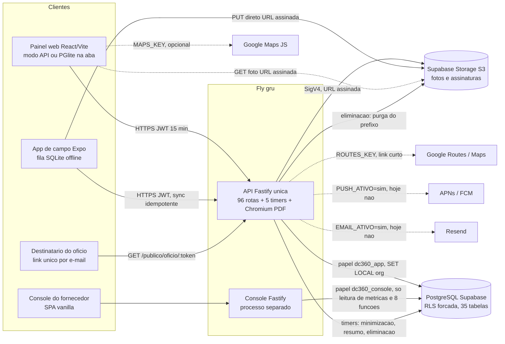

# 02. Painel da Defesa Civil, arquitetura real e dependências externas (Baseline Zero da V2)

Escopo: seções 5 (arquitetura REAL), 6 (web da Defesa Civil/prefeitura), 22 (dependências externas), itens 14 e 15 da revalidação, e os fluxos "Município -> saída/portabilidade" e "Defesa Civil -> Encerramento".
Estado do git na largada: master, HEAD e82719e, árvore limpa exceto `docs/AUDITORIA-2026-09-30.md` (conferido por `git status --short` ao final: nada mudou no repositório).
Data da auditoria: 30/09/2026. Somente leitura. Segredos: só nomes de variáveis.

## Resumo

1. A arquitetura real é: um monorepo com UMA API Fastify (96 rotas, conferidas no servidor montado por `printRoutes`), um banco PostgreSQL com 46 migrações, 35 tabelas e RLS forçada, um painel React/Vite que roda em DOIS modos (API ou PGlite na aba, escolhido em tempo de build por `VITE_API_URL`), um console do fornecedor em processo separado, e cinco rotinas agendadas DENTRO do processo da API. Não há fila, cache, worker, homologação, CD, monitoramento nem página de status.
2. O isolamento por município está provado: `db/test/isolamento.test.ts` rodei sozinho nesta auditoria, 137 de 137 passaram em 55 s (ARQ-04).
3. ACHADO P0 SEGURANÇA, provado por execução: `auth/vigencia.ts` existe mas NÃO é chamado (`servidor.ts:454-468`, teste `describe.skip` em `vigencia-na-escrita.test.ts:102`). Com um servidor montado, desativei a operadora Jonas e o token dela continuou criando ocorrência (HTTP 201) e lendo a lista. Comentários em `auth/sessoes.ts` dizem o contrário. A janela é `ACESSO_MINUTOS` (padrão 15, máximo 60). A auditoria anterior não menciona isso.
4. ACHADO provado por execução: o botão "Baixar pacote de saída" do painel chama `POST {BASE}/pacote.zip` (`apps/web/src/dados/http.ts:951`), mas a rota é `POST /saida/pacote.zip`. A sonda deu 404 no caminho do painel e 200 `application/zip` no caminho real. Nenhum teste de painel, contrato ou e2e cobre isso. Em produção, a saída de município (CA-10) não tem botão funcional.
5. Item 14 (foto de perfil): a API tem as 4 rotas, o APLICATIVO DE CAMPO tem a interface completa (`apps/campo/src/app/(agente)/perfil.tsx`, `dados/foto-do-agente.ts`, testes Jest), e o PAINEL WEB não tem nada (nem upload, nem exibição). A frase da tela de campo "a coordenação passa a ver esta foto" (`perfil.tsx:483`) não é verdadeira no painel. A auditoria anterior disse "sem interface correspondente" sem distinguir campo de web.
6. Item 15: 96 rotas. 12 não têm consumidor efetivo em nenhum cliente (inclui as 4 de saída a campo que o aplicativo de campo nunca chama, `redefinir-senha` e `encerrar-sessoes` de terceiros, `/auth/encerrar-sessoes`, `validar/:codigo`, `evidencias/:id/url`, `auth/eu`, `aparelhos/revogar` e o pacote de saída). Só UM caminho de cliente não casa com rota do servidor: `/pacote.zip`.
7. BACKEND SEM FRONTEND: redefinir senha e encerrar sessões de terceiro, encerrar minhas sessões, foto de perfil, validação de identificador de documento, CSV de nível completo. Teste de painel `seguranca-da-conta.test.ts` descreve a tela que falta: rodei o arquivo, 8 de 8 falham. Com `RECUPERACAO_ATIVA=nao` em produção (`fly.toml`), quem esquece a senha não tem caminho pela interface.
8. FRONTEND SEM REGRA NO SERVIDOR: não achei botão de escrita sem autorização no servidor (toda escrita passa por `autorizar` ou `exigirAutenticacao` de conta própria). O que o servidor NÃO fecha: as transições da máquina de estados (só API e pacote shared, nenhum trigger no banco), desativar equipe com atendimento em curso (só aviso de tela) e a verificação de providências obrigatórias no encerramento (RN-05, só registra).
9. O pacote de produção do painel inclui PGlite, as 46 migrações e a semente de desenvolvimento (114 `CREATE POLICY` e uma conta de exemplo no JS de 1,6 MB, conferido com `vite build` em pasta temporária).
10. Superfícies V2: não há nenhum backend para órgãos como usuários nem para cidadão. `usuarios.papel` é CHECK de 4 valores, `orgaos` é catálogo com e-mail, o ofício público é leitura de uso único.

## §5. Arquitetura REAL (o que existe hoje, não o que o README promete)

### 5.1 Componentes

| Peça | O que é de verdade | Onde | Observação |
| --- | --- | --- | --- |
| Monorepo | npm workspaces: `packages/*`, `apps/api`, `apps/console`, `apps/web`, `db`. `apps/campo` FORA dos workspaces, com lockfile próprio | `dc360/package.json:5-11` | Comando da raiz não enxerga o campo; há `npm run test:campo` |
| API | Fastify 5, TypeScript, processo único, `construirServidor` | `apps/api/src/servidor.ts:226`, bootstrap `index.ts` | 96 rotas (seção Item 15). Sem prefixo: `/equipes`, `/usuarios`, `/organizacao`, `/trilha`, `/relatorios` |
| Painel web | React 18.3, Vite 7, react-router 7; 17 rotas de tela mais a de endereço desconhecido; estado por contexto (sem biblioteca de dados); dois modos (API ou PGlite) | `apps/web` | Modo decidido em BUILD: `repositorio.ts:19` `Boolean(VITE_API_URL)` |
| Campo | Expo SDK 57, RN 0.86.3, fila offline SQLite, motor `packages/campo` | `apps/campo`, `packages/campo` | Fora do escopo deste arquivo, citado onde toca a API |
| Console | Fastify separado (processo, porta 3344, segredo e token próprios), SPA vanilla inline (`pagina.ts` 3646 linhas), contas do fornecedor em `console_operadores` | `apps/console` | Papel de banco `dc360_console` sem concessão em tabela de negócio (README, migrações 036/038/039) |
| Shared | Zod, domínio COBRADE, máquina de estados, 4 papéis, 15 ações, posto | `packages/shared/src` | A máquina de estados mora AQUI e na API, não no banco |
| Banco | PostgreSQL, 46 migrações, 35 `CREATE TABLE`, 39 `FORCE ROW LEVEL SECURITY` | `db/migrations` | Sem PostGIS (nenhuma migração cria a extensão). `pg_trgm` só condicional (041) |
| Armazenamento | S3-compatível com SigV4 escrita à mão (ADR 0005), upload direto por URL assinada, teto por município (035) | `apps/api/src/armazenamento/s3.ts` | Produção exige S3 (`config.ts:747-752`); em dev cai em memória |
| E-mail | Cliente HTTP do Resend sem SDK (`notificadorHttp`) | `apps/api/src/auth/notificador.ts` | DESLIGADO por padrão (`EMAIL_ATIVO=nao`), produção `RECUPERACAO_ATIVA=nao` |
| Push | APNs (HTTP/2) e FCM, varredura de avisos | `apps/api/src/push/*` | `PUSH_ATIVO` está COMENTADO em `fly.toml:88-96` |
| Mapas | Google Maps JS no painel (chave via `GET /configuracao`), plano esquemático sem chave; Routes API e resolvedor de link curto no servidor | `mapa-de-base.ts`, `rotas/rota.ts`, `rotas/mapa.ts` | Sem chave, nenhum contato com o Google |
| Jobs | 5 timers no processo da API com trava consultiva no Postgres (`push/trava.ts`): push (5 min, só `PUSH_ATIVO`), minimização (1 h, sempre), resumo de métricas (15 min, sempre), órfãos (24 h, só `VARREDURA_DE_ORFAOS_ATIVA`), eliminação de município (15 min, sempre) | `apps/api/src/index.ts:144-494` | Sem fila nem worker separado |
| Offline/sincronização | `POST /sincronizacao/vistoria` idempotente por chave, evidência em duas fases, reconciliação de pendências | `rotas/sincronizacao.ts`, `packages/campo` | Lado aparelho é auditoria do campo |
| Documentos | HTML gerado no servidor (`documentos/laudo.ts` 834 linhas, `folha.ts`), PDF por Chromium/Playwright dentro do processo da API, sob demanda, sem guardar | `documentos/pdf.ts` | `--no-sandbox` (`pdf.ts:70`), JS habilitado, sem CSP no HTML. Marca d'água `DOCUMENTO DE VALIDAÇÃO` (`fly.toml:69`). Brasão é o texto fixo "DC" (`folha.ts:330`) |
| Auditoria | `trilha_eventos` (por ocorrência) e `trilha_administrativa` (atos), append-only por ausência de policy UPDATE/DELETE; `ocorrencia_consultas` (LGPD); `exportacoes` | `trilha.ts`, migrações 001/007/010/021 | Nenhum evento de login/falha de login na trilha (só tabela mutável `sessoes`) |
| Exportações | CSV em 2 níveis (básico/completo), pacote ZIP de saída escrito à mão (`saida/zip.ts` 317 linhas, `saida/pacote.ts` 1118 linhas) | `rotas/prestacao-de-contas.ts`, `rotas/saida.ts` | Pacote carrega tudo em memória (PENDENCIAS da API) |
| Infra | Fly.io `defesa-civil` (gru, shared-cpu-1x, 1 GB, `min_machines_running = 1`, `kill_timeout = 30`), Fly `defesa-civil-console` (512 MB), Vercel `dc360-painel-web`, Supabase (Postgres e Storage S3), GitHub Actions `verificar.yml` com 5 jobs | `fly.toml`, `fly.console.toml`, `vercel.json`, `.github/workflows/verificar.yml` | O repositório prova a CONFIGURAÇÃO, não o estado da nuvem |
| Ambientes | desenvolvimento local (PGlite sem `DATABASE_URL`, ou `compose.yaml` com postgis/postgis:16), CI, produção. HOMOLOGAÇÃO: inexistente (`eas.json` aponta `https://api-homologacao.exemplo.gov.br`, domínio de exemplo) | `compose.yaml`, `apps/campo/eas.json` | Sem CD: nenhum workflow de deploy |

### 5.2 Autenticação, autorização e isolamento (verificado em código e execução)

- Senha com scrypt (`auth/senha.ts`), JWT HS256 de `ACESSO_MINUTOS` (padrão 15, teto 60, `config.ts:356`), token de renovação opaco de 14 dias (`RENOVACAO_DIAS`) rotativo com detecção de reuso (`auth/servico.ts:538-599`), limites de login por IP (`LOGIN_POR_IP`, 10 por 5 min) e por conta (5 falhas por 15 min, no banco). Rate limit global de 300 por minuto, em memória por processo (`servidor.ts:381-398`, sem Redis).
- Segundo fator TOTP: só existe se `SEGUNDO_FATOR_ATIVO=sim` (padrão `nao`, e `fly.toml` não define). Quando ligado, é obrigatório só para o papel administrador (`auth/segundo-fator.ts:114`). A exigência "por política da organização" (AUT-04) não existe: é variável de ambiente global.
- Senha provisória de 72 h (migração 046) só para redefinição por administrador/console. Usuário criado por `POST /usuarios` recebe a senha que o administrador digitou, sem marca de provisória (`administracao.ts:143-193`).
- Autorização: `packages/shared/src/permissoes.ts:56-112` (4 papéis: operador, agente_campo, coordenador, administrador; 15 ações; posto 1/1/2/3). Toda rota de escrita chama `autorizar` (`servidor.ts:858`) ou `exigirAutenticacao` para ato da própria conta (troca de senha, 2FA, foto, aparelho, avisos lidos, `POST /rota`). Conferi por `grep` de todas as rotas.
- VIGÊNCIA DO TOKEN NA ESCRITA: DESLIGADA. `servidor.ts:454-468` (comentário "DESLIGADO NESTA IMPLANTAÇÃO, DE PROPÓSITO"). Só a suspensão do município é conferida na escrita (`exigirAcessoAtivo`, `servidor.ts:463-467`). Sonda (servidor montado com semente, `tsx` em pasta temporária, repositório intocado): login da operadora, `POST /ocorrencias` 201, administradora desativa a operadora (`PATCH /usuarios/:id/situacao` 200, sessões de renovação revogadas), mesmo token: `POST /ocorrencias` 201, `GET /ocorrencias` 200. Rebaixamento de papel e sessão encerrada têm o mesmo efeito por desenho (mesma função desligada). Comentários que afirmam o contrário: `auth/sessoes.ts:20-28`, `auth/suspensao.ts:42`.
- RLS: `set_config('app.organizacao_atual', $1, true)` e `SET LOCAL ROLE dc360_app` por transação (`banco/postgres.ts:236-238`); organização vem só do JWT verificado. `isolamento.test.ts`: 137 de 137 passaram (inclui "Apagar prova é negado por AUSÊNCIA de policy", "duas leituras concorrentes não trocam de contexto", "nenhum papel além do de aplicação e do dono tem privilégio").
- Recurso de outro município responde 404 (verificado nos trechos lidos de `administracao.ts`, `ocorrencias.ts`, `documentos.ts`).

### 5.3 Onde é de verdade e onde é fake/local

| Peça | De verdade | Fake/local | Quando cai no fake |
| --- | --- | --- | --- |
| Banco | Postgres (Supabase, `DATABASE_URL`, TLS `verify-full` obrigatório em produção, `config.ts:665`) | PGlite em WebAssembly no processo da API (`banco/memoria.ts`), semeado com 2 municípios fictícios e senha conhecida (`index.ts:73-77`) | `DATABASE_URL` ausente e `NODE_ENV != production` |
| Banco no painel | (nenhum: o painel não fala com Postgres) | PGlite na aba do navegador, persistência IndexedDB com queda para memória após 20 s (`dados/banco.ts`) | `VITE_API_URL` vazio no build |
| Arquivos | S3 (Supabase Storage segundo `fly.toml:70` e `docs/COLOCAR-DE-PE.md:587`) | `armazenamentoEmMemoria` + rotas `/armazenamento/objeto` | S3_* ausente, fora de produção |
| E-mail | Resend (`notificadorHttp`) | `notificadorDeLog` (link no log), `notificadorDeArquivo` (teste, proibido em produção, `config.ts:691`) | `EMAIL_ATIVO != sim` |
| Push | APNs/FCM reais no código | sem entrega (suítes usam dublês) | `PUSH_ATIVO=nao` (padrão) |
| Mapa | Google Maps JS | plano esquemático SVG | `MAPS_KEY` vazia (padrão) |
| PDF | Chromium do Debian na imagem | (nenhum; sem navegador responde 503 "use a versão para impressão") | sem `PLAYWRIGHT_CHROMIUM_EXECUTABLE_PATH` |
| Autenticação do painel | senha, JWT, renovação | escolha de perfil sem senha (`contasDisponiveis`) | modo local |

### 5.4 Diagrama do fluxo de dados

Linhas tracejadas são dependências que o código suporta e que, segundo o repositório, estão desligadas por padrão. Não há fila, cache, Redis, worker, CDN de script, APM nem serviço de status.

## §6. Web da Defesa Civil / prefeitura: inventário funcional completo

### 6.1 Menu por papel (`componentes/Estrutura.tsx:47-100`) e rotas (`App.tsx:105-146`)

| Item do menu | Regra de exibição | operador | agente_campo | coordenador | administrador |
| --- | --- | --- | --- | --- | --- |
| Meu trabalho | exige `registrar_vistoria` | não | SIM | não | não |
| Painel, Ocorrências | esconde se puder `registrar_vistoria` | SIM | não | SIM | SIM |
| Mapa da cidade | todos | SIM | SIM | SIM | SIM |
| Quem está em campo | exige `acompanhar_saida_a_campo`, esconde de quem registra vistoria | SIM | não | SIM | SIM |
| Equipes, Órgãos de destino | exige `gerenciar_equipes` | não | não | SIM | SIM |
| Usuários | exige `gerenciar_usuarios` | não | não | SIM | SIM |
| Prestação de contas | exige `consultar_trilha` | não | não | SIM | SIM |
| Organização | exige `gerenciar_organizacao` | não | não | não | SIM |

Rotas com `<Exige acao>` em `App.tsx`: `/quem-esta-em-campo`, `/equipes`, `/orgaos`, `/usuarios`, `/auditoria`, `/organizacao`. Sem `Exige` (só sessão): `/painel`, `/meu-trabalho`, `/minha-conta`, `/ocorrencias`, `/ocorrencias/nova`, `/ocorrencias/:id`, `/mapa`. Isso é conveniência de navegação: um agente que digita `/ocorrencias/nova` vê o formulário e leva 403 do servidor (comentário de `App.tsx:26-37` reconhece).

### 6.2 Módulo a módulo

Legenda de testes: "unit" = vitest do painel (ambiente node, `renderToStaticMarkup` e leitura de fonte, sem jsdom); "e2e-api" = `apps/web/test/fluxo-api.e2e.mjs` (22 seções contra a API real, no CI `npm run test:e2e:api`); "e2e-local" = `fluxo.e2e.mjs`; "API" = testes de `apps/api/test`.

| Página (arquivo) | O que faz | Quem pode | API usada (`dados/http.ts`) | Tabelas principais | Trilha gerada | Testes | Gaps conhecidos |
| --- | --- | --- | --- | --- | --- | --- | --- |
| Entrar `/entrar` (`Entrar.tsx`, `entrar-regras.ts`) | Login por e-mail e senha; passo do código 2FA; ativação forçada de 2FA; troca de senha provisória; no modo local, escolha de perfil | público | `POST /auth/entrar`, `/auth/segundo-fator`, `/auth/trocar-senha`, `/segundo-fator/*` | usuarios, sessoes, segundo_fator | `segundo_fator_ativado` (admin); login NÃO entra na trilha | unit `sessao-e-entrada`, `senha-provisoria`; e2e-api §1; API 60 arquivos tocam `/auth/entrar` | Sem auditoria de login em tabela append-only; 2FA desligado por padrão |
| Recuperar senha `/recuperar-senha`, `/redefinir-senha` (`RecuperarSenha.tsx`) | Pede link por e-mail e define senha nova | público | `POST /auth/recuperar`, `/auth/redefinir` | recuperacoes_senha, usuarios | nenhuma | e2e-api §14; API `recuperacao*.test` | Produção: 503 (`RECUPERACAO_ATIVA=nao` em `fly.toml`). Sem provedor de e-mail |
| Quero conhecer `/quero-conhecer` (`QueroConhecer.tsx`) | Formulário público de interesse de município | público | `POST /publico/interesse` | interesse_municipio | nenhuma | unit `foco`; API `api.test` | Ninguém lê a fila (sem tela, sem console); leitura só por `psql` (`COLOCAR-DE-PE.md` parte 7) |
| Painel `/painel` (`Painel.tsx`) | Indicadores (fila, em campo, atrasadas, críticas, encerradas 7 d), fila prioritária, providências pendentes, imóveis interditados, tarefas devolvidas; atualiza a cada 60 s | operador, coordenador, administrador | `GET /ocorrencias/indicadores/painel`, `/ocorrencias?status=ativas`, `/ocorrencias/providencias/pendentes`, `/ocorrencias/interditados`, `/ocorrencias/devolvidas` | ocorrencias, providencias, devolucoes_de_tarefa | nenhuma (leitura) | unit `devolucao`, `lista-sem-o-que-so-o-dossie-entrega`; e2e-api; API 4 a 5 | `/ocorrencias/devolvidas` exige `despachar_equipe`: operador recebe 403 e a tela trata `null` como "não sei" |
| Ocorrências `/ocorrencias` (`Ocorrencias.tsx`) | Lista com filtro de status, severidade, atrasadas, busca, paginação (100 por página) | operador, coordenador, administrador (agente vê só a equipe) | `GET /ocorrencias?...` | ocorrencias | nenhuma | unit `pico-lista-e-mapa`, `tipo-a-classificar`; API 45 arquivos | sem exportação da lista, sem ordenação configurável |
| Registrar ocorrência `/ocorrencias/nova` (`NovaOcorrencia.tsx`, `DescobrirPonto.tsx`, `coordenada-colada.ts`) | Abre o chamado: canal, solicitante, endereço, ponto de referência, localização (cola link/coordenada, resolve link curto), tipo COBRADE ou "outro", relato, checagem de duplicidade 48 h, vínculo | `abrir_ocorrencia` (operador, coordenador, administrador) | `POST /ocorrencias`, `GET /ocorrencias/duplicidades/consulta`, `POST /mapa/resolver-link` | ocorrencias, protocolo_sequencias | `registro` | unit `formularios`, `link-encurtado`, `tipo-a-classificar`; e2e-api §5; API `api.test`, `resolver-link` | Sem anexos no registro (OCO-02 "anexos"); rota sem `Exige` |
| Detalhe `/ocorrencias/:id` (`Ocorrencia.tsx`, 2468 linhas) | Dossiê: dados, correção de coordenada, triagem, despacho e redespacho, vistoria, galeria de fotos, providências, ofícios, interdição e levantamento, encerramento, documentos, linha do tempo, prazo, "ver também" | depende do bloco (ver matriz PRF-14 a PRF-27) | `GET /ocorrencias/:id`, `/evidencias/ocorrencia/:id`, `/oficios`, `/orgaos`, `/equipes`, POSTs de triagem, despacho, providência, resposta, encerramento, desinterdição, coordenada, `/oficios`, `/oficios/:id/envio`, `/documentos/...`, `/oficios/:id/documento` | ocorrencias, vistorias, evidencias, providencias, oficios, oficio_envios, trilha_eventos | registro, triagem, despacho, providencia, resposta_providencia, encerramento, desinterdicao, correcao_de_coordenada, oficio_emitido, oficio_enviado, documento_emitido, e registro de consulta (`ocorrencia_consultas`) | unit 13 arquivos; e2e-api §5, 11, 13, 17, 21; API dezenas | Encaminhar providência só é oferecido com status `vistoria_concluida` (`Ocorrencia.tsx:676`); sem editar dados do chamado; sem reabrir; sem anexar arquivo; `ocorrencia-encerramento.test` falha no Windows (CRLF, auditoria anterior) |
| Mapa `/mapa` (`Mapa.tsx`, `MapaDoGoogle.tsx`, `mapa-de-base.ts`) | Pontos das ocorrências ativas; plano esquemático por padrão, Google Maps com chave | todos | `GET /ocorrencias/mapa?pagina=`, `GET /configuracao` | ocorrencias | nenhuma | unit `mapa-e-coordenada`, `pico-lista-e-mapa`; e2e-local | Sem filtros de mapa por tipo/prioridade além da lista; sem raio/área (GEO-02); `google.maps.Marker` obsoleto (`PENDENCIAS` web §4) |
| Meu trabalho `/meu-trabalho` (`MeuTrabalho.tsx`) | Leitura: vistorias designadas à equipe, concluídas, colegas | `registrar_vistoria` (agente) | `GET /campo/meu-trabalho` | ocorrencias, vistorias, usuarios, equipes | nenhuma | unit `busca-nos-dois-modos` (só a busca); e2e-api §18 | Comentário de `MeuTrabalho.tsx:30` diz que o aplicativo "ainda não existe" (desatualizado). Colegas sem foto e sem `emCampo` (tipo `ColegaDeEquipe` ignora os campos que a API manda) |
| Quem está em campo `/quem-esta-em-campo` (`QuemEstaEmCampo.tsx`) | Lista saídas abertas, prazo estourado, encerra a saída com relato | `acompanhar_saida_a_campo` | `GET /saida-a-campo`, `POST /saida-a-campo/encerrar` | saidas_a_campo, trilha_eventos | `saida_a_campo_encerrada` | unit `quem-esta-em-campo` (só modo local); API `saida-a-campo` | O aplicativo de campo NÃO declara saída (`POST /saida-a-campo` sem cliente): a tela só terá dados se algo fora do repositório os criar |
| Equipes `/equipes` (`Equipes.tsx`) | Cria, edita, desativa equipe; mostra atendimentos em curso | `gerenciar_equipes` | `GET/POST /equipes`, `PATCH /equipes/:id` | equipes | `equipe_criada/editada/desativada` (administrativa) | unit `semente-e-confirmacoes` (3 casos falham, auditoria anterior), `portoes-de-componente`; e2e-local | `PATCH /equipes/:id` sem nenhum teste; sem confirmação de sucesso na tela; desativar com atendimento só avisa na tela |
| Órgãos de destino `/orgaos` (`Orgaos.tsx`) | Catálogo de órgãos (nome, sigla, e-mail, telefone), desativa com motivo, reativa | `gerenciar_equipes` | `GET/POST /orgaos`, `PATCH /orgaos/:id`, `POST .../desativacao`, `.../reativacao` | orgaos | `orgao_criado/editado/desativado/reativado` | unit `orgaos`; API `orgaos-e-oficio` | `reativacao` sem teste de API; sem toast de sucesso; catálogo NÃO é conta de usuário |
| Usuários `/usuarios` (`Usuarios.tsx`) | Cadastra, corrige cadastro, desativa/reativa usuário, define senha inicial (modo API) | `gerenciar_usuarios` + posto | `GET/POST /usuarios`, `PATCH /usuarios/:id`, `PATCH .../situacao` | usuarios, sessoes | `usuario_criado/editado`, `papel_alterado`, `usuario_desativado/reativado` | unit `usuarios-regras`, `seguranca-da-conta` (8 de 8 falham, rodei), `portoes-de-componente`; e2e-api §9, 20 | SEM botões de redefinir senha e encerrar sessões (API pronta); texto da tela manda "o link de recuperação" que está desligado; sem toast de sucesso |
| Prestação de contas `/auditoria` (`Auditoria.tsx`) | Trilha filtrável, resumo por período (mediana, por tipo, bairros), quem exportou, quem consultou dado de cidadão, exporta CSV básico | `consultar_trilha` (coordenador, administrador) | `GET /trilha`, `/trilha/tipos`, `/relatorios/resumo`, `/relatorios/exportacoes`, `/relatorios/consultas`, `/relatorios/ocorrencias.csv` | trilha_eventos, trilha_administrativa, exportacoes, ocorrencia_consultas | registro de exportação (`exportacoes`) | e2e-api §15, 16; API `prestacao-de-contas`, `exportacao-em-dois-niveis`, `registro-de-consulta`; nenhum unit | CSV de nível completo (com dado pessoal) sem tela; sem PDF (REL-01 pede PDF e CSV) |
| Organização `/organizacao` (`Organizacao.tsx`) | Retenção de dado pessoal (dias), uso de armazenamento, saída de município | `gerenciar_organizacao` (só administrador) | `GET/PATCH /organizacao/retencao`, `GET /armazenamento/uso`, `POST /pacote.zip` (ERRADO) | organizacoes, exportacoes | `retencao_alterada`, `saida_de_municipio_exportada` (quando a rota certa é chamada) | API `retencao-do-municipio`, `teto-de-armazenamento`, `saida-de-municipio`; NENHUM teste de painel nem e2e | Botão de saída dá 404 (sonda); nenhuma tela edita nome/UF/brasão do município apesar de a ação se chamar "alterar os dados do município" |
| Minha conta `/minha-conta` (`MinhaConta.tsx`, `SegundoFator.tsx`) | Troca de senha, liga/desliga 2FA | todos | `POST /auth/trocar-senha`, `/segundo-fator/*` | usuarios, segundo_fator | `segundo_fator_ativado/desativado` | unit `seguranca-da-conta` (falha); e2e-api §22; API `segundo-fator` | Falta "encerrar minhas outras sessões" e foto de perfil |
| Sino `componentes/Sino.tsx` | Avisos: vistoria recebida, prazo vencido, providência respondida, retorno não confirmado; consulta a cada 30 s | todos | `GET /avisos`, `POST /avisos/lidos` | avisos, avisos_lidos | nenhuma | unit `sino`; API `sino-de-avisos` | Sem aviso de PRAZO DE PROVIDÊNCIA vencido (só `prazo_vencido` de ocorrência) |
| Busca global `componentes/BuscaGlobal.tsx` | Caixa de comando: páginas, ações e registros com tolerância a erro | todos (usuários só com `gerenciar_usuarios`) | `GET /busca?q=` | ocorrencias, equipes, orgaos, usuarios | nenhuma | unit `busca-*`; API `busca` | |
| 404 `NaoEncontrada.tsx` | Endereço desconhecido dito | todos | nenhuma | nenhuma | nenhuma | unit `sessao-e-entrada` | |

### 6.3 Modo local (PGlite) versus modo API

Decisão em tempo de build: `VITE_API_URL` definida vira modo API (`repositorio.ts:19`). `vercel.json` define `VITE_API_URL` como `https://defesa-civil.fly.dev` e mantém `VITE_GOOGLE_MAPS_CHAVE` vazia. O mesmo código das duas camadas (`http.ts` 1245 linhas, `local.ts` 2157 linhas) precisa ser mantido em paridade; `paridade-dos-modos.test.ts` compara NOMES e ARIDADE das funções exportadas, não comportamento nem caminhos HTTP (por isso o erro de `/pacote.zip` passou).

| Capacidade | Modo API | Modo local |
| --- | --- | --- |
| Entrada | e-mail e senha, bloqueio, 2FA, senha provisória | escolha de perfil, sem senha, sem expiração (`local.ts:490`) |
| Isolamento e permissão | servidor (RLS + `autorizar`) | RLS dentro da aba, que o usuário controla; `exigirPermissao` roda no cliente (`local.ts:1923`): demonstração, não controle |
| Ocorrência, triagem, despacho, providência, encerramento, interdição, coordenada, mapa, painel, busca, órgãos, ofício (emitir), quem está em campo, sino | sim | sim (mesmo SQL e migrações) |
| Documentos oficiais e PDF | sim | NÃO (`local.ts:560`) |
| Fotos (galeria) | sim | lista vazia (`local.ts:419`) |
| Ofício: enviar e abrir | sim (e-mail desligado em produção) | NÃO (`local.ts:1869-1883`) |
| Recuperação e troca de senha, 2FA, encerrar sessões | sim (UI parcial) | NÃO |
| Prestação de contas, CSV, retenção, pacote de saída, armazenamento, exportações, consultas | sim (pacote com erro de caminho) | NÃO (todas lançam erro) |
| Formulário de interesse, resolver link curto | sim | NÃO |
| Chave do mapa | `GET /configuracao` | variável de build |
| Persistência | servidor | IndexedDB; cai para memória se abrir em mais de 20 s (Safari leva 163 s, `banco.ts` comentário) |

No pacote de PRODUÇÃO (modo API) o JavaScript continua levando `local.ts`, o PGlite, as 46 migrações e a semente de desenvolvimento: `vite build` com `VITE_API_URL` definido, saída em pasta temporária fora do repositório, gerou `index-*.js` de 1.603 kB contendo 114 `CREATE POLICY`, 60 `SECURITY DEFINER`, a conta de exemplo `helena.coutinho@serraalta...` e emitiu `postgres-*.wasm` (8,1 MB) e `.data` (5,4 MB) como assets (o download do wasm só ocorre se o PGlite for instanciado; NÃO CONFIRMADO no navegador de produção).

### 6.4 BACKEND EXISTE / FRONTEND NÃO EXISTE (sistemático)

| # | Capacidade no backend | Evidência | Frontend |
| --- | --- | --- | --- |
| 1 | Redefinir senha de outra pessoa | `administracao.ts:433`, `http.ts:752` (função existe) | nenhuma tela chama. Teste `seguranca-da-conta.test.ts` descreve a UI; rodei: 8 de 8 falham ("BotaoRedefinirSenha não existe em Usuarios.tsx") |
| 2 | Encerrar sessões de outra pessoa | `administracao.ts:550`, `http.ts:762` | idem |
| 3 | Encerrar minhas outras sessões | `autenticacao.ts:229`, `http.ts:855` | idem (Minha conta) |
| 4 | Foto de perfil (GET eu, autorizar, PUT, DELETE) | `usuarios-eu.ts:143,168,204,298` | WEB: nada. CAMPO: completa |
| 5 | Validar identificador de documento | `documentos.ts:877` | nenhuma tela em web ou campo; rota exige login |
| 6 | CSV nível completo (dado pessoal, só administrador) | `prestacao-de-contas.ts:311-325` | `baixarCsvDeOcorrencias` só envia de/ate/status (`http.ts:906-927`) |
| 7 | Mais de uma providência por ocorrência | `ocorrencias.ts:976-1028` com `exigirTransicao` sem origens (`:130-148` aceita repetir estado não terminal). PROVADO por execução: com a semente, `POST /ocorrencias/:id/providencia` numa ocorrência já em `providencia_pendente` respondeu 200 e a lista passou de 1 para 2 providências | `Ocorrencia.tsx:676` só oferece o bloco com `vistoria_concluida`: depois da primeira providência a tela não deixa encaminhar a segunda |
| 8 | Saída a campo (declarar, prorrogar, retorno, `minha`) | `saida-a-campo.ts:168,430,576,837` | nenhum cliente (campo não chama; `grep saida-a-campo` em `apps/campo/src` só acha um comentário em `api.ts:505`); o painel só lê e encerra |
| 9 | Revogar aparelho (parar de receber push) | `aparelhos.ts:185` | removido do campo em 15/09/2026 (`apps/campo/src/dados/api.ts:324-332`) |
| 10 | Buscar URL de uma evidência avulsa | `evidencias.ts:523` | nenhum cliente (painel usa a lista por ocorrência) |
| 11 | `GET /auth/eu` | `autenticacao.ts:241` | nenhum cliente (só testes) |
| 12 | Alterar dados do município | ação `gerenciar_organizacao` rotulada "alterar os dados do município" (`permissoes.ts:40`) | NÃO há rota nem tela; só retenção |

FRONTEND EXISTE / BACKEND NÃO EXISTE: não achei. O único caso de cliente sem rota é o `/pacote.zip` (caminho errado, rota existe com outro prefixo).

### 6.5 FRONTEND EXISTE / BACKEND NÃO FECHA A REGRA

Verificação: `grep` de `autorizar|exigirPermissao|exigirAutenticacao` em todos os arquivos de rota. Toda escrita tem autorização no servidor, salvo as de conta própria (auth, segundo fator, foto, aparelho, avisos lidos) e `POST /rota` (autenticado, sem efeito em banco). Não encontrei botão que dependa só de `podeExecutar` na tela.

Regras que o servidor não fecha (a tela ou o pacote shared é a única barreira, ou é só aviso):

1. Transições de estado da ocorrência: `exigirTransicao` e `TRANSICOES_PERMITIDAS` (`ocorrencias.ts:108-193`, `dominio.ts:153-181`). O banco só tem CHECK de valor e `encerramento_exige_motivo` (`001_base.sql:186`); nenhum trigger de transição (lista de 10 triggers em `db/migrations`). A regra vale para toda rota que use a função, não para SQL direto.
2. Desativar equipe com atendimento em curso: a tela avisa (`Equipes.tsx:97-100`), `PATCH /equipes/:id` (`administracao.ts:93-127`) não confere.
3. RN-05 (encerramento exige verificação das providências obrigatórias) e FLU-02 (resposta ou justificativa de dispensa): o servidor só anota `providenciasSemResposta` no evento (`ocorrencias.ts:1096-1134`); a tela não bloqueia.
4. Motivo de encerramento: `encerramentoSchema` aceita 1 caractere (`schemas.ts:496`), o banco exige `length(trim) > 0`. A tela usa o mesmo esquema.
5. Permissão e momento do fluxo: os `ofereceTriagem/ofereceEncerramento` da tela repetem a regra que o servidor aplica por `exigirTransicao`; divergência possível se alguém mudar só um lado.
6. Modo local: toda permissão é cliente.

## Item 14. Foto de perfil, revalidação

Conclusão: a auditoria anterior está CORRETA para o painel web e INCOMPLETA para o conjunto. Evidência:

- Backend: `apps/api/src/rotas/usuarios-eu.ts` com `GET /usuarios/eu` (`:143`), `POST /usuarios/eu/foto/autorizar-envio` (`:168`), `PUT /usuarios/eu/foto` (`:204`), `DELETE /usuarios/eu/foto` (`:298`); trilha administrativa `foto_trocada`/`foto_removida` (`:268`, `:309`); migração 040 (`foto_chave`), 045 (conta no teto de armazenamento); testes `apps/api/test/foto-do-agente.test.ts`.
- Campo: `apps/campo/src/dados/api.ts:693-729` chama as quatro rotas; `apps/campo/src/dados/foto-do-agente.ts`; UI em `apps/campo/src/app/(agente)/perfil.tsx` (seletor câmera/galeria, `trocarFoto` `:460`, `removerFoto` `:498`, avatar `:682`); testes Jest `foto-do-agente.test.ts` e `perfil-a-foto-os-numeros-e-a-equipe.test.tsx`. Não exercido em aparelho por mim.
- Web: nenhuma referência. `grep -i "foto"` em `MinhaConta.tsx` acha só "escolha de perfil"; nenhum arquivo do painel chama `/usuarios/eu`. `GET /campo/meu-trabalho` já devolve `fotoUrl` e `emCampo` dos colegas (`campo.ts:72-203`), mas o tipo `ColegaDeEquipe` do painel (`dados/tipos.ts:468-473`) descarta os dois campos.
- Consequência de produto: o texto da tela de campo "A sua equipe e a coordenação passam a ver esta foto ao lado do seu nome" (`perfil.tsx:483`) só é verdade para a equipe no aplicativo; a coordenação no painel não vê foto em lugar nenhum.

Estado: C (existe parcialmente: backend e campo prontos, painel sem nada).

## Item 15. Inventário de TODAS as rotas (96), com consumidor real

Método: árvore real do servidor montado (`app.printRoutes` via `tsx` a partir de pasta temporária, servidor com banco PGlite; 96 rotas sem HEAD/OPTIONS; as 12 públicas coincidem com a lista `SEM_TOKEN` de `superficie.test.ts`). Consumidor procurado por busca do caminho em `apps/web/src`, `apps/campo/src`, `packages/campo/src`, `apps/console/src` e conferido à mão onde o caminho é dinâmico (`${BASE}`, tipo de documento). Verificação inversa por script: das 67 chamadas de `http.ts`, 12 de `apps/campo/src/dados/api.ts`, 2 de `transporte.ts` e 2 de `historico-da-casa.ts`, só `POST /pacote.zip` não tem rota. Teste: coluna por busca textual do caminho em `apps/api/test`, `scripts`, `apps/web/test`, `apps/campo` (não prova asserção nem método; `GET` e `POST` do mesmo caminho se confundem).

Rotas públicas (sem token): 12: `GET /saude`, `POST /auth/entrar|segundo-fator|renovar|sair|recuperar|redefinir`, `POST /publico/interesse`, `GET /publico/oficio/:token`, `PUT|GET /armazenamento/objeto` (este par só existe com armazenamento local; em produção `config.ts` proíbe).

Rotas SEM consumidor efetivo (12): `GET /auth/eu`, `POST /auth/encerrar-sessoes`, `POST /usuarios/:id/redefinir-senha`, `POST /usuarios/:id/encerrar-sessoes`, `POST /saida-a-campo`, `POST /saida-a-campo/prorrogar`, `POST /saida-a-campo/retorno`, `GET /saida-a-campo/minha`, `POST /aparelhos/revogar`, `POST /saida/pacote.zip` (o painel chama outro caminho), `GET /evidencias/:id/url`, `GET /documentos/validar/:codigo`. Sem teste: `PATCH /equipes/:id`, `POST /orgaos/:id/reativacao`.

### Tabela das 96 rotas (método, path, permissão, consumidor real, teste)

| # | Método | Path | Permissão / autenticação | Consumidor real | Teste que cobre (busca textual do caminho) |
| --- | --- | --- | --- | --- | --- |
| 1 | GET | `/saude` | pública (sonda; só números) | infra (check do Fly, CI); nenhum cliente | api.test.ts, duble-da-migracao-038.ts, eliminacao-de-municipio.test.ts (+8) |
| 2 | POST | `/auth/entrar` | pública (limite por IP e por conta) | web, campo | acesso-suspenso.test.ts, agente-so-ve-a-equipe.test.ts, api.test.ts (+58) |
| 3 | POST | `/auth/segundo-fator` | pública (token de desafio) | web | log.test.ts, segundo-fator.test.ts |
| 4 | POST | `/auth/renovar` | pública (token de renovação) | web, campo | acesso-suspenso.test.ts, api.test.ts, recuperacao.test.ts (+6) |
| 5 | POST | `/auth/sair` | pública (token de renovação) | web, campo | push-aparelhos.test.ts, senha-provisoria.test.ts, aviso.test.ts (+2) |
| 6 | POST | `/auth/recuperar` | pública (503 com RECUPERACAO_ATIVA=nao) | web | notificador-http.test.ts, recuperacao-desligada.test.ts, recuperacao.test.ts |
| 7 | POST | `/auth/redefinir` | pública (link de uso único; 503 idem) | web (link do e-mail) | log.test.ts, recuperacao-desligada.test.ts, recuperacao.test.ts |
| 8 | POST | `/auth/trocar-senha` | autenticado (senha atual) | web | log.test.ts, provisionar.test.ts, recuperacao.test.ts (+1) |
| 9 | POST | `/auth/encerrar-sessoes` | autenticado | NENHUM (função existe em http.ts:855, nenhuma tela chama) | senha-e-sessoes.test.ts, vigencia-na-escrita.test.ts |
| 10 | GET | `/auth/eu` | autenticado | NENHUM | api.test.ts, segundo-fator.test.ts |
| 11 | GET | `/segundo-fator` | autenticado | web | segundo-fator.test.ts |
| 12 | POST | `/segundo-fator/iniciar` | autenticado ou desafio de ativação | web | segundo-fator.test.ts |
| 13 | POST | `/segundo-fator/confirmar` | autenticado ou desafio de ativação | web | segundo-fator.test.ts |
| 14 | POST | `/segundo-fator/desativar` | autenticado + senha | web | segundo-fator.test.ts |
| 15 | GET | `/ocorrencias` | autenticado (agente vê só a equipe) | web | acesso-suspenso.test.ts, agente-so-ve-a-equipe.test.ts, api.test.ts (+45) |
| 16 | POST | `/ocorrencias` | abrir_ocorrencia | web | acesso-suspenso.test.ts, agente-so-ve-a-equipe.test.ts, api.test.ts (+45) |
| 17 | GET | `/ocorrencias/devolvidas` | despachar_equipe | web | devolvidas-esperando-decisao.test.ts, devolucao.test.ts |
| 18 | GET | `/ocorrencias/duplicidades/consulta` | autenticado | web | agente-so-ve-a-equipe.test.ts, log.test.ts |
| 19 | GET | `/ocorrencias/mapa` | autenticado | web | agente-so-ve-a-equipe.test.ts, pico-lista-e-mapa.test.ts, registro-de-consulta.test.ts |
| 20 | GET | `/ocorrencias/interditados` | autenticado | web | agente-so-ve-a-equipe.test.ts, desinterdicao.test.ts, documentos.test.ts (+2) |
| 21 | GET | `/ocorrencias/indicadores/painel` | autenticado | web | agente-so-ve-a-equipe.test.ts, api.test.ts, pico-lista-e-mapa.test.ts (+1) |
| 22 | GET | `/ocorrencias/providencias/pendentes` | autenticado | web | agente-so-ve-a-equipe.test.ts, api.test.ts |
| 23 | GET | `/ocorrencias/:id` | autenticado (registra consulta LGPD) | web, campo (histórico da casa) | acesso-suspenso.test.ts, agente-so-ve-a-equipe.test.ts, api.test.ts (+21) |
| 24 | POST | `/ocorrencias/:id/triagem` | classificar_triagem | web | api.test.ts, autoria-da-coleta.test.ts, bytes-confirmados-nao-se-trocam.test.ts (+29) |
| 25 | POST | `/ocorrencias/:id/despacho` | despachar_equipe | web | api.test.ts, autoria-da-coleta.test.ts, bytes-confirmados-nao-se-trocam.test.ts (+29) |
| 26 | POST | `/ocorrencias/:id/desinterdicao` | levantar_interdicao | web | desinterdicao.test.ts, encerrada-nao-recebe-ato.test.ts, segunda-via-nao-reinterdita.test.ts |
| 27 | POST | `/ocorrencias/:id/providencia` | encaminhar_providencia | web | api.test.ts, orgaos-e-oficio.test.ts, prestacao-de-contas.test.ts |
| 28 | POST | `/ocorrencias/:id/providencia/:pid/resposta` | responder_providencia | web | api.test.ts |
| 29 | POST | `/ocorrencias/:id/encerramento` | encerrar_ocorrencia | web | api.test.ts, coordenada-de-ocorrencia-aberta.test.ts, devolucao-de-tarefa.test.ts (+5) |
| 30 | POST | `/ocorrencias/:id/coordenada` | abrir_ocorrencia | web | coordenada-de-ocorrencia-aberta.test.ts, vigencia-na-escrita.test.ts |
| 31 | GET | `/equipes` | autenticado | web | api.test.ts, despacho-avisa.test.ts, prazo-do-despacho.test.ts (+4) |
| 32 | POST | `/equipes` | gerenciar_equipes | web | api.test.ts, despacho-avisa.test.ts, prazo-do-despacho.test.ts (+4) |
| 33 | PATCH | `/equipes/:id` | gerenciar_equipes | web | nenhum (busca textual) |
| 34 | GET | `/usuarios` | gerenciar_usuarios | web | api.test.ts, busca.test.ts, foto-do-agente.test.ts (+5) |
| 35 | POST | `/usuarios` | gerenciar_usuarios + posto | web | api.test.ts, busca.test.ts, foto-do-agente.test.ts (+5) |
| 36 | PATCH | `/usuarios/:id` | gerenciar_usuarios + posto (e-mail só admin) | web, campo | api.test.ts, foto-do-agente.test.ts, posto-abaixo-do-seu.test.ts (+1) |
| 37 | PATCH | `/usuarios/:id/situacao` | gerenciar_usuarios + posto | web | api.test.ts, posto-abaixo-do-seu.test.ts, recuperacao.test.ts (+1) |
| 38 | POST | `/usuarios/:id/redefinir-senha` | gerenciar_usuarios + posto | NENHUM (função em http.ts:752, nenhuma tela chama) | posto-abaixo-do-seu.test.ts, senha-e-sessoes.test.ts, senha-provisoria.test.ts |
| 39 | POST | `/usuarios/:id/encerrar-sessoes` | gerenciar_usuarios + posto | NENHUM (função em http.ts:762, nenhuma tela chama) | posto-abaixo-do-seu.test.ts, senha-e-sessoes.test.ts, vigencia-na-escrita.test.ts |
| 40 | GET | `/organizacao/retencao` | gerenciar_organizacao | web | retencao-do-municipio.test.ts |
| 41 | PATCH | `/organizacao/retencao` | gerenciar_organizacao | web | retencao-do-municipio.test.ts |
| 42 | GET | `/usuarios/eu` | autenticado (própria conta) | campo | foto-do-agente.test.ts |
| 43 | POST | `/usuarios/eu/foto/autorizar-envio` | autenticado (própria conta) | campo | foto-do-agente.test.ts |
| 44 | PUT | `/usuarios/eu/foto` | autenticado (própria conta) | campo | foto-do-agente.test.ts |
| 45 | DELETE | `/usuarios/eu/foto` | autenticado (própria conta) | campo | foto-do-agente.test.ts |
| 46 | POST | `/sincronizacao/vistoria` | registrar_vistoria | campo (packages/campo/src/transporte.ts:201) | acesso-suspenso.test.ts, api.test.ts, autoria-da-coleta.test.ts (+20) |
| 47 | POST | `/sincronizacao/devolucao` | registrar_vistoria | campo (packages/campo) | acesso-suspenso.test.ts, devolucao-de-tarefa.test.ts |
| 48 | GET | `/sincronizacao/pendencias` | registrar_vistoria | campo | acesso-suspenso.test.ts, api.test.ts, campo-integracao.test.ts (+4) |
| 49 | POST | `/sincronizacao/pendencias/reconciliar` | registrar_vistoria | campo | devolucao-de-tarefa.test.ts, reconciliar-pendencias.test.ts, teto-de-pendencias.test.ts |
| 50 | GET | `/campo/meu-trabalho` | registrar_vistoria | web (Meu trabalho), campo | agente-so-ve-a-equipe.test.ts, foto-do-agente.test.ts, senha-provisoria.test.ts |
| 51 | POST | `/saida-a-campo` | registrar_vistoria | NENHUM (campo não chama; só testes de API) | foto-do-agente.test.ts, saida-a-campo.test.ts |
| 52 | POST | `/saida-a-campo/prorrogar` | registrar_vistoria | NENHUM (campo não chama) | saida-a-campo.test.ts |
| 53 | POST | `/saida-a-campo/retorno` | registrar_vistoria | NENHUM (campo não chama) | saida-a-campo.test.ts |
| 54 | GET | `/saida-a-campo` | acompanhar_saida_a_campo | web (Quem está em campo) | foto-do-agente.test.ts, saida-a-campo.test.ts |
| 55 | POST | `/saida-a-campo/encerrar` | acompanhar_saida_a_campo | web | saida-a-campo.test.ts |
| 56 | GET | `/saida-a-campo/minha` | registrar_vistoria | NENHUM (campo lê só o booleano emCampo via meu-trabalho) | saida-a-campo.test.ts |
| 57 | POST | `/aparelhos` | autenticado (próprio aparelho) | campo | acesso-suspenso.test.ts, push-ambiente-por-aparelho.test.ts, push-aparelhos.test.ts |
| 58 | POST | `/aparelhos/revogar` | autenticado (próprio aparelho) | NENHUM (revogarAparelho removido do campo em 15/09/2026, api.ts:324-332) | push-aparelhos.test.ts |
| 59 | GET | `/avisos` | autenticado | web (Sino), campo | saida-a-campo.test.ts, sino-de-avisos.test.ts, api-avisos.test.ts |
| 60 | POST | `/avisos/lidos` | autenticado | web, campo | sino-de-avisos.test.ts |
| 61 | GET | `/configuracao` | autenticado | web, campo (dados/mapa.ts:698) | configuracao-do-painel.test.ts, mapa-de-base.test.ts, vistoria-mapa-e-historico.test.tsx |
| 62 | POST | `/rota` | autenticado | campo (dados/rota.ts:265) | rota.test.ts, testar-campo.test.mjs |
| 63 | POST | `/mapa/resolver-link` | abrir_ocorrencia | web | resolver-link.test.ts |
| 64 | GET | `/orgaos` | autenticado | web | orgaos-e-oficio.test.ts, busca-pontuador.test.ts, busca-registros.test.ts (+2) |
| 65 | POST | `/orgaos` | gerenciar_equipes | web | orgaos-e-oficio.test.ts, busca-pontuador.test.ts, busca-registros.test.ts (+2) |
| 66 | PATCH | `/orgaos/:id` | gerenciar_equipes | web | orgaos-e-oficio.test.ts |
| 67 | POST | `/orgaos/:id/desativacao` | gerenciar_equipes | web | orgaos-e-oficio.test.ts |
| 68 | POST | `/orgaos/:id/reativacao` | gerenciar_equipes | web | nenhum (busca textual) |
| 69 | GET | `/busca` | autenticado (usuários só com gerenciar_usuarios) | web | busca.test.ts |
| 70 | GET | `/oficios` | autenticado | web | orgaos-e-oficio.test.ts |
| 71 | POST | `/oficios` | emitir_documento | web | orgaos-e-oficio.test.ts |
| 72 | GET | `/oficios/:id` | autenticado | web | orgaos-e-oficio.test.ts |
| 73 | GET | `/oficios/:id/documento` | emitir_documento | web (abrirOficio) | orgaos-e-oficio.test.ts |
| 74 | POST | `/oficios/:id/envio` | encaminhar_providencia (503 com EMAIL_ATIVO!=sim) | web | orgaos-e-oficio.test.ts |
| 75 | POST | `/publico/interesse` | pública | web (Quero conhecer) | api.test.ts |
| 76 | GET | `/publico/oficio/:token` | pública (link de uso único, 32 bytes) | PÚBLICO/E-MAIL (link enviado ao órgão) | log.test.ts, notificador-http.test.ts, orgaos-e-oficio.test.ts |
| 77 | GET | `/trilha` | consultar_trilha | web | prestacao-de-contas.test.ts, fluxo-api.e2e.mjs |
| 78 | GET | `/trilha/tipos` | consultar_trilha | web | prestacao-de-contas.test.ts |
| 79 | GET | `/relatorios/ocorrencias.csv` | exportar_dados (nível completo: só administrador) | web (Auditoria, só nível básico) | exportacao-em-dois-niveis.test.ts, prestacao-de-contas.test.ts, saida-de-municipio.test.ts |
| 80 | GET | `/relatorios/resumo` | exportar_dados | web | prestacao-de-contas.test.ts |
| 81 | GET | `/relatorios/exportacoes` | consultar_trilha | web | prestacao-de-contas.test.ts |
| 82 | GET | `/relatorios/consultas` | consultar_trilha | web | registro-de-consulta.test.ts |
| 83 | POST | `/saida/pacote.zip` | exportar_dados + gerenciar_organizacao | NENHUM EFETIVO (web chama /pacote.zip, sem prefixo: 404, http.ts:951) | saida-de-municipio.test.ts |
| 84 | POST | `/evidencias/autorizar-envio` | registrar_vistoria | campo | acesso-suspenso.test.ts, bytes-confirmados-nao-se-trocam.test.ts, coleta-nao-reescreve-prova.test.ts (+6) |
| 85 | POST | `/evidencias/confirmar-envio` | registrar_vistoria | campo | acesso-suspenso.test.ts, bytes-confirmados-nao-se-trocam.test.ts, coleta-nao-reescreve-prova.test.ts (+5) |
| 86 | GET | `/evidencias/ocorrencia/:id` | autenticado | web, campo | agente-so-ve-a-equipe.test.ts, documentos.test.ts |
| 87 | GET | `/evidencias/:id/url` | autenticado | NENHUM | agente-so-ve-a-equipe.test.ts, evidencias.test.ts |
| 88 | GET | `/armazenamento/uso` | gerenciar_organizacao | web | teto-de-armazenamento.test.ts |
| 89 | PUT | `/armazenamento/objeto` | pública (assinatura na URL; só armazenamento local/dev) | dev/local (URL assinada do armazenamento em memória) | evidencias.test.ts |
| 90 | GET | `/armazenamento/objeto` | pública (assinatura na URL; só armazenamento local/dev) | dev/local (URL assinada do armazenamento em memória) | evidencias.test.ts |
| 91 | GET | `/documentos/:id/laudo` | emitir_documento | web (Ocorrencia.tsx:1611, tipo dinâmico) | coleta-nao-reescreve-prova.test.ts, documentos.test.ts, encerrada-nao-recebe-ato.test.ts (+9) |
| 92 | GET | `/documentos/:id/laudo.pdf` | emitir_documento | web (idem) | documentos.test.ts |
| 93 | GET | `/documentos/:id/termo-de-interdicao` | emitir_documento | web (idem) | coleta-nao-reescreve-prova.test.ts, coordenada-de-ocorrencia-aberta.test.ts, desinterdicao.test.ts (+5) |
| 94 | GET | `/documentos/:id/termo-de-interdicao.pdf` | emitir_documento | web (idem) | coleta-nao-reescreve-prova.test.ts, documentos.test.ts |
| 95 | GET | `/documentos/:id/termo-de-desinterdicao` | emitir_documento | web (idem) | desinterdicao.test.ts, encerrada-nao-recebe-ato.test.ts, segunda-via-nao-reinterdita.test.ts |
| 96 | GET | `/documentos/validar/:codigo` | autenticado | NENHUM | identificador-da-emissao.test.ts |

## §22. Dependências externas

Separação pedida: o repositório PROVA a configuração, o código que fala com o provedor e os dublês; só a nuvem prova conta criada, chave válida, domínio, backup ligado. Tudo que depende de nuvem está marcado NÃO CONFIRMADO. Só nomes de variáveis, nunca valores.

### 22.1 Tabela

| # | Dependência | Usada onde | Configuração (nomes) | Fake/local | Homologação | Produção segundo o repositório | Segredo | Risco se indisponível | Fallback existente |
| --- | --- | --- | --- | --- | --- | --- | --- | --- | --- |
| 1 | PostgreSQL (Supabase, sa-east-1; docs citam 17.6) | `apps/api/src/banco/postgres.ts`, `db/src/conexao.ts`, `console/src/banco.ts`; CA em `db/provedores/supabase-prod-ca-2021.crt` | `DATABASE_URL` (exige `sslmode` verificado e porta 5432), `CONSOLE_DATABASE_URL`, `CONSOLE_BANCO_LOCAL` | PGlite no processo (`banco/memoria.ts`) sem `DATABASE_URL`; `compose.yaml` com postgis/postgis:16; CI com postgres:16 | NÃO EXISTE | configurado em `fly.toml:13-50` e checado no boot (`config.ts:647-689`). Conta Supabase: NÃO CONFIRMADO | `DATABASE_URL` (senha do papel `dc360_api`) | API 503 em `/saude`, painel parado; campo segue coletando offline | nenhum (sem réplica nem failover no repositório) |
| 2 | Armazenamento S3 (Supabase Storage, endpoint S3; R2 era o plano) | `armazenamento/s3.ts`, `rotas/evidencias.ts`, `usuarios-eu.ts`, `eliminacao/relogio.ts` | `S3_ENDPOINT`, `S3_BALDE`, `S3_REGIAO`, `S3_CHAVE_ID`, `S3_CHAVE_SECRETA` | `armazenamento/memoria.ts` (proibido em produção, `config.ts:747-752`) | NÃO EXISTE | `fly.toml:70` define `S3_REGIAO=sa-east-1` e comenta Supabase; `docs/COLOCAR-DE-PE.md:587` cita balde `dc360-evidencias` com 7 objetos. README:1354-1356 diz que nunca falou com S3 de verdade: TRÊS versões em conflito, NÃO CONFIRMADO | `S3_CHAVE_ID`, `S3_CHAVE_SECRETA` | foto e assinatura não sobem nem abrem; laudo sem imagem | campo guarda na fila; documento cai com aviso |
| 3 | E-mail transacional (Resend) | `auth/notificador.ts`, `rotas/oficios.ts`, `auth/servico.ts` | `EMAIL_ATIVO`, `NOTIFICADOR_URL`, `NOTIFICADOR_CHAVE`, `EMAIL_REMETENTE`, `RECUPERACAO_ATIVA`, `OFICIO_LINK_HORAS`, `OFICIO_MAX_ENVIOS`; teste: `NOTIFICADOR_ARQUIVO` | `notificadorDeLog` e `notificadorDeArquivo` | NÃO EXISTE | DESLIGADO: `EMAIL_ATIVO` padrão `nao`, `RECUPERACAO_ATIVA=nao` em `fly.toml:62-63`. Conta Resend e domínio verificado (DNS): NÃO CONFIRMADO | `NOTIFICADOR_CHAVE` | ofício não sai por e-mail (imprimir), recuperação de senha indisponível | imprimir ofício; redefinição por administrador só por API |
| 4 | Google Maps JavaScript (painel) | `web/src/paginas/mapa-de-base.ts:101`, `rotas/configuracao.ts` | `MAPS_KEY` (API), `VITE_GOOGLE_MAPS_CHAVE` (build, vazia em `vercel.json`) | plano esquemático sem rede | NÃO EXISTE | chave vazia por padrão; exercido uma vez com chave do Rafa em 13/09 (`PENDENCIAS` web §4); produção NÃO CONFIRMADO | `MAPS_KEY` é pública por construção (restrição por referenciador é ajuste na nuvem, NÃO CONFIRMADO) | mapa cai no plano esquemático | sim, automático |
| 5 | Google Maps SDK (campo) | `apps/campo/app.config.ts:124-140` | `DC360_MAPS_CHAVE`, `DC360_MAPS_CHAVE_IOS`, `DC360_MAPS_CHAVE_ANDROID` (build EAS) | sem chave cai em Apple Maps | NÃO EXISTE | NÃO CONFIRMADO | chaves por plataforma | mapa do agente | botão "Navegar" abre app do aparelho |
| 6 | Google Routes API | `rotas/rota.ts` | `ROUTES_KEY` (segredo de servidor) | dublê `buscar` nos testes | NÃO EXISTE | sem chave a rota responde 503 | `ROUTES_KEY` | caminho por ruas indisponível | desenho reto / app de mapas |
| 7 | Encurtador Google (`maps.app.goo.gl`, `goo.gl`) | `rotas/mapa.ts` (lista fechada, DNS fixado, 4 saltos) | nenhuma | dublês em `resolver-link.test.ts` | NÃO EXISTE | nunca resolveu link de verdade (`PENDENCIAS` web §2) | nenhum | "Descobrir o ponto" falha | digitar coordenada |
| 8 | Apple APNs | `push/apns.ts` | `PUSH_ATIVO`, `APNS_KEY_ID`, `APNS_TEAM_ID`, `APNS_CHAVE`, `APNS_BUNDLE`, `APNS_AMBIENTE` | dublês | NÃO EXISTE (`homologacao` do EAS é ad hoc, `IMPLANTACAO.md:543`) | `PUSH_ATIVO` COMENTADO em `fly.toml:88-96`; `APNS_BUNDLE=com.solerte.dc360.campo` definido. Chave `.p8`: NÃO CONFIRMADO | `APNS_CHAVE`, `APNS_KEY_ID`, `APNS_TEAM_ID` | aviso de despacho e prazo não chega | lista atualiza ao abrir o app |
| 9 | Google FCM (Firebase, projeto `defesa-civil-360`) | `push/fcm.ts`, `apps/campo/google-services.json` (versionado) | `FCM_CONTA_SERVICO` | dublês | NÃO EXISTE | `google-services.json` está no git (config de cliente); conta de serviço NÃO CONFIRMADO; rota recusa aparelho Android sem ela | `FCM_CONTA_SERVICO` | idem Android | idem |
| 10 | Apple Developer, App Store Connect, TestFlight | `apps/campo/eas.json`, `app.config.ts:228` | `EAS_PROJECT_ID`; `eas.json` submit com "PREENCHER" | simulador | `homologacao` = build interno | conta, D-U-N-S, bundle: NÃO CONFIRMADO; `COLOCAR-DE-PE.md` diz que o bundle atual provavelmente seria recusado | credenciais Apple | sem distribuição iOS pública | TestFlight interno |
| 11 | Google Play Console | `eas.json` submit, `./segredos/play-console.json` (fora do git) | caminho de chave de serviço | emulador | `homologacao` APK | NÃO CONFIRMADO | conta de serviço Play | sem distribuição Android pública | APK interno |
| 12 | Expo EAS (build e submit) | `apps/campo/eas.json` | `EAS_PROJECT_ID`, `EAS_BUILD_PROFILE`, `DC360_API_URL` | build local | perfil `homologacao` aponta `api-homologacao.exemplo.gov.br` (domínio de exemplo) | `producao` aponta `https://defesa-civil.fly.dev` | token EAS | não gera binário | build local |
| 13 | Fly.io | `fly.toml`, `fly.console.toml`, `Dockerfile*` | `PROXY_DE_BORDA=fly`, `HOST`, `PORT`, `NODE_ENV`; segredos por `fly secrets` | `compose.yaml` | NÃO EXISTE | app `defesa-civil` (gru, 1 máquina pedida), `defesa-civil-console`. Estado real: NÃO CONFIRMADO | todos os de `config.ts` | API fora | reverter `fly deploy`, reiniciar máquina (`INDISPONIBILIDADE.md:3.3`) |
| 14 | Vercel | `vercel.json`, `docs/VERCEL-PAINEL.md` | `VITE_API_URL` (em `vercel.json` e painel da Vercel), `VITE_GOOGLE_MAPS_CHAVE` | `npm run dev` | NÃO EXISTE | projeto `dc360-painel-web`, domínio `*.vercel.app`. Estado: NÃO CONFIRMADO | nenhum | painel fora, API segue | nenhum |
| 15 | DNS e domínio próprio | (nenhum arquivo) | nenhuma | n/a | n/a | não há domínio próprio no repositório: `defesa-civil.fly.dev` e `dc360-painel-web.vercel.app`. Necessário para remetente de e-mail verificado e para loja | n/a | e-mail e lojas dependem | `*.fly.dev` |
| 16 | GitHub (repositório e Actions) | `.github/workflows/verificar.yml` | nenhuma | n/a | n/a | 5 jobs (produto, navegador, demonstração do mockup, aplicativo, API contra Postgres real). Sem deploy. Status do CI: NÃO CONFIRMADO | n/a | sem portão de integração | rodar `npm run verificar` local |
| 17 | Monitoramento, logs, página de status | (nenhum) | nenhuma | n/a | n/a | AUSENTE: nenhum Sentry/APM/OTel no código (`grep`); `docs/INDISPONIBILIDADE.md` seção 4 confirma que página de status e retenção de log não existem | n/a | incidente sem alerta | `GET /saude` manual, `fly logs` |
| 18 | Backup e restauração | `scripts/copiar-producao.mjs`, `scripts/migrar-producao.mjs`, `docs/COLOCAR-DE-PE.md` parte 6 | nenhuma | n/a | n/a | restore provado UMA vez em 09/09/2026 (documentado, NÃO CONFIRMADO por mim); PITR e backup do provedor: NÃO CONFIRMADO; fotos fora do dump | senha do papel `postgres` | perda de dados sem ponto de volta | cópia manual antes de migrar |
| 19 | Chromium do Debian e Playwright (empacotado) | `documentos/pdf.ts`, `Dockerfile` | `PLAYWRIGHT_CHROMIUM_EXECUTABLE_PATH` | sem navegador: 503 | n/a | na imagem, dentro da API | nenhum | PDF indisponível | versão HTML para imprimir |
| 20 | Registros de pacote e imagens (npm, Docker Hub) | `package-lock.json`, `Dockerfile` (`node:22-bookworm-slim`), `compose.yaml` | nenhuma | n/a | n/a | cadeia de suprimentos; `npm audit` fora do meu escopo (baseline) | n/a | build falha | lockfile |
| 21 | Fontes do painel | `apps/web/public/fontes/` | nenhuma | n/a | n/a | SERVIDAS DE SI, sem CDN (conferido: nenhuma referência a googleapis nas fontes do painel além da API do mapa) | n/a | n/a | n/a |
| 22 | Integrações que NÃO existem no código | `grep` por CEMADEN, INMET, S2iD, ViaCEP, geocodificação, Twilio, WhatsApp API, SendGrid, gov.br, ICP-Brasil | n/a | n/a | n/a | D: nenhuma integração com sistema nacional de defesa civil, alerta, SMS, WhatsApp, login gov.br, assinatura ICP-Brasil ou geocodificação | n/a | n/a | n/a |

Variáveis de ambiente da API (nomes, de `apps/api/src/config.ts`): `NODE_ENV`, `PORT`, `HOST`, `DATABASE_URL`, `MARCA_DAGUA`, `NOTIFICADOR_URL`, `NOTIFICADOR_CHAVE`, `NOTIFICADOR_ARQUIVO`, `RECUPERACAO_ATIVA`, `EMAIL_ATIVO`, `EMAIL_REMETENTE`, `OFICIO_LINK_HORAS`, `OFICIO_MAX_ENVIOS`, `JWT_SEGREDO` (lista rotativa, até 3), `PUSH_ATIVO`, `VARREDURA_DE_ORFAOS_ATIVA`, `PUSH_JANELA_MINUTOS`, `APNS_KEY_ID`, `APNS_TEAM_ID`, `APNS_CHAVE`, `APNS_BUNDLE`, `APNS_AMBIENTE`, `FCM_CONTA_SERVICO`, `SEGUNDO_FATOR_ATIVO`, `SEGUNDO_FATOR_CHAVE`, `SEGUNDO_FATOR_MAX_FALHAS`, `SEGUNDO_FATOR_BLOQUEIO_MINUTOS`, `PROXY_DE_BORDA`, `ORIGENS_PERMITIDAS`, `ACESSO_MINUTOS`, `RENOVACAO_DIAS`, `MAX_FALHAS_LOGIN`, `BLOQUEIO_MINUTOS`, `LOGIN_POR_IP`, `S3_ENDPOINT`, `S3_BALDE`, `S3_REGIAO`, `S3_CHAVE_ID`, `S3_CHAVE_SECRETA`, `URL_PUBLICA`, `URL_PAINEL`, `RECUPERACAO_MINUTOS`, `MAPS_KEY`, `ROUTES_KEY`. Console: `CONSOLE_PORT`, `CONSOLE_HOST`, `CONSOLE_JWT_SEGREDO`, `CONSOLE_SEGUNDO_FATOR_CHAVE`, `CONSOLE_OPERADORES`, `CONSOLE_DATABASE_URL`, `CONSOLE_BANCO_LOCAL`. Campo (build): `DC360_API_URL`, `DC360_MAPS_CHAVE*`, `DC360_TIME_SENSITIVE`, `DC360_DEV_LOCAL`, `EAS_PROJECT_ID`.

### 22.2 O que o repositório prova e o que só a nuvem prova

| O repositório PROVA | Só a NUVEM prova (NÃO CONFIRMADO) |
| --- | --- |
| Código de cada cliente de provedor e seus dublês; recusas de partida (`config.ts`) | Que as contas existem e as chaves valem (Supabase, Fly, Vercel, Resend, Apple, Google, Firebase) |
| Valores de `fly.toml` e `vercel.json` (1 máquina, 1 GB, `PUSH_ATIVO` comentado, `RECUPERACAO_ATIVA=nao`, `MARCA_DAGUA` ligada) | Quais segredos estão em `fly secrets` (ex.: `SEGUNDO_FATOR_ATIVO`, `MAPS_KEY`, `EMAIL_ATIVO`) e quantas máquinas rodam |
| Não há homologação, CD nem monitoramento | Backup automático, PITR, restrição por referenciador da chave do Google, cabeçalhos que a Vercel injeta |
| A API sobe contra Postgres real no CI (job `implantavel`, lido, não rodado) | Status da última execução do CI e da última implantação |

## Matriz D

Legenda: A = existe e comprovado; B = existe com gap ou regressão; C = existe parcialmente; D = não existe; E = novo requisito V2; F = decisão humana necessária; G = não confirmado. Superfícies: PLAT (plataforma), WEB (painel da Defesa Civil), CON (console), CAMPO, ORG (portal de órgãos, V2), CID (app do cidadão, V2).

### Matriz ARQ (arquitetura e serviços externos)

| ID | SUPERFÍCIE | DOMÍNIO | REQUISITO / CAPACIDADE | ESTADO | EVIDÊNCIA | RISCO | DEPENDÊNCIAS | DECISÃO HUMANA? | OBSERVAÇÃO |
| --- | --- | --- | --- | --- | --- | --- | --- | --- | --- |
| ARQ-01 | PLAT | Estrutura | Monorepo com workspaces; campo fora do workspace | A | `package.json:5-11`, README:1341 | Baixo | npm | Não | O campo tem lockfile próprio |
| ARQ-02 | PLAT | Backend | API Fastify única com 96 rotas | A | `servidor.ts:226-789`, `printRoutes` executado | Médio: processo único carrega rotas, jobs e Chromium | Fly | Não | Sem separação de worker |
| ARQ-03 | PLAT | Banco | PostgreSQL, 46 migrações, 35 tabelas, RLS ativada e forçada | A | `db/migrations`; 39 `FORCE ROW LEVEL SECURITY` | Baixo | Supabase | Não | |
| ARQ-04 | PLAT | Isolamento | Isolamento entre municípios (CA-06) | A | `postgres.ts:236-238`; `isolamento.test.ts` 137 de 137 em 55 s (rodei) | Baixo | | Não | Regra número um comprovada nesta auditoria |
| ARQ-05 | PLAT | Banco | PostGIS | D | nenhuma migração cria extensão; README:1361-1363 "ainda não"; CLAUDE.md e `COLOCAR-DE-PE.md:41` dizem PostGIS | Médio: GEO-02 (raio/área) impossível | | Sim | Coordenada em colunas numéricas |
| ARQ-06 | PLAT | Regra no banco | Máquina de estados imposta no banco | C | regra em `dominio.ts:153-181` e `ocorrencias.ts:108-193`; 10 triggers, nenhum de transição | Médio: SQL direto ou rota nova pula a regra | | Não | CHECKs de valor e motivo existem |
| ARQ-07 | PLAT | Autenticação | Senha scrypt, JWT HS256 15 min, renovação rotativa com detecção de reuso, limites por IP e conta | A | `tokens.ts:52`, `servico.ts:538-599`, `config.ts:356-361` | Baixo | | Não | |
| ARQ-08 | PLAT | Autorização | Vigência do token na escrita (conta ativa, papel, sessão) | B | `servidor.ts:454-468` desligada; `vigencia-na-escrita.test.ts:102` `describe.skip`; sonda: usuário desativado escreve 201 | ALTO: desativado ou rebaixado escreve até `ACESSO_MINUTOS` | | Sim: religar custa consulta por escrita | Comentários de `sessoes.ts:20-28` e `suspensao.ts:42` afirmam o contrário |
| ARQ-09 | PLAT | Autenticação | Segundo fator TOTP, obrigatório para administrador | B | `segundo-fator.ts:114`, `config.ts:291` (padrão `nao`) | Médio: desligado por padrão, global, não por organização | `SEGUNDO_FATOR_*` | Sim (AUT-04) | Estado em produção NÃO CONFIRMADO |
| ARQ-10 | PLAT | Autorização | 4 papéis, 15 ações, posto, `autorizar` em toda escrita | A | `permissoes.ts:56-112`; grep de rotas; `superficie.test.ts` | Baixo | | Não | Papéis fixos em 3 CHECKs |
| ARQ-11 | PLAT | Transporte | Helmet, CORS por lista, rate limit 300/min, `no-store`, TLS verify-full do banco | A | `servidor.ts:344-398`, `config.ts:665` | Médio: rate limit em memória por processo | | Não | |
| ARQ-12 | PLAT | Logs | `redact` de segredos, caminho sem segredo, sem corpo de requisição | A | `servidor.ts:159-311`; `log.test.ts` | Baixo | | Não | |
| ARQ-13 | PLAT | Auditoria | Eventos de autenticação (login ok e falho) em trilha imutável | D | `trilha_administrativa` só atos; `sessoes` mutável; sem evento de login no grep | Médio (ASVS V7) | | Sim | Quais eventos e por quanto tempo é decisão LGPD |
| ARQ-14 | PLAT | Auditoria | Trilha append-only de ocorrência e administrativa | A | `trilha.ts`; `isolamento.test.ts` "Apagar prova é negado por AUSÊNCIA de policy" | Baixo | | Não | Cerca de 26 rótulos de evento em `dominio.ts:361` |
| ARQ-15 | PLAT | LGPD | Registro de consulta a dado pessoal e de exportação | A | migrações 007, 021; rotas `/relatorios/consultas`, `/exportacoes` | Baixo | | Não | Ver 08-lgpd-arquivos.md |
| ARQ-16 | PLAT | Arquivos | Armazenamento S3 com SigV4 própria, URL assinada, teto por município | G | `s3.ts`, migração 035; README:1354 (nunca falou com S3), `COLOCAR-DE-PE.md:587` (7 objetos), `fly.toml:70` | Médio | Supabase Storage | Não | Mecanismo testado com vetor AWS; uso em nuvem não provado por mim. Ver 08 |
| ARQ-17 | PLAT | Arquivos | Armazenamento em memória só para dev | A | `index.ts:90-95`, `config.ts:747-752` | Baixo | | Não | Produção recusa |
| ARQ-18 | PLAT | E-mail | Cliente Resend e ofício por e-mail | C | `notificador.ts:316-474`; `EMAIL_ATIVO` padrão `nao`; `fly.toml:62` | Alto para fluxo de órgãos | Resend, DNS | Sim | Ver 05-secretarias.md |
| ARQ-19 | PLAT | Push | APNs e FCM com varredura de avisos | C | `index.ts:183`, `fly.toml:88-96` `PUSH_ATIVO` comentado | Médio | Apple, Google | Sim | Prova real em aparelho NÃO CONFIRMADA |
| ARQ-20 | WEB | Mapas | Google Maps JS ou plano esquemático | B | `mapa-de-base.ts:101`; `configuracao.ts`; `MAPS_KEY` | Baixo | Google | Sim: custo e envio de coordenada | Padrão sem chave |
| ARQ-21 | PLAT | Mapas | Routes API e resolvedor de link curto no servidor | B | `rota.ts`, `mapa.ts`; testes com dublês | Médio: SSRF mitigado, sem prova real | Google | Não | Nunca falou com o Google de verdade |
| ARQ-22 | PLAT | Jobs | 5 timers no processo com trava consultiva | B | `index.ts:144-494`; `SAIDA-DE-MUNICIPIO.md:210` retomada da purga depende de memória | Médio | Postgres | Não | Sem fila nem worker |
| ARQ-23 | PLAT | Operação | `/saude` com banco, esquema, eliminações, push | A | `servidor.ts:597-663` | Baixo | | Não | Push mostra só esta máquina |
| ARQ-24 | PLAT | Entrega | API recusa subir com esquema atrasado; migração manual | A | `index.ts:44-56`, `scripts/migrar-producao.mjs` | Médio: deploy com migração pendente falha | | Não | |
| ARQ-25 | PLAT | Sincronização | `POST /sincronizacao/vistoria` idempotente, evidência em duas fases | A | `sincronizacao.ts:426-700`, testes API 23 arquivos | Baixo | | Não | Lado aparelho: auditoria do campo |
| ARQ-26 | PLAT | Documentos | HTML no servidor, PDF por Chromium no processo da API | B | `pdf.ts:70` `--no-sandbox`; sem CSP nem `javaScriptEnabled` no HTML; `MARCA_DAGUA` ligada | Médio: parser de HTML com dado de cidadão dentro da API | Chromium | Sim (validade oficial) | Sem assinatura digital, brasão é texto "DC" |
| ARQ-27 | PLAT | Exportação | CSV em dois níveis com neutralização de fórmula | A | `prestacao-de-contas.ts:311-325`, `exportacao-em-dois-niveis.test.ts` | Baixo | | Não | Nível completo sem UI |
| ARQ-28 | PLAT | Portabilidade | Pacote ZIP de saída (API) | B | `saida.ts:39`; `apps/api/PENDENCIAS.md` carrega base inteira em memória; 1 GB na máquina | Alto no dia da saída | | Não | |
| ARQ-29 | PLAT | Eliminação | Suspender, agendar (7 dias), relógio, livro | B | `migração 038:665`, `index.ts:482`; docs SAIDA:208-227 | Médio | | Sim: declaração sem modelo | Doc afirma que `eliminacoes_pendentes` não existe; existe em 038:1131 |
| ARQ-30 | CON | Console | Processo separado, papel de banco sem tabela de negócio | A | `apps/console/src/index.ts`; README:463 | Baixo | | Não | Auditoria do console é de outro agente |
| ARQ-31 | PLAT | Infra | Fly (1 máquina 1 GB), Vercel, Supabase configurados | G | `fly.toml:109,127`, `vercel.json` | Alto se 1 máquina | Nuvem | Sim | Estado real da nuvem NÃO CONFIRMADO |
| ARQ-32 | PLAT | CI | GitHub Actions com 5 jobs | A | `.github/workflows/verificar.yml` | Médio | GitHub | Não | Resultado do último CI NÃO CONFIRMADO |
| ARQ-33 | PLAT | Entrega | Entrega contínua (deploy automático) | D | só `verificar.yml`; docs mandam `fly deploy` à mão | Médio | | Sim | |
| ARQ-34 | PLAT | Ambientes | Homologação | D | `eas.json` com domínio de exemplo; nenhum `fly.*` de homologação | Alto para V2 (ORG e CID precisam de ambiente de teste com terceiros) | | Sim | |
| ARQ-35 | PLAT | Continuidade | Backup e restore | C | restore uma vez (09/09/2026, doc); `copiar-producao.mjs` manual; PITR NÃO CONFIRMADO; fotos fora do dump | Alto | Supabase | Sim | |
| ARQ-36 | PLAT | Observabilidade | APM, alertas, página de status, retenção de log | D | grep sem resultado; `INDISPONIBILIDADE.md` seção 4 | Alto | | Sim | |
| ARQ-37 | PLAT | Segredos | Rotação de segredo JWT sem derrubar sessão | A | `config.ts:457-523`, `scripts/rotacionar-segredo.mjs` | Baixo | | Não | |
| ARQ-38 | WEB | Entrega web | Pacote de produção leva PGlite, 46 migrações e semente dev | B | `vite build` temporário com `VITE_API_URL`: 114 `CREATE POLICY`, conta de exemplo no JS | Baixo a médio (exposição do esquema) | | Sim | Não altera RLS |
| ARQ-39 | WEB | Segurança cliente | Cabeçalhos de segurança do painel (CSP, frame-ancestors) e guarda de token | G | `vercel.json` só `Cache-Control`; `index.html` sem CSP; tokens em `sessionStorage` (`http.ts:40-50`); nenhum `dangerouslySetInnerHTML` | Médio | Vercel | Sim | Cabeçalhos que a Vercel injeta: NÃO CONFIRMADO |
| ARQ-40 | PLAT | Capacidade | Pool e timeouts do banco | C | pool 10 + 4 pools de 2 + travas (`postgres.ts:152`, `index.ts`); sem `statement_timeout` em `postgres.ts` | Médio | Supabase | Não | Limite de conexões do plano NÃO CONFIRMADO |
| ARQ-41 | PLAT | Documentação | README e PENDENCIAS alinhados ao código | B | `db/PENDENCIAS.md` itens 1 e 4 contrariam `index.ts:370` e `console/test/segundo-fator-obrigatorio.test.ts`; `web/PENDENCIAS.md` #1 e #3 contrariam `POST /:id/coordenada` e o Google Maps; `MeuTrabalho.tsx:30` | Baixo | | Não | Doc não é prova |
| ARQ-42 | PLAT | Segurança | Suspensão de município barra escrita | A | `servidor.ts:463-467`, `acesso-suspenso.test.ts` | Baixo | | Não | |
| ARQ-43 | ORG | V2 identidade | Usuário de órgão (conta própria, escopo por órgão) | D | `usuarios.papel` CHECK de 4 valores (`001_base.sql:89`), `trilha_*.autor_papel` CHECK (`:307`), `PAPEIS` em `dominio.ts:257`, e-mail globalmente único (`002:31`), `orgaos` é catálogo sem login | Alto: muda schema, JWT, RLS, UI | | Sim | NOVO V2. Ver 05-secretarias.md |
| ARQ-44 | ORG | V2 acesso | Dimensão "unidade/órgão" no controle de acesso (AUT-03 "perfil e unidade") | D | RLS só por `organizacao_id` (`001_base.sql:35`) | Alto | | Sim | Hoje não há escopo abaixo do município |
| ARQ-45 | ORG | V2 retorno | Órgão responde, anexa, pede complemento, devolve | D | resposta é digitada pela Defesa Civil (`ocorrencias.ts:1038-1079`); ofício público é `GET` de uso único (`oficios.ts:602-669`) | Alto | | Sim | |
| ARQ-46 | CID | V2 backend | Relato do cidadão como entidade separada de ocorrência | D | único endpoint público de escrita é `/publico/interesse` (município); `CANAIS_ENTRADA` sem canal de app (`dominio.ts:271-277`) | Alto | | Sim | NOVO V2 |
| ARQ-47 | CID | V2 identidade | Conta de cidadão, inclusive multi-município | D | JWT com um `org`; login sem seleção de município | Alto | | Sim | |
| ARQ-48 | PLAT | Extensibilidade | Notificação ao solicitante, ao órgão e ao cidadão (e-mail, push, SMS) | D | só aviso interno (sino) e push a agente | Médio | | Sim | |
| ARQ-49 | PLAT | Retenção | Minimização por prazo sempre ligada, prazo nulo por padrão | A | `index.ts:308`, migrações 021/029/043 | Baixo | | Sim: o município define prazo | Ver 08 |
| ARQ-50 | PLAT | Rate limit | Limite distribuído entre máquinas | C | `servidor.ts:381-398` sem store externa | Baixo a médio | | Não | Login por conta no banco |

### Matriz PRF (painel da prefeitura)

| ID | SUPERFÍCIE | DOMÍNIO | REQUISITO / CAPACIDADE | ESTADO | EVIDÊNCIA | RISCO | DEPENDÊNCIAS | DECISÃO HUMANA? | OBSERVAÇÃO |
| --- | --- | --- | --- | --- | --- | --- | --- | --- | --- |
| PRF-01 | WEB | Acesso | Entrada por e-mail e senha | A | `Entrar.tsx`; API 60 arquivos; e2e-api §1 | Baixo | | Não | |
| PRF-02 | WEB | Acesso | Segundo fator na entrada e ativação forçada | B | `Entrar.tsx:203-390`; `segundo-fator.test.ts` | Médio | `SEGUNDO_FATOR_ATIVO` | Sim | Desligado por padrão |
| PRF-03 | WEB | Acesso | Senha provisória e troca obrigatória | A | `Entrar.tsx:489-525`, `senha-provisoria.test` | Baixo | | Não | |
| PRF-04 | WEB | Acesso | Recuperação de senha por e-mail | C | `RecuperarSenha.tsx`; `fly.toml:62-63`; API 503 | Alto | Resend | Sim | |
| PRF-05 | WEB | Acesso | Administrador redefine senha de terceiro (tela) | C | API `administracao.ts:433`; nenhuma tela; 8 de 8 do teste falham | Alto | | Não | Único caminho real hoje |
| PRF-06 | WEB | Acesso | Encerrar sessões (própria e de terceiro) | C | `http.ts:762,855` sem tela | Médio | | Não | |
| PRF-07 | WEB | Acesso | Trocar a própria senha | A | `MinhaConta.tsx:109`, e2e-api §22 | Baixo | | Não | |
| PRF-08 | WEB | Conta | Foto de perfil | C | API e campo prontos; web nada (Item 14) | Baixo | | Não | |
| PRF-09 | WEB | Navegação | Menu por papel e rotas com `Exige` | B | `Estrutura.tsx:47-100`, `App.tsx:105-146`; 7 rotas sem `Exige` | Baixo: servidor fecha | | Não | |
| PRF-10 | WEB | Avisos | Sino com 4 tipos de aviso | B | `sino-regras.ts:244-260`; migração 018 | Médio: sem aviso de providência vencida | | Não | FLU-03 |
| PRF-11 | WEB | Busca | Busca global tolerante a erro | A | `BuscaGlobal.tsx`; migração 041; `busca.test.ts` | Baixo | | Não | |
| PRF-12 | WEB | Painel | Indicadores, fila, pendências, interditados, devolvidas | A | `Painel.tsx`; API | Baixo | | Não | |
| PRF-13 | WEB | Ocorrência | Lista com filtros e paginação | A | `Ocorrencias.tsx`; `http.ts:406-441` | Baixo | | Não | |
| PRF-14 | WEB | Ocorrência | Registrar com duplicidade, link curto, referência | A | `NovaOcorrencia.tsx`; e2e-api §5 | Baixo | | Não | |
| PRF-15 | WEB | Ocorrência | Anexos no registro e anexar arquivo pelo painel | D | `evidencias/autorizar-envio` exige `registrar_vistoria` (só agente) | Médio (OCO-02, V2 órgão anexa) | | Sim | |
| PRF-16 | WEB | Ocorrência | Triagem (tipo COBRADE, severidade, vulnerabilidade, prazo) | A | `BlocoTriagem`; `ocorrencias.ts:722-799` | Baixo | | Não | Prazos fixos no código (CFG-01 D) |
| PRF-17 | WEB | Ocorrência | Despacho e redespacho com aviso ao aparelho | A | `ocorrencias.ts:801-953`; `despacho-avisa.test` | Baixo | Push desligado | Não | |
| PRF-18 | WEB | Providência | Encaminhar providência a órgão do catálogo | B | `ocorrencias.ts:976-1028`; UI só em `vistoria_concluida` (`Ocorrencia.tsx:676`) | Médio: uma por ocorrência pela UI | | Sim | Ver matriz de ofício |
| PRF-19 | WEB | Providência | Ofício numerado, envio por e-mail e link único | C | `oficios.ts`; e-mail desligado em produção | Alto | Resend | Sim | Ver 05-secretarias.md |
| PRF-20 | WEB | Providência | Registrar resposta do órgão (pela Defesa Civil) | B | `ocorrencias.ts:1038-1079`; `ja_respondida` impede correção | Médio | | Sim | Não é aceite, nem devolução, nem complemento |
| PRF-21 | WEB | Providência | Alerta de prazo de providência vencido | D | migração 018 só 4 tipos; `providencias.prazo_em` só selo de tela | Médio (FLU-03) | | Não | |
| PRF-22 | WEB | Encerramento | Encerrar com motivo e confirmação em dois toques | B | `ocorrencias.ts:1081-1143`, `BlocoEncerramento` | Médio: motivo mínimo 1; providências pendentes só avisam | | Sim | RN-05 parcial |
| PRF-23 | WEB | Encerramento | Reabrir ocorrência e reinspeção | D | `estadoTerminal` (`dominio.ts:180`); `Ocorrencia.tsx:658` | Alto (FLU-04, V2) | | Sim | |
| PRF-24 | WEB | Ocorrência | Editar dados do chamado após o registro | D | nenhuma rota `PATCH /ocorrencias/:id` | Médio | | Não | Só coordenada tem correção |
| PRF-25 | WEB | Ocorrência | Corrigir coordenada com motivo e trilha | A | `ocorrencias.ts:1299-1384`; `coordenada-de-ocorrencia-aberta.test` | Baixo | | Não | |
| PRF-26 | WEB | Interdição | Termo de interdição, levantamento, lista de interditados | A | `documentos.ts`, `ocorrencias.ts:1171-1242`, `desinterdicao.test` | Baixo | | Não | |
| PRF-27 | WEB | Documentos | Laudo e termos em HTML e PDF | B | `documentos.ts:729-849`; marca d'água; sem PDF de desinterdição | Médio | Chromium | Sim | |
| PRF-28 | WEB | Documentos | Validar identificador do rodapé | D | rota `documentos.ts:877` exige login, varre todas as emissões; sem tela | Médio | | Sim | Terceiro não valida |
| PRF-29 | WEB | Evidência | Galeria de fotos da vistoria | A | `CartaoEvidencias`; `evidencias.ts:560` | Baixo | S3 | Não | |
| PRF-30 | WEB | Mapa | Mapa da cidade com plano esquemático ou Google | B | `Mapa.tsx`, `MapaDoGoogle.tsx` | Baixo | Google | Sim | |
| PRF-31 | WEB | Campo | Meu trabalho (agente na web, leitura) | C | `MeuTrabalho.tsx`; comentário desatualizado | Baixo | | Não | Sem foto nem emCampo dos colegas |
| PRF-32 | WEB | Segurança física | Quem está em campo e encerramento da saída | C | `QuemEstaEmCampo.tsx`; o campo não declara saída | Alto (feature prometida em README:802-835) | Campo | Sim | Campo: NÃO chama `POST /saida-a-campo` |
| PRF-33 | WEB | Cadastro | Equipes (criar, editar, desativar) | B | `Equipes.tsx`; `PATCH` sem teste | Baixo | | Não | |
| PRF-34 | WEB | Cadastro | Catálogo de órgãos | B | `Orgaos.tsx`; `reativacao` sem teste | Baixo | | Não | Base de ORG (V2) |
| PRF-35 | WEB | Cadastro | Usuários com posto e regra do último administrador | B | `Usuarios.tsx`, `administracao.ts:143-400`; sem toast, sem reset | Médio | | Não | |
| PRF-36 | WEB | Auditoria | Trilha filtrável | A | `Auditoria.tsx`; `prestacao-de-contas.ts:174-240` | Baixo | | Não | |
| PRF-37 | WEB | Relatórios | Resumo por período | A | `Auditoria.tsx:64`; `/relatorios/resumo` | Baixo | | Não | PDF de relatório (REL-01) D |
| PRF-38 | WEB | LGPD | Exportar CSV básico | A | `Auditoria.tsx:480` | Baixo | | Não | |
| PRF-39 | WEB | LGPD | CSV completo com dado pessoal (administrador) | C | API pronta; UI não envia `nivel` | Médio | | Não | |
| PRF-40 | WEB | LGPD | Quem exportou e quem consultou | A | `Auditoria.tsx:257,315` | Baixo | | Não | |
| PRF-41 | WEB | LGPD | Retenção de dado pessoal por município | A | `Organizacao.tsx`, `administracao.ts:611-700` | Baixo | | Sim: prazo | Ver 08 |
| PRF-42 | WEB | Contrato | Uso de armazenamento e teto | A | `Organizacao.tsx:168-197` | Baixo | | Não | |
| PRF-43 | WEB | Portabilidade | Botão de saída de município | B | `http.ts:951` chama `/pacote.zip`; sonda 404; rota real 200 | Alto | | Não | Sem teste de painel, contrato nem e2e |
| PRF-44 | WEB | Configuração | Alterar dados do município (nome, UF, brasão) | D | `permissoes.ts:40` sem rota nem tela | Médio | | Não | |
| PRF-45 | WEB | Configuração | Configurar tipos, prazos e modelos (CFG-01) | D | `PRAZO_PADRAO_HORAS` fixo (`dominio.ts:113`) | Médio | | Sim | |
| PRF-46 | WEB | Acesso | Aceite de termos e ciência de uso (AUT-05) | D | grep sem resultado | Médio (LGPD) | | Sim | |
| PRF-47 | WEB | Ocorrência | Importar lote por CSV (OCO-08) | D | grep sem resultado | Baixo | | Não | Prioridade C na spec |
| PRF-48 | WEB | Ocorrência | Histórico territorial por raio e área (GEO-02) | C | "ver também" por tipo e endereço; sem PostGIS | Médio | PostGIS | Sim | |
| PRF-49 | WEB | Comercial | Formulário público "Quero conhecer" | C | `QueroConhecer.tsx`; fila sem leitor | Baixo | | Sim | |
| PRF-50 | WEB | Demonstração | Modo local com PGlite | A | `local.ts`, `banco.ts`; `quem-esta-em-campo.test` | Baixo | | Sim: manter no mesmo build? | Sem documentos, sem fotos, sem auditoria |
| PRF-51 | WEB | Qualidade | Paridade dos modos | B | `paridade-dos-modos.test.ts` compara nomes e aridade | Médio | | Não | Não cobre caminho HTTP nem comportamento |
| PRF-52 | WEB | Qualidade | Testes do painel | B | vitest em node (sem jsdom); e2e-api 22 seções; sem e2e para Organização, Órgãos, Ofícios, Quem está em campo, 2FA; `seguranca-da-conta` 8 de 8 falham (rodei); 14 casos em 5 arquivos segundo a auditoria anterior (não rodei suíte) | Médio | | Não | Números oficiais: agente de baseline |
| PRF-53 | WEB | Design | `borderRadius: "8px"` fora do token | B | `Estrutura.tsx:132` | Baixo | | Não | Viola regra do CLAUDE.md |
| PRF-54 | WEB | Feedback | Confirmação de sucesso em Usuários, Equipes, Órgãos | D | 0 ocorrências de `Toast` nessas páginas | Baixo | | Não | |
| PRF-55 | WEB | V2 ORG | Fila de retorno de órgãos no painel (aceitar, complemento, reinspeção) | E | depende de ARQ-43 a ARQ-45 | Alto | | Sim | NOVO V2 |
| PRF-56 | WEB | V2 CID | Triagem de relatos do cidadão e conversão em ocorrência | E | depende de ARQ-46 | Alto | | Sim | NOVO V2: relato não é ocorrência oficial |
| PRF-57 | WEB | V2 ORG | Encaminhar tarefa a várias secretarias (mais de uma providência) | E | API aceita repetição (provado por sonda: 1 para 2 providências, HTTP 200); UI não | Alto | | Sim | |

## Fluxos

### Município -> saída/portabilidade

| FLUXO | PASSO | ESTADO | EVIDÊNCIA |
| --- | --- | --- | --- |
| Saída de município | 1. Pedido formal de saída e confirmação da data | AUSENTE (manual, contratual) | `docs/SAIDA-DE-MUNICIPIO.md:35-42`; nenhum registro em sistema |
| Saída de município | 2. Administrador aciona a extração pela interface | PARCIAL: botão com caminho errado | `http.ts:951` `POST {BASE}/pacote.zip`; sonda: 404 `nao_encontrado`; `Organizacao.tsx:203-223` |
| Saída de município | 3. API gera o pacote (administrador, dupla permissão) | EXISTE | `saida.ts:39-164`; sonda: `POST /saida/pacote.zip` 200 `application/zip`; `saida-de-municipio.test.ts` |
| Saída de município | 4. Registro da extração (exportações e trilha administrativa, antes do primeiro byte) | EXISTE | `saida.ts:97-123` |
| Saída de município | 5. Conteúdo: CSV e JSON por tabela, fotos por protocolo, HTML dos documentos, índice, `SOMAS-SHA256.txt`, esquema | EXISTE segundo docs e testes; conteúdo do ZIP NÃO inspecionado por mim | `SAIDA-DE-MUNICIPIO.md:78-88`; `pacote.ts` |
| Saída de município | 6. Suporte a município grande | PARCIAL: base inteira em memória antes do primeiro byte, máquina de 1 GB | `apps/api/PENDENCIAS.md`; `fly.toml:127` |
| Saída de município | 7. Dicionário de dados dentro do pacote | AUSENTE (entregue à parte) | `SAIDA-DE-MUNICIPIO.md:86` |
| Saída de município | 8. Conferência pelo município e aceite registrado | AUSENTE (nenhum registro de aceite) | procedimento manual, `:41-47` |
| Saída de município | 9. Suspender acesso (console, dono, segundo fator) | EXISTE | `console/src/servidor.ts:820-860`; migração 038:528 |
| Saída de município | 10. Agendar eliminação (mínimo 7 dias, motivo) e cancelar | EXISTE | `console servidor.ts:885-960`; 038:665,745 |
| Saída de município | 11. Execução: banco, purga do prefixo no armazenamento, conclusão | PARCIAL: relógio de 15 min, mas retomada depende da memória do processo | `index.ts:482-494`; `SAIDA-DE-MUNICIPIO.md:210-218` |
| Saída de município | 12. Declaração de eliminação | AUSENTE (sem modelo) | `:87,222` |
| Saída de município | 13. Livro de eliminações | EXISTE (não sai no pacote) | migração 038:405 |
| Saída de município | 14. Cópias de segurança do fornecedor depois da saída | NÃO CONFIRMADO | retenção do provedor, `:59-66` |

### Defesa Civil -> Encerramento

| FLUXO | PASSO | ESTADO | EVIDÊNCIA |
| --- | --- | --- | --- |
| Encerramento | 1. Registro, triagem e despacho | EXISTE | `ocorrencias.ts:629-953` |
| Encerramento | 2. Vistoria de campo sincronizada e laudo | EXISTE | `sincronizacao.ts:426-700`, `documentos.ts` |
| Encerramento | 3. Providência a órgão e ofício | PARCIAL: e-mail desligado; UI só uma providência em `vistoria_concluida` | `Ocorrencia.tsx:676`, `fly.toml:62` |
| Encerramento | 4. Resposta do órgão registrada pela Defesa Civil | PARCIAL: digitada por staff, sem aceite, complemento ou devolução | `ocorrencias.ts:1038-1079` |
| Encerramento | 5. Levantar interdição antes de encerrar | EXISTE (409 `interdicao_ativa`) | `ocorrencias.ts:1112-1124` |
| Encerramento | 6. Verificação de providências obrigatórias (RN-05) | PARCIAL: só anota `providenciasSemResposta` | `ocorrencias.ts:1096-1134` |
| Encerramento | 7. Encerrar com motivo e confirmação em dois toques | EXISTE (motivo mínimo 1 caractere, CHECK do banco `trim > 0`) | `schemas.ts:496`, `001_base.sql:186`, `ocorrencia-regras.ts:65-78` |
| Encerramento | 8. Evento `encerramento` na trilha | EXISTE | `ocorrencias.ts:1130-1134` |
| Encerramento | 9. Encerrada é terminal: sem vistoria nova nem ato novo | EXISTE | `dominio.ts:180`, `sincronizacao.ts:492`, `ocorrencias.ts:1203` |
| Encerramento | 10. Cópia de documento depois de encerrar | EXISTE | `documentos.ts:540-545` |
| Encerramento | 11. Reabrir ou pedir reinspeção | AUSENTE | `TRANSICOES_PERMITIDAS.encerrada: []`; nenhum estado volta de `vistoria_concluida` |
| Encerramento | 12. Aviso de encerramento ao solicitante, ao órgão ou ao cidadão | AUSENTE | sem canal |
| Encerramento | 13. Minimização do dado pessoal depois do encerramento | EXISTE, inerte até o município definir prazo | `index.ts:308`, migração 021; prazo nulo por padrão |

## Gaps

- **G-01 P0 SEGURANÇA**: vigência do token desligada na escrita. Conta desativada, papel rebaixado e sessão encerrada continuam ESCREVENDO até `ACESSO_MINUTOS` (padrão 15, máximo 60). Provado por sonda. `servidor.ts:454-468`, `vigencia-na-escrita.test.ts:102`. Comentários de `sessoes.ts` e `suspensao.ts` dizem que está ativa.
- **G-02 P1 CONTINUIDADE**: botão de saída de município chama caminho inexistente (`http.ts:951`), 404 provado. Sem teste de contrato que cruze caminhos de cliente com a árvore de rotas.
- **G-03 P1 CONTINUIDADE**: pacote de saída carrega a base inteira em memória numa máquina de 1 GB (`apps/api/PENDENCIAS.md`); trilhas só crescem.
- **G-04 P1 OPERAÇÃO**: com `RECUPERACAO_ATIVA=nao` (produção), quem esquece a senha não tem caminho pela interface: a API de redefinição por administrador existe e nenhuma tela a chama. Texto de `Usuarios.tsx` ainda manda usar "o link de recuperação".
- **G-05 P1 PRODUTO**: saída a campo: README e `SEGURANCA-DO-AGENTE.md` descrevem o agente declarando saída, mas nenhum código de campo chama `POST /saida-a-campo` (nem `prorrogar`, `retorno`); a tela "Quem está em campo" do painel fica sem dado de origem. Confirmar com o auditor do campo.
- **G-06 P1 PRODUTO**: providência: a UI só encaminha uma providência por ocorrência (`Ocorrencia.tsx:676`); resposta do órgão é digitada pela Defesa Civil; sem alerta de prazo de providência vencida; sem anexar arquivo no painel.
- **G-07 P1 PRODUTO**: sem reabertura de ocorrência nem pedido de reinspeção (FLU-04), sem edição de dados do chamado, sem configuração de prazos e tipos (CFG-01).
- **G-08 P1 OPERAÇÃO**: sem homologação, sem entrega contínua, sem monitoramento nem página de status; 1 máquina Fly pedida; backup e restore documentados mas fotos fora do dump.
- **G-09 P1 PRODUTO**: e-mail e push desligados por padrão em produção; ofício por e-mail e recuperação de senha indisponíveis; provedor e domínio não contratados.
- **G-10 P1 PRODUTO**: foto de perfil sem tela no painel, e a tela de campo promete que a coordenação a vê.
- **G-11 A DEFINIR**: eventos de autenticação sem trilha imutável (login, falha de login, bloqueio).
- **G-12 A DEFINIR**: painel sem CSP e sem `frame-ancestors` no repositório; tokens em `sessionStorage`; estado real dos cabeçalhos na Vercel NÃO CONFIRMADO.
- **G-13 A DEFINIR**: pacote de produção do painel leva PGlite, migrações e semente de desenvolvimento.
- **G-14 A DEFINIR**: PostGIS ausente apesar de constar na stack do CLAUDE.md; GEO-02 (raio e área) depende disso.
- **G-15 P1 OPERAÇÃO**: máquina de estados só na API e no shared, nenhum trigger no banco; regra de "motivo mínimo" de encerramento fraca (1 caractere).
- **G-16 A DEFINIR**: documentos oficiais com marca d'água "DOCUMENTO DE VALIDAÇÃO", brasão textual, sem assinatura digital; validação do identificador exige login e varre todas as emissões.
- **G-17 P1 OPERAÇÃO**: Chromium `--no-sandbox` com JS habilitado dentro do processo da API que também serve o banco; sem CSP no HTML do documento.
- **G-18 P2 EVOLUÇÃO**: papéis fixos em CHECKs do banco e no shared; e-mail globalmente único; base para ORG e CID exige evolução de identidade.
- **G-19 P2 EVOLUÇÃO**: documentação desatualizada (`db/PENDENCIAS.md`, `web/PENDENCIAS.md`, `SAIDA-DE-MUNICIPIO.md` seção 5, comentários de `MeuTrabalho.tsx`).
- **G-20 P2 EVOLUÇÃO**: confirmações de sucesso ausentes em Usuários, Equipes e Órgãos; `borderRadius` fora do token em `Estrutura.tsx:132`; `PATCH /equipes/:id` e `POST /orgaos/:id/reativacao` sem teste.
- **G-21 P2 EVOLUÇÃO**: fila `interesse_municipio` sem leitor (leitura só por `psql`).
- **G-22 P1 OPERAÇÃO**: usuário criado por administrador recebe senha escolhida por quem administra, sem troca obrigatória (`administracao.ts:143-193`).

## Decisões humanas

1. **Religar a vigência do token na escrita.** Pergunta: quanto custo (uma consulta a mais por escrita) e quanto risco de travar escrita legítima o projeto aceita para fechar a janela de 15 minutos? Importa: desligamento, rebaixamento e suspensão de conta não valem de imediato. Bloqueia: a afirmação de que desativar um servidor corta o acesso. Alternativas: (a) religar `auth/vigencia.ts` e terminar sua suíte; (b) encurtar `ACESSO_MINUTOS`; (c) aceitar a janela e escrever isso na documentação. Riscos: (a) risco de regressão e de 401 em fila de campo; (b) mais renovações e mais carga; (c) servidor desligado continua escrevendo.
2. **E-mail em produção.** Pergunta: contratar provedor, domínio e remetente agora? Importa: recuperação de senha, ofício por e-mail, e todo o portal de órgãos. Bloqueia: ORG e fluxos de notificação. Alternativas: Resend (escolhido), outro provedor, ficar sem e-mail. Riscos: custo e dado saindo do país, atraso do piloto, dependência de impressão e telefone.
3. **Política de encerramento.** Pergunta: motivo mínimo, lista padronizada de motivos e se providência obrigatória sem resposta bloqueia ou exige justificativa de dispensa (RN-05, FLU-02). Importa: prova de que a prefeitura agiu. Bloqueia: nada tecnicamente. Alternativas: manter aviso, exigir justificativa, bloquear. Riscos: fila travada, ou encerramentos vazios.
4. **Reabertura e reinspeção.** Pergunta: como se reabre, quem pode, o que acontece com documentos já emitidos. Importa: retorno de órgão e devolução (V2). Bloqueia: fluxo de órgãos. Alternativas: reabrir a mesma ocorrência, abrir ocorrência filha, novo estado "em reinspeção". Riscos: histórico confuso, protocolos duplicados, documento emitido divergente.
5. **PostGIS.** Pergunta: a stack oficial inclui PostGIS ou sai do CLAUDE.md? Importa: histórico por raio e área. Bloqueia: GEO-02. Alternativas: adotar, deferir, remover da stack. Riscos: migração tardia, ou promessa sem código.
6. **Homologação e entrega contínua.** Pergunta: criar ambiente de homologação e CD antes da V2? Importa: testar com órgãos e cidadão sem tocar produção. Bloqueia: releases seguros das superfícies 4 e 5. Alternativas: segundo app Fly e segundo banco, branch de preview, nada. Riscos: custo, deriva entre ambientes, teste em produção.
7. **Observabilidade e log.** Pergunta: destino, retenção e acesso do log e dos alertas; se sai do país. Importa: incidente às 3 da manhã e LGPD. Bloqueia: SLO. Alternativas: log do Fly com exportação, coletor nacional, coletor estrangeiro. Riscos: transferência internacional, custo, cegueira.
8. **Auditoria de autenticação.** Pergunta: quais eventos (login, falha, bloqueio, troca de senha) entram em trilha imutável e por quanto tempo. Importa: investigação de tomada de conta. Alternativas: trilha própria, reaproveitar `trilha_administrativa`, só log. Riscos: dado pessoal de IP guardado sem prazo, ou investigação impossível.
9. **Cabeçalhos e guarda de token do painel.** Pergunta: CSP e `frame-ancestors` no `vercel.json`, e se o token sai de `sessionStorage`. Importa: XSS vira sequestro de sessão. Alternativas: CSP estrita, cookie httpOnly com CSRF, manter. Riscos: quebrar o mapa do Google, complexidade de CSRF.
10. **Modo local no build de produção.** Pergunta: manter demonstração e produção no mesmo pacote? Importa: peso, exposição do esquema, semente de desenvolvimento no bundle. Alternativas: dois builds, import dinâmico do modo local, manter. Riscos: duas esteiras, ou exposição contínua.
11. **Validade oficial dos documentos.** Pergunta: quando remover a marca d'água e se haverá assinatura digital e brasão do município. Importa: laudo anexado a processo. Não invento base legal. Alternativas: manter carimbo, assinatura avançada, ICP-Brasil. Riscos: peça inválida em processo, ou custo e dependência de certificado.
12. **Modelo de identidade da V2.** Pergunta: como entram usuários de órgão (conta por órgão dentro do município? concessionária multi-município?) e cidadão (conta por município ou global?). Importa: e-mail globalmente único, JWT com um município, RLS por município. Bloqueia: ORG e CID. Alternativas: papel novo `orgao` com escopo por órgão; identidade separada para cidadão; identidade global com vínculo. Riscos: vazamento entre órgãos, reescrita de RLS, LGPD de cidadão.
13. **Saída de município.** Pergunta: prazo e forma de entrega, modelo da declaração de eliminação, aceite registrado. Importa: CA-10 e confiança contratual. Bloqueia: nada técnico. Alternativas: aceite no sistema, aceite por papel. Riscos: eliminar contra calendário, ou não conseguir provar entrega.
14. **Capacidade e alta disponibilidade.** Pergunta: quantas máquinas Fly, tamanho e limites de conexão do plano do banco, teto de memória para PDF e pacote. Importa: dia de temporal. Alternativas: manter 1 máquina, 2 máquinas com rate limit compartilhado, separar PDF em serviço. Riscos: indisponibilidade, custo, consistência de limite.
15. **Fila de interesse.** Pergunta: quem lê e onde (console, e-mail, planilha). Importa: funil comercial. Alternativas: tela no console, e-mail ao dono, manter `psql`. Riscos: lista de contatos de servidores servida a quem descobrir a rota, ou funil morto.

## Riscos arquiteturais

1. Processo único acumula API, rotinas agendadas, Chromium e pacote de saída em memória numa máquina de 1 GB: um PDF ou uma saída grande derruba o plantão.
2. Regra de negócio importante (transições) vive só na API e no shared: SQL direto, migração ou rota nova a contornam.
3. Autorização por token sem vigência na escrita: desligar pessoa não vale de imediato.
4. Modelo de identidade com quatro papéis fixos em CHECKs e e-mail único global: a V2 (órgãos, cidadão) exige mudança de banco, token, RLS e telas.
5. Sem homologação, cada mudança para as superfícies 4 e 5 seria testada em produção.
6. Duas implementações da camada de dados do painel (`http.ts` e `local.ts`) com teste de paridade só de nomes: divergências como `/pacote.zip` passam.
7. Retomada de purga e rate limit dependem de memória de processo; com duas máquinas, cada uma tem a sua.
8. Dependências de nuvem sem prova no repositório (Supabase, Fly, Vercel): risco de conta única, sem segundo provedor nem plano de saída do fornecedor.
9. HTML de documento com dado de cidadão é renderizado por Chromium com JS habilitado e sem sandbox, na mesma máquina do processo que fala com o banco.
10. Bundle de produção expõe esquema completo e semente de desenvolvimento a qualquer visitante.

## Dívidas técnicas

- Teste de contrato que confronte cada caminho de `http.ts`, `campo/dados/api.ts` e `packages/campo/transporte.ts` com `printRoutes` (teria pego `/pacote.zip`).
- Terminar a suíte de `auth/vigencia.ts` e religá-la, ou remover o código e corrigir os comentários.
- Telas faltantes com teste já escrito (`seguranca-da-conta.test.ts`): redefinir senha, encerrar sessões, encerrar minhas sessões.
- Paginar o pacote de saída por cursor (caminho descrito em `apps/api/PENDENCIAS.md`).
- Alinhar documentação: `db/PENDENCIAS.md`, `apps/web/PENDENCIAS.md`, `docs/SAIDA-DE-MUNICIPIO.md` seção 5, comentários de `MeuTrabalho.tsx` e `auth/sessoes.ts`.
- Testes sem cobertura: `PATCH /equipes/:id`, `POST /orgaos/:id/reativacao`, telas Organização, Órgãos, Ofícios, Quem está em campo e 2FA no painel; nenhum unit de Auditoria.
- `local.ts` (2157 linhas) duplica regras da API em SQL de cliente.
- Adicionar `statement_timeout` e revisar o tamanho dos pools (10 + 4 pools de 2 + travas por máquina).
- Extrair o modo local do pacote de produção.
- `ColegaDeEquipe` do painel descarta `fotoUrl` e `emCampo` que a API já entrega.

## O que NÃO foi coberto ou ficou NÃO CONFIRMADO

- Estado da nuvem (Supabase, Fly, Vercel): contas, segredos presentes, número de máquinas, backup e PITR, cabeçalhos da Vercel, último CI.
- `PUSH_ATIVO`, `EMAIL_ATIVO`, `SEGUNDO_FATOR_ATIVO` e `MAPS_KEY` em produção (podem estar em `fly secrets`, invisíveis ao repositório).
- Conteúdo do ZIP de saída (só verifiquei status 200 e tipo), e a retomada de purga de eliminação.
- Comportamento real do painel em navegador (não abri navegador); download do wasm do PGlite em produção.
- Interface do campo e do console (outros auditores); aceite do ofício e rotas de órgão (ver 05-secretarias.md); cadeia de arquivos (ver 08-lgpd-arquivos.md), que não reli.
- Números oficiais de testes (agente de baseline). Rodei apenas dois arquivos de teste: `db/test/isolamento.test.ts` (137 de 137 passaram) e `apps/web/test/seguranca-da-conta.test.ts` (8 de 8 falham). Não rodei `superficie.test.ts`; em vez disso repliquei sua enumeração de rotas por `printRoutes`.
- Nota de conduta: um arquivo temporário de saída de minha sonda foi gravado por engano em `apps/api/` e movido para a pasta de trabalho em seguida; `git status --short` terminou com apenas `docs/AUDITORIA-2026-09-30.md` não rastreado. O `vite build` foi escrito em pasta temporária.
