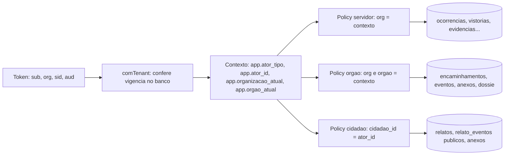
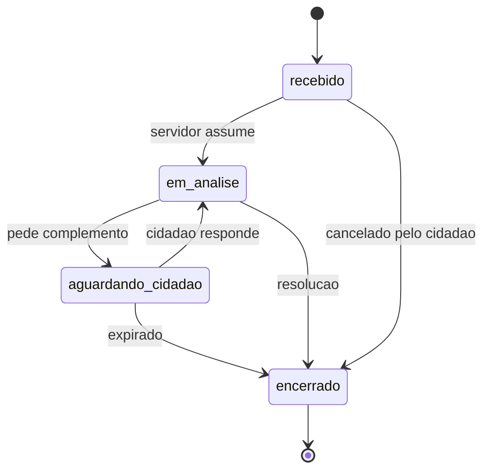
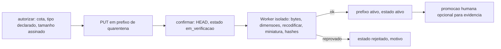
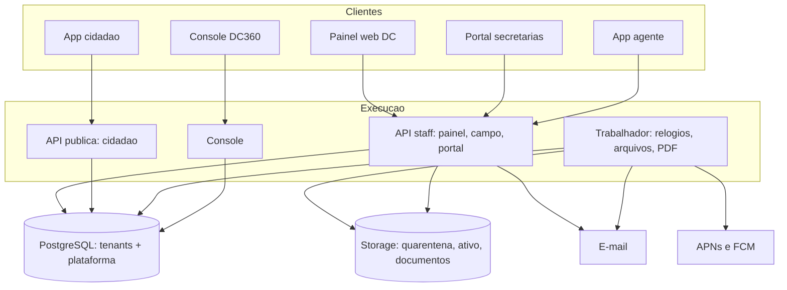

# Decision Pack: Defesa Civil 360 V2

**Data:** 30/09/2026. **Base:** auditoria Baseline Zero (`docs/AUDITORIA-V2-BASELINE-ZERO.md` e os 11 relatórios desta pasta), HEAD `e82719e`.
**Natureza:** documento para discussão humana entre Rafael e Alyson. Não é roadmap, não implementa nada, não altera nenhum relatório existente.
**Convenções:** `[NN]` aponta para o relatório de mesmo número nesta pasta. "RECOMENDAÇÃO TÉCNICA" é minha leitura de arquitetura, sustentada pelo código lido, e não foi prototipada. 🛑 DECISÃO RAFAEL/ALYSON marca o que é de negócio ou de política pública. ⚖️ DECISÃO JURÍDICA / DPO marca o que exige parecer; não cito norma que `docs/CONTEXTO.md` não autorize e não invento base legal.
**Nota de forma:** o pedido manda abrir com um travessão no título; troquei por dois pontos porque o teste `regras-de-conteudo.test.ts` do próprio repositório reprova travessão em qualquer arquivo de `docs/`.

**Limites desta leitura (ditos antes de tudo):** li integralmente, nos 11 relatórios, as narrativas, fluxos, gaps, decisões, riscos e dívidas. As linhas das tabelas "Matriz D" e as listas J/K/L de `09` foram consultadas por busca, não relidas. Conferi no código, por conta própria, só o que sustenta recomendações centrais: a consulta única de `auth/vigencia.ts`, as claims do JWT (`auth/tokens.ts`) e a regra de 401 permanente na fila do campo (`packages/campo/src/transporte.ts`). Nada aqui foi executado ou prototipado. Preços de plano (Supabase, GitHub, Resend, Sentry) e o que só a nuvem prova ficam NÃO CONFIRMADOS.

---

## 0. Classificação de todos os temas (A a E)

Legenda: **A** precisa ser decidido antes do roadmap; **B** pode virar checkpoint dentro de uma fase; **C** é decisão técnica e eu recomendo; **D** exige jurídico, DPO ou município; **E** pode ficar para depois da V2. Um tema pode ter uma parte C e outra A/D: a classe principal vem primeiro e as demais entre parênteses.

| § do pedido | Tema | Classe | Onde resolvo |
| --- | --- | --- | --- |
| 5 | Modelo de identidade da V2 | C | T01 a T06 |
| 6 | Isolamento intra-município | C | T07, T08 |
| 7 | Vigência, sessão, revogação | C | T09 |
| 8 | Competência, transferência, escalonamento, estados, reinspeção do portal | C (B para validar com secretaria real) | T10 a T14, K1, K2 |
| 8 | Órgãos externos ao município (concessionárias) no escopo da V2 | A | R3 |
| 9 | Portal: uma app ou duas | C | T15 |
| 10 | Cidadão: conta obrigatória x anonimato | C (A para confirmar o perfil do canal) | T18, R4 |
| 11 | Login do cidadão e CPF | C | T18, T19 |
| 12 | Município do relato | C (A para habilitação por município) | T20, R4 |
| 13 | Máquina de estados do relato e protocolos | C | T21 |
| 14 | Anti-abuso | C (B para atestação e CAPTCHA) | T22, K9 |
| 15 | Anexos x evidências | C (D para retenção) | T23, J4 |
| 16 | Tipos e limites de arquivo | C (B para PDF e vídeo) | T24, K11, K12 |
| 17 | Cadeia segura de upload | C | T25 |
| 18 | Documento imutável | C (D para retenção do documento) | T26, J4 |
| 19 | Aprovação e assinatura | C (D para competência e nível) | T27, J8 |
| 20 | Compartilhamento campo, cidadão, packages | C | T28 |
| 21 | Design system compartilhado | C | T16 |
| 22 | Identidade visual do portal | C (B para white-label) | T17, K19 |
| 23 | Acessibilidade alvo | C (D para aplicabilidade legal) | T29, J9 |
| 24 | Staging | C | T30 |
| 25 | E-mail, push, SMS | C (A para contratar e domínio) | T31, R6 |
| 26 | Backup, RPO, RTO | C (A para o que prometer) | T32, R7 |
| 27 | Observabilidade | C (A para ferramenta e destino do log) | T33, R6, J7 |
| 28 | SDLC | C | T34 |
| 29 | API v1, OpenAPI, idempotência | C | T35 |
| 30 | PostGIS | C (E: adiar) | T36 |
| 31 | Console x prefeitura | C (D para pedidos de titular) | T37, J5 |
| 32 | Suporte e impersonation | C (D para acesso do fornecedor) | T38, J10 |
| 33 | Campo após retorno da secretaria | C (B) | T39, K14 |
| 34 | Cidadão para agente | C (D para campos que descem) | T40, J6 |
| 35 | Saída, eliminação, retenção, backup das tabelas novas | C | T41 |
| 36 | Decisões que você não perguntou | A | R1, R2, R5, R6, R8 |

Também resolvi, como decisões técnicas, três temas que o pedido não listou e que bloqueiam a execução: política para teste vermelho (T42), topologia de execução da API (T43) e MFA dos usuários de secretaria (dentro de T03).

---

## 1. Decisões que NÃO precisam do Rafael

Cada linha traz a alternativa descartada dentro de "Por quê". A fase provável é um agrupamento de dependência, não um cronograma.

| ID | DECISÃO | RECOMENDAÇÃO TÉCNICA | POR QUÊ (e o que descartei) | RISCO RESIDUAL | FASE PROVÁVEL |
| --- | --- | --- | --- | --- | --- |
| T01 | Modelo de identidade | **Híbrido refinado.** Servidores e usuários de secretaria continuam em `usuarios` (nominais, dentro do município), ligados a órgão por vínculo explícito. Cidadão em realm separado. Sem entidade global "pessoa" agora. | Usuário de secretaria é servidor da prefeitura: mesmo tenant, mesmo ciclo de vida (convite, MFA, desativação, recuperação). Separá-lo duplicaria autenticação como o console já duplicou ([06] 13.3, "auth reimplementada"). Cidadão é população aberta e hostil, sem tenant no token: reutilizar `usuarios` traria 8 riscos medidos em [06] 13.3. Descartei contas separadas por superfície nas 3 frentes (auth x3) e pessoa global (migra `usuarios`, abre porta pré-tenant nova, sem cliente que exija hoje). | Quem atua em dois municípios vira duas contas. Dois mecanismos de auth a manter (servidor e cidadão). | Identidade |
| T02 | Cidadão: realm, audiência, tabelas | **Sim aos três.** Audiência `dc360-cidadao`, segredo de assinatura próprio, tabelas próprias (`cidadaos`, sessões, aparelhos, aceites versionados). Mesmo papel de banco `dc360_app`, com o ator identificado por contexto de banco (T07). Funções de login `SECURITY DEFINER` novas e poucas, com revisão do teto de 27. | O console prova que audiência própria é recusada pela API mesmo com o mesmo segredo (`plateia-nao-atravessa.test.ts`). Manter um único papel de banco evita reabrir o portão `isolamento.test.ts:4005` ("nenhum papel além do de aplicação e do dono tem privilégio"). Descartei "cidadao" em `PAPEIS` (entra em 4 CHECKs e em toda rota que só exige autenticação) e papel de banco novo (reprova o portão). | O teto de funções `SECURITY DEFINER` sobe e cada nova exige prova. Identidade global fora do RLS é a segunda exceção nomeada (hoje só `interesse_municipio`). | Cidadão |
| T03 | Usuário de secretaria na base de servidores | Papel genérico `usuario_orgao` mais tabela `orgao_vinculos` (município, usuário, órgão, papel no órgão: gestor, executor, leitor; unidade opcional; início, fim; quem concedeu; motivo). Audiência própria do portal (`dc360-portal`). **MFA TOTP obrigatório para todo usuário de órgão e para coordenador e administrador**; opcional para operador e agente. | Um único valor novo no enum (e não um por secretaria) evita a explosão de CHECKs e de `PERMISSOES`. O portal expõe dado de família a pessoas fora da Defesa Civil: segundo fator é proporcional ([06] D3, [05] D5). TOTP não depende do provedor de e-mail. Descartei papéis por secretaria e realm próprio para secretaria. | Atrito em secretaria pequena; perda de dispositivo exige reset de TOTP de terceiro, que hoje não existe (T37 cobre quem faz). | Identidade |
| T04 | E-mail e convite | Manter e-mail único global, mas **só entre contas ativas** (índice parcial). Criar conta por **convite por e-mail** com link de uso único (não senha digitada pelo criador). Mensagem de conflito genérica. | O login acha o tenant pelo e-mail (`credenciais_para_login`), por isso a unicidade global existe. Hoje e-mail de conta desativada fica reservado para sempre e o 409 revela existência entre municípios ([06] 13.2). Descartei e-mail por tenant (o login teria de pedir o município). | Convite depende de provedor de e-mail ligado (hoje desligado, R6). Reativar conta cujo e-mail foi reutilizado exige regra. | Identidade |
| T05 | Pessoa em duas secretarias, troca de secretaria, concessionária | Duas secretarias: **dois vínculos ativos**; o portal escolhe o contexto por rota (`/orgaos/:orgaoId/...`), validado no servidor contra o vínculo lido do banco. Troca: encerrar o vínculo (`fim` e motivo) e abrir outro; vínculo antigo fica no histórico. Concessionária multi-município: **fora da V2**, uma conta por município. | Vínculo lido do banco a cada requisição faz a troca valer na hora (precedente: equipe do agente lida do banco, [05] 2.5 cenário 9). ADR 0006:102 recusa token que vale para mais de um município. | Rotação de equipe externa exige trabalho manual em cada município. | Identidade |
| T06 | O que o JWT carrega | Só `sub`, `org`, `sid`, `aud`, `exp` (e `ator` como dica). **Nada de papel, órgão, unidade, competência, situação da conta, equipe, marca de senha provisória ou suspensão como autoridade.** Tudo relido do banco na mesma transação da requisição. | Hoje o token carrega `papel` e `sp` e ninguém os revalida: é a causa do P0 de vigência ([06] 13.2). Ver respostas 9 e 10 em 6.1. | Uma consulta por requisição (T09 mostra que é a mesma que já existe na escrita). | Fundação |
| T07 | Isolamento intra-município | **Híbrido em quatro peças.** (a) Usuário de órgão **nunca consulta `ocorrencias`**: lê `encaminhamentos` e um **dossiê mínimo** montado pela Defesa Civil no envio. (b) RLS por órgão só nas tabelas do domínio de encaminhamento, usando contexto de ator no banco (`app.ator_tipo`, `app.ator_id`, `app.orgao_atual`), **fail-closed** (contexto ausente = zero linhas). (c) Autorização de ação por manifesto rota x papel x vínculo. (d) Arquivos por chave que inclui o órgão, URL emitida só depois da checagem. | RLS por órgão em todas as tabelas refaz 35 tabelas, FKs e portões ([05] D7 a). Só aplicação repete o `recorteDoAgente`, que já vazou uma vez (comentário do próprio arquivo, [07] 10.3 item 8). ACL por item sozinha também deixa o filtro na aplicação. O dossiê como dado resolve de uma vez o isolamento e a minimização (T40, J6). Descartei sub-tenant completo e filtro só de aplicação. | Duas camadas de defesa a manter. Policy mal escrita vaza: exige teste de catálogo por órgão no estilo CA-06. | Fundação, Encaminhamento |
| T08 | Rota nova nunca nasce aberta | `comTenant` passa a **exigir o ator verificado**, conferir vigência e fixar o contexto; rota sem entrada no **manifesto rota x ação** reprova o teste de superfície; policies sem contexto devolvem zero linhas. Varredura empírica papel x rota (o script de `[06]` `tmp\matriz.mts` é o ponto de partida) vira teste fixo. | 32 das 96 rotas só exigem autenticação e o recorte só existe para `agente_campo`: qualquer papel novo herda o município inteiro ([06] 14a). Hoje `superficie.test.ts` prova só autenticação. | Manifesto precisa de manutenção; mitigado porque o teste reprova o esquecimento. | Fundação |
| T09 | Vigência, sessão e revogação | **Combinação: checagem no banco em TODA requisição autenticada, dentro da transação que já existe, mais token de 15 min e refresh rotativo.** Reaproveitar `auth/vigencia.ts` (uma consulta que já existia), terminar os 5 testes pulados, e centralizar a chamada em `comTenant` para não depender de cada rota. Códigos distintos: `401 nao_autenticado` (token vencido, renova), `401 sessao_encerrada` (entrar de novo), `403 conta_desativada` (parar a fila e avisar). | Não é uma consulta nova: a escrita já vai ao banco para saber se o município está suspenso e `vigencia.ts` responde mais quatro perguntas "na mesma ida" (cabeçalho do arquivo). Toda leitura de negócio já abre transação no banco, então uma consulta por chave primária na mesma conexão não consome conexão nova. Cache ou lista distribuída exigiria Redis, que não existe, e perde para o banco, que já é a fonte da verdade. Token curto sozinho só encurta a janela. Funciona com várias instâncias porque não guarda estado em memória. | A fila do campo hoje trata 401 como falha permanente ([`transporte.ts`]): sem os códigos novos, desativar um agente trava itens que deveriam ficar guardados. Coleta feita offline por quem foi desativado precisa de regra (recusar e manter no aparelho; reconhecimento pela coordenação fica para checkpoint). Pool de 10 conexões e sem `statement_timeout` ([10]) piora sob pico: ajustar junto. | Fundação (primeiro item) |
| T10 | Competência das secretarias | **Começar com destino explícito**: a Defesa Civil escolhe o órgão no catálogo e só ele vê o item; devolução cobre engano. Acrescentar `orgaos.tipo` (secretaria, autarquia, concessionária, bombeiros, outro) e uma **lista de categorias de demanda configurável por município**, vazia por padrão, só para relatório. Competência por COBRADE ou por território fica como extensão. | COBRADE descreve a ocorrência, não o que se pede ao órgão ([05] D1 b). Taxonomia de providência inventada sem o domínio diverge entre municípios ([05] D1 c). O gancho de categoria deixa a competência entrar depois sem migração de modelo. | Órgão errado recebe um dossiê (limitado ao mínimo, T07a) até devolver. | Encaminhamento |
| T11 | Transferência entre secretarias | **Secretaria não transfere: devolve com motivo e pode sugerir destino** (campo na devolução, escolhido do catálogo). A Defesa Civil reencaminha com um clique, criando **novo encaminhamento ligado ao anterior** e novo dossiê mínimo. | Evita que dado de família viaje entre órgãos sem decisão da Defesa Civil ([05] D2 c). A sugestão elimina o gargalo da opção A. O órgão B nunca vê a resposta do A, salvo inclusão da DC. | Gargalo na DC em dia de chuva (mitigado por reencaminhar em um clique). | Encaminhamento |
| T12 | Escalonamento (MVP institucional) | Lembretes automáticos **em percentual do prazo** (sem aceite após 25%, lembrete aos 75%, vencido aos 100%) ao responsável e ao gestor do órgão; lista de pendências no painel da DC; ação manual `cobrar` e `escalonar ao gestor do órgão`, ambas como evento append-only com notificação. Cadeia acima do órgão (prefeito, controle) não entra. | Percentual do prazo evita inventar SLA absoluto. Hoje providência vencida não gera aviso nenhum ([05] gap 13). Usa o padrão dos relógios existentes. Cadeia política é decisão do município (K2). | Percentuais são valores iniciais e precisam de validação com secretaria real (K1). Depende de e-mail ou sino para chegar. | Encaminhamento |
| T13 | Estados do encaminhamento | **Sete estados**: `enviado`, `aceito`, `aguardando_dc`, `respondido`, `devolvido`, `concluido`, `cancelado`. Detalhe e tabela de transições em 6.4. | Descartei `recebido` e `em_execucao` como estados: são evento (visualizou) e derivado (aceito já implica trabalho), e cada estado a mais obriga uma ação do órgão. `complemento_solicitado` tem duas direções com "bola" diferente: DC pede ao órgão é **evento que devolve a `aceito`**; órgão pede esclarecimento à DC é o **estado `aguardando_dc`**. `encerrado` vira `concluido` para não colidir com `ocorrencia.encerrada`. | Máquina nova a testar exaustivamente; relógio do prazo pausar em `aguardando_dc` é regra de negócio (K1). | Encaminhamento |
| T14 | Reinspeção sem ocorrência fake | **Nova rodada de vistoria na mesma ocorrência**, por aresta explícita `providencia_pendente -> em_campo` com permissão própria, motivo obrigatório e vínculo ao encaminhamento; evento `reinspecao_determinada` na trilha; vistorias já são várias por ocorrência (documentos usam a vigente). **Reabertura de `encerrada` não existe**: fato novo vira ocorrência nova com `vinculada_a`. | Ocorrência fake perde o protocolo único do fato. Voltar por aresta nomeada troca a propriedade "tudo para a frente" por "toda volta é evento explícito, com motivo e vínculo", que é testável. Manter `encerrada` terminal respeita "registro não se apaga" ([05] D10). | Toca a máquina central, indicadores de prazo (`prazo_em` por rodada) e o app de campo (K14). Documento emitido de rodada anterior continua válido (já é por vistoria). | Encaminhamento, Campo |
| T15 | Portal: app separada ou dentro de `apps/web` | **Aplicação separada `apps/portal`**, consumindo packages mínimos (tokens, UI web extraída do necessário, cliente de API). Domínio, CSP, armazenamento de sessão e deploy próprios. | O que sai no navegador do órgão não pode incluir as telas e os caminhos internos da DC: `http.ts` do painel tem 1245 linhas com todas as rotas internas, e o bundle de produção do painel já leva PGlite, 46 migrações e a semente de desenvolvimento ([02] §5, risco 10). Origem separada isola XSS e token. Audiência própria (`dc360-portal`) casa com a app própria. Descartei "dentro do `apps/web`" (concentra código de dois públicos) e "cópia" (repete a deriva do console). | Mais uma superfície a manter; o custo de extrair UI cai dentro de T16. | Portal |
| T16 | Design system compartilhado | **Extrair já só os tokens** (`packages/design-tokens`, fonte única que gera CSS e TS), antes das superfícies 4 e 5. **Componentes só quando houver segundo consumidor da mesma plataforma:** UI web ao construir o portal, primitivos React Native ao construir o cidadão. Parametrizar os portões de acessibilidade e design para varrer uma lista de superfícies. | Três cópias de tokens hoje, cinco superfícies na V2 ([11] 1.2). A paridade painel x campo cobre 23 pares e não inclui `bordaControle`, `anelDeFoco`. Compartilhar componente DOM com React Native é impossível; compartilhar tokens e rótulos já é real (`glifos-de-severidade`). Os portões hoje têm pasta fixa (`apps/web/src`): app nova fica sem proteção. | Gerador de tokens exige pipeline que o console (só `tsc`) não tem: o console consome um arquivo gerado commitado. | Fundação |
| T17 | Identidade visual do portal | **Identidade DC360** com nome (e logo opcional) do município no cabeçalho. Sem tema por secretaria e sem white-label na V2. | Cada tema novo exige prova de contraste nos dois temas e portão novo; várias prefeituras multiplicam. O órgão precisa saber que está no sistema da Defesa Civil do município dele. | Município pode querer a marca dele (K19). | Portal |
| T18 | Login do cidadão | **E-mail com código de uso único (OTP) de 6 dígitos, validade curta, sem senha.** | Prova posse do e-mail (verificação embutida), elimina armazenamento e recuperação de senha, e usa o mesmo provedor que o portal já exigirá. SMS: custo por mensagem, SIM swap, provedor inexistente. gov.br: credenciamento e dependência externa (adiado, E). Login social: dado com terceiro e possível exigência das lojas (NÃO CONFIRMADO). E-mail com senha: mesma dependência de e-mail, mais fluxo de recuperação. Link mágico exige domínio verificado e associação de links de app (não temos domínio, R5). | Entrega de e-mail em minutos críticos; entrada do código troca de app no celular. Depende de R6 (provedor e domínio). | Cidadão |
| T19 | CPF | **Não coletar.** | Confirma a decisão do produto (`011:25-28`, `schemas.ts:1005-1009`): CPF aumenta obrigação e valor de ataque e nada na V2 o exige (a duplicidade de pessoa não é requisito). Revalidar só se uma integração futura exigir (gov.br). | Menos proteção contra múltiplas contas (compensada por T22). | Cidadão |
| T20 | Município do relato | **O servidor resolve o município pelo local do fato** (coordenada, depois confirmação do cidadão) contra o conjunto de municípios com o canal habilitado. Perto de divisa: o app mostra os candidatos habilitados e pede confirmação. Município não habilitado: mensagem "seu município ainda não usa o canal", sem lista pública. **Sem transferência de relato entre municípios.** Exige `codigo_ibge`, `canal_cidadao_habilitado` e geometria simplificada em `organizacoes` (ou tabela própria). | A regra "organização vem do token" não vale para quem não tem token ([07] DH-29): o município vira atributo calculado e verificado no servidor, nomeado como exceção coberta por gate (como `interesse_municipio`). Mostrar só o município resolvido evita publicar a carteira de clientes (a mesma razão de `/saude` não listar município). Transferir relato entre tenants quebraria o isolamento. | Local do fato diferente do GPS do aparelho; ponto na divisa. Base de limites municipais vira dado a manter (T36 explica por que sem PostGIS). | Cidadão |
| T21 | Estados e protocolos do relato | **Quatro estados**: `recebido`, `em_analise`, `aguardando_cidadao`, `encerrado`, com campo `resolucao` (`convertido`, `vinculado`, `rejeitado`, `fora_da_jurisdicao`, `expirado`, `cancelado_pelo_cidadao`) e motivo estruturado. **Protocolo do relato nasce na criação** (sequência própria por município e ano, prefixo distinto). **Protocolo oficial só nasce na conversão.** O cidadão vê o do relato sempre e o oficial depois da conversão. Detalhe em 6.5. | "Duplicidade" não é estado: é resolução (`vinculado` a ocorrência ou relato existente), útil como sinal de urgência. "Convertido" e "não convertido" são resolução do encerramento. Separar protocolo evita queimar a numeração oficial com spam ([07] 11.2 item 1). | Cidadão cita o protocolo do relato em ofício como se fosse oficial (mitigado pelo prefixo). | Cidadão |
| T22 | Anti-abuso mínimo | **Conta verificada por e-mail (T18) mais limites por conta e por IP guardados no Postgres** (não em memória por processo), tetos diários de relatos e de autorizações de upload, **bloqueio manual** de conta pelo plantão com motivo estruturado (efeito imediato pela T09), e **moderação humana na triagem**. Sem CAPTCHA, sem atestação de app e sem quarentena de relato na V2. Anexos sim passam por quarentena (T25). | O limitador atual é em memória por processo e divide balde atrás de NAT móvel ([07] 11.10); em Postgres vale para qualquer instância. Quarentenar relato atrasa emergência real. Atestação (App Attest, Play Integrity) e CAPTCHA entram se houver abuso observado (K9), pois CAPTCHA em emergência é atrito e acessibilidade. A política da casa é "sem decisão automatizada sobre pessoas" ([08] 15.8), então nada de bloqueio por heurística. | Spam humano ou automatizado no início, absorvido pela fila de triagem. Janela até o primeiro dado de abuso. | Cidadão |
| T23 | Modelo de anexos e evidências | **Tabela genérica `arquivos`** (município, chave de storage, estado, sha256 do armazenado e do original, tamanho, tipo real, origem, autor_tipo e autor, classe de cota) **mais tabelas de vínculo por domínio** (`relato_anexos`, `encaminhamento_anexos`) com FK composta. `evidencias` (prova de vistoria) continua como está. **Promoção** de anexo a evidência é ato humano que cria nova linha em `evidencias` com `origem_anexo_id`, grava `promocoes_de_anexo` (quem, quando, motivo, hash) e nunca altera o anexo. Novo campo `evidencias.incluir_no_laudo` (padrão verdadeiro no que existe, **falso para promovidos**). | Resolve o P0 de integridade: hoje toda `evidencias` enviada entra sozinha no laudo oficial (`documentos.ts:159-189`) e conta no teto dos agentes (`035:351-353`). Cota por classe impede que abuso de cidadão trave a evidência de campo. Classe separada por origem permite retenção diferente. Descartei reaproveitar `evidencias` (herda tudo isso). | Mais tabelas para entrar no manifesto de dados (T41). `incluir_no_laudo` muda o laudo de promovidos: precisa de teste de documento. | Arquivos |
| T24 | Tipos e limites de arquivo | **Cidadão:** JPEG e PNG (o app converte HEIC no aparelho), até 5 por relato, até 10 MB cada, até 25 megapixels. **Secretaria:** imagens como acima até 15 MB; **PDF só depois do scanner** (T25), até 20 MB, até 10 por encaminhamento. **Sem vídeo na V2.** Valores iniciais, ajustáveis. | Vídeo multiplica custo, transcodificação, moderação e superfície ([07] DH-11; [08] DH-02); estimativa de 24 GB por município/ano só com foto ([08]). Menos decodificadores no servidor, menos CVE de imagem. Documento de escritório (macro) fica fora: exportar para PDF. | Secretaria costuma responder com documento: a restrição a PDF pós-scanner pode atrasar o portal (K11). | Arquivos |
| T25 | Cadeia segura de upload | **`autorizar` (cota, tipo declarado, tamanho assinado, chave em prefixo de quarentena) -> PUT -> `confirmar` (HEAD, estado `em_verificacao`) -> worker isolado:** lê em fluxo com limite, detecta tipo por bytes, confere dimensões, **recodifica imagem para JPEG sem EXIF**, gera miniatura, calcula hashes, grava no prefixo ativo e só então marca `ativo`; reprovado vira `rejeitado`. PDF: scanner antivírus em contêiner separado e validação estrutural, fase seguinte. **Recodificar reduz risco** (desarma carga embutida e remove EXIF), mas não substitui validação de bytes, limites e isolamento do decodificador. Em foto de **vistoria** (prova) **não** se recodifica ([08] 16.1: "prova não se reduz"). Antes do primeiro upload público: ver 6.6. | Hoje só o tipo declarado é validado: bytes arbitrários com `content-type` de imagem e tamanho certo passam e entram no laudo, que o Chromium da API renderiza ([08] 16.2). Além disso `confirmarBytes` baixa o objeto inteiro para a memória de uma máquina de 1 GB ([08] 16.3): a verificação sai do processo da API. | Latência entre envio e disponibilidade (estado "em verificação" na tela). Worker é componente novo a operar (T43). | Arquivos |
| T26 | Documento emitido é imutável | **Combinação:** guardar o **PDF final** como objeto de escrita única, o **snapshot estruturado** de tudo que foi impresso, o **hash do PDF**, a **versão do modelo** e a **versão do documento**; tabela `documentos_emitidos` append-only (sem policy de UPDATE e DELETE). Mudança vira **nova versão** que aponta `substitui_id`; cancelamento é evento novo. Um único montador de dados do documento (rota e pacote de saída). | Hoje o documento é função de estado mutável: laudo de amanhã pode divergir do de hoje por nova vistoria, correção de coordenada, nome de agente, retenção ou deploy ([09] 1.2). PDF guardado é o artefato oficial; snapshot mais versão do modelo permitem conferir e regenerar para comparação; hash dá prova de integridade e base para QR de conferência. Descartei "só regenerar" (não reproduz byte a byte) e "só HTML" (depende de navegador). | **Conflito com minimização LGPD**: cópia congelada mantém nome e relato depois do prazo. A solução técnica (classe de retenção própria e derivado redigido) depende de J4. Armazenamento cresce. | Documentos |
| T27 | Aprovação e assinatura (genérico) | Estados do documento `rascunho -> em_revisao -> aprovado -> emitido -> substituido/cancelado`, **políticas por município e tipo** (`exige_aprovacao`, `dupla_aprovacao`, quem aprova por capacidade, não por papel fixo). Campos opcionais `cargo` e `registro_profissional` no perfil. Assinatura como **interface plugável**: `assinaturas(documento, signatario, tipo, momento, hash_assinado, prova)`; **implementar só a simples identificada** (login nominal com MFA, hash, data e hora) e deixar `avancada` e `icp` como tipos reservados. | Permite ao município configurar sem que o produto invente competência pública ([09] decisões 2 e 3). A assinatura simples identificada já é melhor que o "emitido por quem imprimiu" de hoje ([09] 1.5). | Valor jurídico da assinatura simples depende de J8. Marca d'água "DOCUMENTO DE VALIDAÇÃO" segue até lá. | Documentos |
| T28 | O que compartilhar entre agente e cidadão | **Compartilhar:** tokens (T16), esquemas de validação neutros do `@dc360/shared` por **subcaminhos de exportação** (coordenada, telefone, localização, mensagens do Zod), a lógica de renovação de token e classificação de falha (extraída para um pacote de cliente de API), o **protocolo de upload** (autorizar, PUT, confirmar) quando houver o segundo consumidor. **Não compartilhar:** `PAPEIS`, `ACOES`, `PERMISSOES`, `POSTO`, `ROTULO_EVENTO_TRILHA`, schemas de vistoria e sincronização, fila e `packages/campo` (regra de vistoria), tabela `aparelhos` e push do servidor, chaves, bundle e textos de loja do agente, UI do agente. | [07] 10.2 a 10.5 mapeou item a item. O barril único de `@dc360/shared` embarcaria permissões e vocabulário do agente no binário de loja ([07] 10.2 linha de validações). | Extração toca o app de campo (fora do `workspaces`, com `file:`): exige ajuste de Metro e dos scripts de gate (`auditar.mjs:109`). | Fundação, Cidadão |
| T28a | Packages a criar (justificativa por item) | `design-tokens`: **sim**, antes das superfícies novas (T16). `cliente-api` (transporte, renovação de token, classificação de erro, sem DOM nem React Native, `fetch` injetado): **sim**, porque já existem três clientes e o cidadão seria o quarto ([07] DT-01). `upload-core` (lado cliente do protocolo): **sim, mas extraído no momento do cidadão**, a partir do `transporte.ts` do campo, sem inventar. `api-contracts`: **não como pacote novo**; usar subcaminhos de `@dc360/shared` mais **teste de contrato** que confronta cada caminho dos clientes com `printRoutes` (teria pegado o `/pacote.zip`, [02] dívida 1). `auth-core`: **não** (a lógica útil cabe em `cliente-api`; auth de servidor é código da API). UI web e UI nativa: no momento do segundo consumidor (T16). | Cada pacote só nasce se houver duas ou mais cópias ou consumidores reais; o resto seria elegância ([07] R-12). | Mais pacotes de monorepo para equipe de uma pessoa: por isso o corte por necessidade. | Fundação |
| T29 | Acessibilidade: alvo técnico | **Web institucional (painel, portal, console):** WCAG 2.2 nível AA, teclado completo, reflow em 320 px e zoom de 400%, contraste 4,5:1 (texto) e 3:1 (componentes), nunca só cor, autenticação acessível (permitir colar o código). **App do cidadão:** WCAG 2.2 AA mapeado para nativo, VoiceOver e TalkBack em todos os fluxos, rótulo, papel e estado em todo controle, ordem de foco lógica, anúncio de mudança de estado, escala de fonte até 200% sem corte, toque mínimo de 48 dp (Android) e 44 pt (iOS), movimento reduzido, linguagem simples, rotação de tela liberada. **Automatizável:** contraste de tokens (já existe), axe-core no CI em Playwright, regras de a11y no lint de React Native, portões estáticos existentes parametrizados. **Humano e obrigatório antes do público:** leitor de tela em aparelho real (iOS e Android), teste de fonte ampliada, revisão por pessoa com deficiência. eMAG como lista de verificação extra, aplicabilidade em J9. | O projeto só tem análise de fonte e tokens: nenhuma validação em leitor de tela ou aparelho ([11] 2.1 a 2.6). O cidadão amplia o público (idosos, deficiência) em relação ao agente. 2.2 acrescenta alvo de toque, foco não obscurecido e autenticação acessível, relevantes ao login. | Custo de teste manual e de recrutamento (K, dados pessoais dos testadores). PDF oficial sem `tagged` (ativar após revisar estrutura). | Pré-piloto |
| T30 | Staging mínimo | **Três ambientes.** DEV: local (PGlite ou compose). **HML:** app Fly próprio, projeto Supabase próprio, bucket próprio, e-mail em domínio de teste, push em ambiente de teste, builds do app com **bundle ids distintos** e perfil `homologacao` do EAS apontando para a URL real de HML, chave de mapa própria e restrita, **dados sintéticos** (a semente com municípios fictícios já existe). **PROD:** separado e sem dado sintético. Antes de convidar a primeira secretaria ou testar o app do cidadão fora do time: HML de pé; migração ensaiada em HML; e-mail com domínio verificado; trilhas internas de loja (TestFlight, teste interno do Google Play); vigência religada; cadeia de upload; observabilidade P0; restore testado; aviso de privacidade para testadores. | Hoje não existe homologação e o piloto roda como produção com marca d'água ([10] 1.3). `eas.json` aponta para domínio de exemplo. O levantamento proíbe dado de produção em ambiente de teste. | Custo de um segundo conjunto de serviços (NÃO CONFIRMADO o valor). Deriva entre ambientes (versão de Postgres: PGlite 16, CI 16, produção 17.6). | Pré-piloto |
| T31 | E-mail, push, SMS | **E-mail:** manter o Resend (adaptador HTTP já escrito e com contrato testado), remetente em **domínio do fornecedor** (não do município) com nome de exibição por município. **Push:** manter APNs e FCM diretos, tornando `aparelhos` **multiaplicativo** (coluna do aplicativo, credenciais e bundle por aplicativo, tabela própria de aparelhos de cidadão, sem `usuario_id`); a chave APNs é do time de desenvolvedor e o tópico é o bundle id (confirmar na configuração). **SMS: não é necessário na V2.** | Custo de migração de provedor é baixo porque o notificador é injetável, mas não há motivo para trocar o que já tem teste de contrato. Resend gratuito (100 por dia) estoura em dia de temporal ([10] D10): decidir plano em R6. SMS traz custo por mensagem, fraude e provedor inexistente; o OTP por e-mail cobre o login. | Dependência de entregabilidade de e-mail e de contas Apple e Google ainda inexistentes. Push de cidadão exige decisão J1/J2 de identificar aparelho. | Cidadão, Pré-piloto |
| T32 | Backup, RPO e RTO (referência) | **Piloto:** RPO até 24 h e RTO até 8 h (os valores da especificação, RNF-06), com backup diário do provedor, dump antes de cada migração e restore **provado** a cada migração que mexa em papel, policy ou grant. **Produção municipal:** RPO até 15 min (recuperação em ponto no tempo, a confirmar no plano do provedor) e RTO até 4 h, restore trimestral por pessoa que não escreveu o sistema, com relatório. **Storage:** versionamento e cópia periódica para outra conta e região do Brasil. Automatizar o restore em HML com dado sintético ou anonimizado. | O único restore é de 09/09 com 15 migrações (hoje 46) e provavelmente falha em `dc360_console` e `pg_trgm` ([10] 1.1.2); fotos e assinaturas não têm nenhuma cópia; os roteiros só rodam num Mac. Os números são referência técnica para discussão: aprovação em R7. | Cópia de storage em outra conta é novo subprocessador e custo (J7). Restore com dado real exige cuidado de privacidade. Plano do provedor com PITR: NÃO CONFIRMADO. | Operação, Pré-piloto |
| T33 | Observabilidade mínima | **P0 (antes de uso real):** erro centralizado em API, painel, portal e **crash no app móvel** (SDK compatível com Sentry, destino configurável); monitor externo de `/saude` da API e do console com alerta para um canal que alguém lê; `request id` devolvido em cabeçalho e exibido no erro; falha de rotina agendada em nível `error` (hoje `info`); alerta de uso de armazenamento em 80%; profundidade e idade da fila de verificação de arquivos e da sincronização do campo em `/saude`; contagem de falha de push e de e-mail; destino e retenção do log documentados. **P1:** página de status, painel por município no console, percentis de latência. **P2:** tracing, SLO formal. | Hoje nada avisa ninguém: o tempo de detecção é o tempo até o município ligar ([10] 1.2). Console e `/saude` não olham falha semântica. | Destino do log e do erro pode ser fora do país (R6, J7). Alerta sem plantão é inútil (K15 / pergunta 10). | Operação, Pré-piloto |
| T34 | SDLC mínimo | **Obrigatório antes do piloto:** proteção da `master` (PR obrigatório mesmo sozinho, auto-aprovação registrada, checks `produto`, `navegador`, `implantavel` e `aplicativo` obrigatórios, sem push direto); política de `npm audit` alinhada ao `scripts/auditar.mjs` (runtime reprova, desenvolvimento avisa, exceção nomeada com prazo); varredura de segredos (gitleaks) no CI e no pre-commit; análise estática (Semgrep CE) no CI; Dependabot ou Renovate; versionamento SemVer com tags e changelog; deploy para HML por merge e para produção por promoção manual; ação do GitHub fixada por SHA, com `permissions` e `timeout`; build da imagem Docker no CI. **Pode esperar:** SBOM por release (a partir do primeiro release externo), checagem de licenças, DAST automatizado (um ZAP baseline manual em HML antes de abrir o app público), escaneamento de contêiner. **Antes de abrir o app do cidadão:** teste de invasão externo. | 119 commits diretos, sem tag, sem revisão; o CI tende a ficar vermelho pelo `npm audit --audit-level=low` sem mudança de código ([10] 1.3). Recursos de segurança nativos do GitHub variam por plano (NÃO CONFIRMADO qual é o do repositório): por isso ferramentas abertas no CI. | Atrito para operador único: mitigado por checks automáticos e auto-aprovação. Pentest tem custo. | Fundação, Pré-piloto |
| T35 | API: versão, contrato, idempotência, compatibilidade | **Introduzir `/v1` agora**, montando as rotas atuais sob o prefixo com espelho temporário sem prefixo para os clientes já instalados, com data de remoção. **OpenAPI gerado a partir dos esquemas Zod**, começando pelas rotas novas. **Idempotência:** chave de criação gerada no cliente (UUID) com `UNIQUE` para relato, anexo e criação de ocorrência; header `Idempotency-Key` genérico só se surgir necessidade. **Compatibilidade:** `X-App-Version` em toda chamada de aplicativo, rota de versão mínima por aplicativo e `426` para versão antiga. | Agora é o momento mais barato: há um iPhone e poucas instalações, o painel concatena `BASE` em um ponto só, e as rotas já são registradas com prefixo em `servidor.ts`. Binário de loja não atualiza de imediato ([07] R-08) e `POST /ocorrencias` não tem idempotência ([07] gap 20). | Dois caminhos por um tempo. Gerar OpenAPI de Zod exige biblioteca e disciplina. | Fundação |
| T36 | PostGIS | **Pode ser postergado.** Resolver município, duplicidade territorial e proximidade com um módulo TypeScript no pacote compartilhado (ponto em polígono simplificado, distância de Haversine, índice por célula de grade arredondada em colunas comuns), testado como qualquer regra. Reavaliar quando entrarem histórico por raio ou área de risco (GEO-02). | A extensão não existe em nenhuma migração hoje ([02], [07]) e toda a infraestrutura de teste, o modo local do painel e o desenvolvimento rodam em PGlite, onde extensões já são ponto de atrito (`pg_trgm` tem 3 testes pulados por `runIf`, [01] 25). Adotar PostGIS agora arrisca quebrar o que prova o isolamento. **NÃO CONFIRMADO** que o PGlite usado não suporta PostGIS: vale uma hora de verificação antes de fechar. | Geometria própria é código a manter e menos exata na divisa; a base de limites municipais precisa de fonte e atualização. | Cidadão |
| T37 | Console x prefeitura (responsabilidades) | **Console DC360 (fornecedor):** provisiona município e o primeiro administrador, suspende e agenda eliminação do município inteiro, vê só números agregados e saúde. **Administrador do município:** cadastra órgãos, nomeia o **gestor de cada órgão** (por ofício da secretaria), suspende o acesso de uma secretaria, redefine MFA de usuário de órgão (com trilha), habilita o canal do cidadão. **Gestor do órgão:** cria os demais usuários do próprio órgão, abaixo do seu posto. **Recuperação de acesso:** quem administra o posto imediatamente acima, com trilha e senha provisória; o console reemite acesso do **único** administrador de município (hoje falta, [04] item 8). **Suporte ao cidadão:** primeira linha é o município (triagem e mensagens do relato); o fornecedor dá suporte técnico do app sem ver conteúdo. **Pedido de titular do cidadão:** o município é o controlador e recebe o pedido na fila; o fornecedor executa operação técnica documentada e auditada sob instrução do município (J5). | O fornecedor não ganha acesso operacional por conveniência: o console continua sem ler dado municipal (provado por grants, [04] 8.2 item 6). Reaproveita o padrão de hierarquia da ADR 0006. | Município sem capacidade de atender titular (D9 do console). Console passa a precisar de contato institucional por município (campo novo em `organizacoes`, que o console lê por inteiro: exige teste de colunas). | Identidade, Cidadão |
| T38 | Suporte e impersonation | **Piloto e V2: A (sem impersonation) mais um "pacote de diagnóstico" sem dado pessoal** (versão do app, estado da fila, identificadores de erro) que o usuário envia ao suporte. **Suporte assistido (B) fica desenhado, atrás de decisão pós-piloto:** o administrador do município concede um usuário **temporário, nominal, com MFA e prazo curto, somente leitura por padrão**, dentro do próprio município (e não credencial do console), registrado na trilha. **C (impersonation completa) descartada.** | ADR 0006 e 0008 assumem "telefone com o administrador" ([04] 8.6). Qualquer acesso assistido contradiz "nenhuma credencial lê dado de dois municípios" se não for por município e com consentimento. | Atendimento mais lento e frustrante no piloto. Reabrir depois exige J10. | Operação |
| T39 | Campo após retorno da secretaria | **B: o agente vê só o retorno que a Defesa Civil decidir transformar em reinspeção.** A reinspeção chega como tarefa normal, com motivo escrito pela DC e um resumo do retorno (tipo e data, não o texto integral da secretaria). **Nada do histórico da secretaria desce ao aparelho. Sem canal direto agente x secretaria.** | Minimização com SQLite e fotos em claro no aparelho ([03]); hoje até o sino vaza avisos do município inteiro ao agente. A DC continua intermediária, sem dado de órgão no aparelho. | Agente na porta sem saber o que o órgão respondeu (aceitável: ele recebe o motivo da reinspeção). | Campo |
| T40 | Cidadão para agente: o que desce | **Confirmo a hipótese:** agente não recebe relato em triagem, só depois da conversão. Descem: tipo (classificação da DC), endereço e ponto de referência, **coordenada marcada como "declarada pelo cidadão"**, e **descrição operacional escrita ou confirmada pela triagem** (não o texto bruto do cidadão). **Não descem por padrão:** fotos do cidadão (ficam no painel), nome e contato do cidadão (a Defesa Civil intermedia), classificação interna de vulnerabilidade além do que a triagem decidir. Contato só desce se o cidadão marcou "posso ser contatado por agentes" e a triagem confirmou (⚖️ J6). | Hoje a lista de tarefas leva nome, contato e vulnerabilidade de saúde ao aparelho sem criptografia própria ([08] 15.2.3); relato do cidadão traria mais dado e foto de aparelho pessoal. | Perde contexto visual que ajudaria a priorizar. Valida-se com agente no piloto (K14). | Campo, Cidadão |
| T41 | Tabelas novas sempre entram em saída, eliminação, retenção, backup | **Manifesto declarativo** (`db/manifesto-de-tabelas`): por tabela, `saida` (exporta ou exclui com motivo), `eliminacao` (ordem), `pessoal` (sim ou não, colunas) e `retencao` (mecanismo, ou "sem prazo por decisão"). **Teste de catálogo** que compara o manifesto com o catálogo do Postgres nos dois sentidos e **reprova** tabela com `organizacao_id` ausente ou sem classificação; classificar também `dicionario`. Tabelas de plataforma fora de tenant (identidade do cidadão, `interesse_municipio`, console) entram numa lista separada com política própria. Backup é sempre total e checado pelo restore em HML. | Já existem dois portões parciais: `saida-de-municipio.test.ts:276` e `eliminacao-de-municipio.test.ts:1274-1288` forçam classificar; falta o mesmo para retenção e dado pessoal. Sem isso uma migração futura cria tabela com texto livre fora da minimização, como `tipoDescricao` ([08] 15.4.3). Eliminação de município hoje para (`DC366`) se uma tabela nova faltar. | Manifesto vira burocracia se mal desenhado; o teste que reprova torna o custo pequeno. | Fundação |
| T42 | Política para teste vermelho conhecido | **Regra da casa:** nenhum vermelho conhecido existe. Cada vermelho é consertado (defeito real), reescrito (decisão superada, com ADR curta) ou pulado com **data, dono e issue**, e o CI reprova `skip` sem data. Primeiro passo é separar os 14+20+3+2+1+13 vermelhos por causa (o baseline já fez para o campo: 6 texto velho, 4 mock velho, 14 defeitos reais, [01] item 6). | A vigência foi pulada e desligada num commit chamado "ultimo commit" e ninguém viu. Testes escritos antes das correções que nunca chegaram (web 11, API 1, campo 14) misturam defeito real com teste velho ([01]). | A parte "é decisão de produto" do texto "Sair da conta" (K14) segue com o Rafael. | Fundação (portão de entrada) |
| T43 | Topologia de execução | **Separar por processo, mantendo um código:** `apps/api` com modo de serviço. **Trabalhador** (relógios, pipeline de arquivos, PDF e Chromium, saída de município) fora do processo da API **antes** de abrir upload público e PDF pesado. **API pública do cidadão** como app Fly separada **antes do lançamento público**, para o pico de desastre não derrubar painel e fila de campo. Uma imagem Docker, variável de ambiente escolhe o serviço. | Hoje uma máquina `shared-cpu-1x` de 1 GB roda API, cinco relógios, Chromium e o pacote de saída em memória ([02] riscos 1 e 7, [07] R-05). `carga.test.ts` declara que não mede desempenho. | Mais máquinas e custo; semântica de `/saude` por máquina muda; `trustProxy` e limites por instância precisam de revisão (T22 já tira o limitador da memória). | Fundação, Pré-piloto |

---

## 2. Decisões que Rafael/Alyson precisam tomar ANTES do roadmap

Só as bloqueadoras. As marcadas **(ADICIONADA)** não estavam no pedido e foram achadas na segunda leitura (§36). Nenhuma delas é detalhe técnico: cada uma muda a ordem, o tamanho ou a viabilidade do roadmap.

### R1 (ADICIONADA): qual é a capacidade real de execução e o teto de custo?

**Contexto:** o levantamento do projeto fixa capacidade de "um desenvolvedor, até 10 horas por semana" ([07] 10.4, `LEVANTAMENTO...:61`). A V2 acrescenta duas superfícies, um modelo de identidade novo, cadeia de arquivos, documentos imutáveis, homologação e observabilidade, e o Baseline Zero encontrou pendências de fundação antes de qualquer feature. Sem o número de horas, de pessoas e de orçamento (infraestrutura, ferramentas, contas de loja, parecer jurídico, teste de acessibilidade, pentest, IA), nenhum roadmap é executável.

**Alternativa A:** manter a capacidade atual (uma pessoa, horas limitadas) e cortar escopo da V2 para o que cabe.
**Alternativa B:** ampliar (segunda pessoa de código ou revisão; orçamento mensal definido) para executar o escopo inteiro.
**Alternativa C:** faseamento por ondas com marcos de decisão de investimento entre elas.

**Sua recomendação técnica:** C. As dependências em 7 mostram que as duas primeiras ondas (fundação e portal) valem por si; a decisão de investir no app do cidadão é tomada com dados do portal e do piloto.
**Consequência de A:** o roadmap precisa cortar, e o corte natural é adiar o cidadão e mais da metade de T25 a T35.
**Consequência de B:** reduz o fator de ônibus 1 ([10] D4) e permite revisão cruzada (T34), com custo recorrente.
**Consequência de C:** mantém reversibilidade; exige que cada onda tenha critério de saída mensurável.
**O que isso bloqueia:** o tamanho de cada fase do roadmap, o que entra no piloto e as promessas contratuais (R7).

### R2 (ADICIONADA): qual superfície entra primeiro, com qual município e qual secretaria piloto?

**Contexto:** o produto tem hoje um piloto pequeno (3 vistorias reais em iPhone, [03]). As superfícies 4 e 5 têm dependências distintas: o portal depende de identidade, encaminhamento e e-mail; o cidadão depende disso mais arquivos, jurídico, lojas e capacidade humana de triagem. A ordem decide o roadmap, e a validação de T10 a T14 precisa de uma secretaria real.

**Alternativa A:** portal das secretarias primeiro, cidadão depois.
**Alternativa B:** cidadão primeiro (valor visível ao público).
**Alternativa C:** em paralelo.

**Sua recomendação técnica:** A. Pela cadeia de dependências (seção 7), o portal reutiliza e exercita a fundação (identidade, vínculo, estados, e-mail, arquivos) sem expor população aberta, e dá dado real para validar o fluxo antes do cidadão. O cidadão exige J1 a J5 resolvidos, domínio, contas de loja e triagem humana (R4).
**Consequência de A:** o cidadão só entra após o portal estável; menor risco de abuso e de exposição na primeira vitrine.
**Consequência de B:** forte retorno de imagem, mas obriga fazer anexos, moderação, jurídico e lojas antes de a Defesa Civil ter como encaminhar o que recebe.
**Consequência de C:** dobra a frente com a capacidade de R1.
**O que isso bloqueia:** ordem das fases, escolha de município e secretaria de validação (K1), ensaio de HML.

### R3: as secretarias da V2 são só do próprio município?

**Contexto:** concessionárias (água, energia), bombeiros estaduais e outros órgãos que atendem vários municípios conflitam com e-mail único global, token de um município e a ADR 0006:102 ([05] D6).

**Alternativa A:** V2 só com órgãos do próprio município (concessionária entra por conta por município ou fica no link de uso único atual).
**Alternativa B:** órgão externo multi-município com identidade global e vínculos por município.
**Alternativa C:** órgão externo como organização própria com troca controlada entre tenants.

**Sua recomendação técnica:** A. B exige pessoa global, nova porta pré-tenant e nova ADR; C reabre a ADR 0001. Nada na especificação do Alyson exige multi-município na V2.
**Consequência de A:** modelo da T01 a T06 fecha sem entidade nova.
**Consequência de B:** a identidade deixa de ser híbrida simples e o isolamento ganha uma exceção nomeada.
**Consequência de C:** quebra o modelo de tenant.
**O que isso bloqueia:** o modelo de identidade (T01 a T05) e o isolamento do portal.

### R4: perfil do canal do cidadão na V2

**Contexto:** a tendência já é conta cadastrada. A recomendação técnica T18 a T22 pressupõe conta verificada por e-mail, sem vídeo e sem chat. Há um segundo ponto de negócio: quem do município faz a triagem dos relatos, em que horário, e se o canal liga por padrão ([07] DH-31, DH-37).

**Alternativa A:** conta obrigatória verificada por e-mail; sem anonimato, sem vídeo, sem chat; **habilitado por município (opt-in, desligado por padrão)**, com aviso fixo de que não substitui 190, 192 e 193.
**Alternativa B:** conta mais relato anônimo desde o início.
**Alternativa C:** relato sem conta.

**Sua recomendação técnica:** A. Não existe motivo técnico forte para anonimato na V2: ele elimina canal de retorno e de complemento, bloqueio por pessoa e acompanhamento seguro, e pede mais anti-abuso. O motivo de produto ("em emergência, atrito afasta") é real, por isso a conta é de baixo atrito (OTP, T18) e o anonimato fica como evolução medida em checkpoint (K9).
**Consequência de A:** protocolo e acompanhamento autenticados (sem enumeração), moderação com identidade, menos abuso. Atrito inicial.
**Consequência de B:** dois caminhos de segurança, moderação e retenção; ocorrência convertida precisa de "solicitante não identificado" (`solicitante_nome` é `NOT NULL`).
**Consequência de C:** acompanhamento por segredo, sem retorno garantido, spam sem custo.
**O que isso bloqueia:** modelo de identidade do cidadão, estados do relato, anti-abuso, texto de loja, e quem opera a fila de triagem.

### R5 (ADICIONADA): quem é a entidade que publica, opera e responde pelo app e pelo domínio?

**Contexto:** bundle id do app de campo (`com.solerte.dc360.campo`) é "definitivo" depois de publicado e o guia manda trocar ([10] D9); não existe domínio próprio (`*.fly.dev`, `*.vercel.app`), necessário para remetente de e-mail verificado, política de privacidade em URL estável e as lojas; `eas.json` tem `PREENCHER`; app em loja pública com dado sensível pode exigir conta de organização (NÃO CONFIRMADO, `LEVANTAMENTO...:59`). A pergunta de quem é titular da conta de loja e controlador do app é também jurídica (J1, [07] DH-38 e DH-40), mas a escolha da entidade e do domínio é sua.

**Alternativa A:** contas e domínio em nome da empresa do fornecedor (CNPJ existente), uma marca DC360 para todos os municípios.
**Alternativa B:** contas e domínio em nome de pessoa física no piloto, migração depois.
**Alternativa C:** conta e marca por município.

**Sua recomendação técnica:** A. B repete o problema do bundle definitivo; C multiplica lojas e revisões.
**Consequência de A:** prazo de verificação de organização nas lojas (D-U-N-S); marca única; decisão sobre bundle antes do primeiro build.
**Consequência de B:** velocidade agora, retrabalho e risco de personificação depois.
**Consequência de C:** manutenção e submissões por município.
**O que isso bloqueia:** primeiro build e submissão do app do cidadão e do app de campo em loja, e-mail com domínio verificado (T18, T31), política publicada.

### R6 (ADICIONADA, em parte perguntada): autorização para contratar o que a V2 pressupõe

**Contexto:** hoje e-mail e push estão desligados em produção (`EMAIL_ATIVO`, `RECUPERACAO_ATIVA=nao`, `PUSH_ATIVO` comentado); o armazenamento real nunca foi exercitado segundo o README (três versões em conflito, [02] §22); não há erro centralizado, nem plano com recuperação em ponto no tempo confirmado, nem staging. Sem isso o portal (convite, aceite) e o cidadão (OTP) não funcionam.

**Alternativa A:** contratar o conjunto mínimo já escolhido no código: Resend (e-mail), Supabase Storage ou outro S3 com versionamento, plano do banco com PITR, ferramenta de erro com SDK compatível com Sentry, monitor externo, segundo projeto de HML.
**Alternativa B:** contratar só e-mail e storage agora; observabilidade e HML por custo mínimo (log do Fly e projeto gratuito).
**Alternativa C:** adiar.

**Sua recomendação técnica:** A em ordem de bloqueio: e-mail com domínio e storage real primeiro; HML e erro centralizado antes de qualquer usuário externo. Destino de log e erro fora do país é ⚖️ J7.
**Consequência de A:** custo recorrente e novos subprocessadores (aviso de 30 dias, `SUBPROCESSADORES.md`).
**Consequência de B:** piloto de secretaria possível, mas cego a incidente.
**Consequência de C:** o portal e o cidadão não saem.
**O que isso bloqueia:** convite e MFA de secretaria, login do cidadão, anexos, HML, qualquer promessa de continuidade.

### R7: que RPO, RTO e disponibilidade o produto aceita prometer ao município?

**Contexto:** a especificação dá hipótese de 24 h e 8 h e 99,5% de disponibilidade (RNF-01, RNF-06); o levantamento recomenda 15 min e 4 h; nada hoje é medido ([10] D2). T32 propõe referência técnica.

**Alternativa A:** piloto 24 h e 8 h, produção municipal 15 min e 4 h, com restore periódico provado.
**Alternativa B:** manter 24 h e 8 h também na produção.
**Alternativa C:** valores por município em contrato.

**Sua recomendação técnica:** A. B expõe o dia de temporal; C multiplica configuração e prova.
**Consequência de A:** exige plano de banco e storage com cópia, restore em HML e fator de ônibus maior (pergunta 10).
**Consequência de B:** barato, mas a perda aceitável de um dia de ocorrências em temporal não é defensável.
**Consequência de C:** comercialmente flexível, operacionalmente caro.
**O que isso bloqueia:** escolha do plano do provedor, frequência de cópia, SLA no contrato e a definição de "pronto para produção" no roadmap.

### R8 (ADICIONADA): a Fase 0 de estabilização é portão de entrada de qualquer feature?

**Contexto:** o Baseline Zero achou um P0 de segurança (vigência desligada), telas de conta sem interface (a recuperação de senha por e-mail está desligada em produção, então quem esquece a senha não tem caminho), `npm audit` não zerado, 7 suítes vermelhas e documentos que dizem o contrário do código. T09 e T42 dependem de tratar isso antes. Há também uma decisão de produto atrasada: a saída a campo está pronta em API e painel mas **o app não a chama**, enquanto cartão e apresentação afirmam o contrário ([03] decisão 7).

**Alternativa A:** fase de estabilização obrigatória e anterior (vigência, telas de conta, pacote de saída, `npm audit`, vermelhos classificados, saída a campo decidida) antes de qualquer feature da V2.
**Alternativa B:** estabilizar em paralelo à fundação da V2.
**Alternativa C:** deixar para depois.

**Sua recomendação técnica:** A, e a vigência primeiro (uma consulta já existente, T09). Sobre a saída a campo: implementar no app ou retirar das instruções antes de qualquer demonstração a município.
**Consequência de A:** atraso inicial, base confiável e demonstrável.
**Consequência de B:** divide atenção sob a capacidade de R1; risco de construir a V2 sobre autorização aberta.
**Consequência de C:** repete o padrão que desligou a vigência sem ninguém ver.
**O que isso bloqueia:** o início da fundação (T06 a T09) e a veracidade do que se mostra ao Alyson e aos municípios.

---

## 3. Decisões que podem virar CHECKPOINT dentro do roadmap

| ID | Decisão | Quando decidir | Quem | Critério ou insumo |
| --- | --- | --- | --- | --- |
| K1 | Estados, prazos e pausa do relógio em `aguardando_dc` do encaminhamento; competência por destino explícito basta? | Antes de fechar o modelo do encaminhamento, com uma secretaria real | Alyson, secretaria piloto | Rodar o fluxo em HML com dados sintéticos e 3 casos reais da secretaria |
| K2 | Percentuais de lembrete, canal e cadeia acima do gestor do órgão | Piloto do portal | Alyson, município | Quantos lembretes por encaminhamento são tolerados; política municipal de escalonamento |
| K3 | Conteúdo padrão do dossiê mínimo por tipo de demanda | Antes do primeiro encaminhamento real | DPO ou município (⚖️ J6) mais Alyson | Mesmo dossiê para todos ou variável por categoria |
| K4 | MFA obrigatório para usuário de órgão (T03): atrito aceitável | Primeira rodada de convites | Alyson | Taxa de ativação e de perda de dispositivo |
| K5 | Encerramento com providência obrigatória em aberto (RN-05): avisar, justificar ou bloquear | Antes do portal ir ao ar | Alyson, município | Hoje só avisa ([05] D11) |
| K6 | Prazos de retenção padrão por município | No onboarding de cada município | Município (⚖️ J4) | Hoje o padrão é vazio e nada expira |
| K7 | RPO e RTO realmente medidos contra o prometido | Após o primeiro restore em HML | Rafael | Tempo e perda medidos |
| K8 | SMS ou outro canal de contato é necessário? | Após o piloto do cidadão | Alyson | Proporção de cidadãos sem e-mail ou sem acesso a ele |
| K9 | Anonimato, atestação de app e CAPTCHA | Se houver abuso observado | Rafael | Taxa de rejeição e de spam por semana |
| K10 | Aumentar cota e limites de anexo por cidadão | Após o piloto | Rafael | Custo de storage por relato |
| K11 | PDF para secretaria sem esperar o scanner completo | Se o portal travar sem PDF | Rafael | Quanto das respostas das secretarias exige documento |
| K12 | Vídeo | Pós-V2 | Alyson | Caso de uso real justifica o custo |
| K13 | Ferramenta de erro e de log e residência do dado | Início da fase de observabilidade | Rafael (⚖️ J7) | Sentry hospedado fora do país ou alternativa |
| K14 | **Saída a campo:** implementar no app ou retirar das instruções; e o texto "Sair da conta" (o código novo evita apagar vistoria começada: o teste antigo é que está defasado, [01] item 6); aceite e devolução antes do prazo; tarefa por equipe ou por pessoa; sincronização em segundo plano; criptografia local do SQLite; versão mínima e OTA | Antes de qualquer demonstração do app a município e antes da reinspeção (T14) | Alyson, agentes | Entrevistas com agentes; aparelho Android real (ver pergunta 15) |
| K15 | Plantão e segunda pessoa com acesso a contas e segredos | Antes de qualquer SLA | Rafael | Fator de ônibus 1 hoje ([10] D4) |
| K16 | Retirar a marca d'água dos documentos | Após T26 e T27 e J8 | Município, Alyson | Documento imutável e aprovação configurados |
| K17 | Quem substitui a ocorrência por reabertura: só ocorrência vinculada ou também reabertura | Antes de fechar T14 | Alyson | Hoje encerrada é terminal |
| K18 | Orientação do aparelho (retrato fixo) e layout de tablet | Ao desenhar o app do cidadão | Alyson | Acessibilidade motora (T29 libera rotação no cidadão) |
| K19 | White-label por município | Após o primeiro município pedir | Alyson | Pedido real |
| K20 | Idiomas e Libras | Após piloto | Alyson, município | Público real |
| K21 | PDF oficial acessível (`tagged`) | Quando o documento de T26 estiver pronto | Rafael | Revisão de estrutura semântica do HTML |
| K22 | Atribuir encaminhamento a pessoa do órgão ou só ao órgão | Primeira rodada com secretaria | Alyson | Hoje `responsavel` é texto livre |

---

## 4. Decisões jurídicas / DPO / município

Nenhuma resolvida aqui. Cada uma indica o que o roadmap pode implementar de forma genérica sem decidir por vocês.

| ID | ⚖️ Decisão | Por que importa | O que a V2 pode implementar sem decidir |
| --- | --- | --- | --- |
| J1 | Base legal por canal e finalidade (servidor, agente, secretaria, cidadão); **quem é o controlador dos dados da conta do cidadão** num app único para vários municípios (município, fornecedor ou ambos) | Muda texto de privacidade, rótulos de loja, contrato e o modelo de identidade do cidadão (T02) | Estrutura de aceites versionados (tabela, versão, data, IP, usuário, revogação), sem texto |
| J2 | Política de privacidade e termos de uso, aceite versionado, consentimentos granulares (localização, push, foto), com ciência x consentimento | A política está "redigida, não publicada" com 10 campos `[[ ]]` ([08] 15.3). O levantamento diz que a base de Defesa Civil "não é consentimento" | O mecanismo de registro e revogação |
| J3 | Menores de idade como usuários e como fotografados | App em loja aberta; a própria política diz que o sistema não é dirigido a menores | Campo de classificação etária declarada; sem verificação |
| J4 | Retenção: relato não convertido, anexos de cidadão e de secretaria, IP e user agent, logs, **documento emitido x minimização**, backups x eliminação | Hoje o padrão é vazio; documento congelado mantém dado pessoal; backup fora do alcance da eliminação ([08] 15.4.3, [09] decisão 6) | Classe de retenção por tabela (T41), derivado redigido de documento, prazos configuráveis por município |
| J5 | Direitos do titular: canal, prazo, quem atende (município com apoio do fornecedor), exclusão de conta no app x "registro não se apaga" | Hoje seria operação manual com credencial de dono e deixaria o nome antigo na trilha ([08] 15.7) | Fila de pedidos no painel do município, exportação por titular, anonimização com mecanismo de redação |
| J6 | O que cada órgão pode ver do dossiê (nome, endereço, vulnerabilidade, fotos) e se o ofício por link continua entregando relato e vulnerabilidade; o que desce ao aparelho do agente | O ofício imprime nome, relato e descrição de vulnerabilidade a quem abrir o link, contra o texto da política ([08] 15.8 item 2) | Dossiê como dado configurável, registro de consulta por usuário nominal |
| J7 | Transferência internacional e novos subprocessadores (mapa, push, e-mail, erro, cópia de storage) | `SUBPROCESSADORES.md` exige aviso de 30 dias e conversa com o município antes de ligar | Troca de provedor sem reescrita (adaptadores injetáveis) |
| J8 | Competência para aprovar e assinar laudo e termo, nível de assinatura, marca d'água, fundamento legal por tipo de documento (não inventar norma) | Termo de interdição retira famílias de casa e vai para processo ([09]) | Estados de aprovação, políticas por município e tipo, assinatura simples |
| J9 | Quais exigências de acessibilidade (LBI e eMAG) alcançam cada superfície | O levantamento fala em WCAG como piso e eMAG como referência de governo | Alvo técnico de T29 |
| J10 | Papel do fornecedor no suporte: acesso assistido a dado do município | ADR 0006 e 0008 vedam; V2 aumenta chamados | Usuário temporário nominal concedido pelo município (T38), sob decisão |
| J11 | Denúncia falsa (trote), abuso e conteúdo ilícito: termos, consequência, moderação humana | O relato entra numa fila humana de emergência | Registro de moderação append-only e bloqueio manual (T22) |
| J12 | O que se preserva de município eliminado (trilha, laudos e interdições) e por quanto tempo | A eliminação hoje apaga a trilha ([04] D3) | Extrato mínimo sob custódia, se decidido |
| J13 | Nomeação do encarregado e endereço do canal | Campos `[[ ]]` abertos na política | Nenhuma |

---

## 5. Decisões que podem ser adiadas para depois da V2

- **Concessionária e órgão estadual multi-município** como usuário: exige entidade global "pessoa" e vínculos entre tenants (R3 recomenda fora).
- **Unidade administrativa** dentro do órgão (a coluna opcional em `orgao_vinculos` basta como gancho).
- **Competência por COBRADE ou por território**, transferência direta entre órgãos e cadeia de escalonamento acima do gestor do órgão.
- **Vídeo, outros anexos de documento, áudio.**
- **Anonimato do cidadão, SMS, login social, gov.br** (cada um como evolução medida).
- **Atestação de app e CAPTCHA** (só com abuso observado).
- **PostGIS e consultas por raio ou área de risco** (GEO-02).
- **Assinatura avançada e ICP-Brasil** (interface reservada em T27).
- **White-label por município, tema por secretaria, multi-idioma, Libras.**
- **Chat ou mensagens livres** entre cidadão e Defesa Civil (a V2 usa pedido de complemento estruturado).
- **Tracing, SLO formal, OpenTelemetry** e plataforma de logs própria.
- **Impersonation completa** (descartada).
- **OTA de código no app** e sincronização em segundo plano do campo (decisão de K14).
- **Integrações oficiais** (S2ID, SEI e outras), fase 4 do documento original.

---

## 6. Arquitetura recomendada consolidada

### 6.1 Identidade: respostas às 10 perguntas do §5

1. **O híbrido é o melhor para este projeto?** Sim, na forma refinada de T01: o único ator realmente "estranho" ao modelo é o cidadão. Servidor e usuário de secretaria compartilham tenant, ciclo de vida e controles.
2. **Cidadão com realm, audiência JWT e tabelas próprias?** Sim (T02). Audiência `dc360-cidadao`, segredo próprio, tabelas próprias.
3. **Usuário de secretaria na identidade-base dos servidores ou realm próprio?** Mesma tabela e mesma infraestrutura de autenticação, com **audiência própria do portal**, papel genérico e vínculo (T03). Não realm próprio.
4. **Entidade global "pessoa" agora?** Não (T01, T05). Só se R3 for B.
5. **Pessoa em duas secretarias:** dois vínculos ativos e contexto por rota validado no servidor (T05).
6. **Pessoa que muda de secretaria:** encerra o vínculo com motivo, abre outro; itens individualmente atribuídos são reatribuídos ou sinalizados pelo gestor; o histórico preserva o vínculo da época (T05).
7. **Concessionária de vários municípios:** fora da V2; uma conta por município (T05, R3).
8. **E-mail globalmente único?** Sim, **entre ativos**, para servidor e usuário de secretaria; namespace separado para o cidadão (T04, T02).
9. **O JWT carrega órgão ou unidade?** Não. Só identidade; órgão, unidade e papel no órgão são relidos do banco na mesma transação (T06). Para múltiplos vínculos, o órgão vem na rota e é validado.
10. **O que nunca é confiado do token:** papel, vínculo (órgão, unidade, papel no órgão), competência, situação da conta, equipe, marca de senha provisória, suspensão do município. Só `sub`, `org` e `sid` assinados identificam quem pede; tudo mais o banco decide. Nota para a regra do CLAUDE.md ("organização vem do token e de mais lugar nenhum"): o **órgão** é contexto dentro do tenant, escolhido na rota e **validado contra o vínculo lido do banco**, e não é o tenant. Vale registrar em ADR.

### 6.2 Isolamento intra-município: respostas às 10 perguntas do §6

Comparação: **só aplicação** (rápida, mas é o padrão que já vazou: `recorteDoAgente`, `GET /oficios`, `GET /avisos`); **RLS por órgão em tudo** (forte, mas refaz 35 tabelas, FKs e portões); **ACL por item** (precisa do filtro na aplicação); **híbrido** (recomendado, T07).

1. **Obras não vê Saúde:** usuário de órgão não tem caminho para `ocorrencias`; lê `encaminhamentos` cujo `orgao_id` é o do contexto, por RLS fail-closed, mais o dossiê que a DC compôs; anexos pela chave do órgão e URL emitida após a checagem; busca, ofício e exportação do órgão leem as mesmas tabelas.
2. **`orgao_id` no contexto de banco?** Sim, `app.orgao_atual`, junto de `app.ator_tipo` e `app.ator_id`.
3. **Algo como `app.usuario_atual`?** Sim, `app.ator_id`: vale para `WITH CHECK` de trilha (`autor_id = app_ator_id()`, o autor não pode ser forjado), para política de "só o meu" do cidadão e para auditoria.
4. **Papel genérico `usuario_orgao` com vínculo?** Sim.
5. **Papéis Obras e Saúde?** Não.
6. **Competência: dado ou papel?** **Dado**, quando entrar (T10); na V2 inicial nem isso: destino explícito.
7. **Como evitar explosão de roles e CHECKs:** um domínio `CREATE DOMAIN` para tipo e papel de ator, usado nas 4 tabelas que hoje têm `CHECK` próprio (`usuarios`, `trilha_eventos`, `trilha_administrativa`, `ocorrencia_consultas`); adicionar `usuario_orgao` em um lugar só; `autor_tipo` em colunas novas em vez de multiplicar papéis.
8. **Rota nova não nasce aberta:** T08 (ator exigido em `comTenant`, manifesto, policy fail-closed).
9. **Matriz papel x rota x método x recurso:** manifesto versionado, gerado e conferido por teste a partir de `printRoutes`; ponto de partida é o script empírico de [06] (`matriz.mts`); a matriz atual por ação já existe em `permissoes.ts`.
10. **Arquivos e documentos com a mesma regra:** chave inclui `tenant/<org>/orgaos/<orgao>/enc/<id>/`; URL assinada só após o mesmo teste de acesso da rota de dado; documento do órgão é gerado do dossiê, não de `ocorrencias`; consulta registrada por usuário nominal.

### 6.3 Contexto de ator no banco (esboço conceitual)



Regra única: **contexto ausente ou incompleto devolve zero linhas** (nunca `OR contexto IS NULL`).

### 6.4 Encaminhamento (providência evoluída) e reinspeção

Estados: `enviado`, `aceito`, `aguardando_dc`, `respondido`, `devolvido`, `concluido`, `cancelado`. Eventos append-only: `visualizado`, `aceito`, `devolvido` (motivo, destino sugerido), `esclarecimento_solicitado`, `esclarecimento_respondido`, `respondido`, `complemento_solicitado`, `prazo_alterado` (motivo), `cobrado`, `escalonado`, `concluido`, `cancelado`, `reencaminhado`.

| De | Para | Quem | Observação |
| --- | --- | --- | --- |
| (novo) | `enviado` | DC | cria dossiê mínimo (snapshot), prazo |
| `enviado` | `aceito` | usuário do órgão | vira responsável nominal |
| `enviado` | `devolvido` | usuário do órgão | motivo obrigatório; destino sugerido opcional |
| `aceito` | `respondido` | responsável | resposta e anexos |
| `aceito` | `aguardando_dc` | responsável | esclarecimento à DC |
| `aguardando_dc` | `aceito` | DC | responde o esclarecimento |
| `respondido` | `concluido` | DC | aceita a resposta |
| `respondido` | `aceito` | DC | complemento solicitado (evento, novo prazo) |
| `respondido` | `concluido` + reinspeção na ocorrência | DC | aresta `providencia_pendente -> em_campo` com motivo e vínculo (T14) |
| `devolvido` | `enviado` | DC | reenvia ao mesmo órgão |
| `devolvido` | `cancelado` + novo encaminhamento ligado | DC | reencaminha a outro órgão |
| `enviado`, `aceito`, `aguardando_dc` | `cancelado` | DC | motivo obrigatório |

`prazo_vencido` e `sem_aceite` são **derivados** (relógio), não estados. A resposta do órgão deixa de ser digitada pela DC: autoria vem do usuário nominal autenticado (hoje `respondida_por` é texto livre). Atualização de `providencias` passa a UPDATE por coluna com imutabilidade da resposta no banco (padrão já usado em `oficio_envios`, `devolucoes_de_tarefa`, `saidas_a_campo`), eliminando a corrida de [05] gap 3.

### 6.5 Relato do cidadão



Resoluções: `convertido` (cria ocorrência e consome o protocolo oficial), `vinculado` (anexa a ocorrência ou relato existente), `rejeitado` (motivo estruturado), `fora_da_jurisdicao`, `expirado`, `cancelado_pelo_cidadao`.

Respostas às 10 perguntas do §13:
1. **Protocolo do cidadão** nasce na criação do relato, com sequência por município e ano e prefixo próprio.
2. **Protocolo oficial** nasce só na conversão, na sequência já existente (`proximo_protocolo`).
3. **O cidadão vê** o do relato sempre; o oficial depois da conversão, marcado como "protocolo oficial".
4. **Vínculo:** `ocorrencias.relato_origem_id` e `relatos.ocorrencia_id`, mais `relato_vinculos` (N relatos para 1 ocorrência), append-only, com FK composta; o vínculo sobrevive à minimização porque é identificador, não texto.
5. **Duplicidade:** o servidor sugere "possível duplicado" à triagem por tipo, janela de tempo e célula de grade; a triagem decide `vinculado`; o cidadão nunca vê relato ou ocorrência de terceiros, só avisa sobre o próprio relato aberto na mesma área.
6. **O que o cidadão acompanha:** etapa em linguagem padrão (recebido, em análise, precisamos de mais informações, encaminhado à equipe, vistoria realizada, atendimento concluído, vinculado a outro registro, não foi possível atender), datas, protocolos, e mensagens públicas escritas para ele.
7. **Nunca descem ao app:** nota interna, severidade, prazo, equipe, nome de servidor, classificação de vulnerabilidade, duplicidade e dados de terceiros, trilha, status interno bruto, identificadores internos.
8. **Complemento sem nota interna:** pedido estruturado (`mensagem_publica` e campos solicitados) escrito em campo próprio, separado da nota interna (`relato_notas_internas`, só contexto servidor).
9. **O relato convertido continua existindo** como registro imutável; o app lê um modelo de leitura derivado do andamento da ocorrência, nunca `ocorrencias.*` (lista de inclusão, não de exclusão).
10. **Auditoria da decisão humana:** `relato_eventos` append-only com `autor_tipo`, `autor_id` (servidor), estado anterior e novo, resolução, código de motivo e, quando preciso, referência à nota interna; texto livre do cidadão nunca vai para tabela imutável sem classe de retenção.

### 6.6 Cadeia de arquivos e o que existe antes do primeiro upload público



**Pré-requisitos antes do primeiro upload público (todos):** (1) validação por bytes, limites e dimensões; (2) recodificação de imagem e remoção de EXIF; (3) prefixo de quarentena e máquina de estados: nada é servido fora de `ativo`; (4) cota por classe de origem, separada do teto de evidência dos agentes; (5) URL assinada com tamanho e tipo presos e validade curta; (6) verificação fora do processo da API (T43); (7) limite por conta de autorizações de upload (T22); (8) caminho de remoção por moderação com motivo; (9) política de privacidade cobrindo foto; (10) imagens de terceiros fora do Chromium do laudo (só evidência promovida e já recodificada).

### 6.7 Topologia, apps e notificações



Resumo por tema: **tenants** continuam por `organizacao_id` com RLS forçada; **plataforma** (identidade do cidadão, `interesse_municipio`, console) vive fora do tenant com política própria e entra no manifesto (T41). **Órgãos** são entidades do município com vínculos de usuário; **cidadão** tem realm e tabelas próprias e só entra no tenant por relato com instantâneo do contato verificado (o município nunca lê a tabela global). **Autorização**: ator no banco, vigência por requisição, manifesto de ação. **Arquivos**: `arquivos` + vínculos + pipeline em trabalhador. **Documentos**: emitidos imutáveis, versionados, assinatura plugável. **Notificações**: e-mail por Resend, push por APNs e FCM com `aparelhos` multiaplicativo, vitrine sem dado pessoal. **Apps**: cinco superfícies, packages mínimos (`design-tokens`, `cliente-api`, depois UI por plataforma e `upload-core`).

---

## 7. Ordem de dependências (não é roadmap)

```
Baseline verde e portão de testes (T42)            (R8)
   -> vigência por requisição + codigos de erro (T09)
   -> contexto de ator no banco + manifesto rota x ação (T06, T07, T08)
        -> manifesto de dados / catálogo de tabelas (T41)
        -> /v1 + teste de contrato cliente x rota (T35)
        -> trabalhador separado (T43) -> pipeline de arquivos (T25)
   -> design-tokens (T16) e cliente-api (T28a)

Provedores contratados e domínio (R5, R6)
   -> e-mail ligado + convite (T04, T31)
   -> HML + observabilidade P0 + SDLC mínimo (T30, T33, T34)

Identidade: vínculos de órgão, MFA, domínio de papel (T03, T05)
   -> Encaminhamento: estados, eventos, dossiê, prazos (T13, T12, T07)
        -> Portal (T15)  [depende também de design-tokens e UI web extraída]
             -> reinspeção e retorno ao campo (T14, T39)  [depende de K14]
   -> Documentos imutáveis (T26) -> aprovação/assinatura (T27) -> fim da marca d'água (K16)

Pareceres J1 a J5 e J11  -> política publicada
   -> Relato: entidades, estados, protocolo, território (T20, T21, T36)
        -> Identidade do cidadão (T02, T18)
             -> API pública (T43) + anti-abuso (T22)
                  -> App do cidadão (T28, T29)  [depende de pipeline de arquivos, HML, contas de loja, acessibilidade validada]
        -> Caixa de triagem no painel (antes de qualquer beta externo)
```

---

## 8. Perguntas finais ao Rafael/Alyson

1. **Capacidade (R1):** quantas horas por semana de desenvolvimento, quem executa e qual o teto mensal de custo de infraestrutura, ferramentas e IA?
2. **Ordem e piloto (R2):** o portal das secretarias entra antes do app do cidadão? Qual município e qual secretaria validam o fluxo?
3. **Escopo de órgãos (R3):** a V2 atende só secretarias do próprio município, deixando concessionárias e órgãos estaduais de fora?
4. **Perfil do cidadão (R4):** confirmam conta obrigatória verificada por e-mail, sem anonimato, sem vídeo, sem chat, e canal habilitado por município?
5. **Triagem de relatos (R4):** que município aceita habilitar o canal no piloto e quem faz a triagem, em que horário?
6. **Entidade e domínio (R5):** em nome de quem ficam as contas Apple e Google, a marca do app e o domínio próprio?
7. **Contratação (R6):** autorizam e-mail com domínio verificado, storage real com versionamento, plano do banco com recuperação em ponto no tempo, ferramenta de erro e um segundo ambiente de homologação?
8. **Disponibilidade (R7):** aceitam prometer RPO 24 h e RTO 8 h no piloto e RPO 15 min e RTO 4 h na produção municipal?
9. **Fase 0 (R8):** estabilização (vigência, telas de conta, pacote de saída, `npm audit`, vermelhos classificados) é pré-requisito de qualquer feature da V2?
10. **Saída a campo (K14):** implementamos a declaração de saída no app ou retiramos o texto do cartão, do guia e da apresentação?
11. **Operação (K15):** quem é a segunda pessoa com acesso a Fly, Supabase, GitHub, Apple e Google, e existe plantão?
12. **Jurídico (J1 a J13):** quem é o jurídico ou o DPO que responde pelos pareceres, e até quando? O app do cidadão não é publicado sem J1 a J5.
13. **Validação do portal (K1):** que secretaria real e que pessoa nela validam aceite, devolução, prazos e escalonamento antes de congelarmos o modelo?
14. **Documentos (K16, J8):** quem no município aprova o modelo dos documentos e quando a marca "DOCUMENTO DE VALIDAÇÃO" pode sair?
15. **Aparelhos (K14):** que aparelhos Android reais existem para validar o app (hoje só há um iPhone) e quem os mantém?

---

## Anexo: como as 13 decisões do portal ([05] D1 a D13) foram reduzidas

| [05] | Resolução aqui |
| --- | --- |
| D1 competência | T10 (técnica) e K1 (validar com secretaria) |
| D2 transferência | T11 |
| D3 escalonamento | T12, K2 |
| D4 prazos por tipo | T12 (percentual do prazo) e K1 |
| D5 identidade e MFA de secretaria | T03, K4 |
| D6 concessionárias | R3 (recomenda fora da V2) |
| D7 modelo de tenant do órgão | T07 |
| D8 dossiê por órgão | T07 (dossiê como dado), K3, J6 |
| D9 papel e vínculo | T03, T05 |
| D10 reinspeção e reabertura | T14, K17 |
| D11 encerramento com providência aberta | K5 |
| D12 desativação de órgão e usuário com itens em andamento | Regra técnica: bloquear a desativação até reatribuir ou devolver os itens abertos (sem decisão humana nova) |
| D13 forma do portal e link de uso único | T15; o link atual continua até o portal ser adotado, depois decide-se a desativação |

Resultado: das 13, **uma** virou decisão bloqueadora (R3), duas viraram checkpoint de validação com secretaria real (K1, K3) e o resto foi resolvido por recomendação técnica.
