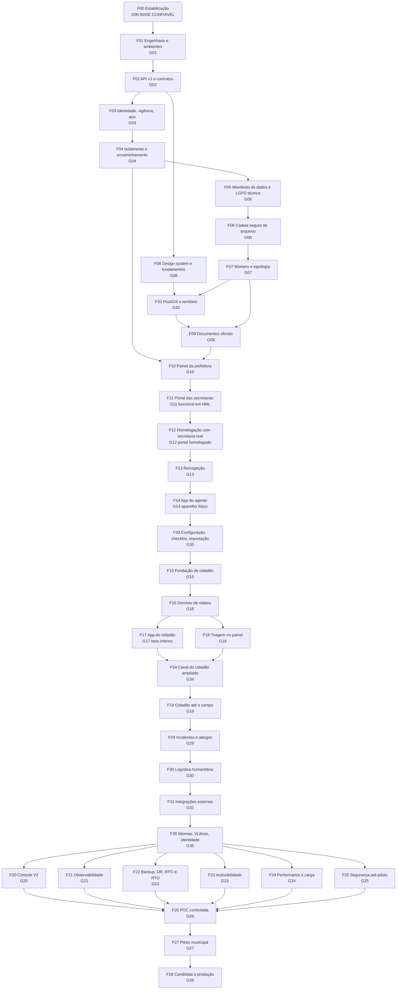

# Mapa de dependências entre fases e gates

Este arquivo mostra a ordem estrutural do roadmap e o que pode andar em paralelo. Em 2026-10-01 a V2 foi ampliada (decisões D-07 a D-29): são 36 fases, e as sete novas (F29 a F35) têm NÚMERO que não é a ORDEM de execução. A ordem de execução vale a tabela da seção 1B e a de `STATUS.md`, seção 5. Onde uma fase pode começar antes do que sua posição sugere, isso está dito e justificado. Dependências finas (etapa com etapa) estão em cada etapa, no campo "Dependências de entrada".

## 1. Sequência conceitual

FUNDAÇÃO, PORTAL DAS SECRETARIAS, ESTABILIZAÇÃO E HOMOLOGAÇÃO, APP DO CIDADÃO (D-01). O cidadão nunca é desenvolvido em paralelo com o portal.

Regra cumulativa: cada gate depende de TODOS os que o precedem NA ORDEM DE EXECUÇÃO (não na numeração). O diagrama mostra só a cadeia principal; uma regressão em qualquer gate anterior reprova os seguintes.

## 1B. Ordem de execução (fonte única: `STATUS.md`, seção 5)

F00, F01, F02, F03, F04, F05, F06, F07, F08, F32, F09, F10, F11, F12, F13, F14, F33, F15, F16, F17, F18, F34, F19, F29, F30, F31, F35, F20, F21, F22, F23, F24, F25, F26, F27, F28.

Por que as fases novas ficam onde ficam: a F32 (PostGIS) vem logo depois do design system porque a F09, a F10 e a F16 consomem geometria; a F33 (configuração, checklist e importação) vem depois do app do agente porque o checklist roda no aparelho e o app precisa existir consolidado; a F34 (canal ampliado) fica entre a triagem (F18) e a F19 porque o payload do agente só fecha depois de provada a ausência de vídeo e conversa; F29, F30 e F31 vêm depois do canal do cidadão e antes do console, porque o console e as métricas passam a conhecer os módulos novos; a F35 traduz e veste as telas de todas as fases anteriores, por isso vem logo antes de F20 a F25.

## 2. Tabela de dependências diretas e do que cada gate libera

| Fase | Gate | Depende diretamente de | Libera |
| --- | --- | --- | --- |
| F00 | G00 BASE CONFIÁVEL | nada (é o portão absoluto) | todas as demais; nada novo entra antes |
| F01 | G01 ENGENHARIA E AMBIENTES PRONTOS | G00 | F02, F08; HML para todas as validações |
| F02 | G02 API V1 E CONTRATOS | G01 | F03, F08 |
| F03 | G03 IDENTIDADE E VIGÊNCIA PROVADAS | G02 | F04 |
| F04 | G04 ISOLAMENTO INTRA-MUNICÍPIO PROVADO | G03 | F05, F10 (parte da Defesa Civil) |
| F05 | G05 MANIFESTO DE DADOS ATIVO | G04 (E01 a E05 podem começar após G03) | F06, F09, F15 |
| F06 | G06 CADEIA DE ARQUIVOS PROVADA | G05 | F07, F09 |
| F07 | G07 WORKERS E TOPOLOGIA OPERACIONAL | G06 | F09, F11 (uploads), API pública do cidadão |
| F08 | G08 DESIGN SYSTEM E FUNDAMENTOS | G02 | F32, F10, F11, F17, F35 |
| F32 | G32 POSTGIS E DADOS TERRITORIAIS PROVADOS | G08 (cumulativo G00 a G08), G01 (PostGIS no HML e no CI) | F09, F10 (áreas e raio), F16 (município por polígono), F31, F24 |
| F09 | G09 DOCUMENTOS IMUTÁVEIS | G05, G07, G32 | F10 (telas de documento), F33 (modelos), F26 |
| F10 | G10 PAINEL CONSOLIDADO | G04, G08, G09, G32 | F11 |
| F11 | G11 PORTAL FUNCIONAL EM HML | G10, G08, G07, G04 | F12 |
| F12 | G12 PORTAL HOMOLOGADO COM SECRETARIA REAL | G11 | F13, F14 (versão final), F15 (início efetivo do cidadão) |
| F13 | G13 REINSPEÇÃO | G12 | F14, F19 |
| F14 | G14 APP DO AGENTE EM APARELHO FÍSICO | G13 (e G00) | F33, F19 |
| F33 | G33 CONFIGURAÇÃO, CHECKLIST E IMPORTAÇÃO PROVADOS | G14, G09, G07, G32 | F15, F19, F29, F30, F20 |
| F15 | G15 FUNDAÇÃO DO CIDADÃO | G12, G05, G07, G33 | F16, F17 |
| F16 | G16 DOMÍNIO DE RELATOS | G15 (e G32 para a geometria) | F17, F18, F19 |
| F17 | G17 APP DO CIDADÃO EM BETA INTERNO | G15, G16, G08, G12 | F34, F19 |
| F18 | G18 TRIAGEM NO PAINEL | G16 (E2E depende de G17) | F34, F19 |
| F34 | G34 CANAL DO CIDADÃO AMPLIADO | G17, G18 | F19, F29, F35 |
| F19 | G19 CIDADÃO ATÉ O CAMPO | G16, G18, G14, G34 | F29 |
| F29 | G29 INCIDENTES E ABRIGOS | G19, G32 | F30, F31, F20 em diante |
| F30 | G30 LOGÍSTICA HUMANITÁRIA | G29 | F31, F35, F20 em diante |
| F31 | G31 INTEGRAÇÕES EXTERNAS OFICIAIS | G30 (cumulativo, em especial G07, G09, G10, G15, G32) | F35, F20, F21, F25, F26 (a ativação real depende de credenciamento) |
| F35 | G35 IDIOMAS, VLIBRAS E IDENTIDADE POR MUNICÍPIO | G31 (cumulativo) | F20 a F25 |
| F20 | G20 CONSOLE V2 | G35 | F26 |
| F21 | G21 OBSERVABILIDADE | G35 (o P0 inicial já existe na F01) | F26 |
| F22 | G22 BACKUP E DR PROVADOS | G35, G01 | F26 |
| F23 | G23 ACESSIBILIDADE VALIDADA | G35 | F26 |
| F24 | G24 DESEMPENHO MEDIDO | G35, G07 | F26 |
| F25 | G25 SEGURANÇA PRÉ-PILOTO | G35, G07 (G22 parcial) | F26; abertura pública do cidadão (junto de CP-11) |
| F26 | G26 POC APROVADA | G20 a G25 | F27 |
| F27 | G27 PILOTO ENCERRADO | G26 | F28 |
| F28 | G28 CANDIDATA A PRODUÇÃO | G27 | produção municipal (decisão fora deste roadmap) |

## 3. Caminho crítico

F00, F01, F02, F03, F04, F05, F06, F07, F08, F32, F09, F10, F11, F12, F15, F16, F17 ou F18, F34, F19, F29, F30, F31, F35, F25, F26, F27, F28.

As fases F13, F14 e F33 (reinspeção, app do agente, configuração e checklist), F20 a F24 saem do caminho crítico estrito porque podem andar ao lado, mas bloqueiam gates posteriores (F08 precisa fechar antes de F11 e de F32; F14 antes de F33 e de F19; F33 antes de F15; F20 a F25 antes de F26). Com os módulos novos (F29 a F31) e a F35 o caminho crítico fica mais longo do que no desenho original de 29 fases; a capacidade é a de uma pessoa dedicada (D-28).

## 4. O que pode andar em paralelo (e o que não pode)

Em uma equipe de uma pessoa o paralelismo é nominal: serve para escolher a ordem de menor risco, não para trabalhar em duas frentes ao mesmo tempo.

| Pode andar em paralelo | Condição |
| --- | --- |
| F08 com F03 a F07 | Depois do G02; os tokens e o cliente de API não dependem de identidade nem de arquivos. F08 DEVE fechar antes de F11 |
| F05 (E01 a E05) com F04 | Classificar as tabelas existentes não depende de encaminhamento; as tabelas novas de F04 entram no manifesto depois |
| F10 (telas de conta, órgãos, build de produção) com F09 | Só as etapas que não dependem de documentos |
| F17 com F18 | Ambos dependem da F16; o E2E dos fluxos F e G fecha em G18, e a F17-E11 só fecha depois da F18-E04 |
| F13 com F14 (etapas independentes) | A prova em aparelho da reinspeção só vale no G14 |
| F21, F22, F23, F24 | Depois do G35; cada uma toca áreas diferentes. F25 pode começar com elas, mas o pentest externo exige o sistema estável |
| F29 e F30 com F31 (etapas independentes) | A F31 só consome incidente, abrigo e estoque quando o G30 fecha; as etapas de núcleo e de GIS (sem módulo novo) podem começar antes |
| F32 (E01 a E05) com F09 | A extensão e os tipos geométricos não dependem de documento; as consultas que a F10 consome fecham antes do G10 |

| NÃO pode andar em paralelo | Motivo |
| --- | --- |
| Portal (F11) e App do Cidadão (F15 em diante) | Decisão D-01: o cidadão só começa depois do G12 |
| Qualquer feature relevante com a F00 | Decisão D-04 |
| Upload externo (portal ou cidadão) com a F06 e a F07 | Nenhum upload externo antes do G07 |
| Abertura pública do cidadão com CP-11, G25 e CP-33 | Pareceres de privacidade e pentest externo |
| F09 com F06 e F07 | O PDF final é guardado pela cadeia de arquivos e gerado no worker |
| F34 com F19 | O payload do agente só fecha depois de provada a ausência de vídeo e conversa (G34 antes de G19) |
| F35 com F20 a F25 | A F35 traduz e veste as telas de todas as fases; as validações de acessibilidade, desempenho e segurança precisam das telas já traduzidas |
| Ativar integração real (F31), gov.br, SMS, login social ou VLibras em produção | Dependem de credenciamento e dos checkpoints novos (ver `18-checkpoints.md`, CP-41 em diante); o roadmap entrega adaptador e sandbox prontos |

## 5. Checkpoints no mapa

| Posição | Checkpoints |
| --- | --- |
| Antes de F00 | CP-01 |
| F00 | CP-02, CP-03, CP-19 (apenas o trecho de recuperação por e-mail) |
| F01 | CP-04, CP-05, CP-06, CP-07 |
| F03 | CP-08 |
| F04 | CP-09 |
| F05 | CP-10, CP-11, CP-29 |
| F06 | CP-12, CP-13 |
| F08 (G08) | CP-36 |
| F09 | CP-14, CP-15, CP-16 |
| F10 | CP-17, CP-18, CP-22 |
| F11 e F12 | CP-19, CP-20, CP-21, CP-22; G12 com CP-36 |
| F13 | CP-23 |
| F14 | CP-24, CP-39 |
| F15 | CP-25, CP-26, CP-28 |
| F17 | CP-27, CP-38 |
| G19 | CP-36 |
| F20 | CP-29, CP-30 |
| F22 | CP-31, CP-37 |
| F23 | CP-32, CP-39 |
| F25 | CP-33 |
| F27 | CP-34, CP-28 |
| F28 | CP-35 |
| Fases novas (F29 a F35) e etapas novas das demais | CP-41 em diante: cada bloco de `18-checkpoints.md` traz a fase e a etapa que ele trava. CP-01 (1 pessoa dedicada), CP-02, CP-18, CP-23 e CP-40 já estão decididos pelas decisões D-28, D-25, D-26, D-21 e D-20 |

## 6. Como ler o gate anterior antes de executar uma etapa

1. Abra o arquivo da fase e confira o `# GATE Gnn` da fase anterior: todos os itens `[x]`, com evidência em `docs/evidencias-v2/Gnn/`.
2. Confira as "Dependências de entrada" da etapa (outras etapas, gates e checkpoints).
3. Se algo estiver aberto, a execução PARA e informa o que falta; não se começa "adiantando".
4. Se um gate aprovado antes tiver sido reprovado por regressão, ele precisa voltar a passar antes de qualquer etapa nova.
